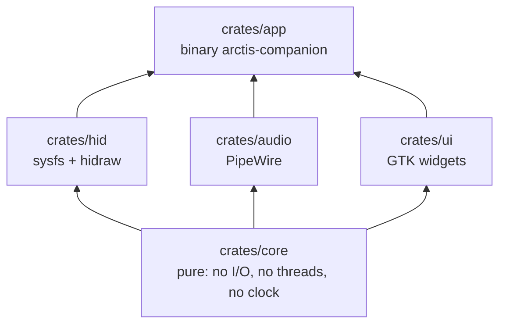
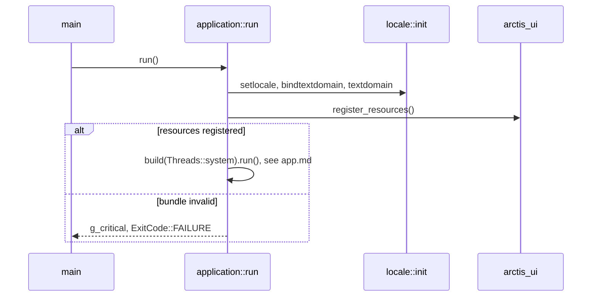
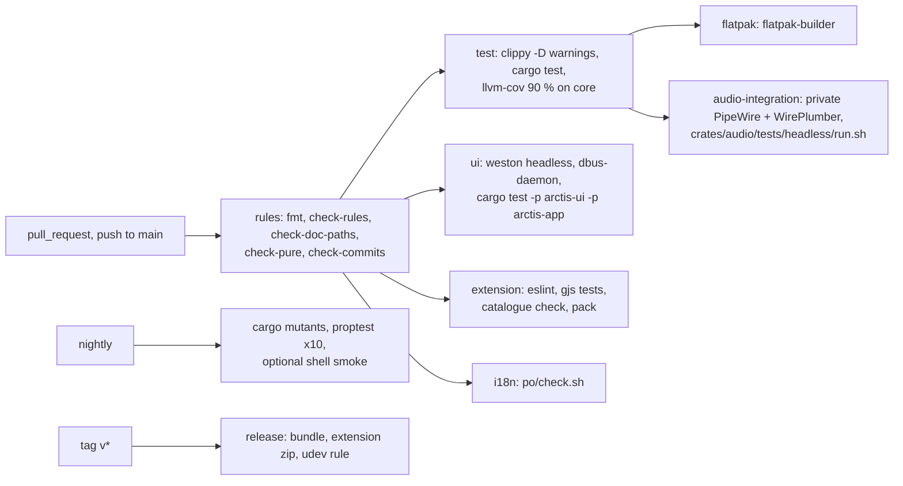

# Architecture

Diagrams of the code as it is. Every backticked path below is checked by `cargo xtask check-doc-paths`
(`xtask/src/check_doc_paths.rs::run`). Design rationale lives in the ADRs.

| Page | Area |
|---|---|
| [rules.md](rules.md) | engineering rules and how `xtask/` enforces them |
| [audio.md](audio.md) | audio adapter: PipeWire graph mirror, route input, per-app streams, system equalizer sink |
| [eq.md](eq.md) | equalizer core: envelope, curves, presets, APO, response, real-time filter |
| [protocol.md](protocol.md) | protocol codec, headset settings, thread messages |
| [shell-extension.md](shell-extension.md) | GNOME Shell Quick Settings extension and its tests |
| [companion.md](companion.md) | companion reducer, battery history, ports, intents and view models |
| [session.md](session.md) | device session reducer, lifecycle, write-then-verify, testkit |
| [ui.md](ui.md) | main window, headset page, status pages, dialogs, text resolver |
| [app-presets.md](app-presets.md) | app presets page, rule rows, add-rule dialog |
| [hid.md](hid.md) | HID adapter: sysfs discovery, hidraw ports, the device thread |
| [battery-page.md](battery-page.md) | battery history page and chart |
| [presets.md](presets.md) | presets page, equalizer editor, response graph, preset import and export |
| [app.md](app.md) | app platform: bridge, ports, settings and file stores, Headset1, background, notifications |
| [packaging.md](packaging.md) | Flatpak build, translations, release, install |

## Workspace

| Crate | Entry points |
|---|---|
| `crates/core/` | `crates/core/src/lib.rs`, `crates/core/src/time.rs::Millis`, `crates/core/src/protocol/mod.rs`, `crates/core/src/messages/mod.rs`, `crates/core/src/companion/mod.rs`, `crates/core/src/view/mod.rs`, `crates/core/src/session/mod.rs`, `crates/core/src/testkit/mod.rs` |
| `crates/hid/` | `crates/hid/src/lib.rs`, `crates/hid/src/handle.rs::DeviceHandle`, `crates/hid/src/worker.rs::Worker` |
| `crates/audio/` | `crates/audio/src/lib.rs::init`, `crates/audio/src/handle.rs::AudioHandle` |
| `crates/ui/` | `crates/ui/src/lib.rs::register_resources`, `crates/ui/src/window.rs::Window`, `crates/ui/src/text.rs::resolve`, `crates/ui/src/intents.rs::IntentSink` |
| `crates/app/` | `crates/app/src/main.rs::main`, `crates/app/src/application.rs::run`, `crates/app/src/application.rs::build`, `crates/app/src/runtime.rs::Runtime`, `crates/app/src/bridge.rs::Bridge` |
| `xtask/` | `xtask/src/main.rs::run` |

Workspace manifest and lint policy: `Cargo.toml`, `clippy.toml`, `rustfmt.toml`, `.cargo/config.toml`.

## Window startup

The window template is `crates/ui/resources/window.blp`, compiled by `crates/ui/build.rs::main` through
`crates/ui/resources/resources.gresource.xml` into the bundle loaded by
`crates/ui/src/lib.rs::register_resources`.

## Build and packaging

The Flatpak build, the translations, the release workflow and the install steps are in
[packaging.md](packaging.md).

## Continuous integration

Workflows: `.github/workflows/ci.yml`, `.github/workflows/nightly.yml`, `.github/workflows/release.yml`. Branch ruleset: `.github/rulesets/main.json`
(rebase merges only, `rules` required).
