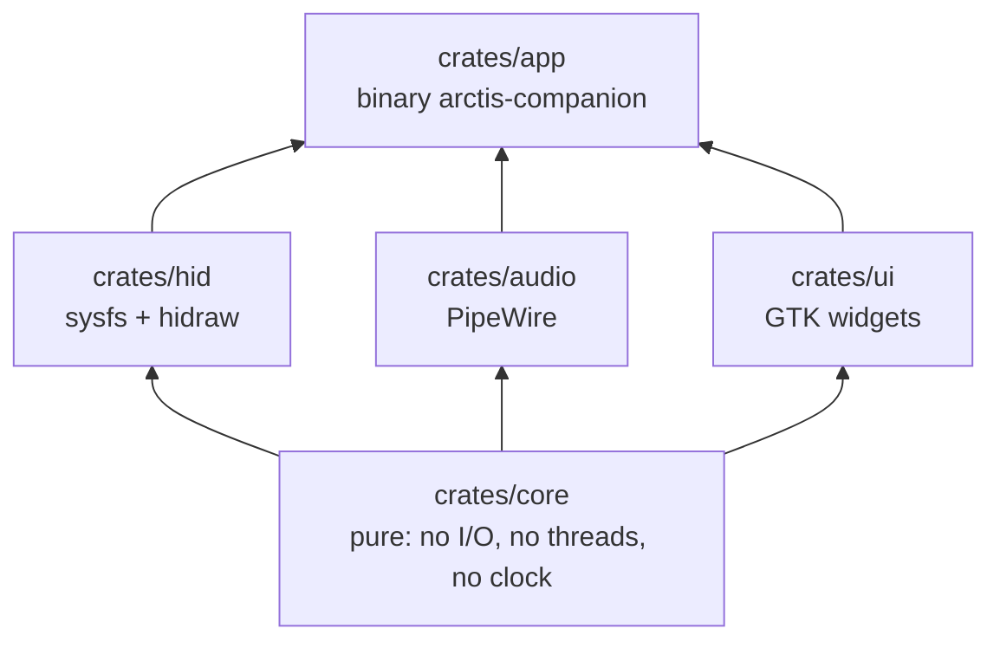
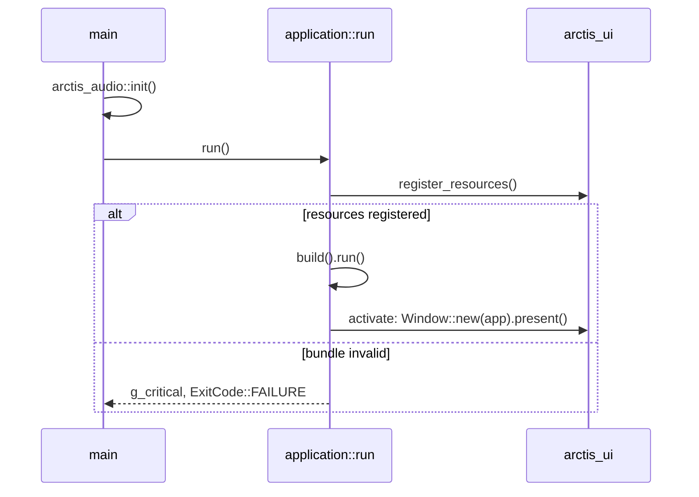
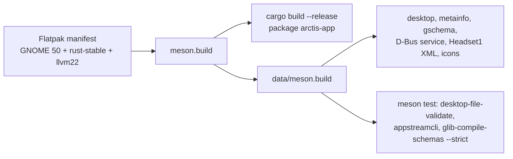
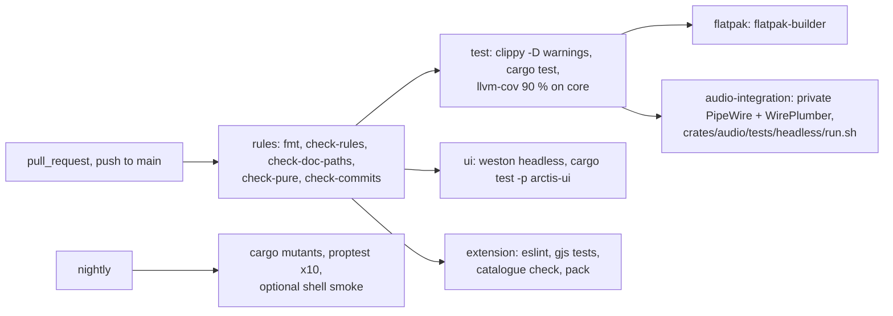

# Architecture

Diagrams of the code as it is. Every backticked path below is checked by `cargo xtask check-doc-paths`
(`xtask/src/check_doc_paths.rs::run`). Design rationale lives in the spec and the ADRs.

| Page | Area |
|---|---|
| [rules.md](rules.md) | engineering rules and how `xtask/` enforces them |
| [audio.md](audio.md) | audio adapter: PipeWire graph mirror, route input, per-app streams, system equalizer sink |
| [eq.md](eq.md) | equalizer core: envelope, curves, presets, APO, response, real-time filter |
| [protocol.md](protocol.md) | protocol codec, headset settings, thread messages |
| [shell-extension.md](shell-extension.md) | GNOME Shell Quick Settings extension and its tests |

## Workspace

| Crate | Entry points |
|---|---|
| `crates/core/` | `crates/core/src/lib.rs`, `crates/core/src/time.rs::Millis`, `crates/core/src/protocol/mod.rs`, `crates/core/src/messages/mod.rs` |
| `crates/hid/` | `crates/hid/src/lib.rs` |
| `crates/audio/` | `crates/audio/src/lib.rs::init`, `crates/audio/src/handle.rs::AudioHandle` |
| `crates/ui/` | `crates/ui/src/lib.rs::register_resources`, `crates/ui/src/window.rs::Window` |
| `crates/app/` | `crates/app/src/main.rs::main`, `crates/app/src/application.rs::run`, `crates/app/src/application.rs::build` |
| `xtask/` | `xtask/src/main.rs::run` |

Workspace manifest and lint policy: `Cargo.toml`, `clippy.toml`, `rustfmt.toml`, `.cargo/config.toml`.

## Window startup

The window template is `crates/ui/resources/window.blp`, compiled by `crates/ui/build.rs::main` through
`crates/ui/resources/resources.gresource.xml` into the bundle loaded by
`crates/ui/src/lib.rs::register_resources`.

## Build and packaging

| Piece | Path |
|---|---|
| Flatpak manifest | `build-aux/io.github.marcelogm.ArctisCompanion.json` |
| Top-level meson | `meson.build` |
| Data install and validation | `data/meson.build` |
| D-Bus contract | `data/dbus/io.github.marcelogm.ArctisCompanion.Headset1.xml` |
| Desktop entry | `data/io.github.marcelogm.ArctisCompanion.desktop` |
| AppStream metadata | `data/io.github.marcelogm.ArctisCompanion.metainfo.xml` |
| Settings schema | `data/io.github.marcelogm.ArctisCompanion.gschema.xml` |
| D-Bus activation | `data/io.github.marcelogm.ArctisCompanion.service.in` |

## Continuous integration

Workflows: `.github/workflows/ci.yml`, `.github/workflows/nightly.yml`. Branch ruleset: `.github/rulesets/main.json`
(rebase merges only, `rules` required).
