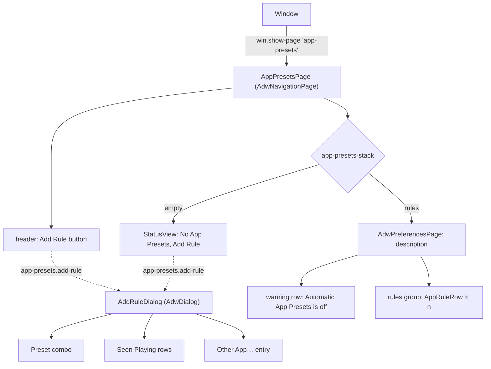
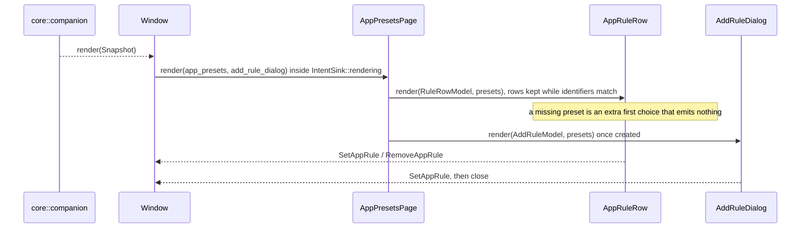

# App presets page

`crates/ui/` shows the app rules of `core::view::app_presets` and turns edits into `Intent::SetAppRule` and
`Intent::RemoveAppRule`. Design rationale: ADR 0010.

## Widget tree

## Data flow

| Piece | Code | Template |
|---|---|---|
| Page | `crates/ui/src/app_presets_page.rs::AppPresetsPage`, `crates/ui/src/app_presets_page.rs::AppPresetsPage::render`, `crates/ui/src/app_presets_page.rs::AppPresetsPage::sync_rows`, `crates/ui/src/app_presets_page.rs::AppPresetsPage::add_rule_dialog` | `crates/ui/resources/app_presets_page.blp` |
| Rule row | `crates/ui/src/app_rule_row.rs::AppRuleRow`, `crates/ui/src/app_rule_row.rs::rule_choices`, `crates/ui/src/app_rule_row.rs::AppRuleRow::chosen_intent` | `crates/ui/resources/app_rule_row.blp` |
| Add Rule dialog | `crates/ui/src/add_rule_dialog.rs::AddRuleDialog`, `crates/ui/src/add_rule_dialog.rs::AddRuleDialog::open`, `crates/ui/src/add_rule_dialog.rs::rule_intent` | `crates/ui/resources/add_rule_dialog.blp` |
| App icons | `crates/ui/src/app_icons.rs::icon_name` | – |
| View models | `crates/core/src/view/app_presets.rs::app_presets`, `crates/core/src/view/app_presets.rs::add_rule_dialog`, `crates/core/src/view/app_presets.rs::RuleRowModel` | – |
| Window wiring | `crates/ui/src/window.rs::Window::render_app_presets` | `crates/ui/resources/window.blp` |
| Tests | `crates/ui/tests/widgets/app_presets_page.rs`, `crates/ui/tests/widgets/app_rule_row.rs`, `crates/ui/tests/widgets/add_rule_dialog.rs`, `crates/core/tests/view/app_presets.rs` | – |
