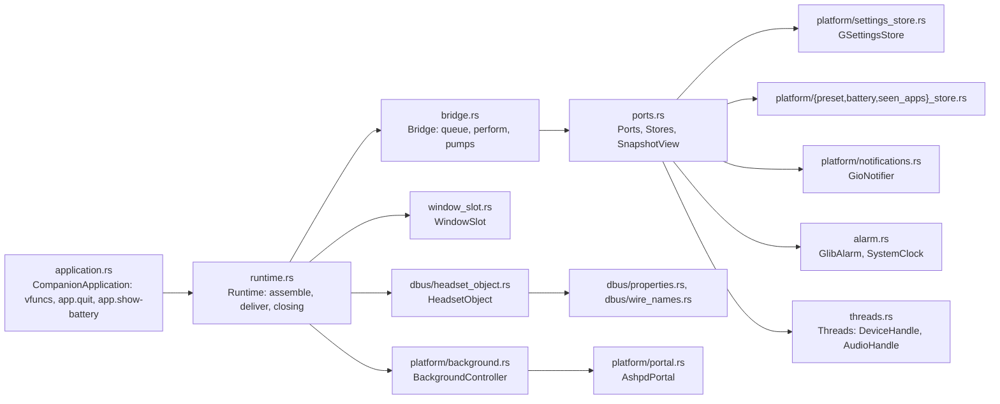
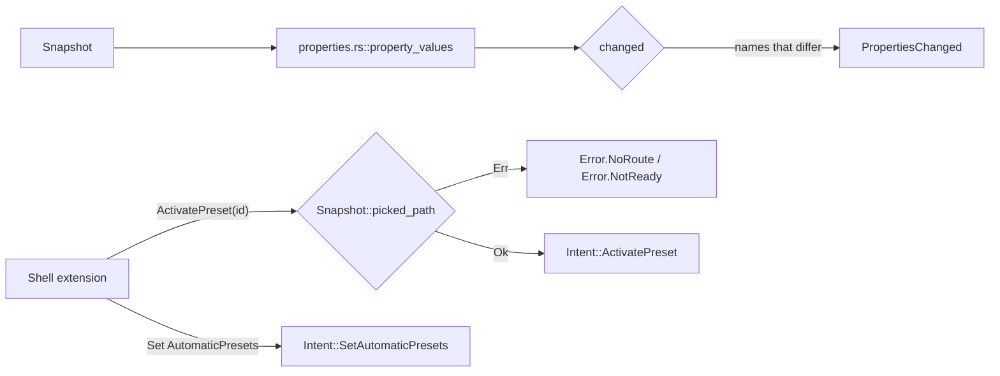
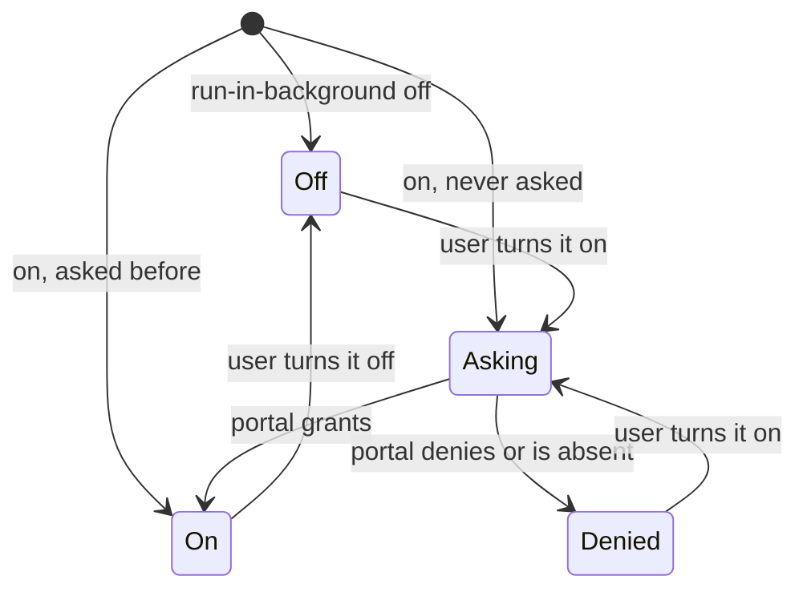
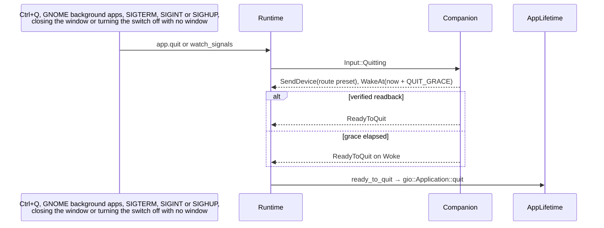

# App platform

`crates/app/` is the composition root and the only crate that touches GSettings, files under
`$XDG_DATA_HOME/arctis-companion`, the session bus and the portals. It decides nothing: every decision is
`crates/core/src/companion/reducer.rs::Companion`'s, and the bridge runs each returned action on one port. Design
rationale: design §2, §3.1 and §3.2, ADR 0001, ADR 0002, ADR 0011 and ADR 0012.

## Modules



| Concern | Code |
|---|---|
| Application, its actions and termination signals | `crates/app/src/application.rs::CompanionApplication`, `crates/app/src/application.rs::build`, `crates/app/src/application.rs::run`, `crates/app/src/application.rs::install_actions`, `crates/app/src/application.rs::watch_signals` |
| Wiring | `crates/app/src/runtime.rs::Runtime`, `crates/app/src/runtime.rs::assemble`, `crates/app/src/runtime.rs::deliver`, `crates/app/src/runtime.rs::destination`, `crates/app/src/runtime.rs::closing`, `crates/app/src/window_slot.rs::OnClose` |
| One input at a time, one port per action | `crates/app/src/bridge.rs::Bridge`, `crates/app/src/bridge.rs::submit`, `crates/app/src/bridge.rs::perform`, `crates/app/src/bridge.rs::attach` |
| Ports | `crates/app/src/ports.rs::Ports`, `crates/app/src/ports.rs::Stores`, `crates/app/src/ports.rs::SnapshotView`, `crates/app/src/ports.rs::SettingsStore`, `crates/app/src/ports.rs::DevicePort`, `crates/app/src/ports.rs::AudioPort`, `crates/app/src/ports.rs::Notifier`, `crates/app/src/ports.rs::Alarm`, `crates/app/src/ports.rs::Clock`, `crates/app/src/ports.rs::Lifetime` |
| Channels from the threads | `crates/app/src/threads.rs::Threads`, `crates/app/src/bridge.rs::pump_device`, `crates/app/src/bridge.rs::pump_audio` |
| One timeout, wall-clock millis | `crates/app/src/alarm.rs::GlibAlarm`, `crates/app/src/alarm.rs::SystemClock`, `crates/app/src/bridge.rs::wake_at` |

## Startup

```mermaid
sequenceDiagram
    participant M as main
    participant A as CompanionApplication
    participant R as Runtime
    participant B as Bridge
    M->>A: build(Threads::system).run()
    A->>A: dbus_register: HeadsetObject::register(stored_snapshot)
    alt the name is already owned
        A-->>A: remote: forward activate to the primary and return, no threads
    end
    A->>A: startup: actions app.quit (Ctrl+Q), app.show-battery
    A->>R: start_runtime: Runtime::start(threads, headset)
    R->>B: Bridge::new, pump_device, pump_audio, watch GSettings
    R->>B: attach(WindowSlot), attach(BackgroundController), attach(HeadsetObject)
    R->>R: BackgroundController::start
    alt launched with --gapplication-service
        A-->>A: no window; Headset1, notifications and history keep working
    else activate
        A->>R: present: WindowSlot builds Window and renders the latest snapshot
    end
```

`dbus_register` runs in every launch, also in a second one that only forwards its activation, so it registers
`Headset1` from `crates/app/src/runtime.rs::stored_snapshot` and starts nothing. Threads, files, the hold and the
portal start in `crates/app/src/application.rs::start_runtime`, called from `startup`, which only the primary
instance runs. `shutdown` calls `crates/app/src/application.rs::drop_runtime`; dropping the runtime drops
`HeadsetObject`, which unregisters itself.

## One input

```mermaid
sequenceDiagram
    participant S as source: pump, window, Headset1, GSettings, alarm
    participant B as Bridge
    participant C as Companion
    participant P as ports
    S->>B: submit(Input)
    B->>B: queue; drain unless already draining
    B->>C: handle(input, SystemClock::now)
    C-->>B: actions
    B->>P: perform: Persist, StorePreset, RecordBattery, RecordSeenApp,<br/>SendDevice, SendAudio, Publish, Notify, Withdraw, WakeAt, ReadyToQuit
    P-->>B: a view may submit again: it waits in the queue
```

| Action | Port | Adapter |
|---|---|---|
| `Persist` | `SettingsStore` | `crates/app/src/platform/settings_store.rs::GSettingsStore` |
| `StorePreset` | `Stores.presets` | `crates/app/src/platform/preset_store.rs::FilePresets` |
| `RecordBattery` | `Stores.battery` | `crates/app/src/platform/battery_store.rs::FileBattery` |
| `RecordSeenApp` | `Stores.seen_apps` | `crates/app/src/platform/seen_apps_store.rs::FileSeenApps` |
| `SendDevice` | `DevicePort` | `crates/hid/src/handle.rs::DeviceHandle` |
| `SendAudio` | `AudioPort` | `crates/audio/src/handle.rs::AudioHandle` |
| `Publish` | `SnapshotView` | `crates/app/src/window_slot.rs::WindowSlot`, `crates/app/src/dbus/headset_object.rs::HeadsetObject`, `crates/app/src/platform/background.rs::BackgroundController` |
| `Notify`, `Withdraw` | `Notifier` | `crates/app/src/platform/notifications.rs::GioNotifier` |
| `WakeAt` | `Alarm` | `crates/app/src/alarm.rs::GlibAlarm` |
| `ReadyToQuit` | `Lifetime` | `crates/app/src/platform/lifetime.rs::AppLifetime` |

A failed store write is logged (`crates/app/src/logging.rs::report`) and the remaining actions still run.

## Settings and files

| Data | Where | Code |
|---|---|---|
| headset values, route presets, app rules, automatic presets, adopted identity, Bluetooth seen, low-battery threshold, Run in Background | GSettings `data/io.github.marcelogm.ArctisCompanion.gschema.xml` | `crates/app/src/platform/settings_keys.rs::headset`, `crates/app/src/platform/settings_keys.rs::accepted`, `crates/app/src/platform/settings_store.rs::load`, `crates/app/src/platform/settings_store.rs::watch` |
| custom presets | one JSON file per preset in the presets folder, named after its id | `crates/app/src/platform/preset_store.rs::FilePresets` |
| battery history | battery.csv, 8 days kept at start-up | `crates/app/src/platform/battery_store.rs::FileBattery`, `crates/app/src/platform/persisted.rs::load_persisted` |
| seen apps | seen-apps.json, newest first, 50 | `crates/app/src/platform/seen_apps_store.rs::FileSeenApps` |

File names and folders: `crates/app/src/platform/persisted.rs::file_stores`. Every file write goes through `crates/app/src/platform/files.rs::write_atomically` (temporary file synced to disk, then rename),
except the CSV append. A stored value the headset does not take is logged and read through the core's fallback
(`nearest` or `MuteLight::from_raw`). Outside changes to GSettings reach `Companion` once per main-loop turn as
`SettingsChanged`; the app's own writes come back the same way and are ignored because nothing changed.

## Headset1



| Concern | Code |
|---|---|
| Export from the contract XML on GApplication's connection | `crates/app/src/dbus/headset_object.rs::HeadsetObject`, `crates/app/src/dbus/headset_object.rs::register`, `crates/app/src/dbus/headset_object.rs::export` |
| Values and the diff | `crates/app/src/dbus/properties.rs::property_values`, `crates/app/src/dbus/properties.rs::changed` |
| Names | `crates/app/src/dbus/wire_names.rs::state_name`, `crates/app/src/dbus/wire_names.rs::battery_level`, `crates/app/src/dbus/wire_names.rs::charging_name`, `crates/app/src/dbus/wire_names.rs::reason_pair`, `crates/app/src/dbus/wire_names.rs::error_name`, `crates/app/src/dbus/wire_names.rs::error_message` |

## Background and quitting



`crates/app/src/platform/background.rs::BackgroundController` holds the application (through
`crates/app/src/platform/lifetime.rs::AppHold`) while the `run-in-background` key is on, whoever writes it, and
ignores a denial that arrives after the switch went off. When the switch goes off with no window open,
`crates/app/src/platform/lifetime.rs::QuitWhenAlone` keeps the hold and quits through `Input::Quitting` instead,
so GApplication never exits without the restore. It sends the status line
(`crates/app/src/platform/background.rs::status_text`) through `crates/app/src/platform/portal.rs::AshpdPortal`.



## Tests

| Binary | What it proves |
|---|---|
| `crates/core/tests/end_to_end.rs` | `Session` and `Companion` together: connect, adopt, set preset, app rule switch, low battery, flap, reconnect; per stage every non-`Publish` action in order, the published phases and the wire log |
| `crates/app/tests/bridge/main.rs` | every action reaches its fake port; one alarm and `Woke`; pumps; the queue; failing stores; quit within the grace |
| `crates/app/tests/settings_store.rs` | schema keys; load, persist and watch over a memory backend |
| `crates/app/tests/stores.rs` | the `core::ports` contract suite on tempdirs; file specifics; start-up loading |
| `crates/app/tests/dbus_properties.rs` | `Headset1` names and values |
| `crates/app/tests/background.rs` | Run in Background with fakes; quitting instead of letting go with no window; the status line; the switch intent routed to the controller |
| `crates/app/tests/session_bus/main.rs` | on a private `gio::TestDBus`: the contract, `PropertiesChanged`, `ActivatePreset`, notifications, the portal, the window slot, the windowless service, a second launch that only activates the first, and SIGTERM quitting through `Input::Quitting` |
