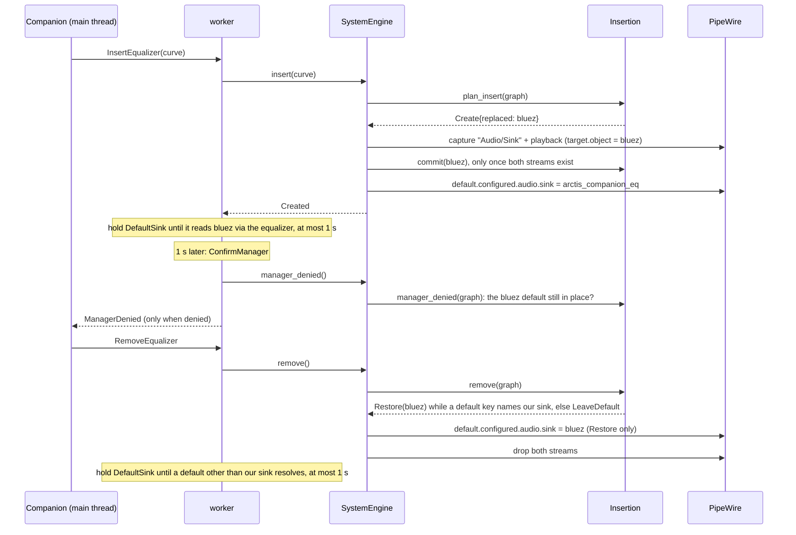
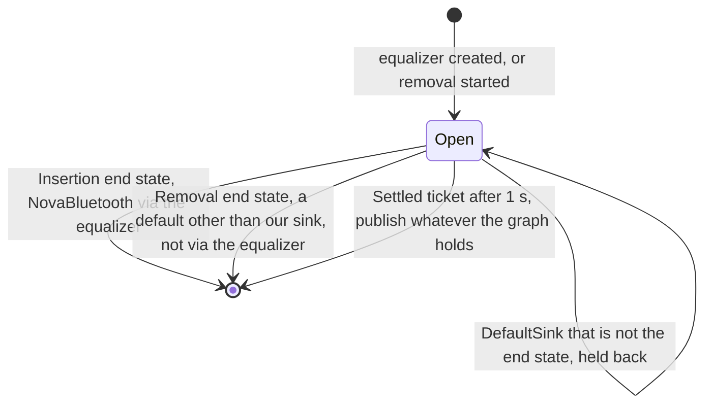
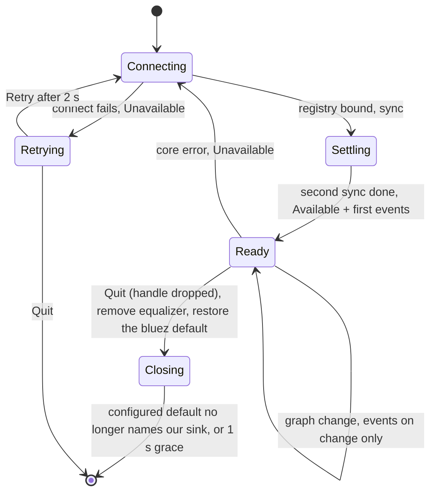

# Audio adapter

`crates/audio/` is the only code that talks to PipeWire. It mirrors the PipeWire graph into a plain model, derives
the default sink's route and the playing streams from it, and runs the system equalizer as two client streams in
place of the Nova 5 Bluetooth node. Design rationale: audio part §1, §2 and §4 of the spec, ADR 0008, ADR 0009
and ADR 0010. Entry: `crates/audio/src/handle.rs::AudioHandle`.

## Modules

```mermaid
flowchart BT
    keys["keys.rs, eq_names.rs, metadata_value.rs<br/>property keys, our node names, default JSON"]
    graph["graph.rs<br/>Graph, Props, Defaults"]
    links["links.rs<br/>follow: chain to the terminal sink"]
    sinks["sinks.rs<br/>sink kinds, default sink"]
    insertion["insertion.rs<br/>Insertion: replaced node, steps"]
    pod["pod.rs<br/>pod bytes, stream format"]
    streams["streams.rs<br/>app streams and their path"]
    changes["changes.rs<br/>Published: events on change"]
    volume["volume.rs<br/>VolumeMirror, Props pods"]
    samples["samples.rs<br/>Processor: bytes through Equalizer"]
    designer["designer.rs<br/>Designer: coefficients per curve and rate"]
    registry["registry.rs<br/>registry, metadata and info listeners"]
    wired["wired.rs<br/>Wired: listeners dropped before streams"]
    eq_sink["eq_sink.rs<br/>EqSink: two pw_streams"]
    engine["system_engine.rs<br/>SystemEngine: insert, retarget, remove"]
    worker["worker.rs<br/>pw main loop, commands, reconnect"]
    handle["handle.rs<br/>AudioHandle"]
    keys --> graph --> links --> sinks --> streams --> changes
    sinks --> insertion
    graph --> registry
    pod --> volume --> eq_sink
    pod & samples & designer & wired --> eq_sink
    insertion & registry & eq_sink --> engine
    changes & registry & engine --> worker --> handle
```

Graph, links, sinks, insertion, streams, changes, volume, pod, samples, designer and wired are pure: they take a `Graph` or
bytes and return values, and are tested by tables in `crates/audio/tests/pure/main.rs`. Registry, equalizer sink,
system engine and worker hold the PipeWire objects, stay private to the crate, and are tested through
`AudioHandle` against a private PipeWire (see Tests).

| Concept | Code |
|---|---|
| Graph model | `crates/audio/src/graph.rs::Graph`, `crates/audio/src/graph.rs::Props`, `crates/audio/src/graph.rs::Node`, `crates/audio/src/graph.rs::Link`, `crates/audio/src/graph.rs::Defaults` |
| Property keys and our node names | `crates/audio/src/keys.rs`, `crates/audio/src/eq_names.rs` |
| Default metadata values | `crates/audio/src/metadata_value.rs::name_from_json`, `crates/audio/src/metadata_value.rs::json_for_name` |
| Link chains | `crates/audio/src/links.rs::follow`, `crates/audio/src/links.rs::Chain` |
| Nova 5 matching | `crates/audio/src/sinks.rs::sink_kind`, `crates/audio/src/sinks.rs::has_nova_bluetooth` |
| Route input | `crates/audio/src/sinks.rs::default_sink` |
| Insertion and removal rules | `crates/audio/src/insertion.rs::Insertion`, `crates/audio/src/insertion.rs::InsertStep`, `crates/audio/src/insertion.rs::RemoveStep`, `crates/audio/src/insertion.rs::insertion_target`, `crates/audio/src/insertion.rs::manager_denied` |
| Per-app streams | `crates/audio/src/streams.rs::streams`, `crates/audio/src/streams.rs::identifiers` |
| Events only on change, held while the graph settles | `crates/audio/src/changes.rs::Published`, `crates/audio/src/changes.rs::Settling` |
| Pod bytes and stream format | `crates/audio/src/pod.rs::pod_bytes`, `crates/audio/src/pod.rs::format_pod` |
| Volume and mute | `crates/audio/src/volume.rs::VolumeMirror`, `crates/audio/src/volume.rs::volume_change`, `crates/audio/src/volume.rs::props_pod` |
| Real-time processing | `crates/audio/src/samples.rs::Processor`, `crates/audio/src/eq_sink.rs::move_block` |
| PipeWire mirror (nodes enter on their first info; Props volumes subscribed) | `crates/audio/src/registry.rs::Registry`, `crates/audio/src/registry.rs::changed_props` |
| System engine | `crates/audio/src/system_engine.rs::SystemEngine`, `crates/audio/src/system_engine.rs::Inserted` |
| Equalizer sink | `crates/audio/src/eq_sink.rs::EqSink`, `crates/audio/src/eq_sink.rs::Replaced`, `crates/audio/src/eq_sink.rs::apply_initial_volume`, `crates/audio/src/eq_sink.rs::keep_unity` |
| Listeners released before the streams they hook into | `crates/audio/src/wired.rs::Wired` |
| Coefficients per curve and rate | `crates/audio/src/designer.rs::Designer`, `crates/audio/src/designer.rs::rate_of` |
| Thread and connection | `crates/audio/src/worker.rs::run`, `crates/audio/src/worker.rs::Connection`, `crates/audio/src/worker.rs::Worker`, `crates/audio/src/worker.rs::Dispatcher`, `crates/audio/src/worker.rs::Outbox` |
| Handle | `crates/audio/src/handle.rs::AudioHandle`, `crates/audio/src/handle.rs::AudioCommands`, `crates/audio/src/handle.rs::spawn` |

## Following a chain

The route and each stream's path come from one walk. Moving from a filter's sink to its output stream (the two
nodes share `node.link-group`) is free; each PipeWire link is a hop, and a walk of more than four hops, a loop, or
one that ends away from an audio sink gives no chain. Recorders of a sink monitor (input streams) are not
followed.


| Terminal and chain | `DefaultSink` | Stream path |
|---|---|---|
| bluez node, chain passes our sink | `NovaBluetooth`, `via_equalizer` | `Bluetooth` |
| bluez node directly | `NovaBluetooth` | none |
| sink whose Device is vendor `0x1038` with a supported PID | `NovaDongle` | `Dongle` |
| a node named `ee_*` in the chain | `via_easy_effects` | by terminal |
| anything else, no default, no chain | `Other` | none |

## The equalizer sink



The capture stream's process callback triggers the playback stream; the playback callback dequeues both buffers
and runs `crates/audio/src/samples.rs::Processor`, which converts the `f32` bytes, takes any coefficients the
audio thread published through the triple buffer and calls `Equalizer::process`. Neither callback allocates
(`crates/audio/tests/samples_allocations.rs`). `crates/audio/src/designer.rs::Designer` redesigns the coefficients
when the curve or the negotiated rate changes.

Volume set on our sink reaches the stream as a Props param. `crates/audio/src/volume.rs::VolumeMirror`, owned by
the system engine, forwards each new `channelVolumes`/`mute` pair once to the bluez node
(`crates/audio/src/registry.rs::set_node_props`), and `crates/audio/src/eq_sink.rs::keep_unity` puts the
sink's own soft volume back to 1, so the headset's Bluetooth volume does the attenuation. The registry keeps
each node's last Props volume (`crates/audio/src/graph.rs::Graph`). On insertion
`crates/audio/src/system_engine.rs::SystemEngine` hands the bluez node's volume to the sink
(`crates/audio/src/eq_sink.rs::Replaced`), which applies it to itself on its first Props report
(`crates/audio/src/eq_sink.rs::apply_initial_volume`) and never forwards that report, so the slider starts where the headset is
and inserting never changes the headset's volume. Our own node is never set through a node proxy: PipeWire would
wait on our own client and freeze the graph. The mirror runs one way only: a change made on the bluez node itself
is not copied back.

## Settling

Between a command and the graph it produces, PipeWire and WirePlumber pass through states that are not routes: the
default names a node the registry has not bound yet (or already removed), or the chain stops at our sink because its
output is not linked yet. `crates/audio/src/sinks.rs::default_sink` returns nothing while the effective default
names a node outside the graph, and `crates/audio/src/changes.rs::Published` holds `DefaultSink` back while a
`crates/audio/src/changes.rs::Settling` is open. Streams and the other events still flow.



## Connection lifecycle



Messages reach the loop through a `pipewire::channel`: commands from `crates/audio/src/handle.rs::AudioCommands`,
and the delayed `Retry`, `ConfirmManager`, `Settled` and grace `Quit` that a short sleeper thread posts
(`crates/audio/src/worker.rs::Outbox`). The client connects with
`media.category = Manager` in its core properties (`docs/research/hardware-findings.md` §6.2).

## Tests

| What | Where |
|---|---|
| Graph, chains, matching, default-sink and insertion tables, streams, events, volume pods, processing | `crates/audio/tests/pure/main.rs` and its modules |
| No allocation in processing | `crates/audio/tests/samples_allocations.rs` |
| Private PipeWire + WirePlumber with a bluez-shaped null sink: insertion, restore, one settled route per insertion and removal, user default, foreign default untouched, Manager role, drop, volume, unity, volume kept on insertion, streams, chain, 1 kHz gain | `crates/audio/tests/headless/run.sh`, `crates/audio/tests/headless/main.rs` |
| PipeWire unreachable | `crates/audio/tests/unreachable.rs` |
| PipeWire started and stopped under a running adapter | `crates/audio/tests/reconnect.rs` |
