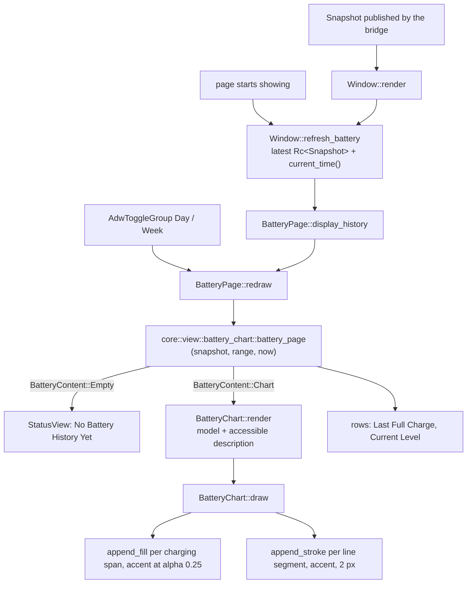
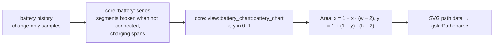

# Battery page

`crates/ui/` shows the battery history as a navigation page with a Day / Week chart. The model comes from
`crates/core/src/view/battery_chart.rs::battery_page`; the page emits no intent. Design rationale: ADR 0012.

## Data flow

## Chart geometry

| Piece | Code | Template |
|---|---|---|
| Page | `crates/ui/src/battery_page.rs::BatteryPage`, `crates/ui/src/battery_page.rs::redraw`, `crates/ui/src/battery_page.rs::range`, `crates/ui/src/battery_page.rs::render` | `crates/ui/resources/battery_page.blp` |
| Chart | `crates/ui/src/battery_chart.rs::BatteryChart`, `crates/ui/src/battery_chart.rs::draw`, `crates/ui/src/battery_chart.rs::Area`, `crates/ui/src/battery_chart.rs::line_path`, `crates/ui/src/battery_chart.rs::shade_path` | `crates/ui/resources/battery_chart.blp` |
| Window wiring | `crates/ui/src/window.rs::refresh_battery`, `crates/ui/src/window.rs::current_time` | `crates/ui/resources/window.blp` |
| Model | `crates/core/src/view/battery_chart.rs::battery_page`, `crates/core/src/view/battery_chart.rs::battery_chart`, `crates/core/src/view/battery_chart.rs::BatteryContent` | – |
| Series | `crates/core/src/battery/series.rs::series`, `crates/core/src/battery/series.rs::Window` | – |

The Battery History row of the headset page activates `win.show-page` with the tag `battery`
(`crates/ui/resources/headset_page.blp`); the page is tagged in its own template.

## Tests

`crates/ui/tests/widgets/battery_chart.rs` draws into a fresh `gtk::Snapshot` and counts fill and stroke nodes
and their accent colour; `crates/ui/tests/widgets/battery_page.rs` checks the empty state, Day and Week on a
synthetic week, the rows and the accessible description; fixtures live in
`crates/ui/tests/widgets/battery_history.rs`. `crates/ui/tests/widgets/battery_window.rs`,
`crates/ui/tests/widgets/accessibility.rs` and `crates/ui/tests/widgets/layout.rs` cover navigation, names, the
chart description and the 360 px width.
