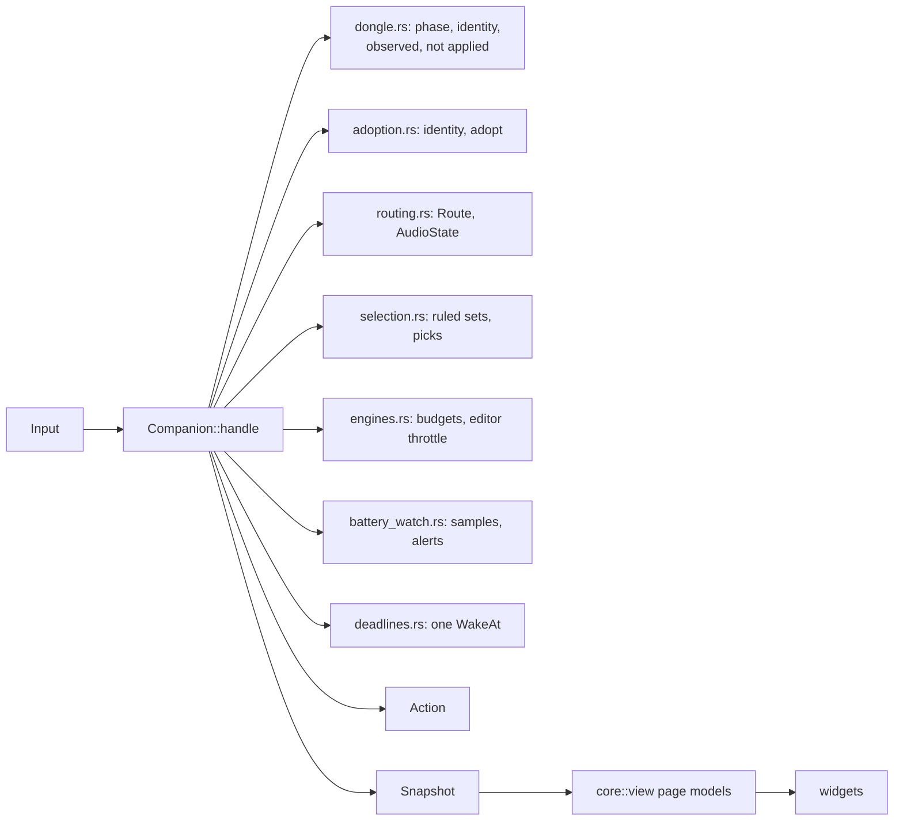
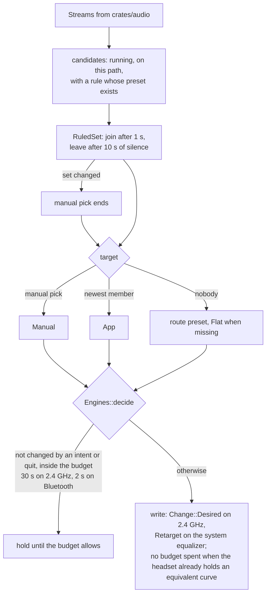
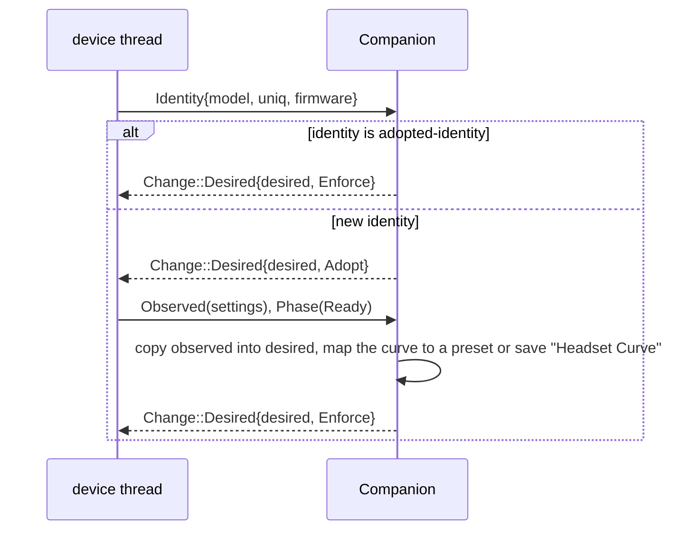
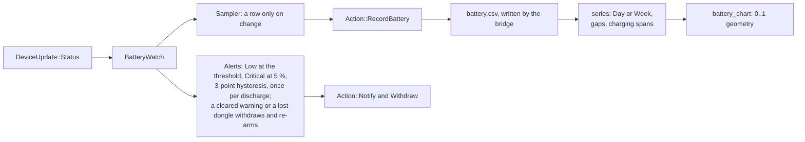
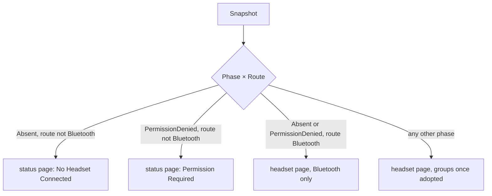

# Companion, battery history and view models

`Companion` is the main thread's policy. It reads what the device thread, the audio thread, the widgets and
GSettings report, and answers with actions for the app's ports. `core::view` turns its `Snapshot` into page models
made only of `Text` values and plain data. All of it is pure code in `crates/core/`; time enters as an argument.
Design rationale: ADR 0007, 0008, 0010, 0012
and 0013.

## Modules



| Concept | Code |
|---|---|
| Reducer, inputs, actions | `crates/core/src/companion/reducer.rs::Companion`, `crates/core/src/companion/reducer.rs::handle`, `crates/core/src/companion/reducer.rs::causes`, `crates/core/src/companion/input.rs::Input`, `crates/core/src/companion/action.rs::Action`, `crates/core/src/companion/action.rs::PresetChange` |
| Device and audio inputs | `crates/core/src/companion/device_inputs.rs::device`, `crates/core/src/companion/device_inputs.rs::try_adopt`, `crates/core/src/companion/audio_inputs.rs::audio_event`, `crates/core/src/companion/audio_inputs.rs::retarget_system_curve` |
| One value per sound path | `crates/core/src/companion/per_path.rs::PerPath` |
| Intents | `crates/core/src/intent.rs::Intent`, `crates/core/src/companion/intents.rs::intent` |
| Quitting | `crates/core/src/companion/quitting.rs::Quit`, `crates/core/src/companion/quitting.rs::start_quit`, `crates/core/src/companion/quitting.rs::finish_quit` |
| App settings and what is persisted | `crates/core/src/companion/app_settings.rs::AppSettings`, `crates/core/src/companion/app_settings.rs::HeadsetValues`, `crates/core/src/companion/app_settings.rs::AppRules`, `crates/core/src/companion/app_settings.rs::PersistedChange`, `crates/core/src/companion/app_settings.rs::Persisted` |
| One app rule per identifier, ignoring case: setting a case variant replaces the stored rule and persists its removal | `crates/core/src/companion/app_settings.rs::AppRules::set`, `crates/core/src/companion/intents.rs::Companion::set_app_rule` |
| Adoption | `crates/core/src/companion/adoption.rs::DongleIdentity`, `crates/core/src/companion/adoption.rs::adopt`, `crates/core/src/companion/adoption.rs::AdoptionStatus` |
| Dongle state | `crates/core/src/companion/dongle.rs::DongleState`, `crates/core/src/companion/dongle.rs::WriteFailure` |
| Presets known to the app | `crates/core/src/companion/catalog.rs::Catalog`, `crates/core/src/companion/catalog.rs::resolve_in`, `crates/core/src/companion/catalog.rs::fresh_id` |
| Route and the system equalizer | `crates/core/src/companion/routing.rs::route`, `crates/core/src/companion/routing.rs::needs_equalizer`, `crates/core/src/companion/routing.rs::AudioState` |
| An equalizer the worker reports as not inserted is forgotten and asked for again on the next audio event | `crates/core/src/companion/audio_inputs.rs::Companion::audio_event`, `crates/core/src/companion/routing.rs::AudioState::apply` |
| Per-app selection | `crates/core/src/companion/selection.rs::candidates`, `crates/core/src/companion/selection.rs::RuledSet`, `crates/core/src/companion/selection.rs::PathSelection`, `crates/core/src/companion/selection.rs::ActivePreset`, `crates/core/src/companion/selection.rs::picked_path` |
| Budgets and the editor throttle | `crates/core/src/companion/engines.rs::Engines`, `crates/core/src/companion/engines.rs::decide`, `crates/core/src/companion/engines.rs::EditorThrottle`, `crates/core/src/companion/timing.rs::auto_switch_min_interval` |
| Seen apps | `crates/core/src/companion/seen_apps.rs::SeenApp`, `crates/core/src/companion/seen_apps.rs::remember`, `crates/core/src/companion/seen_apps.rs::newly_playing` |
| Battery warnings | `crates/core/src/companion/alerts.rs::warning_for`, `crates/core/src/companion/alerts.rs::Alerts`, `crates/core/src/companion/alerts.rs::BatteryWarning`, `crates/core/src/companion/battery_watch.rs::BatteryWatch` |
| One wake-up | `crates/core/src/companion/deadlines.rs::Deadlines`, `crates/core/src/companion/deadlines.rs::earliest` |
| Snapshot | `crates/core/src/companion/snapshot.rs::Snapshot`, `crates/core/src/companion/snapshot.rs::DongleSnapshot`, `crates/core/src/companion/snapshot.rs::PresetsSnapshot`, `crates/core/src/companion/snapshot.rs::picked_path` |

Timing constants (rule enter 1 s, rule leave 10 s, budgets 30 s and 2 s, editor throttle 250 ms, quit grace 1 s,
battery levels) live in `crates/core/src/companion/timing.rs`. The reconnect notice is the session's: `Companion`
shows "Reconnecting…" whenever the published phase is Rebinding.

## One call of `handle`

```mermaid
sequenceDiagram
    participant B as bridge
    participant C as Companion
    B->>C: handle(Input, now)
    C->>C: dispatch: device, audio, intent, settings, quit
    C->>C: adopt, ruled sets; a path is user-caused only when the intent or quit changed its target
    C->>C: advance: settle each path, editor throttle, quit
    C->>C: finish: earliest deadline, snapshot
    C-->>B: actions; WakeAt only when it changed, Publish only when the snapshot changed
```

## Choosing the active preset of a path



## Adoption



## Battery history



| Concept | Code |
|---|---|
| Samples | `crates/core/src/battery/sample.rs::Sample`, `crates/core/src/battery/sample.rs::Sampler`, `crates/core/src/battery/sample.rs::UnixSeconds` |
| CSV lines and retention | `crates/core/src/battery/log_format.rs::render_line`, `crates/core/src/battery/log_format.rs::parse_log`, `crates/core/src/battery/log_format.rs::retain_recent` |
| Series | `crates/core/src/battery/series.rs::series`, `crates/core/src/battery/series.rs::Series`, `crates/core/src/battery/series.rs::last_full_charge` |

## Ports

| Port | Trait | Memory adapter and contract |
|---|---|---|
| presets | `crates/core/src/ports.rs::PresetRepository` | `crates/core/src/testkit/memory_repositories.rs::MemoryPresets`, `crates/core/src/testkit/repository_contracts.rs::preset_repository_contract` |
| battery | `crates/core/src/ports.rs::BatteryRepository` | `crates/core/src/testkit/memory_repositories.rs::MemoryBattery`, `crates/core/src/testkit/repository_contracts.rs::battery_repository_contract` |
| seen apps | `crates/core/src/ports.rs::SeenAppsRepository` | `crates/core/src/testkit/memory_repositories.rs::MemorySeenApps`, `crates/core/src/testkit/repository_contracts.rs::seen_apps_repository_contract` |

## View models



| Model | Code |
|---|---|
| Typed text | `crates/core/src/view/text.rs::Text`, `crates/core/src/view/text.rs::Arg`, `crates/core/src/testkit/english.rs::english` |
| Headset page | `crates/core/src/view/headset_page.rs::headset_page`, `crates/core/src/view/headset_page.rs::banner`, `crates/core/src/view/headset_page.rs::HeadsetModel` |
| Rows | `crates/core/src/view/headset_rows.rs::headset_groups`, `crates/core/src/view/headset_rows.rs::sidetone_text`, `crates/core/src/view/equalizer_rows.rs::equalizer_group`, `crates/core/src/view/equalizer_rows.rs::now_playing_text` |
| Presets and editor | `crates/core/src/view/presets.rs::presets_page`, `crates/core/src/view/presets.rs::deleted_toast`, `crates/core/src/view/eq_editor.rs::eq_editor`, `crates/core/src/view/eq_editor.rs::band_title` |
| App presets | `crates/core/src/view/app_presets.rs::app_presets`, `crates/core/src/view/app_presets.rs::add_rule_dialog` |
| Battery page | `crates/core/src/view/battery_chart.rs::battery_page`, `crates/core/src/view/battery_chart.rs::battery_chart` |
| Status pages and empty states | `crates/core/src/view/status_page.rs::StatusPageModel` |

## Tests

| Area | Entry |
|---|---|
| battery | `crates/core/tests/battery/main.rs` |
| companion rules and flows through the reducer | `crates/core/tests/companion/main.rs`, helpers in `crates/core/tests/companion/support.rs` |
| ports | `crates/core/tests/ports/main.rs` |
| view models | `crates/core/tests/view/main.rs` |
