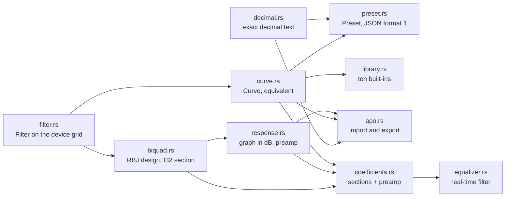
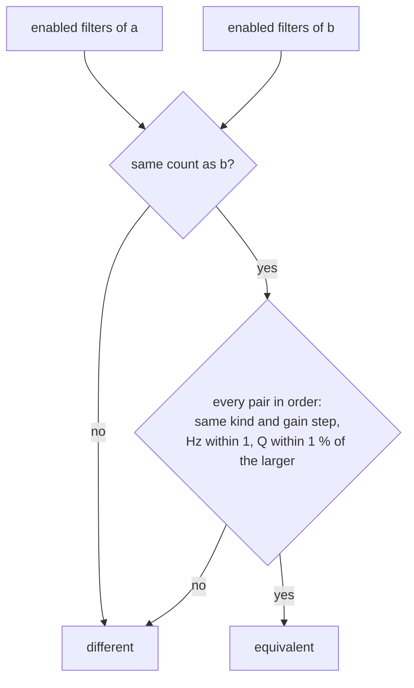
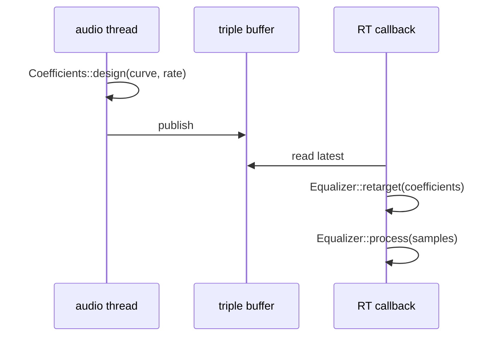
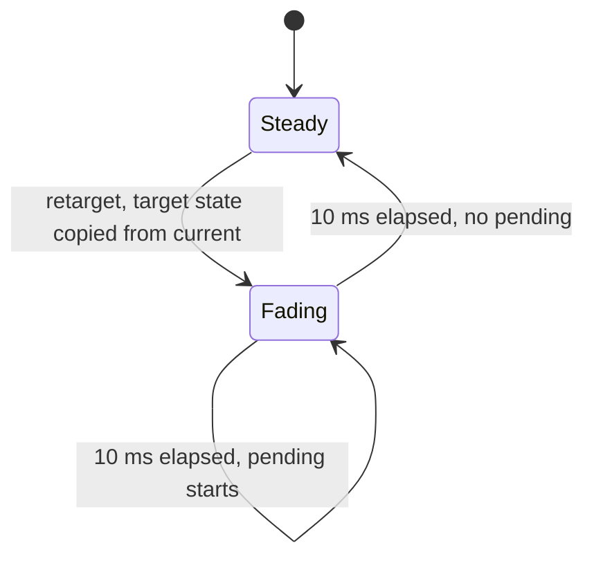
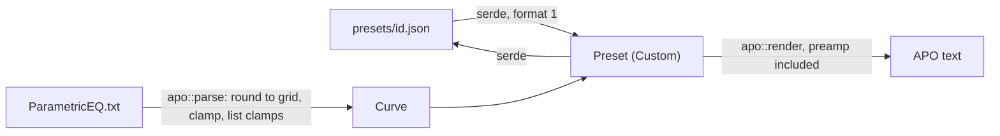

# Equalizer core

`crates/core/src/eq/` holds every equalizer decision that needs neither the headset nor PipeWire: the hardware
envelope, curves and how two curves compare, the built-in presets, the preset file shape, Equalizer APO text,
the response drawn by the graph and the real-time filter of the system engine. Entry: `crates/core/src/eq/mod.rs`.

## Modules

| Concept | Code |
|---|---|
| Envelope: 20..20000 Hz, ±10 dB in 0.5 dB steps, Q 0.2..10, no gain on pass filters | `crates/core/src/eq/filter.rs::Filter`, `crates/core/src/eq/filter.rs::from_parts`, `crates/core/src/eq/filter.rs::EnvelopeError` |
| Grid types | `crates/core/src/eq/filter.rs::Hertz`, `crates/core/src/eq/filter.rs::Gain`, `crates/core/src/eq/filter.rs::Q` |
| At most ten filters | `crates/core/src/eq/curve.rs::Curve` |
| Equivalent curves | `crates/core/src/eq/curve.rs::equivalent` |
| Preamp of the system engine | `crates/core/src/eq/response.rs::preamp_db` |
| Built-in presets | `crates/core/src/eq/library.rs::library`, `crates/core/src/eq/library.rs::flat`, `crates/core/src/eq/library.rs::find` |
| Custom preset files | `crates/core/src/eq/preset.rs::Preset`, `crates/core/src/eq/preset.rs::PresetFormatError` |
| APO import and export | `crates/core/src/eq/apo.rs::parse`, `crates/core/src/eq/apo.rs::render`, `crates/core/src/eq/apo.rs::Import` |
| Exact decimals | `crates/core/src/eq/decimal.rs::parse_thousandths`, `crates/core/src/eq/decimal.rs::render_thousandths` |
| Graph | `crates/core/src/eq/response.rs::response` |
| RBJ maths | `crates/core/src/eq/biquad.rs::Biquad`, `crates/core/src/eq/biquad.rs::design`, `crates/core/src/eq/biquad.rs::magnitude_db` |
| Real-time filter | `crates/core/src/eq/coefficients.rs::Coefficients`, `crates/core/src/eq/equalizer.rs::Equalizer`, `crates/core/src/eq/equalizer.rs::retarget`, `crates/core/src/eq/equalizer.rs::process` |

## Comparing curves

The headset may store a value other than the one written, so verify, "already matches" and adoption compare
through `crates/core/src/eq/curve.rs::equivalent`. Disabled filters and missing slots are skipped wherever they sit,
because the protocol decoder drops disabled bands and closes the gaps; the enabled filters left are compared pair
by pair, in order.

## The system engine's filter

The audio thread designs `Coefficients` for a curve and a sample rate; the real-time callback only retargets and
processes. `Coefficients` is a fixed array, and `Equalizer` preallocates both state sets, so neither call
allocates (`crates/core/tests/eq_allocations.rs`).

`crates/core/src/eq/coefficients.rs::design` skips filters that cannot change the sound
(`crates/core/src/eq/filter.rs::shapes_sound`) and filters at or above the rate's Nyquist frequency
(`crates/core/src/eq/coefficients.rs::below_nyquist`), so Flat runs no section and a preamp of exactly 1: a bit-exact
identity. The preamp cancels the loudest point of the response, so overlapping peaks and resonant pass filters
cannot clip (`crates/core/src/eq/response.rs::preamp_db`). Each section is RBJ, designed in `f64` and run in `f32` transposed direct form II
(`crates/core/src/eq/biquad.rs::Section`); state below 1e-20 is flushed to zero, so silence never turns subnormal.

During a fade both chains run and the output moves linearly from the old to the new over `rate / 100` frames
(`crates/core/src/eq/equalizer.rs::Fade`).

## Presets in and out

Numbers in both formats pass through `crates/core/src/eq/decimal.rs::thousandths_of` and
`crates/core/src/eq/decimal.rs::rounded_quotient`, so a file value becomes an exact step of the grid.

## Tests

| What | Where |
|---|---|
| Envelope, tolerance table, library, JSON, APO, response, magnitudes per kind, poles, identity, crossfade, silence | `crates/core/tests/eq/main.rs` and its modules |
| No allocation in `process` and `retarget` | `crates/core/tests/eq_allocations.rs` |
