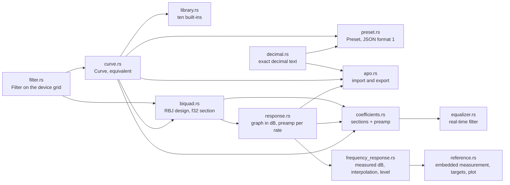
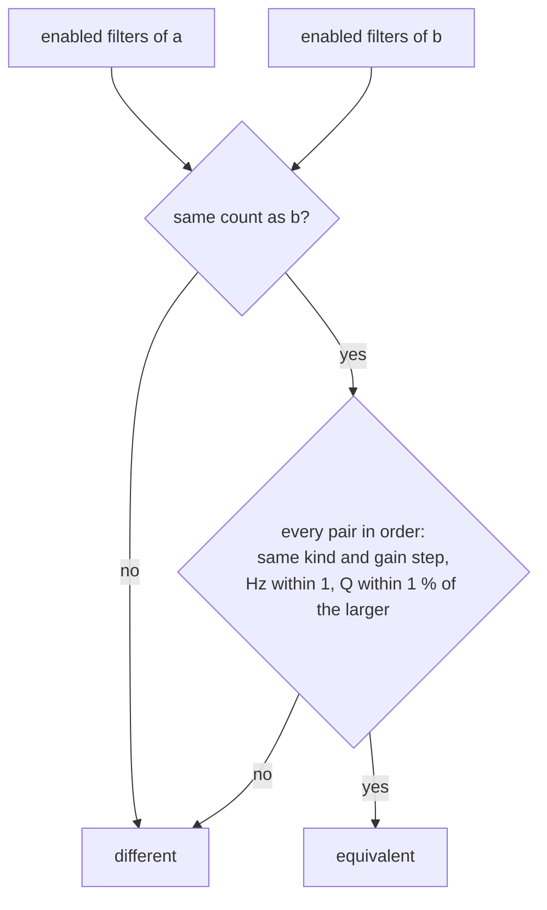
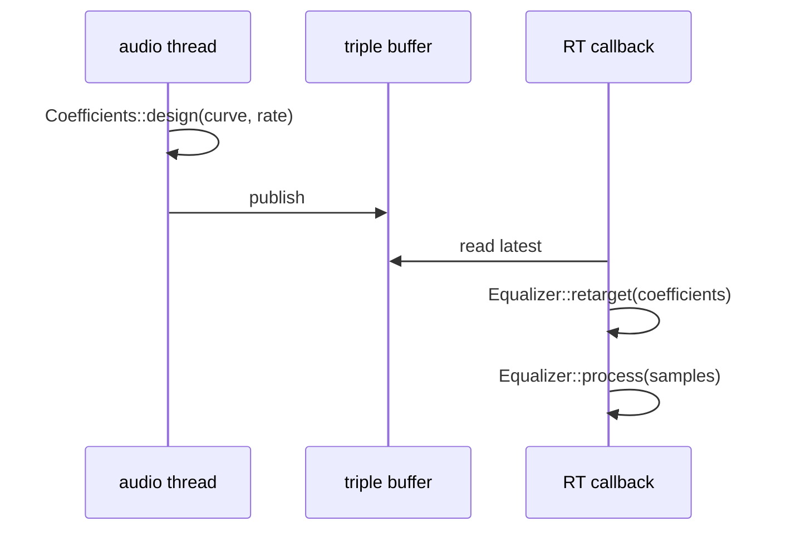
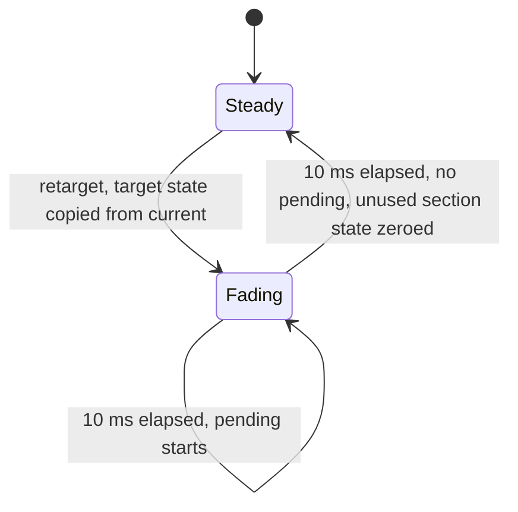
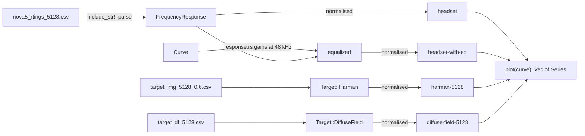
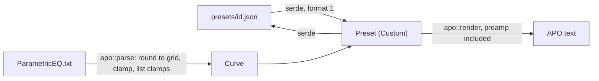

# Equalizer core

`crates/core/src/eq/` holds every equalizer decision that needs neither the headset nor PipeWire: the hardware
envelope, curves and how two curves compare, the built-in presets, the preset file shape, Equalizer APO text,
the response drawn by the graph, the measured headset and its target curves, and the real-time filter of the
system engine. Entry: `crates/core/src/eq/mod.rs`.

## Modules

| Concept | Code |
|---|---|
| Envelope: 20..20000 Hz, ±10 dB in 0.5 dB steps, Q 0.2..10, no gain on pass filters | `crates/core/src/eq/filter.rs::Filter`, `crates/core/src/eq/filter.rs::from_parts`, `crates/core/src/eq/filter.rs::EnvelopeError` |
| Grid types and their clamping constructors | `crates/core/src/eq/filter.rs::Hertz`, `crates/core/src/eq/filter.rs::Gain`, `crates/core/src/eq/filter.rs::Q`, `crates/core/src/eq/filter.rs::Clamped` |
| At most ten filters | `crates/core/src/eq/curve.rs::Curve` |
| Equivalent curves | `crates/core/src/eq/curve.rs::equivalent` |
| Preamp of the system engine | `crates/core/src/eq/response.rs::preamp_db_at`, `crates/core/src/eq/response.rs::preamp_db` |
| Built-in presets | `crates/core/src/eq/library.rs::library`, `crates/core/src/eq/library.rs::flat`, `crates/core/src/eq/library.rs::find` |
| Harman target preset, id `harman` | `crates/core/src/eq/library.rs::library`, data `crates/core/data/nova5_autoeq_parametric_eq.txt` |
| Measured and target responses | `crates/core/src/eq/frequency_response.rs::FrequencyResponse`, `crates/core/src/eq/frequency_response.rs::ParseError` |
| Graph series | `crates/core/src/eq/reference.rs::plot`, `crates/core/src/eq/reference.rs::Series`, `crates/core/src/eq/reference.rs::SeriesId`, `crates/core/src/eq/reference.rs::Target` |
| Which references the editor graph shows, and their setting nicks | `crates/core/src/eq/reference.rs::Overlays`, `crates/core/src/eq/reference.rs::Target::setting`, `crates/core/src/eq/reference.rs::Target::from_setting` |
| Custom preset files | `crates/core/src/eq/preset.rs::Preset`, `crates/core/src/eq/preset.rs::PresetFormatError` |
| APO import and export | `crates/core/src/eq/apo.rs::parse`, `crates/core/src/eq/apo.rs::render`, `crates/core/src/eq/apo.rs::Import` |
| Exact decimals | `crates/core/src/eq/decimal.rs::parse_thousandths`, `crates/core/src/eq/decimal.rs::render_thousandths` |
| Graph | `crates/core/src/eq/response.rs::response` |
| RBJ maths | `crates/core/src/eq/biquad.rs::Biquad`, `crates/core/src/eq/biquad.rs::design`, `crates/core/src/eq/biquad.rs::magnitude_db`, `crates/core/src/eq/biquad.rs::shaping_biquads` |
| Real-time filter | `crates/core/src/eq/coefficients.rs::Coefficients`, `crates/core/src/eq/equalizer.rs::Equalizer`, `crates/core/src/eq/equalizer.rs::retarget`, `crates/core/src/eq/equalizer.rs::process` |

## Comparing curves

The headset may store a value other than the one written, so verify, "already matches" and adoption compare
through `crates/core/src/eq/curve.rs::equivalent`. Disabled filters and missing slots are skipped wherever they sit,
because the protocol decoder drops disabled bands and closes the gaps; the enabled filters left are compared pair
by pair, in order.

## The system engine's filter

The audio thread designs `Coefficients` for a curve and a sample rate; the real-time callback only retargets and
processes. `Coefficients` is a fixed array, and `Equalizer` preallocates both state sets, so neither call
allocates (`crates/core/tests/eq_allocations.rs`).

`crates/core/src/eq/biquad.rs::shaping_biquads`, shared by the graph, the preamp and
`crates/core/src/eq/coefficients.rs::design`, skips filters that cannot change the sound
(`crates/core/src/eq/filter.rs::shapes_sound`) and filters at or above the rate's Nyquist frequency
(`crates/core/src/eq/biquad.rs::below_nyquist`), so Flat runs no section and a preamp of exactly 1: a bit-exact
identity. The preamp cancels the loudest point of the response at the design rate, so overlapping peaks, resonant
pass filters and shelves that overshoot below 20 Hz or above 20 kHz cannot clip (`crates/core/src/eq/response.rs::preamp_db_at`).
It probes DC, a log grid from 1 Hz to Nyquist plus every filter's own frequency, then narrows each local peak of the
grid with a golden-section search (`crates/core/src/eq/response.rs::refined_peak`). APO export writes the preamp at
the graph's 48 kHz (`crates/core/src/eq/response.rs::preamp_db`). Each section is RBJ, designed in `f64` and run in `f32` transposed direct form II
(`crates/core/src/eq/biquad.rs::Section`); state below 1e-20 is flushed to zero, so silence never turns subnormal.

During a fade both chains run and the output moves linearly from the old to the new over `rate / 100` frames
(`crates/core/src/eq/equalizer.rs::Fade`). When a fade ends, state slots past the new curve's section count are
zeroed (`crates/core/src/eq/equalizer.rs::silence_unused_sections`), so a later curve with more sections starts
them from silence instead of from a state frozen by an older curve.

## Measured headset and targets

The app embeds the RTINGS.com measurement of the Nova 5 on a Brüel & Kjær 5128 and two targets for the same rig,
taken from AutoEq (MIT) and resampled to 1/24 octave; provenance in `crates/core/data/SOURCES.md`, licence in
`THIRD_PARTY_LICENSES`. `crates/core/src/eq/reference.rs::plot` returns the series the graph draws, each with a
stable id and a msgid label.

Every plotted series is level aligned the same way: `crates/core/src/eq/frequency_response.rs::FrequencyResponse::level_db`
is the mean dB over 300 Hz to 3 kHz (80 log-spaced probes), and `normalised` subtracts it. A band rather than
AutoEq's single 1 kHz point keeps one narrow feature from shifting a whole curve, and normalising the equalized
headset again reflects that the preamp and the volume set the absolute level, so only shape is compared.
`crates/core/src/eq/frequency_response.rs::FrequencyResponse::db_at` interpolates linearly on a log frequency
axis and holds the end values outside the data.

The Harman target preset is AutoEq's fit of this measurement to LMG 5128 0.6, rounded to the device grid and
ordered by frequency; `crates/core/tests/eq/library.rs` checks it against `crates/core/src/eq/apo.rs::parse` of
the AutoEq file. Like every built-in it carries no preamp: the headset
applies the filters as given, and the system equalizer cancels the loudest point with its own preamp. Its RMS
error against the target from 20 Hz to 10 kHz is 1.54 dB, against 4.43 dB with no equalizer.

The editor graph draws these series over the equalizer curve when the person asks for them; `Overlays` holds the
choice (headset response on or off, one target or none), defaults to the headset and Harman, and maps each target to
the nick stored in the `graph-target` GSettings key. How the graph lays them out is in the presets document
(`docs/architecture/presets.md`, "Reference curves").

## Presets in and out

`apo::parse` clamps every value with the total constructors `Hertz::clamped`, `Gain::clamped_half_db` and
`Q::clamped_milli`, and builds the filter with `crates/core/src/eq/filter.rs::dropping_pass_gain`, so after a line
is read nothing can fail. Each clamp is listed as a `crates/core/src/eq/apo.rs::Clamp`; `Field::Gain` covers both a
gain pinned to ±10 dB and a gain dropped from a low-pass or high-pass filter. Filter lines match `Filter` in any
case, and only as a whole word (`crates/core/src/eq/apo.rs::filter_body`).

Numbers in both formats pass through `crates/core/src/eq/decimal.rs::thousandths_of` and
`crates/core/src/eq/decimal.rs::rounded_quotient`, so a file value becomes an exact step of the grid.

## Tests

| What | Where |
|---|---|
| Envelope, tolerance table, library, JSON, APO, response, magnitudes per kind, poles, identity, crossfade, silence | `crates/core/tests/eq/main.rs` and its modules |
| Parsing, interpolation, level, embedded grid, plot ids, Harman residual, overlay choices and nicks | `crates/core/tests/eq/frequency_response.rs`, `crates/core/tests/eq/reference.rs`, `crates/core/tests/eq/library.rs` |
| No allocation in `process` and `retarget` | `crates/core/tests/eq_allocations.rs` |
