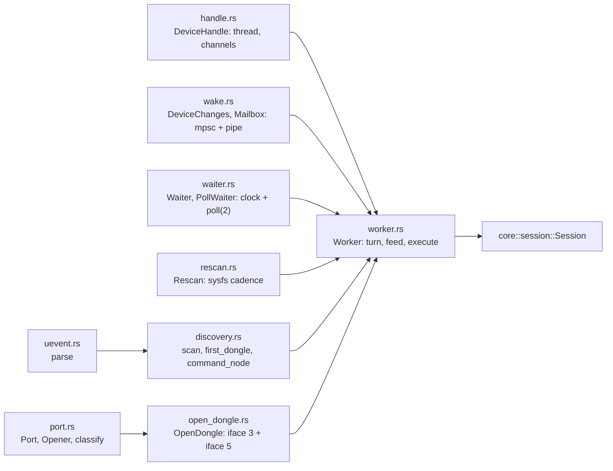
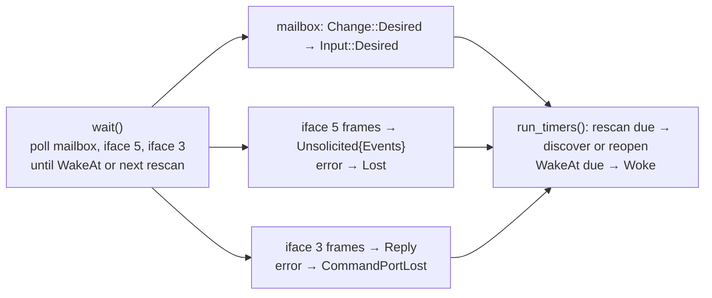
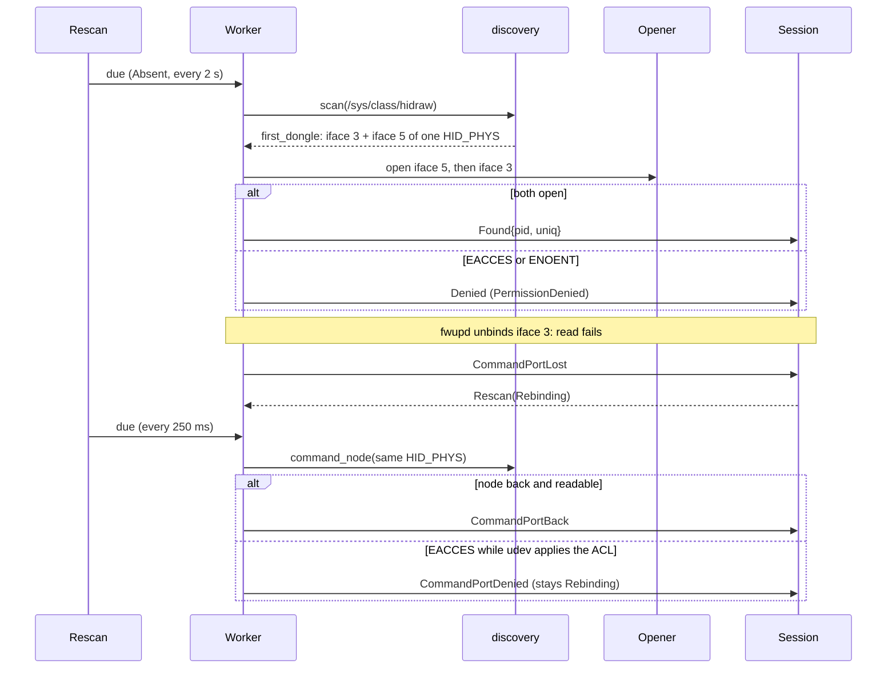
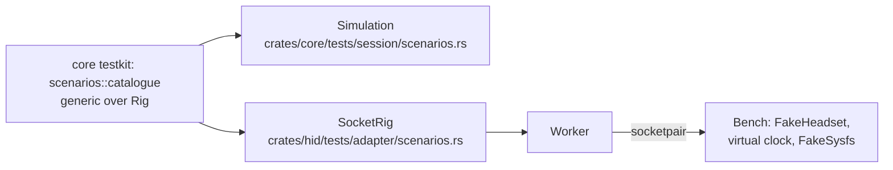

# HID adapter

`crates/hid/` is the only code that reads `/sys/class/hidraw` and opens `/dev/hidraw*`. It runs one
`crates/core/src/session/reducer.rs::Session` on the device thread: it turns sysfs scans, port reads, port errors,
the poll timeout and desired settings from the main thread into `Input`s, and executes the `Effect`s that come back.
It decides nothing about the protocol: every frame it writes comes from the session, so only allow-listed commands
reach the dongle. Design rationale: device part §2 and §6 of the spec, ADR 0005 and ADR 0015.

## Modules

| Concern | Code |
|---|---|
| Public seam to the main thread | `crates/hid/src/handle.rs::DeviceHandle`, `crates/hid/src/handle.rs::spawn`, `crates/hid/src/wake.rs::DeviceChanges` |
| Desired settings in, wake the loop | `crates/hid/src/wake.rs::mailbox`, `crates/hid/src/wake.rs::Mailbox`, `crates/hid/src/wake.rs::take` |
| Clock and `poll(2)` | `crates/hid/src/waiter.rs::Waiter`, `crates/hid/src/waiter.rs::PollWaiter` |
| One loop iteration | `crates/hid/src/worker.rs::Worker`, `crates/hid/src/worker.rs::turn`, `crates/hid/src/worker.rs::feed`, `crates/hid/src/worker.rs::execute` |
| sysfs discovery | `crates/hid/src/discovery.rs::SysfsRoot`, `crates/hid/src/discovery.rs::scan`, `crates/hid/src/discovery.rs::first_dongle`, `crates/hid/src/discovery.rs::command_node`, `crates/hid/src/uevent.rs::parse` |
| Rescan cadence (`Absent` 2 s, `Rebinding` 250 ms, `Off`) | `crates/hid/src/rescan.rs::Rescan`, `crates/core/src/session/effect.rs::Cadence` |
| Raw hidraw: open, 65-byte write, read | `crates/hid/src/port.rs::Port`, `crates/hid/src/port.rs::HidrawOpener` |
| `EACCES`, `EPERM` and `ENOENT` mean denied; anything else means gone | `crates/hid/src/port.rs::classify`, `crates/hid/src/port.rs::OpenError` |
| The open pair; iface 5 error means `Lost`, iface 3 error means `CommandPortLost` | `crates/hid/src/open_dongle.rs::OpenDongle`, `crates/hid/src/worker.rs::port_gone` |

## One turn

`crates/hid/src/worker.rs::feed` hands each `Input` to the session with the waiter's clock and runs the returned
effects in order: `Write` goes to iface 3 (a failed write queues `CommandPortLost` for the same feed),
`WakeAt` sets the poll deadline, `Rescan` resets `crates/hid/src/rescan.rs::Rescan`, `Publish` goes to the
`async-channel` the bridge reads. When the session leaves the present phases (`Lost`, `REBIND_GIVE_UP`) the worker
closes both ports.

## Discovery and rebinding

| Rule | Code |
|---|---|
| Only supported, non-bootloader models of vendor `1038` are reported | `crates/hid/src/discovery.rs::scan` |
| A dongle needs both iface 3 and iface 5 on one physical path; the lowest `HID_PHYS` wins | `crates/hid/src/discovery.rs::first_dongle` |
| A denied dongle that disappears from sysfs is `Lost` | `crates/hid/src/worker.rs::discover` |
| The command node is looked up again by physical path, since its `hidrawN` may change | `crates/hid/src/worker.rs::reopen_command` |

## Tests

| Piece | Code |
|---|---|
| Scenario catalogue shared by both rigs | `crates/core/src/testkit/scenarios/mod.rs::catalogue`, `crates/core/src/testkit/rig.rs::Rig` |
| Worker over socketpairs on a virtual clock | `crates/hid/tests/adapter/rig.rs::SocketRig`, `crates/hid/tests/adapter/rig.rs::VirtualWaiter`, `crates/hid/tests/adapter/bench.rs::Bench` |
| sysfs fixture trees in tempdirs | `crates/hid/tests/adapter/sysfs.rs::FakeSysfs` |
| Discovery, ports, mailbox, waiter, rescan cadence, handle | `crates/hid/tests/adapter/discovery.rs`, `crates/hid/tests/adapter/port.rs`, `crates/hid/tests/adapter/wake.rs`, `crates/hid/tests/adapter/waiter.rs`, `crates/hid/tests/adapter/rescan.rs`, `crates/hid/tests/adapter/handle.rs` |
| Real dongle, `ARCTIS_HW=1` | `crates/hid/tests/hardware/discovery.rs`, `crates/hid/tests/hardware/soak.rs` |
