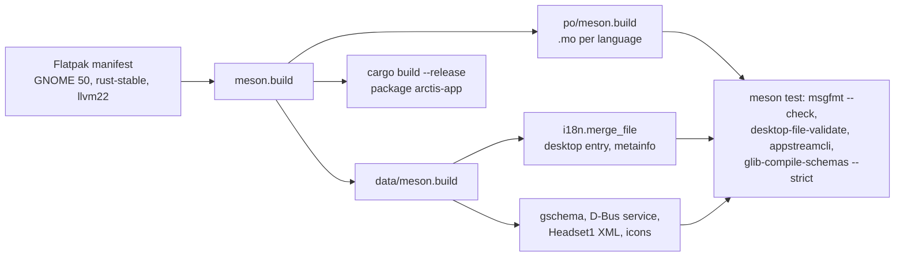
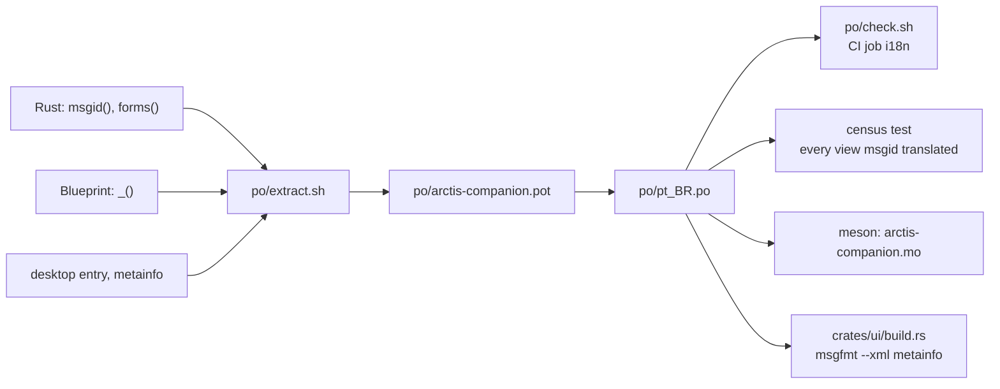
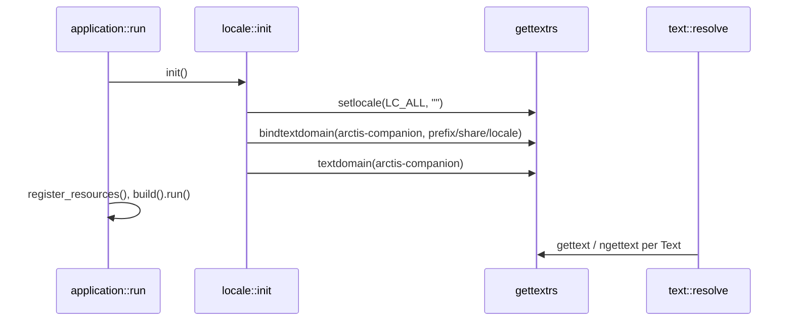
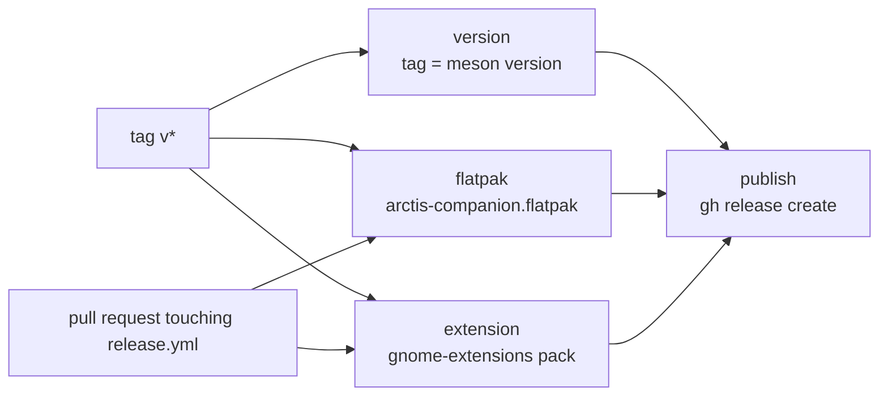
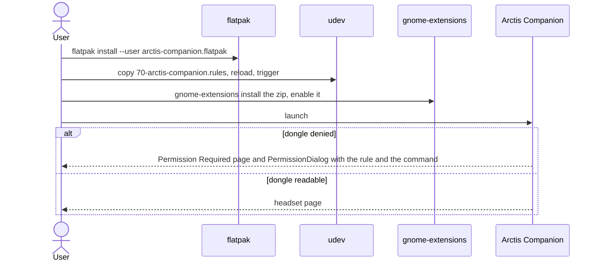

# Packaging, translations and release

How the app is built into a Flatpak, how its strings reach pt_BR, how a tag becomes a GitHub release, and how a
computer gets the app, the udev rule and the Shell extension. The hand-run hardware list is
`docs/hardware-checklist.md`.

## Build

| Piece | Path |
|---|---|
| Flatpak manifest | `build-aux/io.github.marcelogm.ArctisCompanion.json` |
| Top-level meson | `meson.build` |
| Catalogue build and check | `po/meson.build` |
| Data install and validation | `data/meson.build` |
| Desktop entry template | `data/io.github.marcelogm.ArctisCompanion.desktop.in` |
| AppStream template | `data/io.github.marcelogm.ArctisCompanion.metainfo.xml.in` |
| D-Bus activation | `data/io.github.marcelogm.ArctisCompanion.service.in` |
| udev rule | `data/udev/70-arctis-companion.rules` |

| finish-arg | Why |
|---|---|
| `--share=ipc` | shared memory for the X11 fallback |
| `--socket=wayland`, `--socket=fallback-x11` | the window |
| `--device=all` | the dongle's `/dev/hidraw*` nodes; Flatpak has no narrower class for hidraw (`docs/research/flatpak-pipewire.md`) |
| `--filesystem=xdg-run/pipewire-0` | the PipeWire socket, not mounted by default |

Notifications, the Background portal and the file chooser go through portals; the app owns its own app-id name on
the session bus. `crates/app/tests/packaging.rs` pins the finish-args, the version shared by `meson.build`,
`Cargo.toml` and the metainfo, the metainfo's known gaps and permission text, and the release assets.

## Translations

`xgettext --language=Rust` only sees bare calls, so every English literal that reaches `gettext` is wrapped in an
identity `const fn`: `crates/core/src/l10n.rs::msgid` for one string, `crates/core/src/l10n.rs::forms` for a
singular and plural pair.

| Piece | Path |
|---|---|
| Markers | `crates/core/src/l10n.rs` |
| Extraction | `po/extract.sh` |
| Template and catalogue | `po/arctis-companion.pot`, `po/pt_BR.po`, `po/LINGUAS` |
| Catalogue check | `po/check.sh` |
| Census of view msgids | `crates/core/tests/view/catalogue.rs` |
| Merged metainfo for the About dialog | `crates/ui/build.rs`, `crates/ui/src/app_dialogs.rs::about_dialog` |
| Extension catalogue | `extension/po/extract.sh`, `extension/po/pt_BR.po` |

| Step | Symbol |
|---|---|
| Startup | `crates/app/src/application.rs::run` |
| Domain binding | `crates/app/src/locale.rs::init`, `crates/app/src/locale.rs::locale_dir_beside` |
| Text resolution | `crates/ui/src/text.rs::resolve` |

## Release

`.github/workflows/release.yml` publishes three assets: the bundle, the extension zip and
`data/udev/70-arctis-companion.rules`. Pull requests that touch the workflow run the build jobs only.

## Install on a computer

The dialog is `crates/ui/src/permission_dialog.rs::PermissionDialog`.

## Docs check

`xtask/src/check_doc_paths.rs::run` reads `docs/architecture/`, `CONTEXT.md` and the "- Code:" lines of
`docs/adr/`.
