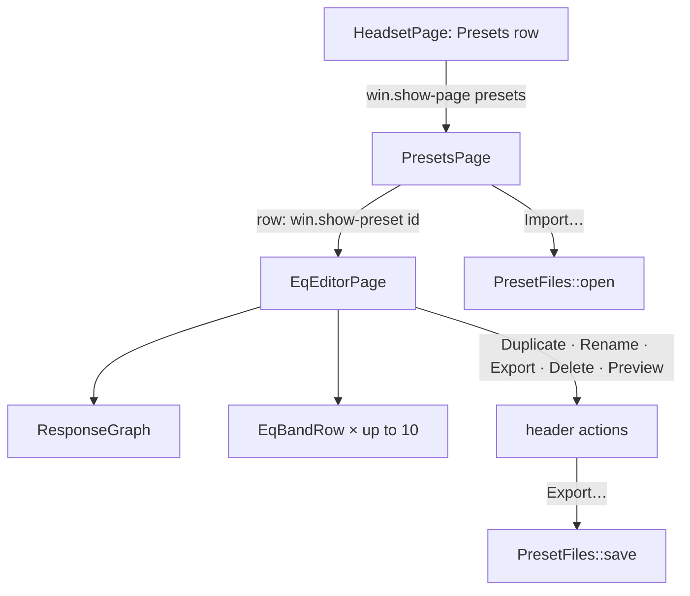
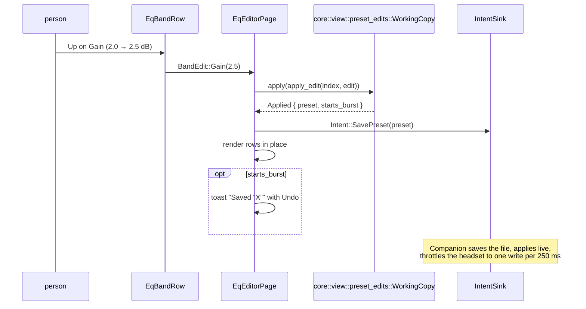
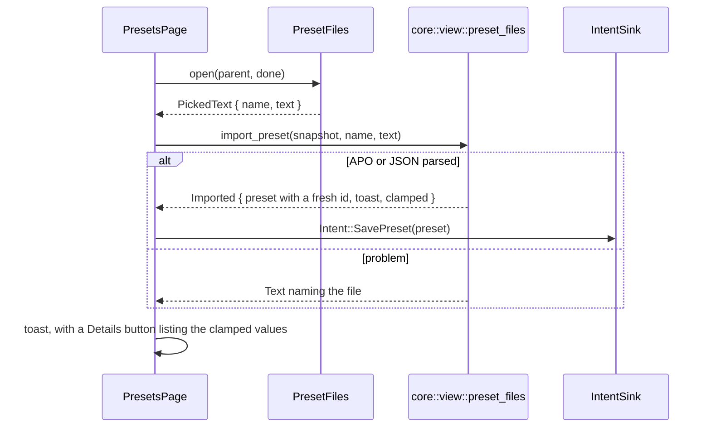

# Presets and equalizer editor

The presets page lists built-in and custom presets and imports Equalizer APO or JSON files; the editor page edits
one preset band by band, shows its response and exports it. Decisions are pure in `crates/core/src/view/`; the
widgets in `crates/ui/src/` render them and emit `Intent`s. Design rationale: ui part §3, audio part §3, ADR 0011.

## Pages

| Piece | Code | Template |
|---|---|---|
| Presets page | `crates/ui/src/presets_page.rs::PresetsPage`, `crates/core/src/view/presets.rs::presets_page` | `crates/ui/resources/presets_page.blp` |
| Editor page | `crates/ui/src/eq_editor_page.rs::EqEditorPage`, `crates/core/src/view/eq_editor.rs::eq_editor_for` | `crates/ui/resources/eq_editor_page.blp` |
| Header actions | `crates/ui/src/eq_editor_page/header.rs::rename_dialog` and the `EqEditorPage` methods in that file | none |
| Band row | `crates/ui/src/eq_band_row.rs::EqBandRow`, `crates/core/src/view/eq_editor.rs::BandModel` | `crates/ui/resources/eq_band_row.blp` |
| Response graph | `crates/ui/src/response_graph.rs::ResponseGraph`, `crates/core/src/view/eq_editor.rs::x_fraction`, `crates/core/src/view/eq_editor.rs::y_fraction`, `crates/core/src/eq/response.rs::response` | none |
| Page services | `crates/ui/src/services.rs::Services`, `crates/ui/src/toasts.rs::button_toast` | none |
| File chooser | `crates/ui/src/preset_files.rs::PresetFiles`, `crates/ui/src/preset_files.rs::PortalFiles` | none |
| Window glue | `crates/ui/src/window.rs::Window` (`show_preset`, `set_preset_files`) | `crates/ui/resources/window.blp` |

## One edit

`WorkingCopy` owns the rules the widget must not: a published copy replaces the working copy, the first edit of a
burst is remembered for Undo, `burst_ended` (toast gone) opens the next burst, `undo` returns the preset as it was
before the burst. The page keeps the toast handle only to dismiss it when another preset opens.

| Concern | Code |
|---|---|
| Working copy, bursts, Undo | `crates/core/src/view/preset_edits.rs::WorkingCopy`, `crates/core/src/view/preset_edits.rs::Applied` |
| One widget change to an edited preset | `crates/core/src/view/preset_edits.rs::BandEdit`, `crates/core/src/view/preset_edits.rs::apply_edit`, `crates/core/src/view/preset_edits.rs::add_band`, `crates/core/src/view/preset_edits.rs::remove_band`, `crates/core/src/view/preset_edits.rs::renamed` |
| Rounding to the device grid | `crates/core/src/eq/filter.rs::Hertz`, `crates/core/src/eq/filter.rs::Gain`, `crates/core/src/eq/filter.rs::Q` |
| Duplicate of a built-in | `crates/core/src/view/preset_edits.rs::copy_name`, `crates/core/src/view/preset_edits.rs::duplicate` |
| Undo texts | `crates/core/src/view/preset_edits.rs::saved_toast`, `crates/core/src/view/presets.rs::deleted_toast` |
| Gain off for pass filters | `crates/core/src/eq/filter.rs::FilterKind`, `crates/ui/src/eq_band_row.rs::EqBandRow` |
| Combo positions | `crates/core/src/view/eq_editor.rs::kind_at`, `crates/core/src/view/eq_editor.rs::kind_position` |

## Import and export

APO values are rounded to the device grid and clamped to the envelope; each clamp is listed. JSON must already sit
on the grid and inside the envelope, otherwise the file is not a preset file.

| Concern | Code |
|---|---|
| Parse and name an import | `crates/core/src/view/preset_files.rs::import_preset`, `crates/core/src/view/preset_files.rs::Imported`, `crates/core/src/eq/apo.rs::parse` |
| Export text by file name | `crates/core/src/view/preset_files.rs::export_text`, `crates/core/src/view/preset_files.rs::export_file_name`, `crates/core/src/eq/apo.rs::render` |
| Clamp details dialog | `crates/ui/src/services.rs::details_dialog` |
| Published AutoEQ fixture | `crates/core/src/testkit/autoeq.rs` |

## Preview

The header toggle sends `Intent::StartPreview(id)` and `Intent::EndPreview`; the page's `hidden` and `unmap` vfuncs
turn it off, so leaving the editor or closing the window always ends the pick. `Companion` picks the path
(`crates/core/src/companion/selection.rs::picked_path`) and ends every manual pick on route changes, ruled app
changes and other picks. `crates/core/src/view/eq_editor.rs::PreviewState` says whether this preset is the manual
pick of the picked path; when it stops being `Picked` the page turns the toggle off without an intent.

## Tests

Pure: `crates/core/tests/view/eq_editor.rs`, `crates/core/tests/view/preset_edits.rs`,
`crates/core/tests/view/preset_files.rs`. Widgets (`crates/ui/tests/widgets/main.rs`):
`crates/ui/tests/widgets/presets_page.rs`, `crates/ui/tests/widgets/eq_editor_page.rs` (keyboard-only editing,
undo toast), `crates/ui/tests/widgets/preset_actions.rs` (Duplicate, Rename, Export, Delete, Preview),
`crates/ui/tests/widgets/eq_band_row.rs`, `crates/ui/tests/widgets/response_graph.rs`, with the fake file chooser
`crates/ui/tests/widgets/support.rs::FakeFiles`.
