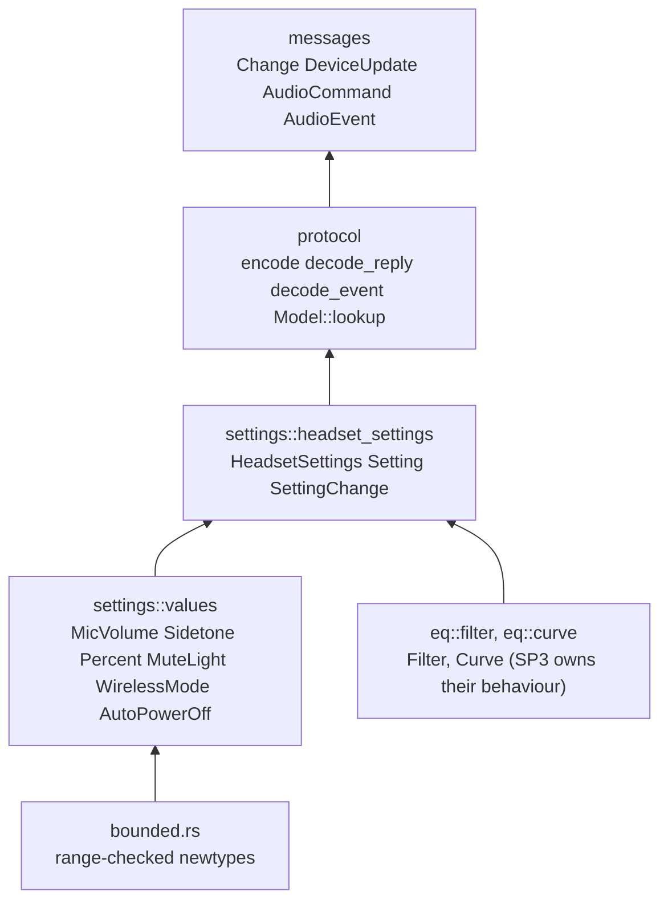
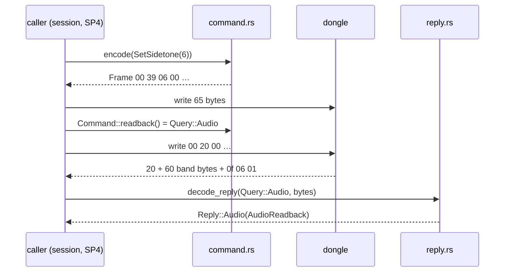
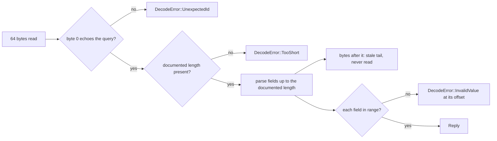
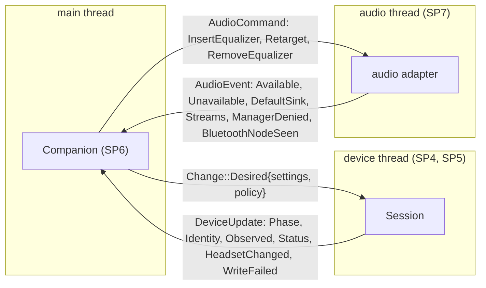

# Protocol, headset settings and thread messages

The pure codec for the Nova 5 dongle, the headset setting values and the messages that cross the device and
audio thread seams. All of it lives in `crates/core/` and does no I/O. Design rationale: device part §1, §5 and
§6 of the spec, ADR 0004 and ADR 0013.

## Modules

| Module | Code |
|---|---|
| Range-checked values | `crates/core/src/bounded.rs`, `crates/core/src/settings/values.rs::OutOfRange`, `crates/core/src/settings/values.rs::MuteLight`, `crates/core/src/settings/values.rs::WirelessMode`, `crates/core/src/settings/values.rs::AutoPowerOff` |
| Filters and curves | `crates/core/src/eq/filter.rs::Filter`, `crates/core/src/eq/filter.rs::FilterKind`, `crates/core/src/eq/curve.rs::Curve` |
| Headset settings | `crates/core/src/settings/headset_settings.rs::HeadsetSettings`, `crates/core/src/settings/headset_settings.rs::Setting`, `crates/core/src/settings/headset_settings.rs::SettingChange`, `crates/core/src/settings/headset_settings.rs::apply` |
| Frames | `crates/core/src/protocol/frame.rs::Frame`, `crates/core/src/protocol/frame.rs::DecodeError` |
| Commands | `crates/core/src/protocol/command.rs::Command`, `crates/core/src/protocol/command.rs::Query`, `crates/core/src/protocol/command.rs::encode`, `crates/core/src/protocol/command.rs::readback` |
| Equalizer bands | `crates/core/src/protocol/eq_wire.rs::encode_curve`, `crates/core/src/protocol/eq_wire.rs::decode_curve` |
| Replies | `crates/core/src/protocol/reply.rs::decode_reply`, `crates/core/src/protocol/reply.rs::Reply`, `crates/core/src/protocol/reply.rs::observed_settings` |
| Status and firmware | `crates/core/src/protocol/status.rs::Status`, `crates/core/src/protocol/status.rs::Link`, `crates/core/src/protocol/firmware.rs::Firmware`, `crates/core/src/protocol/firmware.rs::Version` |
| Events | `crates/core/src/protocol/event.rs::decode_event`, `crates/core/src/protocol/event.rs::DeviceEvent` |
| Models | `crates/core/src/protocol/model.rs::Model`, `crates/core/src/protocol/model.rs::lookup`, `crates/core/src/protocol/model.rs::ModelLookup`, `crates/core/src/protocol/model.rs::Capabilities`, `data/udev/70-arctis-companion.rules` |
| Device seam | `crates/core/src/messages/device.rs::Change`, `crates/core/src/messages/device.rs::SyncPolicy`, `crates/core/src/messages/device.rs::Phase`, `crates/core/src/messages/device.rs::DeviceUpdate` |
| Audio seam | `crates/core/src/messages/audio.rs::AudioCommand`, `crates/core/src/messages/audio.rs::AudioEvent`, `crates/core/src/messages/audio.rs::DefaultSink`, `crates/core/src/messages/audio.rs::StreamInfo`, `crates/core/src/messages/audio.rs::AppIdentifiers` |

## A write and its readback

`Frame` has no public constructor: only `encode` builds one, from a `Command`, and `Command` has a variant only for
the allow-listed frames (B0 10 20 A0 36 queries; 37 39 27 33 AE A3 35 setters). Nothing can produce 09, A5, A7,
22, 34 or a trailing save frame.

| Command | First payload bytes | Readback |
|---|---|---|
| QueryStatus, QueryFirmware, QueryAudio, QueryUx, QueryWireless | B0, 10, 20, A0, 36 | none |
| SetMicVolume, SetSidetone, SetVolumeLimiter | 37 n, 39 n, 27 n | Query::Audio |
| SetEqualizer | 33 then ten 6-byte bands | Query::Audio |
| SetMuteLight, SetAutoPowerOff | AE raw, A3 minutes | Query::Ux |
| SetWirelessMode | 35 0 (extended range) or 35 1 | Query::Wireless |

## Replies and stale tails

| Query | Documented length | Fields |
|---|---|---|
| Status (B0) | 5 | link, battery, charging |
| Firmware (10) | 37 | receiver slot, unused slot, headset slot (fwupd digit pairs; zeros mean unreachable) |
| Audio (20) | 64 | ten bands, mic volume, sidetone, volume limiter |
| Ux (A0) | 3 | automatic power off (an unlisted minute count reads as the nearest choice), mute light (unknown raw reads as Medium) |
| Wireless (36) | 2 | wireless mode |

Band layout (equalizer wire format): frequency u16 little endian, kind 1 to 5, gain byte 20 + 2·dB, Q × 1000 u16
little endian. Frequency 20001 is a disabled band: it decodes to no filter, and disabled or missing filters encode
as 21 4e 01 14 e8 03 after the enabled ones. A low-pass or high-pass band read with a gain byte other than 20 decodes
with no gain.

## Events

`decode_event` turns an unsolicited frame into a `DeviceEvent`: B7 battery, BB charging, B9 link, 45 chat mix, and
27 37 39 A3 AE as a `SettingChange`. Out-of-range values and unknown ids give no event.

## Messages across the seams

## Tests

| What | Where |
|---|---|
| SP0 captures, one 64-byte frame per file | `crates/core/tests/golden/` |
| Golden loader shared by the golden tests | `crates/core/tests/support/mod.rs` |
| The golden set, captured curves and setter frames | `crates/core/tests/golden_frames.rs` |
| Every captured reply decodes to its expectation | `crates/core/tests/golden_replies.rs` |
| Command bytes, readbacks, allow-list proptest | `crates/core/tests/command.rs` |
| Band encoding, round-trip and no-panic proptests | `crates/core/tests/eq_wire.rs`, `crates/core/tests/strategies/mod.rs` |
| Replies, firmware slots, no-panic and stale-tail proptests | `crates/core/tests/reply.rs` |
| Events, no-panic proptest | `crates/core/tests/event.rs` |
| Models and the udev rule | `crates/core/tests/model.rs`, `crates/core/tests/udev_rule.rs` |
| Value ranges | `crates/core/tests/values.rs`, `crates/core/tests/status.rs`, `crates/core/tests/eq_types.rs`, `crates/core/tests/headset_settings.rs` |
| Frozen message contract | `crates/core/tests/messages.rs` |
