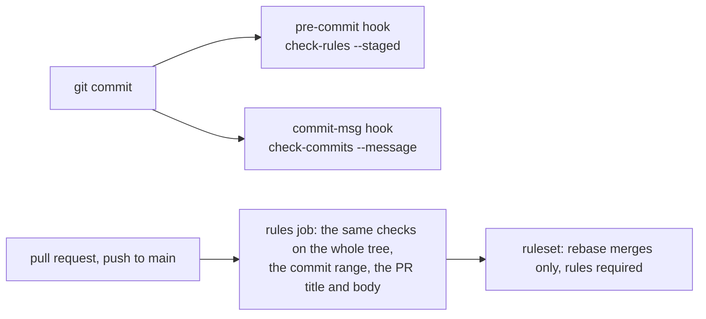
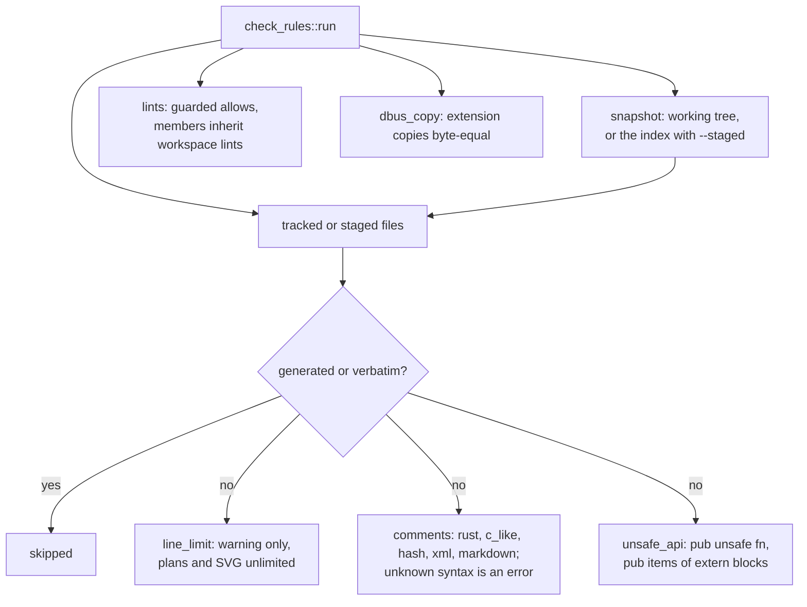

# Engineering rules

`cargo xtask` (`xtask/src/main.rs::run`, arguments parsed by `xtask/src/cli.rs::parse`) checks every rule
locally through git hooks and in the `rules` CI job. Each rule has one module and one test file under
`xtask/tests/`, which builds the violation in a tempdir repository and runs the real binary
(`xtask/tests/support/mod.rs::Fixture`).

| Rule | Code | Test |
|---|---|---|
| No comments in any language | `xtask/src/check_rules/comments/mod.rs::check`, `xtask/src/check_rules/comments/rust.rs::first_comment_line`, `xtask/src/check_rules/comments/c_like.rs::first_comment_line`, `xtask/src/check_rules/comments/hash.rs::first_comment_line`, `xtask/src/check_rules/comments/xml.rs::first_comment_line`, `xtask/src/check_rules/comments/markdown.rs::first_comment_line` | `xtask/tests/comments.rs` |
| Generated and verbatim files exempt | `xtask/src/check_rules/exempt.rs::is_exempt` | `xtask/tests/generated.rs` |
| Staged checks read the index | `xtask/src/check_rules/snapshot.rs::Snapshot` | `xtask/tests/comments.rs`, `xtask/tests/dbus_copy.rs`, `xtask/tests/lints.rs` |
| About 400 lines per file, warning only | `xtask/src/check_rules/line_limit.rs::check` | `xtask/tests/line_limit.rs` |
| Lints that demand docs stay allowed; members inherit the workspace lints | `xtask/src/check_rules/lints.rs::check`, policy in `Cargo.toml` and `clippy.toml` | `xtask/tests/lints.rs`, `xtask/tests/clippy_config.rs` |
| No public unsafe functions | `xtask/src/check_rules/unsafe_api.rs::check`, lexer wrapper `xtask/src/rust_tokens.rs::tokens` | `xtask/tests/unsafe_api.rs` |
| Headset1 XML copies byte-equal | `xtask/src/check_rules/dbus_copy.rs::check` | `xtask/tests/dbus_copy.rs` |
| Conventional commits, no attribution | `xtask/src/check_commits.rs::run`, `xtask/src/commit_message.rs::subject_problem`, `xtask/src/commit_message.rs::attribution_problem` | `xtask/tests/check_commits.rs` |
| Doc paths and symbols exist | `xtask/src/check_doc_paths.rs::run`, `xtask/src/doc_refs.rs::doc_refs` | `xtask/tests/check_doc_paths.rs` |
| Pure core | `xtask/src/check_pure.rs::run` | `xtask/tests/check_pure.rs` |
| Hooks | `xtask/src/install_hooks.rs::run`, scripts in `xtask/hooks/` | `xtask/tests/install_hooks.rs` |
| The repository itself passes | | `xtask/tests/repository.rs` |
| Extension lint | `extension/eslint.config.js` | ESLint in the `extension` CI job |

`xtask/Cargo.toml` pins `unicode-ident` to the Unicode version `ra-ap-rustc_lexer` checks at compile time.
