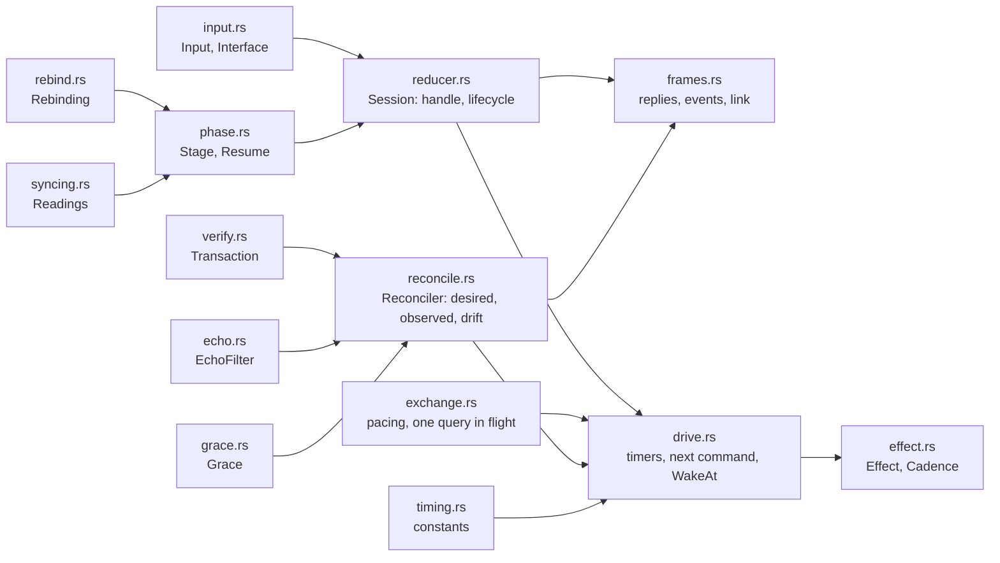
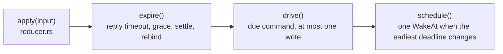
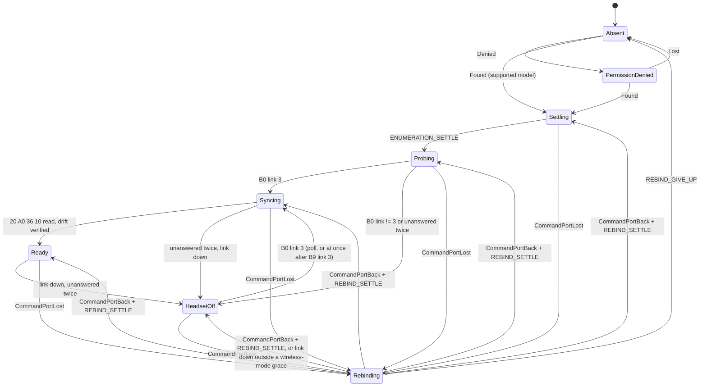
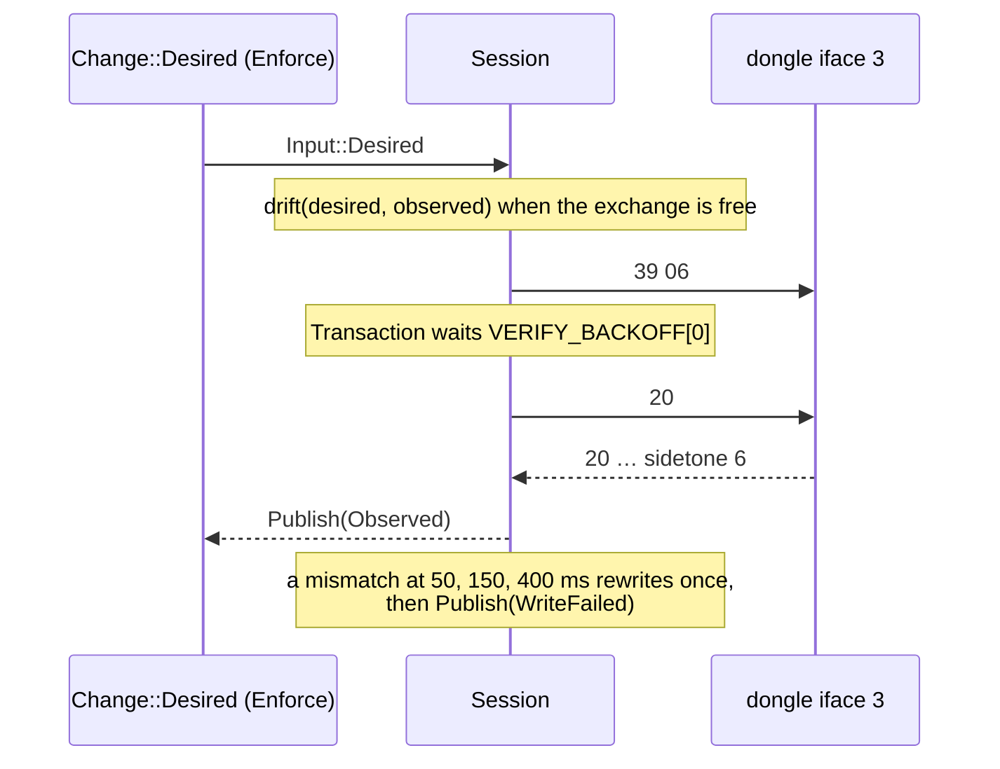
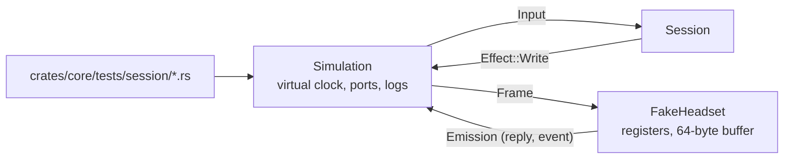

# Device session and testkit

`crates/core/src/session/` is the sans-I/O reducer that owns one dongle's life on the device thread: lifecycle
phases, settles, the probe, silent Rebinding, echo filtering, reconcile, pacing and write-then-verify. It never
sleeps and never touches a file descriptor: `crates/core/src/session/reducer.rs::Session` takes an `Input` and the
current `Millis` and returns `Effect`s. `crates/core/src/testkit/` (cargo feature `testkit`) drives it against a
modelled dongle on a virtual clock. Design rationale: device part §2 to §6 of the spec, ADR 0005, 0006 and 0007.

## Modules

| Concern | Code |
|---|---|
| Entry point | `crates/core/src/session/reducer.rs::Session`, `crates/core/src/session/reducer.rs::handle`, `crates/core/src/session/reducer.rs::phase` |
| Inputs from the worker | `crates/core/src/session/input.rs::Input`, `crates/core/src/session/input.rs::Interface` |
| Effects for the worker | `crates/core/src/session/effect.rs::Effect`, `crates/core/src/session/effect.rs::Cadence` |
| Timing constants | `crates/core/src/session/timing.rs` |
| Phases and resume points | `crates/core/src/session/phase.rs::Stage`, `crates/core/src/session/phase.rs::Resume`, `crates/core/src/session/phase.rs::restart` |
| Syncing reads | `crates/core/src/session/syncing.rs::Readings` |
| Pacing, reply matching, resend | `crates/core/src/session/exchange.rs::Exchange`, `crates/core/src/session/exchange.rs::answer`, `crates/core/src/session/exchange.rs::expire` |
| Desired, observed, failures, unknown settings, the open transaction, echoes and the wireless-mode grace | `crates/core/src/session/reconcile.rs::Reconciler`, `crates/core/src/session/reconcile.rs::drift` |
| Readbacks and curve comparison | `crates/core/src/session/verify.rs::readbacks`, `crates/core/src/session/verify.rs::same` |
| Write then verify | `crates/core/src/session/verify.rs::Transaction`, `crates/core/src/session/verify.rs::check`, `crates/core/src/session/verify.rs::Progress` |
| Echoes | `crates/core/src/session/echo.rs::EchoFilter`, `crates/core/src/session/echo.rs::is_echo` |
| Rebinding | `crates/core/src/session/rebind.rs::Rebinding`, `crates/core/src/session/rebind.rs::RebindStep` |

## One call to `handle`

Every input runs the same four steps, so a late `Woke` and an early reply are handled alike.

`crates/core/src/session/drive.rs::due` is the one place that says, per stage, which command comes next and when
(probe, headset-off poll, Syncing read, reconcile write or readback, safety poll).
`crates/core/src/session/drive.rs::drive` sends at most one frame per call, only once that time has come and
`crates/core/src/session/exchange.rs::free_at` allows it (`COMMAND_SPACING` after the last write, nothing in
flight). `crates/core/src/session/drive.rs::next_wake` is the earliest of: the next command from `due` (no earlier
than the spacing gate), the reply deadline, the settle or rebind deadline and the end of a wireless-mode grace.

## Lifecycle

| Rule | Code |
|---|---|
| Unsupported and bootloader PIDs are never opened | `crates/core/src/session/reducer.rs::found` |
| `Identity` is published on `Found` with unread firmware and again after each Syncing read of `10` | `crates/core/src/session/reducer.rs::publish_identity`, `crates/core/src/session/frames.rs::after_read` |
| `Lost` from any phase forgets the dongle, desired settings included | `crates/core/src/session/reducer.rs::lost` |
| Frames on iface 3 are drained while Settling and Rebinding | `crates/core/src/session/phase.rs::drains_command_frames`, `crates/core/src/session/frames.rs::command_frame` |
| A query unanswered twice means HeadsetOff, unless asked inside a wireless-mode grace | `crates/core/src/session/drive.rs::unanswered`, `crates/core/src/session/grace.rs::covers` |
| A reply with the awaited id that fails to decode is answered, never resent. An unreadable `B0` means HeadsetOff; an unreadable Syncing read is assumed to hold the desired values and its settings stay unknown, so drift overwrites them (without desired settings Syncing waits); an unreadable readback is a mismatch | `crates/core/src/session/exchange.rs::answer`, `crates/core/src/session/frames.rs::on_unreadable`, `crates/core/src/session/reconcile.rs::assume`, `crates/core/src/session/reconcile.rs::on_unreadable` |
| Link events; `B9` link 3 while HeadsetOff, or while Rebinding from HeadsetOff, polls `B0` at once | `crates/core/src/session/frames.rs::on_link_event`, `crates/core/src/session/frames.rs::poll_status_now`, `crates/core/src/session/rebind.rs::link_up`, `crates/core/src/session/frames.rs::on_link` |
| Rebinding sends nothing, publishes `Phase::Rebinding` only after `REBIND_NOTICE`, resumes the interrupted phase | `crates/core/src/session/rebind.rs::step`, `crates/core/src/session/drive.rs::rebinding_step`, `crates/core/src/session/reducer.rs::command_port_lost` |
| The published phase never repeats | `crates/core/src/session/reducer.rs::announce` |

## Write then verify

| Rule | Code |
|---|---|
| No desired settings, no write; `Adopt` ends any open transaction, writes nothing and republishes observed | `crates/core/src/session/reconcile.rs::desire` |
| A newer desired value drops the older target from the open transaction, so only the latest value is written and verified; a dropped target that was already written leaves the setting unknown until a readback or an event, so drift writes the latest value again | `crates/core/src/session/verify.rs::keep_wanted`, `crates/core/src/session/reconcile.rs::drop_unwanted_targets`, `crates/core/src/session/reconcile.rs::drift` |
| Only drifted fields are written, wireless mode last, failed fields skipped until the next `Change::Desired` or the next Syncing | `crates/core/src/session/reconcile.rs::drift`, `crates/core/src/session/reconcile.rs::next`, `crates/core/src/session/reducer.rs::enter`, `crates/core/src/session/reconcile.rs::start_syncing` |
| One readback per query kind, backoff steps, one retry | `crates/core/src/session/verify.rs::next`, `crates/core/src/session/verify.rs::check` |
| Curves compare with `equivalent` | `crates/core/src/session/verify.rs::same`, `crates/core/src/eq/curve.rs::equivalent` |
| A wireless-mode write opens a grace: link drops and silence wait for it. The grace outlives the transaction that opened it, the readback that confirms the mode and a Rebinding; it ends with HeadsetOff | `crates/core/src/session/grace.rs::Grace`, `crates/core/src/session/reconcile.rs::waits_for_link`, `crates/core/src/session/reconcile.rs::link_lost_at`, `crates/core/src/session/frames.rs::on_link`, `crates/core/src/session/drive.rs::link_up_or_awaited` |
| An echo of a value written in the transaction or within `ECHO_WINDOW` is consumed; any other setting event is intent | `crates/core/src/session/reconcile.rs::on_setting_event`, `crates/core/src/session/echo.rs::close` |
| A press on a setting in flight wins over the write | `crates/core/src/session/reconcile.rs::on_setting_event`, `crates/core/src/session/verify.rs::keep_wanted` |
| The safety poll waits for the transaction and is postponed by battery events | `crates/core/src/session/drive.rs::due`, `crates/core/src/session/frames.rs::on_event` |

## Testkit

| Piece | Code |
|---|---|
| Modelled dongle: registers, stale tails through one reused buffer, readback latency, Q quantization, echoes, dropped writes, silence, events, another claimant's leftover reply, a curve band outside the envelope | `crates/core/src/testkit/fake_headset.rs::FakeHeadset`, `crates/core/src/testkit/fake_headset.rs::Behaviour`, `crates/core/src/testkit/fake_headset.rs::Emission`, `crates/core/src/testkit/fake_headset.rs::hold_unreadable_band`, `crates/core/src/testkit/replies.rs` |
| Virtual clock, rescans while Rebinding, flaps with EACCES windows, EIO on a write, wire and update logs | `crates/core/src/testkit/simulation.rs::Simulation`, `crates/core/src/testkit/simulation.rs::Flap`, `crates/core/src/testkit/simulation.rs::run_for` |
| Fidelity to the SP0 captures | `crates/core/tests/session/testkit.rs` |
| One table row per arrow of the lifecycle | `crates/core/tests/session/lifecycle.rs`, `crates/core/tests/session/rebinding.rs`, `crates/core/tests/session/support.rs::assert_arrows` |
| Scenarios | `crates/core/tests/session/polling.rs`, `crates/core/tests/session/reconcile.rs`, `crates/core/tests/session/verify.rs`, `crates/core/tests/session/echo.rs`, `crates/core/tests/session/wireless.rs`, `crates/core/tests/session/unreadable.rs` |
| Scenario catalogue, also run by `crates/hid` over sockets (`docs/architecture/hid.md`) | `crates/core/src/testkit/scenarios/mod.rs` (`scenario_tests!`), `crates/core/src/testkit/rig.rs::Rig`, `crates/core/tests/session/scenarios.rs` |
| Mutation testing skips the testkit | `.cargo/mutants.toml` |
