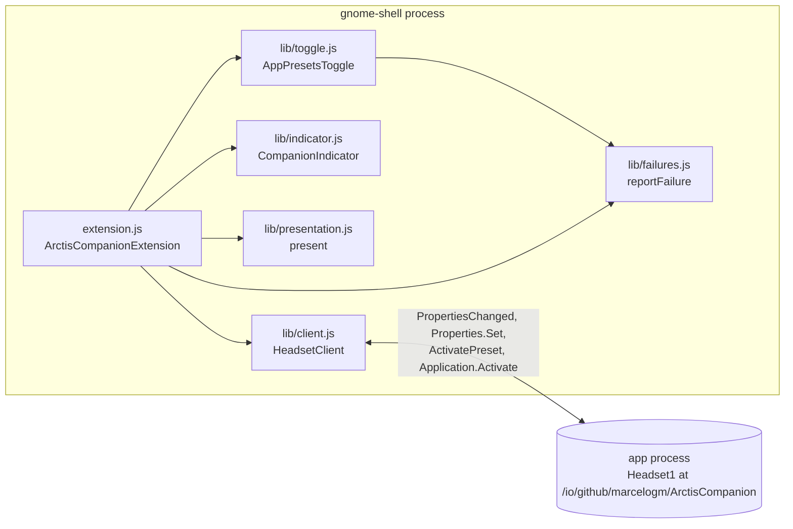
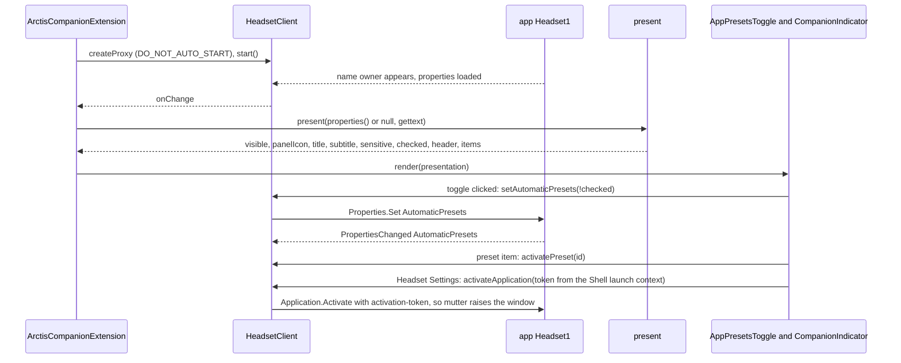
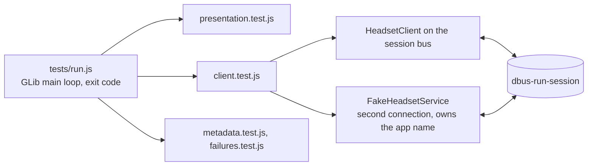
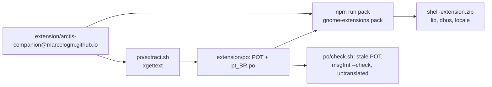

# Shell extension

The Quick Settings toggle "App Presets" for GNOME Shell 50. It reads the app's `Headset1` object, holds no state
of its own and hides while the app's bus name has no owner (ADR 0002). Directory:
`extension/arctis-companion@marcelogm.github.io/`; contract copy
`extension/arctis-companion@marcelogm.github.io/dbus/io.github.marcelogm.ArctisCompanion.Headset1.xml`, byte-equal
to `data/dbus/io.github.marcelogm.ArctisCompanion.Headset1.xml` (`xtask/src/check_rules/dbus_copy.rs::check`).

| Module | Path | Shell imports |
|---|---|---|
| Entry point | `extension/arctis-companion@marcelogm.github.io/extension.js` | yes |
| Presentation | `extension/arctis-companion@marcelogm.github.io/lib/presentation.js` | none, tested |
| D-Bus client | `extension/arctis-companion@marcelogm.github.io/lib/client.js` | none, tested |
| Failure log | `extension/arctis-companion@marcelogm.github.io/lib/failures.js` | none, tested |
| Toggle and menu | `extension/arctis-companion@marcelogm.github.io/lib/toggle.js` | yes |
| Panel icon | `extension/arctis-companion@marcelogm.github.io/lib/indicator.js` | yes |
| Metadata | `extension/arctis-companion@marcelogm.github.io/metadata.json` | – |

## Updates

| `State` | Shown |
|---|---|
| no owner, `absent`, `permission-denied` | nothing (the window explains these) |
| `connecting` | toggle, preset items insensitive |
| `awaiting-headset` | toggle, preset items insensitive unless `Route` is `bluetooth` |
| `bluetooth-only`, `headset-off`, `connected` | toggle, preset items sensitive |

The switch part is insensitive while `AppRuleCount` is 0; the arrow still opens the preset menu. The panel icon
shows only for a battery warning or while charging.

## Tests

| Piece | Path |
|---|---|
| Runner and harness | `extension/tests/run.js`, `extension/tests/support/harness.js`, `extension/tests/support/assert.js` |
| Presentation tests | `extension/tests/presentation.test.js` |
| Client tests | `extension/tests/client.test.js` |
| Fake `Headset1` service | `extension/tests/support/fake_headset_service.js` |
| Activatable test bus | `extension/tests/support/session-bus.xml`, `extension/tests/support/activation.js` |
| Nested shells | `extension/tests/nested-shell.sh`, `extension/tests/shell-session.sh`, `extension/tests/fake_app.js` |

## Build and translations

Scripts: `extension/package.json`, `extension/po/extract.sh`, `extension/po/check.sh`. CI: job `extension` in
`.github/workflows/ci.yml`.
