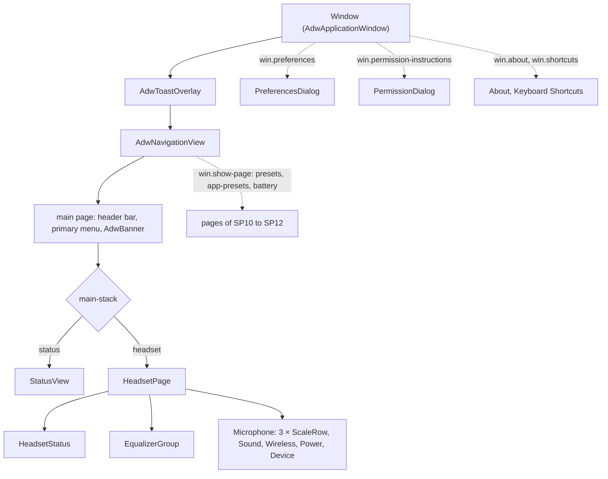
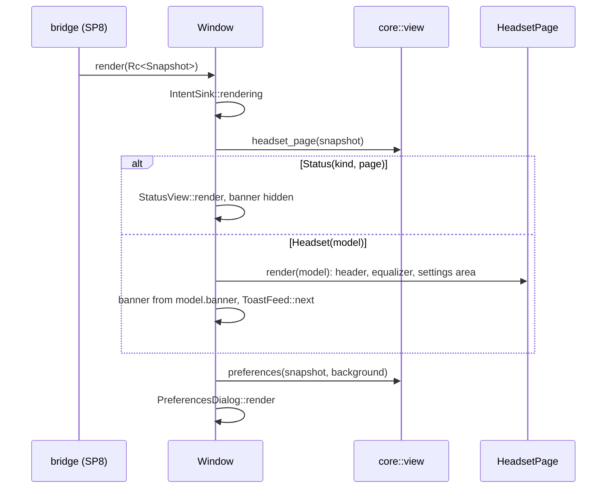
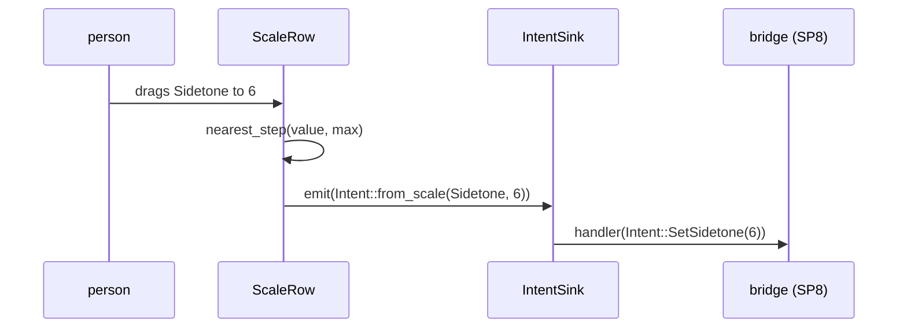

# Main window and widgets

`crates/ui/` renders `core::view` models and turns user input into `core::intent::Intent`s. It reads no
GSettings, no channel and no app file; documents a person picks in the file chooser reach the preset pages
through `crates/ui/src/preset_files.rs::PresetFiles` ([presets.md](presets.md)). Design rationale: ui part §1, §2, §4; ADR 0013.

## Widget tree

| Widget | Code | Template |
|---|---|---|
| Window | `crates/ui/src/window.rs::Window`, `crates/ui/src/window.rs::status_action` | `crates/ui/resources/window.blp` |
| Headset page | `crates/ui/src/headset_page.rs::HeadsetPage`, `crates/ui/src/headset_rows.rs::show_scale`, `crates/ui/src/headset_rows.rs::show_switch`, `crates/ui/src/headset_rows.rs::show_choice`, `crates/ui/src/headset_page.rs::HeadsetPage::render_device` | `crates/ui/resources/headset_page.blp` |
| Header | `crates/ui/src/headset_status.rs::HeadsetStatus` | `crates/ui/resources/headset_status.blp` |
| Equalizer group | `crates/ui/src/equalizer_group.rs::EqualizerGroup` | `crates/ui/resources/equalizer_group.blp` |
| Scale row | `crates/ui/src/scale_row.rs::ScaleRow` | `crates/ui/resources/scale_row.blp` |
| Status pages | `crates/ui/src/status_pages.rs::StatusView` | `crates/ui/resources/status_pages.blp` |
| Write-failure toasts | `crates/ui/src/toasts.rs::ToastFeed` | – |
| Permission dialog | `crates/ui/src/permission_dialog.rs::PermissionDialog` | `crates/ui/resources/permission_dialog.blp` |
| Preferences dialog | `crates/ui/src/preferences_dialog.rs::PreferencesDialog`, `crates/core/src/view/preferences.rs::preferences`, `crates/core/src/view/preferences.rs::Background` | `crates/ui/resources/preferences_dialog.blp` |
| About, Keyboard Shortcuts | `crates/ui/src/app_dialogs.rs::about_dialog`, `crates/ui/src/app_dialogs.rs::shortcuts_dialog` | `crates/ui/resources/shortcuts_dialog.blp` |

Templates compile through `crates/ui/build.rs::main` and `crates/ui/resources/resources.gresource.xml`, which
also bundles the metainfo for the About dialog: `crates/ui/build.rs` merges the translations of `po/` into
`data/io.github.marcelogm.ArctisCompanion.metainfo.xml.in` with `msgfmt --xml`.

## One render

Programmatic updates fire the same notify signals as user input; `crates/ui/src/intents.rs::IntentSink` drops
every emission made inside `rendering`, so only a person's change becomes an `Intent`.

## One change

| Concern | Code |
|---|---|
| Intent callback and render guard | `crates/ui/src/intents.rs::IntentSink`, `crates/ui/src/window.rs::Window` (`on_intent`) |
| Slider steps, list positions, combo items | `crates/ui/src/widget_values.rs::nearest_step`, `crates/ui/src/widget_values.rs::index`, `crates/ui/src/widget_values.rs::show_choices` |
| `Text` to string | `crates/ui/src/text.rs::resolve`, `crates/ui/src/text.rs::Resolver`, `crates/ui/src/text.rs::NumberStyle` |

## Text

`crates/ui/src/text.rs::Resolver` is the only place that turns `crates/core/src/view/text.rs::Text` into a string:
`gettext` for `Plain` and `Arg::Msgid`, `ngettext` for `Plural` with `{n}`, named placeholders filled after
translation, decibels with the locale's decimal separator (`crates/ui/src/text.rs::NumberStyle`), percent as
`73 %`, times through `glib::DateTime`.

## Tests

One binary, `crates/ui/tests/widgets/main.rs`, run under a headless Wayland compositor (the `ui` job of
`.github/workflows/ci.yml`). Fixtures come from `crates/core/src/testkit/snapshots.rs::snapshot` and
`crates/core/src/testkit/snapshots.rs::with`. `crates/ui/tests/widgets/window.rs` renders every `Phase` × `Route`;
`crates/ui/tests/widgets/accessibility.rs` walks names, value texts and descriptions;
`crates/ui/tests/widgets/layout.rs` checks the 360 px minimum width.
