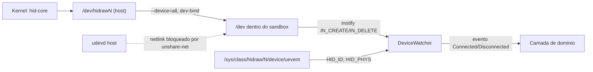
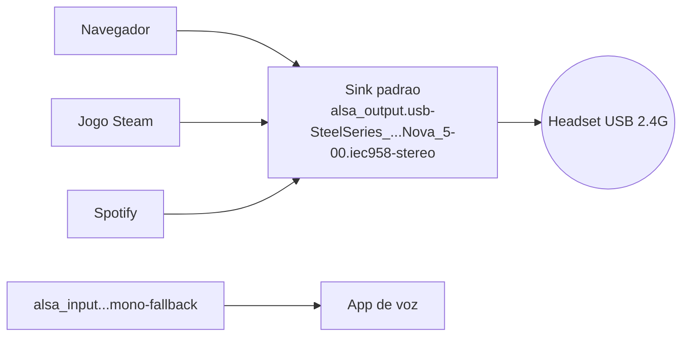
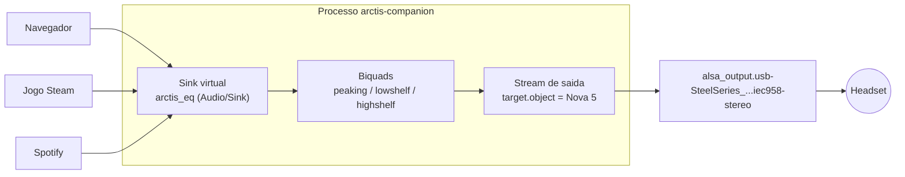
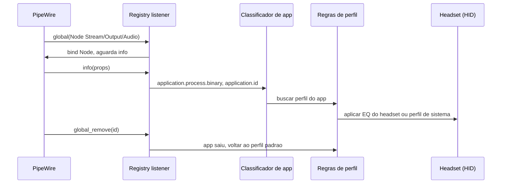

# Flatpak, hidraw, crates e PipeWire

Pesquisa feita em 2026-10-11 no host do projeto (Fedora 44, flatpak 1.18.4, PipeWire 1.6.9, WirePlumber 0.5.18, xdg-desktop-portal 1.22.1). Código de terceiros foi clonado em `scratchpad/ext/<nome>` e só lido. Tudo que não foi verificado diretamente está marcado **UNVERIFIED**.

Commits lidos: flatpak `35b818b`, pipewire `77b1480`, pipewire-rs `7102242`, HeadsetControl `d0da29a`, EasyEffects `90ae807`.

## Resumo executivo

| Tema | Decisão recomendada |
|---|---|
| Acesso ao hidraw no Flatpak | `--device=all` (confirmado ainda necessário com o NEWS até 1.17.7). Não existe `--device=hidraw`; `--device=usb` expõe só `/dev/bus/usb`, não `/dev/hidraw*`. |
| Regra udev | Regra no host com `TAG+="uaccess"` instalada pelo usuário (Flatpak não instala regras udev). |
| Hotplug no sandbox | Vigiar `/dev` com inotify (nós `hidraw*`) e validar via `/sys/class/hidraw`, com polling leve como rede de segurança (inotify em devtmpfs sob bwrap é UNVERIFIED). Não depender de netlink/libudev. |
| Camada HID | Trait própria `HidTransport` com implementação sobre `hidapi` (`linux-native`, backend hidraw) e fake em memória nos testes. |
| UI | `gtk4` 0.11 + `libadwaita` 0.9 (gtk-rs puro com subclasses e Blueprint), `async-channel` + main context do GLib, sem tokio na UI. |
| EQ de sistema | Nós PipeWire próprios do app (sink virtual + stream de saída com biquads em Rust), roteados ao Nova 5. O módulo `filter-chain` **não existe** nos runtimes Flatpak GNOME/Freedesktop. |
| Detecção por app | Registry do `pipewire-rs` (permissão RX já basta); mover streams exige `media.category = Manager`. |

## 1. Flatpak e hidraw

### 1.1 Permissões de dispositivo disponíveis

Fonte local: `man flatpak-metadata` (flatpak 1.18.4) e `flatpak/common/flatpak-run.c`.

| Opção | O que expõe | Desde | Serve para hidraw? |
|---|---|---|---|
| `--device=dri` | GPU | 0.3 | Não |
| `--device=input` | `/dev/input` | 1.15.6 | Não. O próprio código diz "raw and virtual input currently require --device=all" (`flatpak-run.c:555`). |
| `--device=usb` | `/dev/bus/usb` (`flatpak-run.c:511-512`) | 1.15.11 | Não: só nós usbfs, sem `/dev/hidraw*`. |
| `--device=all` | `--dev-bind /dev /dev` (`flatpak-run.c:413-416`) | 0.6.6 | Sim |
| `--device=hidraw` | Não existe. A lista válida é `dri, input, usb, kvm, shm, all`. | n/a | n/a |

Condicionais, conforme o NEWS (https://github.com/flatpak/flatpak/blob/main/NEWS, lido na revisão): `--device=usb` entrou no flatpak 1.15.11 (2024-11-26); `--device-if=` no 1.17.0 (2025-11-03, exemplo: `--device-if=all:!has-input-device --device=input`); `has-usb-device`/`has-usb-portal` e a possibilidade de o app dispensar `--device=all`/`usb` no 1.17.7 (2026-05-06). Como `hidraw` não aparece no NEWS, `--device=all` segue obrigatório, e o `flatpak 1.18.4` deste host já suporta as condicionais (`has-input-device`, `has-usb-device`, `has-usb-portal` no man). Usar `--device-if` com `has-usb-portal` não ajuda aqui: não troca hidraw por nada.

### 1.2 Portal USB não resolve

`org.freedesktop.portal.Usb` (https://flatpak.github.io/xdg-desktop-portal/docs/doc-org.freedesktop.portal.Usb.html) entrega um **fd de usbfs** para `libusb_wrap_sys_device()` ou `hid_libusb_wrap_sys_device()`. Para o Nova 5 isso implica `libusb`: é preciso reivindicar a interface 3, que o kernel já prendeu em `usbhid`, exigindo `detach_kernel_driver` e quebrando os nós hidraw e o input do próprio headset. O portal não menciona hidraw. Conclusão: descartado para este projeto. Reavaliar só se o portal ganhar suporte a hidraw (nada indica isso).

### 1.3 O que o Nova 5 expõe no host

Lido em `/sys/class/hidraw/*/device/uevent` neste PC (VID:PID `1038:2232`):

| Nó | Interface USB | Observação |
|---|---|---|
| `/dev/hidraw6` | `input3` | Interface de comando. HeadsetControl usa `usagepage=0xffc0, usageid=0x1, interface_id=3` (`hsc/lib/devices/steelseries_arctis_nova_5.hpp:98`). |
| `/dev/hidraw7` | `input4` | Não usada pelo HeadsetControl. |
| `/dev/hidraw8` | `input5` | Interface de eventos (Linux-Arctis-Manager: `usage_page 0xFF00`, `nova_5.yaml`, sync_interface 5). |

Os números `hidrawN` mudam a cada conexão; o app deve achar o nó por VID/PID e `HID_PHYS` (sufixo `/inputN`) ou usage page, nunca por nome fixo.

PIDs do mesmo modelo (HeadsetControl, `steelseries_arctis_nova_5.hpp:30-31`): `0x2232` (Nova 5), `0x2253` (5X); Linux-Arctis-Manager lista também `0x2264` e bootloaders `0x2233/0x2254/0x2265`. A regra udev deve cobrir todos.

### 1.4 Por que uma regra udev no host

Os nós hidraw nascem `root:root 0600` por padrão (`/usr/lib/udev/rules.d/50-udev-default.rules` só tem `SUBSYSTEM=="hidraw", IMPORT{builtin}="hwdb"`, linha 18, e nenhuma regra de MODE/GROUP para hidraw, então vale o padrão do kernel/devtmpfs, 0600 root; o modo não foi observado num nó sem regra extra porque `92-viia.rules` mascara). `TAG+="uaccess"` faz o `systemd-logind` (regra `73-seat-late` / `70-uaccess.rules`) adicionar uma ACL para o usuário da sessão ativa, sem criar grupos. Flatpak não instala regras no host (o sandbox não escreve em `/etc/udev` nem em `/usr`), então a regra precisa ser entregue fora do Flatpak.

Regra proposta (um arquivo, `/etc/udev/rules.d/70-arctis-companion.rules`, ou `/usr/lib/udev/rules.d/` se empacotada):

```
SUBSYSTEM=="hidraw", ATTRS{idVendor}=="1038", ATTRS{idProduct}=="2232|2253|2264", TAG+="uaccess"
```

Observação importante para testes: **este PC já tem `/etc/udev/rules.d/92-viia.rules`** com `KERNEL=="hidraw*", MODE="0666", TAG+="uaccess"` para todo hidraw (confirmado: `/dev/hidraw6` está `crw-rw-rw-` com ACL `other::rw-`). Logo o ambiente do desenvolvedor mascara qualquer erro de permissão. Testar o fluxo "sem permissão" apenas com o fake de transporte e em CI, nunca confiando neste host.

### 1.5 Como outros apps fazem

| App | finish-args relevantes | Regra udev |
|---|---|---|
| Solaar (`flathub/io.github.pwr_solaar.solaar`, yaml:9) | `--device=all` | README manda copiar manualmente `42-logitech-unify-permissions.rules` para `/etc/udev/rules.d` e rodar `udevadm control --reload-rules` (README linhas 7-12) |
| OpenRGB (`flathub/org.openrgb.OpenRGB`, yaml:7) | `--device=all`, `--share=network` | README: "install the latest UDEV rules"; no Fedora `dnf install openrgb-udev-rules` (README 5-12) |
| Steam (`flathub/com.valvesoftware.Steam`, yml:38-45) | `--device=all`, `--filesystem=/run/udev:ro`, `--filesystem=xdg-run/pipewire-0:ro` | Regras `60-steam-input.rules` vêm do pacote do host (existem em `/usr/lib/udev/rules.d` aqui) |
| Piper (`flathub/org.freedesktop.Piper`) | sem `--device`; usa `--system-talk-name=org.freedesktop.ratbag1` | Delega o hardware ao daemon `ratbagd` no host via D-Bus de sistema |
| HeadsetControl GUI | **UNVERIFIED**: não encontrei flatpak publicado | O CLI documenta regras udev próprias |

Padrão dominante: `--device=all` mais instrução manual de udev. A alternativa Piper (daemon no host) exige instalar algo no host de qualquer forma e foge do escopo.

Entrega sugerida: arquivo da regra instalado em `share/` do Flatpak, mais um botão/diálogo no app ("Permissão negada") que mostra o comando `pkexec`/`sudo` exato e o `.rules` com botão de copiar; a regra também fica no repositório para pacote RPM futuro.

### 1.6 Hotplug dentro do sandbox

Fatos verificados em `flatpak-run.c`:

- Com `--device=all`, `/dev` do host é bind-mounted vivo (`flatpak-run.c:416`), então nós `hidrawN` aparecem e somem em tempo real e `inotify` em `/dev` funciona (**UNVERIFIED** empiricamente; deve ser testado no primeiro protótipo).
- Sem `--share=network` o bwrap usa `--unshare-net` (`flatpak-run.c:407-410`). Sockets netlink `NETLINK_KOBJECT_UEVENT` são por network namespace, então o monitor do libudev (grupo multicast do udevd) **não recebe eventos**. Conclusão inferida, **UNVERIFIED** em teste real.
- `libudev` também lê `/run/udev/data`; Steam adiciona `--filesystem=/run/udev:ro` por isso (yml:40).
- Apenas `/sys/block`, `/sys/bus`, `/sys/class`, `/sys/dev`, `/sys/devices` são expostos (`flatpak-run.c:2327-2331`): suficiente para ler `uevent` e `HID_PHYS` em `/sys/class/hidraw`.



Estratégia recomendada: `DeviceWatcher` com inotify em `/dev` (filtrando `hidraw*`), reenumeração por `hidapi` a cada evento, e um poll de segurança de 2 s caso o inotify falhe. `hidapi` com `linux-native` usa libudev para enumerar (precisa de `/run/udev:ro` e do pacote libudev no runtime); o backend `linux-native-basic-udev` lê `/sys` direto sem libudev (ver 2.1) e é a melhor opção para o sandbox.

## 2. Crates Rust

Versões estáveis consultadas na API do crates.io em 2026-10-11:

| Crate | Versão | Atualizada |
|---|---|---|
| gtk4 | 0.11.5 | 2026-09-20 |
| glib | 0.22.10 | 2026-09-19 |
| libadwaita | 0.9.2 | 2026-07-07 |
| relm4 | 0.11.0 | 2026-04-08 |
| zbus | 5.19.0 | 2026-08-09 |
| rusqlite | 0.40.2 | 2026-08-08 |
| hidapi | 2.6.7 | 2026-08-27 |
| async-hid | 0.5.3 | 2026-06-11 |
| pipewire | 0.10.1 | 2026-08-19 |
| async-channel | 2.5.0 | 2025-07-06 |
| tokio | 1.53.2 | 2026-10-03 |
| nix | 0.31.3 | 2026-05-11 |
| rustix | 1.1.5 | 2026-09-16 |
| mockall | 0.15.0 | 2026-06-28 |

Toolchain local: rustc/cargo 1.98.1. **Pacotes `gtk4-devel`, `libadwaita-devel` e `blueprint-compiler` não estão instalados neste host** (`pkg-config` não acha `gtk4` nem `libadwaita-1`; `blueprint-compiler` não respondeu a `--version`). O build local exige instalá-los; o build oficial roda no SDK `org.gnome.Sdk//50` (instalado) via Flatpak.

### 2.1 Camada HID

| Opção | Prós | Contras |
|---|---|---|
| `hidapi` 2.6.7 (`ruabmbua/hidapi-rs`) | Enumeração por usage page/interface (necessária aqui), `read_timeout`, feature reports. Features em `Cargo.toml:44-64`: `linux-static-hidraw` (default), `linux-shared-hidraw`, `linux-static-libusb`, `linux-native` (reimplementa em Rust usando `udev` + `nix`), `linux-native-basic-udev` (`basic-udev` + `nix`, sem libudev em C). | Backends C compilados no build (static) exigem toolchain C; backend libusb é o errado para nós (1.2). |
| `async-hid` 0.5.3 | API async nativa, Rust puro. | Mais novo, menos usado; trazer runtime async (ver 2.4). **UNVERIFIED**: cobertura de usage page e hotplug em Linux não lida a fundo. |
| hidraw cru (`rustix`/`nix` + ioctls `HIDIOCGRAWINFO`, `HIDIOCGRDESC`) | Controle total, nenhuma dependência C. | Reimplementa enumeração e parsing de report descriptor. Mais código para manter. |

Recomendação: `hidapi` com `default-features = false, features = ["linux-native-basic-udev"]` **UNVERIFIED** em Flatpak (testar no protótipo); fallback `linux-static-hidraw`. O que importa para a arquitetura é o seam:

```rust
pub trait HidTransport {
    fn write(&mut self, report: &[u8]) -> Result<usize, HidError>;
    fn read_timeout(&mut self, buf: &mut [u8], ms: i32) -> Result<usize, HidError>;
}

pub trait HidEnumerator {
    fn find(&self, vid: u16, candidates: &[u16]) -> Vec<HidEndpoint>;
}
```

Duas traits pequenas (módulos profundos): produção usa `hidapi`; testes usam `FakeHeadset` que responde a frames conhecidos (bateria, sidetone, chatmix) e simula desconexão. Isso permite testar todo o protocolo, o estado e a UI sem hardware. `mockall` só se um fake manual ficar caro; um fake escrito à mão costuma ser mais legível.

### 2.2 GTK / libadwaita

- `gtk4` 0.11 e `libadwaita` 0.9 (binding de libadwaita 1.9) são as linhas atuais. Features do gtk4-rs são cumulativas (`v4_20`/`v4_22`, `v1_9` no libadwaita). Features verificadas na API do crates.io (`libadwaita` 0.9.2): `v1_9` (habilita `v1_8` e `ffi/v1_9`) e, para o GTK, `gtk_v4_22` (habilita `gtk/v4_22`). Em `gtk4` use `v4_22`.
- `relm4` 0.11 acelera protótipos (modelo Elm), mas adiciona uma camada com macros que dificulta leitura e quebra com mais frequência a cada release do gtk4-rs. Como o critério é baixa complexidade cognitiva e testabilidade, a recomendação é **gtk-rs puro com `CompositeTemplate`**: widgets finos que só renderizam um `ViewModel`, e toda lógica em módulos sem GTK, testáveis por `cargo test`.
- Blueprint: `.blp` compilado por `blueprint-compiler` para `.ui`, embutido via `gio::resources` (`glib-build-tools::compile_resources` no `build.rs`). Funciona no manifest Flatpak porque o SDK GNOME inclui `blueprint-compiler` (verificado: `blueprint-compiler` e `glib-compile-resources` existem em `org.gnome.Sdk//50`, `files/bin`, neste host). Mantém o visual alinhado ao HIG (AdwPreferencesPage, AdwSwitchRow, AdwComboRow, AdwSpinRow).

### 2.3 D-Bus e persistência

- `zbus` 5.19: Rust puro, async. Usar para a extensão do Shell (interface do próprio app em `org.gnome.…`, nome a definir), notificações (`org.freedesktop.portal.Notification` ou `org.freedesktop.Notifications` com `--talk-name`), e escutar `org.freedesktop.UPower` não é necessário. Com `zbus` use a feature `async-io` (default) para não puxar tokio; runtime combina com o main context do GLib via `glib::spawn_future_local`.
- `rusqlite` 0.40 com a feature `bundled` para o histórico de bateria (uma tabela `(ts, percent, charging, source)` e retenção por data). Banco em `$XDG_DATA_HOME` (`~/.var/app/<id>/data`), sem permissão extra.

### 2.4 Assíncrono

Recomendação: **sem tokio**. O loop do GLib dirige a UI; E/S de hidraw roda em uma thread dedicada que publica eventos em `async_channel` (2.5.0), consumidos com `glib::spawn_future_local`. Razões: um único runtime, nada de `Send` espalhado nos widgets, ordenação simples. `zbus` e `pipewire-rs` também se integram ao main context do GLib (PipeWire tem `MainLoop`/`ThreadLoop` próprio; rodar em thread separada e enviar mensagens por canal).

## 3. PipeWire

### 3.1 Estado real do host (somente leitura)

`wpctl status` e `pw-dump` neste PC, PipeWire 1.6.9:

| Objeto | id | Propriedades |
|---|---|---|
| Device | 70 | `device.name = alsa_card.usb-SteelSeries_SteelSeries_Arctis_Nova_5-00`, `device.bus = usb`, vendor `0x1038`, product `0x2232`, `api.alsa.path = hw:4` |
| Sink | 69 | `node.name = alsa_output.usb-SteelSeries_SteelSeries_Arctis_Nova_5-00.iec958-stereo`, descrição "SteelSeries Arctis Nova 5 Digital Stereo (IEC958)", `media.class = Audio/Sink`, `api.alsa.path = iec958:4` |
| Source | 96 | `node.name = alsa_input.usb-SteelSeries_SteelSeries_Arctis_Nova_5-00.mono-fallback`, `media.class = Audio/Source` |

Pontos de atenção:

- O sufixo do sink é **`.iec958-stereo`**, não `analog-stereo`. Nunca fixar o nome completo: casar por `device.vendor.id = 0x1038` e `device.product.id` em `{0x2232, 0x2253, 0x2264}` (**UNVERIFIED** para 5X/branco), ou prefixo `alsa_output.usb-SteelSeries_SteelSeries_Arctis_Nova_5`.
- Sink Bluetooth do Nova 5: **UNVERIFIED**. O único Bluetooth visível é o default configurado `bluez_output.E8_C9_13_36_0D_7D.1`, que não é necessariamente o Nova 5 (nenhum nó `bluez` do headset estava presente no `pw-dump`). Padrão esperado do WirePlumber: `bluez_output.<MAC>.<n>`, com `device.api = bluez5` e `api.bluez5.address`. Casar por MAC ou `node.nick`/descrição.
- Não há nenhum arquivo em `~/.config/pipewire/`, então não existe configuração do usuário a preservar.

### 3.2 Grafo de áudio

Sem EQ de sistema (o EQ do headset é feito no firmware, via HID):



Com EQ paramétrico de sistema (sink virtual do app + stream que toca no Nova 5):



Decisão por perfil: o sink virtual é o padrão apenas quando o EQ estiver ativo e o headset presente; ao desligar ou no desconectar, o padrão volta ao sink físico.

### 3.3 Como implementar o EQ

PipeWire embutido (`module-filter-chain`, `pw/src/modules/module-filter-chain.c`): rótulos `bq_lowshelf`, `bq_highshelf`, `bq_peaking` (linhas 259-261) com controles `Freq`, `Q`, `Gain` (linha 246) e `param_eq` com lista `filters` (linhas ~330-351). Args `capture.props` / `playback.props` (linhas 56-57) definem `media.class = Audio/Sink` e `target.object`. Exemplo de config em `pw/src/modules/module-filter-chain.c:1110-1140`.

**Achado crítico:** os runtimes Flatpak **não incluem** o módulo. Verificado em disco neste host:

| Runtime | `libpipewire-module-filter-chain.so` | `spa-0.2/filter-graph/` |
|---|---|---|
| `org.freedesktop.Platform//25.08` | ausente (só `parametric-equalizer`) | vazio |
| `org.freedesktop.Platform//26.08` | ausente | n/v |
| `org.gnome.Platform//50` | ausente | vazio (`total 0`) |
| `org.gnome.Platform//51` | ausente | n/v |
| `org.fedoraproject.Platform//f44` | **presente** em `lib64/pipewire-0.3/` | `libspa-filter-graph-plugin-builtin.so` presente |
| host Fedora (`/usr/lib64/pipewire-0.3`) | presente | presente |

O `libpipewire-module-parametric-equalizer.so` do runtime GNOME chama internamente o `filter-chain` (strings do `.so`), então também não funciona sem ele.

Opções:

| Opção | Funciona em Flatpak GNOME | Vive só com o app | Latência de ajuste | Complexidade |
|---|---|---|---|---|
| A. Drop-in `~/.config/pipewire/pipewire.conf.d/*.conf` (host) | Sim, o módulo está no host. Requer `--filesystem=xdg-config/pipewire:create`, que amplia o sandbox. | Não: persiste e só carrega ao reiniciar o PipeWire (**UNVERIFIED** recarga a quente) | Alta | Baixa, porém intrusiva |
| B. `pw_context_load_module("libpipewire-module-filter-chain")` no processo do app | Só se o app empacotar o módulo e o plugin builtin compatíveis com a `libpipewire` do runtime (ABI casada, **UNVERIFIED**). `pipewire-rs` 0.10.1 não tem `load_module` (busca por `load_module` vazia em `pwrs/pipewire/src`); dá para chamar `pw_sys::pw_context_load_module` por FFI `unsafe` (`pipewire.h` inclui `impl-module.h`, `pipewire-sys/wrapper.h`). | Sim | Reload do módulo para mudar coeficientes | Alta (build do pipewire dentro do manifest) |
| C. Nós próprios com `pw_stream` e DSP em Rust | Sim, só `libpipewire` do runtime | Sim | Imediata (altera coeficientes no callback) | Média, e é o que o EasyEffects faz |

Recomendação: **C**. Os biquads (fórmulas RBJ para peaking/shelves) viram funções puras em um módulo `dsp` com testes numéricos (resposta em frequência conhecida), sem nenhum acoplamento com PipeWire. O app cria um `Audio/Sink` virtual (`stream` com `media.class = Audio/Sink`, ou `support.null-audio-sink` via `core.create_object`, **UNVERIFIED** quanto à permissão) e um stream de saída com `target.object = <node.name do Nova 5>`.

EasyEffects (referência, `ee/src/pw_manager.cpp`, `ee/src/pw_node_manager.cpp`): cria seus próprios nós `ee_soe`/`ee_sie`, reconecta streams de apps definindo metadata `target.node` e `target.object` (`pw_manager.cpp:466-467`, `pw_node_manager.cpp:485-488`) e lê `application.process.binary`, `application.name`, `application.id` (`pw_node_manager.cpp:294-405`). Seu flatpak usa `--filesystem=xdg-run/pipewire-0:ro` (`ee-fh2/com.github.wwmm.easyeffects.json:13`), não `--device`.

### 3.4 Permissões do PipeWire dentro do Flatpak

Verificado em `/usr/share/wireplumber/scripts/client/find-flatpak-access.lua` e `module-access.c:52-64`:

- O módulo `access` marca clientes Flatpak com `pipewire.sec.flatpak = true` e `pipewire.access.portal.app_id`.
- WirePlumber 0.5.18 dá a esses clientes `Perm.RX` (leitura e execução) por padrão (`find-flatpak-access.lua:18`), sem `W` nem `M`.
- Se o cliente declara `media.category = Manager`, recebe `Perm.ALL` ("flatpak-manager", linhas 42-43). Documentado em `pw/doc/dox/internals/access.dox`: apps "Manager" precisam de acesso total, inclusive mover streams via metadata.
- Existem dois sockets no host: `pipewire-0` e `pipewire-0-manager`. `grep -i pipewire` em `common/*.c` do flatpak (`35b818b`) só acha um comentário em `flatpak-run-pulseaudio.c:334`: o flatpak 1.18 **não monta o socket do PipeWire por padrão**, daí os apps declararem `--filesystem=xdg-run/pipewire-0`. Qual dos dois sockets (`pipewire-0` ou `-manager`) o cliente enxerga e com qual papel é **UNVERIFIED**; Steam, EasyEffects e Helvum declaram `--filesystem=xdg-run/pipewire-0` (Helvum sem `:ro`, `org.pipewire.Helvum.json:16`).

Consequências:

| Necessidade | Permissão exigida | Disponível por padrão no Flatpak |
|---|---|---|
| Listar nós, ler `application.*` | R | Sim (RX) |
| Criar o sink virtual e o stream do EQ (objetos do próprio cliente) | dono do objeto | Sim |
| Redirecionar streams de outros apps (metadata `target.object`) | M sobre o nó alvo | Só com `media.category = Manager` |
| Trocar o sink padrão (metadata `default.audio.sink`) | M / W no objeto de metadata | Só como Manager |

### 3.5 Detecção por aplicativo

`pipewire-rs` 0.10.1: `Registry::add_listener_local()` (`pwrs/pipewire/src/registry/mod.rs:67`) recebe eventos `global`/`global_remove`; para cada `Node` com `media.class = Stream/Output/Audio`, ler `info.props`:

| Propriedade | Origem | Uso |
|---|---|---|
| `application.process.binary` | `keys.h:127` | Chave principal do perfil (ex.: `firefox`, `steam`) |
| `application.name` | PipeWire | Fallback e texto de UI |
| `application.id`, `pipewire.access.portal.app_id` | `keys.h:117`, módulo access | Apps Flatpak (id reverso-DNS) |
| `media.name`, `node.name` | PipeWire | Desambiguar |
| Steam game id | **UNVERIFIED**: não há chave padrão no PipeWire; jogos via Proton aparecem como o binário do runtime. Possível via env `SteamGameId` lendo `/proc/<pid>/environ` do `application.process.id`, que no sandbox só funciona para processos visíveis. Pesquisar à parte. | |

Atenção: algumas propriedades chegam só no evento `info`, não no `global` (EasyEffects comenta isso em `pw_node_manager.cpp:294`), então o listener de nó precisa esperar o `info` antes de classificar.



Para evitar tempestade de trocas, o motor de regras deve ter prioridade (app em foco/mais recente que tocou), debounce de ~500 ms e um estado explícito "perfil manual vence".

## 4. Riscos e perguntas abertas

Riscos:

1. `--device=all` é amplo e o Flathub o revisa; justificar no metainfo/pull request. A abertura de `/dev` inteiro é o preço do hidraw.
2. O monitor do libudev provavelmente não funciona sem `--share=network`; o plano usa inotify e poll, precisa ser provado no primeiro protótipo.
3. EQ de sistema em Rust (opção C) exige DSP em tempo real sem alocação no callback e controle de latência; erros causam estalos. Cobrir com testes de DSP e um teste de integração com `pw-cli`/`pipewire` no CI.
4. Redirecionar streams de outros apps exige `media.category = Manager`; depende da política do WirePlumber (arquivo local de 2026, versão 0.5.18) e pode mudar entre versões.
5. A máquina de desenvolvimento tem `92-viia.rules` com `MODE=0666` em todo hidraw, que esconde problemas de permissão.
6. `-devel` de GTK/libadwaita/blueprint ausentes localmente; desenvolver e validar via `flatpak-builder` com `org.gnome.Sdk//50`.

Perguntas abertas:

- Nome do sink Bluetooth do Nova 5 (parear e rodar `pw-dump`).
- O `inotify` em `/dev` de fato dispara dentro do bwrap com `--dev-bind`?
- Com `--filesystem=xdg-run/pipewire-0`, o cliente Flatpak recebe `Perm.RX` ou o papel Manager? Testar com um protótipo e `pw-dump` (campo `permissions`).
- Falta: política de reconexão se o headset trocar entre USB e Bluetooth (sink muda de nome); alocação de `pw_stream` em tempo real; empacotamento da regra udev dentro do `.flatpak` (o Flatpak só a hospeda em `share/`).
- Steam game id: fonte confiável sem ler `/proc`.

## 5. Fontes

- Flatpak: `scratchpad/ext/fp/common/flatpak-run.c` linhas 407-416, 505-512, 553-556, 2327-2331; `man flatpak-metadata`, `man flatpak-override` (locais); NEWS https://github.com/flatpak/flatpak/blob/main/NEWS
- Portal USB: https://flatpak.github.io/xdg-desktop-portal/docs/doc-org.freedesktop.portal.Usb.html
- Manifests Flathub: `flathub/io.github.pwr_solaar.solaar`, `flathub/org.openrgb.OpenRGB`, `flathub/com.valvesoftware.Steam`, `flathub/org.freedesktop.Piper`, `flathub/com.github.wwmm.easyeffects`, `flathub/org.pipewire.Helvum` (GitHub)
- HeadsetControl: `Sapd/HeadsetControl` `lib/devices/steelseries_arctis_nova_5.hpp`
- Linux-Arctis-Manager: `daemon/device-configs/nova_5.yaml`, `docs/device_compatibility.md`
- PipeWire: `src/modules/module-filter-chain.c`, `src/modules/module-access.c`, `src/pipewire/keys.h`, `doc/dox/internals/access.dox`, `doc/dox/internals/portal.dox` (gitlab.freedesktop.org/pipewire/pipewire)
- pipewire-rs: `pipewire/src/registry/mod.rs`, `pipewire-sys/wrapper.h` (gitlab.freedesktop.org/pipewire/pipewire-rs)
- hidapi-rs `Cargo.toml` linhas 44-64 (github.com/ruabmbua/hidapi-rs)
- EasyEffects: `src/pw_manager.cpp`, `src/pw_node_manager.cpp` (github.com/wwmm/easyeffects)
- WirePlumber: `/usr/share/wireplumber/scripts/client/find-flatpak-access.lua` (local)
- Versões de crates: https://crates.io/api/v1/crates/<nome>
- Host: `wpctl status`, `pw-dump`, `/sys/class/hidraw`, `udevadm`, `getfacl` (somente leitura)
