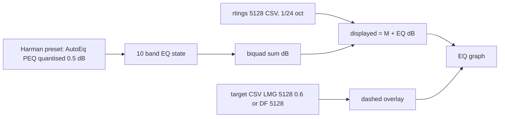

# Frequency response and target curves

Verified 2026-10-12 by fetching raw files from `jaakkopasanen/AutoEq@master` (MIT). Items not fetched or not confirmed are marked UNVERIFIED.

## 1. Measurements

Raw base: `https://raw.githubusercontent.com/jaakkopasanen/AutoEq/master/`

| Source | URL / file | Rig | Format | License | Verdict |
|---|---|---|---|---|---|
| RTINGS via AutoEq | `measurements/rtings/data/over-ear/Bruel & Kjaer 5128/SteelSeries Arctis Nova 5.csv` (the dir `measurements/Rtings/...` exists, but the file is only reachable under the lowercase `rtings` path) | B&K 5128 | CSV `frequency,raw`, 20.00-20000 Hz, 695 rows, ~1/96 oct. Starts `20.00,5.32` | Repo is MIT, but data is RTINGS-measured. No data licence found. RTINGS ToS page fetched but text was not extractable. **UNVERIFIED permission** | Only usable source. Redistribution is a risk (see 4) |
| RTINGS origin | `https://i.rtings.com/assets/products/W3xHYmyl/graph-rawfreqrespl.json` (L), `.../ov3SUIYz/graph-rawfreqrespr.json` (R), listed in `measurements/Rtings/name_index.tsv` | B&K 5128 | JSON | RTINGS copyright | Same data as above |
| oratory1990 (AutoEq) | Only Nova **Pro Wireless** PDFs in `measurements/oratory1990/name_index.tsv`. No Nova 5. | n/a | n/a | n/a | Not available |
| crinacle, Headphone.com Legacy, Super Review, HypetheSonics, Ted's Squig Hoard, Filk, DHRME, ToneDeafMonk, freeryder05, kr0mka, Kuulokenurkka, Regan Cipher, Auriculares Argentina | no "Arctis Nova" entry in any `name_index.tsv` | n/a | n/a | n/a | Not in AutoEq. squig.link and crinacle.com/graphs respond 200, but I did not search them for Nova 5 (UNVERIFIED) |
| Nova 5X / 5P | no separate file (404 on `...Nova 5X.csv` and `...Nova 5P.csv`). RTINGS review slug is `arctis-nova-5-wireless-5-5p-5x`, which suggests one review covers all three. Same drivers is plausible but UNVERIFIED | | | | Treat as one response |
| Rtings HMS II.3 (older rig) | none for Nova 5 | | | | n/a |

AutoEq already ships a computed EQ for Nova 5:
`results/Rtings/Bruel & Kjaer 5128 over-ear/SteelSeries Arctis Nova 5/` (`README.md`, `... ParametricEQ.txt`, `... .csv`, `... .png`, GraphicEQ, FixedBandEQ, wavs).

- **Target used.** The `target` column of the result CSV is the target `LMG 5128 0.6` plus a constant offset (+0.29 dB; std of difference 0.004 dB). I checked this against 10 candidate targets and none of the others fit (std 1.8-3.6 dB).
- **Parametric EQ.** 10 filters, preamp -6.0 dB in the txt (README says -5.3 dB for the first 5 filters, -6.1 dB for all 10):

| # | Type | Fc | Q | Gain |
|---|---|---|---|---|
| 1 | LowShelf | 105 | 0.70 | +0.4 |
| 2 | Peak | 139 | 0.77 | -6.6 |
| 3 | Peak | 212 | 1.19 | -1.9 |
| 4 | Peak | 452 | 1.17 | +6.4 |
| 5 | Peak | 4320 | 3.73 | +5.2 |
| 6 | Peak | 54 | 5.15 | +1.9 |
| 7 | Peak | 4910 | 3.07 | +2.2 |
| 8 | Peak | 6263 | 5.86 | -4.9 |
| 9 | Peak | 9164 | 2.07 | -6.5 |
| 10 | HighShelf | 10000 | 0.70 | +4.1 |

All filters are inside the device limits (gain within ±10, Q 0.2-10, Fc 20-20000). Gains need quantising to 0.5 dB, so re-fit or re-check the error after rounding.

- **What the EQ tells us.** The Nova 5 needs about -6.6 dB at 139 Hz and +6.4 dB at 452 Hz, so the stock tuning deviates a lot from the target.
- **Is the measurement EQ-off?** Whether RTINGS measured with the SteelSeries Sonar or app EQ off, and whether wired or wireless: UNVERIFIED.

## 2. Targets (`targets/*.csv`, same CSV format, 695 rows, 20-20000 Hz)

All are in the MIT repo. The underlying curves are published research (Harman/Olive-Welti; ISO/GRAS diffuse field). Each curve has to match the rig.

| Target | File | Rig it matches | Verdict |
|---|---|---|---|
| **LMG 5128 0.6** (the one AutoEq's own Nova 5 result uses) | `targets/LMG 5128 0.6.csv` (+ `LMG 5128 0.6 without bass.csv`) | B&K 5128. Relative to 1 kHz: +4.1 dB at 20 Hz, +0.95 dB at 100 Hz, +9.7 dB at 3 kHz, +3 dB at 10 kHz, -10 dB at 20 kHz | **Primary Harman-style target for this data.** AutoEq issue #954 says it matches RTINGS' own default target. Origin of "LMG 0.6" is UNVERIFIED. Last touched in commit 6c9a0976 |
| Diffuse field 5128 | `targets/Diffuse field 5128.csv` | B&K 5128 | Second target to offer |
| Harman over-ear 2018 | `targets/Harman over-ear 2018.csv` (+ `without bass`) | GRAS 45CA-type rig used by Harman, **not** 5128 | Only valid for GRAS-type data. `Rtings Harman over-ear 2018.csv` is a 5128-adjusted version, but AutoEq's own Nova 5 result does not use it |
| Diffuse field GRAS KEMAR / ISO 11904-1 | `targets/Diffuse field GRAS KEMAR.csv`, `targets/Diffuse field ISO 11904-1.csv` | GRAS (not 5128) | Do not use with RTINGS 5128 data. Whether ISO 11904-**2** exists in the repo is UNVERIFIED (no such file in the listing) |
| Others in `targets/` | Harman 2013/2015, `oratory1990 optimum hifi over-ear`, `Rtings original*`, `zero.csv`, `711 5128 delta` | various | Not needed |

Mixing a GRAS Harman curve with 5128 data would show about ±2 dB error against the right target, so the UI must pair rig and target.

## 3. How AutoEq computes the PEQ (`autoeq/peq.py`, `constants.py`)

1. Preprocess: smooth the raw response (1/12 oct window; wider above 6 kHz). Compute `error = target - raw` after normalising at about 1 kHz.
2. Initialise filters from error peaks (`find_peaks`). The config `10_PEAKING_WITH_SHELVES` uses a low shelf, a high shelf and 8 peaks.
3. Optimise all (Fc, Q, gain) together with `scipy.optimize.fmin_slsqp`. The loss is `sqrt(mean((target - fr)^2))` over 20-20 kHz plus a per-filter sharpness penalty. Bounds are set per filter. Stopping rules are a min-std of the loss history (0.002) and an optional time limit.
4. Defaults: peak Fc 20-10000, Q 0.18-6, gain ±20; shelf Q 0.4-0.7. Treble above 6-8 kHz is treated loosely (max treble gain 6, averaged, not fitted precisely). Preamp is `-(max positive combined gain) - 0.2 dB headroom` (`PREAMP_HEADROOM`).

**Recommendation: embed the precomputed result now, and write a small Rust optimiser later.**

- **Embed now.** Zero risk, matches the device's 10 bands, and the values are already in range. Quantise to 0.5 dB and verify that the residual stays small. The data is a few numbers, and no licensing issue applies beyond MIT.
- **Optimiser later (optional).** It would need a biquad response model (RBJ cookbook), a bounded least-squares fit (SLSQP is not trivial in Rust; Levenberg-Marquardt or Nelder-Mead with penalties would do), and the device quantisation. It is only worth it for offering several targets, because each target change requires a re-fit.

## 4. Recommendation and licensing

- **Measurement + target pair:** RTINGS B&K 5128 Nova 5 + `LMG 5128 0.6`. Offer `Diffuse field 5128` as the second overlay. Do not show Harman 2018 (GRAS) against this data unless labelled as a different rig.
- **Storage:** `crates/core/data/` contains
  - `nova5_rtings_5128.csv`, resampled to 1/24 octave (about 240 points), 2 decimals, with a comment-free header `freq_hz,spl_db` and the provenance in a sibling `README`/`SOURCES.md`;
  - `target_lmg_5128_0.6.csv` and `target_df_5128.csv`, also resampled to 1/24 octave;
  - the Harman preset, a plain table of 10 filters (type, Fc, Q, gain 0.5 dB) plus preamp.
  The app embeds them with `include_str!`. The displayed response is `measurement + sum(biquad dB of the 10 bands)`, with the target as a dashed overlay.
- **Licensing verdict.**
  - **Targets: yes, ship.** The AutoEq repo is MIT (compatible with GPL; keep the MIT notice). The curves are standard published research.
  - **RTINGS measurement: not clearly allowed.** The repo's MIT licence covers AutoEq's code and collection. It does not give a third-party data licence, and no RTINGS licence was found. Before shipping, obtain written permission from RTINGS, or ask the maintainers to confirm. Safest fallbacks are: fetch from AutoEq at runtime on user action, let the user import a CSV, or show only the target and EQ curve until permission arrives. This is not legal advice.
- **Attribution text** (About dialog and metainfo `<description>`/credits):
  > Headphone frequency response measured by RTINGS.com on a Bruel & Kjaer 5128, via the AutoEq project (Jaakko Pasanen, MIT licence, github.com/jaakkopasanen/AutoEq). Target curves: Diffuse field 5128 and LMG 5128 0.6 (from AutoEq targets). Harman target research by Sean Olive, Todd Welti and colleagues. Parametric EQ preset derived from AutoEq results. Used with permission [pending].
  Include the AutoEq MIT text in a `THIRD_PARTY_LICENSES` file.

## Data flow

