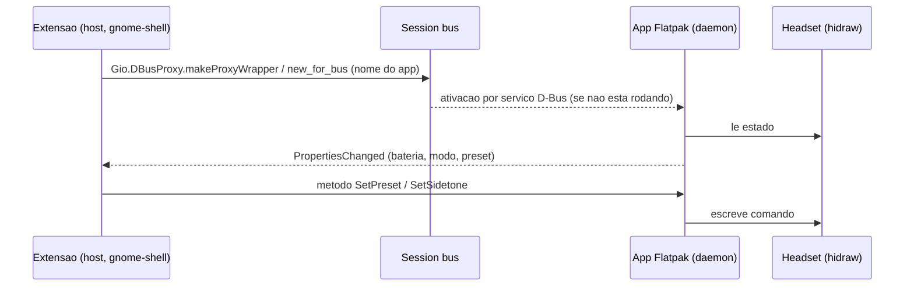
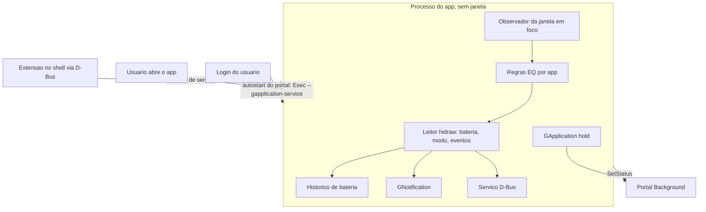

# Pesquisa: GNOME HIG, libadwaita 1.9, GNOME Shell 50 Quick Settings, execucao em segundo plano

Escopo: app libadwaita (Rust + gtk4-rs) para o Arctis Nova 5, extensao Quick Settings e notificacoes.
Ambiente local verificado: `gnome-shell --version` = 50.5, `gjs --version` = 1.88.1, `gnome-shell-test-tool` presente em `/usr/bin`, pacote `mutter-devkit` NAO instalado.
Itens sem fonte direta estao marcados UNVERIFIED.

Codigo de terceiros clonado (somente leitura, nunca executado) em
`/tmp/claude-1000/-home-marcelo-Desenvolvimento/8a4bce46-9fd7-462d-9c4c-4557a117ff8c/scratchpad/ext/{amberol,health,solanum,libadwaita}`.
Os caminhos `arquivo:linha` abaixo sao relativos a esses clones (HEAD de 2026-10-11).

## 1. HIG e libadwaita: widget por controle

### 1.1 Principios (https://developer.gnome.org/hig/principles.html)

| Principio | Consequencia no app |
|---|---|
| Design for People | Acessibilidade: `accessible-label` em cada slider/marca, sem depender de cor |
| Make it Simple | Uma situacao: configurar o headset. Sem abas de recursos secundarios |
| Reduce User Effort | EQ por app automatico, textos curtos, estado lido do headset sem pedir ao usuario |
| Be Considerate | Desfazer em vez de confirmar; nada de notificacao por evento trivial |

### 1.2 Mapeamento controle oficial -> widget

| Controle do app oficial | Widget recomendado | Base |
|---|---|---|
| Cabecalho bateria + icones BT/2.4G | `AdwPreferencesGroup` no topo com `GtkLevelBar`/porcentagem e `AdwActionRow` de estado, ou widget custom pequeno (nao ha widget de bateria no libadwaita) | UNVERIFIED (decisao de design) |
| Audio mode 2.4GHz/Bluetooth | `AdwToggleGroup` (Since 1.7 confirmado em `libadwaita/src/adw-toggle-group.c:114`, props `active`, `active-name`, `homogeneous`, `can-shrink`) dentro de um `AdwActionRow` como sufixo, ou sozinho numa linha | https://gnome.pages.gitlab.gnome.org/libadwaita/doc/1-latest/class.ToggleGroup.html |
| Volume do microfone (~15 passos) e sidetone (Off/Low/Med/High, ~11 passos) | `GtkScale` com `add_mark` dentro de `AdwActionRow` (titulo+subtitulo) ou `AdwPreferencesRow` com child custom. `AdwActionRow` aceita widget em sufixo; o HIG nao tem pagina de "slider rows" | HIG tem pagina propria de sliders (ver abaixo); o encaixe do `GtkScale` numa linha boxed e convencao, nao regra |
| Marcas e rotulos de slider | HIG (lido nesta sessao): usar slider quando a faixa e fixa e ordenada; marcar valores significativos com texto ou ticks; sem convencao de posicao, adicionar rotulo ou icone; dar feedback em tempo real; se o valor exato importa, spin button/campo ligado. Sem diretriz de acessibilidade especifica de slider na pagina | https://developer.gnome.org/hig/patterns/controls/sliders.html |
| Brilho do LED de mute (Off/Low/Med/High) | `AdwComboRow` (4 opcoes, escolha unica) ou `AdwToggleGroup` com rotulos. Preferir ComboRow: cabe em largura estreita | https://developer.gnome.org/hig/patterns/containers/boxed-lists.html |
| Volume limiter, Extended range | `AdwSwitchRow` (Since 1.4: titulo, subtitulo, switch). Subtitulo carrega o aviso "reduz qualidade do microfone" | libadwaita/src/adw-switch-row.c:45 |
| Seletor de preset de EQ | `AdwComboRow` na pagina principal (poucos presets, escolha unica) mais uma linha com seta `go-next-symbolic` para a pagina do editor | HIG boxed lists: link rows tem seta trailing |
| Editor de EQ parametrico | Widget de desenho custom (`GtkDrawingArea` ou `GtkWidget` com `snapshot`), curva de resposta + handles por banda; empurrado como `AdwNavigationPage` | UNVERIFIED (nao ha widget stock) |
| "Headset nao conectado" | `AdwStatusPage` (icone, titulo, descricao, botao opcional) como unica view do `AdwNavigationPage` raiz | libadwaita/src/adw-status-page.c |
| "Sem permissao udev" | `AdwBanner` (classe Since 1.3 por NEWS; `adw-banner.c:34` "Since 1.7" e so o enum `AdwBannerButtonStyle`) no topo, botao "Corrigir"/"Ajuda". Estado persistente, nao some sozinho | https://developer.gnome.org/hig/patterns/feedback/banners.html |
| Confirmacao de aplicacao ("Preset aplicado", falha pontual de escrita) | `AdwToast` via `AdwToastOverlay`; eventos e mensagens transitorias | HIG banners remete a toasts para eventos |
| Engrenagem de configuracoes | Menu primario com "Preferencias" abrindo `AdwPreferencesDialog` (autostart, notificacoes, regras por app) | https://developer.gnome.org/hig/patterns/containers/boxed-lists.html |
| Largura estreita | `AdwBreakpoint` (Since 1.4, `adw-breakpoint.c:69`) com `max-width` em `sp`; `AdwBreakpointBin` (1.4) para widgets que nao sao janela; `AdwNavigationSplitView` (1.4) com `collapsed` num breakpoint | https://gnome.pages.gitlab.gnome.org/libadwaita/doc/1-latest/adaptive-layouts.html. Exemplos da doc usam `max-width: 400sp` para colapsar o split view e 550/860sp para outros casos; a doc NAO fixa valor recomendado. Widget com breakpoint nao tem tamanho minimo: definir `width-request`/`height-request` (o valor 360x294 NAO aparece na doc; UNVERIFIED) |

### 1.3 Regras de boxed list (HIG)
- Uma lista boxed serve a listas pequenas e estaticas; listas grandes ou dinamicas usam list views.
- Maximo um controle por linha, dois no limite; clicar no fundo da linha ativa o controle; o controle e focavel, a linha nao.
- Icones simbolicos, para nao dominar a lista. Fonte: https://developer.gnome.org/hig/patterns/containers/boxed-lists.html
- Regras de notificacao: nao interromper sem necessidade, retirar notificacoes obsoletas, ate 3 acoes, e a informacao tambem deve estar na janela. Fonte: https://developer.gnome.org/hig/patterns/feedback/notifications.html
- Lista de regras por app (dinamica) e candidata a `GtkListView`, nao a boxed list.

### 1.4 Novidades libadwaita 1.9 relevantes
Fonte: `libadwaita/NEWS:180-297` (versao 1.9.0 e alphas). Observacao: o HEAD clonado ja e 1.10 (`NEWS:1-4`); o alvo Fedora 44 e 1.9.
- Adicionados `AdwSidebar`, `AdwViewSwitcherSidebar`, `AdwNoneAnimationTarget` (1.9.alpha, `NEWS:~270`). `adw-sidebar.c:35` marca `Since: 1.9`.
- `AdwComboRow` com acessibilidade melhor e selecao atualizada quando a expressao muda.
- `AdwWrapBox` (Since 1.7, `adw-wrap-box.c:78`) pode servir a chips de apps nas regras.
- Versoes minimas por `Since` (lidas no clone): `AdwSwitchRow` 1.4, `AdwBreakpoint`/`AdwBreakpointBin`/`AdwNavigationSplitView` 1.4, `AdwPreferencesDialog`/`AdwAboutDialog` 1.5, `AdwToggleGroup`/`AdwWrapBox` 1.7. `AdwToastOverlay` e anterior (o 1.7 em `adw-toast-overlay.c:750` e de uma propriedade).
- Nada em 1.9 muda os widgets escolhidos acima. Conclusao: os widgets necessarios (`AdwToggleGroup` 1.7, `AdwBanner`, `AdwSwitchRow`, `AdwStatusPage`) existem desde 1.7, entao `libadwaita >= 1.7` basta como requisito minimo.

## 2. Apps GNOME Circle em Rust: estrutura e testes

Amostra clonada: Amberol, Health, Solanum. Mousai, Fragments, Shortwave, Decoder, Paper Plane, Podcasts NAO foram lidos (UNVERIFIED para eles).

### 2.1 Layout de projeto (comum)
```
meson.build  Cargo.toml  Cargo.lock
src/            codigo Rust + meson.build que chama cargo
src/gtk/*.blp   UI em Blueprint (Amberol)
data/           .desktop.in, metainfo, gschema.xml, gresource.xml, icones, service D-Bus
po/             i18n (gettext)
build-aux/      scripts (checks.sh, cargo-test.sh, dist-vendor.sh)
<app-id>.json   manifesto Flatpak
```
- Amberol: `amberol/src/gtk/meson.build:1-30` compila `.blp` em lote com `blueprint-compiler batch-compile`; `amberol/src/amberol.gresource.xml`; `amberol/data/io.bassi.Amberol.gschema.xml`; `amberol/src/i18n.rs` encapsula gettext.
- Amberol dependencias: `amberol/meson.build:9-16` (`gtk4 >= 4.19.5`, `libadwaita-1 >= 1.8.rc`).
- Health: sem `.blp`; UI em XML `.ui` (`health/data/ui`, `health/data/dev.Cogitri.Health.gresource.xml`); widgets em `health/src/widgets/*.rs` (um widget por arquivo, p.ex. `circular_progress_bar.rs`, `legend_row.rs`) e `health/src/windows/*.rs`; dados tracker em `health/data/tracker/*.rq`.
- Solanum: pequeno (`app.rs, timer.rs, window.rs, preferences_window.rs`, sem subpastas).

### 2.2 Como manter widgets pequenos
- Um widget (subclasse GObject) por arquivo e por `.blp`: Amberol separa `playback_control.rs`, `volume_control.rs`, `queue_row.rs`, `song_cover.rs` etc.
- Logica de dominio fora da UI: `amberol/src/audio/{queue,shuffle,state,player,...}.rs`. Mesmo assim `amberol/src/window.rs` tem 1629 linhas, acima do nosso limite de 400. Contra-exemplo a evitar.
- Maior arquivo de Amberol fora disso: `waveform_view.rs` 569 linhas. Nosso limite de 400 exige mais divisao do que o upstream faz.

### 2.3 Testes upstream
- `#[test]`/`#[gtk::test]`: 138 arquivos-ocorrencias somadas por `grep -c` nos tres repos (contagem por linha, nao por arquivo).
- Health testa widgets de verdade com `#[gtk::test]` (macro do gtk4-rs que roda na thread principal do GTK): `health/src/windows/window.rs:393` instancia `Application` com id unico de teste, `register()` e `Window::new`; tambem em `widgets/legend_row.rs:120`, `circular_progress_bar.rs:188`, `views/view_add_weight.rs:147`. Padrao reaproveitavel: init_gtk() em helper, app id unico por teste. Em CI precisa de display (xvfb/weston headless): UNVERIFIED. Health roda via meson `test('cargo-tests', build-aux/cargo-test.sh)` em `health/src/meson.build:57-59`.
- Amberol: suites `lint` via `reuse lint` e `build-aux/checks.sh` (protocolo TAP) em `amberol/meson.build:56-71`. Nenhum teste de UI em Amberol.
- Conclusao: a cobertura de UI varia (Health sim, Amberol nao). Para atender "testes sao prioridade" precisamos de nucleo puro (protocolo HID, mapeamento de passos, EQ, regras por app) testavel sem GTK, mais camada fina de widgets. Recomendacao, nao pratica upstream.

## 3. GNOME Shell 50: extensao Quick Settings

### 3.1 API (fonte: https://gjs.guide/extensions/topics/quick-settings.html)
Imports ESM:
```js
import * as QuickSettings from 'resource:///org/gnome/shell/ui/quickSettings.js';
import * as Main from 'resource:///org/gnome/shell/ui/main.js';
```
| Classe | Uso para o Arctis |
|---|---|
| `QuickSettings.SystemIndicator` | Obrigatorio ("all extensions with quick settings should have an instance"). Icone no painel (`_addIndicator()`) para bateria. Itens em `this.quickSettingsItems`. Registro: `Main.panel.statusArea.quickSettings.addExternalIndicator(indicator)` em `enable()`; destruir itens e `super.destroy()` em `disable()` |
| `QuickMenuToggle` | Toggle principal "Arctis Nova 5" com subtitulo de bateria; menu com header (`menu.setHeader(icon,title,subtitle)`), presets de EQ como itens, link "Abrir app" |
| `QuickToggle` | Atalhos simples (ex.: Audio mode) |
| `QuickSlider` | Sidetone/volume mic; guardar 0-100 inteiro e converter para 0-1; bloquear handler durante atualizacao programatica; `addExternalIndicator(indicator, 2)` ocupa duas colunas |

### 3.2 Mudancas GNOME 50 (https://gjs.guide/extensions/upgrading/gnome-shell-50.html)
- Sem mudancas em `metadata.json`, `extension.js`, `prefs.js`.
- Novo `easeAsync()`; `logErrorUnlessCancelled()` em `misc/errorUtils.js`.
- `ui/slider.js` ganha `addMark()` e `clearMarks()` (confirmado na pagina gnome-shell-50; util para marcas de sidetone). Tambem no 50: `gnome-extensions install` com flag `print-uuid`.
- `gnome-shell-test-tool --extension` instala e habilita um zip antes de iniciar o shell.
- `GLib.idle_add_once()`, `timeout_add_once()` novos no GJS.
- Removidos `releaseKeyboard()/holdKeyboard()`; sinais de restart removidos (X11 saiu).
- `metadata.json`: `uuid`, `name`, `description`, `shell-version` (array, ex.: `["50"]`), `url`. O diretorio deve ter o nome do uuid. Fonte: https://gjs.guide/extensions/development/creating.html
- Se a extensao deve funcionar tambem no 49, listar `["49","50"]`. Compatibilidade real UNVERIFIED.

### 3.3 Comunicacao com o app Flatpak via D-Bus
Fluxo:

- CORRECAO: nao e preciso `--own-name` para o proprio id. Doc do Flatpak (https://docs.flatpak.org/en/latest/sandbox-permissions.html): por padrao o app pode possuir `$FLATPAK_ID`, seus subnomes e `org.mpris.MediaPlayer2.$FLATPAK_ID`. Logo o nome do servico deve ser o app-id (ou subnome dele) e `finish-args` nao precisa de permissao D-Bus. Evitar `--socket=session-bus` (doc: risco de seguranca).
- Ativacao: Amberol usa `data/io.bassi.Amberol.service.in` com `Name=@application_id@` e `Exec=@bindir@/amberol --gapplication-service`; Health tem `dev.Cogitri.Health.service.in`. Que o Flatpak exporta esse arquivo para `share/dbus-1/services` do host e reescreve o `Exec` para `flatpak run`: UNVERIFIED nesta sessao (a pagina de permissoes nao cobre).
- A extensao so precisa saber o app-id; usar `Gio.DBusProxy` com `Gio.DBusProxyFlags.NONE` e `g-name-owner` para detectar ausencia.
- A extensao roda no processo do shell, fora do sandbox, entao enxerga o nome sem permissao extra. Evitar chamadas sincronas; usar `Gio.DBusProxy` assincrono e observar `g-properties-changed` e `notify::g-name-owner` para detectar app ausente.
- Interface com Properties (`Battery`, `Connected`, `Mode`, `Preset`) e metodos de escrita, sinais por PropertiesChanged. Desenho proposto, UNVERIFIED como convencao.

### 3.4 Testes de extensao
- Shell aninhado GNOME 49+: `dbus-run-session gnome-shell --devkit --wayland` (48 e anterior: `--nested`). Requer `mutter-devkit` no Fedora. Fonte: https://gjs.guide/extensions/development/creating.html e https://gjs.guide/extensions/development/debugging.html. Aqui o pacote falta: `sudo dnf install mutter-devkit`.
- Variaveis de depuracao: `G_MESSAGES_DEBUG=all SHELL_DEBUG=all`.
- Aviso da fonte: o aninhado "tem pouco isolamento" e pode afetar o sistema; como roda em bus proprio ele consegue exportar nomes que colidiriam com o host, entao o app de teste deve ser lancado dentro do mesmo `dbus-run-session`.
- `gnome-shell-test-tool` existe localmente; `--extension <zip>` e GNOME 50. Uso em CI: UNVERIFIED.
- ESLint: nao instalado localmente (`which eslint` vazio); recomendado, regra do guia do gjs.guide nao verificada. Testes unitarios em GJS (`gjs -m` com Jasmine) para logica pura (mapeamento de bateria -> icone): UNVERIFIED como pratica estabelecida; GJS 1.88 presente. Mantenha a logica da extensao em modulos sem dependencia de `resource:///org/gnome/shell/...` para poder testar fora do shell.

## 4. Segundo plano em app Flatpak

Fonte do portal: https://flatpak.github.io/xdg-desktop-portal/docs/doc-org.freedesktop.portal.Background.html
- `RequestBackground(parent_window, options)` com `reason` (texto mostrado ao usuario), `autostart` (bool), `commandline` (as; padrao `Exec` do .desktop), `dbus-activatable` (bool), `handle_token`. Resposta assincrona em `Request::Response` com `background` e `autostart`.
- `SetStatus({message})` (interface v2): mensagem de uma linha, maximo 96 caracteres, visivel na lista de apps em segundo plano. Bom para "Headset conectado, 80%".
- Exemplo real em Rust: Amberol usa `ashpd` 0.13 com features `gtk4, background` (`amberol/Cargo.toml:30`), chama `Background::request().identifier(..).reason(..)` e em sucesso guarda `self.hold()` (`ApplicationHoldGuard`) em `background_hold` (`amberol/src/application.rs:250-263`). A opcao do usuario `background-play` (GSettings) liga/desliga o hold (`application.rs:139-151`).
- Health usa um `.desktop` de autostart com `Exec=<id> --gapplication-service`, `NoDisplay=true` (`health/data/dev.Cogitri.Health.Autostart.desktop.in.in`). Padrao para iniciar sem janela.
- Flatpak e hidraw: a doc de permissoes NAO menciona hidraw. `--device=all` libera todos os dispositivos menos `shm` e a doc o chama de "nao ideal"; `--device=usb` e citado como alternativa mais estreita. Qual deles expoe `/dev/hidraw*` ao sandbox e como a regra udev do host (TAG+="uaccess") interage: UNVERIFIED, tratar na trilha de HID/distribuicao.
- Portal Background (lido): `version` 2; `NotifyBackground`, `EnableAutostart` nao estao nessa pagina. Se `commandline` for omitido, vale o `Exec` do `.desktop`; `dbus-activatable` pede ativacao D-Bus no autostart. O usuario pode negar: tratar `background=false`/`autostart=false` na resposta, sem insistir.
- `GApplication.hold()`/`release()` mantem o processo vivo sem janela. `gio::ApplicationHoldGuard` do gtk-rs libera ao ser descartado.
- Notificacoes: `GNotification` via `Gio.Application.send_notification`; no Flatpak vai pelo portal automaticamente (comportamento do GIO, UNVERIFIED nesta sessao). Regras HIG na secao 1.3.


- Ponto em aberto: como um app Flatpak sabe qual app esta em foco para o EQ por app. Nao ha API de portal para isso. Opcoes: extensao do shell informa o app em foco por D-Bus (viavel, a extensao ja existe), ou observar streams do PipeWire (`application.name`, `application.process.binary`) sem depender do shell. Ambas UNVERIFIED nesta pesquisa; devem ser avaliadas na trilha de PipeWire.

## Riscos e lacunas
- HIG tem pagina de sliders, mas nenhuma sobre sliders dentro de linhas; layout `GtkScale` em `AdwActionRow` e convencao de apps, nao regra.
- Apps Circle lidos: so 3 de 9 pedidos; blueprint so confirmado em Amberol (`amberol/src/gtk/*.blp`).
- Nao pesquisado: i18n em Rust alem de `amberol/src/i18n.rs`; valores de `GtkScale` por passo (mic ~15, sidetone ~11) dependem do protocolo, trilha HID.
- Para implementar: (1) estrutura meson+cargo copiavel de Amberol, testes de widget copiaveis de Health; (2) extensao deve ficar em modulos puros + camada fina de shell; (3) falta decidir fonte do app em foco (secao 4).
- gitlab.gnome.org bloqueou fetch por web (Client Challenge), mas `git clone` funcionou.
- `mutter-devkit` ausente: testes de extensao em shell aninhado nao rodam ate instalar.
