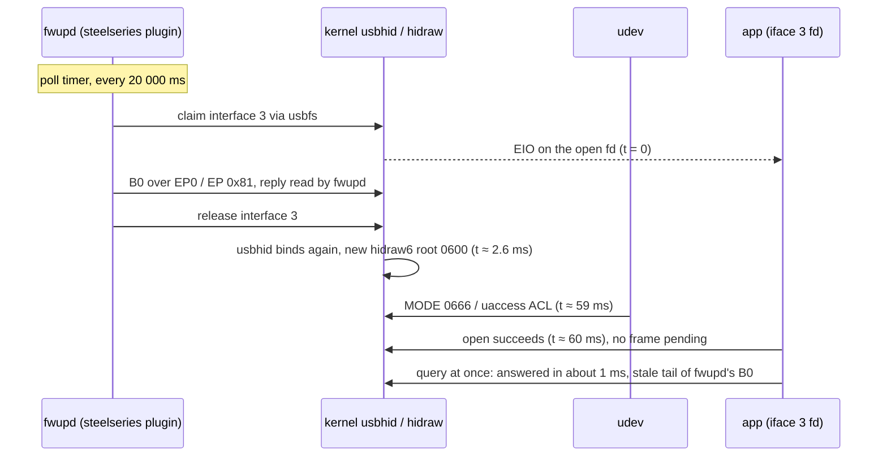

# Arctis Nova 5: hardware and sandbox findings (SP0)

Status: SP0 result, 2026-10-12 00:36–01:00 (-03), run by an agent with nobody at the desk. It answers each SP0 item
of [the design](../superpowers/specs/2026-10-11-arctis-companion-design.md) §5 with captures, or names it **needs a
person** with the designed fallback and the procedure for SP14's hardware checklist (§7). Protocol facts are in
[hid-protocol.md](hid-protocol.md); frames captured here are in [`captures/`](captures) (§8).

## 0. Conditions and safety record

| Item | Value |
|---|---|
| Dongle | `1038:2232`, bcdDevice `0110`, full speed, `usb-0000:0c:00.0-5.2.1`, ifaces 3/4/5 = `hidraw6/7/8` |
| Firmware (fwupd 2.1.8) | receiver `1.16.0`, headset `1.7.0` |
| Headset | **off for the whole session**: it had powered itself off after the 30 min inactivity timer (`B0[1] = 2`, fwupd flag `unreachable`). Every device result below is therefore the dongle's behaviour with the headset off; headset-on behaviour is in §7 |
| Host | Fedora 44, kernel 7.2.8, fwupd 2.1.8, PipeWire 1.6.9, WirePlumber 0.5.18, flatpak 1.18.4, `org.gnome.Sdk//50`; `/etc/udev/rules.d/92-viia.rules` gives every hidraw node `0666` |
| Scripts | throwaway Python, outside the repo. Every frame goes through one guard that accepts only the queries `B0 10 20 A0 36`, the setters `37 39 27 AE A3 35` with in-range values, `33` with an in-envelope curve, and `22` only in the one script that sends it; `09 A5 A7 34`, `22` writes and unknown ids raise before `write(2)` |

Writes sent, each preceded by a read of the original value and followed by a restore verified by readback:
`39 03`, `39 06`, `39 0a`, `37 0e`, `27 00`, `AE 04`, `AE 01`, `AE 00`, `A3 0f`, `35 00`, and three `33` curves
(§1.6). `22` was sent once. Nothing else was written.

Full readback before and after the session (stale tails cut at each reply's documented length):

| Query | Initial = final |
|---|---|
| `20` | `20` + 10 × `{32..16000 Hz, peaking, 0 dB, Q 1410}` + `0f 00 01` (mic 15, sidetone 0, limiter on) |
| `A0` | `a0 1e 0a ff 01 01 00 01` (30 min, mute light 10) |
| `B0` | `b0 02 02 20 03 00 00` (link 2, battery 32 %, discharging) |
| `36` | `36 01` (speed) |
| `10` | `"0.01.010.000"`, twelve `.`, twelve `0` |

## 1. Summary

| Area | Item | Answer | Status |
|---|---|---|---|
| Device | persistence across a power cycle | not testable without pressing the power button | needs a person |
| Device | where events arrive | nothing arrived on iface 3, 4 or 5 in 20 min of listening with the headset off | needs a person |
| Device | host write produces an event | headset off: no frame on any interface within 1.5 s of any setter, and no direct reply on iface 3 | headset-off answer; headset on needs a person |
| Device | setter to readback time | headset off: the first readback, sent about 1 ms after the write, already shows the value (18 of 18) | headset-off answer; headset on needs a person |
| Device | `35 0` / `35 1` | headset off: readback follows at once, no link or event change for 6 s | headset-off answer; headset on and "which is Extended range" need a person |
| Device | EQ quantization | headset off: the dongle stores the 60 band bytes bit-exact, odd Q and frequencies included | headset-off answer; headset on needs a person |
| Device | sidetone 0/3/6/10 | the bytes are accepted and read back; the official app's Low/Medium/High bytes are not observable here | needs a person |
| Device | `0x10` slots | A = receiver firmware, B = unknown, C = headset firmware (zeros while the headset is unreachable); decoding taken from fwupd | answered |
| Device | `HID_UNIQ` | empty; the dongle has no USB serial string | answered |
| Glitches | `B0` at 2 s and 60 s, one `0x33` write | needs ears; note fwupd already sends `B0` every 20 s | needs a person |
| iface 3 flap | cause | fwupd's SteelSeries plugin, by source, timing and a fwupd-shaped stale tail | answered without root; the `systemctl stop` check is optional |
| iface 3 flap | shortest `REBIND_SETTLE` | 0 ms after a successful open (24 of 24); the 100 ms default stays | answered |
| iface 3 flap | how long a recreated node is unreadable | 56–60 ms with the `MODE` rule; without `92-viia.rules` needs root | proxy answered; needs a person for root |
| Bluetooth | read-only `0x22` | returns a full band layout (flat factory curve) | answered |
| Bluetooth | `0x34` with phone audio | not sent: needs phone audio and an explicit go-ahead | needs a person |
| Bluetooth | `B0[1]` and `B9` with QuickSwitch | needs a button press and two links | needs a person |
| Sandbox | Flatpak sysfs rescan and hidraw open | works with `--device=all`, including recovery from a rebind inside the sandbox | answered |
| PipeWire | node shape | two streams (Audio/Sink + playback stream) work from a Flatpak; no `pw_filter` | answered |
| PipeWire | Manager role, `default.configured.audio.sink` | granted (`rwxm`) to a Flatpak client whose **context** properties carry `media.category = Manager`; without it the metadata write is silently dropped | answered |
| PipeWire | volume forwarding to the bluez node | works for any Flatpak client (`rwx` on nodes), Manager not needed | answered |
| PipeWire | Nova 5 bluez node properties | no Nova 5 known to bluez on this host (bluetooth unit not running) | needs a person |

## 2. Device behaviour

### 2.1 The dongle answers from its own copy

Every query is answered in 0.6–1.9 ms (`B0` 0.8, `10` 1.1, `20` 1.9, `A0` 1.2, `36` 1.5 ms in the initial
snapshot) although the headset is off. `20`, `A0` and `36` return the last known settings and `B0` returns
link 2 with the last battery value. Consequences, all already compatible with the design:

- a query timeout is not a headset-off signal; `B0[1] != 3` is (device §2 Probing, `HEADSET_OFF_POLL`);
- the settings shown while HeadsetOff come from the dongle's copy, so `Observed` may be published in HeadsetOff,
  but the design keeps adoption to Ready, which is the safer choice;
- setters never produce a reply frame on iface 3 (the listener saw no `27 37 39 AE A3 35 33` frame).

Side observations, not used by any parser: `B0[2]` equals `B0[1]` in both captures (`03 03` on, `02 02` off);
`A0[3]` is `00` with the headset on and `ff` with it off.

### 2.2 Events (`ECHO_WINDOW`)

Setters were written in a quiet window right after a rebind; for 1.5 s after each write and each restore every frame
on iface 3, 4 and 5 was logged. With the headset off no frame arrived other than the readback replies, and the
long listener (iface 3, 4, 5, 20 minutes) saw no unsolicited frame either. Whether the headset echoes host
writes, and on which interface buttons and the dial report, needs the headset on (checklist §7, items 2 and 3).
`ECHO_WINDOW` stays 1 s.

### 2.3 Setter to readback (`VERIFY_BACKOFF`)

| Setter | Trial | Readback that showed the value |
|---|---|---|
| `39` sidetone | 0→3, 0→6, 0→10 and restores | first, 0.7–1.8 ms after the write |
| `37` mic volume | 15→14 and restore | first, 0.6 / 1.4 ms |
| `27` limiter | 1→0 and restore | first, 1.5 / 1.5 ms |
| `AE` mute light | 10→4, 10→1, 10→0 and restores | first, 0.6–1.6 ms |
| `A3` auto off | 30→15 and restore | first, 0.6 / 0.9 ms |

With the headset off the dongle updates its copy synchronously. The headset-on latency is the one that matters and
needs a person; `VERIFY_BACKOFF` stays 50, 150, 400 ms.

### 2.4 Wireless mode (`WIRELESS_MODE_GRACE`)

`35 00` then `35 01`, each followed by `36` and `B0` every 500 ms for 6 s: `36[1]` showed the new value at the first
readback (2 ms), `B0` stayed `02 02` and no event arrived. Mapping stays `0 = range = Extended range on` (LAM, ASM),
and `WIRELESS_MODE_GRACE` stays 5 s until the headset-on run (§7 item 5).

### 2.5 EQ quantization (`curve.rs` tolerances)

Three curves were written with `33` and read back with `20`, then the original curve was restored bit-exact:

| Curve | Content | Readback `[1..61]` |
|---|---|---|
| `odd` | peaking 0 dB at 21, 33, 99, 251, 499, 1001, 2047, 4321, 9999, 19999 Hz; Q 0.201, 0.707, 1.001, 1.414, 1.999, 2.345, 3.333, 4.999, 7.777, 9.999 | identical to the written bytes |
| `kinds` | low shelf 80 Hz +3.5 dB, high-pass 30 Hz, peaking 1 kHz −2.5 dB, low-pass 18 kHz, high shelf 8 kHz +1 dB, five disabled bands (`20001`) | identical |
| `edges` | 20 Hz −10 dB Q 0.2, 20 kHz +10 dB Q 10, gain bytes 21 and 19, Q 1.409–1.420, a disabled band with gain byte 0 | identical |

The dongle does not quantize and keeps the bytes of disabled bands. The factory curve's Q 1410 is therefore what
the firmware stores, not a rounding of 1414. Whether the headset quantizes once the curve reaches it needs the
headset on (§7 item 6). Tolerances stay as designed: frequency ±1 Hz, Q ±1 %, gain byte exact, disabled bands equal.

### 2.6 Sidetone bytes

`39 03`, `39 06`, `39 0a` read back as `20[62]` = 3, 6, 10. The bytes the official app sends for Low, Medium and
High cannot be observed from this computer. Marks stay 0, 3, 6, 10 (device §5); §7 item 7 checks them.

### 2.7 Version slots of `0x10`

fwupd's SteelSeries plugin reads the same command as `Version2` (`0x10`, `fu-steelseries-fizz.rs`,
`FuStructSteelseriesVersion2Res2 { reserved u8, version1 [12], _version_unknown [12], version2 [12] }`, fwupd tag
`2.1.8`) and decodes it in `fu_steelseries_fizz_gen2_get_version2` (`fu-steelseries-fizz-gen2.c`):

| Slot | On-wire | Meaning | Decoding (fwupd) | This dongle |
|---|---|---|---|---|
| A | `[1..12]` | receiver firmware | when slot chars 1, 4, 8 are `.`: each digit pair `ab` at slot chars `[2,3]`, `[6,7]`, `[9,10]` gives `a·16 + b` | `"0.01.010.000"` → `1.16.0` (fwupd: receiver `1.16.0`) |
| B | `[13..24]` | unknown | – | twelve `.` |
| C | `[25..36]` | headset firmware, read through the receiver | otherwise: digit pairs at slot chars `[7,8]` and `[10,11]`, same `a·16 + b`, third part 0 | `"000000001.07"` → `1.7.0` with the headset on; twelve `0` while it is unreachable |

### 2.8 `HID_UNIQ`

`HID_UNIQ=` is empty on all three interfaces and `/sys/bus/usb/devices/1-5.2.1/serial` does not exist (no
iSerial string). The dongle identity is the PID alone (device §5 rule "else the PID alone"). fwupd shows a headset
serial `6167039804022420062`, read with the fizz `Serial2` command `0x12`, which is not in the allow-list.

## 3. Glitches

Needs a person: whether `B0` every 2 s or every 60 s, or one `33` write, is audible. New input for that test: fwupd
already sends `B0` to the receiver every 20 s on every host (§4), and while the headset is reachable it also reads
the battery and a file CRC through the receiver. Fallbacks stay: `STATUS_SAFETY_POLL` 5 min (floor 60 s if no events
exist), `AUTO_SWITCH_MIN_INTERVAL` 30 s on the 2.4 GHz path.

## 4. The iface 3 flap

Cause, confirmed without root:

1. **Source.** fwupd 2.1.8 `plugins/steelseries/fu-steelseries-fizz-tunnel.c` sets
   `FU_STEELSERIES_FIZZ_TUNNEL_POLL_INTERVAL 20000 /* ms*/`; its `poll` opens the parent receiver with a
   `FuDeviceLocker` and sends `ConnectionStatus2` (`0xB0`). `steelseries.quirk` binds `USB\VID_1038&PID_2232` to
   the plugin with `SteelSeriesCmdInterface = 3`, so the open claims interface 3 through usbfs and the kernel
   detaches usbhid.
2. **Timing.** 48 consecutive rebinds were 19.998–20.002 s apart. fwupd's threads (`/proc/<pid>/task/*/schedstat`,
   sampled every 1 ms for 41 s covering three rebinds) woke in a 12–15 ms burst of about 11 wakeups around each
   rebind; outside them only single wakeups occurred:

   ```
   8245.0027 … 8245.0150  fwupd scheduled (11 wakeups)      kernel 8245.006018 hid-generic …2232.0180 hidraw6 input3
   8265.0013 … 8265.0160  fwupd scheduled (11 wakeups)      kernel 8265.005011 hid-generic …2232.0181 hidraw6 input3
   ```
3. **A fwupd-shaped stale tail.** The first `36` after each rebind returns `36 01 02 20 03 00 00 …`: bytes `[2..6]`
   are the tail of a `B0` reply (`b0 02 02 20 03 00 00`) that no hidraw reader asked for
   ([`reply_36_tail_from_fwupd_b0.hex`](captures/reply_36_tail_from_fwupd_b0.hex)).
4. `udevadm monitor --kernel` shows `remove hidraw6`, `unbind` hid and usb interface `1-5.2.1:1.3`, then `add` and
   `bind` 2 ms later, with no USB device event.



`REBIND_SETTLE`: a `36` query was sent 0, 1, 2, 5, 10, 20, 50 and 100 ms after the reopen, three times each: 24 of
24 answered in 0.6–1.8 ms, no read error, no frame pending at open. fwupd has released the interface before usbhid
binds again, so nothing remains to wait for. Decided: the **100 ms** default stays, as margin; it is far below the
20 s period and the reopen itself already lands about 60 ms after the `EIO`.

Unreadable window: the recreated node exists 2.6 ms after the `EIO` with mode `0600`; `open` fails with `EACCES`
for 56–60 ms (median 57.8 ms over 48 rebinds) until udev applies the rule. That is the same udev event that applies
`TAG+="uaccess"`, so the planned rule should behave alike; measuring it with `92-viia.rules` moved away needs root
(§7 item 9). Rebinding treats `EACCES` like a missing node (device §2), which covers it.

The same rebind was observed and recovered from inside a Flatpak sandbox (§6.1).

## 5. Bluetooth

`22` was sent once, right after a `10` whose ASCII filled bytes 1–36. The reply was
`22` + 10 × `{32..16000 Hz, peaking, 0 dB, Q 1410}` ([`reply_22_flat_headset_off.hex`](captures/reply_22_flat_headset_off.hex)):
the dongle keeps a separate Bluetooth band layout, flat at the factory values. Per ADR 0013 the next step is `34`
with phone audio and a `22` readback; it needs a phone paired to the headset and a person listening, and `34` stays
forbidden until then (§7 item 10). `B0[1]` and `B9` with QuickSwitch need a person (§7 item 11).

## 6. Sandbox and PipeWire

### 6.1 Flatpak, sysfs and hidraw

`flatpak run --device=all org.gnome.Sdk//50` with the discovery and port code: `/.flatpak-info` present,
`/sys/class/hidraw/*/device/uevent` readable, the three Nova 5 nodes found by `HID_ID` and `HID_PHYS`, iface 3
opened read-write, `36` answered, a rebind seen as `EIO`, the new node found by a sysfs rescan (`EACCES` ×13, then
open after 58 ms) and `36` answered again. Without `--device=all`, `/sys/class/hidraw` is still listed but
`/dev/hidraw*` does not exist, so `open` fails with `ENOENT` for a node that discovery reports; SP5 maps that
`ENOENT` to PermissionDenied like `EACCES` (§9).

### 6.2 Headless instance

A private PipeWire 1.6.9 + WirePlumber 0.5.18 with its own `XDG_RUNTIME_DIR`, state and config dirs, its own
session bus, and the ALSA, bluez, V4L2 and libcamera monitors disabled. Two null sinks stand in for the Nova 5 bluez
node (`bluez_output.AA_BB_CC_DD_EE_FF.1`, `device.api = bluez5`) and the USB sink. Clients ran inside
`flatpak run org.gnome.Sdk//50` with the instance's socket bound in; PipeWire tagged them `pipewire.access = flatpak`.
The user's live PipeWire was only read.

| Client | Permissions on nodes / metadata | `default.configured.audio.sink` write | `channelVolumes` on the bluez node |
|---|---|---|---|
| Flatpak, no category | `rwx-l` / `rwx` | exit 0, **value unchanged** | applied |
| Flatpak, context property `media.category = Manager` | `rwxml` / `rwxm` | applied | applied |
| same two clients against the live session (read only) | `rwx` and `rwxm` on their own client object | not tried | not tried |

`PIPEWIRE_PROPS` does not reach the client object (the category stayed unset); the property must be in the context
properties the core connects with (`client.conf.d` here; in `pipewire-rs`, the context or core properties).
WirePlumber's `client/find-flatpak-access.lua` grants `Perm.ALL` to `access = flatpak` with `media.category =
Manager` without a portal dialog.

Because a denied write is silent, `crates/audio` detects ManagerDenied by reading `default.configured.audio.sink`
back after setting it (§9).

### 6.3 Node shape

`pw-loopback` run inside the sandbox as a Manager client, with an `Audio/Sink` capture side
(`node.description = "Arctis Nova 5 (Equalizer)"`) and a `Stream/Output/Audio` playback side
(`target.object = bluez_output.AA_BB_CC_DD_EE_FF.1`, `node.dont-reconnect = true`), plus a metadata write of
`default.configured.audio.sink`:

```
Sinks:      32. Arctis Nova 5 / 33. Arctis Nova 5 USB
Filters:    53. arctis_companion_eq_out [Stream/Output/Audio]
          * 54. arctis_companion_eq     [Audio/Sink]
bluez_output.AA_BB_CC_DD_EE_FF.1:playback_FL  |<- arctis_companion_eq_out:output_FL
bluez_output.AA_BB_CC_DD_EE_FF.1:playback_FR  |<- arctis_companion_eq_out:output_FR
default.audio.sink = arctis_companion_eq      default.configured.audio.sink = arctis_companion_eq
```

When the client exited, WirePlumber fell back `default.audio.sink` to the bluez node, but
`default.configured.audio.sink` kept naming the vanished EQ sink. Removal must therefore restore the configured
default itself (audio §2 "Removal"); after a crash the stale value is harmless because WirePlumber falls back.

Decision: **two `pw_stream`s** (the `module-loopback` shape). `pipewire` 0.10 wraps streams, so `crates/audio` stays
`#![forbid(unsafe_code)]` and `raw_filter.rs` is not created.

### 6.4 Nova 5 nodes on the live session (read only)

USB sink `alsa_output.usb-SteelSeries_SteelSeries_Arctis_Nova_5-00.iec958-stereo` and source
`alsa_input.usb-SteelSeries_SteelSeries_Arctis_Nova_5-00.mono-fallback`; their Device has `device.vendor.id 0x1038`,
`device.product.id 0x2232`, `device.bus usb`, which confirms the audio §1 matching rule. No Nova 5 bluez node exists
and bluez is not running on this host, so the bluez properties need a person (§7 item 12); until then the rule
`device.api = bluez5` and `node.description` starting with "Arctis Nova 5" stands.

## 7. Hardware checklist for SP14 (needs a person)

Each item keeps its designed default until a person runs it; scripts must use the same allow-list guard.

| # | Item | Procedure | Designed default meanwhile |
|---|---|---|---|
| 1 | Persistence across a power cycle | record `20 A0 36`; write `39 03` and `37 0e`, verify; power the headset off and on; read again; restore | desired state re-applied on every Syncing (ADR 0007) |
| 2 | Event interface for buttons and dial | listen on iface 3, 4, 5 while pressing mute, turning the volume and ChatMix dials, plugging the charger | read both iface 3 and 5 (ADR 0006) |
| 3 | Echo of host writes | headset on: write each setter, log all interfaces for 1.5 s | `ECHO_WINDOW` 1 s |
| 4 | Setter to readback, headset on | as §2.3 with the headset on | `VERIFY_BACKOFF` 50, 150, 400 ms |
| 5 | `35 0` / `35 1` with the headset on | write, then `36` and `B0` every 100 ms for 10 s; note `B9`; check the official app's Extended range toggle after `35 00` | `WIRELESS_MODE_GRACE` 5 s; 0 = Extended range |
| 6 | EQ quantization, headset on | write `cmd_33_odd.hex`, power-cycle the headset, read `20`, restore | ±1 Hz, ±1 % |
| 7 | Sidetone Low/Medium/High | set each level in the official app, read `20[62]` | marks 0, 3, 6, 10 |
| 8 | Audible glitches | play music; `B0` every 2 s for 1 min, then every 60 s for 5 min; one `33` write | 5 min safety poll, 30 s auto-switch interval |
| 9 | Unreadable window without `92-viia.rules` | as root move the rule away, `udevadm control --reload`, measure `EACCES` time after a rebind, restore the rule | Rebinding retries `EACCES`, give up after 30 s |
| 10 | Bluetooth curve `34` | phone paired, phone audio playing: `34` with a clearly audible curve, `22` readback, restore | known gap "Bluetooth preset for the phone" (ADR 0013) |
| 11 | QuickSwitch | both links up, press QuickSwitch, log `B0[1]` and events | no "playing from Bluetooth" state |
| 12 | Nova 5 bluez node | pair over Bluetooth, `pw-dump` the node and its Device | match by `device.api` and description prefix |
| 13 | Optional flap confirmation | `systemctl stop fwupd` for 2 min, `journalctl -k` shows no `input3` rebind, start it again | fwupd is the cause (§4) |

## 8. Captures

[`captures/*.hex`](captures): one 64-byte frame per file, lowercase hex bytes separated by spaces on one line,
exactly as read from or written to hidraw without the leading report-id `00`. Replies keep their stale tails, which
is what the golden tests need. SP2 moves them to `crates/core/tests/golden/`.

| Files | Content |
|---|---|
| `reply_{b0_link3,10,20_flat,36_speed,a0}_headset_on.hex` | the headset-on frames of [hid-protocol.md](hid-protocol.md) §7.1 (2026-10-11), full 64 bytes |
| `reply_{b0_link2,10,20_flat,36_speed,a0}_headset_off.hex` | the initial readback of this session |
| `reply_36_range_headset_off.hex` | `36[1] = 0` after `35 00` |
| `reply_36_tail_from_fwupd_b0.hex` | first reply after a rebind, tail left by fwupd |
| `reply_22_flat_headset_off.hex` | the Bluetooth band layout |
| `cmd_33_{odd,kinds,edges}.hex`, `reply_20_after_33_*.hex` | EQ writes and their readbacks |
| `cmd_{39_03,39_06,39_0a,37_0e,27_00,ae_04,ae_01,ae_00,a3_0f,35_00,35_01}.hex` | setter frames as sent |
| `reply_20_after_{sidetone_3,sidetone_6,sidetone_10,mic_volume_14,limiter_off}.hex`, `reply_a0_after_{mute_light_4,mute_light_1,mute_light_0,auto_off_15}.hex` | readbacks showing each written value |

## 9. Decisions

| Constant or rule | Value | Basis |
|---|---|---|
| `REBIND_SETTLE` (`core::session::timing`) | 100 ms (unchanged) | §4: 0 ms safe in 24 of 24 |
| `VERIFY_BACKOFF` | 50, 150, 400 ms (unchanged) | §2.3; headset-on run §7 item 4 |
| `ECHO_WINDOW` | 1 s (unchanged) | §2.2; §7 item 3 |
| `WIRELESS_MODE_GRACE` | 5 s (unchanged) | §2.4; §7 item 5 |
| `STATUS_SAFETY_POLL` | 5 min, floor 60 s (unchanged) | §3; §7 item 8 |
| `RESCAN_REBINDING`, `REBIND_GIVE_UP` | 250 ms, 30 s (unchanged) | node openable 60 ms after `EIO` |
| `core::companion::timing` | all unchanged | no SP0 result touches them; `AUTO_SWITCH_MIN_INTERVAL` waits for §7 item 8 |
| `core::eq::curve` tolerances | ±1 Hz, Q ±1 %, gain byte exact, disabled bands equal (unchanged) | §2.5 |
| Identity | PID alone on the Nova 5 | §2.8 |
| `0x10` decoding | slots A and C as §2.7, slot B ignored | fwupd source |
| `ENOENT` on a node discovery reports | PermissionDenied, like `EACCES` (SP5) | §6.1 |
| ManagerDenied detection | read `default.configured.audio.sink` back after writing it (SP7) | §6.2 |
| Manager role | `media.category = Manager` in the context properties (SP7) | §6.2 |
| EQ node shape | two `pw_stream`s; `crates/audio` stays `forbid(unsafe_code)` | §6.3 |
| `Command` | unchanged: no `22`, no `34` until §7 item 10 | §5, ADR 0013 |

## 10. Deviations from the SP0 plan

| Deviation | Why |
|---|---|
| Device items were measured with the headset off; their headset-on halves moved to §7 | the headset had powered itself off and nobody could turn it on |
| fwupd was not stopped; the cause was confirmed from source, timing and the stale tail instead, and the stop test is optional item 13 | `systemctl stop fwupd` needs root |
| `34` was not sent although `22` returned a band layout | it needs phone audio and a listener, and this run allowed no `34` |
| The device spec's timing table and ADR 0005 now point here instead of saying "SP0 measures/confirms" | keeps the authoritative docs in step with the results |
