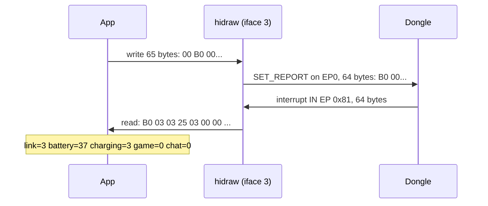
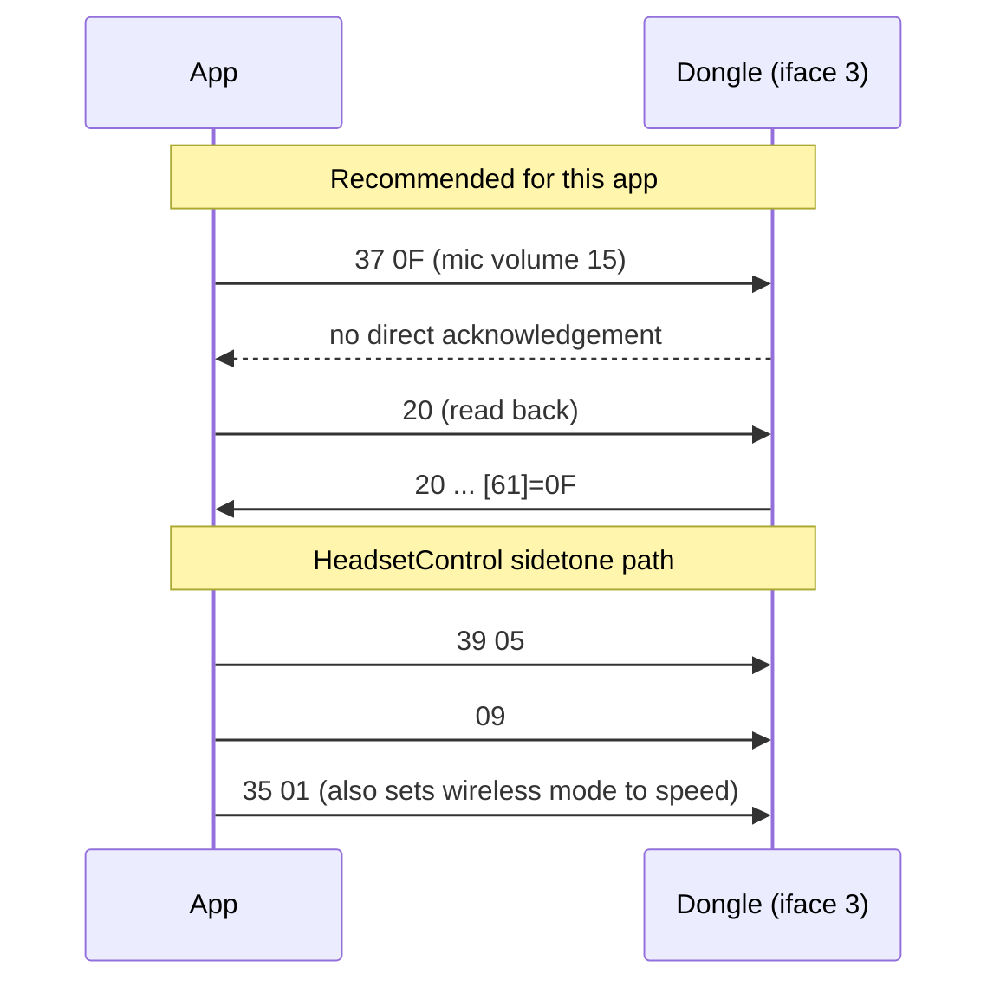
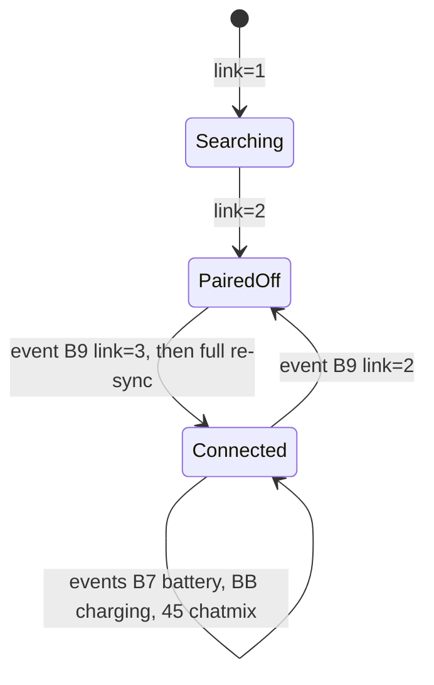
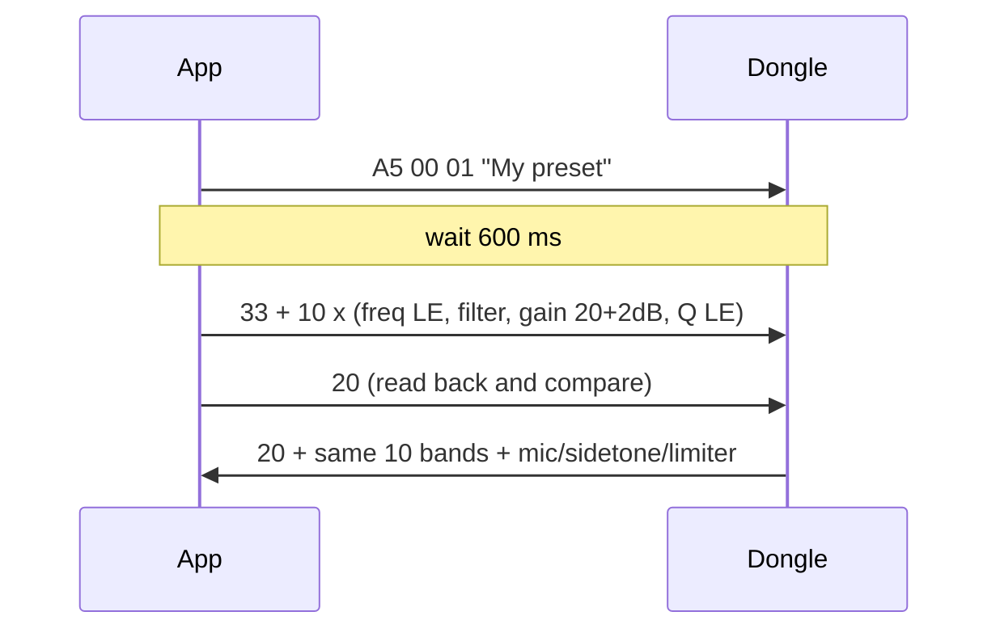

# Arctis Nova 5 - USB HID protocol

Status legend: **VERIFIED-LIVE** = observed on the real dongle on 2026-10-11 (read-only); **UPSTREAM** = taken from upstream source, not exercised live; **UNVERIFIED** = inferred or not found.

## 1. Sources

| Id | Source | Pinned revision | Used for |
|----|--------|-----------------|----------|
| HC | https://github.com/Sapd/HeadsetControl, `lib/devices/steelseries_arctis_nova_5.hpp`, `lib/devices/protocols/steelseries_protocol.hpp` | `d0da29a09729307ba78cc0dfe69a439b95f068fd` | write commands, battery, chatmix, presets |
| LAM | https://github.com/elegos/Linux-Arctis-Manager, `daemon/device-configs/base_arctis_nova_5.yaml`, `daemon/device-configs/nova_5.yaml`, `daemon/device-config/src/builtins.rs` | `fa010512176fec0c64145a6f121be22b8493cf9b` | structs derived from the SteelSeries vendor spec, read-back commands, unsolicited events, wireless mode |
| ASM | https://github.com/loteran/Arctis-Sound-Manager, `src/arctis_sound_manager/devices/nova_5.yaml`, `docs/HARDWARE-QUESTIONS.md` | `41ea013574ca5a4d3a4dcf4cb83a8a67739a6e18` | init sequence, inactivity table, timing, polling-glitch report |
| Live | `/dev/hidraw6..8`, scripts in the session scratchpad: `hid_readonly.py`, `hid_listen.py`; captures `live_query.txt`, `live_listen.txt` | - | descriptors, read-back frames |

Other Nova 5 projects found on GitHub: `willbilec/steelSeries-headset-control` (NVDA add-on, `steelSeriesBattery.py:815`) only queries the SteelSeries GG local HTTP API (`arctis_nova_5_tx`), no HID bytes, so it is not a source. The upstream YAML comments in LAM and ASM say the structs come from SteelSeries' own device spec; those specs are not public (UNVERIFIED provenance).

## 2. Device identity

| Item | Value | Status |
|------|-------|--------|
| Vendor id | `0x1038` | live |
| Nova 5 dongle | `0x2232` (bcdDevice `0x0110`, USB full-speed 12 Mb/s) | live |
| Nova 5X dongle | `0x2253` | HC `steelseries_arctis_nova_5.hpp:29-32`, LAM `nova_5.yaml` variants |
| Nova 5X variant | `0x2255` | ASM `nova_5.yaml:17` only (UNVERIFIED) |
| Nova 5X white / rev2 | `0x2264` | LAM `nova_5.yaml` variants, ASM `nova_5.yaml` (UNVERIFIED) |
| Bootloader PIDs | `0x2233`, `0x2254`, `0x2265` | LAM `nova_5.yaml` only. Never open these. |
| Product string | `SteelSeries Arctis Nova 5` | live |

The dongle is a composite device, six USB interfaces:

| USB iface | hidraw (now) | Class | Endpoint | Usage page / usage | Role |
|-----------|--------------|-------|----------|--------------------|------|
| 0, 1, 2 | - | Audio (snd-usb-audio) | - | - | sound card |
| 3 | hidraw6 | HID | `0x81` interrupt IN only | `0xFFC0` / `0x01` | **command + status interface** (HC `getCapabilityDetail`, line 95-99) |
| 4 | hidraw7 | HID | `0x82` interrupt IN | Consumer `0x0C` / `0x01` | media/volume keys |
| 5 | hidraw8 | HID | `0x84` interrupt IN | `0xFF00` / `0x01` | **unsolicited event interface** (LAM `sync_interface`) |

There is no interrupt OUT endpoint. Writes through `/dev/hidraw` become HID `SET_REPORT` control transfers on endpoint 0, which the kernel does transparently. ASM calls this `command_transport: ctrl_output` (`nova_5.yaml:24`).

## 3. Report descriptors (VERIFIED-LIVE, decoded by hand)

Read from `/sys/class/hidraw/hidrawN/device/report_descriptor`. None of the three descriptors declares a Report ID, so the wire format has no ID byte.

**iface 3 (hidraw6)**, 37 bytes:
```
06 c0 ff  Usage Page (0xFFC0)         09 01  Usage (1)         a1 01  Collection (Application)
06 c1 ff  Usage Page (0xFFC1)         15 00  Logical Min 0     26 ff 00  Logical Max 255   75 08  Report Size 8
09 f0  Usage (0xF0)   95 40  Count 64   81 02  Input  -> 64-byte input report
09 f1  Usage (0xF1)   95 40  Count 64   91 02  Output -> 64-byte output report
09 f2  Usage (0xF2)   96 02 02  Count 514   b1 02  Feature -> 514-byte feature report
c0
```

**iface 4 (hidraw7)**, 31 bytes: Consumer Control, Volume Up (`0xE9`) and Volume Down (`0xEA`) as 2 one-bit fields, 6 bits padding, then Scan Previous (`0xB6`), Play/Pause (`0xCD`), Scan Next (`0xB5`) as 3 one-bit fields, 21 bits padding. Input report is 4 bytes. There is no Mute usage (`0xE2`), so the headset mute button is not reported here.

**iface 5 (hidraw8)**, 27 bytes: Usage Page `0xFF00`, usage 1, inner page `0xFF01`, 64-byte input (usage `0xF0`) and 64-byte output (usage `0xF1`). No feature report.

The feature report on iface 3 is declared but no upstream project uses it (UNVERIFIED purpose).

## 4. Framing rules

- Host to device: 64-byte output report. Through `/dev/hidraw` write 65 bytes, a leading `0x00` that the kernel strips because there is no Report ID, then the 64 payload bytes (LAM `chunk_size: 65`, ASM `command_padding length 64`). HC writes a 64-byte buffer starting with `0x00`, so it ends up sending 63 payload bytes; both work on hardware per upstream reports.
- Payload byte 0 is the **command id**, byte 1 onward are arguments, zero padded.
- Device to host: 64-byte input report, byte 0 echoes the command id, byte 1 onward is data. **Offsets in the LAM YAML include the dummy report-id byte, so subtract 1 for on-wire offsets** (ASM states the same shift, `nova_5.yaml:51-60`). Everything in this document uses **on-wire offsets** unless it says "LAM offset".
- Responses are **not zero-cleared**. Bytes after the documented length contain stale data from earlier responses (see 7.2). Parse only the documented length.
- Multi-byte integers are little-endian.
- Inter-command spacing: 50 ms, wait 3000 ms after enumeration before the first command, 600 ms between the EQ name frame and the EQ band frame (ASM `nova_5.yaml:5-9,103`).

## 5. Command table

"Dir": W write, R query with reply, E unsolicited event. "Save" says whether upstream sends a persist command after the write. All commands go to iface 3, events come on iface 5 (possibly 3 as well, see 6).

### 5.1 Queries

| Purpose | Dir | Cmd | Request payload | Reply layout (on-wire) | Evidence |
|---------|-----|-----|-----------------|------------------------|----------|
| Status: connection, battery, charging, chatmix | R | `0xB0` | `B0` | `[0]=B0 [1]=link [2]=unused [3]=battery% [4]=charging [5]=chatmix game 0-100 [6]=chatmix chat 0-100` | HC `getBattery` 171-203, `getChatmix` 313-345, `readDeviceStatus` `steelseries_protocol.hpp:253`; LAM `headset_status` 69; live |
| Firmware / version strings | R | `0x10` | `10` | `[0]=10 [1..12]=ASCII slot A [13..24]=ASCII slot B [25..36]=ASCII slot C` | ASM `nova_5.yaml:49` sends it during init with no mapping; layout from live capture only |
| Current EQ (wireless profile) | R | `0x20` | `20` | `[0]=20, 10 bands x 6 bytes at [1..60], [61]=mic volume 0-15, [62]=sidetone 0-10, [63]=volume limiter 0/1` | LAM `audio_settings` 171; live |
| Current EQ (Bluetooth profile) | R | `0x22` | `22` | same band layout as `0x20`, bands only, no trailer | LAM `audio_settings_bt` 222. Not sent live. |
| UX settings | R | `0xA0` | `A0` | `[0]=A0 [1]=inactivity minutes [2]=mute LED raw [3]=unused [4]=eq-sync (unused) [5..7]=unused` | LAM `ux_settings` 270; live |
| Wireless mode | R | `0x36` | `36` | `[0]=36 [1]=mode (0 = range, 1 = speed)` | LAM `wireless_mode_status` 60; ASM `nova_5.yaml:81`; live |

Notes:
- ASM's `device_init` (`nova_5.yaml:47-59`) sends `0xB0`, `0x10`, `0x36` as plain queries, then re-applies stored settings with `0xAE`, `0x37`, `0xA3`, `0x27`, `0x39` (each paired with a settings key, so these are writes that restore state), and `0x09` twice. `0x20` and `0xA0` come from the LAM structs.
- `0xA7` appears in the ASM init and in no struct elsewhere (UNVERIFIED purpose). Do not send.

### 5.2 Setting writes

| Setting | Cmd | Payload | Range and UI mapping | Save needed? | Evidence |
|---------|-----|---------|----------------------|--------------|----------|
| Sidetone | `0x39` | `39 <n>` | `n` 0..10 (11 steps). Official app shows Off/Low/Medium/High: UI to byte mapping UNVERIFIED (GameBuds uses 0/3/6/10, builtins.rs `gamebuds_sidetone_write_payload`; Nova 5 mapping not documented). HC maps its 0-128 scale to 11 buckets (`mapSidetoneToDiscrete<11>`) | HC yes, LAM no | HC 205-226, LAM `sidetone` 32 |
| Mic volume | `0x37` | `37 <n>` | `n` 0..15 (16 steps; the official slider has about 15) | HC yes, LAM no | HC 244-267, LAM `mic_volume` 27 |
| Mic mute LED brightness | `0xAE` | `AE <raw>` | Level 0 Off to raw `0x00`, 1 Low to `0x01`, 2 Medium to `0x04`, 3 High to `0x0A`. Unknown raw values map to medium on the firmware (LAM builtins.rs:101-115) | HC yes, LAM no | HC 269-295, LAM `muted_mic_brightness` 47, ASM `nova_5.yaml:179` |
| Volume limiter | `0x27` | `27 <0/1>` | 0 off, 1 on | HC yes, LAM no | HC 297-311, LAM `volume_limiter` 37 |
| Inactive (auto-off) time | `0xA3` | `A3 <minutes>` | 0 = never. ASM's UI list: 0, 1, 5, 10, 15, 30, 45, 60, 75, 90 minutes (`0x00,0x01,0x05,0x0A,0x0F,0x1E,0x2D,0x3C,0x4B,0x5A`), default 30. HC accepts any 0..255 | HC no | HC 228-242, ASM `nova_5.yaml:166-178` |
| Wireless mode ("Extended range") | `0x35` | `35 <mode>` | 0 = **range** (extended range, lower mic quality), 1 = **speed**. Official toggle "Extended range mode on" is expected to be 0 (name match, UNVERIFIED against the official app) | no | LAM `wireless_mode` 52, ASM `nova_5.yaml:202-206` |
| Custom EQ, 10 bands | `0x33` | `33` then 10 x 6 bytes | see 5.3 | HC yes | HC 381-432 |
| Custom EQ, Bluetooth profile | `0x34` | same as `0x33` | applies to BT audio (UNVERIFIED on Nova 5; shape from LAM `parametric_eq_bt` 162) | - | LAM |
| EQ preset name announce | `0xA5` | `A5 <conn> <preset_type> <name utf8...>` | conn 0 wireless, 1 Bluetooth. preset_type 0 built-in, 1 custom. Sent 600 ms before the band frame so the official app can show the preset name. HC omits it | no | LAM `parametric_eq` 153, ASM `hardware_eq` block |
| "Save" command A | `0x09` | `09` | meaning UNVERIFIED | - | HC `saveStateNova5` 153-165; ASM sends `0x09` twice at init |
| "Save" command B | `0x35 0x01` | `35 01` | **this is the wireless mode write with value 1 (speed)** | - | HC 153-165 vs LAM 52 |

#### Finding: HeadsetControl's "save" is suspect

HC calls `saveStateNova5` after sidetone, mic volume, mic LED, volume limiter and EQ. It sends `09` then `35 01`. LAM and ASM both define `0x35` as the wireless mode setter and neither project has any save-to-flash command for this device (LAM `base_arctis_nova_5.yaml:23-26` "No save_to_flash ... structs exist for this device" and `:432-435` "this device has no save_to_flash struct (settings apply immediately, no explicit commit step)"; this comes from the vendor spec as LAM read it, not from a hardware persistence test. HC itself sends only `0x00 0x09` as save on Nova 7, `steelseries_arctis_nova_7.hpp:190`, so `35 01` is a Nova 5 specific addition). Reading the three together, HC probably flips the headset to speed mode (extended range off) every time it writes a setting. HC may have reused the `0x35` byte from its Nova 7 save pattern. Both interpretations are UNVERIFIED because writes were out of scope for the live test.

Decision for the app: do **not** send `09` or `35 01` after setting writes. Setting writes should be followed by a `0xA0`/`0x20` read-back to confirm. A later, explicit hardware test (power-cycle the headset after a write) should settle whether anything persists without a save.

### 5.3 Equalizer encoding

Band record, 6 bytes, repeated 10 times (`0x20` reply from byte 1, `0x33` write from byte 1):

| Offset in record | Size | Field | Encoding |
|------------------|------|-------|----------|
| 0-1 | u16 LE | frequency Hz | 20..20000; `20001` marks a disabled band (HC `EQUALIZER_FREQ_DISABLED`) |
| 2 | u8 | filter type | 1 peaking, 2 low-pass, 3 high-pass, 4 low shelf, 5 high shelf (HC `getFilterByte` 59-79). ASM names 6 = notch for other families (not confirmed on Nova 5) |
| 3 | u8 | gain | `raw = 20 + 2 * dB`, so 0..40 covers -10..+10 dB in 0.5 dB steps (HC 38-42, LAM `audio_settings` range 0..40). 20 = 0 dB |
| 4-5 | u16 LE | Q x 1000 | 200..10000 (Q 0.2..10). HC writes 1414 (`0x0586`); the device reports 1410 (`0x0582`) for factory bands |

Factory band frequencies, live and HC: 32, 64, 125, 250, 500, 1000, 2000, 4000, 8000, 16000 Hz.

Gain encoding conflict: ASM `hardware_eq.py` documents signed decibels (0 dB = `0x00`, +12 = `0x78`) but that is for other families; for Nova 5 both HC and LAM (`unsigned_half_db_offset`, offset 10 dB, clamp 40, builtins.rs:347-352) agree on the unsigned offset form, and the live frame shows `0x14` for flat. Use the offset form.

Presets in HC (names match the official app, values UNVERIFIED against it), gains in dB, band order as above:

| Preset | Gains |
|--------|-------|
| Flat | 0 0 0 0 0 0 0 0 0 0 |
| Bass | 3.5 5.5 4 1 -1.5 -1.5 -1 -1 -1 -1 |
| Focus | -5 -3.5 -1 -3.5 -2.5 4 6 -3.5 0 0 |
| Smiley | 3 3.5 1.5 -1.5 -4 -4 -2.5 1.5 3 4 |

HC marks the filter byte of the preset frame as `0x01` for flat bands, `0x04` (low shelf) for band 1 and `0x05` (high shelf) for band 10 only when their gain is non-zero (HC 395-410). This matches the shelf shape of the official presets. The device's current preset index is **not** readable: the `0x20` reply holds the curve only, so the app must identify a preset by comparing the curve (UNVERIFIED that no preset-id field exists).

Conflict on the band frame header: LAM builds `[33, <connection byte>, bands...]` (`builtins.rs:230-250`), whereas HC, ASM (`bands_carry_connection: false`, "including it would shift the whole curve by one byte") and the `0x20` read-back all have bands directly after the command byte. Majority wins; the LAM variant is UNVERIFIED and likely wrong for Nova 5.

### 5.4 Status values

| Field | Raw to meaning | Evidence |
|-------|----------------|----------|
| link `[1]` | 0 not paired, not searching; 1 not paired, searching; 2 paired, not connected (headset off or out of range); 3 paired and connected | LAM `connection_status_to_label` (labels), HC treats `2` as offline, ASM treats `3` on and `2` off. Live: 3 |
| battery `[3]` | percent 0..100 directly | live `0x25` = 37 % |
| charging `[4]` | 0 unknown or headset not connected; 1 plugged in, charging; 2 plugged in, not charging; 3 discharging | LAM `charging_status_to_label`. HC only tests `1`. Live: 3 |
| chatmix `[5]`,`[6]` | game and chat volume 0..100. HC notes the dongle reports valid chatmix even when the headset is off | HC 313-345. Live: 0, 0 |

Bluetooth: no upstream struct carries a Bluetooth connection flag on the dongle. ASM's test suite states the byte once read as Bluetooth is padding and the Nova 5 dongle has no Bluetooth (`tests/test_status_offsets_vs_spec.py`, `nova_5.yaml:41-50`). The dongle only knows the 2.4 GHz link, so the official app's 2.4G/Bluetooth icons and "Audio mode" switch are probably served by the headset's own Bluetooth (phone side), outside this USB interface. UNVERIFIED. Likewise no upstream command exists for **call volume**, **BT power-on behaviour**, or an **audio mode 2.4G/BT switch**: all UNVERIFIED and treated as not available over USB.

## 6. Unsolicited events (UPSTREAM, none observed live)

LAM `sync_events` (`base_arctis_nova_5.yaml:344-395`) lists reports the headset pushes when the user changes something on the device. LAM byte indexes include the dummy report-id byte, so on-wire the value sits one byte earlier than the YAML says (the table is already converted).

| Event cmd | Meaning | Payload (on-wire) |
|-----------|---------|-------------------|
| `0x27` | volume limiter changed | `[1]` 0/1 |
| `0x37` | mic volume changed | `[1]` 0..15 |
| `0x39` | sidetone changed | `[1]` 0..10 |
| `0x45` | chatmix dial moved | `[1]` game 0..100, `[2]` chat 0..100 |
| `0xA3` | inactivity timer changed | `[1]` minutes |
| `0xAE` | mute LED brightness changed | `[1]` raw 0/1/4/10 (map to level 0..3) |
| `0xB7` | battery level changed | `[1]` percent |
| `0xB9` | connection (headset power or link) changed | `[1]` link state as 5.4. LAM triggers a full re-sync of settings on this event |
| `0xBB` | charging state changed | `[1]` charging state as 5.4 |

LAM reads them from iface 5 (`sync_interface`, usage page `0xFF00`, "taken as declared" by the vendor spec; `nova_5.yaml:7-25` says its earlier v2 also listened on 3 and "nothing in the spec suggests it pushes unsolicited data" there, and that command writes going to iface 3 came from a PyUSB experiment on real hardware); ASM listens on both 3 and 5 (`nova_5.yaml:45`, noting "restored from upstream rather than measured"). Where each event arrives is UNVERIFIED. No event is documented for the mute button; the mute state itself is not in the status frame (UNVERIFIED), only the mute LED brightness. The consumer interface (iface 4) reports volume up/down and media keys as plain HID.

Practical consequence: use the events for battery, charging and connection instead of polling. HeadsetControl issue #452 (https://github.com/Sapd/HeadsetControl/issues/452, open, 6 comments, verified through `gh`) reports audio glitches on Nova 5 around battery polling, and ASM polls every 2 s (`docs/HARDWARE-QUESTIONS.md` INT-2, lines 474-512). Not reproduced here (UNVERIFIED). Poll `0xB0` once on connect and then rarely (for example every 5 minutes) as a safety net.

## 7. Live verification (read-only)

Only `0xB0`, `0x10`, `0x20`, `0x36`, `0xA0` were sent, all known read commands, one frame each, to iface 3. Nothing was written to any setting. Script: `hid_readonly.py` (stdlib, allow-list of those five command ids enforced with an assert).

### 7.1 Captured frames

Headset was on, connected, discharging. Frames are 64 bytes, shown in full.

```
tx 00 b0
rx b0 03 03 25 03 00 00 31 30 2e 30 30 30 2e 2e 2e 2e 2e 2e 2e 2e 2e 2e 2e 2e 30 30 30 30 30 30 30 30 31 2e 30 37 00 ... (zeros to 64)

tx 00 10
rx 10 30 2e 30 31 2e 30 31 30 2e 30 30 30 2e 2e 2e 2e 2e 2e 2e 2e 2e 2e 2e 2e 30 30 30 30 30 30 30 30 31 2e 30 37 00 ... (zeros to 64)

tx 00 20
rx 20 20 00 01 14 82 05 40 00 01 14 82 05 7d 00 01 14 82 05 fa 00 01 14 82 05 f4 01 01 14 82 05 e8 03 01 14 82 05 d0 07 01 14 82 05 a0 0f 01 14 82 05 40 1f 01 14 82 05 80 3e 01 14 82 05 0f 00 01

tx 00 36
rx 36 01 00 01 14 82 05 40 00 01 14 82 05 7d 00 01 14 82 05 fa 00 01 14 82 05 f4 01 01 14 82 05 e8 03 01 14 82 05 d0 07 01 14 82 05 a0 0f 01 14 82 05 40 1f 01 14 82 05 80 3e 01 14 82 05 0f 00 01

tx 00 a0
rx a0 1e 0a 00 01 01 00 01 00 01 14 82 05 7d 00 01 14 82 05 fa 00 01 14 82 05 f4 01 01 14 82 05 e8 03 01 14 82 05 d0 07 01 14 82 05 a0 0f 01 14 82 05 40 1f 01 14 82 05 80 3e 01 14 82 05 0f 00 01
```

### 7.2 Decoding

| Frame | Field | Raw | Meaning |
|-------|-------|-----|---------|
| `0xB0` | `[1]` | `03` | paired and connected |
| | `[2]` | `03` | the spec's "unused" byte (value 3 here, ASM `nova_5.yaml:41` agrees it carries nothing) |
| | `[3]` | `25` | battery 37 % |
| | `[4]` | `03` | discharging |
| | `[5]`,`[6]` | `00 00` | chatmix game 0, chat 0 |
| | `[7..]` | `10.000...` | stale text from the previous `0x10` reply, not part of the status frame |
| `0x10` | `[1..12]` | `"0.01.010.000"` | version string slot A |
| | `[13..24]` | twelve `.` | empty slot B |
| | `[25..36]` | `"000000001.07"` | version string slot C |
| `0x20` | band 1..10 | `20 00 / 40 00 / 7d 00 / fa 00 / f4 01 / e8 03 / d0 07 / a0 0f / 40 1f / 80 3e` | 32, 64, 125, 250, 500, 1000, 2000, 4000, 8000, 16000 Hz |
| | filter byte | `01` x10 | peaking |
| | gain byte | `14` x10 | 20, so 0 dB: the current curve is Flat |
| | Q | `82 05` x10 | 0x0582 = 1410, Q 1.41 |
| | `[61]` | `0f` | mic volume 15 (max) |
| | `[62]` | `00` | sidetone 0 (off) |
| | `[63]` | `01` | volume limiter on |
| `0x36` | `[1]` | `01` | wireless mode = speed (extended range off) |
| | `[2..]` | band bytes | stale tail from the `0x20` reply |
| `0xA0` | `[1]` | `1e` | inactivity timer 30 minutes |
| | `[2]` | `0a` | mute LED raw 10 = High |
| | `[3..7]` | `00 01 01 00 01` | unused/eq-sync bytes (LAM: `unused1`, `eq_sync_unused`, `unused2..4`); values not meaningful |
| | `[8..]` | `00 01 14 ...` | stale tail |

Meaning of the three version slots is UNVERIFIED. The dongle and the headset each have firmware, so slots probably hold dongle and headset versions, but no upstream project decodes them. The `bcdDevice` of the dongle is `1.10`, which does not obviously match any slot.

The stale-tail behaviour in the `0xB0`, `0x36`, `0xA0` replies is real: each reply begins with the new data and keeps the tail of the previous reply. Parsers must use fixed lengths.

### 7.3 Listening for unsolicited reports

`hid_listen.py` listened on iface 3, 4 and 5 for 45 s while the headset was idle (`live_listen.txt`): **no input report arrived on any interface**. Events in section 6 therefore remain UPSTREAM only; triggering them would need a button press or a setting change, neither allowed here.

### 7.4 Finding: iface 3 re-binds every 20 seconds

While capturing, reads on hidraw6 failed with `EIO (5)` about every 20 s and the node was recreated. The kernel log shows the pattern since the dongle enumerated at 22:27:

```
23:40:12 hid-generic 0003:1038:2232.00C1: hiddev98,hidraw6: ... on usb-0000:0c:00.0-5.2.1/input3
23:40:32 hid-generic 0003:1038:2232.00C2: hiddev98,hidraw6: ... on usb-0000:0c:00.0-5.2.1/input3
23:40:52 hid-generic 0003:1038:2232.00C3: hiddev98,hidraw6: ... on usb-0000:0c:00.0-5.2.1/input3
```

Only iface 3 flaps; ifaces 4 and 5 stay bound. 195 such lines in the last 3 hours. The cause was not identified (not my scripts, the first one ran after the pattern started; a host process, the firmware, or kernel probing are all possible, UNVERIFIED). The hidraw index is not stable (`hidraw13` appeared once). Design consequences:

- Never cache `/dev/hidrawN`. Discover by udev (`SUBSYSTEM=="hidraw"`, `ID_VENDOR_ID=1038`, `ID_MODEL_ID` in the PID list, interface number 3 or 5 from the parent `bInterfaceNumber`) and re-open on `EIO`/`ENODEV`.
- Treat command failures as retryable; re-send idempotent settings, never blindly retry toggles.
- Verify the cause on a clean boot with no other tools before shipping.

Review note (2026-10-12, not yet confirmed by stopping the service): the likely cause is fwupd's SteelSeries "fizz" plugin. `udevadm monitor` shows usbhid unbound from `1-5.2.1:1.3` and rebound 5 ms later with no USB reset in `journalctl -k`; the period is exactly 20.000 s; the dongle's usbfs node is touched about 6 ms before each new hidraw node; `fwupdmgr get-devices` lists "Arctis Nova 5 USB Receiver" and "Arctis Nova 5 Headset via USB Receiver" under plugin `steelseries`, protocol `com.steelseries.fizz`. SP0 confirms with `systemctl stop fwupd` for 2 minutes. If confirmed, every host with fwupd sees the flap, and no re-enumeration settle is needed after it.

## 8. Diagrams

### 8.1 Query and response



### 8.2 Write plus verify (recommended) versus HeadsetControl's write plus save



### 8.3 Connection state and events



### 8.4 Custom EQ write (LAM/ASM, with preset name)



## 9. Mapping to the official app's screens

| Official app item | USB support | Command |
|-------------------|-------------|---------|
| Battery % | yes | `0xB0 [3]`, event `0xB7` |
| Connection icons (BT, 2.4G) | 2.4G link state yes, Bluetooth not on dongle (UNVERIFIED) | `0xB0 [1]`, event `0xB9` |
| Audio mode 2.4G/BT toggle | not found | - |
| Equalizer preset picker | yes, as four curves written with `0x33` (Flat, Bass, Focus, Smiley) | `0x33`, `0x20` |
| Mic volume (~15 steps) | yes, 0..15 | `0x37` |
| Sidetone Off/Low/Medium/High | yes, byte 0..10; the four-level mapping is not documented (UNVERIFIED) | `0x39` |
| Mute LED brightness | yes, raw 0/1/4/10 | `0xAE` |
| Volume limiter | yes | `0x27` |
| Extended range mode | yes, wireless mode 0 = range | `0x35`, `0x36` |
| Inactive time | yes | `0xA3` |
| Chatmix | read only | `0xB0 [5][6]`, event `0x45` |
| Firmware version | raw strings only, meaning unverified | `0x10` |

## 9.1 Review notes (completeness critic pass)

Spot-checked against the cloned primary sources: HC pid list (`steelseries_arctis_nova_5.hpp:29-32`), HC `saveStateNova5` bytes (lines 153-165, confirmed `09` then `35 01`), HC command bytes `0x39 0xA3 0x37 0xAE 0x27 0x33`, LAM `wireless_mode` `0x35` with 0=range 1=speed (`base_arctis_nova_5.yaml:52-58`), LAM `sync_events` at line 344. All matched. One citation was corrected in 5.2 (the "no commit step" quote lives at lines 23-26 and 432-435). Remaining gaps a developer must still close with hardware tests: persistence across power cycle, sidetone level mapping, events interface, and whether the 0x20 reply stays valid while the headset is off (UNVERIFIED).

## 10. Open questions

1. Does any setting survive a headset power cycle without a save command? Needs a controlled write test.
2. Meaning of `0x09` and of HC's `35 01` side effect (section 5.2).
3. Exact sidetone Off/Low/Medium/High to byte mapping used by the official app.
4. Which interface carries unsolicited events, and whether the mute button produces one.
5. Meaning of the three version slots of `0x10`.
6. Cause of the 20 s iface 3 re-bind (likely fwupd, see 7.4).
7. Whether PIDs `0x2255` and `0x2264` use the same protocol (taken from LAM and ASM only).
8. Whether a BT-specific channel (`0x22`, `0x34`, `0xA5` with conn 1) does anything on the Nova 5.
