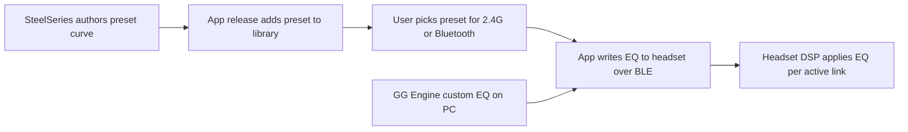
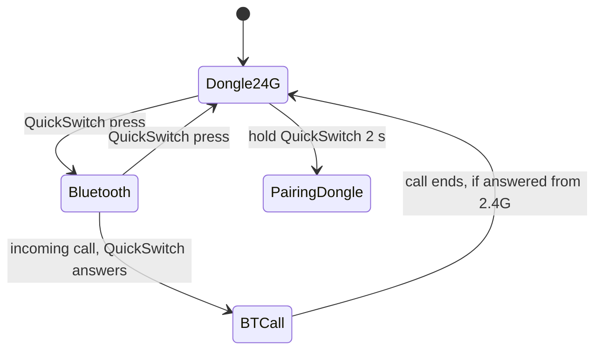

# Official feature inventory: Arctis Nova 5 (Companion App and SteelSeries GG)

Research date: 2026-10-11. Scope: Arctis Nova 5 / 5P / 5X (wireless, dongle + Bluetooth).

Method note. support.steelseries.com, hardreset.info, tweaktown and the Google Play page returned HTTP 403 or no body to the fetcher, so official help-center article bodies were NOT read directly. Their content is known only through search-result summaries and secondary reviews. Every such item is marked UNVERIFIED or attributed to the review that states it. Items marked "user screens" come from the screens the project owner saw in the official mobile app (given in the task brief), not from a web source.

Legend: **P** = parity-required (present in the mobile Companion App). **GG** = only in SteelSeries GG (Windows/macOS; Engine and Sonar). **FW** = firmware or hardware behaviour, not an app setting.

## 1. Sources

| Id | Source | Used for |
|---|---|---|
| S1 | Product Information Guide PDF, https://downloads.steelseriescdn.com/guides/Nova_5_Product_Information_Guide.pdf (English pages 4-11) | Hardware controls, LED colours, pairing, "100+ presets", GG Engine custom EQ |
| S2 | App Store listing, https://apps.apple.com/us/app/-/id6502297763 (fetched 2026-10-11, version 6.10.0) | App feature list, "200+" presets, genre presets, changelog, user reviews |
| S3 | SteelSeries/GN press release, https://www.gn.com/Newsroom/News/2024/May/SteelSeries-unveils-100-game-specific-audio-profiles-with-new-Arctis-Nova-5-and-companion-app | Preset provenance, switch on the fly |
| S4 | TechRadar launch article, https://www.techradar.com/gaming/steelseries-launches-the-new-arctis-nova-5-headset-and-a-superb-companion-app (2024-05-14) | Launch description |
| S5 | The Shortcut review, https://www.theshortcut.com/p/steelseries-arctis-nova-5-wireless-review | App scope, no manual EQ in app, extended range toggle, no multipoint |
| S6 | SoundGuys 5X review, https://www.soundguys.com/steelseries-arctis-nova-5x-review-118793/ | App settings list, 140+ presets, no simultaneous BT and 2.4G |
| S7 | Back2Gaming review, https://www.back2gaming.com/review/steelseries-arctis-nova-5-wireless/ | Sleep timer 1-90 min or never, extended range trade-off, LED, sidetone |
| S8 | Techporn review, https://www.techporn.ph/steelseries-arctis-nova-5-wireless-headset-review/ | GG parametric EQ: up to 10 filters, filter types, gain/Q |
| S9 | Igor's Lab review, https://www.igorslab.de/en/steelseries-arctis-nova-5-wirereless-im-test/3/ | Mandatory registration complaint, GG EQ description |
| S10 | CG Magazine review, https://www.cgmagonline.com/review/hardware/steelseries-arctis-nova-5 (via search summary only) | Quick-Switch as compromise vs Nova 7 dual audio |
| S11 | Support article "Adjusting the Inactivity Timer on the Arctis Companion App", https://support.steelseries.com/hc/en-us/articles/26712533459597 (403; search summary only) | Inactivity timer lives in app Device Settings |
| S12 | Support article "What is sidetone and how do I adjust it in the Arctis Companion App?", https://support.steelseries.com/hc/en-us/articles/26712363484813 (403; search summary only) | Sidetone is a slider on the Microphone card |
| S13 | Support section "Arctis Companion App", https://support.steelseries.com/hc/en-us/sections/26711671763213 (403) | Not read |
| S14 | GameSpot, https://Gamespot.Com/articles/steelseries-arctis-nova-5-headset-lets-you-customize-console-gaming-audio-on-your-phone/1100-6523448/ (search summary only) | App exclusive to the three Nova 5 models at launch |
| S15 | hardreset.info Nova 5 how-tos (extended-range-mode, adjust-mute-led-brightness, auto-power); 403, search summary only | Low-trust corroboration |

## 2. App identity

- Mobile app "SteelSeries Arctis Companion" (iOS developer shown as GN Audio AS; Android package `com.steelseries.arctiscompanion`). Free (S2).
- At launch (2024) the app was named "Nova 5 Companion App" and was exclusive to the Nova 5 trio (S14, S1 title). By 2026 the same app covers Arctis Nova Elite, Nova Pro Omni, GameBuds, Nova 7, Nova 5 and Nova 3 (S2). Features differ per model; ANC, transparency and dual mic modes are NOT Nova 5 features (S2).
- Platform differences: the same setting can sit under different menus (inactivity timer: Android Device Settings vs iOS Power Options, S11). The App Store listing is iPhone only, iOS 15.5+ (S2); Android layout is known only from support summaries.
- Firmware updates are NOT done in the phone app. Support and reviews say firmware updates need SteelSeries GG on PC or Mac (search summary of support article 8601979351693; S2 user review says headset and dongle must be connected directly, not through a hub). UNVERIFIED for the Nova 5 specifically that the app has no update flow; the changelog entry for 6.2.2 says GameBuds firmware is in GG (S2).
- App needs the phone connected over Bluetooth to the headset to change settings (S5: "changing presets requires the phone to be connected over Bluetooth").
- A SteelSeries account/registration is requested by the GG software (S9 complaint). Whether the mobile app requires login is UNVERIFIED.

## 3. Inventory by screen (mobile Companion App)

Values in the "Range" column come from the owner's screens unless a source is cited. Defaults are UNVERIFIED unless stated, because no accessible source lists them; they must be read from a real device during the protocol track.

### 3.1 Home / device card

| Feature | Range / behaviour | Default | Tag | Source |
|---|---|---|---|---|
| Battery percentage | 0-100 % | n/a | P | user screens; S6 ("check battery") |
| Connection icons (Bluetooth, 2.4G) | Which links are active | n/a | P | user screens |
| Audio mode toggle 2.4 GHz / Bluetooth | Two-state switch, equals the headset QuickSwitch button | last used | P | user screens; S1 p.8-9 |
| Device name / model | Nova 5, 5P or 5X | n/a | P | UNVERIFIED for device-info screen |

Hardware battery LED thresholds (FW, S1 p.7): green 100-50 %, yellow 49-15 %, orange 14-5 %, red 4-1 %.

### 3.2 Equalizer screen

| Feature | Detail | Tag | Source |
|---|---|---|---|
| Preset picker | List of presets, e.g. "Flat" | P | user screens |
| Separate EQ per connection (2.4G and Bluetooth) | One preset assigned to the wireless dongle path and another to Bluetooth, switchable on the fly | P | S2 ("Customizable Dual EQ"), S5, S6, S10 |
| Preset library size | "100+" (S1, S3, 2024); "over 140" (S6); "+200" (S2, 2026). Grows via app releases | P | S1, S2, S6 |
| Game presets | Named per title (e.g. Fortnite, Apex Legends, CoD MW III, Minecraft). New titles added nearly every release: 6.10.0 added Beast of Reincarnation, Hell Let Loose: Vietnam, Mortal Shell II and others (S2 version history) | P | S2, S3 |
| Genre/music presets | Afrobeats, Rock, Jazz, Hip-Hop, K-Pop, Reggae, Lo-fi Chill, Metal, Synthwave, Trap | P | S2 |
| Utility presets | Flat, Bass Boost, Focus, Movie, Music; also "Music: Deep Bass", "Movie: Clear Dialogue", "Music: Clear Vocals" | P | S6, S8 |
| Preset authorship | "Developed by audio engineers, esports pros and more"; "mixed by the developers" | n/a | S3, S4, S5 |
| Custom EQ editing on phone | CONFLICTING. S5 and S7 say no manual tweaking in the app and custom EQ is created in GG Engine; S7 notes screenshots show a custom equalizer; S2 listing says "independently adjust the dual equalizer"; S2 user review says custom EQs must be synced from the PC. Treat phone editing as UNVERIFIED and absent for launch firmware | UNVERIFIED | S2, S5, S7 |
| EQ saved on headset | "EQ settings are saved to the headset itself", so the profile persists on console without the phone | FW | S6 (single source, UNVERIFIED) |

### 3.3 Microphone card

| Feature | Range | Default | Tag | Source |
|---|---|---|---|---|
| Mic volume slider | about 15 steps | UNVERIFIED | P | user screens; S5/S6 call it mic gain/pickup |
| Sidetone | Off, Low, Medium, High (about 11 steps on the slider) | UNVERIFIED | P | user screens; S12 (slider on Microphone card) |
| Mute LED brightness | Off, Low, Medium, High | UNVERIFIED | P | user screens; S6, S7 ("LED brightness"); mute LED glows red when muted |

### 3.4 Other controls on the main screen

Note: the App Store text (S2) also lists "chat volume" under communication controls, with no description. It does not appear in the owner's screens, so it is UNVERIFIED for Nova 5 and may belong to other models.

| Feature | Detail | Tag | Source |
|---|---|---|---|
| Volume limiter switch | On/Off. Reduces maximum output volume. In GG it is also settable; the support article on removing the limiter covers the Nova 7 (UNVERIFIED for Nova 5 semantics, e.g. the dB cap) | P | user screens; S6 |
| Extended range mode switch | "Reduces mic audio quality to increase wireless range" (user screens). S7 confirms: trades mic quality for range, best for listening only. S5 confirms a toggle exists. Which link it applies to (2.4G only vs both) is UNVERIFIED | P | user screens; S5; S7 |

### 3.5 Settings (gear) screen

Only the inactivity timer is corroborated. All other rows are UNVERIFIED guesses to confirm on a device or via a screenshot.

| Feature | Detail | Tag | Source |
|---|---|---|---|
| Inactivity (auto-off) timer | Powers the headset off after a period without audio. Android: Device Settings, then an "Inactivity Timer" dropdown (fixed choices, not a free slider). iOS: "Power Options". Range 1 to 90 minutes or never per S7 (single review); dropdown step values and default UNVERIFIED | P | S11 (search summary, re-confirmed 2026-10-11), S7 |
| Firmware version / device info | UNVERIFIED | P? | none |
| Firmware update | Not in phone app per support guidance; done in GG | GG | S2, support summary |
| Bluetooth settings / pairing | Pairing is done with hardware buttons (S1 p.8-9). In-app pairing UNVERIFIED | FW | S1 |
| Voice prompts / language, factory reset, app theme, privacy, help links | UNVERIFIED | ? | none |

## 4. Presets: concept and data model

- Presets are EQ curves authored by SteelSeries for each game or use case; they are not DSP effects, spatial audio or per-game detection (S3, S4).
- Naming and grouping: game title as the preset name for game presets; "Genre" for music; functional names for generic ones (Flat, Bass Boost, Focus, Movie, Music). Whether the app groups them into categories (Games, Music, Movies) or only offers search is UNVERIFIED. The App Store text groups them as "Game-Enhancing Presets" and "Immersive Music Presets" (S2).
- Distribution: presets ship in the app and are added by app updates (S2 version history lists the new titles per release), so the library is app-side data, not headset firmware. The selected curve is then pushed to the headset (the EQ persists on console per S6). Whether the pushed payload is a 10-band graphic curve, biquad coefficients or a preset index is UNVERIFIED and is the key question for the protocol track.
- GG Engine EQ (S8): parametric, up to 10 filters; types peak, low-pass, high-pass, low-shelf, high-shelf; per-filter frequency, gain and Q. The reviewer used gain from -8 to +10 dB and Q from 0.2 to 6.476 as examples, which are not stated limits. The Igor's Lab description (S9) of "a simple graphic EQ with fixed bands" refers to the app or older GG UI and conflicts with S8. Treat the exact band count, gain range and Q range of the headset-side EQ as UNVERIFIED.
- Mobile EQ editor UX (bands, gain range, Q) cannot be described from sources; if the owner has the app, capture screenshots.

The BLE write step and the PC-to-headset path are inferred from S6 and S1; the transport is UNVERIFIED.

## 5. Bluetooth plus 2.4 GHz behaviour

- Spot-check 2026-10-11: S2 wording is "connects through the 2.4 GHz dongle for console audio, or pairs with a phone over Bluetooth at the same time", i.e. both links may be connected at once (control and audio from different sources) but S6 states plainly that it "cannot connect to both at the same time" for audio. The two are reconciled only by Igor's Lab reading below; real behaviour is UNVERIFIED until tested on hardware.
- One source at a time. The QuickSwitch button flips between dongle and Bluetooth (S1 p.8-9, S5, S6, S10). Reviews list the lack of simultaneous audio as a downside and say the Nova 7 has it (S9, S10).
- Igor's Lab says GG supports "simultaneous 2.4 GHz and Bluetooth connections, but not simultaneous playback" (S9). I read this as: both links stay connected, only one carries audio. A phone on Bluetooth can therefore stay connected to the app while the dongle is the active audio source (S6, S14). Behaviour when the active source flips is UNVERIFIED.
- Calls: single press of QuickSwitch answers or ends a Bluetooth call; if answered while in 2.4 GHz mode the headset returns to 2.4 GHz afterwards (S1 p.9). Double press ignores a call.
- No Bluetooth multipoint; SteelSeries reportedly said it was left out to keep the interface simple (S5).
- ChatMix on PC needs GG with Sonar (retail listing via search summary; UNVERIFIED for Nova 5 hardware details).
- Mixing game and chat in software is a Sonar (Windows) concept, so it cannot be replicated by the headset itself; on Linux it is the PipeWire work in the other tracks.

## 6. Hardware controls (not app settings, context for UI)

From S1 p.7-9: power button hold 1 s on/off; single press play/pause, double next, triple previous; during calls single press raises call volume and double lowers it (the guide prints this under the power button). Mic mute button and LED, volume wheel, USB-C charging, retractable ClearCast mic, status LED on the dongle. Dongle re-pairing: hold dongle button 4 s, then hold QuickSwitch 2 s on the headset. These need no app, but the companion should show state where readable.

## 7. SteelSeries GG only features (not parity-required)

| Feature | Detail | Source |
|---|---|---|
| Engine custom EQ | Parametric, up to 10 filters (see section 4) | S1, S8 |
| Sonar | Windows audio suite: channel mixing (game, chat, media, aux, mic), ChatMix, per-app routing, spatial audio, AI noise cancelling for mic | S6 (spatial audio only via GG on PC), S7 (mic has 13 presets and an EQ on PC), S5 |
| Mic EQ and presets | 13 mic presets plus EQ on PC | S7 |
| Firmware updates | Via GG on PC or Mac; headset and dongle must be directly attached | support summary, S2 review |
| Volume limiter in GG | Also settable | S6 |
| Mandatory account | Registration required | S9 |
| Moments, Home | Other GG modules, irrelevant here | S1 |

Not available on Linux in any official form. GG does not run on Linux, so the headset-side settings above (EQ upload, mic, sidetone, limiter) are what this project must supply via the protocol.

## 8. Complaints and opportunities

| Complaint | Evidence | Opportunity for this project |
|---|---|---|
| No custom EQ creation on the phone; PC GG required, no easy sharing of custom EQs | S5, S7, S2 reviews | Built-in EQ editor and import/export of curves |
| Cannot audition game sounds while creating EQ on console | S2 user review | Preview with local audio when on PC (system-side PipeWire EQ) |
| Presets only change while phone is connected over Bluetooth | S5 | Desktop control over USB or BLE without a phone |
| No simultaneous BT and 2.4G audio, no multipoint | S5, S6, S9, S10 | System-side mixing in PipeWire (new feature, other track) |
| Mandatory registration and app/GG required for good sound | S7, S8, S9 | No account, offline operation |
| No Linux support at all | GG scope (S1) | The whole project |
| App scope limited ("not as full-featured as I would like") | S5 | Per-app automatic EQ profiles, battery history graph, desktop notifications (all new, none in official app) |
| Default tuning issues (low-end roll-off, 5 kHz dip, harsh 6-10 kHz) | S6, S8 | Ship corrective default presets |
| Battery below advertised (42 h vs 50 h on 2.4G in one test) | S6 | Battery history and low-battery notifications |
| Preset library churn (200+ and growing) | S2 | Allow importing the preset library from a data file, not code |

## 8b. Verification log

Checked against primary pages on 2026-10-11: S3 (GN press release) confirms "100+" presets, on-the-fly switching and that Sonar, not the app, is the parametric EQ; it does not describe custom EQ in the app. S2 confirms 200+ presets, Dual EQ wording, firmware in SteelSeries Engine (GG), version 6.10.0, Nova 5 plus five other models. S6 confirms 42 h 10 min vs 50 h advertised, 60 h BT advertised (unverified by reviewer), "over 140" presets, EQ saved on headset (still single source). S11 corrected (see 3.5). Not re-checked: S7 timer range, S8 filter limits, S9 claims.

## 9. Parity checklist for the project

Must have (P): battery percent; connection mode indicators and 2.4G/Bluetooth toggle; EQ preset picker with separate selection per connection; mic volume; sidetone (Off/Low/Medium/High); mute LED brightness (Off/Low/Medium/High); volume limiter; extended range mode; inactivity timer (1-90 min, never).

Open questions for device capture (protocol track and a screenshot pass):
1. Exact default value and step encoding of each setting above.
2. Full contents of the gear screen.
3. How a preset is transmitted: index, 10-band gains, or biquads, and the gain and Q limits.
4. Whether extended range applies to 2.4G only.
5. Whether the phone app has a custom EQ editor in version 6.10.0.
6. Preset names and categories exported by the app (the app APK/IPA data is the primary source; analyse it only as untrusted data).
