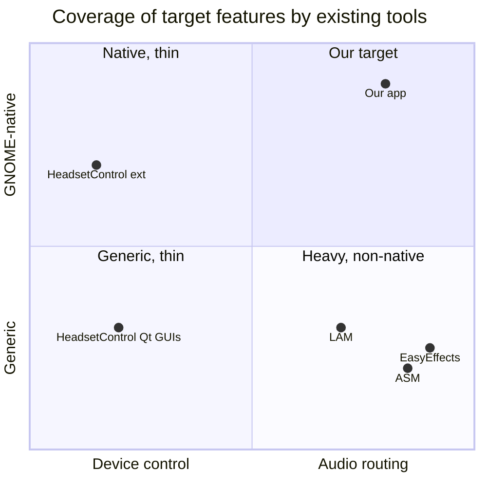

# Prior art on Linux

Survey of existing Linux tools for SteelSeries Arctis headsets (target: Arctis Nova 5 / 5X). Scope: what each does, architecture, UX, license, lessons, gaps, and HeadsetControl dependency pros and cons.

Method: third-party repos were shallow-cloned into the scratchpad (`ext/<name>/src`), read only, never built or run. Paths below are relative to each repo root. Snapshot dates are the HEAD commit dates seen on 2026-10-11. Anything not read in source or fetched from a page is marked UNVERIFIED.

## 1. Summary matrix

| Project | Role | Stack | License | Nova 5 | Writes to device | UI |
|---|---|---|---|---|---|---|
| [HeadsetControl](https://github.com/Sapd/HeadsetControl) | CLI + C/C++ lib, many vendors | C++, hidapi | GPL-3.0 (`license`) | Yes, PIDs `0x2232`, `0x2253` | Yes | none |
| [gnome-shell-extension-HeadsetControl](https://github.com/ChrisLauinger77/gnome-shell-extension-HeadsetControl) | GNOME Shell wrapper | GJS | GPL-3.0 (`LICENSE`) | via HeadsetControl | via CLI | panel + Quick Settings |
| Third-party wrappers (HeadsetControl-Qt, HeadsetControl-GUI x2, HeadsetKontrol, headset-battery-indicator) | tray GUIs on the CLI | Qt/PySide6/Kirigami | GPL-3.0 / LGPL-2.1 / Unlicense / GPL-3.0 / GPL-3.0 (GitHub API, see 2.3) | via HeadsetControl | via CLI | tray + window |
| [Linux-Arctis-Manager](https://github.com/elegos/Linux-Arctis-Manager) (LAM) v3 | Daemon + GUI, Arctis only | Rust daemon, Python/Qt6 GUI | GPL-3.0 (`LICENSE`) | Yes (`base_arctis_nova_5.yaml`) | Yes | Qt window |
| [Arctis Sound Manager](https://github.com/loteran/arctis-sound-manager) (ASM) | LAM fork, mixer + Sonar-style EQ | Python, dbus-next, PipeWire | GPL-3.0 (`LICENSE`) | Yes (`devices/nova_5.yaml`), unverified on hardware | Yes | Qt window + tray |
| [nova-chatmix-linux](https://github.com/Dymstro/nova-chatmix-linux) | ChatMix for Nova Pro Wireless only | Python, hidapi, pactl | 0BSD (GitHub API) | No | enables ChatMix | none |
| [SteelVoiceMix](https://github.com/Ibrahim-Aldhaheri/SteelVoiceMix) | Nova Pro Wireless ChatMix | Rust daemon, PySide6 GUI | GPL-3.0 (`LICENSE`) | No | Yes | tray + overlay |
| [EasyEffects](https://github.com/wwmm/easyeffects) | System-wide PipeWire effects/EQ | C++, Qt6/Kirigami on master | GPL-3.0 (`LICENSE`) | n/a (no HID) | n/a | full app |
| [Solaar](https://github.com/pwr-Solaar/Solaar) | Logitech device manager (UX reference) | Python | GPL-2.0 (GitHub API) | n/a | Yes (Logitech) | GTK window + tray |

## 2. Per project

### 2.1 HeadsetControl (Sapd)

What it does: CLI plus shared library for sidetone, battery, LEDs, EQ, inactive time, chat-mix, mic settings, voice prompts and Bluetooth options across Logitech, Corsair, SteelSeries, HyperX and others (`README.md` lines 1-20).

Architecture:
- One C++ class per device under `lib/devices/`, registered in `lib/device_registry.cpp`. Shared SteelSeries framing in `lib/devices/protocols/steelseries_protocol.hpp`.
- Capability bitmask per device: `lib/capability_descriptors.hpp` (sidetone, battery, chatmix, lights, inactive time, EQ, parametric EQ, mic mute LED, mic volume, volume limiter, rotate-to-mute, BT options, noise filter).
- Outputs: text, `-o json`, `yaml`, `env` (`README.md` lines 242-249). JSON has `api_version` (`"1.5"` in the doc example) with semver rules: first number breaks, second adds (`docs/LIBRARY_USAGE.md` lines 30 and 97-103).
- Library: C++ API (`lib/headsetcontrol.hpp`) and a pure C handle API (`lib/headsetcontrol_c.h`, `hsc_discover`, `hsc_supports`, `hsc_get_battery`). Build with `-DBUILD_SHARED_LIBRARY=ON`; SOVERSIONed (`docs/LIBRARY_USAGE.md` line 195).
- One-shot process model: each invocation opens hidapi, talks, exits. No daemon, no event stream.

Nova 5 support (`lib/devices/steelseries_arctis_nova_5.hpp`):
- PIDs `0x2232` (Nova 5), `0x2253` (Nova 5X) at lines 29-31. LAM and ASM list more (`0x2264`, `0x2255`).
- Capabilities at lines 89-92: sidetone, battery, chatmix status, mic mute LED brightness, mic volume, inactive time, volume limiter, EQ preset, EQ, parametric EQ.
- Interface 3, usage page `0xffc0` (line 97).
- Sidetone: 11 discrete levels `0x00-0x0a` (line 208). Mic volume: 16 levels (`volume / 8`, capped at 15). Mic mute LED: 0 / low / `0x04` / `0x0A` (lines 269-285).
- EQ: 10 bands, gain -10..+10 dB step 0.5, four named presets Flat / Bass / Focus / Smiley (lines 34-56 and presets block), parametric with 5 filter types, Q 0.2-10.
- Battery read is a status poll (`readDeviceStatus`); offline when status byte is `0x02`.

Not exposed for Nova 5 (checked against the capability list and the file; no match for these): audio mode 2.4G/Bluetooth, extended range (wireless mode), connection-type icons, charge state beyond "charging", live events (dial, mute, connect/disconnect).

Potential correctness risk (UNVERIFIED, needs hardware): `saveStateNova5` (line 153) sends `{0x00, 0x09}` then `{0x00, 0x35, 0x01}`. LAM models command `0x35` as `wireless_mode` with `0 = RANGE`, `1 = SPEED` (`daemon/device-configs/base_arctis_nova_5.yaml`, `wireless_mode` block at lines 52-58 with `values_mapping {"0": "range", "1": "speed"}`; re-checked 2026-10-11). If both are right, every HeadsetControl setting write may also switch the headset out of Extended range mode. This would contradict the official app behavior ("extended range reduces mic quality to increase range") and is worth testing before trusting any HeadsetControl write path.

License: GPL-3.0.

UX: none of its own; project policy is that GUIs live in other repos (third-party list in its wiki, see 2.3).

Lessons:
- Copy: capability-descriptor model (UI renders only what the device reports), JSON with explicit `api_version`, rich result types (`min/max/current`, device-native range plus normalised range), documented device-adding workflow (`docs/ADDING_A_DEVICE.md`).
- Avoid: poll-by-spawn model, normalising to 0-128 sidetone that hides the real 11 steps, writing a "save" side effect after each change without knowing what the save bytes do.

### 2.2 GNOME Shell extension wrapping HeadsetControl

Source: [ChrisLauinger77/gnome-shell-extension-HeadsetControl](https://github.com/ChrisLauinger77/gnome-shell-extension-HeadsetControl), listed at [extensions.gnome.org/extension/5823](https://extensions.gnome.org/extension/5823/headsetcontrol) (search result showed 48.1 on the listing and 50.6 on review pages; current version UNVERIFIED).

- `metadata.json` at the cloned HEAD: `shell-version` `["50", "51"]`. The extensions.gnome.org query (`extension-query/?search=headset`, fetched 2026-10-11) lists the published extension as pk 5823, shell 42-51, description "Shows headset status from the HeadsetControl CLI and controls features like ChatMix, Sidetone, and Equalizer". The same search shows no other headset-vendor extension; the remaining hits are unrelated (`autoselectheadset`, `bt-battery@thiagoprz` for Bluetooth headphone battery, `toggleAudio`). Search "arctis" returned no relevant extension.
- `extension.js` (1284 lines) spawns `headsetcontrol` with `Gio.Subprocess` (line 53-58) and parses `-o json` (lines 74 and 655). A timer (`GLib.timeout_add`, line 1056) polls at a user-set `refreshinterval-systemindicator`.
- Features (`README.md`): battery and charging in panel and Quick Settings, ChatMix status, sidetone levels, lights, voice prompts, rotate-to-mute, EQ and presets, low-battery notification, colored battery text. Only capabilities reported by the CLI are shown.
- Does not bundle the binary; user must install `headsetcontrol` and the udev rule.
- Prior art cited by the author: `centic9/headset-charge-indicator`.

Strengths: capability-driven, ships in GNOME's extension store, supports current Shell versions, has notifications.
Weaknesses: every refresh forks a process; no push events; one 1284-line file; no per-app logic; Flatpak apps and the extension cannot share a device owner cleanly; depends on whatever CLI version the user installed.

Lessons: copy the "show only what the device reports" rule and the Quick Settings placement. Avoid polling by subprocess; talk to a daemon over D-Bus instead and expose signals.

### 2.3 Other HeadsetControl GUIs

Licenses, languages and last-push dates checked via the GitHub API on 2026-10-11 (`gh api repos/<r>`); features are from web-search snippets only (repos not opened, UNVERIFIED):
- Odizinne/HeadsetControl-Qt: GPL-3.0, C++, last push 2025-10-01 (likely stale); tray + settings window, Qt.
- LeoKlaus/HeadsetControl-GUI: LGPL-2.1, C++, pushed 2026-06; simple GUI, listed under Windows.
- paradox-ng/HeadsetControl-GUI: Unlicense, Python, pushed 2026-09; PySide6, sidetone, lights, battery, notification sounds.
- TheBill2001/HeadsetKontrol: GPL-3.0, C++, pushed 2026-06; Kirigami.
- ruflas/headset-battery-indicator: GPL-3.0, Python, pushed 2026-09; Qt tray, Fedora COPR.

Common pattern: tray icon + a window, thin wrapper over the CLI, Qt-based. None is libadwaita-native. None covers EQ authoring, per-app profiles or history (UNVERIFIED).

### 2.4 Linux-Arctis-Manager (elegos), v3 beta

Version 3.0.0-beta1 (`VERSION`), HEAD 2026-10-10.

Architecture (`docs/ARCHITECTURE.md`, mermaid component diagram at lines ~10-45):
- `lam-daemon` (Rust, systemd user service): D-Bus (zbus) server, hotplug via tokio-udev, device-config YAML DSL interpreter, `hid-transport` crate, audio subsystem (virtual sinks, LADSPA/hardware EQ, noise-cancel filter-chain, voice changer, stream monitor via libpulse, focus monitor).
- `lam-hidraw-helper`: tiny `setcap cap_dac_override` binary that opens `/dev/hidraw*` and passes the fd by `SCM_RIGHTS`; chosen over udev rules (`docs/ARCHITECTURE.md` "Privilege Model").
- `lam-gui`: Python/Qt6 on D-Bus. Bus name `name.giacomofurlan.ArctisManager.Next` (`docs/dbus.md`).
- Devices are declarative YAML: `daemon/device-configs/*.yaml`, DSL documented in `docs/DEVICE_DSL.md`, compatibility table auto-generated in `docs/device_compatibility.md`.

Nova 5 protocol as modelled (`daemon/device-configs/base_arctis_nova_5.yaml`), the richest public description found and a close match to the official app screens:

| Official app item | Command byte | Range | YAML lines |
|---|---|---|---|
| Mic volume | `0x37` | 0-15 | 27-30 |
| Sidetone | `0x39` | 0-10 | 32-35 |
| Volume limiter | `0x27` | 0-1 | 37-40 |
| Mute LED brightness | `0xAE` | 0-3 (wire 0,1,4,10) | 47-51 and `mic_mute_brightness_to_level` |
| Extended range / speed | `0x35` set, `0x36` get | 0 RANGE, 1 SPEED | 52-60 |
| Status (connection, battery, charging, chatmix) | `0xB0` | conn 0-3, battery 0-100, charge 0-3 | 69-80 |
| Auto power-off | `0xA3` | minutes 0-255 | `power_inactivity_timer` |
| Parametric EQ write | `0xA5` name, `0x33` (2.4G) / `0x34` (BT) bands | 10 bands, freq 20-20001, type 1-5, gain, Q 0.2-10 | 153+ |
| EQ readback | `0x20` | raw wire encoding | `audio_settings` |

Notes: reports are 64 bytes, report-id byte `0x00`, sent as HID SET_REPORT on interface 3; events arrive on interface 5 (`CHANGELOG.md` line 85; ASM `nova_5.yaml` `listen_interface_indexes: [3, 5]`). Nova 5 gain encoding is "unsigned half-dB offset", unlike the Nova 7 Gen2 family (YAML comment above `parametric_eq_bands`). Sources: LAM transport `daemon/hid-transport/src/` (`REPORT_SIZE_HID_IO = 64`).

Features: ChatMix with virtual sinks, hardware and software EQ (10/15 band via PipeWire), per-app EQ overrides matched by stream name, executable path or Steam AppID (`docs/eq.md` lines 49-60), noise cancel, voice changer, optional hiding of the physical sink, wide device list (README table).

Strengths: daemon + D-Bus separation, declarative device configs, privilege minimization, per-app EQ prior art, thorough docs with diagrams.
Weaknesses: Qt GUI (not GNOME-native), setcap helper is unusual and not Flatpak-friendly, installs system-wide service; WirePlumber Lua script and `pactl` subprocesses add moving parts; Nova 5 hardware verification level UNVERIFIED (changelog credits a community contributor for adding the family, line 143).

License: GPL-3.0. Anything derived from its YAML inherits GPL-3.0; protocol facts (byte values) are re-derivable, so a clean re-verification on our own hardware is the safer path (legal view UNVERIFIED).

Lessons: copy the daemon/D-Bus/GUI split, declarative capability tables, transport behind a seam, per-app matcher kinds, generated compatibility docs. Avoid: setcap helper (we use udev rule per task constraints), subprocess-driven audio control, YAML DSL growth (its `device_session.rs` carries device-specific field-name conventions that already caused bugs, `CHANGELOG.md` line 87).

### 2.5 Arctis Sound Manager (loteran)

Version 1.6.0 (`pyproject.toml`). LAM fork (`LICENSE` credits Giacomo Furlan), GPL-3.0. Python >=3.10, `dbus-next` (`pyproject.toml`), Qt GUI, PipeWire filter-chain.

Features (`README.md` "Features"): 4-channel mixer (Game/Chat/Media/Output), Sonar-style EQ with up to 10 bands per channel and hundreds of presets, automatic preset per game (Steam/Lutris/Heroic/executable), macro sliders, spatial audio (HeSuVi), mic processing (rnnoise, DeepFilterNet), audio profiles, OLED widgets for DAC models, clips, community preset and theme sites, tray, installers for AUR, COPR, PPA, PyPI, Distrobox.

Nova 5 profile (`src/arctis_sound_manager/devices/nova_5.yaml`): PIDs `0x2232`, `0x2253`, `0x2255`, `0x2264`; 64-byte padded commands; `command_transport: ctrl_output`; 3000 ms init sleep; 50 ms inter-command spacing; device init sequence sends status request, `0x10`, `0x36`, `0xAE`, `0x37`, `0xA3`, `0xA7`, `0x27`, `0x39`, `0x09` twice. A comment in the file (not re-checked in this pass) states "nobody here has a Nova 5", so its Nova 5 profile is unverified on hardware.

Strengths: broadest feature set, per-game automatic preset (closest to our per-app goal), preset import/export, status for scripts.
Weaknesses: very large Python code base (about 70 modules in `src/arctis_sound_manager/`), `RAPPORT-CHAOS-ASM.md` and `SESSION.md` in repo root suggest process noise (content not read), Qt look, Windows-GG imitation (Sonar) rather than GNOME conventions, telemetry/update-check modules present (`telemetry.py`, `update_checker.py`; behavior UNVERIFIED).

Lessons: copy preset import/export, per-game auto profile concept, "audio profile" bundles, community preset format interop. Avoid: feature sprawl, vendor look-alike UX, telemetry.

### 2.6 nova-chatmix-linux (Dymstro)

Single script `nova-chatmix.py` (236 lines), systemd unit, udev rule `50-nova-pro-wireless.rules`. Reverse-engineers how Sonar enables ChatMix on the Nova Pro Wireless base station and drives two PipeWire null sinks (`README.md`). Nova Pro Wireless only; not Nova 5. Its README text: "Permission to use, copy, modify, and/or distribute ... with or without fee is hereby granted" (permissive; SPDX not confirmed). The `birdybirdonthewire/` URL guessed in the task does not exist; the actual repo is `Dymstro/nova-chatmix-linux` (acknowledged in SteelVoiceMix README).

Lessons: ChatMix on newer SteelSeries gear is a software feature (virtual sinks driven by HID events), not a hardware mixer. The Nova 5 is a different family; LAM/ASM list `chatmix` for it but whether Nova 5 hardware emits a dial event is UNVERIFIED, and the official app screens show no ChatMix on Nova 5.

### 2.7 SteelVoiceMix

Rust daemon + PySide6 tray GUI, Nova Pro Wireless only, GPL-3.0, Fedora COPR, systemd user service, dial overlay, battery display (`README.md`). Acknowledges the three upstreams above. Lesson: the Rust daemon + thin GUI pattern is converging across projects; battery and dial overlays are the features users notice.

### 2.8 EasyEffects (EQ UX reference)

- Master branch (HEAD 2026-10-11) is Qt6/KDE Frameworks: `CMakeLists.txt` lines 35-57 `find_package(ECM)`, `Qt`, `KF6`; `src/contents/ui`. It is no longer GTK4/libadwaita on master. Older GTK4 releases exist (UNVERIFIED which versions). A GNOME-native app therefore cannot assume EasyEffects UX matches the platform.
- Architecture: PipeWire client managers (`src/pw_client_manager.*`, `pw_device_manager.*`, `pw_link_manager.*`), per-plugin classes (`src/equalizer.cpp`, `equalizer_apo.cpp`, `midside_equalizer.cpp`), preset managers including autoload and community presets (`src/presets_autoload_manager.*`, `presets_community_manager.*`), effects pipelines per direction (`stream_output_effects.*`, `stream_input_effects.*`).
- EQ UX: per-band frequency, Q, type, gain, solo/mute per band, Equalizer APO import (`equalizer_apo.cpp`), preset autoload tied to device (not to app; per-app routing UNVERIFIED in this survey), community presets, input and output pipelines.
- Strengths: mature DSP chain, preset import (APO, GraphicEQ), autoload by output device.
- Weaknesses for our case: no knowledge of the headset; autoload keyed on device, so no "Spotify vs game" profile; would double-process if we also write hardware EQ; Qt on master.

Lessons: copy APO text import, preset autoload concept, per-band solo/bypass, plot with draggable handles. Our system-side parametric EQ must coexist with EasyEffects (it may be installed; both would insert filter-chains: document and detect).

### 2.9 Solaar (device GUI reference)

Per the GitHub page: Linux device manager for Logitech devices, GPL-2.0, rules (`rules.d`, `rules.d-uinput`) that react to device messages, pairing, settings, custom buttons, tray. Verified in source: GTK 3 (`lib/solaar/ui/__init__.py` line 39 `gi.require_version("Gtk", "3.0")`), tray via Ayatana/AppIndicator3 (`lib/solaar/ui/tray.py` lines 141-147), `desktop_notifications.py`, `diversion_rules.py`. A Flatpak packaging repo exists (`io.github.pwr_solaar.solaar.yaml`, runtime `org.gnome.Sdk//49`), so a Flatpak device manager with udev rules on the host is a proven pattern. It is not libadwaita.

Lessons: device list sidebar + settings pages generated from per-device capabilities; rule engine reacting to device events is the model for "when headset connects, do X". Avoid: tray-only presence (GNOME removed legacy tray; use a Shell extension + notifications instead).

Spot-check log (2026-10-11, re-read in fresh clones): HeadsetControl PIDs `0x2232/0x2253`, `saveStateNova5` sending `{0x0,0x09}` then `{0x0,0x35,0x01}`, interface 3 / usage page `0xffc0`, `volume / 8`, GPL-3.0, `api_version "1.5"` all confirmed. LAM `0x35/0x36` wireless_mode, `0xB0` status layout and `0xAE` confirmed. Corrected: wrapper licenses, extension shell range, Solaar toolkit.

## 3. Gaps our app fills

(Illustrative positioning from this survey, not measured.)

| Official-app item | HeadsetControl | LAM v3 | ASM | Gap |
|---|---|---|---|---|
| Battery % | yes | yes | yes | none |
| Connection icons (BT, 2.4G) | no | status field `radio_connection_status` | yes (UNVERIFIED for Nova 5) | native UI |
| Audio mode 2.4G/BT toggle | no | not found in Nova 5 YAML | not found | UNVERIFIED protocol; capture needed |
| EQ preset picker (Flat...) | yes (4 presets) | yes | yes | UI quality |
| Mic volume (16 steps) | yes | yes | yes | none |
| Sidetone (11 steps) | yes | yes | yes | none |
| Mute LED brightness | yes | yes | yes | none |
| Volume limiter | yes | yes | yes | none |
| Extended range | no (and possible side effect, section 2.1) | yes (`0x35/0x36`) | UNVERIFIED | HeadsetControl cannot do it |
| Libadwaita UI | no | no (Qt) | no (Qt) | yes |
| GNOME Quick Settings, event-driven | polling wrapper only | no | no | yes |
| Native notifications | extension low-battery only | UNVERIFIED | UNVERIFIED | yes |
| Per-app automatic EQ profile | no | yes (stream/exe/Steam) | yes (games) | non-game apps, GNOME focus, UX |
| System-side parametric EQ via PipeWire | no | yes (LADSPA filter-chain) | yes | native config, coexistence with EasyEffects |
| Battery history | no | no | UNVERIFIED | yes |
| Flatpak + host udev only | no (CLI) | no (setcap helper, system service) | no (PyPI/distro) | yes |

## 4. HeadsetControl: depend or implement natively (pros and cons only)

### Depend on HeadsetControl (CLI or library)

Pros:
- Immediate multi-vendor device coverage, maintained community, Nova 5 already implemented and tested by others.
- Less protocol reverse-engineering and HID plumbing to write and test.
- JSON output with versioned `api_version`; C API (`headsetcontrol_c.h`) could be bound from Rust.
- Existing GNOME extension proves the model works.

Cons:
- C++ build dependency; Flatpak needs it bundled as a module and the library path is not packaged as a stable Fedora lib (COPR only per README). SOVERSION exists but ABI stability across releases UNVERIFIED.
- CLI mode means one process spawn per read, no events, no atomic multi-setting transactions.
- Missing for Nova 5: extended range, audio mode, connection type, live events; we would still need a native path for them, giving two protocol stacks on one device.
- Possible hidden side effect of its save sequence (section 2.1); we would inherit it.
- Normalised value ranges (0-128 sidetone) obscure real device steps; sidetone `Off/Low/Medium/High` UI needs mapping back.
- GPL-3.0 linking constrains our license to GPL-3.0-compatible (we likely are GPL anyway; decision for the project).
- Testing: harder to inject a fake transport at a seam when the protocol lives inside a C++ library; tests would mock the CLI or the C boundary.
- Flatpak sandbox: hidapi/hidraw access needs device permission either way; the CLI inside the sandbox needs `--device=all` or host-side helper.

### Implement the protocol natively in Rust

Pros:
- Single stack: typed commands, a `Transport` seam for fakes, strong unit tests, no FFI.
- Full control of semantics: events on interface 5, connect/disconnect, exact steps, atomic writes and read-back verification.
- Covers every official-app item on Nova 5, including extended range and audio mode once captured.
- Fits Flatpak: Rust crates (`hidapi` or `hidraw` ioctls) bundle cleanly; no C++ toolchain.
- Protocol is small for one family (about ten commands, 64-byte reports); LAM's YAML is a cross-check, HeadsetControl a second.

Cons:
- Reverse-engineering and hardware validation burden falls on us; no Nova 5 documentation is official (LAM cites a "vendor spec" in its comments; UNVERIFIED provenance).
- Only one device family supported unless we add more; losing the free long tail of HeadsetControl devices.
- Risk of firmware variance (`0x2232`, `0x2253`, `0x2255`, `0x2264`) without test hardware for all.
- Upstream fixes (new firmware quirks) must be tracked manually.
- Licensing hygiene: avoid copying GPL code verbatim; verify bytes on hardware.

Cross-check approach available either way: HeadsetControl and LAM disagree/overlap in places (the `0x35` byte), so hardware captures are needed regardless.

## 5. Open items

- Confirm on hardware what `0x35 0x01` does (save vs speed mode) and whether the 2.4G/BT audio-mode switch has its own command. Status: UNVERIFIED.
- Whether the Nova 5 emits unsolicited events on interface 5 (dial/mute/battery) — LAM changelog line 85 says Nova 5 gets the generic listener; hardware confirmation UNVERIFIED.
- Licenses of wrappers and Dymstro's script are now recorded; still confirm each repo's LICENSE file before reusing code.
- Check EasyEffects per-application routing and the last GTK4 release number (tags v7.2.5 and v8.0.0-v8.3.0 exist; which tag switched to Qt UNVERIFIED).
- Nova 5 hardware has a ChatMix dial (product knowledge, UNVERIFIED here); LAM's Nova 5 YAML parses `chatmix_game`/`chatmix_chat` from the `0xB0` status and an event map (`base_arctis_nova_5.yaml` lines 86-87, 361-364), and HeadsetControl lists a chatmix capability. Section 2.6 and the gap table treat ChatMix as unconfirmed; treat it as likely present and a candidate feature.
- Audio mode 2.4G/BT toggle: no command found in LAM's Nova 5 YAML (grep for bluetooth in the file: no match) nor in its compatibility table (Nova 5 not listed with `bluetooth`). It may be a firmware-side mode, not host-writable. Needs USB/BT capture of the official app.
- Fedora packaging of HeadsetControl: UNVERIFIED; the README claim was not re-checked.

## 6. Sources

- https://github.com/Sapd/HeadsetControl (files: `lib/devices/steelseries_arctis_nova_5.hpp`, `lib/capability_descriptors.hpp`, `lib/headsetcontrol_c.h`, `docs/LIBRARY_USAGE.md`, `README.md`, `license`)
- https://github.com/ChrisLauinger77/gnome-shell-extension-HeadsetControl (`HeadsetControl@lauinger-clan.de/extension.js`, `metadata.json`, `README.md`) and https://extensions.gnome.org/extension/5823/headsetcontrol
- https://github.com/elegos/Linux-Arctis-Manager (`docs/ARCHITECTURE.md`, `docs/dbus.md`, `docs/eq.md`, `docs/device_compatibility.md`, `daemon/device-configs/base_arctis_nova_5.yaml`, `daemon/hid-transport/src/`, `CHANGELOG.md`)
- https://github.com/loteran/arctis-sound-manager (`README.md`, `pyproject.toml`, `src/arctis_sound_manager/devices/nova_5.yaml`) and https://pypi.org/project/arctis-sound-manager/1.2.14/ (search snippet)
- https://github.com/Dymstro/nova-chatmix-linux (`README.md`, `nova-chatmix.py`)
- https://github.com/Ibrahim-Aldhaheri/SteelVoiceMix (`README.md`)
- https://github.com/wwmm/easyeffects (`CMakeLists.txt`, `src/`)
- https://github.com/pwr-Solaar/Solaar (GitHub page)
- Third-party GUI list from web search: Odizinne/HeadsetControl-Qt, LeoKlaus/HeadsetControl-GUI, paradox-ng/HeadsetControl-GUI, TheBill2001/HeadsetKontrol, ruflas/headset-battery-indicator
