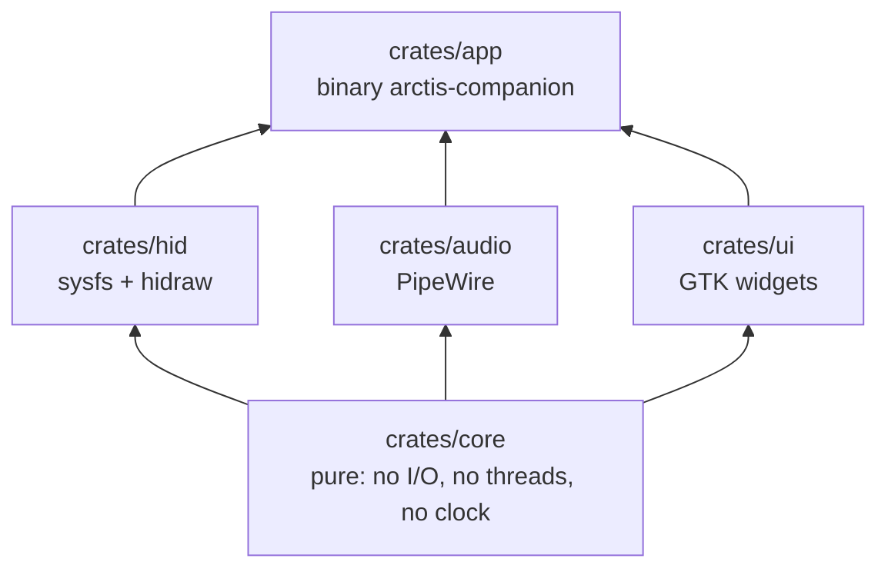
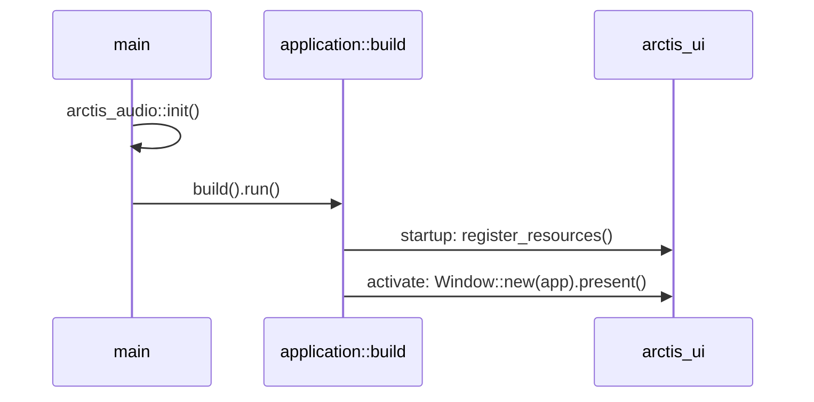
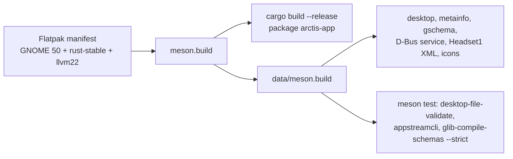
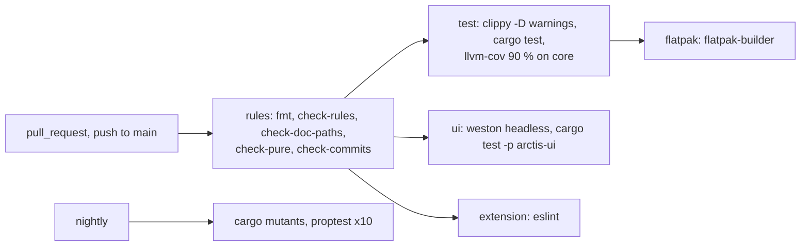
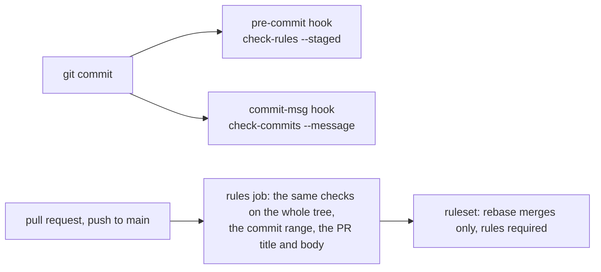
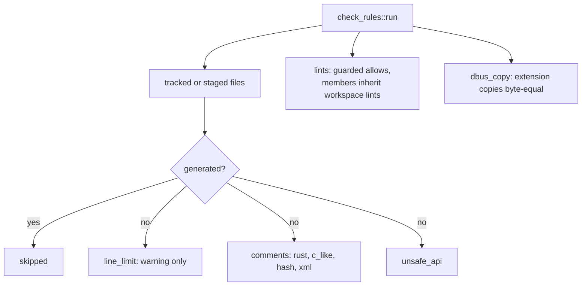

# SP1 Foundations Implementation Plan

> **For agentic workers:** REQUIRED SUB-SKILL: Use superpowers:subagent-driven-development (recommended) or superpowers:executing-plans to implement this plan task-by-task. Steps use checkbox (`- [ ]`) syntax for tracking.

**Goal:** A five-crate Rust workspace that compiles, a `cargo xtask` that enforces every engineering rule, lint
configs, CI workflows, meson install of the data files and a Flatpak build of an empty `AdwApplicationWindow`
that links `crates/audio`.

**Architecture:** Root `Cargo.toml` holds the workspace, shared dependencies and the clippy policy. `xtask/` is a
binary crate whose integration tests build every violation in a tempdir git repository and run the real binary.
`crates/ui` compiles Blueprint into a gresource in `build.rs`; `crates/app` is the binary `arctis-companion`.
Meson drives cargo and installs `data/`; the Flatpak manifest drives meson.

**Tech Stack:** Rust 2024 (rustc 1.98), gtk4-rs 0.11 (`gnome_50`), libadwaita 0.9 (`v1_9`), pipewire-rs 0.10,
glib-build-tools 0.22, ra-ap-rustc_lexer 0.177, toml 1, serde_json 1, tempfile 3, Blueprint 0.20, meson 1.11,
ESLint 9, GitHub Actions, flatpak-builder with org.gnome.Sdk//50 + rust-stable + llvm22.

Spec: `docs/superpowers/specs/2026-10-11-arctis-companion-design.md` §5 (SP1 row), quality part §2 and §3,
ui part §5 (Headset1 XML), ADR 0003 and ADR 0014.

---

## Conventions for every task

- Worktree: `/home/marcelo/Desenvolvimento/arctis-wt/sp1`, branch `sp1-foundations`. Never touch
  `/home/marcelo/Desenvolvimento/arctis-companion`.
- **Run (toolbox):** `X` means
  `toolbox run -c arctis bash -lc 'cd /home/marcelo/Desenvolvimento/arctis-wt/sp1 && X'`.
  Git and `gh` run on the host in the worktree.
- No comments in any file of any language, doc comments included. Names and small functions carry the meaning.
- Clippy policy (Task 1) applies to everything, tests included: cognitive complexity 8, 40 lines per function,
  nesting 3 (a `mod`, an `impl`, a `fn` body and each `if`/`for`/`match` block count), at most 4 arguments,
  no `unwrap()` outside `#[test]` functions (use `expect` in test helpers). When clippy objects, extract a
  function; never add an `allow` (the one exception is `#![allow(dead_code)]` in
  `xtask/tests/support/mod.rs`, since each test file uses a different subset of the shared helpers).
- Before each commit: `cargo fmt --all`, then Run (toolbox):
  `cargo clippy --workspace --all-targets -- -D warnings && cargo test --workspace --exclude arctis-ui`.
  From Task 4 on, also `cargo xtask check-rules`.
- Tasks 2–11 add xtask items one rule at a time, so some helpers exist before their first caller. Until Task 12,
  append `-A dead_code` to every clippy command (a command-line flag, never an attribute in the source); from
  Task 12 on, clippy runs with `-D warnings` alone.
- Commit subjects are conventional (`type(scope): summary`). Never write `Co-Authored-By`, "Generated with",
  or any AI or tool name in a commit message, PR title or PR body. Never use `--no-verify`.
- Push after every commit: `git push -u origin sp1-foundations` (first time), then `git push`.

## Acceptance criteria → tasks

| SP1 acceptance criterion (design §5) | Task |
|---|---|
| Workspace with five compiling crates | 1, 13, 14, 15 |
| `xtask` with `check-rules`, `check-commits`, `check-doc-paths`, `check-pure`, `install-hooks` | 2–12 |
| clippy / rustfmt / ESLint config | 1, 7, 18 |
| CI workflows | 20 |
| meson install of data | 17 |
| Flatpak manifest with `llvm22` building an empty `AdwApplicationWindow` and linking `crates/audio` | 19 |
| Branch ruleset: only rebase merging, requires `rules` | 20 (JSON), 24 (applied) |
| `docs/architecture/README.md` | 21 |
| CI green | 23 |
| xtask/tests: commented Rust doc comment, JS, TOML, Blueprint file each fail | 4 |
| xtask/tests: `core` dependency outside the allow-list fails | 11 |
| xtask/tests: `pub unsafe fn` fails | 6 |
| xtask/tests: removed lint allow fails | 7 |
| xtask/tests: commit, PR title, PR body with `Co-Authored-By` each fail | 9 |
| 401-line file: warning and exit code zero | 3 |
| `pub fn f() -> Result<(), E>` with no docs passes `clippy -D warnings` | 7 |
| `check-rules` passes with a freshly generated `Cargo.lock` and `pt_BR.po` | 5 |
| `scripts/check-line-limit.sh` and `.githooks/*` replaced by `xtask install-hooks` | 12, 24 |

## File structure

```
Cargo.toml  Cargo.lock  clippy.toml  rustfmt.toml  .cargo/config.toml  meson.build  LICENSE  REUSE.toml
crates/core/   Cargo.toml  src/lib.rs  src/time.rs
crates/hid/    Cargo.toml  src/lib.rs
crates/audio/  Cargo.toml  src/lib.rs  tests/init.rs
crates/ui/     Cargo.toml  build.rs  src/lib.rs  src/window.rs
               resources/window.blp  resources/resources.gresource.xml  tests/window.rs
crates/app/    Cargo.toml  src/lib.rs  src/main.rs  src/application.rs  tests/application.rs
xtask/         Cargo.toml
xtask/src/     main.rs cli.rs report.rs git.rs text.rs rust_tokens.rs
               check_rules/{mod,generated,line_limit,lints,unsafe_api,dbus_copy}.rs
               check_rules/comments/{mod,rust,c_like,hash,xml}.rs
               check_commits.rs commit_message.rs check_doc_paths.rs doc_refs.rs check_pure.rs install_hooks.rs
xtask/tests/   support/mod.rs cli.rs line_limit.rs comments.rs generated.rs unsafe_api.rs lints.rs
               clippy_config.rs dbus_copy.rs check_commits.rs check_doc_paths.rs check_pure.rs
               install_hooks.rs repository.rs
data/          meson.build  io.github.marcelogm.ArctisCompanion.{desktop,metainfo.xml,gschema.xml,service.in}
               dbus/io.github.marcelogm.ArctisCompanion.Headset1.xml
               icons/hicolor/scalable/apps/io.github.marcelogm.ArctisCompanion.svg
               icons/hicolor/symbolic/apps/io.github.marcelogm.ArctisCompanion-symbolic.svg
extension/     package.json  package-lock.json  eslint.config.js
build-aux/     io.github.marcelogm.ArctisCompanion.json
.github/       workflows/ci.yml  workflows/nightly.yml  rulesets/main.json
docs/architecture/  README.md  rules.md
removed:       .githooks/commit-msg  scripts/check-line-limit.sh
```

Responsibilities: `cli.rs` parses arguments into an `Invocation`; `report.rs` collects errors and warnings and
maps them to an exit code; `git.rs` lists tracked or staged files; `text.rs` turns byte offsets into line numbers;
`rust_tokens.rs` wraps the rustc lexer for the comment, unsafe and doc-symbol checks; each `check_*` module owns
one rule.

---

### Task 1: Workspace, lint policy, `core::time::Millis`, empty `hid`

**Files:**
- Create: `Cargo.toml`, `clippy.toml`, `rustfmt.toml`, `.cargo/config.toml`
- Create: `crates/core/Cargo.toml`, `crates/core/src/lib.rs`, `crates/core/src/time.rs`
- Create: `crates/hid/Cargo.toml`, `crates/hid/src/lib.rs`
- Create: `xtask/Cargo.toml`, `xtask/src/main.rs` (placeholder `main` replaced in Task 2)

- [ ] **Step 1: Write the workspace manifest and lint configs**

`Cargo.toml`:

```toml
[workspace]
resolver = "3"
members = ["crates/core", "crates/hid", "xtask"]

[workspace.package]
version = "0.1.0"
edition = "2024"
license = "GPL-3.0-or-later"
publish = false

[workspace.dependencies]
arctis-core = { path = "crates/core" }

[workspace.lints.rust]
unsafe_op_in_unsafe_fn = "deny"

[workspace.lints.clippy]
pedantic = { level = "warn", priority = -1 }
cognitive_complexity = "deny"
too_many_lines = "deny"
excessive_nesting = "deny"
too_many_arguments = "deny"
unwrap_used = "deny"
missing_errors_doc = "allow"
missing_panics_doc = "allow"
missing_safety_doc = "allow"
undocumented_unsafe_blocks = "allow"
doc_markdown = "allow"
```

`clippy.toml`:

```toml
cognitive-complexity-threshold = 8
too-many-lines-threshold = 40
excessive-nesting-threshold = 3
too-many-arguments-threshold = 4
allow-unwrap-in-tests = true
allow-expect-in-tests = true
```

`rustfmt.toml`:

```toml
style_edition = "2024"
newline_style = "Unix"
```

`.cargo/config.toml`:

```toml
[alias]
xtask = "run --quiet --package xtask --"
```

`crates/core/Cargo.toml`:

```toml
[package]
name = "arctis-core"
version.workspace = true
edition.workspace = true
license.workspace = true
publish.workspace = true

[lints]
workspace = true
```

`crates/hid/Cargo.toml`:

```toml
[package]
name = "arctis-hid"
version.workspace = true
edition.workspace = true
license.workspace = true
publish.workspace = true

[dependencies]
arctis-core.workspace = true

[lints]
workspace = true
```

`crates/hid/src/lib.rs`: an empty file (SP5 fills it; this crate may use `unsafe`, so no `forbid`).

`xtask/Cargo.toml`:

```toml
[package]
name = "xtask"
version.workspace = true
edition.workspace = true
license.workspace = true
publish.workspace = true

[dependencies]
ra-ap-rustc_lexer = "0.177"
serde_json = "1"
toml = "1"
unicode-ident = "=1.0.24"

[dev-dependencies]
tempfile = "3"

[lints]
workspace = true
```

`unicode-ident` is pinned because `ra-ap-rustc_lexer` 0.177 asserts at compile time that `unicode-ident` and
`unicode-properties` 0.1.4 share a Unicode version; 1.0.25+ moved to Unicode 18 (see Deviations).

`xtask/src/main.rs` (replaced in Task 2):

```rust
#![forbid(unsafe_code)]

fn main() {}
```

- [ ] **Step 2: Write the failing test for `Millis`**

`crates/core/src/lib.rs`:

```rust
#![forbid(unsafe_code)]

pub mod time;
```

`crates/core/src/time.rs` (tests only for now):

```rust
#[cfg(test)]
mod tests {
    use super::Millis;

    #[test]
    fn after_adds_a_duration() {
        assert_eq!(Millis(1_000).after(250), Millis(1_250));
    }

    #[test]
    fn after_saturates_at_the_end_of_time() {
        assert_eq!(Millis(u64::MAX).after(1), Millis(u64::MAX));
    }

    #[test]
    fn since_measures_elapsed_time() {
        assert_eq!(Millis(1_250).since(Millis(1_000)), 250);
    }

    #[test]
    fn since_is_zero_when_the_other_instant_is_later() {
        assert_eq!(Millis(1_000).since(Millis(1_250)), 0);
    }

    #[test]
    fn instants_are_ordered() {
        assert!(Millis(1) < Millis(2));
    }
}
```

- [ ] **Step 3: Run it to verify it fails**

Run (toolbox): `cargo test -p arctis-core`
Expected: FAIL to compile, "cannot find type `Millis`".

- [ ] **Step 4: Implement `Millis`**

Prepend to `crates/core/src/time.rs`:

```rust
#[derive(Clone, Copy, Debug, Default, PartialEq, Eq, PartialOrd, Ord, Hash)]
pub struct Millis(pub u64);

impl Millis {
    #[must_use]
    pub const fn after(self, duration: u64) -> Self {
        Self(self.0.saturating_add(duration))
    }

    #[must_use]
    pub const fn since(self, earlier: Self) -> u64 {
        self.0.saturating_sub(earlier.0)
    }
}
```

- [ ] **Step 5: Pin the lexer's Unicode dependency and run everything**

Run (toolbox): `cargo update -p unicode-ident --precise 1.0.24 && cargo test --workspace && cargo clippy --workspace --all-targets -- -D warnings && cargo fmt --all --check`
Expected: 5 tests pass in `arctis-core`; clippy and fmt clean.

- [ ] **Step 6: Commit**

```bash
git add Cargo.toml Cargo.lock clippy.toml rustfmt.toml .cargo/config.toml crates xtask
git commit -m "build: set up cargo workspace and core time type"
git push -u origin sp1-foundations
```

---

### Task 2: xtask command line, report and git helpers

**Files:**
- Create: `xtask/src/cli.rs`, `xtask/src/report.rs`
- Create stubs: `xtask/src/check_rules/mod.rs`, `xtask/src/check_commits.rs`, `xtask/src/check_doc_paths.rs`,
  `xtask/src/check_pure.rs`, `xtask/src/install_hooks.rs`
- Modify: `xtask/src/main.rs`
- Test: `xtask/tests/support/mod.rs`, `xtask/tests/cli.rs`

- [ ] **Step 1: Write the shared test support**

`xtask/tests/support/mod.rs`:

```rust
#![allow(dead_code)]

use std::fs;
use std::path::{Path, PathBuf};
use std::process::Command;

use tempfile::TempDir;

pub struct Outcome {
    pub code: Option<i32>,
    pub stdout: String,
    pub stderr: String,
}

impl Outcome {
    pub fn succeeded(&self) -> bool {
        self.code == Some(0)
    }
}

pub struct Fixture {
    dir: TempDir,
}

impl Fixture {
    pub fn init() -> Self {
        let fixture = Self { dir: TempDir::new().expect("tempdir") };
        fixture.git(&["init", "--quiet", "--initial-branch=main"]);
        fixture.git(&["config", "user.name", "Fixture"]);
        fixture.git(&["config", "user.email", "fixture@example.invalid"]);
        fixture.git(&["config", "commit.gpgsign", "false"]);
        fixture
    }

    pub fn path(&self) -> &Path {
        self.dir.path()
    }

    pub fn write(&self, relative: &str, content: &str) -> &Self {
        let target = self.path().join(relative);
        let parent = target.parent().expect("relative path has a parent");
        fs::create_dir_all(parent).expect("create parent directories");
        fs::write(&target, content).expect("write fixture file");
        self.git(&["add", relative]);
        self
    }

    pub fn commit(&self, message: &str) -> &Self {
        let args =
            ["-c", "core.hooksPath=/dev/null", "commit", "--quiet", "--allow-empty", "--message", message];
        self.git(&args);
        self
    }

    pub fn git(&self, args: &[&str]) -> String {
        git(self.path(), args)
    }

    pub fn xtask(&self, args: &[&str]) -> Outcome {
        xtask_in(self.path(), args)
    }
}

pub fn git(dir: &Path, args: &[&str]) -> String {
    let output = Command::new("git").arg("-C").arg(dir).args(args).output().expect("git runs");
    assert!(output.status.success(), "git {args:?}: {}", String::from_utf8_lossy(&output.stderr));
    String::from_utf8_lossy(&output.stdout).into_owned()
}

pub fn git_succeeds(dir: &Path, args: &[&str]) -> bool {
    let status = Command::new("git").arg("-C").arg(dir).args(args).status().expect("git runs");
    status.success()
}

pub fn xtask_in(root: &Path, args: &[&str]) -> Outcome {
    let output = Command::new(env!("CARGO_BIN_EXE_xtask"))
        .args(args)
        .arg("--root")
        .arg(root)
        .output()
        .expect("xtask runs");
    Outcome {
        code: output.status.code(),
        stdout: String::from_utf8_lossy(&output.stdout).into_owned(),
        stderr: String::from_utf8_lossy(&output.stderr).into_owned(),
    }
}

pub fn repo_root() -> PathBuf {
    let manifest_dir = Path::new(env!("CARGO_MANIFEST_DIR"));
    manifest_dir.parent().expect("xtask sits inside the workspace").to_path_buf()
}

pub fn assert_rejected(path: &str, content: &str) {
    let fixture = Fixture::init();
    fixture.write(path, content);
    let outcome = fixture.xtask(&["check-rules"]);
    assert!(!outcome.succeeded(), "{path} should be rejected");
    assert!(outcome.stderr.contains(&format!("{path}:")), "{}", outcome.stderr);
}

pub fn assert_accepted(path: &str, content: &str) {
    let fixture = Fixture::init();
    fixture.write(path, content);
    let outcome = fixture.xtask(&["check-rules"]);
    assert!(outcome.succeeded(), "{path} should be accepted: {}", outcome.stderr);
}
```

- [ ] **Step 2: Write the failing CLI tests**

`xtask/tests/cli.rs`:

```rust
mod support;

use support::{Fixture, repo_root, xtask_in};

#[test]
fn unknown_command_prints_usage_and_exits_with_two() {
    let outcome = xtask_in(&repo_root(), &["frobnicate"]);
    assert_eq!(outcome.code, Some(2));
    assert!(outcome.stderr.contains("usage: cargo xtask"), "{}", outcome.stderr);
}

#[test]
fn unknown_flag_exits_with_two() {
    let outcome = xtask_in(&repo_root(), &["check-rules", "--loud"]);
    assert_eq!(outcome.code, Some(2));
}

#[test]
fn every_command_is_recognised() {
    let fixture = Fixture::init();
    for command in ["check-rules", "check-commits", "check-doc-paths", "check-pure", "install-hooks"] {
        assert_ne!(fixture.xtask(&[command]).code, Some(2), "{command}");
    }
}
```

- [ ] **Step 3: Run to verify it fails**

Run (toolbox): `cargo test -p xtask --test cli`
Expected: FAIL, `unknown_command_prints_usage_and_exits_with_two` sees exit code 0.

- [ ] **Step 4: Implement the CLI, report, git helper and stubs**

`xtask/src/main.rs`:

```rust
#![forbid(unsafe_code)]

mod check_commits;
mod check_doc_paths;
mod check_pure;
mod check_rules;
mod cli;
mod install_hooks;
mod report;

use std::process::ExitCode;

use cli::Invocation;
use report::Report;

fn main() -> ExitCode {
    match cli::parse(std::env::args().skip(1)) {
        Ok(invocation) => run(invocation).finish(),
        Err(usage) => {
            eprintln!("{usage}");
            ExitCode::from(2)
        }
    }
}

fn run(invocation: Invocation) -> Report {
    match invocation {
        Invocation::CheckRules { root, staged } => check_rules::run(&root, staged),
        Invocation::CheckCommits { root, sources } => check_commits::run(&root, &sources),
        Invocation::CheckDocPaths { root } => check_doc_paths::run(&root),
        Invocation::CheckPure { root } => check_pure::run(&root),
        Invocation::InstallHooks { root } => install_hooks::run(&root),
    }
}
```

`xtask/src/cli.rs`:

```rust
use std::path::PathBuf;

const USAGE: &str = "usage: cargo xtask <command> [--root DIR]\n  check-rules [--staged]\n  check-commits [--message FILE] [--range RANGE] [--pr-title TEXT] [--pr-body TEXT]\n  check-doc-paths\n  check-pure\n  install-hooks";

pub enum Invocation {
    CheckRules { root: PathBuf, staged: bool },
    CheckCommits { root: PathBuf, sources: Vec<MessageSource> },
    CheckDocPaths { root: PathBuf },
    CheckPure { root: PathBuf },
    InstallHooks { root: PathBuf },
}

pub enum MessageSource {
    File(PathBuf),
    Range(String),
    PrTitle(String),
    PrBody(String),
}

struct Options {
    root: PathBuf,
    staged: bool,
    sources: Vec<MessageSource>,
}

pub fn parse(mut args: impl Iterator<Item = String>) -> Result<Invocation, String> {
    let command = args.next().ok_or(USAGE)?;
    let options = parse_options(args)?;
    build(&command, options)
}

fn parse_options(mut args: impl Iterator<Item = String>) -> Result<Options, String> {
    let mut options = Options { root: default_root(), staged: false, sources: Vec::new() };
    while let Some(flag) = args.next() {
        apply_flag(&mut options, &flag, &mut args)?;
    }
    Ok(options)
}

fn apply_flag(
    options: &mut Options,
    flag: &str,
    args: &mut impl Iterator<Item = String>,
) -> Result<(), String> {
    if flag == "--staged" {
        options.staged = true;
        return Ok(());
    }
    let value = args.next().ok_or_else(|| format!("{flag} needs a value\n{USAGE}"))?;
    match flag {
        "--root" => options.root = PathBuf::from(value),
        "--message" => options.sources.push(MessageSource::File(PathBuf::from(value))),
        "--range" => options.sources.push(MessageSource::Range(value)),
        "--pr-title" => options.sources.push(MessageSource::PrTitle(value)),
        "--pr-body" => options.sources.push(MessageSource::PrBody(value)),
        _ => return Err(format!("unknown flag {flag}\n{USAGE}")),
    }
    Ok(())
}

fn build(command: &str, options: Options) -> Result<Invocation, String> {
    let Options { root, staged, sources } = options;
    match command {
        "check-rules" => Ok(Invocation::CheckRules { root, staged }),
        "check-commits" => Ok(Invocation::CheckCommits { root, sources }),
        "check-doc-paths" => Ok(Invocation::CheckDocPaths { root }),
        "check-pure" => Ok(Invocation::CheckPure { root }),
        "install-hooks" => Ok(Invocation::InstallHooks { root }),
        _ => Err(format!("unknown command {command}\n{USAGE}")),
    }
}

fn default_root() -> PathBuf {
    PathBuf::from(env!("CARGO_MANIFEST_DIR")).join("..")
}
```

`xtask/src/report.rs`:

```rust
use std::process::ExitCode;

#[derive(Default)]
pub struct Report {
    errors: Vec<String>,
    warnings: Vec<String>,
}

impl Report {
    pub fn failed(message: impl Into<String>) -> Self {
        Self::errors([message.into()])
    }

    pub fn errors(messages: impl IntoIterator<Item = String>) -> Self {
        Self { errors: messages.into_iter().collect(), warnings: Vec::new() }
    }

    pub fn error(&mut self, message: impl Into<String>) {
        self.errors.push(message.into());
    }

    pub fn warning(&mut self, message: impl Into<String>) {
        self.warnings.push(message.into());
    }

    pub fn merge(&mut self, other: Self) {
        self.errors.extend(other.errors);
        self.warnings.extend(other.warnings);
    }

    pub fn merged(mut self, other: Self) -> Self {
        self.merge(other);
        self
    }

    pub fn finish(self) -> ExitCode {
        self.warnings.iter().for_each(|warning| eprintln!("warning: {warning}"));
        self.errors.iter().for_each(|error| eprintln!("error: {error}"));
        if self.errors.is_empty() { ExitCode::SUCCESS } else { ExitCode::FAILURE }
    }
}
```

Stubs (each later task replaces its stub completely):

`xtask/src/check_rules/mod.rs`:

```rust
use std::path::Path;

use crate::report::Report;

pub fn run(_root: &Path, _staged: bool) -> Report {
    Report::default()
}
```

`xtask/src/check_commits.rs`:

```rust
use std::path::Path;

use crate::cli::MessageSource;
use crate::report::Report;

pub fn run(_root: &Path, _sources: &[MessageSource]) -> Report {
    Report::default()
}
```

`xtask/src/check_doc_paths.rs`, `xtask/src/check_pure.rs`, `xtask/src/install_hooks.rs` (same body each):

```rust
use std::path::Path;

use crate::report::Report;

pub fn run(_root: &Path) -> Report {
    Report::default()
}
```

- [ ] **Step 5: Run to verify it passes**

Run (toolbox): `cargo test -p xtask --test cli && cargo clippy -p xtask --all-targets -- -D warnings -A dead_code`
Expected: 3 passed; clippy clean.

- [ ] **Step 6: Commit**

```bash
git add xtask Cargo.lock
git commit -m "feat(xtask): add command-line skeleton"
git push
```

---

### Task 3: `check-rules`: generated-file list and the line guideline

**Files:**
- Create: `xtask/src/git.rs`, `xtask/src/check_rules/generated.rs`, `xtask/src/check_rules/line_limit.rs`
- Modify: `xtask/src/check_rules/mod.rs`, `xtask/src/main.rs` (add `mod git;`)
- Test: `xtask/tests/line_limit.rs`

- [ ] **Step 1: Write the failing tests**

`xtask/tests/line_limit.rs`:

```rust
mod support;

use support::Fixture;

#[test]
fn a_file_of_401_lines_warns_and_exits_zero() {
    let fixture = Fixture::init();
    fixture.write("notes/long.txt", &"line\n".repeat(401));
    let outcome = fixture.xtask(&["check-rules"]);
    assert!(outcome.succeeded(), "{}", outcome.stderr);
    assert!(outcome.stderr.contains("warning: notes/long.txt: 401 lines"), "{}", outcome.stderr);
}

#[test]
fn a_file_of_400_lines_is_silent() {
    let fixture = Fixture::init();
    fixture.write("notes/long.txt", &"line\n".repeat(400));
    let outcome = fixture.xtask(&["check-rules"]);
    assert!(outcome.succeeded());
    assert!(!outcome.stderr.contains("warning"), "{}", outcome.stderr);
}

#[test]
fn the_staged_mode_warns_too() {
    let fixture = Fixture::init();
    fixture.write("notes/long.txt", &"line\n".repeat(401));
    let outcome = fixture.xtask(&["check-rules", "--staged"]);
    assert!(outcome.succeeded());
    assert!(outcome.stderr.contains("401 lines"), "{}", outcome.stderr);
}

const GENERATED: [&str; 10] = [
    "Cargo.lock",
    "build-aux/cargo-sources.json",
    "extension/package-lock.json",
    "LICENSE",
    "po/pt_BR.po",
    "po/arctis-companion.pot",
    "po/LINGUAS",
    "po/POTFILES.in",
    "data/icons/app.svg",
    "data/screenshots/main.png",
];

#[test]
fn every_entry_of_the_generated_list_is_exempt() {
    let fixture = Fixture::init();
    for path in GENERATED {
        fixture.write(path, &"line\n".repeat(900));
    }
    let outcome = fixture.xtask(&["check-rules"]);
    assert!(outcome.succeeded(), "{}", outcome.stderr);
    assert!(!outcome.stderr.contains("warning"), "{}", outcome.stderr);
}
```

- [ ] **Step 2: Run to verify it fails**

Run (toolbox): `cargo test -p xtask --test line_limit`
Expected: FAIL in the two warning tests (no warning printed).

- [ ] **Step 3: Implement**

`xtask/src/git.rs`:

```rust
use std::path::Path;
use std::process::Command;

pub fn run(root: &Path, args: &[&str]) -> Result<String, String> {
    let output = Command::new("git")
        .arg("-C")
        .arg(root)
        .args(args)
        .output()
        .map_err(|error| format!("git: {error}"))?;
    if output.status.success() {
        Ok(String::from_utf8_lossy(&output.stdout).into_owned())
    } else {
        let stderr = String::from_utf8_lossy(&output.stderr);
        Err(format!("git {}: {}", args.join(" "), stderr.trim()))
    }
}

pub fn tracked_files(root: &Path) -> Result<Vec<String>, String> {
    run(root, &["ls-files", "-z"]).map(|text| split_nul(&text))
}

pub fn staged_files(root: &Path) -> Result<Vec<String>, String> {
    let args = ["diff", "--cached", "--name-only", "--diff-filter=ACMR", "-z"];
    run(root, &args).map(|text| split_nul(&text))
}

fn split_nul(text: &str) -> Vec<String> {
    text.split('\0').filter(|name| !name.is_empty()).map(str::to_owned).collect()
}
```

`xtask/src/check_rules/generated.rs`:

```rust
use std::path::Path;

const NAMES: [&str; 5] = ["Cargo.lock", "cargo-sources.json", "package-lock.json", "LINGUAS", "LICENSE"];
const EXTENSIONS: [&str; 4] = ["po", "pot", "png", "svg"];

pub fn is_generated(path: &Path) -> bool {
    let name = path.file_name().and_then(|name| name.to_str()).unwrap_or_default();
    let extension = path.extension().and_then(|ext| ext.to_str()).unwrap_or_default();
    NAMES.contains(&name) || name.starts_with("POTFILES") || EXTENSIONS.contains(&extension)
}
```

`xtask/src/check_rules/line_limit.rs`:

```rust
use std::path::Path;

const GUIDELINE: usize = 400;

pub fn check(path: &Path, text: &str) -> Option<String> {
    let lines = text.lines().count();
    (lines > GUIDELINE).then(|| {
        format!("{}: {lines} lines, the guideline is about {GUIDELINE}; consider splitting it", path.display())
    })
}
```

`xtask/src/check_rules/mod.rs`:

```rust
mod generated;
mod line_limit;

use std::fs;
use std::path::Path;

use crate::git;
use crate::report::Report;

pub fn run(root: &Path, staged: bool) -> Report {
    let files = if staged { git::staged_files(root) } else { git::tracked_files(root) };
    match files {
        Ok(files) => check_tree(root, &files),
        Err(message) => Report::failed(message),
    }
}

fn check_tree(root: &Path, files: &[String]) -> Report {
    files.iter().map(|file| check_file(root, file)).fold(Report::default(), Report::merged)
}

fn check_file(root: &Path, file: &str) -> Report {
    let path = Path::new(file);
    if generated::is_generated(path) {
        return Report::default();
    }
    fs::read_to_string(root.join(path)).map_or_else(|_| Report::default(), |text| check_text(path, &text))
}

fn check_text(path: &Path, text: &str) -> Report {
    let mut report = Report::default();
    if let Some(warning) = line_limit::check(path, text) {
        report.warning(warning);
    }
    report
}
```

- [ ] **Step 4: Run to verify it passes**

Run (toolbox): `cargo test -p xtask && cargo clippy -p xtask --all-targets -- -D warnings -A dead_code`
Expected: all pass.

- [ ] **Step 5: Commit**

```bash
git add xtask
git commit -m "feat(xtask): warn on files over the line guideline"
git push
```

---

### Task 4: `check-rules`: no comments in any language

**Files:**
- Create: `xtask/src/text.rs`, `xtask/src/rust_tokens.rs`
- Create: `xtask/src/check_rules/comments/{mod,rust,c_like,hash,xml}.rs`
- Modify: `xtask/src/main.rs` (add `mod rust_tokens; mod text;`), `xtask/src/check_rules/mod.rs`
- Test: `xtask/tests/comments.rs`, `xtask/tests/repository.rs`

- [ ] **Step 1: Write the failing tests**

`xtask/tests/comments.rs`:

```rust
mod support;

use support::{Fixture, assert_accepted, assert_rejected};

#[test]
fn staged_mode_rejects_a_staged_comment() {
    let fixture = Fixture::init();
    fixture.write("src/lib.rs", "// why\n");
    assert!(!fixture.xtask(&["check-rules", "--staged"]).succeeded());
}

#[test]
fn rust_outer_doc_comment_is_rejected() {
    assert_rejected("src/lib.rs", "/// Adds two numbers.\npub fn add() {}\n");
}

#[test]
fn rust_inner_doc_comment_is_rejected() {
    assert_rejected("src/lib.rs", "//! The crate.\n");
}

#[test]
fn rust_line_comment_is_rejected() {
    assert_rejected("src/lib.rs", "fn f() {} // why\n");
}

#[test]
fn rust_block_comment_is_rejected() {
    assert_rejected("src/lib.rs", "fn f() { /* why */ }\n");
}

#[test]
fn rust_comment_markers_inside_strings_are_accepted() {
    assert_accepted("src/lib.rs", "pub const URL: &str = \"https://example.org/*x*/\";\n");
}

#[test]
fn rust_inner_attribute_is_accepted() {
    assert_accepted("src/main.rs", "#![forbid(unsafe_code)]\nfn main() {}\n");
}

#[test]
fn javascript_line_comment_is_rejected() {
    assert_rejected("extension/lib/client.js", "export const a = 1; // why\n");
}

#[test]
fn javascript_block_comment_is_rejected() {
    assert_rejected("extension/lib/client.js", "/* why */\nexport const a = 1;\n");
}

#[test]
fn javascript_url_inside_a_string_is_accepted() {
    assert_accepted("extension/lib/client.js", "export const url = 'https://example.org';\n");
}

#[test]
fn toml_comment_is_rejected() {
    assert_rejected("config/settings.toml", "# why\nvalue = 1\n");
}

#[test]
fn toml_trailing_comment_is_rejected() {
    assert_rejected("config/settings.toml", "value = 1 # why\n");
}

#[test]
fn toml_hash_inside_a_string_is_accepted() {
    assert_accepted("config/settings.toml", "color = \"#ffffff\"\n");
}

#[test]
fn blueprint_comment_is_rejected() {
    assert_rejected("crates/ui/resources/window.blp", "using Gtk 4.0;\n// why\n");
}

#[test]
fn css_comment_is_rejected() {
    assert_rejected("crates/ui/resources/style.css", "/* why */\n.row {}\n");
}

#[test]
fn xml_comment_is_rejected() {
    assert_rejected("data/contract.xml", "<node><!-- why --></node>\n");
}

#[test]
fn yaml_comment_is_rejected() {
    assert_rejected(".github/workflows/ci.yml", "on: push # why\n");
}

#[test]
fn shell_shebang_is_accepted() {
    assert_accepted("build-aux/run.sh", "#!/bin/sh\necho \"#1\"\n");
}

#[test]
fn shell_comment_is_rejected() {
    assert_rejected("build-aux/run.sh", "#!/bin/sh\n# why\n");
}

#[test]
fn meson_comment_is_rejected() {
    assert_rejected("meson.build", "project('a') # why\n");
}

#[test]
fn desktop_entry_comment_is_rejected() {
    assert_rejected("data/app.desktop", "# why\n[Desktop Entry]\n");
}

#[test]
fn template_file_uses_the_syntax_of_its_output() {
    assert_rejected("data/app.service.in", "# why\n[D-BUS Service]\n");
}
```

`xtask/tests/repository.rs`:

```rust
mod support;

use support::{repo_root, xtask_in};

#[test]
fn repository_passes_check_rules() {
    let outcome = xtask_in(&repo_root(), &["check-rules"]);
    assert!(outcome.succeeded(), "{}", outcome.stderr);
}
```

- [ ] **Step 2: Run to verify it fails**

Run (toolbox): `cargo test -p xtask --test comments`
Expected: every `_is_rejected` test and `staged_mode_rejects_a_staged_comment` FAIL (exit code 0).

- [ ] **Step 3: Implement the shared helpers**

`xtask/src/text.rs`:

```rust
pub fn line_at(text: &str, offset: usize) -> usize {
    text[..offset].matches('\n').count() + 1
}
```

`xtask/src/rust_tokens.rs`:

```rust
pub use ra_ap_rustc_lexer::TokenKind;
use ra_ap_rustc_lexer::{FrontmatterAllowed, strip_shebang, tokenize};

pub struct Token<'a> {
    pub kind: TokenKind,
    pub text: &'a str,
    pub start: usize,
}

impl Token<'_> {
    pub fn is_comment(&self) -> bool {
        matches!(self.kind, TokenKind::LineComment { .. } | TokenKind::BlockComment { .. })
    }

    pub fn is_ident(&self, word: &str) -> bool {
        self.kind == TokenKind::Ident && self.text == word
    }

    fn is_trivia(&self) -> bool {
        self.is_comment() || self.kind == TokenKind::Whitespace
    }
}

pub fn tokens(source: &str) -> impl Iterator<Item = Token<'_>> {
    let skipped = strip_shebang(source).unwrap_or(0);
    let mut start = skipped;
    tokenize(&source[skipped..], FrontmatterAllowed::No).map(move |token| {
        let end = start + token.len as usize;
        let item = Token { kind: token.kind, text: &source[start..end], start };
        start = end;
        item
    })
}

pub fn code_tokens(source: &str) -> Vec<Token<'_>> {
    tokens(source).filter(|token| !token.is_trivia()).collect()
}
```

- [ ] **Step 4: Implement the four scanners**

`xtask/src/check_rules/comments/mod.rs`:

```rust
mod c_like;
mod hash;
mod rust;
mod xml;

use std::path::Path;

enum Syntax {
    Rust,
    CLike,
    Hash,
    Xml,
}

const HASH_NAMES: [&str; 5] =
    ["meson.build", "meson.options", "meson_options.txt", ".gitignore", ".gitattributes"];

pub fn check(path: &Path, text: &str) -> Option<String> {
    let line = match syntax_of(path)? {
        Syntax::Rust => rust::first_comment_line(text),
        Syntax::CLike => c_like::first_comment_line(text),
        Syntax::Hash => hash::first_comment_line(text),
        Syntax::Xml => xml::first_comment_line(text),
    }?;
    Some(format!("{}:{line}: comments are not allowed; rename or extract instead", path.display()))
}

fn syntax_of(path: &Path) -> Option<Syntax> {
    let name = path.file_name()?.to_str()?;
    let name = name.strip_suffix(".in").unwrap_or(name);
    if HASH_NAMES.contains(&name) {
        return Some(Syntax::Hash);
    }
    by_extension(name.rsplit_once('.')?.1)
}

fn by_extension(extension: &str) -> Option<Syntax> {
    match extension {
        "rs" => Some(Syntax::Rust),
        "js" | "mjs" | "blp" | "css" => Some(Syntax::CLike),
        "toml" | "yml" | "yaml" | "sh" | "desktop" | "service" | "rules" => Some(Syntax::Hash),
        "xml" => Some(Syntax::Xml),
        _ => None,
    }
}
```

`xtask/src/check_rules/comments/rust.rs`:

```rust
use crate::rust_tokens::tokens;
use crate::text::line_at;

pub fn first_comment_line(text: &str) -> Option<usize> {
    tokens(text).find(|token| token.is_comment()).map(|token| line_at(text, token.start))
}
```

`xtask/src/check_rules/comments/c_like.rs`:

```rust
use crate::text::line_at;

pub fn first_comment_line(text: &str) -> Option<usize> {
    comment_start(text.as_bytes()).map(|offset| line_at(text, offset))
}

fn comment_start(bytes: &[u8]) -> Option<usize> {
    let mut quote: Option<u8> = None;
    let mut index = 0;
    while index < bytes.len() {
        match (quote, bytes[index]) {
            (Some(_), b'\\') => index += 1,
            (Some(open), byte) if byte == open => quote = None,
            (None, byte @ (b'"' | b'\'' | b'`')) => quote = Some(byte),
            (None, b'/') if opens_comment(bytes.get(index + 1)) => return Some(index),
            _ => {}
        }
        index += 1;
    }
    None
}

fn opens_comment(next: Option<&u8>) -> bool {
    matches!(next, Some(b'/' | b'*'))
}
```

`xtask/src/check_rules/comments/hash.rs`:

```rust
pub fn first_comment_line(text: &str) -> Option<usize> {
    text.lines()
        .enumerate()
        .find(|(index, line)| has_comment(line, *index == 0))
        .map(|(index, _)| index + 1)
}

fn has_comment(line: &str, first_line: bool) -> bool {
    if first_line && line.starts_with("#!") {
        return false;
    }
    let mut quote = None;
    let mut previous = ' ';
    for character in line.chars() {
        if quote.is_none() && character == '#' && previous.is_whitespace() {
            return true;
        }
        quote = next_quote(quote, previous, character);
        previous = character;
    }
    false
}

fn next_quote(quote: Option<char>, previous: char, character: char) -> Option<char> {
    match quote {
        Some(open) if character == open && previous != '\\' => None,
        Some(open) => Some(open),
        None if character == '"' || character == '\'' => Some(character),
        None => None,
    }
}
```

`xtask/src/check_rules/comments/xml.rs`:

```rust
use crate::text::line_at;

pub fn first_comment_line(text: &str) -> Option<usize> {
    text.find("<!--").map(|offset| line_at(text, offset))
}
```

Wire it in `xtask/src/check_rules/mod.rs`: add `mod comments;` and, in `check_text`, after the line-limit
block:

```rust
    if let Some(error) = comments::check(path, text) {
        report.error(error);
    }
```

Add `mod rust_tokens;` and `mod text;` to `xtask/src/main.rs`.

- [ ] **Step 5: Run to verify it passes**

Run (toolbox): `cargo test -p xtask && cargo clippy -p xtask --all-targets -- -D warnings -A dead_code && cargo xtask check-rules`
Expected: all tests pass, including `repository_passes_check_rules`; `check-rules` prints only line warnings.

- [ ] **Step 6: Commit**

```bash
git add xtask
git commit -m "feat(xtask): reject comments in every language"
git push
```

---

### Task 5: `check-rules` accepts a fresh `Cargo.lock` and `pt_BR.po`

**Files:**
- Test: `xtask/tests/generated.rs`

- [ ] **Step 1: Write the test**

`xtask/tests/generated.rs`:

```rust
mod support;

use std::fs;
use std::process::Command;

use support::Fixture;

const TEXT_RS: &str = "pub fn title() -> String {\n    gettext(\"Arctis Companion\")\n}\n";
const XGETTEXT: [&str; 5] = [
    "--language=Rust",
    "--keyword=gettext",
    "--package-name=arctis-companion",
    "--output=po/arctis-companion.pot",
    "src/text.rs",
];
const MSGINIT: [&str; 4] =
    ["--no-translator", "--locale=pt_BR", "--input=po/arctis-companion.pot", "--output-file=po/pt_BR.po"];

fn run_in(fixture: &Fixture, program: &str, args: &[&str]) {
    let status = Command::new(program).args(args).current_dir(fixture.path()).status().expect("tool runs");
    assert!(status.success(), "{program} {args:?}");
}

fn generate_lockfile(fixture: &Fixture) {
    fixture.write("Cargo.toml", "[package]\nname = \"fixture\"\nversion = \"0.1.0\"\nedition = \"2024\"\n");
    fixture.write("src/lib.rs", "");
    run_in(fixture, env!("CARGO"), &["generate-lockfile", "--offline"]);
    fixture.git(&["add", "Cargo.lock"]);
}

fn generate_translation(fixture: &Fixture) {
    fixture.write("src/text.rs", TEXT_RS);
    fixture.write("po/POTFILES.in", "src/text.rs\n");
    fixture.write("po/LINGUAS", "pt_BR\n");
    run_in(fixture, "xgettext", &XGETTEXT);
    run_in(fixture, "msginit", &MSGINIT);
    fixture.git(&["add", "po"]);
}

#[test]
fn fresh_lockfile_and_translation_pass_check_rules() {
    let fixture = Fixture::init();
    generate_lockfile(&fixture);
    generate_translation(&fixture);
    let lockfile = fs::read_to_string(fixture.path().join("Cargo.lock")).expect("lockfile");
    assert!(lockfile.starts_with("# This file is automatically @generated"));
    let translation = fs::read(fixture.path().join("po/pt_BR.po")).expect("translation");
    assert!(translation.starts_with(b"# "), "msginit writes a comment header");
    let outcome = fixture.xtask(&["check-rules"]);
    assert!(outcome.succeeded(), "{}", outcome.stderr);
}
```

The `.po` file is read as bytes: `msginit` writes its header in the locale's charset, which may not be UTF-8.
`xgettext` needs gettext ≥ 0.24 for `--language=Rust` (the toolbox has 0.26; the CI `test` job installs
`gettext`).

- [ ] **Step 2: Prove the test guards the rule**

Run (toolbox): `rpm -q gettext || sudo dnf install -y gettext`
Temporarily change `NAMES` in `xtask/src/check_rules/generated.rs` to drop `"Cargo.lock"`.
Run (toolbox): `cargo test -p xtask --test generated`
Expected: FAIL with `Cargo.lock:1: comments are not allowed`. Restore `"Cargo.lock"`, then repeat with `"po"`
and `"pot"` dropped from `EXTENSIONS`: expect a comment error on `po/arctis-companion.pot`. Restore both.

- [ ] **Step 3: Run to verify it passes**

Run (toolbox): `cargo test -p xtask --test generated`
Expected: PASS.

- [ ] **Step 4: Commit**

```bash
git add xtask
git commit -m "test(xtask): accept generated lockfile and translations"
git push
```

---

### Task 6: `check-rules`: no `pub unsafe fn`

**Files:**
- Create: `xtask/src/check_rules/unsafe_api.rs`
- Modify: `xtask/src/check_rules/mod.rs`
- Test: `xtask/tests/unsafe_api.rs`

- [ ] **Step 1: Write the failing tests**

`xtask/tests/unsafe_api.rs`:

```rust
mod support;

use support::{assert_accepted, assert_rejected};

const PORT: &str = "crates/hid/src/port.rs";

#[test]
fn pub_unsafe_fn_is_rejected() {
    assert_rejected(PORT, "pub unsafe fn read() {}\n");
}

#[test]
fn restricted_pub_unsafe_fn_is_rejected() {
    assert_rejected(PORT, "pub(crate) unsafe fn read() {}\n");
}

#[test]
fn qualified_pub_unsafe_extern_fn_is_rejected() {
    assert_rejected(PORT, "pub const unsafe extern \"C\" fn read() {}\n");
}

#[test]
fn private_unsafe_fn_is_accepted() {
    assert_accepted(PORT, "unsafe fn read() {}\npub fn safe() {}\n");
}

#[test]
fn unsafe_block_inside_a_safe_pub_fn_is_accepted() {
    assert_accepted(PORT, "pub fn read() -> u8 {\n    unsafe { core::ptr::read(&1) }\n}\n");
}
```

- [ ] **Step 2: Run to verify it fails**

Run (toolbox): `cargo test -p xtask --test unsafe_api`
Expected: the three `_is_rejected` tests FAIL.

- [ ] **Step 3: Implement**

`xtask/src/check_rules/unsafe_api.rs`:

```rust
use std::path::Path;

use crate::rust_tokens::{Token, TokenKind, code_tokens};
use crate::text::line_at;

const QUALIFIERS: [&str; 2] = ["const", "async"];

pub fn check(path: &Path, text: &str) -> Option<String> {
    if path.extension().is_none_or(|extension| extension != "rs") {
        return None;
    }
    let tokens = code_tokens(text);
    let position = (0..tokens.len()).find(|&index| is_pub_unsafe_fn(&tokens[index..]))?;
    let line = line_at(text, tokens[position].start);
    Some(format!("{}:{line}: `pub unsafe fn` is not allowed; wrap the unsafe code in a safe function", path.display()))
}

fn is_pub_unsafe_fn(tokens: &[Token]) -> bool {
    let Some((first, rest)) = tokens.split_first() else {
        return false;
    };
    first.is_ident("pub") && starts_unsafe_fn(skip_qualifiers(skip_restriction(rest)))
}

fn skip_restriction<'t, 'a>(tokens: &'t [Token<'a>]) -> &'t [Token<'a>] {
    if tokens.first().is_none_or(|token| token.kind != TokenKind::OpenParen) {
        return tokens;
    }
    let close = tokens.iter().position(|token| token.kind == TokenKind::CloseParen);
    &tokens[close.map_or(tokens.len(), |index| index + 1)..]
}

fn skip_qualifiers<'t, 'a>(tokens: &'t [Token<'a>]) -> &'t [Token<'a>] {
    let count = tokens
        .iter()
        .take_while(|token| QUALIFIERS.iter().any(|qualifier| token.is_ident(qualifier)))
        .count();
    &tokens[count..]
}

fn starts_unsafe_fn(tokens: &[Token]) -> bool {
    let Some((first, rest)) = tokens.split_first() else {
        return false;
    };
    first.is_ident("unsafe") && skip_abi(rest).first().is_some_and(|token| token.is_ident("fn"))
}

fn skip_abi<'t, 'a>(tokens: &'t [Token<'a>]) -> &'t [Token<'a>] {
    match tokens {
        [keyword, abi, rest @ ..] if keyword.is_ident("extern") && is_literal(abi) => rest,
        [keyword, rest @ ..] if keyword.is_ident("extern") => rest,
        _ => tokens,
    }
}

fn is_literal(token: &Token) -> bool {
    matches!(token.kind, TokenKind::Literal { .. })
}
```

In `xtask/src/check_rules/mod.rs` add `mod unsafe_api;` and, in `check_text`:

```rust
    if let Some(error) = unsafe_api::check(path, text) {
        report.error(error);
    }
```

- [ ] **Step 4: Run to verify it passes**

Run (toolbox): `cargo test -p xtask && cargo clippy -p xtask --all-targets -- -D warnings -A dead_code`
Expected: all pass.

- [ ] **Step 5: Commit**

```bash
git add xtask
git commit -m "feat(xtask): reject public unsafe functions"
git push
```

---

### Task 7: Guarded lint allows and the clippy policy test

**Files:**
- Create: `xtask/src/check_rules/lints.rs`
- Modify: `xtask/src/check_rules/mod.rs`
- Test: `xtask/tests/lints.rs`, `xtask/tests/clippy_config.rs`

- [ ] **Step 1: Write the failing tests**

`xtask/tests/lints.rs`:

```rust
mod support;

use std::fs;

use support::{Fixture, repo_root};

const GUARDED: [&str; 5] = [
    "missing_errors_doc",
    "missing_panics_doc",
    "missing_safety_doc",
    "undocumented_unsafe_blocks",
    "doc_markdown",
];

fn repository_manifest() -> String {
    fs::read_to_string(repo_root().join("Cargo.toml")).expect("root manifest")
}

fn check_rules_with(manifest: &str) -> support::Outcome {
    let fixture = Fixture::init();
    fixture.write("Cargo.toml", manifest);
    fixture.xtask(&["check-rules"])
}

#[test]
fn repository_manifest_passes() {
    let outcome = check_rules_with(&repository_manifest());
    assert!(outcome.succeeded(), "{}", outcome.stderr);
}

#[test]
fn removing_any_guarded_allow_fails() {
    for lint in GUARDED {
        let manifest = repository_manifest().replace(&format!("{lint} = \"allow\"\n"), "");
        let outcome = check_rules_with(&manifest);
        assert!(!outcome.succeeded(), "{lint}");
        assert!(outcome.stderr.contains(lint), "{}", outcome.stderr);
    }
}

#[test]
fn turning_an_allow_into_warn_fails() {
    let manifest = repository_manifest().replace("doc_markdown = \"allow\"", "doc_markdown = \"warn\"");
    assert!(!check_rules_with(&manifest).succeeded());
}

const MEMBER: &str = "crates/core/Cargo.toml";
const PACKAGE: &str = "[package]\nname = \"arctis-core\"\nversion = \"0.1.0\"\nedition = \"2024\"\n";

fn check_rules_with_member(member_manifest: &str) -> support::Outcome {
    let fixture = Fixture::init();
    fixture.write("Cargo.toml", &repository_manifest()).write(MEMBER, member_manifest);
    fixture.xtask(&["check-rules"])
}

#[test]
fn member_inheriting_the_workspace_lints_passes() {
    let outcome = check_rules_with_member(&format!("{PACKAGE}\n[lints]\nworkspace = true\n"));
    assert!(outcome.succeeded(), "{}", outcome.stderr);
}

#[test]
fn member_opting_out_of_the_workspace_lints_fails() {
    let outcome = check_rules_with_member(PACKAGE);
    assert!(!outcome.succeeded());
    assert!(outcome.stderr.contains(MEMBER), "{}", outcome.stderr);
}
```

A member without `[lints] workspace = true` would drop every guarded allow and every complexity deny at once,
so the guard covers member manifests too.

`xtask/tests/clippy_config.rs`:

```rust
mod support;

use std::fs;
use std::process::Command;

use support::{Fixture, repo_root};

const MEMBER_MANIFEST: &str = "[package]\nname = \"member\"\nversion = \"0.1.0\"\nedition = \"2024\"\n\n[lints]\nworkspace = true\n";
const UNDOCUMENTED_RESULT: &str = "pub struct Failure;\n\npub fn f(ok: bool) -> Result<(), Failure> {\n    if ok { Ok(()) } else { Err(Failure) }\n}\n";

fn repository_lints() -> toml::Value {
    let text = fs::read_to_string(repo_root().join("Cargo.toml")).expect("root manifest");
    let manifest: toml::Table = text.parse().expect("valid toml");
    manifest["workspace"]["lints"].clone()
}

fn workspace_manifest(lints: toml::Value) -> String {
    let mut workspace = toml::Table::new();
    workspace.insert("members".into(), toml::Value::Array(vec!["member".into()]));
    workspace.insert("resolver".into(), "3".into());
    workspace.insert("lints".into(), lints);
    let mut root = toml::Table::new();
    root.insert("workspace".into(), toml::Value::Table(workspace));
    toml::to_string(&root).expect("serialisable manifest")
}

fn clippy_passes(lints: toml::Value) -> bool {
    let fixture = Fixture::init();
    fixture.write("Cargo.toml", &workspace_manifest(lints));
    fixture.write("clippy.toml", &fs::read_to_string(repo_root().join("clippy.toml")).expect("clippy.toml"));
    fixture.write("member/Cargo.toml", MEMBER_MANIFEST);
    fixture.write("member/src/lib.rs", UNDOCUMENTED_RESULT);
    let output = Command::new(env!("CARGO"))
        .args(["clippy", "--quiet", "--offline", "--", "-D", "warnings"])
        .current_dir(fixture.path())
        .env("CARGO_TARGET_DIR", fixture.path().join("target"))
        .output()
        .expect("cargo clippy runs");
    output.status.success()
}

#[test]
fn undocumented_public_result_function_passes_clippy_with_denied_warnings() {
    assert!(clippy_passes(repository_lints()));
}

#[test]
fn without_the_errors_doc_allow_the_same_function_fails() {
    let mut lints = repository_lints();
    lints["clippy"].as_table_mut().expect("clippy table").remove("missing_errors_doc");
    assert!(!clippy_passes(lints));
}
```

- [ ] **Step 2: Run to verify the right tests fail**

Run (toolbox): `cargo test -p xtask --test lints --test clippy_config`
Expected: `removing_any_guarded_allow_fails`, `turning_an_allow_into_warn_fails` and
`member_opting_out_of_the_workspace_lints_fails` FAIL; both clippy tests PASS
already (Task 1 wrote the policy), which proves the allows do their job.

- [ ] **Step 3: Implement**

`xtask/src/check_rules/lints.rs`:

```rust
use std::fs;
use std::path::Path;

use crate::report::Report;

const GUARDED: [&str; 5] = [
    "missing_errors_doc",
    "missing_panics_doc",
    "missing_safety_doc",
    "undocumented_unsafe_blocks",
    "doc_markdown",
];

pub fn check(root: &Path, files: &[String]) -> Report {
    let members = files.iter().filter(|file| file.ends_with("/Cargo.toml"));
    members.map(|file| check_member(root, file)).fold(check_root(root), Report::merged)
}

fn check_root(root: &Path) -> Report {
    match read_manifest(&root.join("Cargo.toml")) {
        Some(Ok(manifest)) => check_workspace(&manifest),
        Some(Err(error)) => Report::failed(format!("Cargo.toml: {error}")),
        None => Report::default(),
    }
}

fn check_member(root: &Path, file: &str) -> Report {
    match read_manifest(&root.join(file)) {
        Some(Ok(manifest)) if inherits_lints(&manifest) => Report::default(),
        Some(Ok(_)) => Report::failed(format!("{file}: add [lints] workspace = true so the lint policy applies")),
        Some(Err(error)) => Report::failed(format!("{file}: {error}")),
        None => Report::default(),
    }
}

fn read_manifest(path: &Path) -> Option<Result<toml::Table, toml::de::Error>> {
    fs::read_to_string(path).ok().map(|text| text.parse::<toml::Table>())
}

fn inherits_lints(manifest: &toml::Table) -> bool {
    let workspace = manifest.get("lints").and_then(|lints| lints.get("workspace"));
    !manifest.contains_key("package") || workspace.and_then(toml::Value::as_bool) == Some(true)
}

fn check_workspace(manifest: &toml::Table) -> Report {
    let Some(workspace) = manifest.get("workspace") else {
        return Report::default();
    };
    let clippy = workspace.get("lints").and_then(|lints| lints.get("clippy"));
    let missing = GUARDED.iter().filter(|lint| !is_allowed(clippy, lint));
    Report::errors(missing.map(|lint| {
        format!("Cargo.toml: [workspace.lints.clippy] must keep {lint} = \"allow\"; it would demand doc comments")
    }))
}

fn is_allowed(clippy: Option<&toml::Value>, lint: &str) -> bool {
    clippy.and_then(|table| table.get(lint)).and_then(level_of) == Some("allow")
}

fn level_of(value: &toml::Value) -> Option<&str> {
    value.as_str().or_else(|| value.get("level").and_then(toml::Value::as_str))
}
```

In `xtask/src/check_rules/mod.rs` add `mod lints;` and make `check_tree` include it:

```rust
fn check_tree(root: &Path, files: &[String]) -> Report {
    let per_file = files.iter().map(|file| check_file(root, file));
    per_file.fold(Report::default(), Report::merged).merged(lints::check(root, files))
}
```

- [ ] **Step 4: Run to verify it passes**

Run (toolbox): `cargo test -p xtask && cargo clippy -p xtask --all-targets -- -D warnings -A dead_code`
Expected: all pass.

- [ ] **Step 5: Commit**

```bash
git add xtask
git commit -m "feat(xtask): guard lint allows that would demand docs"
git push
```

---

### Task 8: The `Headset1` contract and its byte-equal copies

**Files:**
- Create: `data/dbus/io.github.marcelogm.ArctisCompanion.Headset1.xml`
- Create: `xtask/src/check_rules/dbus_copy.rs`
- Modify: `xtask/src/check_rules/mod.rs`
- Test: `xtask/tests/dbus_copy.rs`

- [ ] **Step 1: Write the failing tests**

`xtask/tests/dbus_copy.rs`:

```rust
mod support;

use support::Fixture;

const SOURCE: &str = "data/dbus/io.github.marcelogm.ArctisCompanion.Headset1.xml";
const COPY: &str = "extension/arctis-companion@marcelogm.github.io/dbus/io.github.marcelogm.ArctisCompanion.Headset1.xml";
const CONTRACT: &str = "<node>\n  <interface name=\"io.github.marcelogm.ArctisCompanion.Headset1\"/>\n</node>\n";

#[test]
fn identical_copy_passes() {
    let fixture = Fixture::init();
    fixture.write(SOURCE, CONTRACT).write(COPY, CONTRACT);
    let outcome = fixture.xtask(&["check-rules"]);
    assert!(outcome.succeeded(), "{}", outcome.stderr);
}

#[test]
fn diverging_copy_fails() {
    let fixture = Fixture::init();
    fixture.write(SOURCE, CONTRACT).write(COPY, "<node/>\n");
    let outcome = fixture.xtask(&["check-rules"]);
    assert!(!outcome.succeeded());
    assert!(outcome.stderr.contains(COPY), "{}", outcome.stderr);
}

#[test]
fn copy_without_a_source_fails() {
    let fixture = Fixture::init();
    fixture.write(COPY, CONTRACT);
    assert!(!fixture.xtask(&["check-rules"]).succeeded());
}
```

- [ ] **Step 2: Run to verify it fails**

Run (toolbox): `cargo test -p xtask --test dbus_copy`
Expected: `diverging_copy_fails` and `copy_without_a_source_fails` FAIL.

- [ ] **Step 3: Implement**

`xtask/src/check_rules/dbus_copy.rs`:

```rust
use std::fs;
use std::path::Path;

use crate::report::Report;

const SOURCE: &str = "data/dbus/io.github.marcelogm.ArctisCompanion.Headset1.xml";
const NAME: &str = "io.github.marcelogm.ArctisCompanion.Headset1.xml";

pub fn check(root: &Path, files: &[String]) -> Report {
    let source = fs::read(root.join(SOURCE)).ok();
    let diverging = files
        .iter()
        .filter(|file| is_extension_copy(file))
        .filter(|file| fs::read(root.join(file.as_str())).ok() != source);
    Report::errors(diverging.map(|file| format!("{file} must be byte-equal to {SOURCE}")))
}

fn is_extension_copy(file: &str) -> bool {
    file.starts_with("extension/") && Path::new(file).file_name().is_some_and(|name| name == NAME)
}
```

In `xtask/src/check_rules/mod.rs` add `mod dbus_copy;` and extend `check_tree`:

```rust
fn check_tree(root: &Path, files: &[String]) -> Report {
    let per_file = files.iter().map(|file| check_file(root, file));
    per_file
        .fold(Report::default(), Report::merged)
        .merged(lints::check(root, files))
        .merged(dbus_copy::check(root, files))
}
```

- [ ] **Step 4: Add the frozen contract (ui spec §5)**

`data/dbus/io.github.marcelogm.ArctisCompanion.Headset1.xml`:

```xml
<node>
  <interface name="io.github.marcelogm.ArctisCompanion.Headset1">
    <property name="State" type="s" access="read"/>
    <property name="Model" type="s" access="read"/>
    <property name="BatteryLevel" type="i" access="read"/>
    <property name="Charging" type="s" access="read"/>
    <property name="BatteryWarning" type="s" access="read"/>
    <property name="Route" type="s" access="read"/>
    <property name="Presets" type="a(ss)" access="read"/>
    <property name="ActivePreset" type="s" access="read"/>
    <property name="ActivePresetReason" type="(ss)" access="read"/>
    <property name="AppRuleCount" type="u" access="read"/>
    <property name="AutomaticPresets" type="b" access="readwrite"/>
    <method name="ActivatePreset">
      <arg name="id" type="s" direction="in"/>
    </method>
  </interface>
</node>
```

- [ ] **Step 5: Run to verify it passes**

Run (toolbox): `cargo test -p xtask && cargo xtask check-rules`
Expected: all pass.

- [ ] **Step 6: Commit**

```bash
git add xtask data/dbus
git commit -m "feat(xtask): check the Headset1 contract copies"
git push
```

---

### Task 9: `check-commits`

**Files:**
- Create: `xtask/src/commit_message.rs`
- Replace: `xtask/src/check_commits.rs`
- Modify: `xtask/src/main.rs` (add `mod commit_message;`)
- Test: `xtask/tests/check_commits.rs`

- [ ] **Step 1: Write the failing tests**

`xtask/tests/check_commits.rs`:

```rust
mod support;

use support::Fixture;

const TRAILER: &str = "Co-Authored-By: Someone <someone@example.invalid>";

fn range_outcome(messages: &[&str]) -> support::Outcome {
    let fixture = Fixture::init();
    messages.iter().for_each(|message| {
        fixture.commit(message);
    });
    fixture.xtask(&["check-commits", "--range", "HEAD"])
}

fn message_file_outcome(content: &str) -> support::Outcome {
    let fixture = Fixture::init();
    fixture.write("COMMIT_EDITMSG", content);
    let path = fixture.path().join("COMMIT_EDITMSG");
    fixture.xtask(&["check-commits", "--message", path.to_str().expect("utf-8 path")])
}

#[test]
fn conventional_commits_pass() {
    let outcome = range_outcome(&["feat(core): add time", "fix!: handle wake"]);
    assert!(outcome.succeeded(), "{}", outcome.stderr);
}

#[test]
fn co_author_trailer_in_a_commit_fails() {
    let outcome = range_outcome(&["feat: add time", &format!("fix: wake\n\n{TRAILER}")]);
    assert!(!outcome.succeeded());
    assert!(outcome.stderr.contains("co-authored-by"), "{}", outcome.stderr);
}

#[test]
fn tool_footer_in_a_commit_fails() {
    assert!(!range_outcome(&["docs: add notes\n\nGenerated with a tool"]).succeeded());
}

#[test]
fn non_conventional_subject_fails() {
    assert!(!range_outcome(&["Add things"]).succeeded());
}

#[test]
fn unknown_type_fails() {
    assert!(!range_outcome(&["feature: add things"]).succeeded());
}

#[test]
fn pr_title_with_a_co_author_fails() {
    let outcome = Fixture::init().xtask(&["check-commits", "--pr-title", "feat: add Co-Authored-By support"]);
    assert!(!outcome.succeeded());
}

#[test]
fn non_conventional_pr_title_fails() {
    assert!(!Fixture::init().xtask(&["check-commits", "--pr-title", "Add things"]).succeeded());
}

#[test]
fn pr_body_with_a_co_author_fails() {
    let body = format!("Sets up the workspace.\n\n{TRAILER}");
    assert!(!Fixture::init().xtask(&["check-commits", "--pr-body", &body]).succeeded());
}

#[test]
fn co_author_trailer_in_any_case_fails() {
    let body = "Sets up the workspace.\n\nco-authored-BY: someone <someone@example.invalid>";
    assert!(!Fixture::init().xtask(&["check-commits", "--pr-body", body]).succeeded());
}

#[test]
fn clean_pr_title_and_body_pass() {
    let args = ["check-commits", "--pr-title", "build: set up the workspace", "--pr-body", "Sets up the workspace.\n\nRelated to #1"];
    let outcome = Fixture::init().xtask(&args);
    assert!(outcome.succeeded(), "{}", outcome.stderr);
}

#[test]
fn message_file_ignores_git_comment_lines() {
    let outcome = message_file_outcome("feat: add time\n\n# Lines with Co-Authored-By here are git hints\n");
    assert!(outcome.succeeded(), "{}", outcome.stderr);
}

#[test]
fn message_file_ignores_the_verbose_diff() {
    let content = format!("fix: wake\n# ------------------------ >8 ------------------------\n+{TRAILER}\n");
    assert!(message_file_outcome(&content).succeeded());
}

#[test]
fn message_file_with_a_co_author_fails() {
    assert!(!message_file_outcome(&format!("feat: add time\n\n{TRAILER}\n")).succeeded());
}

#[test]
fn no_source_fails() {
    assert!(!Fixture::init().xtask(&["check-commits"]).succeeded());
}
```

- [ ] **Step 2: Run to verify it fails**

Run (toolbox): `cargo test -p xtask --test check_commits`
Expected: every `_fails` test FAILS (the stub reports success).

- [ ] **Step 3: Implement the message rules**

`xtask/src/commit_message.rs`:

```rust
const TYPES: [&str; 11] =
    ["feat", "fix", "refactor", "test", "docs", "build", "ci", "chore", "perf", "style", "revert"];
const FORBIDDEN: [&str; 8] = [
    "co-authored-by",
    "generated with",
    "claude",
    "anthropic",
    "openai",
    "chatgpt",
    "copilot",
    "\u{1f916}",
];

pub fn subject_problem(subject: &str) -> Option<String> {
    (!is_conventional(subject)).then(|| {
        format!("subject \"{subject}\" is not `type(scope)!: summary` with type one of {}", TYPES.join(", "))
    })
}

pub fn attribution_problem(text: &str) -> Option<String> {
    let lower = text.to_lowercase();
    FORBIDDEN
        .iter()
        .find(|word| lower.contains(*word))
        .map(|word| format!("mentions \"{word}\"; attribution and tool mentions are not allowed"))
}

pub fn editor_message(raw: &str) -> String {
    let kept: Vec<&str> = raw
        .lines()
        .take_while(|line| !is_scissors(line))
        .filter(|line| !line.starts_with('#'))
        .collect();
    kept.join("\n")
}

pub fn subject_of(message: &str) -> &str {
    message.lines().find(|line| !line.trim().is_empty()).unwrap_or_default()
}

fn is_scissors(line: &str) -> bool {
    line.starts_with('#') && line.contains(">8")
}

fn is_conventional(subject: &str) -> bool {
    let Some((head, summary)) = subject.split_once(": ") else {
        return false;
    };
    let head = head.strip_suffix('!').unwrap_or(head);
    !summary.trim().is_empty() && head_is_valid(head)
}

fn head_is_valid(head: &str) -> bool {
    match head.split_once('(') {
        Some((kind, scope)) => TYPES.contains(&kind) && scope_is_valid(scope),
        None => TYPES.contains(&head),
    }
}

fn scope_is_valid(scope: &str) -> bool {
    scope.strip_suffix(')').is_some_and(|name| !name.is_empty() && name.chars().all(is_scope_char))
}

fn is_scope_char(character: char) -> bool {
    character.is_ascii_alphanumeric() || "-_/.".contains(character)
}
```

- [ ] **Step 4: Implement the command**

`xtask/src/check_commits.rs`:

```rust
use std::fs;
use std::path::Path;

use crate::cli::MessageSource;
use crate::commit_message::{attribution_problem, editor_message, subject_of, subject_problem};
use crate::git;
use crate::report::Report;

pub fn run(root: &Path, sources: &[MessageSource]) -> Report {
    if sources.is_empty() {
        return Report::failed("check-commits needs --message, --range, --pr-title or --pr-body");
    }
    sources.iter().map(|source| check_source(root, source)).fold(Report::default(), Report::merged)
}

fn check_source(root: &Path, source: &MessageSource) -> Report {
    match source {
        MessageSource::File(path) => check_file(path),
        MessageSource::Range(range) => check_range(root, range),
        MessageSource::PrTitle(title) => check_message("PR title", title),
        MessageSource::PrBody(body) => check_text("PR body", body),
    }
}

fn check_file(path: &Path) -> Report {
    match fs::read_to_string(path) {
        Ok(raw) => check_message("commit message", &editor_message(&raw)),
        Err(error) => Report::failed(format!("{}: {error}", path.display())),
    }
}

fn check_range(root: &Path, range: &str) -> Report {
    match git::run(root, &["rev-list", range]) {
        Ok(list) => list.lines().map(|sha| check_commit(root, sha)).fold(Report::default(), Report::merged),
        Err(message) => Report::failed(message),
    }
}

fn check_commit(root: &Path, sha: &str) -> Report {
    match git::run(root, &["log", "-1", "--format=%B", sha]) {
        Ok(message) => check_message(&format!("commit {sha}"), &message),
        Err(message) => Report::failed(message),
    }
}

fn check_message(label: &str, message: &str) -> Report {
    let mut report = check_text(label, message);
    if let Some(problem) = subject_problem(subject_of(message)) {
        report.error(format!("{label}: {problem}"));
    }
    report
}

fn check_text(label: &str, text: &str) -> Report {
    attribution_problem(text)
        .map_or_else(Report::default, |problem| Report::failed(format!("{label}: {problem}")))
}
```

Add `mod commit_message;` to `xtask/src/main.rs`.

- [ ] **Step 5: Run to verify it passes**

Run (toolbox): `cargo test -p xtask && cargo xtask check-commits --range origin/main..HEAD`
Expected: all tests pass; every commit of this branch passes.

- [ ] **Step 6: Commit**

```bash
git add xtask
git commit -m "feat(xtask): check commit messages and pull request text"
git push
```

---

### Task 10: `check-doc-paths`

**Files:**
- Create: `xtask/src/doc_refs.rs`
- Replace: `xtask/src/check_doc_paths.rs`
- Modify: `xtask/src/main.rs` (add `mod doc_refs;`), `xtask/tests/repository.rs`
- Test: `xtask/tests/check_doc_paths.rs`

- [ ] **Step 1: Write the failing tests**

`xtask/tests/check_doc_paths.rs`:

```rust
mod support;

use support::Fixture;

const TIME_RS: &str = "pub struct Millis;\n\nimpl Millis {\n    pub fn after(self) {}\n}\n";

fn outcome_for(document: &str, markdown: &str) -> support::Outcome {
    let fixture = Fixture::init();
    fixture.write("crates/core/src/time.rs", TIME_RS);
    fixture.write(document, markdown);
    fixture.xtask(&["check-doc-paths"])
}

#[test]
fn existing_path_passes() {
    let outcome = outcome_for("docs/architecture/core.md", "See `crates/core/src/time.rs`.\n");
    assert!(outcome.succeeded(), "{}", outcome.stderr);
}

#[test]
fn missing_path_fails_with_its_line() {
    let outcome = outcome_for("docs/architecture/core.md", "Intro.\nSee `crates/core/src/gone.rs`.\n");
    assert!(!outcome.succeeded());
    assert!(outcome.stderr.contains("docs/architecture/core.md:2"), "{}", outcome.stderr);
}

#[test]
fn declared_symbol_passes() {
    assert!(outcome_for("docs/architecture/core.md", "`crates/core/src/time.rs::Millis`\n").succeeded());
}

#[test]
fn missing_symbol_fails() {
    assert!(!outcome_for("docs/architecture/core.md", "`crates/core/src/time.rs::Instant`\n").succeeded());
}

#[test]
fn method_reference_checks_its_last_segment() {
    assert!(outcome_for("docs/architecture/core.md", "`crates/core/src/time.rs::Millis::after`\n").succeeded());
}

#[test]
fn directory_reference_must_be_a_directory() {
    assert!(outcome_for("docs/architecture/core.md", "`crates/core/src/`\n").succeeded());
    assert!(!outcome_for("docs/architecture/core.md", "`crates/core/src/time.rs/`\n").succeeded());
}

#[test]
fn fenced_blocks_and_non_paths_are_ignored() {
    let markdown = "```text\n`gone/path.rs`\n```\nUse `core::session`, `org.gnome.Sdk//50`, `https://example.org/x` and `xtask/tests/*.rs`.\n";
    let outcome = outcome_for("docs/architecture/core.md", markdown);
    assert!(outcome.succeeded(), "{}", outcome.stderr);
}

#[test]
fn nested_architecture_pages_are_checked() {
    assert!(!outcome_for("docs/architecture/hid/discovery.md", "`crates/hid/src/gone.rs`\n").succeeded());
}

#[test]
fn the_glossary_is_checked() {
    assert!(!outcome_for("CONTEXT.md", "`crates/core/src/gone.rs`\n").succeeded());
}

#[test]
fn specs_are_exempt() {
    assert!(outcome_for("docs/superpowers/specs/old.md", "`crates/core/src/gone.rs`\n").succeeded());
}
```

Append to `xtask/tests/repository.rs`:

```rust
#[test]
fn repository_passes_check_doc_paths() {
    let outcome = xtask_in(&repo_root(), &["check-doc-paths"]);
    assert!(outcome.succeeded(), "{}", outcome.stderr);
}
```

- [ ] **Step 2: Run to verify it fails**

Run (toolbox): `cargo test -p xtask --test check_doc_paths`
Expected: every test expecting failure FAILS.

- [ ] **Step 3: Implement the Markdown reference extractor**

`xtask/src/doc_refs.rs`:

```rust
pub struct DocRef {
    pub line: usize,
    pub path: String,
    pub item: Option<String>,
}

const ROOT_EXTENSIONS: [&str; 9] = ["rs", "md", "toml", "json", "xml", "js", "blp", "build", "lock"];
const NOT_A_PATH: [&str; 8] = ["://", "//", "*", "{", "<", "\u{2026}", "...", "$"];

pub fn doc_refs(markdown: &str) -> Vec<DocRef> {
    prose_lines(markdown)
        .flat_map(|(line, text)| spans(text).filter_map(move |span| as_doc_ref(line, span)))
        .collect()
}

fn prose_lines(markdown: &str) -> impl Iterator<Item = (usize, &str)> {
    let mut in_fence = false;
    markdown
        .lines()
        .enumerate()
        .filter(move |(_, text)| {
            let fence = text.trim_start().starts_with("```");
            in_fence ^= fence;
            !fence && !in_fence
        })
        .map(|(index, text)| (index + 1, text))
}

fn spans(text: &str) -> impl Iterator<Item = &str> {
    text.split('`').skip(1).step_by(2)
}

fn as_doc_ref(line: usize, span: &str) -> Option<DocRef> {
    let (path, item) = split_item(span);
    looks_like_path(path).then(|| DocRef { line, path: path.to_owned(), item })
}

fn split_item(span: &str) -> (&str, Option<String>) {
    match span.split_once(".rs::") {
        Some((stem, items)) => {
            let path = &span[..stem.len() + ".rs".len()];
            (path, items.rsplit("::").next().map(str::to_owned))
        }
        None => (span, None),
    }
}

fn looks_like_path(span: &str) -> bool {
    let plain = !span.is_empty()
        && !span.contains(char::is_whitespace)
        && !span.starts_with(['/', '~', '-'])
        && !NOT_A_PATH.iter().any(|marker| span.contains(marker));
    plain && (span.contains('/') || has_root_extension(span))
}

fn has_root_extension(span: &str) -> bool {
    span.rsplit_once('.')
        .is_some_and(|(stem, extension)| !stem.is_empty() && ROOT_EXTENSIONS.contains(&extension))
}
```

- [ ] **Step 4: Implement the command**

`xtask/src/check_doc_paths.rs`:

```rust
use std::fs;
use std::path::{Path, PathBuf};

use crate::doc_refs::{DocRef, doc_refs};
use crate::report::Report;
use crate::rust_tokens::code_tokens;

const DECLARATIONS: [&str; 4] = ["fn", "struct", "enum", "trait"];

pub fn run(root: &Path) -> Report {
    documents(root).iter().map(|document| check_document(root, document)).fold(Report::default(), Report::merged)
}

fn documents(root: &Path) -> Vec<PathBuf> {
    let mut documents = markdown_under(&root.join("docs/architecture"));
    documents.push(root.join("CONTEXT.md"));
    documents.retain(|document| document.is_file());
    documents
}

fn markdown_under(dir: &Path) -> Vec<PathBuf> {
    let Ok(entries) = fs::read_dir(dir) else {
        return Vec::new();
    };
    entries.filter_map(Result::ok).map(|entry| entry.path()).flat_map(expand).collect()
}

fn expand(path: PathBuf) -> Vec<PathBuf> {
    if path.is_dir() {
        return markdown_under(&path);
    }
    if path.extension().is_some_and(|extension| extension == "md") { vec![path] } else { Vec::new() }
}

fn check_document(root: &Path, document: &Path) -> Report {
    let label = document.strip_prefix(root).unwrap_or(document).display().to_string();
    let Ok(text) = fs::read_to_string(document) else {
        return Report::failed(format!("{label}: unreadable"));
    };
    let problems = doc_refs(&text)
        .into_iter()
        .filter_map(|doc_ref| problem(root, &doc_ref).map(|problem| format!("{label}:{}: {problem}", doc_ref.line)));
    Report::errors(problems)
}

fn problem(root: &Path, doc_ref: &DocRef) -> Option<String> {
    let target = root.join(&doc_ref.path);
    let wants_directory = doc_ref.path.ends_with('/');
    if !target.exists() || (wants_directory && !target.is_dir()) {
        return Some(format!("`{}` does not exist", doc_ref.path));
    }
    let item = doc_ref.item.as_deref()?;
    (!declares(&target, item))
        .then(|| format!("`{}` declares no fn, struct, enum or trait `{item}`", doc_ref.path))
}

fn declares(file: &Path, item: &str) -> bool {
    let text = fs::read_to_string(file).unwrap_or_default();
    let tokens = code_tokens(&text);
    tokens.windows(2).any(|pair| {
        DECLARATIONS.iter().any(|keyword| pair[0].is_ident(keyword)) && pair[1].is_ident(item)
    })
}
```

Add `mod doc_refs;` to `xtask/src/main.rs`.

- [ ] **Step 5: Run to verify it passes**

Run (toolbox): `cargo test -p xtask && cargo xtask check-doc-paths`
Expected: all pass (no architecture pages yet; `CONTEXT.md` has no path spans).

- [ ] **Step 6: Commit**

```bash
git add xtask
git commit -m "feat(xtask): check doc paths and symbols"
git push
```

---

### Task 11: `check-pure`

**Files:**
- Replace: `xtask/src/check_pure.rs`
- Modify: `xtask/tests/repository.rs`
- Test: `xtask/tests/check_pure.rs`

- [ ] **Step 1: Write the failing tests**

`xtask/tests/check_pure.rs`:

```rust
mod support;

use support::Fixture;

fn workspace_with_core(dependencies: &str) -> support::Outcome {
    let fixture = Fixture::init();
    fixture.write("Cargo.toml", "[workspace]\nresolver = \"3\"\nmembers = [\"crates/core\"]\n");
    let core = format!("[package]\nname = \"arctis-core\"\nversion = \"0.1.0\"\nedition = \"2024\"\n\n{dependencies}");
    fixture.write("crates/core/Cargo.toml", &core);
    fixture.write("crates/core/src/lib.rs", "");
    fixture.xtask(&["check-pure"])
}

#[test]
fn core_without_dependencies_passes() {
    let outcome = workspace_with_core("");
    assert!(outcome.succeeded(), "{}", outcome.stderr);
}

#[test]
fn serde_and_serde_json_pass() {
    let outcome = workspace_with_core("[dependencies]\nserde = \"1\"\nserde_json = \"1\"\n");
    assert!(outcome.succeeded(), "{}", outcome.stderr);
}

#[test]
fn any_other_normal_dependency_fails() {
    let outcome = workspace_with_core("[dependencies]\nrustix = \"1\"\n");
    assert!(!outcome.succeeded());
    assert!(outcome.stderr.contains("rustix"), "{}", outcome.stderr);
}

#[test]
fn dev_dependencies_are_free() {
    assert!(workspace_with_core("[dev-dependencies]\nproptest = \"1\"\n").succeeded());
}

#[test]
fn build_dependencies_are_checked() {
    assert!(!workspace_with_core("[build-dependencies]\ncc = \"1\"\n").succeeded());
}

#[test]
fn target_specific_dependencies_are_checked() {
    assert!(!workspace_with_core("[target.'cfg(unix)'.dependencies]\nlibc = \"0.2\"\n").succeeded());
}

#[test]
fn missing_core_package_fails() {
    let fixture = Fixture::init();
    fixture.write("Cargo.toml", "[workspace]\nresolver = \"3\"\nmembers = []\n");
    assert!(!fixture.xtask(&["check-pure"]).succeeded());
}
```

If `cargo metadata --no-deps --offline` refuses a registry dependency that is not cached, replace `serde`,
`serde_json`, `rustix`, `proptest`, `cc` and `libc` in these fixtures with path dependencies of the same names created by
`fixture.write("deps/<name>/Cargo.toml", …)`.

Append to `xtask/tests/repository.rs`:

```rust
#[test]
fn repository_passes_check_pure() {
    let outcome = xtask_in(&repo_root(), &["check-pure"]);
    assert!(outcome.succeeded(), "{}", outcome.stderr);
}
```

- [ ] **Step 2: Run to verify it fails**

Run (toolbox): `cargo test -p xtask --test check_pure`
Expected: `any_other_normal_dependency_fails`, `build_dependencies_are_checked`,
`target_specific_dependencies_are_checked` and `missing_core_package_fails` FAIL.

- [ ] **Step 3: Implement**

`xtask/src/check_pure.rs`:

```rust
use std::path::Path;
use std::process::Command;

use serde_json::Value;

use crate::report::Report;

const CORE: &str = "arctis-core";
const ALLOWED: [&str; 2] = ["serde", "serde_json"];

pub fn run(root: &Path) -> Report {
    match metadata(root) {
        Ok(metadata) => check_metadata(&metadata),
        Err(message) => Report::failed(message),
    }
}

fn metadata(root: &Path) -> Result<Value, String> {
    let cargo = std::env::var("CARGO").unwrap_or_else(|_| "cargo".to_owned());
    let output = Command::new(cargo)
        .args(["metadata", "--no-deps", "--offline", "--format-version", "1", "--manifest-path"])
        .arg(root.join("Cargo.toml"))
        .output()
        .map_err(|error| format!("cargo metadata: {error}"))?;
    if !output.status.success() {
        return Err(format!("cargo metadata: {}", String::from_utf8_lossy(&output.stderr)));
    }
    serde_json::from_slice(&output.stdout).map_err(|error| format!("cargo metadata: {error}"))
}

fn check_metadata(metadata: &Value) -> Report {
    let mut packages = metadata["packages"].as_array().into_iter().flatten();
    let Some(core) = packages.find(|package| package["name"] == CORE) else {
        return Report::failed(format!("package {CORE} not found"));
    };
    Report::errors(forbidden_dependencies(core).map(|name| {
        format!("{CORE} may depend only on {} (found {name})", ALLOWED.join(" and "))
    }))
}

fn forbidden_dependencies(core: &Value) -> impl Iterator<Item = String> + '_ {
    core["dependencies"]
        .as_array()
        .into_iter()
        .flatten()
        .filter(|dependency| dependency["kind"] != "dev")
        .filter_map(|dependency| dependency["name"].as_str())
        .filter(|name| !ALLOWED.contains(name))
        .map(str::to_owned)
}
```

- [ ] **Step 4: Run to verify it passes**

Run (toolbox): `cargo test -p xtask && cargo xtask check-pure`
Expected: all pass.

- [ ] **Step 5: Commit**

```bash
git add xtask
git commit -m "feat(xtask): keep core dependencies pure"
git push
```

---

### Task 12: `install-hooks`, legacy hooks removed

**Files:**
- Replace: `xtask/src/install_hooks.rs`
- Delete: `.githooks/commit-msg`, `scripts/check-line-limit.sh`
- Test: `xtask/tests/install_hooks.rs`

Do **not** run `cargo xtask install-hooks` against the real repository in this task: its git config is shared
by every worktree. Task 24 runs it once SP1 is on `main`.

- [ ] **Step 1: Write the failing tests**

`xtask/tests/install_hooks.rs`:

```rust
mod support;

use std::fs;
use std::os::unix::fs::PermissionsExt;
use std::path::Path;
use std::process::Command;

use support::{Fixture, git_succeeds};

fn assert_hook(path: &Path, command: &str) {
    let script = fs::read_to_string(path).expect("hook written");
    assert!(script.starts_with("#!/bin/sh\n"), "{script}");
    assert!(script.contains(command), "{script}");
    let mode = fs::metadata(path).expect("hook metadata").permissions().mode();
    assert_ne!(mode & 0o111, 0, "hook must be executable");
}

#[test]
fn installs_both_hooks_and_drops_the_legacy_hooks_path() {
    let fixture = Fixture::init();
    fixture.git(&["config", "core.hooksPath", ".githooks"]);
    let outcome = fixture.xtask(&["install-hooks"]);
    assert!(outcome.succeeded(), "{}", outcome.stderr);
    let hooks = fixture.path().join(".git/hooks");
    assert_hook(&hooks.join("pre-commit"), "cargo xtask check-rules --staged");
    assert_hook(&hooks.join("commit-msg"), "cargo xtask check-commits --message \"$1\"");
    assert!(!git_succeeds(fixture.path(), &["config", "--get", "core.hooksPath"]));
}

#[test]
fn installing_twice_succeeds() {
    let fixture = Fixture::init();
    assert!(fixture.xtask(&["install-hooks"]).succeeded());
    assert!(fixture.xtask(&["install-hooks"]).succeeded());
}

fn run_hook(fixture: &Fixture, hook: &str, args: &[&str]) -> Option<i32> {
    let script = fixture.path().join(".git/hooks").join(hook);
    let status = Command::new("sh").arg(script).args(args).current_dir(fixture.path()).status();
    status.expect("hook runs").code()
}

#[test]
fn pre_commit_hook_skips_checkouts_without_xtask() {
    let fixture = Fixture::init();
    fixture.xtask(&["install-hooks"]);
    assert_eq!(run_hook(&fixture, "pre-commit", &[]), Some(0));
}

#[test]
fn commit_msg_hook_runs_the_legacy_guard_in_checkouts_without_xtask() {
    let fixture = Fixture::init();
    fixture.write(".githooks/commit-msg", "#!/bin/sh\nexit 7\n");
    fixture.xtask(&["install-hooks"]);
    assert_eq!(run_hook(&fixture, "commit-msg", &["message"]), Some(7));
}

#[test]
fn commit_msg_hook_passes_checkouts_without_any_guard() {
    let fixture = Fixture::init();
    fixture.xtask(&["install-hooks"]);
    assert_eq!(run_hook(&fixture, "commit-msg", &["message"]), Some(0));
}
```

Hooks live in the common git dir and so serve every worktree. Sibling branches that predate SP1 have no
`xtask/` but still carry `.githooks/commit-msg`; the new `commit-msg` hook runs that legacy guard for them, so
unsetting `core.hooksPath` never leaves a worktree without the attribution check.

- [ ] **Step 2: Run to verify it fails**

Run (toolbox): `cargo test -p xtask --test install_hooks`
Expected: FAIL, hook files not written (`run_hook` panics on the missing script or `sh` exits 127).

- [ ] **Step 3: Implement**

`xtask/src/install_hooks.rs`:

```rust
use std::fs;
use std::os::unix::fs::PermissionsExt;
use std::path::{Path, PathBuf};

use crate::git;
use crate::report::Report;

const PRE_COMMIT: &str = "#!/bin/sh\n[ -d xtask ] || exit 0\nexec cargo xtask check-rules --staged\n";
const COMMIT_MSG: &str = "#!/bin/sh\nif [ -d xtask ]; then exec cargo xtask check-commits --message \"$1\"; fi\nif [ -f .githooks/commit-msg ]; then exec sh .githooks/commit-msg \"$1\"; fi\n";

pub fn run(root: &Path) -> Report {
    install(root).map_or_else(Report::failed, |()| Report::default())
}

fn install(root: &Path) -> Result<(), String> {
    let hooks = hooks_dir(root)?;
    fs::create_dir_all(&hooks).map_err(|error| format!("{}: {error}", hooks.display()))?;
    write_hook(&hooks.join("pre-commit"), PRE_COMMIT)?;
    write_hook(&hooks.join("commit-msg"), COMMIT_MSG)?;
    unset_hooks_path(root)
}

fn hooks_dir(root: &Path) -> Result<PathBuf, String> {
    let common = git::run(root, &["rev-parse", "--path-format=absolute", "--git-common-dir"])?;
    Ok(PathBuf::from(common.trim()).join("hooks"))
}

fn write_hook(path: &Path, script: &str) -> Result<(), String> {
    let describe = |error: std::io::Error| format!("{}: {error}", path.display());
    fs::write(path, script).map_err(describe)?;
    fs::set_permissions(path, fs::Permissions::from_mode(0o755)).map_err(describe)
}

fn unset_hooks_path(root: &Path) -> Result<(), String> {
    if git::run(root, &["config", "--get", "core.hooksPath"]).is_err() {
        return Ok(());
    }
    git::run(root, &["config", "--unset", "core.hooksPath"]).map(drop)
}
```

- [ ] **Step 4: Remove the legacy hook and script**

```bash
git rm .githooks/commit-msg scripts/check-line-limit.sh
```

- [ ] **Step 5: Run to verify it passes**

Run (toolbox): `cargo test -p xtask && cargo clippy -p xtask --all-targets -- -D warnings && cargo xtask check-rules`
Expected: all pass.

- [ ] **Step 6: Commit**

```bash
git add xtask
git commit -m "feat(xtask): install git hooks and drop legacy scripts"
git push
```

---

### Task 13: `crates/audio` links PipeWire

**Files:**
- Create: `crates/audio/Cargo.toml`, `crates/audio/src/lib.rs`
- Modify: `Cargo.toml` (member + `pipewire` workspace dependency)
- Test: `crates/audio/tests/init.rs`

- [ ] **Step 1: Install bindgen's libclang in the toolbox**

Run (toolbox): `rpm -q clang-devel || sudo dnf install -y clang-devel`

- [ ] **Step 2: Write the failing test**

`crates/audio/tests/init.rs`:

```rust
#[test]
fn initialising_pipewire_twice_is_harmless() {
    arctis_audio::init();
    arctis_audio::init();
}
```

`crates/audio/Cargo.toml`:

```toml
[package]
name = "arctis-audio"
version.workspace = true
edition.workspace = true
license.workspace = true
publish.workspace = true

[dependencies]
arctis-core.workspace = true
pipewire.workspace = true

[lints]
workspace = true
```

`crates/audio/src/lib.rs`:

```rust
#![forbid(unsafe_code)]
```

In `Cargo.toml` add `"crates/audio"` to `members` and to `[workspace.dependencies]`:

```toml
arctis-audio = { path = "crates/audio" }
pipewire = "0.10"
```

- [ ] **Step 3: Run to verify it fails**

Run (toolbox): `cargo test -p arctis-audio`
Expected: FAIL to compile, "cannot find function `init`".

- [ ] **Step 4: Implement**

`crates/audio/src/lib.rs`:

```rust
#![forbid(unsafe_code)]

pub fn init() {
    pipewire::init();
}
```

- [ ] **Step 5: Run to verify it passes**

Run (toolbox): `cargo test -p arctis-audio && cargo clippy -p arctis-audio --all-targets -- -D warnings`
Expected: PASS.

- [ ] **Step 6: Commit**

```bash
git add Cargo.toml Cargo.lock crates/audio
git commit -m "build(audio): link PipeWire"
git push
```

---

### Task 14: `crates/ui` empty window from Blueprint

**Files:**
- Create: `crates/ui/Cargo.toml`, `crates/ui/build.rs`, `crates/ui/src/lib.rs`, `crates/ui/src/window.rs`
- Create: `crates/ui/resources/window.blp`, `crates/ui/resources/resources.gresource.xml`
- Modify: `Cargo.toml` (member + `gtk`, `adw`, `glib-build-tools`, `arctis-ui` workspace dependencies)
- Test: `crates/ui/tests/window.rs`

- [ ] **Step 1: Write the failing test**

`crates/ui/tests/window.rs`:

```rust
use gtk::prelude::{GtkWindowExt, WidgetExt};

fn new_window() -> arctis_ui::Window {
    adw::init().expect("libadwaita initialises");
    arctis_ui::register_resources().expect("bundled resources register");
    gtk::glib::Object::new()
}

#[gtk::test]
fn window_is_titled_arctis_companion() {
    assert_eq!(new_window().title().as_deref(), Some("Arctis Companion"));
}

#[gtk::test]
fn window_keeps_the_minimum_size_of_the_design() {
    let window = new_window();
    assert_eq!((window.width_request(), window.height_request()), (360, 294));
}
```

`crates/ui/Cargo.toml`:

```toml
[package]
name = "arctis-ui"
version.workspace = true
edition.workspace = true
license.workspace = true
publish.workspace = true

[dependencies]
arctis-core.workspace = true
gtk.workspace = true
adw.workspace = true

[build-dependencies]
glib-build-tools.workspace = true

[lints]
workspace = true
```

`crates/ui/src/lib.rs`:

```rust
#![forbid(unsafe_code)]
```

In `Cargo.toml` add `"crates/ui"` to `members` and to `[workspace.dependencies]`:

```toml
arctis-ui = { path = "crates/ui" }
gtk = { package = "gtk4", version = "0.11", features = ["gnome_50"] }
adw = { package = "libadwaita", version = "0.9", features = ["v1_9"] }
glib-build-tools = "0.22"
```

`gnome_50` is required: without a version feature gtk4-rs hides `gtk::Accessible`, which the window wrapper needs.

- [ ] **Step 2: Run to verify it fails**

Run (toolbox): `cargo test -p arctis-ui`
Expected: FAIL to compile, "cannot find type `Window` in crate `arctis_ui`".

- [ ] **Step 3: Write the Blueprint and resource bundle**

`crates/ui/resources/window.blp`:

```
using Gtk 4.0;
using Adw 1;

template $ArctisWindow: Adw.ApplicationWindow {
  title: _("Arctis Companion");
  default-width: 420;
  default-height: 640;
  width-request: 360;
  height-request: 294;

  content: Adw.ToolbarView {
    [top]
    Adw.HeaderBar {}
  };
}
```

`crates/ui/resources/resources.gresource.xml`:

```xml
<?xml version="1.0" encoding="UTF-8"?>
<gresources>
  <gresource prefix="/io/github/marcelogm/ArctisCompanion/ui">
    <file preprocess="xml-stripblanks">window.ui</file>
  </gresource>
</gresources>
```

`crates/ui/build.rs`:

```rust
use std::env;
use std::fs;
use std::path::{Path, PathBuf};
use std::process::Command;

fn main() {
    println!("cargo::rerun-if-changed=resources");
    let out_dir = PathBuf::from(env::var("OUT_DIR").expect("cargo sets OUT_DIR"));
    compile_blueprints(&out_dir);
    glib_build_tools::compile_resources(
        &[out_dir.as_path(), Path::new("resources")],
        "resources/resources.gresource.xml",
        "arctis-ui.gresource",
    );
}

fn compile_blueprints(out_dir: &Path) {
    let status = Command::new("blueprint-compiler")
        .arg("batch-compile")
        .arg(out_dir)
        .arg("resources")
        .args(blueprint_files())
        .status()
        .expect("blueprint-compiler is installed");
    assert!(status.success(), "blueprint-compiler failed");
}

fn blueprint_files() -> Vec<PathBuf> {
    let entries = fs::read_dir("resources").expect("resources directory exists");
    let mut files: Vec<PathBuf> = entries
        .filter_map(Result::ok)
        .map(|entry| entry.path())
        .filter(|path| path.extension().is_some_and(|extension| extension == "blp"))
        .collect();
    files.sort();
    files
}
```

- [ ] **Step 4: Implement the window**

`crates/ui/src/window.rs`:

```rust
use gtk::{gio, glib};

mod imp {
    use adw::subclass::prelude::*;
    use gtk::glib;

    #[derive(Default, gtk::CompositeTemplate)]
    #[template(resource = "/io/github/marcelogm/ArctisCompanion/ui/window.ui")]
    pub struct Window;

    #[glib::object_subclass]
    impl ObjectSubclass for Window {
        const NAME: &'static str = "ArctisWindow";
        type Type = super::Window;
        type ParentType = adw::ApplicationWindow;

        fn class_init(klass: &mut Self::Class) {
            klass.bind_template();
        }

        fn instance_init(obj: &glib::subclass::InitializingObject<Self>) {
            obj.init_template();
        }
    }

    impl ObjectImpl for Window {}
    impl WidgetImpl for Window {}
    impl WindowImpl for Window {}
    impl ApplicationWindowImpl for Window {}
    impl AdwApplicationWindowImpl for Window {}
}

glib::wrapper! {
    pub struct Window(ObjectSubclass<imp::Window>)
        @extends adw::ApplicationWindow, gtk::ApplicationWindow, gtk::Window, gtk::Widget,
        @implements gio::ActionGroup, gio::ActionMap, gtk::Accessible, gtk::Buildable,
            gtk::ConstraintTarget, gtk::Native, gtk::Root, gtk::ShortcutManager;
}

impl Window {
    #[must_use]
    pub fn new(application: &adw::Application) -> Self {
        glib::Object::builder().property("application", application).build()
    }
}
```

`crates/ui/src/lib.rs`:

```rust
#![forbid(unsafe_code)]

mod window;

pub use window::Window;

pub fn register_resources() -> Result<(), gtk::glib::Error> {
    gtk::gio::resources_register_include!("arctis-ui.gresource")
}
```

- [ ] **Step 5: Run to verify it passes**

Run (toolbox): `cargo test -p arctis-ui && cargo clippy -p arctis-ui --all-targets -- -D warnings`
Expected: 2 passed (the toolbox reaches the host Wayland display); clippy clean.

- [ ] **Step 6: Commit**

```bash
git add Cargo.toml Cargo.lock crates/ui
git commit -m "feat(ui): add empty main window from Blueprint"
git push
```

---

### Task 15: `crates/app` binary

**Files:**
- Create: `crates/app/Cargo.toml`, `crates/app/src/lib.rs`, `crates/app/src/main.rs`,
  `crates/app/src/application.rs`
- Modify: `Cargo.toml` (members, `arctis-hid` workspace dependency)
- Test: `crates/app/tests/application.rs`

- [ ] **Step 1: Write the failing test**

`crates/app/tests/application.rs`:

```rust
use adw::prelude::*;
use arctis_app::application::{self, APP_ID};

#[test]
fn application_uses_the_app_id() {
    assert_eq!(application::build().application_id().as_deref(), Some(APP_ID));
}
```

`crates/app/Cargo.toml`:

```toml
[package]
name = "arctis-app"
version.workspace = true
edition.workspace = true
license.workspace = true
publish.workspace = true

[lib]
path = "src/lib.rs"

[[bin]]
name = "arctis-companion"
path = "src/main.rs"

[dependencies]
arctis-core.workspace = true
arctis-hid.workspace = true
arctis-audio.workspace = true
arctis-ui.workspace = true
gtk.workspace = true
adw.workspace = true

[lints]
workspace = true
```

`crates/app/src/lib.rs`:

```rust
#![forbid(unsafe_code)]
```

`crates/app/src/main.rs`:

```rust
#![forbid(unsafe_code)]

fn main() {}
```

In `Cargo.toml`: `members = ["crates/core", "crates/hid", "crates/audio", "crates/ui", "crates/app", "xtask"]`
and add `arctis-hid = { path = "crates/hid" }` to `[workspace.dependencies]`.

- [ ] **Step 2: Run to verify it fails**

Run (toolbox): `cargo test -p arctis-app`
Expected: FAIL to compile, "unresolved import `arctis_app::application`".

- [ ] **Step 3: Implement**

`crates/app/src/application.rs`:

```rust
use adw::prelude::*;
use arctis_ui::Window;

pub const APP_ID: &str = "io.github.marcelogm.ArctisCompanion";

#[must_use]
pub fn build() -> adw::Application {
    let application = adw::Application::builder().application_id(APP_ID).build();
    application.connect_startup(|_| register_resources());
    application.connect_activate(present_window);
    application
}

fn register_resources() {
    arctis_ui::register_resources().expect("bundled resources are valid");
}

fn present_window(application: &adw::Application) {
    match application.active_window() {
        Some(window) => window.present(),
        None => Window::new(application).present(),
    }
}
```

`crates/app/src/lib.rs`:

```rust
#![forbid(unsafe_code)]

pub mod application;
```

`crates/app/src/main.rs`:

```rust
#![forbid(unsafe_code)]

use adw::prelude::*;

fn main() -> gtk::glib::ExitCode {
    arctis_audio::init();
    arctis_app::application::build().run()
}
```

`adw::Application::builder()` skips the GTK initialisation assertion (`skip_assert_initialized!` in
libadwaita 0.9), so the plain `#[test]` needs no display and runs in the CI `test` job. Do not turn it into
`#[gtk::test]`: that job has no compositor.

- [ ] **Step 4: Run to verify it passes, then smoke-run the window**

Run (toolbox): `cargo test --workspace && cargo clippy --workspace --all-targets -- -D warnings`
Expected: PASS.
Run (toolbox): `cargo build -p arctis-app && timeout 5 target/debug/arctis-companion; test $? -eq 124 && echo window-stayed-open`
(build first, so compile time never eats the 5 s budget)
Expected: an empty window titled "Arctis Companion" appears and `window-stayed-open` is printed.

- [ ] **Step 5: Commit**

```bash
git add Cargo.toml Cargo.lock crates/app
git commit -m "feat(app): add application binary"
git push
```

---

### Task 16: Licence and REUSE metadata

**Files:**
- Create: `LICENSE`, `REUSE.toml`

- [ ] **Step 1: Add the licence text and REUSE file**

```bash
curl -fsSL https://www.gnu.org/licenses/gpl-3.0.txt -o LICENSE
```

`REUSE.toml`:

```toml
version = 1

[[annotations]]
path = "**"
SPDX-FileCopyrightText = "2026 marcelogm"
SPDX-License-Identifier = "GPL-3.0-or-later"
```

- [ ] **Step 2: Verify**

Run (toolbox): `cargo xtask check-rules`
Expected: success; no warning for `LICENSE` (it is in the exempt list).

- [ ] **Step 3: Commit**

```bash
git add LICENSE REUSE.toml
git commit -m "chore: add licence and REUSE metadata"
git push
```

---

### Task 17: Data files and meson install

**Files:**
- Create: `meson.build`, `data/meson.build`
- Create: `data/io.github.marcelogm.ArctisCompanion.desktop`, `data/io.github.marcelogm.ArctisCompanion.metainfo.xml`,
  `data/io.github.marcelogm.ArctisCompanion.gschema.xml`, `data/io.github.marcelogm.ArctisCompanion.service.in`
- Create: `data/icons/hicolor/scalable/apps/io.github.marcelogm.ArctisCompanion.svg`,
  `data/icons/hicolor/symbolic/apps/io.github.marcelogm.ArctisCompanion-symbolic.svg`
- Test: `crates/app/tests/application.rs` (new test)

- [ ] **Step 1: Write the failing test**

Append to `crates/app/tests/application.rs` (add `use std::fs;` and `use std::path::{Path, PathBuf};` to its
imports):

```rust
const HEADSET1: &str = "io.github.marcelogm.ArctisCompanion.Headset1";
const HEADSET1_PROPERTIES: [&str; 11] = [
    "State",
    "Model",
    "BatteryLevel",
    "Charging",
    "BatteryWarning",
    "Route",
    "Presets",
    "ActivePreset",
    "ActivePresetReason",
    "AppRuleCount",
    "AutomaticPresets",
];

fn data_dir() -> PathBuf {
    Path::new(env!("CARGO_MANIFEST_DIR")).join("../../data")
}

#[test]
fn every_data_file_is_named_after_the_app_id() {
    for suffix in [".desktop", ".metainfo.xml", ".gschema.xml", ".service.in"] {
        let file = data_dir().join(format!("{APP_ID}{suffix}"));
        assert!(file.is_file(), "{}", file.display());
    }
}

#[test]
fn headset_contract_parses_and_declares_every_member() {
    let xml = fs::read_to_string(data_dir().join(format!("dbus/{HEADSET1}.xml"))).expect("contract file");
    let node = gtk::gio::DBusNodeInfo::for_xml(&xml).expect("valid introspection XML");
    let interface = node.lookup_interface(HEADSET1).expect("Headset1 interface");
    for property in HEADSET1_PROPERTIES {
        assert!(interface.lookup_property(property).is_some(), "{property}");
    }
    assert!(interface.lookup_method("ActivatePreset").is_some());
}
```

Run (toolbox): `cargo test -p arctis-app`
Expected: FAIL, `.desktop` missing. `headset_contract_parses_and_declares_every_member` already passes (the XML
landed in Task 8); it guards the frozen contract against malformed edits before SP8's `gio::TestDBus` test.

- [ ] **Step 2: Write the data files**

`data/io.github.marcelogm.ArctisCompanion.desktop`:

```
[Desktop Entry]
Name=Arctis Companion
Comment=Control your SteelSeries Arctis headset
Exec=arctis-companion
Icon=io.github.marcelogm.ArctisCompanion
Terminal=false
Type=Application
Categories=Settings;HardwareSettings;
Keywords=headset;equalizer;battery;sidetone;
DBusActivatable=true
StartupNotify=true
```

`data/io.github.marcelogm.ArctisCompanion.metainfo.xml`:

```xml
<?xml version="1.0" encoding="UTF-8"?>
<component type="desktop-application">
  <id>io.github.marcelogm.ArctisCompanion</id>
  <metadata_license>CC0-1.0</metadata_license>
  <project_license>GPL-3.0-or-later</project_license>
  <name>Arctis Companion</name>
  <summary>Control your SteelSeries Arctis Nova 5 headset</summary>
  <description>
    <p>Change headset settings and equalizer presets, switch presets per app and follow the battery.</p>
  </description>
  <developer id="io.github.marcelogm">
    <name>marcelogm</name>
  </developer>
  <launchable type="desktop-id">io.github.marcelogm.ArctisCompanion.desktop</launchable>
  <url type="homepage">https://github.com/marcelogm/arctis-companion</url>
  <url type="bugtracker">https://github.com/marcelogm/arctis-companion/issues</url>
  <content_rating type="oars-1.1"/>
  <requires>
    <display_length compare="ge">360</display_length>
  </requires>
  <supports>
    <control>pointing</control>
    <control>keyboard</control>
    <control>touch</control>
  </supports>
  <releases>
    <release version="0.1.0" date="2026-10-12"/>
  </releases>
</component>
```

`data/io.github.marcelogm.ArctisCompanion.gschema.xml` (keys arrive with SP8):

```xml
<?xml version="1.0" encoding="UTF-8"?>
<schemalist gettext-domain="arctis-companion">
  <schema id="io.github.marcelogm.ArctisCompanion" path="/io/github/marcelogm/ArctisCompanion/">
  </schema>
</schemalist>
```

`data/io.github.marcelogm.ArctisCompanion.service.in`:

```
[D-BUS Service]
Name=io.github.marcelogm.ArctisCompanion
Exec=@bindir@/arctis-companion --gapplication-service
```

`data/icons/hicolor/scalable/apps/io.github.marcelogm.ArctisCompanion.svg`:

```xml
<svg xmlns="http://www.w3.org/2000/svg" width="128" height="128" viewBox="0 0 128 128">
  <rect x="8" y="8" width="112" height="112" rx="24" fill="#3584e4"/>
  <path d="M32 72v-8a32 32 0 0 1 64 0v8" fill="none" stroke="#ffffff" stroke-width="8" stroke-linecap="round"/>
  <rect x="24" y="68" width="20" height="32" rx="8" fill="#ffffff"/>
  <rect x="84" y="68" width="20" height="32" rx="8" fill="#ffffff"/>
</svg>
```

`data/icons/hicolor/symbolic/apps/io.github.marcelogm.ArctisCompanion-symbolic.svg`:

```xml
<svg xmlns="http://www.w3.org/2000/svg" width="16" height="16" viewBox="0 0 16 16">
  <path d="M8 2a6 6 0 0 0-6 6v4a2 2 0 0 0 2 2h1V9H3.5V8a4.5 4.5 0 0 1 9 0v1H11v5h1a2 2 0 0 0 2-2V8a6 6 0 0 0-6-6z" fill="#222222"/>
</svg>
```

- [ ] **Step 3: Write the meson build**

`meson.build`:

```meson
project(
  'arctis-companion',
  version: '0.1.0',
  meson_version: '>= 1.5.0',
  license: 'GPL-3.0-or-later',
)

gnome = import('gnome')

app_id = 'io.github.marcelogm.ArctisCompanion'
bindir = get_option('prefix') / get_option('bindir')
datadir = get_option('prefix') / get_option('datadir')

subdir('data')

cargo = find_program('cargo')
cargo_target_dir = meson.project_build_root() / 'target'

custom_target(
  'cargo-build',
  build_by_default: true,
  build_always_stale: true,
  output: meson.project_name(),
  console: true,
  install: true,
  install_dir: bindir,
  command: [
    cargo, 'build', '--release',
    '--package', 'arctis-app',
    '--manifest-path', meson.project_source_root() / 'Cargo.toml',
    '--target-dir', cargo_target_dir,
    '&&',
    'cp', cargo_target_dir / 'release' / meson.project_name(), '@OUTPUT@',
  ],
)

gnome.post_install(
  glib_compile_schemas: true,
  gtk_update_icon_cache: true,
  update_desktop_database: true,
)
```

`data/meson.build`:

```meson
icons_dir = datadir / 'icons' / 'hicolor'

install_data(app_id + '.desktop', install_dir: datadir / 'applications')
install_data(app_id + '.metainfo.xml', install_dir: datadir / 'metainfo')
install_data(app_id + '.gschema.xml', install_dir: datadir / 'glib-2.0' / 'schemas')
install_data('dbus' / (app_id + '.Headset1.xml'), install_dir: datadir / 'dbus-1' / 'interfaces')
install_data(
  'icons' / 'hicolor' / 'scalable' / 'apps' / (app_id + '.svg'),
  install_dir: icons_dir / 'scalable' / 'apps',
)
install_data(
  'icons' / 'hicolor' / 'symbolic' / 'apps' / (app_id + '-symbolic.svg'),
  install_dir: icons_dir / 'symbolic' / 'apps',
)

configure_file(
  input: app_id + '.service.in',
  output: app_id + '.service',
  configuration: {'bindir': bindir},
  install_dir: datadir / 'dbus-1' / 'services',
)

desktop_file_validate = find_program('desktop-file-validate', required: false)
if desktop_file_validate.found()
  test('validate-desktop', desktop_file_validate, args: [files(app_id + '.desktop')])
endif

appstreamcli = find_program('appstreamcli', required: false)
if appstreamcli.found()
  test('validate-metainfo', appstreamcli, args: ['validate', '--no-net', '--explain', files(app_id + '.metainfo.xml')])
endif

glib_compile_schemas = find_program('glib-compile-schemas')
test('validate-schema', glib_compile_schemas, args: ['--strict', '--dry-run', meson.current_source_dir()])
```

- [ ] **Step 4: Run to verify**

Run (toolbox): `cargo test -p arctis-app`
Expected: PASS.
Run (toolbox): `rpm -q meson ninja-build desktop-file-utils appstream || sudo dnf install -y meson ninja-build desktop-file-utils appstream`
Run (toolbox): `rm -rf _build && meson setup _build --prefix=/usr && meson compile -C _build && meson test -C _build && DESTDIR=$PWD/_build/staging meson install -C _build --no-rebuild && find _build/staging -type f | sort`
Expected: 3 meson tests OK; staging lists `/usr/bin/arctis-companion`, the desktop file, metainfo, gschema,
`dbus-1/services/…service` (with `Exec=/usr/bin/arctis-companion --gapplication-service`), the Headset1 XML and
both icons.
Run (toolbox): `cargo xtask check-rules`
Expected: success.

- [ ] **Step 5: Commit**

```bash
git add meson.build data crates/app/tests/application.rs
git commit -m "build: install data files with meson"
git push
```

---

### Task 18: ESLint configuration for the extension

**Files:**
- Create: `extension/package.json`, `extension/package-lock.json` (generated), `extension/eslint.config.js`

- [ ] **Step 1: Install Node in the toolbox**

Run (toolbox): `command -v node && command -v npm || sudo dnf install -y nodejs npm`
(the toolbox already has Node 22 from a versioned package, so `rpm -q nodejs` reports it missing; do not
install a second Node)

- [ ] **Step 2: Write the package and config**

`extension/package.json`:

```json
{
  "name": "arctis-companion-extension",
  "private": true,
  "type": "module",
  "scripts": {
    "lint": "eslint ."
  }
}
```

Run (toolbox): `cd extension && npm install --save-dev --save-exact eslint@9`

`extension/eslint.config.js`:

```js
const noComments = {
    meta: {
        type: 'problem',
        messages: {comment: 'Comments are not allowed; rename or extract instead.'},
        schema: [],
    },
    create(context) {
        return {
            Program() {
                for (const comment of context.sourceCode.getAllComments())
                    context.report({loc: comment.loc, messageId: 'comment'});
            },
        };
    },
};

const gjsGlobals = {
    ARGV: 'readonly',
    imports: 'readonly',
    log: 'readonly',
    logError: 'readonly',
    print: 'readonly',
    printerr: 'readonly',
};

export default [
    {
        files: ['**/*.js'],
        languageOptions: {
            ecmaVersion: 2024,
            sourceType: 'module',
            globals: gjsGlobals,
        },
        plugins: {local: {rules: {'no-comments': noComments}}},
        rules: {
            'local/no-comments': 'error',
            'complexity': ['error', 6],
            'max-depth': ['error', 3],
            'max-lines': ['warn', 400],
            'no-undef': 'error',
            'no-unused-vars': 'error',
        },
    },
];
```

- [ ] **Step 3: Prove the comment rule fires, then lint clean**

Run (toolbox): `cd extension && printf 'export const a = 1; // why\n' > probe.js && npx eslint probe.js; echo exit=$?; rm probe.js`
Expected: `local/no-comments` error and `exit=1`.
Run (toolbox): `cd extension && npx eslint . && cd .. && cargo xtask check-rules`
Expected: both clean.

- [ ] **Step 4: Commit**

```bash
git add extension/package.json extension/package-lock.json extension/eslint.config.js
git commit -m "build(extension): add ESLint config"
git push
```

---

### Task 19: Flatpak manifest with `llvm22`

**Files:**
- Create: `build-aux/io.github.marcelogm.ArctisCompanion.json`

- [ ] **Step 1: Write the manifest**

`build-aux/io.github.marcelogm.ArctisCompanion.json`:

```json
{
  "id": "io.github.marcelogm.ArctisCompanion",
  "runtime": "org.gnome.Platform",
  "runtime-version": "50",
  "sdk": "org.gnome.Sdk",
  "sdk-extensions": [
    "org.freedesktop.Sdk.Extension.rust-stable",
    "org.freedesktop.Sdk.Extension.llvm22"
  ],
  "command": "arctis-companion",
  "finish-args": [
    "--share=ipc",
    "--socket=wayland",
    "--socket=fallback-x11",
    "--device=dri"
  ],
  "build-options": {
    "append-path": "/usr/lib/sdk/rust-stable/bin:/usr/lib/sdk/llvm22/bin",
    "prepend-ld-library-path": "/usr/lib/sdk/llvm22/lib",
    "build-args": ["--share=network"],
    "env": {
      "CARGO_HOME": "/run/build/arctis-companion/cargo"
    }
  },
  "modules": [
    {
      "name": "arctis-companion",
      "buildsystem": "meson",
      "run-tests": true,
      "sources": [
        {
          "type": "dir",
          "path": "..",
          "skip": ["target", "_build", "build-dir", "repo", ".flatpak-builder", "extension/node_modules"]
        }
      ]
    }
  ]
}
```

- [ ] **Step 2: Build on the host**

Run (host, in the worktree):

```bash
flatpak run org.flatpak.Builder --user --force-clean --install-deps-from=flathub \
  build-dir build-aux/io.github.marcelogm.ArctisCompanion.json
```

Expected: `org.freedesktop.Sdk.Extension.llvm22//25.08` installs per-user if missing; the build ends with the
three meson tests passing.

- [ ] **Step 3: Verify PipeWire is linked and the window opens**

```bash
flatpak run org.flatpak.Builder --run build-dir build-aux/io.github.marcelogm.ArctisCompanion.json \
  sh -c 'ldd /app/bin/arctis-companion' | grep libpipewire
timeout 5 flatpak run org.flatpak.Builder --run build-dir build-aux/io.github.marcelogm.ArctisCompanion.json \
  arctis-companion; test $? -eq 124 && echo window-stayed-open
```

Expected: a `libpipewire-0.3.so.0` line; an empty "Arctis Companion" window, then `window-stayed-open`.

- [ ] **Step 4: Commit**

```bash
git add build-aux
git commit -m "build(flatpak): add manifest with llvm22"
git push
```

---

### Task 20: CI workflows and the ruleset definition

**Files:**
- Create: `.github/workflows/ci.yml`, `.github/workflows/nightly.yml`, `.github/rulesets/main.json`

- [ ] **Step 1: Write `ci.yml`**

`.github/workflows/ci.yml`:

```yaml
name: ci

on:
  pull_request:
  push:
    branches: [main]

permissions:
  contents: read

env:
  CARGO_TERM_COLOR: always

jobs:
  rules:
    runs-on: ubuntu-latest
    steps:
      - uses: actions/checkout@v4
        with:
          fetch-depth: 0
      - uses: dtolnay/rust-toolchain@master
        with:
          toolchain: 1.98.1
          components: rustfmt
      - run: cargo fmt --all --check
      - run: cargo xtask check-rules
      - run: cargo xtask check-doc-paths
      - run: cargo xtask check-pure
      - name: check-commits for a pull request
        if: github.event_name == 'pull_request'
        env:
          BASE_SHA: ${{ github.event.pull_request.base.sha }}
          HEAD_SHA: ${{ github.event.pull_request.head.sha }}
          PR_TITLE: ${{ github.event.pull_request.title }}
          PR_BODY: ${{ github.event.pull_request.body }}
        run: cargo xtask check-commits --range "$BASE_SHA..$HEAD_SHA" --pr-title "$PR_TITLE" --pr-body "$PR_BODY"
      - name: check-commits for main
        if: github.event_name == 'push' && github.event.before != '0000000000000000000000000000000000000000'
        env:
          BEFORE_SHA: ${{ github.event.before }}
        run: cargo xtask check-commits --range "$BEFORE_SHA..$GITHUB_SHA"

  test:
    needs: rules
    runs-on: ubuntu-latest
    container: fedora:44
    steps:
      - run: dnf install -y --setopt=install_weak_deps=False git gcc gettext clang-devel pipewire-devel gtk4-devel libadwaita-devel blueprint-compiler
      - uses: actions/checkout@v4
      - run: git config --global --add safe.directory "$GITHUB_WORKSPACE"
      - uses: dtolnay/rust-toolchain@master
        with:
          toolchain: 1.98.1
          components: clippy, llvm-tools-preview
      - uses: taiki-e/install-action@v2
        with:
          tool: cargo-llvm-cov
      - run: cargo clippy --workspace --all-targets -- -D warnings
      - run: cargo test --workspace --exclude arctis-ui
      - run: cargo llvm-cov --package arctis-core --fail-under-lines 90

  ui:
    needs: rules
    runs-on: ubuntu-latest
    container: fedora:44
    steps:
      - run: dnf install -y --setopt=install_weak_deps=False git gcc gtk4-devel libadwaita-devel blueprint-compiler weston mesa-dri-drivers
      - uses: actions/checkout@v4
      - uses: dtolnay/rust-toolchain@master
        with:
          toolchain: 1.98.1
      - name: widget tests under headless weston
        env:
          GDK_BACKEND: wayland
          GSK_RENDERER: cairo
          WAYLAND_DISPLAY: wayland-ci
        run: |
          export XDG_RUNTIME_DIR="$(mktemp -d)"
          weston --backend=headless --socket=wayland-ci --idle-time=0 &
          until [ -S "$XDG_RUNTIME_DIR/wayland-ci" ]; do sleep 0.1; done
          cargo test --package arctis-ui

  extension:
    needs: rules
    runs-on: ubuntu-latest
    container: fedora:44
    steps:
      - run: dnf install -y --setopt=install_weak_deps=False nodejs npm
      - uses: actions/checkout@v4
      - run: npm ci
        working-directory: extension
      - run: npx eslint .
        working-directory: extension

  flatpak:
    needs: test
    runs-on: ubuntu-latest
    container:
      image: ghcr.io/flathub-infra/flatpak-github-actions:gnome-50
      options: --privileged
    steps:
      - uses: actions/checkout@v4
      - uses: flatpak/flatpak-github-actions/flatpak-builder@v6
        with:
          bundle: arctis-companion.flatpak
          manifest-path: build-aux/io.github.marcelogm.ArctisCompanion.json
          cache-key: flatpak-builder-${{ github.sha }}
```

- [ ] **Step 2: Write `nightly.yml`**

`.github/workflows/nightly.yml`:

```yaml
name: nightly

on:
  schedule:
    - cron: "0 4 * * *"
  workflow_dispatch:

permissions:
  contents: read

jobs:
  mutants:
    runs-on: ubuntu-latest
    steps:
      - uses: actions/checkout@v4
      - uses: dtolnay/rust-toolchain@master
        with:
          toolchain: 1.98.1
      - uses: taiki-e/install-action@v2
        with:
          tool: cargo-mutants
      - run: cargo mutants --package arctis-core --test-workspace=false

  proptest:
    runs-on: ubuntu-latest
    steps:
      - uses: actions/checkout@v4
      - uses: dtolnay/rust-toolchain@master
        with:
          toolchain: 1.98.1
      - run: cargo test --package arctis-core
        env:
          PROPTEST_CASES: "2560"
```

- [ ] **Step 3: Write the ruleset definition (applied in Task 24)**

`.github/rulesets/main.json`:

```json
{
  "name": "main",
  "target": "branch",
  "enforcement": "active",
  "conditions": {
    "ref_name": {
      "include": ["~DEFAULT_BRANCH"],
      "exclude": []
    }
  },
  "rules": [
    {"type": "deletion"},
    {"type": "non_fast_forward"},
    {
      "type": "pull_request",
      "parameters": {
        "required_approving_review_count": 0,
        "dismiss_stale_reviews_on_push": false,
        "require_code_owner_review": false,
        "require_last_push_approval": false,
        "required_review_thread_resolution": false,
        "allowed_merge_methods": ["rebase"]
      }
    },
    {
      "type": "required_status_checks",
      "parameters": {
        "strict_required_status_checks_policy": false,
        "required_status_checks": [{"context": "rules"}]
      }
    }
  ]
}
```

- [ ] **Step 4: Verify locally**

Run (toolbox): `cargo xtask check-rules`
Expected: success (no `#` comments in the YAML, no `//` outside strings anywhere).

- [ ] **Step 5: Commit**

```bash
git add .github
git commit -m "ci: add rules, test, ui, extension and flatpak jobs"
git push
```

---

### Task 21: `docs/architecture` pages

**Files:**
- Create: `docs/architecture/README.md`, `docs/architecture/rules.md`

Every backticked span that contains `/` or ends in a root extension is checked; do not backtick removed paths,
URLs written without a scheme, or flatpak refs.

- [ ] **Step 1: Write `docs/architecture/README.md`**

~~~markdown
# Architecture

Diagrams of the code as it is. Every backticked path below is checked by `cargo xtask check-doc-paths`
(`xtask/src/check_doc_paths.rs::run`). Design rationale lives in the spec and the ADRs.

| Page | Area |
|---|---|
| [rules.md](rules.md) | engineering rules and how `xtask/` enforces them |

## Workspace



| Crate | Entry points |
|---|---|
| `crates/core/` | `crates/core/src/lib.rs`, `crates/core/src/time.rs::Millis` |
| `crates/hid/` | `crates/hid/src/lib.rs` |
| `crates/audio/` | `crates/audio/src/lib.rs::init` |
| `crates/ui/` | `crates/ui/src/lib.rs::register_resources`, `crates/ui/src/window.rs::Window` |
| `crates/app/` | `crates/app/src/main.rs::main`, `crates/app/src/application.rs::build` |
| `xtask/` | `xtask/src/main.rs::run` |

Workspace manifest and lint policy: `Cargo.toml`, `clippy.toml`, `rustfmt.toml`, `.cargo/config.toml`.

## Window startup



The window template is `crates/ui/resources/window.blp`, compiled by `crates/ui/build.rs::main` through
`crates/ui/resources/resources.gresource.xml` into the bundle loaded by
`crates/ui/src/lib.rs::register_resources`.

## Build and packaging



| Piece | Path |
|---|---|
| Flatpak manifest | `build-aux/io.github.marcelogm.ArctisCompanion.json` |
| Top-level meson | `meson.build` |
| Data install and validation | `data/meson.build` |
| D-Bus contract | `data/dbus/io.github.marcelogm.ArctisCompanion.Headset1.xml` |
| Desktop entry | `data/io.github.marcelogm.ArctisCompanion.desktop` |
| AppStream metadata | `data/io.github.marcelogm.ArctisCompanion.metainfo.xml` |
| Settings schema | `data/io.github.marcelogm.ArctisCompanion.gschema.xml` |
| D-Bus activation | `data/io.github.marcelogm.ArctisCompanion.service.in` |

## Continuous integration



Workflows: `.github/workflows/ci.yml`, `.github/workflows/nightly.yml`. Branch ruleset: `.github/rulesets/main.json`
(rebase merges only, `rules` required).
~~~

- [ ] **Step 2: Write `docs/architecture/rules.md`**

~~~markdown
# Engineering rules

`cargo xtask` (`xtask/src/main.rs::run`, arguments parsed by `xtask/src/cli.rs::parse`) checks every rule
locally through git hooks and in the `rules` CI job. Each rule has one module and one test file under
`xtask/tests/`, which builds the violation in a tempdir repository and runs the real binary
(`xtask/tests/support/mod.rs::Fixture`).





| Rule | Code | Test |
|---|---|---|
| No comments in any language | `xtask/src/check_rules/comments/mod.rs::check`, `xtask/src/check_rules/comments/rust.rs::first_comment_line`, `xtask/src/check_rules/comments/c_like.rs::first_comment_line`, `xtask/src/check_rules/comments/hash.rs::first_comment_line`, `xtask/src/check_rules/comments/xml.rs::first_comment_line` | `xtask/tests/comments.rs` |
| Generated files exempt | `xtask/src/check_rules/generated.rs::is_generated` | `xtask/tests/generated.rs` |
| About 400 lines per file, warning only | `xtask/src/check_rules/line_limit.rs::check` | `xtask/tests/line_limit.rs` |
| Lints that demand docs stay allowed; members inherit the workspace lints | `xtask/src/check_rules/lints.rs::check`, policy in `Cargo.toml` and `clippy.toml` | `xtask/tests/lints.rs`, `xtask/tests/clippy_config.rs` |
| No public unsafe functions | `xtask/src/check_rules/unsafe_api.rs::check`, lexer wrapper `xtask/src/rust_tokens.rs::tokens` | `xtask/tests/unsafe_api.rs` |
| Headset1 XML copies byte-equal | `xtask/src/check_rules/dbus_copy.rs::check` | `xtask/tests/dbus_copy.rs` |
| Conventional commits, no attribution | `xtask/src/check_commits.rs::run`, `xtask/src/commit_message.rs::subject_problem`, `xtask/src/commit_message.rs::attribution_problem` | `xtask/tests/check_commits.rs` |
| Doc paths and symbols exist | `xtask/src/check_doc_paths.rs::run`, `xtask/src/doc_refs.rs::doc_refs` | `xtask/tests/check_doc_paths.rs` |
| Pure core | `xtask/src/check_pure.rs::run` | `xtask/tests/check_pure.rs` |
| Hooks | `xtask/src/install_hooks.rs::run` | `xtask/tests/install_hooks.rs` |
| The repository itself passes | | `xtask/tests/repository.rs` |
| Extension lint | `extension/eslint.config.js` | ESLint in the `extension` CI job |

`xtask/Cargo.toml` pins `unicode-ident` to the Unicode version `ra-ap-rustc_lexer` checks at compile time.
~~~

- [ ] **Step 3: Verify**

Run (toolbox): `cargo xtask check-doc-paths && cargo test -p xtask --test repository`
Expected: success. If a symbol is reported missing, fix the page, not the check.

- [ ] **Step 4: Commit**

```bash
git add docs/architecture
git commit -m "docs(architecture): add workspace and rules pages"
git push
```

---

### Task 22: Full verification sweep

- [ ] **Step 1: Run every gate CI runs**

Run (toolbox):

```
cargo fmt --all --check \
 && cargo xtask check-rules \
 && cargo xtask check-doc-paths \
 && cargo xtask check-pure \
 && cargo xtask check-commits --range origin/main..HEAD \
 && cargo clippy --workspace --all-targets -- -D warnings \
 && cargo test --workspace \
 && (cd extension && npx eslint .)
```

Expected: all succeed; only line-guideline warnings may print.

- [ ] **Step 2: Coverage gate**

Run (toolbox): `cargo install cargo-llvm-cov --locked && rustup component add llvm-tools-preview 2>/dev/null; cargo llvm-cov --package arctis-core --fail-under-lines 90`
Expected: `crates/core/src/time.rs` at 100 %. If the toolbox Rust is the Fedora package without rustup, skip this
step locally and rely on the CI `test` job.

- [ ] **Step 3: Commit any fixes**

```bash
git add -A
git commit -m "fix: address verification findings"
git push
```

Skip when nothing changed.

---

### Task 23: Pull request with CI green

- [ ] **Step 1: Open the PR**

```bash
gh pr create --base main --head sp1-foundations \
  --title "build: set up the workspace, rule checks, CI and packaging" \
  --body "Sets up the five-crate workspace, the xtask rule checks, lint configs, CI workflows, meson data install and a Flatpak build of an empty window."
```

- [ ] **Step 2: Wait for CI**

```bash
gh pr checks --watch
```

Expected: `rules`, `test`, `ui`, `extension`, `flatpak` all pass. On failure, read the log with
`gh run view --log-failed`, fix test-first, push, and watch again.

---

### Task 24: Before the PR merges — ruleset, merge settings, hooks

Done on 2026-10-12 before merging PR #2, so the PR itself can only be rebase-merged and every worktree keeps a
commit-msg guard (ruleset id 24908577; see Deviations 13 and 15).

- [ ] **Step 1: Restrict merge methods and apply the ruleset**

```bash
cd /home/marcelo/Desenvolvimento/arctis-wt/sp1
gh api --method PATCH repos/marcelogm/arctis-companion \
  -F allow_squash_merge=false -F allow_merge_commit=false -F allow_rebase_merge=true
existing=$(gh api repos/marcelogm/arctis-companion/rulesets --jq '.[] | select(.name == "main") | .id')
if [ -n "$existing" ]; then
  gh api --method PUT "repos/marcelogm/arctis-companion/rulesets/$existing" --input .github/rulesets/main.json
else
  gh api --method POST repos/marcelogm/arctis-companion/rulesets --input .github/rulesets/main.json
fi
```

Re-running the step updates the ruleset instead of creating a second one.

- [ ] **Step 2: Verify**

```bash
gh api repos/marcelogm/arctis-companion --jq '[.allow_squash_merge, .allow_merge_commit, .allow_rebase_merge]'
gh api repos/marcelogm/arctis-companion/rules/branches/main --jq '.[].type'
```

Expected: `[false,false,true]`; the rule types include `pull_request` and `required_status_checks`; the ruleset
JSON shows `allowed_merge_methods: ["rebase"]` and context `rules`. If the POST returns 403 because the account
plan does not offer rulesets on private repositories, keep the merge-method settings from Step 1, and report the
gap in the SP1 summary (see Deviations).

- [ ] **Step 3: Install the hooks for every worktree**

```bash
cd /home/marcelo/Desenvolvimento/arctis-wt/sp1 && cargo xtask install-hooks
git -C /home/marcelo/Desenvolvimento/arctis-companion config --get core.hooksPath || echo unset
```

Expected: `unset`; `.git/hooks/pre-commit` and `.git/hooks/commit-msg` exist in the common git dir. This step
runs `cargo` on the host on purpose: git runs the hooks on the host, so the host toolchain (Fedora cargo 1.98 and
gcc, no GTK needed for `xtask`) must build `xtask`. Worktrees on branches without `xtask/` skip the pre-commit
check and run their tracked `.githooks/commit-msg` until they rebase onto `main`.

- [ ] **Step 4: Prove the hooks fire**

```bash
cd /home/marcelo/Desenvolvimento/arctis-wt/sp1
git commit --allow-empty -m "Add things"; echo exit=$?
git commit --allow-empty -m "chore: probe" -m "Co-Authored-By: Someone <someone@example.invalid>"; echo exit=$?
git log -1 --format=%s
```

Expected: both commits are rejected (`exit=1`) and `git log` still shows the last SP1 commit, not a probe.

---

## Deviations

Decisions taken where the spec is silent or ambiguous; each is the simplest option consistent with it.

1. **`core::time::Millis` lands in SP1** (`crates/core/src/time.rs`). The module tree lists `time.rs` but no
   sub-project owns it; every reducer and both thread seams take `Millis`, and the 90 % coverage gate on `core`
   needs code to measure.
2. **Extra xtask modules**: `cli.rs`, `report.rs`, `git.rs`, `text.rs`, `rust_tokens.rs`, `commit_message.rs`,
   `doc_refs.rs`, beside the modules the spec names. Each keeps one rule module small. xtask stays a binary; its
   tests drive the built binary, so every acceptance check exercises the real exit code.
3. **JavaScript comments are also caught by xtask** (C-like scanner shared with Blueprint and CSS), on top of the
   ESLint `local/no-comments` rule the spec names, so the "commented JS file fails its check" criterion runs
   without Node. Limitation: a regex literal containing `//` or `/*` is reported; write it with `new RegExp`.
4. **Generated list adds `package-lock.json` and `LICENSE`**: one is generated by npm, the other is the verbatim
   GPL text (≈670 lines) that would warn forever.
5. **Licence GPL-3.0-or-later**: the metainfo needs `project_license` to validate; GPL is the GNOME Circle norm.
6. **`crates/app/src/lib.rs`** exists so `crates/app/tests/` can reach modules; the binary is `src/main.rs`
   (`arctis-companion`).
7. **Flatpak build uses `--share=network` for cargo** and minimal finish-args (ipc, wayland, fallback-x11, dri).
   SP14 owns the final manifest: offline `cargo-sources.json`, `--device=all`, the PipeWire socket.
8. **Empty GSettings schema**: SP8 owns the keys; SP1 installs and validates an empty schema.
9. **`unicode-ident` pinned to `=1.0.24` in `xtask/Cargo.toml`**: `ra-ap-rustc_lexer` 0.177 fails to compile when
   `unicode-ident` (1.0.25+, Unicode 18) and `unicode-properties` 0.1.4 (Unicode 17) differ. Lift the pin when a
   newer lexer or `unicode-properties` catches up.
10. **Hash-comment rule**: `#` is a comment only at line start or after whitespace and outside quotes on that line
    (YAML, shell, TOML, meson, desktop, udev, service files); quote state resets per line. A shebang on line 1 is
    allowed. Files ending in `.in` use the syntax of their output.
11. **Doc-path detection**: a backticked span is a repo path if it contains `/` or ends in `.rs`, `.md`, `.toml`,
    `.json`, `.xml`, `.js`, `.blp`, `.build` or `.lock`; spans with whitespace, `//`, `://`, `*`, `{`, `<`, `…`,
    `...`, `$`, or a leading `/`, `~`, `-` are not paths. Fenced blocks are skipped. In `path.rs::A::b` the last
    segment is the checked item. Paths resolve from the repository root.
12. **Extension XML copy location is SP13's choice**: every tracked file under `extension/` named
    `io.github.marcelogm.ArctisCompanion.Headset1.xml` must be byte-equal to the `data/dbus/` source.
13. **Hooks adapt to checkouts without `xtask/`**: git config and hooks are shared by every worktree and sibling
    branches predate xtask. There `pre-commit` exits 0 and `commit-msg` runs the branch's tracked
    `.githooks/commit-msg`, so unsetting `core.hooksPath` never drops the attribution guard. `install-hooks` ran on
    the host before the merge (Task 24): deleting `.githooks/` on this branch had left it without any guard. It
    unsets only a local `core.hooksPath`, fails when a global or system one would hide `.git/hooks`, and replaces
    only hooks that call `cargo xtask`. The scripts live in `xtask/hooks/` so the hash-comment rule reads them.
14. **CI scope in SP1**: the `extension` job runs ESLint only (gjs tests and `gnome-extensions pack` arrive with
    SP13); `audio-integration` arrives with SP7; `release.yml` with SP14; nightly mutation testing covers all of
    `arctis-core` until SP2/SP4/SP6 add the modules the spec names. Weston runs with `GSK_RENDERER=cairo`. The i18n
    gates of quality §2 (stale POT, `msgfmt --check`, untranslated `pt_BR`) and the optional nested-shell smoke
    arrive with the first `po/` directory (SP9) and the extension (SP13): SP1 has no catalogue to check.
15. **Ruleset applied before the merge** (Task 24, ruleset id 24908577), with the repository's merge settings
    set to rebase-only, so PR #2 itself can only be rebase-merged. The ruleset JSON is tracked in
    `.github/rulesets/main.json`. Branches of other sub-projects get the required `rules` check once they rebase
    onto a `main` that contains `.github/workflows/ci.yml`.
16. **Meson always builds cargo with `--release`**; day-to-day development uses `cargo run`.
17. **Forbidden words in commit and PR text**: `co-authored-by`, `generated with`, `claude`, `anthropic`,
    `openai`, `chatgpt`, `copilot` and the robot emoji, case-insensitive. In `--message` mode everything after a
    verbose-commit scissors line is ignored, and `#` lines are skipped only when looking for the subject: with
    `git commit -m` git keeps them, so they are scanned for attribution. Known false positive: in editor mode a
    staged path containing a forbidden word shows up in git's `#` status lines and fails the hook.
18. **`gettext-rs` deferred to SP9**: the empty window has one translatable string in Blueprint; no Rust code
    resolves text yet.
19. **`check-pure` checks build and target-specific dependencies too**: the spec frees only dev-dependencies and
    ADR 0003 limits the dependency closure of `core`, so every dependency kind except `dev` must be `serde` or
    `serde_json`.
20. **Every member manifest must keep `[lints] workspace = true`** (`check-rules`, `lints.rs`): a member that opts
    out drops the guarded allows and the complexity denies at once, which is the same failure as a removed allow.
21. **CI pins Rust 1.98.1**, the version of the toolbox and of the Flatpak `rust-stable` extension, so pedantic
    clippy with `-D warnings` gives the same verdict locally, in CI and in the Flatpak; bump all three together.
22. **The `pt_BR.po` fixture is generated by `xgettext` and `msginit`** inside the test, so "a freshly generated
    `pt_BR.po`" is literal; the CI `test` job installs `gettext`.
23. **`.lock`, `.po` and `.pot` files use the hash comment syntax** (`comments/mod.rs::by_extension`). Found while
    executing Task 5: without it the comment check never reads `Cargo.lock` or the translation files, so dropping
    them from the generated list went unnoticed and the Task 5 test guarded nothing. With it, the mutation proof
    of Task 5 Step 2 fails as the plan expects.
24. **Coverage gate not run locally**: the toolbox Rust is the Fedora package without rustup, so Task 22 Step 2
    relies on the CI `test` job, as the plan allows.
25. **Staged mode reads the index** (`xtask/src/check_rules/snapshot.rs::Snapshot`): `check-rules --staged` reads
    each staged file, the root manifest and the Headset1 XML copies with `git show :<path>`. The XML copies are
    compared on every run, not only when a copy is staged, so a change to only the source is caught.
26. **Comment rule fails closed**: a readable text file whose syntax is unknown is an error naming
    `comments::syntax_of`. Syntaxes: Rust; C-like (`js`, `mjs`, `cjs`, `ts`, `blp`, `scss`); CSS, block comments
    only, so `url(http://…)` is accepted; hash (`toml`, `lock`, `yml`, `yaml`, `sh`, `py`, `ini`, `conf`,
    `desktop`, `service`, `rules`, `po`, `pot`, `meson.build`, `Containerfile`, `Dockerfile`, git attribute and
    ignore files, and any file starting with a `#!/` shebang); XML (`xml`, `ui`, `svg`, `policy`); Markdown,
    `<!--` outside fenced blocks and code spans; plain (`json`, `txt`, `hex` captures). Known false positives: an unquoted
    `url(//…)` in SCSS, and the regex-literal case of deviation 3.
27. **Hash rule quoting**: a backslash escapes only inside double quotes, so a TOML literal string or a shell
    single-quoted string ending in `\` closes normally. `#` inside a word (`C#`, `$#`) is not a comment.
28. **Exempt files split** (`xtask/src/check_rules/exempt.rs`): generated (lockfiles, `po`, `pot`, `LINGUAS`,
    `POTFILES`) and verbatim (`LICENSE`, binary images). SVG goes through the XML comment rule and is exempt only
    from the line limit.
29. **Plans are exempt from the line limit** (`xtask/src/check_rules/line_limit.rs`) instead of trimming this
    plan: it is the execution record of SP1 and its code blocks are a snapshot, not the source of truth; the code
    under `xtask/` and `crates/` is authoritative.
30. **Public foreign items**: inside an `extern` block every `pub` item not marked `safe` is rejected, beside
    `pub unsafe fn` (`xtask/src/check_rules/unsafe_api.rs::check`).
31. **Flags are per command** (`xtask/src/cli.rs::parse`): a flag of another command exits 2 with
    `unknown flag … for <command>`.
32. **`expect_used` not denied**: clippy's `allow-expect-in-tests` covers `#[test]` functions and `#[cfg(test)]`
    modules but not helper functions of integration-test crates, so the lint would force an allow attribute on
    every `tests/*.rs` crate root, including those of sibling sub-projects. The spec asks only for `unwrap_used`.
    The non-test `expect` calls were removed instead: `crates/app/src/application.rs::run` logs a critical
    message and exits with failure when the resource bundle does not register, and `crates/ui/build.rs::main`
    returns errors.
33. **`xtask/tests/support/mod.rs` keeps a module-wide `dead_code` allow**: every helper is unused by at least one
    test binary, so per-item allows would cover every item anyway. The one field no test read
    (`Outcome::stdout`) was removed.
