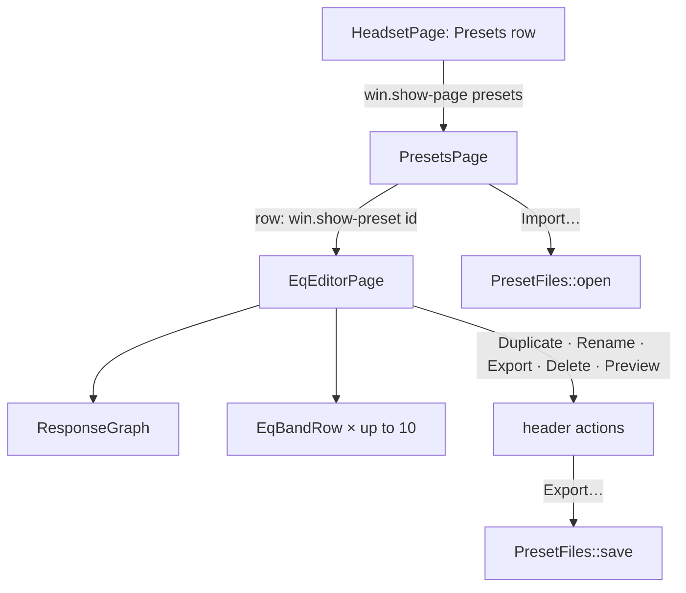
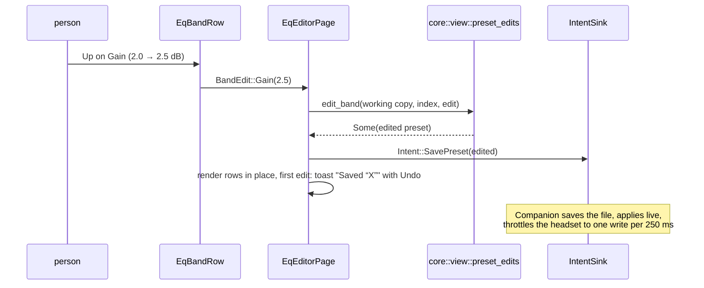
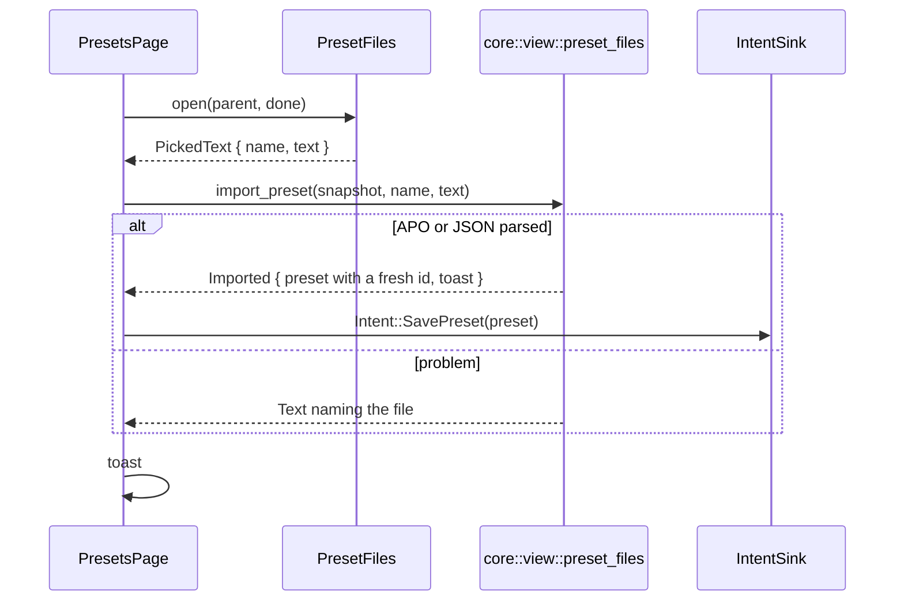

# SP10 Presets Page and EQ Editor Implementation Plan

> **For agentic workers:** REQUIRED SUB-SKILL: Use superpowers:subagent-driven-development (recommended) or superpowers:executing-plans to implement this plan task-by-task. Steps use checkbox (`- [ ]`) syntax for tracking.

**Goal:** The presets page (Built-in and Custom groups, Import), the equalizer editor page (response graph, up to
ten band rows, Add/Remove Band, Duplicate, Rename, Export, Delete with an undo toast, Preview) and preset
import/export, all in `crates/ui`, rendering `core::view` models and emitting `core::intent::Intent`s, tested
headless with `#[gtk::test]` and pure view-model tests.

**Architecture:** Every decision stays pure in `crates/core/src/view/`: `eq_editor.rs` builds the editor model
from a working copy and places graph points, `preset_edits.rs` turns one widget change (`BandEdit`, add, remove,
rename, duplicate) into the edited `Preset`, `preset_files.rs` turns a picked document into a custom `Preset` (APO
or JSON) and a preset into export text. `crates/ui` renders: `PresetsPage` and `EqEditorPage` are
`AdwNavigationPage`s in the window's navigation view, `EqBandRow` is one band, `ResponseGraph` draws the curve.
Every edit leaves as `Intent::SavePreset` at once (instant save); `Companion` (SP6) already throttles the headset
and retargets the system engine. Pages reach the intent sink, the window's toast overlay and the file chooser
through one `Services` value; the file chooser hides behind the `PresetFiles` trait so tests fake it.

**Tech Stack:** Rust 2024 (toolbox `arctis`), gtk4-rs 0.11 (`gnome_50`), libadwaita-rs 0.9 (`v1_9`), gettext-rs
0.7, blueprint-compiler, `serde_json` (now a normal dependency of `arctis-core`); tests under
`weston --backend=headless`.

Spec: `docs/superpowers/specs/2026-10-11-arctis-companion-design.md` §3 (module tree: `presets_page.rs`,
`eq_editor_page.rs`, `eq_band_row.rs`, `response_graph.rs`; `core::view` `presets.rs`, `eq_editor.rs`), §5 (SP10
row); ui part §1 (navigation), §3 (presets and EQ editor), §4 (HIG capitalization, i18n, `Text`); audio part §3
(preset library, import, export, missing presets, delete toast), §4 (user picks); quality part §1 (`core::view` and
`crates/ui` rows); ADR 0011; SP6 plan Deviations 11, 12, 28; SP9 plan Deviations 2, 3, 4, 8, 16, 17, 24, 26.

---

## Conventions for every task

- Worktree: `/home/marcelo/Desenvolvimento/arctis-wt/sp10`, branch `sp10-presets-eq-editor`. Never touch
  `/home/marcelo/Desenvolvimento/arctis-companion`. Stay inside `crates/core/src/view/`, `crates/core/src/testkit/`,
  `crates/core/Cargo.toml`, `crates/core/tests/view/`, `crates/ui/`, `docs/architecture/` and this plan. SP10 never
  opens `/dev/hidraw*`, never talks to PipeWire and never edits `crates/app`.
- **Run (core):** `X` means `toolbox run -c arctis bash -lc 'cd /home/marcelo/Desenvolvimento/arctis-wt/sp10 && X'`.
- **Run (ui):** `X` means

  ```bash
  toolbox run -c arctis bash -lc 'cd /home/marcelo/Desenvolvimento/arctis-wt/sp10 && export XDG_RUNTIME_DIR=$(mktemp -d) LC_ALL=C.UTF-8 && { weston --backend=headless --socket=wl-sp10 --idle-time=0 >/dev/null 2>&1 & W=$!; } && until [ -S "$XDG_RUNTIME_DIR/wl-sp10" ]; do sleep 0.1; done; GDK_BACKEND=wayland GSK_RENDERER=cairo WAYLAND_DISPLAY=wl-sp10 X; S=$?; kill $W; exit $S'
  ```

  This is the `ui` job of `.github/workflows/ci.yml`. Git and `gh` run on the host in the worktree.
- Never run the `arctis-companion` binary: once SP8 lands it opens `/dev/hidraw*`, which only SP0 and SP5 may do
  with the real dongle plugged in. The widget tests load every template.
- No comments in any file of any language, doc comments and Blueprint included. Names and small functions carry
  the meaning. Blueprint strings shown to people are `_("…")`; widget `name:` values, icon names and action names
  are not.
- Clippy policy applies to tests too: cognitive complexity 8, 40 lines per function, nesting 3, at most 4
  arguments (`self` included), no `unwrap()` (tests use `expect`), `pedantic` as errors under `-D warnings`: no
  `as` casts (`f32::from`, `u32::try_from`, `i16::try_from`), no `==` on floats, `#[must_use]` on public
  functions that return a value. When clippy objects, extract a function or rename; never add an `allow` or
  `expect` attribute.
- HIG capitalization: header case for titles, buttons and menu items, sentence case for subtitles, descriptions
  and toasts. Every row whose title comes from a model has `use-markup: false` (custom preset names are user text).
- Widget tests live in the one integration binary `crates/ui/tests/widgets/main.rs`, one module per widget.
  Helpers go into `crates/ui/tests/widgets/support.rs` in the task that first uses them. Widgets are found by their
  Blueprint `name:` through `support::named`. Expected strings come from the core model through
  `arctis_core::testkit::english::english` whenever the model provides them.
- Code blocks below are not rustfmt-formatted; `cargo fmt --all` reflows them and that is expected.
- Before each commit, Run (core): `cargo fmt --all && cargo clippy --workspace --all-targets -- -D warnings && cargo test -p arctis-core && cargo xtask check-rules && cargo xtask check-pure && cargo xtask check-doc-paths`,
  then Run (ui): `cargo test -p arctis-ui`.
- Commit subjects are conventional (`type(scope): summary`), short. Never write `Co-Authored-By`,
  "Generated with", or any AI or tool name in a commit message, PR title or PR body. Never use `--no-verify`.
- Push after every commit: `git push -u origin sp10-presets-eq-editor` the first time, then `git push`. After a
  rebase that moved the branch, `git push --force-with-lease`.
- SP11 and SP12 run in parallel and also add pages to `crates/ui`. SP10's edits to shared files are kept to a few
  lines each: `crates/ui/src/lib.rs` (module lines and re-exports), `crates/ui/src/window.rs` (two template
  children, one field, one action, one call in `render`, one in `constructed`, four small methods),
  `crates/ui/resources/window.blp` (two page lines), `crates/ui/resources/resources.gresource.xml` (three lines),
  `crates/ui/tests/widgets/main.rs` and `support.rs` (appended helpers), `crates/ui/tests/widgets/window.rs` (one
  test rewritten), `accessibility.rs` and `layout.rs` (appended tests), `crates/core/src/view/mod.rs` and
  `crates/core/src/testkit/mod.rs` (one module line each), `docs/architecture/README.md` (one row) and
  `docs/architecture/ui.md` (one sentence). Before Task 1, before Task 9 and before the PR (Task 14) run
  `git fetch origin && git rebase origin/main`; on a conflict in those files keep both sides' lines.

## Acceptance criteria → tasks

| SP10 acceptance criterion (design §5) or scope item | Task |
|---|---|
| Scope: presets page (`presets_page.rs`): Built-in and Custom groups, rows open the editor, header Import | 7, 9 |
| Scope: EQ editor page (`eq_editor_page.rs`, `eq_band_row.rs`): up to 10 band rows (type, frequency, gain step 0.5, Q, enabled), Add Band / Remove Band, Duplicate for built-ins, Rename / Export / Delete menu for custom presets, breakpoint at 720sp | 1, 2, 6, 8, 9, 10 |
| Scope: response graph (`response_graph.rs`): log axis 20 Hz–20 kHz, ±10 dB grid, curve from `core::eq::response`, accessible description | 1, 5, 8, 12 |
| Scope: import/export (APO or JSON through the file chooser portal; clamps listed in a toast; more than 10 filters rejected) | 3, 4, 7, 9, 10 |
| keyboard-only editing of every band | 6, 8, 12 |
| low-pass/high-pass gain insensitive | 2, 6, 8 |
| instant save with undo toast | 2, 4, 8 |
| delete toast names the preset's uses | 10 (uses `core::view::presets::deleted_toast` from SP6) |
| Preview emits its manual-pick intents (`StartPreview`, `EndPreview`, also when the page closes) | 11 |
| APO import of a published AutoEQ file | 3, 7, 9 |
| empty Custom group description | 7 (model from SP6) |
| view-model checks (pure, `crates/core/tests/view/`) | 1, 2, 3 |
| 360 px wide with no horizontal scroll, accessibility walk (SP9's checks extended to the new pages) | 12 |
| `docs/architecture/presets.md` (sub-project rule, design §5) | 13 |
| full verification and pull request | 14 |

## File structure

```
crates/core/Cargo.toml                          serde_json becomes a normal dependency
crates/core/src/view/mod.rs                     pub mod preset_edits; pub mod preset_files
crates/core/src/view/eq_editor.rs               eq_editor_for, x_fraction, y_fraction, GRID_HZ, GRID_DB, kind_at, kind_position
crates/core/src/view/preset_edits.rs            BandEdit, NEW_BAND, edit_band, add_band, remove_band, renamed, copy_name, duplicate, saved_toast
crates/core/src/view/preset_files.rs            Imported, import_preset, export_text, export_file_name, export_failed
crates/core/src/testkit/mod.rs                  pub mod autoeq
crates/core/src/testkit/autoeq.rs               SENNHEISER_HD_600, SENNHEISER_HD_600_FILE
crates/core/tests/view/main.rs                  mod preset_edits; mod preset_files
crates/core/tests/view/support.rs               filter() helper (moved from eq_editor.rs)
crates/core/tests/view/eq_editor.rs             working-copy model, graph fractions, kind positions
crates/core/tests/view/preset_edits.rs          edit table
crates/core/tests/view/preset_files.rs          AutoEQ import, clamps, errors, JSON round trip, export
crates/ui/src/lib.rs                            modules and re-exports
crates/ui/src/services.rs                       Services, undo_toast
crates/ui/src/preset_files.rs                   PresetFiles, PickedText, Export, PortalFiles, portal_files
crates/ui/src/response_graph.rs                 ResponseGraph
crates/ui/src/eq_band_row.rs                    EqBandRow
crates/ui/src/presets_page.rs                   PresetsPage, SHOW_PRESET_ACTION
crates/ui/src/eq_editor_page.rs                 EqEditorPage, EDITOR_TAG (render, band rows, edits, undo)
crates/ui/src/eq_editor_page/header.rs          Duplicate, Rename, Export, Delete, Preview
crates/ui/src/window.rs                         pages, win.show-preset, set_preset_files
crates/ui/resources/eq_band_row.blp             expander row with type, frequency, gain, Q, enabled, Remove Band
crates/ui/resources/presets_page.blp            header Import, Built-in and Custom groups
crates/ui/resources/eq_editor_page.blp          header Preview / Duplicate / menu, breakpoint bin, graph, Bands group
crates/ui/resources/window.blp                  the two pages inside the navigation view
crates/ui/resources/resources.gresource.xml     three .ui files
crates/ui/tests/widgets/main.rs                 new modules
crates/ui/tests/widgets/support.rs              FakeFiles, fake_services, band, custom_preset, with_preset, shows_text, click, saved, step_up, open_editor, visible_tag
crates/ui/tests/widgets/services.rs             toasts and undo
crates/ui/tests/widgets/response_graph.rs       role, description, drawing
crates/ui/tests/widgets/eq_band_row.rs          values, gain sensitivity, read-only, edits, render guard
crates/ui/tests/widgets/presets_page.rs         groups, empty Custom description, row targets, AutoEQ import
crates/ui/tests/widgets/eq_editor_page.rs       read-only built-ins, editing, keyboard, undo toast
crates/ui/tests/widgets/preset_actions.rs       Duplicate, Rename, Export, Delete, Preview
crates/ui/tests/widgets/window.rs               navigation test rewritten, preset navigation, window import
crates/ui/tests/widgets/accessibility.rs        preset pages walk, graph description
crates/ui/tests/widgets/layout.rs               preset pages at 360 px
docs/architecture/presets.md                    diagrams + code paths and symbols
docs/architecture/README.md                     one row
docs/architecture/ui.md                         one sentence on picked documents
```

Dependency direction inside `crates/ui`: `text`, `intents`, `widget_values` → `preset_files` → `services` →
`response_graph`, `eq_band_row` → `presets_page`, `eq_editor_page` (+ `header`) → `window`.

## Deviations

Decisions taken where the spec is silent or ambiguous; each is the simplest option consistent with it.

| # | Decision | Why |
|---|---|---|
| 1 | Extra files beyond the module tree: `crates/ui/src/services.rs`, `crates/ui/src/preset_files.rs`, `crates/ui/src/eq_editor_page/header.rs`; in core `view/preset_edits.rs`, `view/preset_files.rs`, `testkit/autoeq.rs` | one responsibility per file, all well under 400 lines; the spec's tree lists the floor |
| 2 | The file chooser lives in `crates/ui/src/preset_files.rs`: `PortalFiles` opens `gtk::FileDialog` (the file chooser portal under Flatpak) and reads or writes only the document the person picked, behind the `PresetFiles` trait. No widget touches a file; pages get text and hand back text. `docs/architecture/ui.md` says so | ui §3 puts Import and Export "through the file chooser portal", which is a GTK dialog; ui §1's "no file" is read as "no app-owned file" (stores, settings). The trait lets tests fake the portal and lets SP8 swap the implementation without touching the pages |
| 3 | `serde_json` moves from `arctis-core`'s dev-dependencies to its dependencies | JSON import and export are pure decisions in `core::view::preset_files`; design §3 allows `serde_json` in core and `xtask check-pure` already lists it |
| 4 | No new `Intent` variants: edits, Duplicate, Rename, Import and Undo all emit `Intent::SavePreset`, Delete emits `Intent::DeletePreset`, Preview emits `StartPreview`/`EndPreview` | SP6 froze these intents and `Companion` already persists, applies live and throttles (SP6 Deviations 11, 12) |
| 5 | The editor edits a working copy of the preset: each change builds the edited `Preset` with `core::view::preset_edits`, keeps it, emits `SavePreset` at once and re-renders from it. A later snapshot that contains the same id replaces the working copy; a snapshot without it (a duplicate not yet published) keeps it | instant save with no wait for the round trip; band rows update in place so keyboard focus is never lost |
| 6 | Edit undo: the first edit after the editor opens (or after its toast went away) shows one toast "Saved “{preset}”" with Undo; Undo saves the preset as it was when the editor opened. Later edits while that toast is shown add no toast | ui §3 "instant save" and design §7 "undo toasts"; one toast per burst of spin-button steps instead of one per step |
| 7 | Delete: the toast "Deleted “X”. Used by …" (SP6 `core::view::presets::deleted_toast`) has High priority and Undo (`SavePreset` of the deleted preset); the editor pops before `DeletePreset` is emitted, so an active Preview ends first | audio §3; a High toast replaces a pending "Saved" toast instead of queueing behind it |
| 8 | Remove Band is an `AdwButtonRow` inside each band's expander row (removes that band); Add Band is a `list-add-symbolic` button in the Bands group header. A new band is Peaking 1000 Hz, 0 dB, Q 1.41 (the factory Q) | ui §3 names both actions but not their place; per-band removal needs no selection model; a 0 dB peak changes nothing until edited |
| 9 | Duplicate (built-ins only): name "{preset} (Copy)" resolved in the person's language, id `fresh_preset_id` of that name, curve copied; the editor ends Preview and switches to the copy in place. Custom presets get the Rename / Export / Delete menu instead | ui §3 "Built-ins are read-only with a Duplicate header button"; a custom copy of a custom preset is Export + Import |
| 10 | Rename: an `AdwAlertDialog` with an entry; empty or unchanged names are ignored, the id never changes. The dialog's presentation is not tested (SP9 Deviation 24); `EqEditorPage::rename_to` is | rules and route presets keep pointing at the id |
| 11 | Export: one "Export…" item; the format follows the chosen file name: `.txt` (any case) writes Equalizer APO text, anything else JSON format 1; the suggested name is "{name}.json". A failed write shows "Could not export “{preset}”"; a cancelled dialog does nothing. Built-ins are not exported | audio §3 "Export writes the same JSON or APO text through the file chooser portal"; one item keeps the menu at three entries |
| 12 | Import: text starting with `{` is JSON, anything else APO. Every import gets a fresh id from its name, so it never overwrites a preset. An APO preset is named after the file without its extension. The toast reads "Imported “X”", or counts the clamped values ("… 3 values were changed to fit the headset"); rounding to the device grid (0.5 dB, 1 Hz, 0.001 Q) is silent. Errors are toasts naming the file. A cancelled chooser or an unreadable file does nothing; non-UTF-8 bytes are read lossily and fail as "no filters". The imported preset stays in the list (the editor does not open) | audio §3; an `AdwToast` is one line, so a count replaces a list; ui §4 forbids concatenated msgids |
| 13 | Preview: a `GtkToggleButton` "Preview" in the editor header, shown while `preview_available`; on → `StartPreview(id)`, off → `EndPreview`; the page's `hidden` vfunc turns it off (so closing the page emits `EndPreview`); a render that finds no picked path hides it and turns it off without an intent | ui §3; `Companion` already ends picks on route changes (SP6 Deviation 11) |
| 14 | Spin rows: frequency 20..20000 step 1 (page 100, 0 digits), gain −10..10 step 0.5 (1 digit), Q 0.2..10 step 0.01 (page 0.1, 3 digits) | three Q digits keep a stored 0.707 from being re-saved as 0.71 when focus leaves the field; an unchanged value is never an edit (`edit_band` returns `None`) |
| 15 | `ResponseGraph` has no template (a drawing widget with no children); height 160 px; grid lines at 100 Hz, 1 kHz, 10 kHz and every 5 dB in the foreground color at 15 % alpha; curve in the accent color, 2 px. The placement maths (`x_fraction`, `y_fraction`) is pure in `core::view::eq_editor`; `ResponseGraph::draw` is public so a test can draw into a `gtk::Snapshot` without a mapped window | quality §1 puts geometry in view models; GTK only lets a mapped widget snapshot itself |
| 16 | Layout: `AdwBreakpointBin` (width-request 360, height-request 200) holding a horizontal box; the breakpoint `max-width: 720sp` turns it vertical (graph above the bands). Only the 360 px minimum width is tested | ui §3; breakpoints evaluate only on a mapped, allocated window |
| 17 | Window glue: both pages are children of the navigation view in `window.blp` (tags `presets`, `eq-editor`); `win.show-preset` (string id) opens the editor and pushes it unless it is already visible; `Window::set_preset_files` replaces the default `PortalFiles` (tests use it) | the presets row already targets `win.show-page` `presets` (SP9 Deviation 8) |
| 18 | SP9's test `navigation_rows_open_their_page_once_it_exists` used the tag `presets`, which SP10 now provides; it is rewritten with the made-up tag `test-page` | the test's intent (only existing pages open) is kept |
| 19 | AutoEQ fixture: `results/oratory1990/over-ear/Sennheiser HD 600/Sennheiser HD 600 ParametricEQ.txt` from AutoEq (MIT, `jaakkopasanen/AutoEq`), ten filters, embedded verbatim as `arctis_core::testkit::autoeq::SENNHEISER_HD_600` and shared by core and ui tests | a real published file; a Rust constant needs no new file type in `xtask`'s comment check |
| 20 | "Keyboard-only editing" is checked as: every editing control of every band (type, frequency, gain, Q, enabled, Remove Band) is focusable and sensitive (gain only for gain kinds), and each band's frequency is changed through its spin button's `change-value` key-binding signal (what Up does) and saved; opening an expander and choosing in a combo row are libadwaita's own keyboard handling | GTK has no public API to send key events to an unmapped test window |
| 21 | `PortalFiles` itself has no automated test (it needs a running portal); SP14's hardware checklist imports and exports a file by hand | the pages are tested through `FakeFiles` |
| 22 | Two Duplicates of the same built-in before the first snapshot arrives get the same fresh id; the second overwrites the first | the bridge publishes after each intent (SP8), so this needs two clicks inside one main-loop turn |

---

### Task 1: Editor model from a working copy, graph placement, kind positions

**Files:**
- Modify: `crates/core/src/view/eq_editor.rs`
- Modify: `crates/core/tests/view/support.rs`
- Modify: `crates/core/tests/view/eq_editor.rs`

- [ ] **Step 1: Rebase and move the test filter helper into support**

Run on the host: `git -C /home/marcelo/Desenvolvimento/arctis-wt/sp10 fetch origin && git -C /home/marcelo/Desenvolvimento/arctis-wt/sp10 rebase origin/main`

Append to `crates/core/tests/view/support.rs` (and add `Filter, FilterKind` to its `arctis_core::eq` import):

```rust
pub fn filter(kind: FilterKind, hz: u16, half_db: i8, milli_q: u16) -> Filter {
    Filter::from_parts(kind, hz, half_db, milli_q).expect("filter in the envelope")
}
```

In `crates/core/tests/view/eq_editor.rs` delete the local `fn filter` and import it from support:
`use crate::support::{assert_close, filter, id, snapshot, with};`

- [ ] **Step 2: Write the failing tests**

Append to `crates/core/tests/view/eq_editor.rs` and extend its imports to
`use arctis_core::view::eq_editor::{GRAPH_POINTS, band_title, eq_editor, eq_editor_for, kind_at, kind_items, kind_position, x_fraction, y_fraction};`:

```rust
#[test]
fn the_editor_model_can_come_from_a_working_copy() {
    let s = snapshot();
    let copy = two_bands();
    let editor = eq_editor_for(&s, &copy);
    assert_eq!(editor.id, id("mine"));
    assert_eq!(editor.bands.len(), 2);
    assert!(editor.editable);
    assert_eq!(eq_editor(&s, &id("mine")), None);
}

#[test]
fn twenty_hertz_sits_left_and_twenty_kilohertz_right() {
    assert_close(f64::from(x_fraction(20.0)), 0.0, 1e-6);
    assert_close(f64::from(x_fraction(632.455_5)), 0.5, 1e-4);
    assert_close(f64::from(x_fraction(20_000.0)), 1.0, 1e-6);
    assert_close(f64::from(x_fraction(5.0)), 0.0, 1e-6);
}

#[test]
fn plus_ten_decibels_sits_on_top_and_minus_ten_at_the_bottom() {
    assert_close(f64::from(y_fraction(10.0)), 0.0, 1e-6);
    assert_close(f64::from(y_fraction(0.0)), 0.5, 1e-6);
    assert_close(f64::from(y_fraction(-10.0)), 1.0, 1e-6);
    assert_close(f64::from(y_fraction(-14.0)), 1.0, 1e-6);
    assert_close(f64::from(y_fraction(12.0)), 0.0, 1e-6);
}

#[test]
fn filter_kinds_map_to_combo_positions() {
    for (position, kind) in FilterKind::ALL.into_iter().enumerate() {
        assert_eq!(kind_position(kind), position);
        assert_eq!(kind_at(position), Some(kind));
    }
    assert_eq!(kind_at(FilterKind::ALL.len()), None);
    assert_eq!(kind_items().len(), FilterKind::ALL.len());
}
```

- [ ] **Step 3: Run the tests to see them fail**

Run (core): `cargo test -p arctis-core --test view eq_editor`
Expected: compile error, `eq_editor_for`, `x_fraction`, `y_fraction`, `kind_at`, `kind_position` not found.

- [ ] **Step 4: Implement**

In `crates/core/src/view/eq_editor.rs` replace `pub fn eq_editor` with the two functions below and add the
constants and helpers (after `graph_frequencies`):

```rust
const GRAPH_DB_RANGE: f32 = 10.0;
pub const GRID_HZ: [f32; 3] = [100.0, 1_000.0, 10_000.0];
pub const GRID_DB: [f32; 5] = [-10.0, -5.0, 0.0, 5.0, 10.0];

#[must_use]
pub fn eq_editor(snapshot: &Snapshot, id: &PresetId) -> Option<EqEditorModel> {
    snapshot
        .presets
        .find(id)
        .map(|preset| eq_editor_for(snapshot, preset))
}

#[must_use]
pub fn eq_editor_for(snapshot: &Snapshot, preset: &Preset) -> EqEditorModel {
    let filters = preset.curve().filters();
    EqEditorModel {
        id: preset.id().clone(),
        title: preset_title(preset),
        editable: preset.kind() == PresetKind::Custom,
        bands: filters
            .iter()
            .zip(0_usize..)
            .map(|(filter, index)| band(*filter, index))
            .collect(),
        can_add_band: filters.len() < MAX_FILTERS,
        graph: graph(preset),
        preview_available: snapshot.picked_path().is_ok(),
    }
}

#[must_use]
pub fn x_fraction(hz: f32) -> f32 {
    ((hz / GRAPH_LOW_HZ).log10() / GRAPH_SPAN.log10()).clamp(0.0, 1.0)
}

#[must_use]
pub fn y_fraction(db: f32) -> f32 {
    ((GRAPH_DB_RANGE - db) / (2.0 * GRAPH_DB_RANGE)).clamp(0.0, 1.0)
}

#[must_use]
pub fn kind_at(position: usize) -> Option<FilterKind> {
    FilterKind::ALL.get(position).copied()
}

#[must_use]
pub fn kind_position(kind: FilterKind) -> usize {
    FilterKind::ALL
        .iter()
        .position(|candidate| *candidate == kind)
        .unwrap_or(0)
}
```

- [ ] **Step 5: Run the tests to see them pass**

Run (core): `cargo test -p arctis-core --test view`
Expected: PASS (the earlier `eq_editor` tests still pass through `eq_editor_for`).

- [ ] **Step 6: Commit**

```bash
git add crates/core/src/view/eq_editor.rs crates/core/tests/view/support.rs crates/core/tests/view/eq_editor.rs
git commit -m "feat(core): build the editor model from a working copy and place graph points"
git push -u origin sp10-presets-eq-editor
```

### Task 2: Preset edits as pure functions

**Files:**
- Create: `crates/core/src/view/preset_edits.rs`
- Modify: `crates/core/src/view/mod.rs`
- Create: `crates/core/tests/view/preset_edits.rs`
- Modify: `crates/core/tests/view/main.rs`

- [ ] **Step 1: Write the failing tests**

Add `mod preset_edits;` to `crates/core/tests/view/main.rs` (alphabetical) and create
`crates/core/tests/view/preset_edits.rs`:

```rust
use arctis_core::eq::library;
use arctis_core::eq::preset::{Preset, PresetKind};
use arctis_core::eq::{Curve, Filter, FilterKind};
use arctis_core::testkit::english::english;
use arctis_core::view::preset_edits::{
    BandEdit, NEW_BAND, add_band, copy_name, duplicate, edit_band, remove_band, renamed, saved_toast,
};

use crate::support::{custom, filter, id, snapshot};

fn mine(filters: &[Filter]) -> Preset {
    let curve = Curve::new(filters.to_vec()).expect("at most ten filters");
    Preset::custom(id("mine"), "Mine".to_owned(), curve)
}

fn peak() -> Preset {
    mine(&[filter(FilterKind::Peaking, 250, 4, 1_000)])
}

fn first_band(preset: &Preset) -> Filter {
    preset.curve().filters()[0]
}

#[test]
fn a_gain_edit_snaps_to_half_decibels_and_keeps_the_identity() {
    let edited = edit_band(&peak(), 0, BandEdit::Gain(2.7)).expect("edited");
    assert_eq!(first_band(&edited).gain().half_db(), 5);
    assert_eq!(edited.id(), &id("mine"));
    assert_eq!(edited.name(), "Mine");
    assert_eq!(edited.kind(), PresetKind::Custom);
}

#[test]
fn frequency_and_q_edits_stay_inside_the_envelope() {
    let low = edit_band(&peak(), 0, BandEdit::Frequency(5.0)).expect("edited");
    assert_eq!(first_band(&low).hz().get(), 20);
    let precise = edit_band(&peak(), 0, BandEdit::Q(0.707)).expect("edited");
    assert_eq!(first_band(&precise).q().milli(), 707);
    let widest = edit_band(&peak(), 0, BandEdit::Q(40.0)).expect("edited");
    assert_eq!(first_band(&widest).q().milli(), 10_000);
}

#[test]
fn a_pass_filter_drops_its_gain_and_ignores_gain_edits() {
    let low_pass = edit_band(&peak(), 0, BandEdit::Kind(FilterKind::LowPass)).expect("edited");
    assert_eq!(first_band(&low_pass).kind(), FilterKind::LowPass);
    assert_eq!(first_band(&low_pass).gain().half_db(), 0);
    assert_eq!(edit_band(&low_pass, 0, BandEdit::Gain(3.0)), None);
}

#[test]
fn disabling_a_band_keeps_its_values() {
    let off = edit_band(&peak(), 0, BandEdit::Enabled(false)).expect("edited");
    assert!(!first_band(&off).is_enabled());
    assert_eq!(first_band(&off).with_enabled(true), first_band(&peak()));
}

#[test]
fn an_unchanged_value_or_a_missing_band_is_no_edit() {
    assert_eq!(edit_band(&peak(), 0, BandEdit::Frequency(250.0)), None);
    assert_eq!(edit_band(&peak(), 0, BandEdit::Gain(2.0)), None);
    assert_eq!(edit_band(&peak(), 0, BandEdit::Q(1.0)), None);
    assert_eq!(edit_band(&peak(), 3, BandEdit::Gain(1.0)), None);
}

#[test]
fn built_in_presets_take_no_edits() {
    let flat = library::flat();
    assert_eq!(edit_band(&flat, 0, BandEdit::Gain(3.0)), None);
    assert_eq!(add_band(&flat), None);
    assert_eq!(remove_band(&flat, 0), None);
    assert_eq!(renamed(&flat, "Mine"), None);
}

#[test]
fn bands_are_added_as_a_neutral_peak_up_to_ten() {
    let two = add_band(&peak()).expect("added");
    assert_eq!(two.curve().filters(), [first_band(&peak()), NEW_BAND]);
    assert_eq!(NEW_BAND, filter(FilterKind::Peaking, 1_000, 0, 1_410));
    assert_eq!(add_band(&custom("Full")), None);
}

#[test]
fn a_band_is_removed_by_position() {
    let pass = filter(FilterKind::LowPass, 8_000, 0, 707);
    let two = mine(&[filter(FilterKind::Peaking, 250, 4, 1_000), pass]);
    let one = remove_band(&two, 0).expect("removed");
    assert_eq!(one.curve().filters(), [pass]);
    assert_eq!(remove_band(&two, 2), None);
}

#[test]
fn renaming_trims_and_ignores_empty_or_unchanged_names() {
    let renamed_preset = renamed(&peak(), "  Night  ").expect("renamed");
    assert_eq!(renamed_preset.name(), "Night");
    assert_eq!(renamed_preset.id(), &id("mine"));
    assert_eq!(renamed(&peak(), "   "), None);
    assert_eq!(renamed(&peak(), "Mine"), None);
}

#[test]
fn a_duplicate_is_a_custom_copy_under_a_fresh_id() {
    let source = library::find(&id("bass-boost")).expect("a built-in");
    let name = english(&copy_name(&source));
    assert_eq!(name, "Bass Boost (Copy)");
    let copy = duplicate(&snapshot(), &source, &name);
    assert_eq!(copy.id(), &id("bass-boost-copy"));
    assert_eq!(copy.name(), "Bass Boost (Copy)");
    assert_eq!(copy.kind(), PresetKind::Custom);
    assert_eq!(copy.curve(), source.curve());
}

#[test]
fn the_saved_toast_names_the_preset() {
    assert_eq!(english(&saved_toast(&peak())), "Saved “Mine”");
}
```

- [ ] **Step 2: Run the tests to see them fail**

Run (core): `cargo test -p arctis-core --test view preset_edits`
Expected: compile error, module `preset_edits` not found.

- [ ] **Step 3: Implement**

Add `pub mod preset_edits;` to `crates/core/src/view/mod.rs` (after `pub mod preferences;`, before
`pub mod presets;`). Create `crates/core/src/view/preset_edits.rs`:

```rust
use super::text::{Text, preset_arg};
use crate::companion::snapshot::Snapshot;
use crate::eq::curve::{Curve, MAX_FILTERS};
use crate::eq::decimal::{rounded_quotient, thousandths_of};
use crate::eq::filter::{Filter, FilterKind, Gain, Hertz, Q};
use crate::eq::preset::{Preset, PresetKind};

const MILLI_PER_HZ: i64 = 1_000;

pub const NEW_BAND: Filter = match Filter::from_parts(FilterKind::Peaking, 1_000, 0, 1_410) {
    Ok(filter) => filter,
    Err(_) => panic!("the new band lies outside the envelope"),
};

#[derive(Clone, Copy, Debug, PartialEq)]
pub enum BandEdit {
    Kind(FilterKind),
    Frequency(f64),
    Gain(f64),
    Q(f64),
    Enabled(bool),
}

#[must_use]
pub fn edit_band(preset: &Preset, index: usize, edit: BandEdit) -> Option<Preset> {
    let mut filters = editable_filters(preset)?;
    let band = filters.get_mut(index)?;
    *band = edited(*band, edit)?;
    with_filters(preset, filters)
}

#[must_use]
pub fn add_band(preset: &Preset) -> Option<Preset> {
    let mut filters = editable_filters(preset)?;
    if filters.len() >= MAX_FILTERS {
        return None;
    }
    filters.push(NEW_BAND);
    with_filters(preset, filters)
}

#[must_use]
pub fn remove_band(preset: &Preset, index: usize) -> Option<Preset> {
    let mut filters = editable_filters(preset)?;
    if index >= filters.len() {
        return None;
    }
    filters.remove(index);
    with_filters(preset, filters)
}

#[must_use]
pub fn renamed(preset: &Preset, name: &str) -> Option<Preset> {
    let name = name.trim();
    let changes = preset.kind() == PresetKind::Custom && !name.is_empty() && name != preset.name();
    changes.then(|| Preset::custom(preset.id().clone(), name.to_owned(), preset.curve().clone()))
}

#[must_use]
pub fn copy_name(preset: &Preset) -> Text {
    Text::format("{preset} (Copy)", vec![("preset", preset_arg(preset))])
}

#[must_use]
pub fn duplicate(snapshot: &Snapshot, source: &Preset, name: &str) -> Preset {
    Preset::custom(
        snapshot.fresh_preset_id(name),
        name.to_owned(),
        source.curve().clone(),
    )
}

#[must_use]
pub fn saved_toast(preset: &Preset) -> Text {
    Text::format("Saved “{preset}”", vec![("preset", preset_arg(preset))])
}

fn editable_filters(preset: &Preset) -> Option<Vec<Filter>> {
    (preset.kind() == PresetKind::Custom).then(|| preset.curve().filters().to_vec())
}

fn with_filters(preset: &Preset, filters: Vec<Filter>) -> Option<Preset> {
    let curve = Curve::new(filters).ok()?;
    (curve != *preset.curve())
        .then(|| Preset::custom(preset.id().clone(), preset.name().to_owned(), curve))
}

fn edited(band: Filter, edit: BandEdit) -> Option<Filter> {
    let (kind, hz, gain, q) = match edit {
        BandEdit::Enabled(enabled) => return Some(band.with_enabled(enabled)),
        BandEdit::Kind(kind) => (kind, band.hz(), band.gain(), band.q()),
        BandEdit::Frequency(value) => (band.kind(), hertz_of(value)?, band.gain(), band.q()),
        BandEdit::Gain(db) => (band.kind(), band.hz(), gain_of(db)?, band.q()),
        BandEdit::Q(value) => (band.kind(), band.hz(), band.gain(), q_of(value)?),
    };
    Some(Filter::dropping_pass_gain(kind, hz, gain, q).with_enabled(band.is_enabled()))
}

fn hertz_of(value: f64) -> Option<Hertz> {
    let hz = rounded_quotient(thousandths_of(value)?, MILLI_PER_HZ);
    Some(Hertz::clamped(hz).value)
}

fn gain_of(db: f64) -> Option<Gain> {
    let half_db = rounded_quotient(thousandths_of(db)?, Gain::MILLI_DB_PER_STEP);
    Some(Gain::clamped_half_db(half_db).value)
}

fn q_of(value: f64) -> Option<Q> {
    Some(Q::clamped_milli(thousandths_of(value)?).value)
}
```

- [ ] **Step 4: Run the tests to see them pass**

Run (core): `cargo test -p arctis-core --test view preset_edits`
Expected: PASS, 11 tests.

- [ ] **Step 5: Commit**

```bash
git add crates/core/src/view/mod.rs crates/core/src/view/preset_edits.rs crates/core/tests/view/main.rs crates/core/tests/view/preset_edits.rs
git commit -m "feat(core): turn editor changes into edited presets"
git push
```

### Task 3: Preset import and export, with a published AutoEQ fixture

**Files:**
- Modify: `crates/core/Cargo.toml`
- Create: `crates/core/src/testkit/autoeq.rs`
- Modify: `crates/core/src/testkit/mod.rs`
- Create: `crates/core/src/view/preset_files.rs`
- Modify: `crates/core/src/view/mod.rs`
- Create: `crates/core/tests/view/preset_files.rs`
- Modify: `crates/core/tests/view/main.rs`

- [ ] **Step 1: Add the fixture and the dependency**

In `crates/core/Cargo.toml` move `serde_json = "1"` from `[dev-dependencies]` to `[dependencies]` (below
`serde`). Add `pub mod autoeq;` as the first line of `crates/core/src/testkit/mod.rs` and create
`crates/core/src/testkit/autoeq.rs` with the published file, byte for byte:

```rust
pub const SENNHEISER_HD_600_FILE: &str = "Sennheiser HD 600 ParametricEQ.txt";

pub const SENNHEISER_HD_600: &str = "Preamp: -6.3 dB
Filter 1: ON LSC Fc 105 Hz Gain 6.5 dB Q 0.70
Filter 2: ON PK Fc 125 Hz Gain -2.7 dB Q 0.55
Filter 3: ON PK Fc 8445 Hz Gain 3.3 dB Q 1.61
Filter 4: ON PK Fc 522 Hz Gain 0.7 dB Q 1.02
Filter 5: ON PK Fc 1298 Hz Gain -1.2 dB Q 2.14
Filter 6: ON HSC Fc 10000 Hz Gain -3.1 dB Q 0.70
Filter 7: ON PK Fc 3158 Hz Gain -1.8 dB Q 3.67
Filter 8: ON PK Fc 2166 Hz Gain 0.9 dB Q 3.32
Filter 9: ON PK Fc 6639 Hz Gain 2.2 dB Q 5.82
Filter 10: ON PK Fc 5433 Hz Gain -1.2 dB Q 5.70
";
```

Run (core): `cargo xtask check-pure`
Expected: PASS (`serde_json` is on the allow-list).

- [ ] **Step 2: Write the failing tests**

Add `mod preset_files;` to `crates/core/tests/view/main.rs` and create `crates/core/tests/view/preset_files.rs`:

```rust
use arctis_core::eq::apo;
use arctis_core::eq::preset::PresetKind;
use arctis_core::eq::FilterKind;
use arctis_core::testkit::autoeq::{SENNHEISER_HD_600, SENNHEISER_HD_600_FILE};
use arctis_core::testkit::english::english;
use arctis_core::view::preset_files::{export_failed, export_file_name, export_text, import_preset};
use arctis_core::view::text::Text;

use crate::support::{custom, filter, id, snapshot};

fn problem(file_name: &str, text: &str) -> String {
    english(&import_preset(&snapshot(), file_name, text).expect_err("rejected"))
}

#[test]
fn a_published_autoeq_file_imports_as_a_custom_preset() {
    let imported = import_preset(&snapshot(), SENNHEISER_HD_600_FILE, SENNHEISER_HD_600).expect("imported");
    let preset = &imported.preset;
    assert_eq!(preset.name(), "Sennheiser HD 600 ParametricEQ");
    assert_eq!(preset.id(), &id("sennheiser-hd-600-parametriceq"));
    assert_eq!(preset.kind(), PresetKind::Custom);
    let filters = preset.curve().filters();
    assert_eq!(filters.len(), 10);
    assert_eq!(filters[0], filter(FilterKind::LowShelf, 105, 13, 700));
    assert_eq!(filters[1], filter(FilterKind::Peaking, 125, -5, 550));
    assert_eq!(filters[5], filter(FilterKind::HighShelf, 10_000, -6, 700));
    assert_eq!(english(&imported.toast), "Imported “Sennheiser HD 600 ParametricEQ”");
}

#[test]
fn clamped_values_are_counted_in_the_toast() {
    let text = "Filter 1: ON PK Fc 10 Hz Gain 14 dB Q 0.7\nFilter 2: ON LPQ Fc 9000 Hz Gain 3 dB Q 0.7\n";
    let imported = import_preset(&snapshot(), "Loud.txt", text).expect("imported");
    assert_eq!(imported.preset.name(), "Loud");
    assert_eq!(
        english(&imported.toast),
        "Imported “Loud”. 3 values were changed to fit the headset"
    );
}

#[test]
fn problems_name_the_file() {
    assert_eq!(problem("eq.txt", "Preamp: -3 dB\n"), "“eq.txt” has no filters");
    assert_eq!(
        problem("eq.txt", "Filter 1: ON PK Fc x Hz Gain 1 dB Q 1\n"),
        "Could not read line 1 of “eq.txt”"
    );
    assert_eq!(
        problem("eq.txt", "Preamp: 0 dB\nFilter 1: ON BP Fc 100 Hz Q 1\n"),
        "Line 2 of “eq.txt” uses a filter type the headset does not support"
    );
    let eleven: String = (1..=11)
        .map(|n| format!("Filter {n}: ON PK Fc 100 Hz Gain 1 dB Q 1\n"))
        .collect();
    assert_eq!(
        problem("eq.txt", &eleven),
        "“eq.txt” has 11 filters; the headset takes at most 10"
    );
    assert_eq!(problem("x.json", "{\"format\": 9}"), "“x.json” is not a preset file");
}

#[test]
fn a_json_export_imports_back_under_a_fresh_id() {
    let mut s = snapshot();
    let mine = custom("Mine");
    s.presets.all.push(mine.clone());
    let text = export_text(&mine, "Mine.json");
    let imported = import_preset(&s, "Mine.json", &text).expect("imported");
    assert_eq!(imported.preset.id(), &id("mine-2"));
    assert_eq!(imported.preset.name(), "Mine");
    assert_eq!(imported.preset.curve(), mine.curve());
}

#[test]
fn a_text_file_name_exports_equalizer_apo() {
    let mine = custom("Mine");
    assert_eq!(export_text(&mine, "mine.TXT"), apo::render(mine.curve()));
}

#[test]
fn exports_suggest_a_json_name_and_report_failures() {
    assert_eq!(export_file_name("Mine"), "Mine.json");
    assert_eq!(english(&export_failed(&custom("Mine"))), "Could not export “Mine”");
    assert!(matches!(export_failed(&custom("Mine")), Text::Format { .. }));
}
```

- [ ] **Step 3: Run the tests to see them fail**

Run (core): `cargo test -p arctis-core --test view preset_files`
Expected: compile error, module `preset_files` not found.

- [ ] **Step 4: Implement**

Add `pub mod preset_files;` to `crates/core/src/view/mod.rs` (after `pub mod preset_edits;`). Create
`crates/core/src/view/preset_files.rs`:

```rust
use super::text::{Arg, Args, Text, preset_arg};
use crate::companion::snapshot::Snapshot;
use crate::eq::apo::{self, ApoError, Import};
use crate::eq::curve::{Curve, MAX_FILTERS};
use crate::eq::preset::Preset;

const APO_EXTENSION: &str = ".txt";
const JSON_EXTENSION: &str = ".json";

#[derive(Clone, Debug, PartialEq, Eq)]
pub struct Imported {
    pub preset: Preset,
    pub toast: Text,
}

struct Parsed {
    name: String,
    curve: Curve,
    clamped: usize,
}

pub fn import_preset(snapshot: &Snapshot, file_name: &str, text: &str) -> Result<Imported, Text> {
    let parsed = if text.trim_start().starts_with('{') {
        from_json(file_name, text)?
    } else {
        from_apo(file_name, text)?
    };
    let id = snapshot.fresh_preset_id(&parsed.name);
    let preset = Preset::custom(id, parsed.name, parsed.curve);
    Ok(Imported {
        toast: imported_toast(&preset, parsed.clamped),
        preset,
    })
}

#[must_use]
pub fn export_text(preset: &Preset, file_name: &str) -> String {
    if file_name.to_ascii_lowercase().ends_with(APO_EXTENSION) {
        apo::render(preset.curve())
    } else {
        serde_json::to_string_pretty(preset).unwrap_or_default()
    }
}

#[must_use]
pub fn export_file_name(name: &str) -> String {
    format!("{name}{JSON_EXTENSION}")
}

#[must_use]
pub fn export_failed(preset: &Preset) -> Text {
    Text::format(
        "Could not export “{preset}”",
        vec![("preset", preset_arg(preset))],
    )
}

fn from_json(file_name: &str, text: &str) -> Result<Parsed, Text> {
    let preset: Preset = serde_json::from_str(text).map_err(|_| not_a_preset(file_name))?;
    Ok(Parsed {
        name: preset.name().to_owned(),
        curve: preset.curve().clone(),
        clamped: 0,
    })
}

fn from_apo(file_name: &str, text: &str) -> Result<Parsed, Text> {
    let Import { curve, clamped } =
        apo::parse(text).map_err(|error| apo_problem(file_name, error))?;
    Ok(Parsed {
        name: stem(file_name).to_owned(),
        curve,
        clamped: clamped.len(),
    })
}

fn stem(file_name: &str) -> &str {
    match file_name.rsplit_once('.') {
        Some((stem, _)) if !stem.trim().is_empty() => stem,
        _ => file_name,
    }
}

fn imported_toast(preset: &Preset, clamped: usize) -> Text {
    let name = vec![("preset", preset_arg(preset))];
    match count(clamped) {
        0 => Text::format("Imported “{preset}”", name),
        n => Text::plural(
            [
                "Imported “{preset}”. {n} value was changed to fit the headset",
                "Imported “{preset}”. {n} values were changed to fit the headset",
            ],
            n,
            name,
        ),
    }
}

fn not_a_preset(file_name: &str) -> Text {
    Text::format("“{file}” is not a preset file", file_args(file_name))
}

fn apo_problem(file_name: &str, error: ApoError) -> Text {
    let mut args = file_args(file_name);
    match error {
        ApoError::NoFilters => Text::format("“{file}” has no filters", args),
        ApoError::TooManyFilters(found) => {
            args.push(("max", Arg::Number(count(MAX_FILTERS))));
            Text::plural(
                [
                    "“{file}” has {n} filter; the headset takes at most {max}",
                    "“{file}” has {n} filters; the headset takes at most {max}",
                ],
                count(found),
                args,
            )
        }
        ApoError::Malformed { line } => {
            args.push(("line", Arg::Number(count(line))));
            Text::format("Could not read line {line} of “{file}”", args)
        }
        ApoError::UnsupportedKind { line } => {
            args.push(("line", Arg::Number(count(line))));
            Text::format(
                "Line {line} of “{file}” uses a filter type the headset does not support",
                args,
            )
        }
    }
}

fn file_args(file_name: &str) -> Args {
    vec![("file", Arg::Str(file_name.to_owned()))]
}

fn count(value: usize) -> u32 {
    u32::try_from(value).unwrap_or(u32::MAX)
}
```

If clippy reports `apo_problem` above 40 lines or cognitive complexity 8, split each arm's body into one small
function (`too_many_filters(args, found)`, `bad_line(args, msgid, line)`).

- [ ] **Step 5: Run the tests to see them pass**

Run (core): `cargo test -p arctis-core --test view preset_files && cargo clippy -p arctis-core --all-targets -- -D warnings`
Expected: PASS, 6 tests; clippy clean.

- [ ] **Step 6: Commit**

```bash
git add crates/core/Cargo.toml Cargo.lock crates/core/src/testkit crates/core/src/view crates/core/tests/view
git commit -m "feat(core): import and export presets as APO or JSON"
git push
```

### Task 4: Services for pages and the file chooser seam

**Files:**
- Create: `crates/ui/src/preset_files.rs`
- Create: `crates/ui/src/services.rs`
- Modify: `crates/ui/src/lib.rs`
- Modify: `crates/ui/tests/widgets/support.rs`
- Create: `crates/ui/tests/widgets/services.rs`
- Modify: `crates/ui/tests/widgets/main.rs`

- [ ] **Step 1: Write the failing tests and their helpers**

Append to `crates/ui/tests/widgets/support.rs` (merge the `use` lines into its imports):

```rust
use std::cell::Cell;

use arctis_ui::Services;
use arctis_ui::preset_files::{Export, PickedText, PresetFiles};

#[derive(Default)]
pub struct FakeFiles {
    pub picked: RefCell<Option<PickedText>>,
    pub save_as: RefCell<String>,
    pub saved: RefCell<Vec<String>>,
    pub refuse_writes: Cell<bool>,
}

impl PresetFiles for FakeFiles {
    fn open(&self, _parent: &gtk::Widget, done: Box<dyn FnOnce(PickedText)>) {
        if let Some(picked) = self.picked.take() {
            done(picked);
        }
    }

    fn save(&self, _parent: &gtk::Widget, export: Export) {
        let text = (export.render)(&self.save_as.borrow());
        self.saved.borrow_mut().push(text);
        (export.done)(!self.refuse_writes.get());
    }
}

pub fn fake_services() -> (Services, Log, Rc<FakeFiles>) {
    init();
    let (sink, log) = recording_sink();
    let files = Rc::new(FakeFiles::default());
    let shared: Rc<dyn PresetFiles> = files.clone();
    let services = Services {
        sink,
        toasts: adw::ToastOverlay::new(),
        files: shared,
    };
    (services, log, files)
}

pub fn shows_text(root: &impl IsA<gtk::Widget>, text: &str) -> bool {
    descendants(root)
        .into_iter()
        .filter_map(|widget| widget.downcast::<gtk::Label>().ok())
        .any(|label| label.label() == text)
}

pub fn click(root: &impl IsA<gtk::Widget>, label: &str) {
    descendants(root)
        .into_iter()
        .filter_map(|widget| widget.downcast::<gtk::Button>().ok())
        .find(|button| button.label().as_deref() == Some(label))
        .unwrap_or_else(|| panic!("no button labelled {label}"))
        .emit_clicked();
}
```

Add `mod services;` to `crates/ui/tests/widgets/main.rs` and create `crates/ui/tests/widgets/services.rs`:

```rust
use std::cell::Cell;
use std::rc::Rc;

use arctis_core::view::text::Text;

use crate::support::{click, fake_services, shows_text};

#[gtk::test]
fn a_toast_shows_its_text() {
    let (services, log, _) = fake_services();
    services.toast(&Text::plain("Imported “Mine”"));
    assert!(shows_text(&services.toasts, "Imported “Mine”"));
    assert!(log.borrow().is_empty());
}

#[gtk::test]
fn an_urgent_undo_toast_runs_its_undo() {
    let (services, _, _) = fake_services();
    let undone = Rc::new(Cell::new(false));
    let flag = Rc::clone(&undone);
    services.urgent_undo_toast(&Text::plain("Deleted “Mine”"), move || flag.set(true));
    assert!(shows_text(&services.toasts, "Deleted “Mine”"));
    click(&services.toasts, "Undo");
    assert!(undone.get());
}
```

- [ ] **Step 2: Run the tests to see them fail**

Run (ui): `cargo test -p arctis-ui services`
Expected: compile error, `arctis_ui::Services` and `arctis_ui::preset_files` not found.

- [ ] **Step 3: Implement the file chooser seam**

Create `crates/ui/src/preset_files.rs`:

```rust
use std::rc::Rc;

use arctis_core::view::text::Text;
use gtk::prelude::*;
use gtk::{gio, glib};

use crate::text::resolve;

const PATTERNS: [&str; 2] = ["*.txt", "*.json"];

pub struct PickedText {
    pub name: String,
    pub text: String,
}

pub struct Export {
    pub suggested_name: String,
    pub render: Box<dyn FnOnce(&str) -> String>,
    pub done: Box<dyn FnOnce(bool)>,
}

pub trait PresetFiles {
    fn open(&self, parent: &gtk::Widget, done: Box<dyn FnOnce(PickedText)>);
    fn save(&self, parent: &gtk::Widget, export: Export);
}

#[derive(Clone, Copy, Debug, Default)]
pub struct PortalFiles;

impl PresetFiles for PortalFiles {
    fn open(&self, parent: &gtk::Widget, done: Box<dyn FnOnce(PickedText)>) {
        let dialog = preset_dialog(&Text::plain("Import Preset"));
        let window = parent.root().and_downcast::<gtk::Window>();
        glib::spawn_future_local(async move {
            if let Some(picked) = pick(&dialog, window.as_ref()).await {
                done(picked);
            }
        });
    }

    fn save(&self, parent: &gtk::Widget, export: Export) {
        let dialog = preset_dialog(&Text::plain("Export Preset"));
        dialog.set_initial_name(Some(&export.suggested_name));
        let window = parent.root().and_downcast::<gtk::Window>();
        glib::spawn_future_local(async move {
            write(&dialog, window.as_ref(), export).await;
        });
    }
}

#[must_use]
pub fn portal_files() -> Rc<dyn PresetFiles> {
    Rc::new(PortalFiles)
}

fn preset_dialog(title: &Text) -> gtk::FileDialog {
    let filter = gtk::FileFilter::new();
    filter.set_name(Some(&resolve(&Text::plain("Presets"))));
    for pattern in PATTERNS {
        filter.add_pattern(pattern);
    }
    let filters = gio::ListStore::new::<gtk::FileFilter>();
    filters.append(&filter);
    gtk::FileDialog::builder()
        .title(resolve(title))
        .modal(true)
        .filters(&filters)
        .default_filter(&filter)
        .build()
}

async fn pick(dialog: &gtk::FileDialog, window: Option<&gtk::Window>) -> Option<PickedText> {
    let file = dialog.open_future(window).await.ok()?;
    let (bytes, _) = file.load_contents_future().await.ok()?;
    Some(PickedText {
        name: file_name(&file),
        text: String::from_utf8_lossy(&bytes).into_owned(),
    })
}

async fn write(dialog: &gtk::FileDialog, window: Option<&gtk::Window>, export: Export) {
    let Ok(file) = dialog.save_future(window).await else {
        return;
    };
    let text = (export.render)(&file_name(&file));
    let written = file
        .replace_contents_future(
            text.into_bytes(),
            None,
            false,
            gio::FileCreateFlags::REPLACE_DESTINATION,
        )
        .await
        .is_ok();
    (export.done)(written);
}

fn file_name(file: &gio::File) -> String {
    file.basename()
        .map(|name| name.to_string_lossy().into_owned())
        .unwrap_or_default()
}
```

- [ ] **Step 4: Implement the services**

Create `crates/ui/src/services.rs`:

```rust
use std::rc::Rc;

use arctis_core::view::text::Text;

use crate::intents::IntentSink;
use crate::preset_files::PresetFiles;
use crate::text::resolve;

#[derive(Clone)]
pub struct Services {
    pub sink: IntentSink,
    pub toasts: adw::ToastOverlay,
    pub files: Rc<dyn PresetFiles>,
}

impl Services {
    pub fn toast(&self, title: &Text) {
        self.toasts.add_toast(plain_toast(title));
    }

    pub fn urgent_undo_toast(&self, title: &Text, undo: impl Fn() + 'static) {
        let toast = undo_toast(title, undo);
        toast.set_priority(adw::ToastPriority::High);
        self.toasts.add_toast(toast);
    }
}

#[must_use]
pub fn undo_toast(title: &Text, undo: impl Fn() + 'static) -> adw::Toast {
    let toast = plain_toast(title);
    toast.set_button_label(Some(&resolve(&Text::plain("Undo"))));
    toast.connect_button_clicked(move |_| undo());
    toast
}

fn plain_toast(title: &Text) -> adw::Toast {
    adw::Toast::builder()
        .title(resolve(title))
        .use_markup(false)
        .build()
}
```

In `crates/ui/src/lib.rs` add `pub mod preset_files;` and `mod services;` to the module list (alphabetical) and
`pub use services::Services;` to the re-exports.

- [ ] **Step 5: Run the tests to see them pass**

Run (ui): `cargo test -p arctis-ui services`
Expected: PASS, 2 tests. Then Run (core): `cargo clippy --workspace --all-targets -- -D warnings` (no
`dead_code` warning: `PortalFiles` and `portal_files` are public).

- [ ] **Step 6: Commit**

```bash
git add crates/ui/src/preset_files.rs crates/ui/src/services.rs crates/ui/src/lib.rs crates/ui/tests/widgets
git commit -m "feat(ui): add page services and the file chooser seam"
git push
```

### Task 5: Response graph

**Files:**
- Create: `crates/ui/src/response_graph.rs`
- Modify: `crates/ui/src/lib.rs`
- Create: `crates/ui/tests/widgets/response_graph.rs`
- Modify: `crates/ui/tests/widgets/main.rs`

- [ ] **Step 1: Write the failing tests**

Add `mod response_graph;` to `crates/ui/tests/widgets/main.rs` and create
`crates/ui/tests/widgets/response_graph.rs`:

```rust
use adw::prelude::*;
use arctis_core::testkit::english::english;
use arctis_core::testkit::snapshots::{id, snapshot};
use arctis_core::view::eq_editor::{GraphModel, eq_editor};
use arctis_ui::ResponseGraph;
use gtk::{AccessibleProperty, AccessibleRole};

use crate::support::{has_accessible_text, init};

fn graph_of(preset: &str) -> GraphModel {
    eq_editor(&snapshot(), &id(preset)).expect("editor").graph
}

#[gtk::test]
fn the_graph_is_an_image_described_by_its_model() {
    init();
    let graph = ResponseGraph::default();
    let model = graph_of("bass-boost");
    graph.render(&model);
    assert_eq!(graph.accessible_role(), AccessibleRole::Img);
    assert!(has_accessible_text(
        &graph,
        AccessibleProperty::Description,
        &english(&model.description)
    ));
}

#[gtk::test]
fn the_graph_draws_a_grid_and_a_curve() {
    init();
    let graph = ResponseGraph::default();
    graph.render(&graph_of("bass-boost"));
    let snapshot = gtk::Snapshot::new();
    graph.draw(&snapshot, 360, 160);
    assert!(snapshot.to_node().is_some());
}

#[gtk::test]
fn an_empty_graph_still_draws_its_grid() {
    init();
    let graph = ResponseGraph::default();
    let snapshot = gtk::Snapshot::new();
    graph.draw(&snapshot, 0, 0);
    assert!(snapshot.to_node().is_some());
}
```

- [ ] **Step 2: Run the tests to see them fail**

Run (ui): `cargo test -p arctis-ui response_graph`
Expected: compile error, `arctis_ui::ResponseGraph` not found.

- [ ] **Step 3: Implement**

Create `crates/ui/src/response_graph.rs`:

```rust
use adw::prelude::*;
use adw::subclass::prelude::*;
use arctis_core::view::eq_editor::{
    GRID_DB, GRID_HZ, GraphModel, GraphPoint, x_fraction, y_fraction,
};
use gtk::accessible::Property;
use gtk::{gdk, glib, gsk};

use crate::text::resolve;

const GRID_ALPHA: f32 = 0.15;
const GRID_WIDTH: f32 = 1.0;
const CURVE_WIDTH: f32 = 2.0;

mod imp {
    use std::cell::RefCell;

    use adw::subclass::prelude::*;
    use arctis_core::view::eq_editor::GraphPoint;
    use gtk::glib;
    use gtk::prelude::WidgetExt;

    #[derive(Default)]
    pub struct ResponseGraph {
        pub points: RefCell<Vec<GraphPoint>>,
    }

    #[glib::object_subclass]
    impl ObjectSubclass for ResponseGraph {
        const NAME: &'static str = "ArctisResponseGraph";
        type Type = super::ResponseGraph;
        type ParentType = gtk::Widget;

        fn class_init(klass: &mut Self::Class) {
            klass.set_css_name("response-graph");
            klass.set_accessible_role(gtk::AccessibleRole::Img);
        }
    }

    impl ObjectImpl for ResponseGraph {}

    impl WidgetImpl for ResponseGraph {
        fn snapshot(&self, snapshot: &gtk::Snapshot) {
            let graph = self.obj();
            graph.draw(snapshot, graph.width(), graph.height());
        }
    }
}

glib::wrapper! {
    pub struct ResponseGraph(ObjectSubclass<imp::ResponseGraph>)
        @extends gtk::Widget,
        @implements gtk::Accessible, gtk::Buildable, gtk::ConstraintTarget;
}

impl Default for ResponseGraph {
    fn default() -> Self {
        glib::Object::new()
    }
}

impl ResponseGraph {
    pub fn render(&self, model: &GraphModel) {
        self.imp().points.replace(model.points.clone());
        self.update_property(&[Property::Description(&resolve(&model.description))]);
        self.queue_draw();
    }

    pub fn draw(&self, snapshot: &gtk::Snapshot, width: i32, height: i32) {
        let area = (pixels(width), pixels(height));
        let grid = faded(&self.color());
        for line in grid_lines(area) {
            snapshot.append_stroke(&line, &gsk::Stroke::new(GRID_WIDTH), &grid);
        }
        if let Some(curve) = curve_path(&self.imp().points.borrow(), area) {
            let accent = adw::StyleManager::default().accent_color_rgba();
            snapshot.append_stroke(&curve, &gsk::Stroke::new(CURVE_WIDTH), &accent);
        }
    }
}

fn pixels(size: i32) -> f32 {
    i16::try_from(size.max(0)).map_or(f32::from(i16::MAX), f32::from)
}

fn faded(color: &gdk::RGBA) -> gdk::RGBA {
    gdk::RGBA::new(color.red(), color.green(), color.blue(), GRID_ALPHA)
}

fn grid_lines((width, height): (f32, f32)) -> Vec<gsk::Path> {
    let verticals = GRID_HZ
        .into_iter()
        .map(|hz| x_fraction(hz) * width)
        .map(|x| segment((x, 0.0), (x, height)));
    let horizontals = GRID_DB
        .into_iter()
        .map(|db| y_fraction(db) * height)
        .map(|y| segment((0.0, y), (width, y)));
    verticals.chain(horizontals).collect()
}

fn segment(from: (f32, f32), to: (f32, f32)) -> gsk::Path {
    let builder = gsk::PathBuilder::new();
    builder.move_to(from.0, from.1);
    builder.line_to(to.0, to.1);
    builder.to_path()
}

fn curve_path(points: &[GraphPoint], (width, height): (f32, f32)) -> Option<gsk::Path> {
    let place = |point: &GraphPoint| (x_fraction(point.hz) * width, y_fraction(point.db) * height);
    let (first, rest) = points.split_first()?;
    let builder = gsk::PathBuilder::new();
    let (x, y) = place(first);
    builder.move_to(x, y);
    for (x, y) in rest.iter().map(place) {
        builder.line_to(x, y);
    }
    Some(builder.to_path())
}
```

In `crates/ui/src/lib.rs` add `mod response_graph;` and `pub use response_graph::ResponseGraph;`.

- [ ] **Step 4: Run the tests to see them pass**

Run (ui): `cargo test -p arctis-ui response_graph`
Expected: PASS, 3 tests.

- [ ] **Step 5: Commit**

```bash
git add crates/ui/src/response_graph.rs crates/ui/src/lib.rs crates/ui/tests/widgets
git commit -m "feat(ui): draw the response graph"
git push
```

### Task 6: Band row

**Files:**
- Create: `crates/ui/resources/eq_band_row.blp`
- Create: `crates/ui/src/eq_band_row.rs`
- Modify: `crates/ui/resources/resources.gresource.xml`
- Modify: `crates/ui/src/lib.rs`
- Create: `crates/ui/tests/widgets/eq_band_row.rs`
- Modify: `crates/ui/tests/widgets/main.rs`, `crates/ui/tests/widgets/support.rs`

- [ ] **Step 1: Write the failing tests and their helpers**

Append to `crates/ui/tests/widgets/support.rs` (merge imports: `arctis_core::eq::{Curve, Filter, FilterKind}`,
`arctis_core::eq::preset::Preset`):

```rust
pub fn band(kind: FilterKind, hz: u16, half_db: i8, milli_q: u16) -> Filter {
    Filter::from_parts(kind, hz, half_db, milli_q).expect("band in the envelope")
}

pub fn custom_preset(filters: &[Filter]) -> Preset {
    let curve = Curve::new(filters.to_vec()).expect("at most ten bands");
    Preset::custom(id("mine"), "Mine".to_owned(), curve)
}
```

Add `mod eq_band_row;` to `crates/ui/tests/widgets/main.rs` and create `crates/ui/tests/widgets/eq_band_row.rs`:

```rust
use std::cell::{Cell, RefCell};
use std::rc::Rc;

use adw::prelude::*;
use arctis_core::eq::{Filter, FilterKind};
use arctis_core::testkit::english::english;
use arctis_core::testkit::snapshots::snapshot;
use arctis_core::view::eq_editor::{BandModel, eq_editor_for};
use arctis_core::view::preset_edits::BandEdit;
use arctis_ui::EqBandRow;

use crate::support::{assert_close, band, combo_text, custom_preset, init, named};

const CONTROLS: [&str; 5] = ["band-kind", "band-frequency", "band-gain", "band-q", "band-enabled"];

fn model_of(filter: Filter) -> BandModel {
    eq_editor_for(&snapshot(), &custom_preset(&[filter])).bands.remove(0)
}

fn row_showing(filter: Filter, editable: bool) -> EqBandRow {
    init();
    let row = EqBandRow::default();
    row.render(&model_of(filter), editable);
    row
}

fn recorded_edits(row: &EqBandRow) -> Rc<RefCell<Vec<BandEdit>>> {
    let edits = Rc::new(RefCell::new(Vec::new()));
    let writer = Rc::clone(&edits);
    row.connect_edit(move |edit| writer.borrow_mut().push(edit));
    edits
}

#[gtk::test]
fn a_band_shows_its_values() {
    let filter = band(FilterKind::LowShelf, 105, 13, 700);
    let row = row_showing(filter, true);
    assert_eq!(row.title(), english(&model_of(filter).title));
    assert_eq!(combo_text(&named(&row, "band-kind")), "Low Shelf");
    assert_close(named::<adw::SpinRow>(&row, "band-frequency").value(), 105.0);
    assert_close(named::<adw::SpinRow>(&row, "band-gain").value(), 6.5);
    assert_close(named::<adw::SpinRow>(&row, "band-q").value(), 0.7);
    assert!(named::<adw::SwitchRow>(&row, "band-enabled").is_active());
    assert!(named::<adw::ButtonRow>(&row, "band-remove").is_visible());
}

#[gtk::test]
fn low_pass_and_high_pass_make_the_gain_insensitive() {
    let kinds = [
        (FilterKind::Peaking, true),
        (FilterKind::LowShelf, true),
        (FilterKind::HighShelf, true),
        (FilterKind::LowPass, false),
        (FilterKind::HighPass, false),
    ];
    for (kind, sensitive) in kinds {
        let row = row_showing(band(kind, 1_000, 0, 707), true);
        assert_eq!(named::<adw::SpinRow>(&row, "band-gain").is_sensitive(), sensitive, "{kind:?}");
    }
}

#[gtk::test]
fn a_read_only_band_cannot_change() {
    let row = row_showing(band(FilterKind::Peaking, 250, 4, 1_000), false);
    for name in CONTROLS {
        assert!(!named::<gtk::Widget>(&row, name).is_sensitive(), "{name}");
    }
    assert!(!named::<adw::ButtonRow>(&row, "band-remove").is_visible());
}

#[gtk::test]
fn each_control_reports_its_edit() {
    let row = row_showing(band(FilterKind::Peaking, 250, 4, 1_000), true);
    let edits = recorded_edits(&row);
    named::<adw::ComboRow>(&row, "band-kind").set_selected(3);
    named::<adw::SpinRow>(&row, "band-frequency").set_value(300.0);
    named::<adw::SpinRow>(&row, "band-gain").set_value(-1.5);
    named::<adw::SpinRow>(&row, "band-q").set_value(2.0);
    named::<adw::SwitchRow>(&row, "band-enabled").set_active(false);
    assert_eq!(
        *edits.borrow(),
        vec![
            BandEdit::Kind(FilterKind::LowPass),
            BandEdit::Frequency(300.0),
            BandEdit::Gain(-1.5),
            BandEdit::Q(2.0),
            BandEdit::Enabled(false),
        ]
    );
}

#[gtk::test]
fn remove_band_reports_itself() {
    let row = row_showing(band(FilterKind::Peaking, 250, 4, 1_000), true);
    let removed = Rc::new(Cell::new(false));
    let flag = Rc::clone(&removed);
    row.connect_remove(move || flag.set(true));
    named::<adw::ButtonRow>(&row, "band-remove").emit_by_name::<()>("activated", &[]);
    assert!(removed.get());
}

#[gtk::test]
fn rendering_reports_no_edit() {
    let row = row_showing(band(FilterKind::Peaking, 250, 4, 1_000), true);
    let edits = recorded_edits(&row);
    row.render(&model_of(band(FilterKind::HighPass, 9_000, 0, 1_410)), true);
    row.render(&model_of(band(FilterKind::Peaking, 40, -20, 200)), false);
    assert!(edits.borrow().is_empty());
}
```

- [ ] **Step 2: Run the tests to see them fail**

Run (ui): `cargo test -p arctis-ui eq_band_row`
Expected: compile error, `arctis_ui::EqBandRow` not found.

- [ ] **Step 3: Write the template**

Create `crates/ui/resources/eq_band_row.blp`:

```blueprint
using Gtk 4.0;
using Adw 1;

template $ArctisEqBandRow: Adw.ExpanderRow {
  use-markup: false;

  Adw.ComboRow kind {
    name: "band-kind";
    title: _("Type");
  }

  Adw.SpinRow frequency {
    name: "band-frequency";
    title: _("Frequency (Hz)");
    digits: 0;

    adjustment: Adjustment {
      lower: 20;
      upper: 20000;
      step-increment: 1;
      page-increment: 100;
    };
  }

  Adw.SpinRow gain {
    name: "band-gain";
    title: _("Gain (dB)");
    digits: 1;

    adjustment: Adjustment {
      lower: -10;
      upper: 10;
      step-increment: 0.5;
      page-increment: 2;
    };
  }

  Adw.SpinRow q {
    name: "band-q";
    title: _("Q");
    digits: 3;

    adjustment: Adjustment {
      lower: 0.2;
      upper: 10;
      step-increment: 0.01;
      page-increment: 0.1;
    };
  }

  Adw.SwitchRow enabled {
    name: "band-enabled";
    title: _("Enabled");
  }

  Adw.ButtonRow remove {
    name: "band-remove";
    title: _("Remove Band");

    styles [
      "destructive-action",
    ]
  }
}
```

Add `<file preprocess="xml-stripblanks">eq_band_row.ui</file>` to `crates/ui/resources/resources.gresource.xml`
(after `shortcuts_dialog.ui`).

- [ ] **Step 4: Implement the widget**

Create `crates/ui/src/eq_band_row.rs`:

```rust
use std::rc::Rc;

use adw::prelude::*;
use adw::subclass::prelude::*;
use arctis_core::view::eq_editor::{BandModel, kind_at, kind_items, kind_position};
use arctis_core::view::preset_edits::BandEdit;
use gtk::glib;

use crate::text::resolve;
use crate::widget_values::{index, show_choices};

type EditHandler = Rc<dyn Fn(BandEdit)>;
type RemoveHandler = Rc<dyn Fn()>;

mod imp {
    use std::cell::{Cell, RefCell};

    use adw::subclass::prelude::*;
    use gtk::glib;

    #[derive(Default, gtk::CompositeTemplate)]
    #[template(resource = "/io/github/marcelogm/ArctisCompanion/ui/eq_band_row.ui")]
    pub struct EqBandRow {
        #[template_child]
        pub kind: TemplateChild<adw::ComboRow>,
        #[template_child]
        pub frequency: TemplateChild<adw::SpinRow>,
        #[template_child]
        pub gain: TemplateChild<adw::SpinRow>,
        #[template_child]
        pub q: TemplateChild<adw::SpinRow>,
        #[template_child]
        pub enabled: TemplateChild<adw::SwitchRow>,
        #[template_child]
        pub remove: TemplateChild<adw::ButtonRow>,
        pub rendering: Cell<bool>,
        pub on_edit: RefCell<Option<super::EditHandler>>,
        pub on_remove: RefCell<Option<super::RemoveHandler>>,
    }

    #[glib::object_subclass]
    impl ObjectSubclass for EqBandRow {
        const NAME: &'static str = "ArctisEqBandRow";
        type Type = super::EqBandRow;
        type ParentType = adw::ExpanderRow;

        fn class_init(klass: &mut Self::Class) {
            klass.bind_template();
        }

        fn instance_init(obj: &glib::subclass::InitializingObject<Self>) {
            obj.init_template();
        }
    }

    impl ObjectImpl for EqBandRow {
        fn constructed(&self) {
            self.parent_constructed();
            self.obj().connect_controls();
        }
    }

    impl WidgetImpl for EqBandRow {}
    impl ListBoxRowImpl for EqBandRow {}
    impl PreferencesRowImpl for EqBandRow {}
    impl ExpanderRowImpl for EqBandRow {}
}

glib::wrapper! {
    pub struct EqBandRow(ObjectSubclass<imp::EqBandRow>)
        @extends adw::ExpanderRow, adw::PreferencesRow, gtk::ListBoxRow, gtk::Widget,
        @implements gtk::Accessible, gtk::Actionable, gtk::Buildable, gtk::ConstraintTarget;
}

impl Default for EqBandRow {
    fn default() -> Self {
        glib::Object::new()
    }
}

impl EqBandRow {
    pub fn render(&self, band: &BandModel, editable: bool) {
        let imp = self.imp();
        let outer = imp.rendering.replace(true);
        self.set_title(&resolve(&band.title));
        let kinds: Vec<String> = kind_items().iter().map(resolve).collect();
        show_choices(&imp.kind, &kinds, kind_position(band.kind));
        imp.frequency.set_value(f64::from(band.hz.get()));
        imp.gain.set_value(band.gain.db());
        imp.q.set_value(band.q.value());
        imp.enabled.set_active(band.enabled);
        self.set_editable(editable, band.gain_sensitive);
        imp.rendering.set(outer);
    }

    pub fn connect_edit(&self, handler: impl Fn(BandEdit) + 'static) {
        self.imp().on_edit.replace(Some(Rc::new(handler)));
    }

    pub fn connect_remove(&self, handler: impl Fn() + 'static) {
        self.imp().on_remove.replace(Some(Rc::new(handler)));
    }

    fn set_editable(&self, editable: bool, gain_sensitive: bool) {
        let imp = self.imp();
        imp.kind.set_sensitive(editable);
        imp.frequency.set_sensitive(editable);
        imp.gain.set_sensitive(editable && gain_sensitive);
        imp.q.set_sensitive(editable);
        imp.enabled.set_sensitive(editable);
        imp.remove.set_visible(editable);
    }

    fn connect_controls(&self) {
        let imp = self.imp();
        imp.kind.connect_selected_notify(glib::clone!(
            #[weak(rename_to = row)]
            self,
            move |kind| row.edited(index(kind.selected()).and_then(kind_at).map(BandEdit::Kind))
        ));
        self.connect_spin(&imp.frequency, BandEdit::Frequency);
        self.connect_spin(&imp.gain, BandEdit::Gain);
        self.connect_spin(&imp.q, BandEdit::Q);
        imp.enabled.connect_active_notify(glib::clone!(
            #[weak(rename_to = row)]
            self,
            move |switch| row.edited(Some(BandEdit::Enabled(switch.is_active())))
        ));
        imp.remove.connect_activated(glib::clone!(
            #[weak(rename_to = row)]
            self,
            move |_| row.removed()
        ));
    }

    fn connect_spin(&self, spin: &adw::SpinRow, edit: fn(f64) -> BandEdit) {
        spin.connect_value_notify(glib::clone!(
            #[weak(rename_to = row)]
            self,
            move |spin| row.edited(Some(edit(spin.value())))
        ));
    }

    fn edited(&self, edit: Option<BandEdit>) {
        let imp = self.imp();
        if imp.rendering.get() {
            return;
        }
        let handler = imp.on_edit.borrow().clone();
        if let (Some(handler), Some(edit)) = (handler, edit) {
            handler(edit);
        }
    }

    fn removed(&self) {
        let handler = self.imp().on_remove.borrow().clone();
        if let Some(handler) = handler {
            handler();
        }
    }
}
```

In `crates/ui/src/lib.rs` add `mod eq_band_row;` and `pub use eq_band_row::EqBandRow;`.

- [ ] **Step 5: Run the tests to see them pass**

Run (ui): `cargo test -p arctis-ui eq_band_row`
Expected: PASS, 6 tests.

- [ ] **Step 6: Commit**

```bash
git add crates/ui/resources/eq_band_row.blp crates/ui/resources/resources.gresource.xml crates/ui/src/eq_band_row.rs crates/ui/src/lib.rs crates/ui/tests/widgets
git commit -m "feat(ui): add the equalizer band row"
git push
```

### Task 7: Presets page with Import

**Files:**
- Create: `crates/ui/resources/presets_page.blp`
- Create: `crates/ui/src/presets_page.rs`
- Modify: `crates/ui/resources/resources.gresource.xml`
- Modify: `crates/ui/src/lib.rs`
- Create: `crates/ui/tests/widgets/presets_page.rs`
- Modify: `crates/ui/tests/widgets/main.rs`

- [ ] **Step 1: Write the failing tests**

Add `mod presets_page;` to `crates/ui/tests/widgets/main.rs` and create `crates/ui/tests/widgets/presets_page.rs`:

```rust
use std::rc::Rc;

use adw::prelude::*;
use arctis_core::companion::Snapshot;
use arctis_core::eq::FilterKind;
use arctis_core::testkit::autoeq::{SENNHEISER_HD_600, SENNHEISER_HD_600_FILE};
use arctis_core::testkit::english::english;
use arctis_core::testkit::snapshots::snapshot;
use arctis_core::view::presets::presets_page;
use arctis_ui::PresetsPage;
use arctis_ui::preset_files::PickedText;

use crate::support::{
    FakeFiles, Log, band, custom_preset, descendants, fake_services, named, saved, shows_text, with_preset,
};

struct Shown {
    page: PresetsPage,
    log: Log,
    files: Rc<FakeFiles>,
    toasts: adw::ToastOverlay,
}

fn shown(s: Snapshot) -> Shown {
    let (services, log, files) = fake_services();
    let toasts = services.toasts.clone();
    let page = PresetsPage::default();
    page.set_services(services);
    page.render(&Rc::new(s));
    Shown { page, log, files, toasts }
}

fn rows(page: &PresetsPage, group: &str) -> Vec<adw::ActionRow> {
    descendants(&named::<adw::PreferencesGroup>(page, group))
        .into_iter()
        .filter(|widget| widget.widget_name() == "preset-row")
        .filter_map(|widget| widget.downcast::<adw::ActionRow>().ok())
        .collect()
}

fn titles(page: &PresetsPage, group: &str) -> Vec<String> {
    rows(page, group).iter().map(|row| row.title().to_string()).collect()
}

fn pick(files: &FakeFiles, name: &str, text: &str) {
    files.picked.replace(Some(PickedText {
        name: name.to_owned(),
        text: text.to_owned(),
    }));
}

#[gtk::test]
fn built_in_and_custom_presets_are_listed_apart() {
    let s = with_preset(&custom_preset(&[band(FilterKind::Peaking, 250, 4, 1_000)]));
    let model = presets_page(&s);
    let shown = shown(s);
    let built_in: Vec<String> = model.built_in.iter().map(|item| english(&item.title)).collect();
    assert_eq!(titles(&shown.page, "built-in-presets"), built_in);
    assert_eq!(titles(&shown.page, "custom-presets"), ["Mine"]);
    let custom = named::<adw::PreferencesGroup>(&shown.page, "custom-presets");
    assert_eq!(custom.description(), None);
}

#[gtk::test]
fn an_empty_custom_group_explains_itself() {
    let shown = shown(snapshot());
    let custom = named::<adw::PreferencesGroup>(&shown.page, "custom-presets");
    assert_eq!(
        custom.description().as_deref(),
        Some("Duplicate or import a preset to customize it")
    );
    assert!(titles(&shown.page, "custom-presets").is_empty());
}

#[gtk::test]
fn each_row_opens_its_preset_in_the_editor() {
    let shown = shown(snapshot());
    let first = rows(&shown.page, "built-in-presets").remove(0);
    assert_eq!(first.action_name().as_deref(), Some("win.show-preset"));
    assert_eq!(first.action_target_value(), Some("flat".to_variant()));
    assert!(first.is_activatable());
}

#[gtk::test]
fn a_new_snapshot_refreshes_the_rows() {
    let shown = shown(snapshot());
    let s = with_preset(&custom_preset(&[band(FilterKind::Peaking, 250, 4, 1_000)]));
    shown.page.render(&Rc::new(s));
    assert_eq!(titles(&shown.page, "custom-presets"), ["Mine"]);
    assert_eq!(titles(&shown.page, "built-in-presets").len(), 10);
}

#[gtk::test]
fn importing_a_published_autoeq_file_saves_a_custom_preset() {
    let shown = shown(snapshot());
    pick(&shown.files, SENNHEISER_HD_600_FILE, SENNHEISER_HD_600);
    named::<gtk::Button>(&shown.page, "import").emit_clicked();
    let preset = saved(&shown.log);
    assert_eq!(preset.name(), "Sennheiser HD 600 ParametricEQ");
    assert_eq!(preset.curve().filters().len(), 10);
    assert_eq!(shown.log.borrow().len(), 1);
    assert!(shows_text(&shown.toasts, "Imported “Sennheiser HD 600 ParametricEQ”"));
}

#[gtk::test]
fn a_file_without_filters_raises_a_toast_and_saves_nothing() {
    let shown = shown(snapshot());
    pick(&shown.files, "notes.txt", "hello");
    named::<gtk::Button>(&shown.page, "import").emit_clicked();
    assert!(shown.log.borrow().is_empty());
    assert!(shows_text(&shown.toasts, "“notes.txt” has no filters"));
}

#[gtk::test]
fn a_cancelled_import_does_nothing() {
    let shown = shown(snapshot());
    named::<gtk::Button>(&shown.page, "import").emit_clicked();
    assert!(shown.log.borrow().is_empty());
}
```

Append to `crates/ui/tests/widgets/support.rs` the two helpers these tests are the first to use:

```rust
pub fn saved(log: &Log) -> Preset {
    match log.borrow().last() {
        Some(Intent::SavePreset(preset)) => preset.clone(),
        other => panic!("expected SavePreset, got {other:?}"),
    }
}

pub fn with_preset(preset: &Preset) -> Snapshot {
    let mut s = snapshot();
    s.presets.all.push(preset.clone());
    s
}
```

Every helper enters `support.rs` in the task whose tests first call it, so the test binary never carries dead
code under `-D warnings`.

- [ ] **Step 2: Run the tests to see them fail**

Run (ui): `cargo test -p arctis-ui presets_page`
Expected: compile error, `arctis_ui::PresetsPage` not found.

- [ ] **Step 3: Write the template**

Create `crates/ui/resources/presets_page.blp`:

```blueprint
using Gtk 4.0;
using Adw 1;

template $ArctisPresetsPage: Adw.NavigationPage {
  tag: "presets";
  title: _("Presets");

  child: Adw.ToolbarView {
    [top]
    Adw.HeaderBar {
      [end]
      Button import {
        name: "import";
        label: _("_Import…");
        use-underline: true;
        tooltip-text: _("Import an Equalizer APO or preset file");
      }
    }

    content: Adw.PreferencesPage {
      Adw.PreferencesGroup built_in {
        name: "built-in-presets";
        title: _("Built-in");
      }

      Adw.PreferencesGroup custom {
        name: "custom-presets";
        title: _("Custom");
      }
    };
  };
}
```

Add `<file preprocess="xml-stripblanks">presets_page.ui</file>` to `crates/ui/resources/resources.gresource.xml`.

- [ ] **Step 4: Implement the page**

Create `crates/ui/src/presets_page.rs`:

```rust
use std::cell::RefCell;
use std::rc::Rc;

use adw::prelude::*;
use adw::subclass::prelude::*;
use arctis_core::companion::Snapshot;
use arctis_core::intent::Intent;
use arctis_core::view::preset_files::import_preset;
use arctis_core::view::presets::{PresetItem, presets_page};
use gtk::glib;

use crate::preset_files::PickedText;
use crate::services::Services;
use crate::text::resolve;

pub const SHOW_PRESET_ACTION: &str = "win.show-preset";

mod imp {
    use std::cell::RefCell;
    use std::rc::Rc;

    use adw::subclass::prelude::*;
    use arctis_core::companion::Snapshot;
    use arctis_core::view::presets::PresetsPageModel;
    use gtk::glib;

    use crate::services::Services;

    #[derive(Default, gtk::CompositeTemplate)]
    #[template(resource = "/io/github/marcelogm/ArctisCompanion/ui/presets_page.ui")]
    pub struct PresetsPage {
        #[template_child]
        pub import: TemplateChild<gtk::Button>,
        #[template_child]
        pub built_in: TemplateChild<adw::PreferencesGroup>,
        #[template_child]
        pub custom: TemplateChild<adw::PreferencesGroup>,
        pub services: RefCell<Option<Services>>,
        pub snapshot: RefCell<Option<Rc<Snapshot>>>,
        pub model: RefCell<Option<PresetsPageModel>>,
        pub built_in_rows: RefCell<Vec<adw::ActionRow>>,
        pub custom_rows: RefCell<Vec<adw::ActionRow>>,
    }

    #[glib::object_subclass]
    impl ObjectSubclass for PresetsPage {
        const NAME: &'static str = "ArctisPresetsPage";
        type Type = super::PresetsPage;
        type ParentType = adw::NavigationPage;

        fn class_init(klass: &mut Self::Class) {
            klass.bind_template();
        }

        fn instance_init(obj: &glib::subclass::InitializingObject<Self>) {
            obj.init_template();
        }
    }

    impl ObjectImpl for PresetsPage {
        fn constructed(&self) {
            self.parent_constructed();
            self.obj().connect_import();
        }
    }

    impl WidgetImpl for PresetsPage {}
    impl NavigationPageImpl for PresetsPage {}
}

glib::wrapper! {
    pub struct PresetsPage(ObjectSubclass<imp::PresetsPage>)
        @extends adw::NavigationPage, gtk::Widget,
        @implements gtk::Accessible, gtk::Buildable, gtk::ConstraintTarget;
}

impl Default for PresetsPage {
    fn default() -> Self {
        glib::Object::new()
    }
}

impl PresetsPage {
    pub fn set_services(&self, services: Services) {
        self.imp().services.replace(Some(services));
    }

    pub fn render(&self, snapshot: &Rc<Snapshot>) {
        let imp = self.imp();
        imp.snapshot.replace(Some(Rc::clone(snapshot)));
        let model = presets_page(snapshot);
        if imp.model.borrow().as_ref() == Some(&model) {
            return;
        }
        replace_rows(&imp.built_in, &imp.built_in_rows, &model.built_in);
        replace_rows(&imp.custom, &imp.custom_rows, &model.custom);
        let description = model.custom_description.as_ref().map(resolve);
        imp.custom.set_description(description.as_deref());
        imp.model.replace(Some(model));
    }

    fn connect_import(&self) {
        self.imp().import.connect_clicked(glib::clone!(
            #[weak(rename_to = page)]
            self,
            move |_| page.import()
        ));
    }

    fn import(&self) {
        let Some(services) = self.imp().services.borrow().clone() else {
            return;
        };
        let page = self.downgrade();
        let done = move |picked: PickedText| {
            if let Some(page) = page.upgrade() {
                page.import_picked(&picked);
            }
        };
        services.files.open(self.upcast_ref(), Box::new(done));
    }

    fn import_picked(&self, picked: &PickedText) {
        let imp = self.imp();
        let services = imp.services.borrow().clone();
        let snapshot = imp.snapshot.borrow().clone();
        let (Some(services), Some(snapshot)) = (services, snapshot) else {
            return;
        };
        match import_preset(&snapshot, &picked.name, &picked.text) {
            Ok(imported) => {
                services.sink.emit(Intent::SavePreset(imported.preset));
                services.toast(&imported.toast);
            }
            Err(problem) => services.toast(&problem),
        }
    }
}

fn replace_rows(
    group: &adw::PreferencesGroup,
    shown: &RefCell<Vec<adw::ActionRow>>,
    items: &[PresetItem],
) {
    for row in shown.take() {
        group.remove(&row);
    }
    let rows: Vec<adw::ActionRow> = items.iter().map(preset_row).collect();
    for row in &rows {
        group.add(row);
    }
    shown.replace(rows);
}

fn preset_row(item: &PresetItem) -> adw::ActionRow {
    let row = adw::ActionRow::builder()
        .name("preset-row")
        .title(resolve(&item.title))
        .use_markup(false)
        .activatable(true)
        .action_name(SHOW_PRESET_ACTION)
        .action_target(&item.id.as_str().to_variant())
        .build();
    row.add_suffix(&gtk::Image::from_icon_name("go-next-symbolic"));
    row
}
```

In `crates/ui/src/lib.rs` add `mod presets_page;` and `pub use presets_page::PresetsPage;`.

- [ ] **Step 5: Run the tests to see them pass**

Run (ui): `cargo test -p arctis-ui presets_page`
Expected: PASS, 7 tests.

- [ ] **Step 6: Commit**

```bash
git add crates/ui/resources/presets_page.blp crates/ui/resources/resources.gresource.xml crates/ui/src/presets_page.rs crates/ui/src/lib.rs crates/ui/tests/widgets
git commit -m "feat(ui): add the presets page with import"
git push
```

### Task 8: Equalizer editor page: render, edit, undo, keyboard

**Files:**
- Create: `crates/ui/resources/eq_editor_page.blp`
- Create: `crates/ui/src/eq_editor_page.rs`
- Modify: `crates/ui/resources/resources.gresource.xml`
- Modify: `crates/ui/src/lib.rs`
- Create: `crates/ui/tests/widgets/eq_editor_page.rs`
- Modify: `crates/ui/tests/widgets/main.rs`, `crates/ui/tests/widgets/support.rs`

- [ ] **Step 1: Write the failing tests and their helpers**

Append to `crates/ui/tests/widgets/support.rs` (merge imports: `arctis_ui::{EqBandRow, EqEditorPage}`):

```rust
pub struct Editor {
    pub page: EqEditorPage,
    pub log: Log,
    pub files: Rc<FakeFiles>,
    pub toasts: adw::ToastOverlay,
}

pub fn standalone_editor(s: Snapshot, preset: &str) -> Editor {
    let (services, log, files) = fake_services();
    let toasts = services.toasts.clone();
    let page = EqEditorPage::default();
    page.set_services(services);
    page.open(&Rc::new(s), &id(preset));
    Editor { page, log, files, toasts }
}

pub fn band_rows(page: &EqEditorPage) -> Vec<EqBandRow> {
    descendants(page)
        .into_iter()
        .filter_map(|widget| widget.downcast::<EqBandRow>().ok())
        .collect()
}

pub fn step_up(row: &adw::SpinRow) {
    first::<gtk::SpinButton>(row).emit_by_name::<()>("change-value", &[&gtk::ScrollType::StepUp]);
}
```

Add `mod eq_editor_page;` to `crates/ui/tests/widgets/main.rs` and create
`crates/ui/tests/widgets/eq_editor_page.rs`:

```rust
use std::rc::Rc;

use adw::prelude::*;
use arctis_core::eq::library;
use arctis_core::eq::preset::Preset;
use arctis_core::eq::FilterKind;
use arctis_core::intent::Intent;
use arctis_core::testkit::english::english;
use arctis_core::testkit::snapshots::{id, snapshot};
use arctis_core::view::eq_editor::{eq_editor_for, kind_position};
use arctis_core::view::preset_edits::NEW_BAND;
use arctis_ui::{EqBandRow, ResponseGraph};
use gtk::AccessibleProperty;

use crate::support::{
    band, band_rows, click, custom_preset, first, has_accessible_text, named, saved, shows_text,
    standalone_editor, step_up, with_preset,
};

const EDIT_CONTROLS: [&str; 6] = [
    "band-kind",
    "band-frequency",
    "band-gain",
    "band-q",
    "band-enabled",
    "band-remove",
];

fn one_peak() -> Preset {
    custom_preset(&[band(FilterKind::Peaking, 250, 4, 1_000)])
}

fn ten_peaks() -> Preset {
    Preset::custom(id("mine"), "Mine".to_owned(), library::flat().curve().clone())
}

fn spin(row: &EqBandRow, name: &str) -> adw::SpinRow {
    named::<adw::SpinRow>(row, name)
}

#[gtk::test]
fn a_built_in_preset_opens_read_only() {
    let editor = standalone_editor(snapshot(), "flat");
    let page = &editor.page;
    assert_eq!(page.title(), "Flat");
    assert_eq!(band_rows(page).len(), 10);
    assert!(named::<gtk::Button>(page, "duplicate").is_visible());
    assert!(!named::<gtk::MenuButton>(page, "editor-menu").is_visible());
    assert!(!named::<gtk::Button>(page, "add-band").is_visible());
    assert!(!spin(&band_rows(page)[0], "band-frequency").is_sensitive());
    assert!(editor.log.borrow().is_empty());
}

#[gtk::test]
fn a_custom_preset_opens_editable() {
    let editor = standalone_editor(with_preset(&one_peak()), "mine");
    let page = &editor.page;
    assert_eq!(page.title(), "Mine");
    assert_eq!(band_rows(page).len(), 1);
    assert!(!named::<gtk::Button>(page, "duplicate").is_visible());
    assert!(named::<gtk::MenuButton>(page, "editor-menu").is_visible());
    assert!(named::<gtk::Button>(page, "add-band").is_visible());
    assert!(spin(&band_rows(page)[0], "band-frequency").is_sensitive());
    assert!(editor.files.saved.borrow().is_empty());
}

#[gtk::test]
fn the_graph_describes_the_shown_preset() {
    let s = with_preset(&one_peak());
    let editor = standalone_editor(s.clone(), "mine");
    let description = eq_editor_for(&s, &one_peak()).graph.description;
    assert!(has_accessible_text(
        &first::<ResponseGraph>(&editor.page),
        AccessibleProperty::Description,
        &english(&description)
    ));
}

#[gtk::test]
fn low_pass_and_high_pass_bands_have_no_gain_control() {
    let preset = custom_preset(&[
        band(FilterKind::Peaking, 250, 4, 1_000),
        band(FilterKind::LowPass, 8_000, 0, 707),
        band(FilterKind::HighPass, 30, 0, 707),
    ]);
    let editor = standalone_editor(with_preset(&preset), "mine");
    let sensitive: Vec<bool> = band_rows(&editor.page)
        .iter()
        .map(|row| spin(row, "band-gain").is_sensitive())
        .collect();
    assert_eq!(sensitive, [true, false, false]);
}

#[gtk::test]
fn an_edit_saves_at_once_and_offers_undo() {
    let editor = standalone_editor(with_preset(&one_peak()), "mine");
    step_up(&spin(&band_rows(&editor.page)[0], "band-gain"));
    assert_eq!(saved(&editor.log).curve().filters()[0].gain().half_db(), 5);
    assert_eq!(band_rows(&editor.page)[0].title(), "250 Hz · +2.5 dB");
    assert!(shows_text(&editor.toasts, "Saved “Mine”"));
    click(&editor.toasts, "Undo");
    assert_eq!(saved(&editor.log), one_peak());
    assert_eq!(editor.log.borrow().len(), 2);
    assert_eq!(band_rows(&editor.page)[0].title(), "250 Hz · +2.0 dB");
}

#[gtk::test]
fn one_toast_covers_a_burst_of_edits() {
    let editor = standalone_editor(with_preset(&one_peak()), "mine");
    let gain = spin(&band_rows(&editor.page)[0], "band-gain");
    step_up(&gain);
    step_up(&gain);
    assert_eq!(saved(&editor.log).curve().filters()[0].gain().half_db(), 6);
    let toasts = crate::support::descendants(&editor.toasts)
        .into_iter()
        .filter_map(|widget| widget.downcast::<gtk::Label>().ok())
        .filter(|label| label.label() == "Saved “Mine”")
        .count();
    assert_eq!(toasts, 1);
}

#[gtk::test]
fn every_band_is_editable_from_the_keyboard() {
    let editor = standalone_editor(with_preset(&ten_peaks()), "mine");
    for (index, row) in band_rows(&editor.page).iter().enumerate() {
        row.set_expanded(true);
        for name in EDIT_CONTROLS {
            let control = named::<gtk::Widget>(row, name);
            assert!(control.is_sensitive() && control.is_focusable(), "{name} of band {index}");
        }
        step_up(&spin(row, "band-frequency"));
        let expected = ten_peaks().curve().filters()[index].hz().get() + 1;
        assert_eq!(saved(&editor.log).curve().filters()[index].hz().get(), expected, "band {index}");
    }
    assert_eq!(editor.log.borrow().len(), 10);
}

#[gtk::test]
fn a_kind_change_to_low_pass_turns_the_gain_off() {
    let editor = standalone_editor(with_preset(&one_peak()), "mine");
    let row = band_rows(&editor.page).remove(0);
    named::<adw::ComboRow>(&row, "band-kind").set_selected(
        u32::try_from(kind_position(FilterKind::LowPass)).expect("small position"),
    );
    let band = saved(&editor.log).curve().filters()[0];
    assert_eq!(band.kind(), FilterKind::LowPass);
    assert_eq!(band.gain().half_db(), 0);
    assert!(!spin(&band_rows(&editor.page)[0], "band-gain").is_sensitive());
}

#[gtk::test]
fn add_band_appends_a_neutral_peak() {
    let editor = standalone_editor(with_preset(&one_peak()), "mine");
    editor.page.activate_action("editor.add-band", None).expect("the action exists");
    assert_eq!(saved(&editor.log).curve().filters()[1], NEW_BAND);
    assert_eq!(band_rows(&editor.page).len(), 2);
}

#[gtk::test]
fn add_band_does_nothing_at_ten_bands() {
    let editor = standalone_editor(with_preset(&ten_peaks()), "mine");
    editor.page.activate_action("editor.add-band", None).ok();
    assert!(editor.log.borrow().is_empty());
    assert!(!named::<gtk::Button>(&editor.page, "add-band").is_sensitive());
}

#[gtk::test]
fn remove_band_drops_that_band() {
    let preset = custom_preset(&[
        band(FilterKind::Peaking, 250, 4, 1_000),
        band(FilterKind::LowPass, 8_000, 0, 707),
    ]);
    let editor = standalone_editor(with_preset(&preset), "mine");
    let second = band_rows(&editor.page).remove(1);
    named::<adw::ButtonRow>(&second, "band-remove").emit_by_name::<()>("activated", &[]);
    assert_eq!(saved(&editor.log).curve().filters(), [preset.curve().filters()[0]]);
    assert_eq!(band_rows(&editor.page).len(), 1);
}

#[gtk::test]
fn a_published_preset_replaces_the_working_copy_without_an_intent() {
    let editor = standalone_editor(with_preset(&one_peak()), "mine");
    let renamed = Preset::custom(id("mine"), "Night".to_owned(), one_peak().curve().clone());
    editor.page.render(&Rc::new(with_preset(&renamed)));
    assert_eq!(editor.page.title(), "Night");
    assert!(editor.log.borrow().is_empty());
}

#[gtk::test]
fn rendering_emits_nothing() {
    let editor = standalone_editor(with_preset(&one_peak()), "mine");
    editor.page.render(&Rc::new(snapshot()));
    editor.page.render(&Rc::new(with_preset(&ten_peaks())));
    assert!(editor.log.borrow().is_empty());
}

#[gtk::test]
fn intents_are_only_saves() {
    let editor = standalone_editor(with_preset(&one_peak()), "mine");
    step_up(&spin(&band_rows(&editor.page)[0], "band-q"));
    assert!(matches!(editor.log.borrow().as_slice(), [Intent::SavePreset(_)]));
}
```

- [ ] **Step 2: Run the tests to see them fail**

Run (ui): `cargo test -p arctis-ui eq_editor_page`
Expected: compile error, `arctis_ui::EqEditorPage` not found.

- [ ] **Step 3: Write the template**

Create `crates/ui/resources/eq_editor_page.blp`:

```blueprint
using Gtk 4.0;
using Adw 1;

template $ArctisEqEditorPage: Adw.NavigationPage {
  tag: "eq-editor";
  title: _("Preset");

  child: Adw.ToolbarView {
    [top]
    Adw.HeaderBar {
      [end]
      MenuButton menu {
        name: "editor-menu";
        icon-name: "view-more-symbolic";
        menu-model: editor_menu;
        tooltip-text: _("Preset Menu");

        accessibility {
          label: _("Preset Menu");
        }
      }

      [end]
      Button duplicate {
        name: "duplicate";
        label: _("_Duplicate");
        use-underline: true;
        action-name: "editor.duplicate";
      }

      [end]
      ToggleButton preview {
        name: "preview";
        label: _("_Preview");
        use-underline: true;
        tooltip-text: _("Play through this preset while the page is open");
      }
    }

    content: Adw.BreakpointBin {
      width-request: 360;
      height-request: 200;

      child: Box layout {
        name: "editor-layout";
        orientation: horizontal;
        spacing: 12;

        $ArctisResponseGraph graph {
          name: "response-graph";
          height-request: 160;
          hexpand: true;
          valign: start;
          margin-start: 12;
          margin-end: 12;
          margin-top: 12;
        }

        ScrolledWindow {
          hscrollbar-policy: never;
          hexpand: true;
          vexpand: true;

          child: Adw.Clamp {
            margin-start: 12;
            margin-end: 12;
            margin-top: 12;
            margin-bottom: 12;

            child: Adw.PreferencesGroup bands {
              name: "bands";
              title: _("Bands");

              header-suffix: Button add_band {
                name: "add-band";
                icon-name: "list-add-symbolic";
                action-name: "editor.add-band";
                tooltip-text: _("Add Band");

                styles [
                  "flat",
                ]

                accessibility {
                  label: _("Add Band");
                }
              };
            };
          };
        }
      };

      Adw.Breakpoint {
        condition ("max-width: 720sp")

        setters {
          layout.orientation: vertical;
        }
      }
    };
  };
}

menu editor_menu {
  section {
    item {
      label: _("_Rename…");
      action: "editor.rename";
    }

    item {
      label: _("_Export…");
      action: "editor.export";
    }
  }

  section {
    item {
      label: _("_Delete");
      action: "editor.delete";
    }
  }
}
```

Add `<file preprocess="xml-stripblanks">eq_editor_page.ui</file>` to
`crates/ui/resources/resources.gresource.xml`.

- [ ] **Step 4: Implement the page**

Create `crates/ui/src/eq_editor_page.rs`:

```rust
use std::rc::Rc;

use adw::prelude::*;
use adw::subclass::prelude::*;
use arctis_core::companion::Snapshot;
use arctis_core::eq::preset::{Preset, PresetId};
use arctis_core::intent::Intent;
use arctis_core::view::eq_editor::{EqEditorModel, eq_editor_for};
use arctis_core::view::preset_edits::{edit_band, remove_band, saved_toast};
use gtk::glib;

use crate::eq_band_row::EqBandRow;
use crate::services::{Services, undo_toast};
use crate::text::resolve;

pub const EDITOR_TAG: &str = "eq-editor";

mod imp {
    use std::cell::{Cell, RefCell};
    use std::rc::Rc;

    use adw::subclass::prelude::*;
    use arctis_core::companion::Snapshot;
    use arctis_core::eq::preset::Preset;
    use arctis_core::view::preset_edits::add_band;
    use gtk::glib;
    use gtk::glib::prelude::StaticTypeExt;

    use crate::eq_band_row::EqBandRow;
    use crate::response_graph::ResponseGraph;
    use crate::services::Services;

    #[derive(Default, gtk::CompositeTemplate)]
    #[template(resource = "/io/github/marcelogm/ArctisCompanion/ui/eq_editor_page.ui")]
    pub struct EqEditorPage {
        #[template_child]
        pub menu: TemplateChild<gtk::MenuButton>,
        #[template_child]
        pub duplicate: TemplateChild<gtk::Button>,
        #[template_child]
        pub preview: TemplateChild<gtk::ToggleButton>,
        #[template_child]
        pub graph: TemplateChild<ResponseGraph>,
        #[template_child]
        pub bands: TemplateChild<adw::PreferencesGroup>,
        #[template_child]
        pub add_band: TemplateChild<gtk::Button>,
        pub services: RefCell<Option<Services>>,
        pub snapshot: RefCell<Option<Rc<Snapshot>>>,
        pub preset: RefCell<Option<Preset>>,
        pub opened: RefCell<Option<Preset>>,
        pub band_rows: RefCell<Vec<EqBandRow>>,
        pub undo_toast: RefCell<Option<adw::Toast>>,
        pub rendering: Cell<bool>,
    }

    #[glib::object_subclass]
    impl ObjectSubclass for EqEditorPage {
        const NAME: &'static str = "ArctisEqEditorPage";
        type Type = super::EqEditorPage;
        type ParentType = adw::NavigationPage;

        fn class_init(klass: &mut Self::Class) {
            ResponseGraph::ensure_type();
            klass.bind_template();
            klass.install_action("editor.add-band", None, |page, _, _| page.edit(add_band));
        }

        fn instance_init(obj: &glib::subclass::InitializingObject<Self>) {
            obj.init_template();
        }
    }

    impl ObjectImpl for EqEditorPage {}
    impl WidgetImpl for EqEditorPage {}
    impl NavigationPageImpl for EqEditorPage {}
}

glib::wrapper! {
    pub struct EqEditorPage(ObjectSubclass<imp::EqEditorPage>)
        @extends adw::NavigationPage, gtk::Widget,
        @implements gtk::Accessible, gtk::Buildable, gtk::ConstraintTarget;
}

impl Default for EqEditorPage {
    fn default() -> Self {
        glib::Object::new()
    }
}

impl EqEditorPage {
    pub fn set_services(&self, services: Services) {
        self.imp().services.replace(Some(services));
    }

    pub fn open(&self, snapshot: &Rc<Snapshot>, id: &PresetId) {
        let imp = self.imp();
        let preset = snapshot.presets.find(id).cloned();
        imp.opened.replace(preset.clone());
        imp.preset.replace(preset);
        imp.undo_toast.replace(None);
        self.render(snapshot);
    }

    pub fn render(&self, snapshot: &Rc<Snapshot>) {
        let imp = self.imp();
        imp.snapshot.replace(Some(Rc::clone(snapshot)));
        let published = imp
            .preset
            .borrow()
            .as_ref()
            .and_then(|shown| snapshot.presets.find(shown.id()).cloned());
        if published.is_some() {
            imp.preset.replace(published);
        }
        self.render_model();
    }

    fn render_model(&self) {
        let imp = self.imp();
        let snapshot = imp.snapshot.borrow().clone();
        let preset = imp.preset.borrow().clone();
        let (Some(snapshot), Some(preset)) = (snapshot, preset) else {
            return;
        };
        let model = eq_editor_for(&snapshot, &preset);
        let outer = imp.rendering.replace(true);
        self.set_title(&resolve(&model.title));
        self.show_header(&model);
        imp.graph.render(&model.graph);
        self.show_bands(&model);
        imp.rendering.set(outer);
    }

    fn show_header(&self, model: &EqEditorModel) {
        let imp = self.imp();
        imp.duplicate.set_visible(!model.editable);
        imp.menu.set_visible(model.editable);
        imp.add_band.set_visible(model.editable);
        imp.preview.set_visible(model.preview_available);
        self.action_set_enabled("editor.add-band", model.editable && model.can_add_band);
    }

    fn show_bands(&self, model: &EqEditorModel) {
        self.sync_band_rows(model.bands.len());
        let rows = self.imp().band_rows.borrow();
        for (row, band) in rows.iter().zip(&model.bands) {
            row.render(band, model.editable);
        }
    }

    fn sync_band_rows(&self, count: usize) {
        let imp = self.imp();
        let mut rows = imp.band_rows.borrow_mut();
        let keep = count.min(rows.len());
        for row in rows.drain(keep..) {
            imp.bands.remove(&row);
        }
        while rows.len() < count {
            let row = self.band_row(rows.len());
            imp.bands.add(&row);
            rows.push(row);
        }
    }

    fn band_row(&self, index: usize) -> EqBandRow {
        let row = EqBandRow::default();
        row.set_widget_name("band-row");
        row.connect_edit(glib::clone!(
            #[weak(rename_to = page)]
            self,
            move |edit| page.edit(|preset| edit_band(preset, index, edit))
        ));
        row.connect_remove(glib::clone!(
            #[weak(rename_to = page)]
            self,
            move || page.edit(|preset| remove_band(preset, index))
        ));
        row
    }

    fn edit(&self, change: impl FnOnce(&Preset) -> Option<Preset>) {
        let current = self.imp().preset.borrow().clone();
        let Some(edited) = current.as_ref().and_then(change) else {
            return;
        };
        self.save(edited);
        self.offer_undo();
    }

    fn save(&self, preset: Preset) {
        self.imp().preset.replace(Some(preset.clone()));
        self.emit(Intent::SavePreset(preset));
        self.render_model();
    }

    fn restore(&self, preset: Preset) {
        let showing = self
            .imp()
            .preset
            .borrow()
            .as_ref()
            .is_some_and(|shown| shown.id() == preset.id());
        if showing {
            self.save(preset);
        } else {
            self.emit(Intent::SavePreset(preset));
        }
    }

    fn offer_undo(&self) {
        let imp = self.imp();
        if imp.undo_toast.borrow().is_some() {
            return;
        }
        let opened = imp.opened.borrow().clone();
        let current = imp.preset.borrow().clone();
        let (Some(services), Some(opened), Some(current)) = (self.services(), opened, current) else {
            return;
        };
        let toast = undo_toast(
            &saved_toast(&current),
            glib::clone!(
                #[weak(rename_to = page)]
                self,
                move || page.restore(opened.clone())
            ),
        );
        toast.connect_dismissed(glib::clone!(
            #[weak(rename_to = page)]
            self,
            move |_| {
                page.imp().undo_toast.replace(None);
            }
        ));
        services.toasts.add_toast(toast.clone());
        imp.undo_toast.replace(Some(toast));
    }

    fn emit(&self, intent: Intent) {
        if let Some(services) = self.services() {
            services.sink.emit(intent);
        }
    }

    fn services(&self) -> Option<Services> {
        self.imp().services.borrow().clone()
    }
}
```

The `sync_band_rows` loop holds `band_rows` mutably while it adds rows; neither `bands.add` nor `band_row` touches
`band_rows`, so no re-entrant borrow happens.

In `crates/ui/src/lib.rs` add `mod eq_editor_page;` and `pub use eq_editor_page::EqEditorPage;`.

- [ ] **Step 5: Run the tests to see them pass**

Run (ui): `cargo test -p arctis-ui eq_editor_page`
Expected: PASS, 14 tests. If `every_band_is_editable_from_the_keyboard` reports a control as not focusable, check
the widget named in the message: a row control that GTK makes unfocusable is a regression in the template
(`can-focus`/`focusable` must stay at their defaults).

- [ ] **Step 6: Commit**

```bash
git add crates/ui/resources/eq_editor_page.blp crates/ui/resources/resources.gresource.xml crates/ui/src/eq_editor_page.rs crates/ui/src/lib.rs crates/ui/tests/widgets
git commit -m "feat(ui): add the equalizer editor with instant save and undo"
git push
```

### Task 9: Window wiring and navigation

**Files:**
- Modify: `crates/ui/resources/window.blp`
- Modify: `crates/ui/src/window.rs`
- Modify: `crates/ui/tests/widgets/window.rs`
- Modify: `crates/ui/tests/widgets/support.rs`

- [ ] **Step 1: Rebase**

Run on the host: `git -C /home/marcelo/Desenvolvimento/arctis-wt/sp10 fetch origin && git -C /home/marcelo/Desenvolvimento/arctis-wt/sp10 rebase origin/main`.
If SP11 or SP12 landed first, `window.rs`, `window.blp`, `lib.rs` and the gresource list already carry their
pages; keep their lines and add SP10's next to them.

- [ ] **Step 2: Write the failing tests and their helpers**

Append to `crates/ui/tests/widgets/support.rs` (merge `arctis_ui::EqEditorPage` and `gtk::glib::prelude::ToVariant`
if not already reachable through `adw::prelude::*`):

```rust
pub fn open_editor(window: &Window, preset: &str) -> EqEditorPage {
    WidgetExt::activate_action(window, "win.show-preset", Some(&preset.to_variant()))
        .expect("the action exists");
    first::<EqEditorPage>(window)
}

pub fn open_presets(window: &Window) {
    WidgetExt::activate_action(window, "win.show-page", Some(&"presets".to_variant()))
        .expect("the action exists");
}

pub fn visible_tag(window: &Window) -> Option<String> {
    named::<adw::NavigationView>(window, "navigation")
        .visible_page()
        .and_then(|page| page.tag())
        .map(String::from)
}
```

In `crates/ui/tests/widgets/window.rs` delete `fn open_presets` and the test
`navigation_rows_open_their_page_once_it_exists`, import `open_editor, open_presets, visible_tag` (and
`FakeFiles, saved, shows_text, custom_preset, band, with_preset`) from `crate::support`, and append:

```rust
#[gtk::test]
fn show_page_opens_only_pages_that_exist() {
    let (window, _) = rendered_window(snapshot());
    let navigation = named::<adw::NavigationView>(&window, "navigation");
    let show = || {
        WidgetExt::activate_action(&window, "win.show-page", Some(&"test-page".to_variant()))
            .expect("the action exists");
    };
    show();
    assert_eq!(visible_tag(&window).as_deref(), Some("main"));
    navigation.add(&adw::NavigationPage::with_tag(&gtk::Label::new(None), "Test", "test-page"));
    show();
    assert_eq!(visible_tag(&window).as_deref(), Some("test-page"));
}

#[gtk::test]
fn the_presets_row_opens_the_presets_page() {
    let (window, _) = rendered_window(snapshot());
    open_presets(&window);
    assert_eq!(visible_tag(&window).as_deref(), Some("presets"));
}

#[gtk::test]
fn a_preset_opens_in_the_editor() {
    let (window, log) = rendered_window(snapshot());
    open_presets(&window);
    let page = open_editor(&window, "bass-boost");
    assert_eq!(visible_tag(&window).as_deref(), Some("eq-editor"));
    assert_eq!(page.title(), "Bass Boost");
    open_editor(&window, "flat");
    assert_eq!(page.title(), "Flat");
    assert_eq!(visible_tag(&window).as_deref(), Some("eq-editor"));
    assert!(log.borrow().is_empty());
}

#[gtk::test]
fn the_window_renders_the_preset_pages() {
    let mine = custom_preset(&[band(arctis_core::eq::FilterKind::Peaking, 250, 4, 1_000)]);
    let (window, _) = rendered_window(snapshot());
    window.render(&Rc::new(with_preset(&mine)));
    open_presets(&window);
    let custom = named::<adw::PreferencesGroup>(&window, "custom-presets");
    assert_eq!(custom.description(), None);
}

#[gtk::test]
fn the_window_hands_the_file_chooser_to_its_pages() {
    let (window, log) = rendered_window(snapshot());
    let files = Rc::new(FakeFiles::default());
    files.picked.replace(Some(arctis_ui::preset_files::PickedText {
        name: arctis_core::testkit::autoeq::SENNHEISER_HD_600_FILE.to_owned(),
        text: arctis_core::testkit::autoeq::SENNHEISER_HD_600.to_owned(),
    }));
    let shared: Rc<dyn arctis_ui::preset_files::PresetFiles> = files.clone();
    window.set_preset_files(shared);
    open_presets(&window);
    named::<gtk::Button>(&window, "import").emit_clicked();
    assert_eq!(saved(&log).name(), "Sennheiser HD 600 ParametricEQ");
    assert!(shows_text(&window, "Imported “Sennheiser HD 600 ParametricEQ”"));
}
```

- [ ] **Step 3: Run the tests to see them fail**

Run (ui): `cargo test -p arctis-ui window`
Expected: FAIL: `the_presets_row_opens_the_presets_page` (no page tagged `presets`), and compile error for
`Window::set_preset_files`.

- [ ] **Step 4: Add the pages to the window template**

In `crates/ui/resources/window.blp`, inside `Adw.NavigationView navigation { … }`, after the closing brace of the
main `Adw.NavigationPage { tag: "main"; … }`, add:

```blueprint
      $ArctisPresetsPage presets_page {}

      $ArctisEqEditorPage eq_editor_page {}
```

- [ ] **Step 5: Wire the window**

In `crates/ui/src/window.rs`:

Add to the top-level imports:

```rust
use arctis_core::eq::preset::PresetId;

use crate::eq_editor_page::EDITOR_TAG;
use crate::preset_files::{PresetFiles, portal_files};
use crate::presets_page::SHOW_PRESET_ACTION;
use crate::services::Services;
```

Add to the imports of `mod imp`:

```rust
use crate::eq_editor_page::EqEditorPage;
use crate::preset_files::PresetFiles;
use crate::presets_page::PresetsPage;
```

Add three fields to `imp::Window` (after `headset_page`):

```rust
        #[template_child]
        pub presets_page: TemplateChild<PresetsPage>,
        #[template_child]
        pub eq_editor_page: TemplateChild<EqEditorPage>,
        pub files: RefCell<Option<Rc<dyn PresetFiles>>>,
```

In `class_init`, next to `HeadsetPage::ensure_type();`:

```rust
            PresetsPage::ensure_type();
            EqEditorPage::ensure_type();
```

and after the `win.show-page` action:

```rust
            klass.install_action(
                super::SHOW_PRESET_ACTION,
                Some(glib::VariantTy::STRING),
                |window, _, target| window.show_preset(target.and_then(glib::Variant::str)),
            );
```

In `ObjectImpl::constructed`, after `self.headset_page.connect_intents(&self.sink);`:

```rust
            self.obj().connect_preset_pages();
```

In `Window::render`, inside the `imp.sink.rendering(|| { … })` closure, after `self.render_preferences();`:

```rust
            self.render_preset_pages(snapshot);
```

Add these methods to `impl Window`:

```rust
    pub fn set_preset_files(&self, files: Rc<dyn PresetFiles>) {
        self.imp().files.replace(Some(files));
        self.connect_preset_pages();
    }

    fn connect_preset_pages(&self) {
        let imp = self.imp();
        let services = Services {
            sink: imp.sink.clone(),
            toasts: imp.toasts.get(),
            files: imp.files.borrow().clone().unwrap_or_else(portal_files),
        };
        imp.presets_page.set_services(services.clone());
        imp.eq_editor_page.set_services(services);
    }

    fn render_preset_pages(&self, snapshot: &Rc<Snapshot>) {
        let imp = self.imp();
        imp.presets_page.render(snapshot);
        imp.eq_editor_page.render(snapshot);
    }

    fn show_preset(&self, id: Option<&str>) {
        let imp = self.imp();
        let snapshot = imp.snapshot.borrow().clone();
        let (Some(snapshot), Some(id)) = (snapshot, id) else {
            return;
        };
        imp.eq_editor_page.open(&snapshot, &PresetId::new(id));
        if imp.navigation.visible_page_tag().as_deref() != Some(EDITOR_TAG) {
            imp.navigation.push_by_tag(EDITOR_TAG);
        }
    }
```

- [ ] **Step 6: Run the tests to see them pass**

Run (ui): `cargo test -p arctis-ui`
Expected: PASS, the whole widgets binary, including SP9's window, accessibility and layout tests (the pooled pages
are not shown, so SP9's walks are unchanged).

- [ ] **Step 7: Commit**

```bash
git add crates/ui/resources/window.blp crates/ui/src/window.rs crates/ui/tests/widgets
git commit -m "feat(ui): open the presets page and the editor from the window"
git push --force-with-lease
```

### Task 10: Duplicate, Rename, Export and Delete

**Files:**
- Create: `crates/ui/src/eq_editor_page/header.rs`
- Modify: `crates/ui/src/eq_editor_page.rs`
- Create: `crates/ui/tests/widgets/preset_actions.rs`
- Modify: `crates/ui/tests/widgets/main.rs`

- [ ] **Step 1: Write the failing tests**

Add `mod preset_actions;` to `crates/ui/tests/widgets/main.rs` and create
`crates/ui/tests/widgets/preset_actions.rs`:

```rust
use adw::prelude::*;
use arctis_core::eq::apo;
use arctis_core::eq::library;
use arctis_core::eq::preset::{Preset, PresetKind};
use arctis_core::eq::FilterKind;
use arctis_core::intent::Intent;
use arctis_core::testkit::english::english;
use arctis_core::testkit::snapshots::{id, snapshot};
use arctis_core::view::preset_files::export_text;
use arctis_core::view::presets::deleted_toast;

use crate::support::{
    band, click, custom_preset, named, open_editor, rendered_window, saved, shows_text,
    standalone_editor, visible_tag, with_preset,
};

fn mine() -> Preset {
    custom_preset(&[band(FilterKind::Peaking, 250, 4, 1_000)])
}

#[gtk::test]
fn duplicate_saves_a_custom_copy_and_edits_it() {
    let editor = standalone_editor(snapshot(), "bass-boost");
    named::<gtk::Button>(&editor.page, "duplicate").emit_clicked();
    let copy = saved(&editor.log);
    let source = library::find(&id("bass-boost")).expect("a built-in");
    assert_eq!(copy.name(), "Bass Boost (Copy)");
    assert_eq!(copy.id(), &id("bass-boost-copy"));
    assert_eq!(copy.kind(), PresetKind::Custom);
    assert_eq!(copy.curve(), source.curve());
    assert_eq!(editor.page.title(), "Bass Boost (Copy)");
    assert!(named::<gtk::MenuButton>(&editor.page, "editor-menu").is_visible());
    assert!(!named::<gtk::Button>(&editor.page, "duplicate").is_visible());
}

#[gtk::test]
fn custom_presets_cannot_be_duplicated_and_built_ins_cannot_be_deleted() {
    let custom = standalone_editor(with_preset(&mine()), "mine");
    custom.page.activate_action("editor.duplicate", None).ok();
    assert!(custom.log.borrow().is_empty());
    let built_in = standalone_editor(snapshot(), "flat");
    built_in.page.activate_action("editor.delete", None).ok();
    built_in.page.activate_action("editor.rename", None).ok();
    assert!(built_in.log.borrow().is_empty());
}

#[gtk::test]
fn rename_saves_the_trimmed_name_under_the_same_id() {
    let editor = standalone_editor(with_preset(&mine()), "mine");
    editor.page.rename_to("  Night ");
    let renamed = saved(&editor.log);
    assert_eq!(renamed.name(), "Night");
    assert_eq!(renamed.id(), &id("mine"));
    assert_eq!(editor.page.title(), "Night");
    editor.page.rename_to("   ");
    assert_eq!(editor.log.borrow().len(), 1);
}

#[gtk::test]
fn export_writes_the_format_of_the_chosen_name() {
    let editor = standalone_editor(with_preset(&mine()), "mine");
    editor.files.save_as.replace("mine.txt".to_owned());
    editor.page.activate_action("editor.export", None).expect("the action exists");
    editor.files.save_as.replace("mine.json".to_owned());
    editor.page.activate_action("editor.export", None).expect("the action exists");
    assert_eq!(
        *editor.files.saved.borrow(),
        vec![apo::render(mine().curve()), export_text(&mine(), "mine.json")]
    );
    assert!(editor.log.borrow().is_empty());
}

#[gtk::test]
fn a_failed_export_raises_a_toast() {
    let editor = standalone_editor(with_preset(&mine()), "mine");
    editor.files.refuse_writes.set(true);
    editor.page.activate_action("editor.export", None).expect("the action exists");
    assert!(shows_text(&editor.toasts, "Could not export “Mine”"));
}

#[gtk::test]
fn delete_closes_the_editor_and_names_the_uses_with_undo() {
    let mut s = with_preset(&mine());
    s.presets.route_presets.dongle = id("mine");
    let toast = english(&deleted_toast(&s, &mine()));
    assert_eq!(toast, "Deleted “Mine”. Used by the 2.4 GHz preset");
    let (window, log) = rendered_window(s);
    let page = open_editor(&window, "mine");
    page.activate_action("editor.delete", None).expect("the action exists");
    assert_eq!(*log.borrow(), vec![Intent::DeletePreset(id("mine"))]);
    assert_eq!(visible_tag(&window).as_deref(), Some("main"));
    assert!(shows_text(&window, &toast));
    click(&window, "Undo");
    assert_eq!(log.borrow().last(), Some(&Intent::SavePreset(mine())));
}
```

- [ ] **Step 2: Run the tests to see them fail**

Run (ui): `cargo test -p arctis-ui preset_actions`
Expected: compile error, `EqEditorPage::rename_to` not found; the action tests fail once it compiles.

- [ ] **Step 3: Implement the header actions**

Create `crates/ui/src/eq_editor_page/header.rs`:

```rust
use adw::prelude::*;
use adw::subclass::prelude::*;
use arctis_core::intent::Intent;
use arctis_core::view::preset_edits::{copy_name, duplicate, renamed};
use arctis_core::view::preset_files::{export_failed, export_file_name, export_text};
use arctis_core::view::presets::deleted_toast;
use arctis_core::view::text::Text;
use gtk::accessible::Property;
use gtk::glib;

use super::EqEditorPage;
use crate::preset_files::Export;
use crate::text::resolve;

const CANCEL: &str = "cancel";
const RENAME: &str = "rename";

impl EqEditorPage {
    pub fn rename_to(&self, name: &str) {
        self.edit(|preset| renamed(preset, name));
    }

    pub(super) fn duplicate_preset(&self) {
        let imp = self.imp();
        let snapshot = imp.snapshot.borrow().clone();
        let source = imp.preset.borrow().clone();
        let (Some(snapshot), Some(source)) = (snapshot, source) else {
            return;
        };
        let copy = duplicate(&snapshot, &source, &resolve(&copy_name(&source)));
        imp.opened.replace(Some(copy.clone()));
        self.save(copy);
    }

    pub(super) fn ask_rename(&self) {
        let Some(preset) = self.imp().preset.borrow().clone() else {
            return;
        };
        let (dialog, entry) = rename_dialog(preset.name());
        dialog.connect_response(
            Some(RENAME),
            glib::clone!(
                #[weak(rename_to = page)]
                self,
                #[weak]
                entry,
                move |_, _| page.rename_to(&entry.text())
            ),
        );
        dialog.present(Some(self));
    }

    pub(super) fn export_preset(&self) {
        let preset = self.imp().preset.borrow().clone();
        let (Some(services), Some(preset)) = (self.services(), preset) else {
            return;
        };
        let failed = export_failed(&preset);
        let toasts = services.clone();
        let export = Export {
            suggested_name: export_file_name(preset.name()),
            render: Box::new(move |file_name: &str| export_text(&preset, file_name)),
            done: Box::new(move |written: bool| {
                if !written {
                    toasts.toast(&failed);
                }
            }),
        };
        services.files.save(self.upcast_ref(), export);
    }

    pub(super) fn delete_preset(&self) {
        let imp = self.imp();
        let snapshot = imp.snapshot.borrow().clone();
        let preset = imp.preset.borrow().clone();
        let (Some(services), Some(snapshot), Some(preset)) = (self.services(), snapshot, preset) else {
            return;
        };
        let id = preset.id().clone();
        let sink = services.sink.clone();
        let title = deleted_toast(&snapshot, &preset);
        services.urgent_undo_toast(&title, move || sink.emit(Intent::SavePreset(preset.clone())));
        self.activate_action("navigation.pop", None).ok();
        services.sink.emit(Intent::DeletePreset(id));
    }
}

fn rename_dialog(name: &str) -> (adw::AlertDialog, gtk::Entry) {
    let entry = gtk::Entry::builder().text(name).activates_default(true).build();
    entry.update_property(&[Property::Label(&resolve(&Text::plain("Name")))]);
    let dialog = adw::AlertDialog::builder()
        .heading(resolve(&Text::plain("Rename Preset")))
        .extra_child(&entry)
        .default_response(RENAME)
        .close_response(CANCEL)
        .build();
    dialog.add_responses(&[
        (CANCEL, &resolve(&Text::plain("_Cancel"))),
        (RENAME, &resolve(&Text::plain("_Rename"))),
    ]);
    dialog.set_response_appearance(RENAME, adw::ResponseAppearance::Suggested);
    (dialog, entry)
}
```

In `crates/ui/src/eq_editor_page.rs`:

Add `mod header;` as the first line of the file, and the constant below `EDITOR_TAG`:

```rust
const EDITABLE_ACTIONS: [&str; 3] = ["editor.rename", "editor.export", "editor.delete"];
```

In `imp::EqEditorPage::class_init`, after the `editor.add-band` action:

```rust
            klass.install_action("editor.duplicate", None, |page, _, _| page.duplicate_preset());
            klass.install_action("editor.rename", None, |page, _, _| page.ask_rename());
            klass.install_action("editor.export", None, |page, _, _| page.export_preset());
            klass.install_action("editor.delete", None, |page, _, _| page.delete_preset());
```

At the end of `show_header`:

```rust
        self.action_set_enabled("editor.duplicate", !model.editable);
        for action in EDITABLE_ACTIONS {
            self.action_set_enabled(action, model.editable);
        }
```

The header module calls `edit`, `save` and `services`, which stay private to `eq_editor_page`; a child module
sees them.

- [ ] **Step 4: Run the tests to see them pass**

Run (ui): `cargo test -p arctis-ui preset_actions eq_editor_page`
Expected: PASS.

- [ ] **Step 5: Commit**

```bash
git add crates/ui/src/eq_editor_page.rs crates/ui/src/eq_editor_page crates/ui/tests/widgets
git commit -m "feat(ui): duplicate, rename, export and delete presets"
git push
```

### Task 11: Preview

**Files:**
- Modify: `crates/ui/src/eq_editor_page/header.rs`
- Modify: `crates/ui/src/eq_editor_page.rs`
- Modify: `crates/ui/tests/widgets/preset_actions.rs`

- [ ] **Step 1: Write the failing tests**

Append to `crates/ui/tests/widgets/preset_actions.rs` (add `step_up, band_rows` to the support import and
`arctis_core::companion::routing::Route`, `arctis_core::messages::device::Phase`,
`arctis_core::testkit::snapshots::with`):

```rust
#[gtk::test]
fn preview_starts_and_ends_a_manual_pick() {
    let editor = standalone_editor(snapshot(), "flat");
    let preview = named::<gtk::ToggleButton>(&editor.page, "preview");
    assert!(preview.is_visible());
    preview.set_active(true);
    preview.set_active(false);
    assert_eq!(
        *editor.log.borrow(),
        vec![Intent::StartPreview(id("flat")), Intent::EndPreview]
    );
}

#[gtk::test]
fn preview_is_hidden_without_a_picked_path() {
    let editor = standalone_editor(with(Phase::Absent, Route::None), "flat");
    assert!(!named::<gtk::ToggleButton>(&editor.page, "preview").is_visible());
}

#[gtk::test]
fn losing_the_picked_path_turns_preview_off_without_an_intent() {
    let editor = standalone_editor(snapshot(), "flat");
    let preview = named::<gtk::ToggleButton>(&editor.page, "preview");
    preview.set_active(true);
    editor.page.render(&std::rc::Rc::new(with(Phase::Absent, Route::None)));
    assert!(!preview.is_active());
    assert_eq!(*editor.log.borrow(), vec![Intent::StartPreview(id("flat"))]);
}

#[gtk::test]
fn closing_the_editor_ends_its_preview() {
    let (window, log) = rendered_window(snapshot());
    let page = open_editor(&window, "flat");
    named::<gtk::ToggleButton>(&page, "preview").set_active(true);
    named::<adw::NavigationView>(&window, "navigation").pop();
    assert_eq!(
        *log.borrow(),
        vec![Intent::StartPreview(id("flat")), Intent::EndPreview]
    );
}

#[gtk::test]
fn edits_while_previewing_keep_the_preview() {
    let editor = standalone_editor(with_preset(&mine()), "mine");
    let preview = named::<gtk::ToggleButton>(&editor.page, "preview");
    preview.set_active(true);
    step_up(&named::<adw::SpinRow>(&band_rows(&editor.page)[0], "band-gain"));
    assert!(preview.is_active());
    assert_eq!(editor.log.borrow()[0], Intent::StartPreview(id("mine")));
    assert!(matches!(editor.log.borrow()[1], Intent::SavePreset(_)));
}

#[gtk::test]
fn duplicating_ends_the_preview_first() {
    let editor = standalone_editor(snapshot(), "bass-boost");
    named::<gtk::ToggleButton>(&editor.page, "preview").set_active(true);
    named::<gtk::Button>(&editor.page, "duplicate").emit_clicked();
    let log = editor.log.borrow();
    assert_eq!(log[0], Intent::StartPreview(id("bass-boost")));
    assert_eq!(log[1], Intent::EndPreview);
    assert!(matches!(log[2], Intent::SavePreset(_)));
}
```

- [ ] **Step 2: Run the tests to see them fail**

Run (ui): `cargo test -p arctis-ui preset_actions`
Expected: FAIL: no intents from the toggle; closing the page emits nothing.

- [ ] **Step 3: Implement**

Append to the `impl EqEditorPage` block of `crates/ui/src/eq_editor_page/header.rs`:

```rust
    pub(super) fn connect_preview(&self) {
        self.imp().preview.connect_toggled(glib::clone!(
            #[weak(rename_to = page)]
            self,
            move |toggle| page.preview_toggled(toggle.is_active())
        ));
    }

    pub(super) fn end_preview(&self) {
        let preview = &self.imp().preview;
        if preview.is_active() {
            preview.set_active(false);
        }
    }

    fn preview_toggled(&self, active: bool) {
        let imp = self.imp();
        if imp.rendering.get() {
            return;
        }
        let intent = if active {
            imp.preset
                .borrow()
                .as_ref()
                .map(|preset| Intent::StartPreview(preset.id().clone()))
        } else {
            Some(Intent::EndPreview)
        };
        if let Some(intent) = intent {
            self.emit(intent);
        }
    }
```

and make `duplicate_preset` end the preview before it saves the copy:

```rust
        let copy = duplicate(&snapshot, &source, &resolve(&copy_name(&source)));
        self.end_preview();
        imp.opened.replace(Some(copy.clone()));
        self.save(copy);
```

In `crates/ui/src/eq_editor_page.rs`:

- replace `impl ObjectImpl for EqEditorPage {}` and `impl NavigationPageImpl for EqEditorPage {}` with

```rust
    impl ObjectImpl for EqEditorPage {
        fn constructed(&self) {
            self.parent_constructed();
            self.obj().connect_preview();
        }
    }

    impl NavigationPageImpl for EqEditorPage {
        fn hidden(&self) {
            self.parent_hidden();
            self.obj().end_preview();
        }
    }
```

- in `open`, call `self.end_preview();` first;
- in `show_header`, after `imp.preview.set_visible(model.preview_available);`:

```rust
        if !model.preview_available {
            imp.preview.set_active(false);
        }
```

`show_header` runs inside `render_model`'s `rendering` guard, so turning the toggle off there emits nothing.

- [ ] **Step 4: Run the tests to see them pass**

Run (ui): `cargo test -p arctis-ui`
Expected: PASS, the whole widgets binary. `AdwNavigationView::pop` on an unmapped window skips its animation and
emits `hidden` at once; if this libadwaita build delivers it on a later main-loop turn instead, drain the loop in
`closing_the_editor_ends_its_preview` and `delete_closes_the_editor_and_names_the_uses_with_undo` with
`while gtk::glib::MainContext::default().iteration(false) {}` before their assertions.

- [ ] **Step 5: Commit**

```bash
git add crates/ui/src/eq_editor_page.rs crates/ui/src/eq_editor_page crates/ui/tests/widgets
git commit -m "feat(ui): preview the edited preset while the editor is open"
git push
```

### Task 12: Accessibility walk and narrow layout for the preset pages

**Files:**
- Modify: `crates/ui/tests/widgets/accessibility.rs`
- Modify: `crates/ui/tests/widgets/layout.rs`

- [ ] **Step 1: Write the tests**

Append to `crates/ui/tests/widgets/accessibility.rs` (merge imports: `arctis_core::eq::FilterKind`,
`arctis_ui::ResponseGraph`, `crate::support::{band, band_rows, custom_preset, open_editor, open_presets, with_preset}`):

```rust
fn two_kinds_snapshot() -> arctis_core::companion::Snapshot {
    with_preset(&custom_preset(&[
        band(FilterKind::Peaking, 250, 4, 1_000),
        band(FilterKind::LowPass, 8_000, 0, 707),
    ]))
}

#[gtk::test]
fn every_control_of_the_presets_page_has_a_name() {
    let (window, _) = rendered_window(two_kinds_snapshot());
    open_presets(&window);
    assert_eq!(unnamed(&window), Vec::<String>::new());
}

#[gtk::test]
fn every_control_of_the_editor_has_a_name() {
    for preset in ["mine", "flat"] {
        let (window, _) = rendered_window(two_kinds_snapshot());
        let page = open_editor(&window, preset);
        for row in band_rows(&page) {
            row.set_expanded(true);
        }
        assert_eq!(unnamed(&window), Vec::<String>::new(), "{preset}");
    }
}

#[gtk::test]
fn the_response_graph_has_a_description() {
    let s = two_kinds_snapshot();
    let (window, _) = rendered_window(s.clone());
    let page = open_editor(&window, "mine");
    let model = arctis_core::view::eq_editor::eq_editor(&s, &arctis_core::testkit::snapshots::id("mine"))
        .expect("editor");
    assert!(has_accessible_text(
        &first::<ResponseGraph>(&page),
        AccessibleProperty::Description,
        &english(&model.graph.description)
    ));
}
```

Append to `crates/ui/tests/widgets/layout.rs` (merge imports: `arctis_core::eq::FilterKind`, `arctis_ui::Window`,
`crate::support::{band, custom_preset, open_editor, open_presets, with_preset}`):

```rust
fn content_width(window: &Window) -> i32 {
    minimum_width(&window.content().expect("window content"))
}

fn shown_scrolled_windows(window: &Window) -> Vec<gtk::ScrolledWindow> {
    descendants(window)
        .into_iter()
        .filter(shown)
        .filter_map(|widget| widget.downcast::<gtk::ScrolledWindow>().ok())
        .collect()
}

#[gtk::test]
fn the_preset_pages_fit_the_narrowest_window() {
    let mine = custom_preset(&[band(FilterKind::Peaking, 250, 4, 1_000)]);
    let (window, _) = rendered_window(with_preset(&mine));
    open_presets(&window);
    assert!(content_width(&window) <= NARROWEST, "{}", content_width(&window));
    open_editor(&window, "mine");
    assert!(content_width(&window) <= NARROWEST, "{}", content_width(&window));
}

#[gtk::test]
fn the_editor_never_scrolls_horizontally() {
    let (window, _) = rendered_window(rich_snapshot());
    open_editor(&window, "flat");
    let scrolled = shown_scrolled_windows(&window);
    assert!(!scrolled.is_empty(), "the band list scrolls vertically");
    for view in scrolled {
        assert_eq!(view.hscrollbar_policy(), gtk::PolicyType::Never);
    }
}
```

- [ ] **Step 2: Run the tests**

Run (ui): `cargo test -p arctis-ui accessibility layout`
Expected: PASS. A failure names the widget type and name: give an icon-only button an
`accessibility { label: … }` block in its template, or lower a `width-request` above 360.

- [ ] **Step 3: Commit**

```bash
git add crates/ui/tests/widgets/accessibility.rs crates/ui/tests/widgets/layout.rs
git commit -m "test(ui): walk the preset pages and check them at 360 px"
git push
```

### Task 13: Architecture page

**Files:**
- Create: `docs/architecture/presets.md`
- Modify: `docs/architecture/README.md`
- Modify: `docs/architecture/ui.md`

- [ ] **Step 1: Write the page**

Create `docs/architecture/presets.md`:

````markdown
# Presets and equalizer editor

The presets page lists built-in and custom presets and imports Equalizer APO or JSON files; the editor page edits
one preset band by band, shows its response and exports it. Decisions are pure in `crates/core/src/view/`; the
widgets in `crates/ui/src/` render them and emit `Intent`s. Design rationale: ui part §3, audio part §3, ADR 0011.

## Pages



| Piece | Code | Template |
|---|---|---|
| Presets page | `crates/ui/src/presets_page.rs::PresetsPage`, `crates/core/src/view/presets.rs::presets_page` | `crates/ui/resources/presets_page.blp` |
| Editor page | `crates/ui/src/eq_editor_page.rs::EqEditorPage`, `crates/core/src/view/eq_editor.rs::eq_editor_for` | `crates/ui/resources/eq_editor_page.blp` |
| Header actions | `crates/ui/src/eq_editor_page/header.rs::rename_dialog` and the `EqEditorPage` methods in that file | – |
| Band row | `crates/ui/src/eq_band_row.rs::EqBandRow`, `crates/core/src/view/eq_editor.rs::BandModel` | `crates/ui/resources/eq_band_row.blp` |
| Response graph | `crates/ui/src/response_graph.rs::ResponseGraph`, `crates/core/src/view/eq_editor.rs::x_fraction`, `crates/core/src/view/eq_editor.rs::y_fraction`, `crates/core/src/eq/response.rs::response` | – |
| Page services | `crates/ui/src/services.rs::Services`, `crates/ui/src/services.rs::undo_toast` | – |
| File chooser | `crates/ui/src/preset_files.rs::PresetFiles`, `crates/ui/src/preset_files.rs::PortalFiles` | – |
| Window glue | `crates/ui/src/window.rs::Window` (`show_preset`, `set_preset_files`) | `crates/ui/resources/window.blp` |

## One edit



| Concern | Code |
|---|---|
| One widget change to an edited preset | `crates/core/src/view/preset_edits.rs::BandEdit`, `crates/core/src/view/preset_edits.rs::edit_band`, `crates/core/src/view/preset_edits.rs::add_band`, `crates/core/src/view/preset_edits.rs::remove_band`, `crates/core/src/view/preset_edits.rs::renamed` |
| Duplicate of a built-in | `crates/core/src/view/preset_edits.rs::copy_name`, `crates/core/src/view/preset_edits.rs::duplicate` |
| Undo texts | `crates/core/src/view/preset_edits.rs::saved_toast`, `crates/core/src/view/presets.rs::deleted_toast` |
| Gain off for pass filters | `crates/core/src/eq/filter.rs::FilterKind` (`has_gain`), `crates/ui/src/eq_band_row.rs::EqBandRow` |
| Combo positions | `crates/core/src/view/eq_editor.rs::kind_at`, `crates/core/src/view/eq_editor.rs::kind_position` |

## Import and export



| Concern | Code |
|---|---|
| Parse and name an import | `crates/core/src/view/preset_files.rs::import_preset`, `crates/core/src/view/preset_files.rs::Imported`, `crates/core/src/eq/apo.rs::parse` |
| Export text by file name | `crates/core/src/view/preset_files.rs::export_text`, `crates/core/src/view/preset_files.rs::export_file_name`, `crates/core/src/eq/apo.rs::render` |
| Published AutoEQ fixture | `crates/core/src/testkit/autoeq.rs` |

## Preview

The header toggle sends `Intent::StartPreview(id)` and `Intent::EndPreview`; the page's `hidden` vfunc turns it
off, so leaving the editor always ends the pick. `Companion` picks the path
(`crates/core/src/companion/selection.rs::picked_path`) and ends previews on route changes.

## Tests

Pure: `crates/core/tests/view/eq_editor.rs`, `crates/core/tests/view/preset_edits.rs`,
`crates/core/tests/view/preset_files.rs`. Widgets (`crates/ui/tests/widgets/main.rs`):
`crates/ui/tests/widgets/presets_page.rs`, `crates/ui/tests/widgets/eq_editor_page.rs` (keyboard-only editing,
undo toast), `crates/ui/tests/widgets/preset_actions.rs` (Duplicate, Rename, Export, Delete, Preview),
`crates/ui/tests/widgets/eq_band_row.rs`, `crates/ui/tests/widgets/response_graph.rs`, with the fake file chooser
`crates/ui/tests/widgets/support.rs::FakeFiles`.
````

- [ ] **Step 2: Link it and correct the ui page**

In `docs/architecture/README.md` add after the `ui.md` row:

```markdown
| [presets.md](presets.md) | presets page, equalizer editor, response graph, preset import and export |
```

In `docs/architecture/ui.md` replace the sentence "It reads no GSettings, no channel and no file." (wrapped
over the first two lines of the intro) with:

```markdown
It reads no GSettings, no channel and no app file; documents a person picks in the file chooser reach the preset
pages through `crates/ui/src/preset_files.rs::PresetFiles` ([presets.md](presets.md)).
```

- [ ] **Step 3: Check the paths**

Run (core): `cargo xtask check-doc-paths && cargo xtask check-rules`
Expected: PASS. If a `path.rs::Item` reference is rejected because the checker does not accept methods of a type,
reference the type instead (for example `crates/ui/src/window.rs::Window`).

- [ ] **Step 4: Commit**

```bash
git add docs/architecture/presets.md docs/architecture/README.md docs/architecture/ui.md
git commit -m "docs(architecture): add the presets and editor page"
git push
```

### Task 14: Full verification and pull request

**Files:**
- Modify: `docs/superpowers/plans/2026-10-12-sp10-presets-eq-editor.md` (Deviations, only if execution needed new ones)

- [ ] **Step 1: Rebase and run everything**

Run on the host: `git -C /home/marcelo/Desenvolvimento/arctis-wt/sp10 fetch origin && git -C /home/marcelo/Desenvolvimento/arctis-wt/sp10 rebase origin/main`

Run (core): `cargo fmt --all --check && cargo clippy --workspace --all-targets -- -D warnings && cargo test --workspace --exclude arctis-ui && cargo xtask check-rules && cargo xtask check-pure && cargo xtask check-doc-paths && cargo xtask check-commits --range origin/main..HEAD`

Run (ui): `cargo test -p arctis-ui`

Run (core): `LLVM_COV=/usr/bin/llvm-cov LLVM_PROFDATA=/usr/bin/llvm-profdata cargo llvm-cov -p arctis-core --summary-only`
Expected: `view/preset_edits.rs` and `view/preset_files.rs` at or near 100 % lines; core total stays at or above
the 90 % gate.

Expected: everything PASS; the line-limit check prints no warning for SP10's files.

- [ ] **Step 2: Record execution deviations**

If execution needed any change of plan (an API that differs, a test that needed a loop drain), add a row per
change to the Deviations table of this plan and commit:

```bash
git add docs/superpowers/plans/2026-10-12-sp10-presets-eq-editor.md
git commit -m "docs: record SP10 execution deviations"
git push --force-with-lease
```

- [ ] **Step 3: Open the pull request**

```bash
gh pr create --base main --head sp10-presets-eq-editor \
  --title "feat(ui): add the presets page and equalizer editor" \
  --body "Adds the presets page with APO/JSON import and the equalizer editor with band rows, response graph, instant save with undo, duplicate, rename, export, delete and preview."
```

Wait for the `rules`, `test` and `ui` checks to pass (`gh pr checks --watch`) and fix any failure with a new
commit. `main` accepts only rebase merges (`gh pr merge --rebase`); merge when the run that executes this plan
says to.
