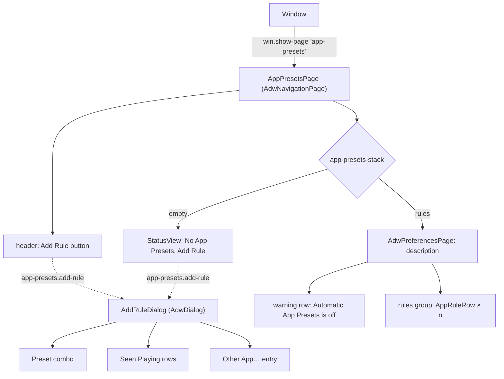
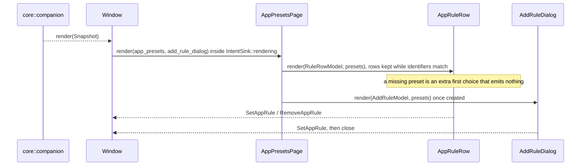

# SP11 App Presets Page Implementation Plan

> **For agentic workers:** REQUIRED SUB-SKILL: Use superpowers:subagent-driven-development (recommended) or superpowers:executing-plans to implement this plan task-by-task. Steps use checkbox (`- [ ]`) syntax for tracking.

**Goal:** The `crates/ui` App Presets page and its Add Rule dialog: a navigation page that lists app rules (app
icon, app name, stored identifier or "Preset missing", preset chooser, remove button), an empty state with "Add
Rule", a warning row while Automatic App Presets is off, and a dialog that offers seen apps and "Other App…", all
rendering `core::view::app_presets` models and emitting `Intent::SetAppRule` / `Intent::RemoveAppRule`.

**Architecture:** `Window::render` already owns the published `Snapshot`; it now also calls
`core::view::app_presets::{app_presets, add_rule_dialog}` and hands both models to `AppPresetsPage::render`. The page
is an `AdwNavigationPage` (tag `app-presets`, pushed by SP9's `win.show-page`) with a `GtkStack` of the shared
`StatusView` (empty) and an `AdwPreferencesPage` (rules). One `AppRuleRow` (`AdwComboRow` subclass) per rule is
kept while the rule identifiers stay the same and rebuilt when they change. `AddRuleDialog` (`AdwDialog`) is created
lazily by the page's `app-presets.add-rule` action and re-rendered on every page render. Every widget emits through
the window's `IntentSink`, and every render runs inside `IntentSink::rendering`, so programmatic updates never emit.

**Tech Stack:** Rust 2024 (toolbox `arctis`), gtk4-rs 0.11 (`gnome_50`), libadwaita-rs 0.9.2 (`v1_9`),
blueprint-compiler, `glib-build-tools`; widget tests with `#[gtk::test]` under `weston --backend=headless`.

Spec: `docs/superpowers/specs/2026-10-11-arctis-companion-design.md` §3 (module tree: `crates/ui/src/app_presets_page.rs`,
`add_rule_dialog.rs`), §5 (SP11 row); ui part §1 (information architecture: `AppPresetsPage` → Add Rule
`AdwDialog`, reachable in full and Bluetooth-only mode), §4 (App presets row of the page table, empty states, HIG
capitalization, `Text`); audio part §4 (app identifiers, app key, rules, seen apps); quality part §1 (`crates/ui`
row); ADR 0010; SP9 plan Deviation 8 (`win.show-page` tags); code on `origin/main`:
`crates/core/src/view/app_presets.rs` (models delivered by SP6), `crates/ui/src/window.rs`,
`crates/ui/src/status_pages.rs`, `crates/ui/src/widget_values.rs`, `crates/ui/src/intents.rs`.

---

## Conventions for every task

- Worktree: `/home/marcelo/Desenvolvimento/arctis-wt/sp11`, branch `sp11-app-presets-page`. Never touch
  `/home/marcelo/Desenvolvimento/arctis-companion`. SP11 never opens `/dev/hidraw*`, never talks to PipeWire and
  never edits `crates/app` (SP8 wires `Window` to the bridge) nor `crates/core/src` (the models exist; only tests
  are added under `crates/core/tests/view/`).
- **Run (core):** `X` means `toolbox run -c arctis bash -lc 'cd /home/marcelo/Desenvolvimento/arctis-wt/sp11 && X'`.
- **Run (ui):** `X` means

  ```bash
  toolbox run -c arctis bash -lc 'cd /home/marcelo/Desenvolvimento/arctis-wt/sp11 && export XDG_RUNTIME_DIR=$(mktemp -d) LC_ALL=C.UTF-8 && { weston --backend=headless --socket=wl-sp11 --idle-time=0 >/dev/null 2>&1 & W=$!; } && until [ -S "$XDG_RUNTIME_DIR/wl-sp11" ]; do sleep 0.1; done; GDK_BACKEND=wayland GSK_RENDERER=cairo WAYLAND_DISPLAY=wl-sp11 X; S=$?; kill $W; exit $S'
  ```

  This mirrors the `ui` job of `.github/workflows/ci.yml`. Git and `gh` run on the host in the worktree.
- Never run the `arctis-companion` binary; every template is loaded by the widget tests.
- No comments in any file of any language, doc comments and Blueprint included. Names and small functions carry
  the meaning. Blueprint strings shown to people are `_("…")`; widget `name:` values and icon names are not.
- Clippy policy applies to tests too: cognitive complexity 8, 40 lines per function, at most 4 arguments
  (`self` included), block nesting at most 3 (`excessive_nesting`: an inline `mod imp`, an `impl` and a `fn` body
  already count 3, so a closure or `if` block inside an `imp` method trips it; put the logic in a method of the
  outer `impl` and call it, as SP9's `copy_on_click` does; `#[glib::object_subclass]` impls are exempt because the
  macro re-emits them), no `unwrap()` (tests use `expect`), `pedantic` under `-D warnings`: no `as` casts (use
  `u32::try_from`, `widget_values::position`), `#[must_use]` on public functions that return a value. When clippy
  objects, extract a function or rename; never add an `allow` or `expect` attribute.
- Every row whose title or subtitle comes from a model has `use-markup: false` (app names and identifiers are
  user or third-party text).
- Widget tests live in the single integration binary `crates/ui/tests/widgets/main.rs`, one module per widget.
  Shared helpers go into `crates/ui/tests/widgets/support.rs` in the task that first uses them. Widgets are found by
  their Blueprint `name:` through `support::named`, never through test-only accessors.
- Expected strings come from the core model through `arctis_core::testkit::english::english` whenever the model
  provides them, so a test checks the rendering, not a copy of a msgid.
- Code blocks below are not rustfmt-formatted; `cargo fmt --all` reflows them and that is expected.
- Before each commit, Run (core): `cargo fmt --all && cargo clippy --workspace --all-targets -- -D warnings && cargo test -p arctis-core && cargo xtask check-rules && cargo xtask check-pure && cargo xtask check-doc-paths`,
  then Run (ui): `cargo test -p arctis-ui`.
- Commit subjects are conventional (`type(scope): summary`), short. Never write `Co-Authored-By`,
  "Generated with", or any AI or tool name in a commit message, PR title or PR body. Never use `--no-verify`.
- Push after every commit: `git push -u origin sp11-app-presets-page` the first time, then `git push`. After a
  rebase that moved the branch, `git push --force-with-lease`.
- SP10 and SP12 run in parallel and add pages to the same crate. The shared files SP11 touches are
  `crates/ui/src/lib.rs` (module lines and `pub use` lines), `crates/ui/resources/resources.gresource.xml` (one
  `<file>` line per template), `crates/ui/resources/window.blp` (one navigation child),
  `crates/ui/src/window.rs` (one template child, one `ensure_type`, one `connect_intents`, one render call),
  `crates/ui/tests/widgets/main.rs` (module lines), `crates/ui/tests/widgets/support.rs` (two helpers appended),
  `crates/ui/tests/widgets/accessibility.rs` and `layout.rs` (tests appended), `docs/architecture/README.md` (one
  row). Before Task 1, before Task 6 and before the PR run `git fetch origin && git rebase origin/main`; on a
  conflict in those files keep both sides' lines.

## Acceptance criteria → tasks

| SP11 acceptance criterion (design §5, ui §4, quality §1 `crates/ui` row) | Task |
|---|---|
| Scope: app presets page (`crates/ui/src/app_presets_page.rs`) | 5, 6 |
| Scope: add-rule dialog (`crates/ui/src/add_rule_dialog.rs`) | 4, 5, 6 |
| View-model checks: rules list with identifiers and "Preset missing" | 1 |
| `#[gtk::test]`: rules list with app name, identifiers and "Preset missing" | 3, 5 |
| App icon if resolvable | 2, 3, 4 |
| Preset chooser per rule shows the rule's preset; a missing preset shows as its own first choice, and picking a library preset repairs the rule | 3 |
| View-model checks: Add Rule offers seen apps (without a rule) and "Other App…" | 1 |
| `#[gtk::test]`: Add Rule offers seen apps and "Other App…" with the identifier hint | 4 |
| Empty states: page "No App Presets" with suggested "Add Rule"; dialog hides "Seen Playing" and focuses "Other App…" | 1, 4, 5 |
| Page description ("On the 2.4 GHz connection the headset keeps …") | 5 |
| Warning row while Automatic App Presets is off | 5 |
| Each control emits its `Intent`: preset chooser → `SetAppRule`, remove → `RemoveAppRule`, seen app → `SetAppRule`, Other App apply → `SetAppRule` (trimmed; empty adds nothing); header and empty-state buttons open the dialog; the dialog closes after adding | 3, 4, 5, 6 |
| The dialog's preset choice survives renders and falls back to the first preset when it disappears | 4 |
| Rendering never emits an `Intent` | 3, 4, 5, 6 |
| Page reachable from the headset page's App Presets row (`win.show-page` `app-presets`), in full and Bluetooth-only mode (ui §1), with rules editable in both | 6 |
| A presented dialog follows new snapshots (seen apps appear while it is open) | 5, 6 |
| Accessibility walk (names on every control) and 360 px width (quality §1 `crates/ui`, ui §4 adaptive) | 7 |
| `docs/architecture/app-presets.md` (sub-project rule, design §5) | 8 |

## File structure

```
crates/core/tests/view/app_presets.rs          characterization cases appended (Task 1)
crates/ui/src/app_icons.rs                     FALLBACK_ICON, icon_name, display_icon_name
crates/ui/src/app_rule_row.rs                  AppRuleRow (AdwComboRow subclass): render, identifier
crates/ui/src/add_rule_dialog.rs               AddRuleDialog (AdwDialog): render, open, connect_intents
crates/ui/src/app_presets_page.rs              AppPresetsPage (AdwNavigationPage): render, connect_intents, add_rule_dialog
crates/ui/resources/app_rule_row.blp           icon prefix, remove suffix
crates/ui/resources/add_rule_dialog.blp        Preset combo, Seen Playing group, Other App entry
crates/ui/resources/app_presets_page.blp       header Add Rule button, stack: StatusView | rules page
crates/ui/resources/resources.gresource.xml    three .ui lines
crates/ui/resources/window.blp                 the page as a navigation child
crates/ui/src/lib.rs                           modules and re-exports
crates/ui/src/window.rs                        template child, ensure_type, connect_intents, render_app_presets
crates/ui/tests/widgets/main.rs                mod app_icons, app_rule_row, add_rule_dialog, app_presets_page
crates/ui/tests/widgets/support.rs             ruled, seen_app
crates/ui/tests/widgets/app_icons.rs           icon lookup
crates/ui/tests/widgets/app_rule_row.rs        row rendering and intents
crates/ui/tests/widgets/add_rule_dialog.rs     dialog rendering, intents, focus
crates/ui/tests/widgets/app_presets_page.rs    page states, row reuse, intents, window integration
crates/ui/tests/widgets/accessibility.rs       two walks appended
crates/ui/tests/widgets/layout.rs              one width test appended
docs/architecture/app-presets.md               diagrams + code paths and symbols
docs/architecture/README.md                    one new row
```

Dependency direction inside `crates/ui` for SP11: `text`, `intents`, `widget_values` → `app_icons` →
`app_rule_row`, `add_rule_dialog` → `app_presets_page` (also uses `status_pages`) → `window`.

## Deviations

Decisions taken where the spec is silent or ambiguous; each is the simplest option consistent with it.

| # | Decision | Why |
|---|---|---|
| 1 | No production code in `crates/core`: `core::view::app_presets::{app_presets, add_rule_dialog}` and their models (`AppPresetsModel`, `RuleRowModel`, `AddRuleModel`, `SeenRowModel`) were delivered by SP6. SP11 appends characterization tests to `crates/core/tests/view/app_presets.rs` for the cases SP6 left implicit (order, case-insensitive name lookup, seen row key, preset list) | the view-model half of the acceptance criteria is already on `main`; SP10 and SP12 also touch `core::view`, so not editing it avoids conflicts |
| 2 | The rules list is an `AdwPreferencesGroup` of `AppRuleRow`s instead of a `GtkListView` | a `GtkListView` creates rows only after size allocation, so headless `#[gtk::test]`s cannot see them, and it would need a `gio::ListStore` plus a factory for a list of a few dozen rules at most. Rows are kept while the identifiers are unchanged and rebuilt otherwise, so a publish never steals focus from an open chooser |
| 3 | Each rule's preset chooser is the row itself: `AppRuleRow` subclasses `AdwComboRow` (title = app name, subtitle = identifier or "Preset missing", prefix = app icon, suffix = remove button) instead of an `AdwActionRow` holding a `GtkDropDown` | `AdwComboRow` is libadwaita's row form of `GtkDropDown`; it reuses `widget_values::show_choices`, the `support::combo_text` helper and the accessibility handling SP9 already proved |
| 4 | A rule whose preset is missing gets one extra first choice in its chooser, titled with the row's subtitle ("Preset missing"), selected; picking it emits nothing; picking a library preset repairs the rule through `Intent::SetAppRule`. Rows with a known preset list the library only | `RuleRowModel.preset` is `None` for that case and there is nothing truthful to select, but neither `AdwComboRow` nor `GtkDropDown` can show "no selection": probed on libadwaita 1.9.4 / GTK 4.22 in the toolbox, `set_selected(gtk::INVALID_LIST_POSITION)` is ignored and the previous item stays selected |
| 5 | App icon: the stored identifier (rule) or the app key (seen app) is looked up in the display's `gtk::IconTheme`; when the theme lacks it, `application-x-executable-symbolic`. Lookup lives in `crates/ui/src/app_icons.rs`; the core models are unchanged | "app icon if resolvable" (ui §4); the app key is the portal app id first (audio §4), which is the icon name of Flatpak and most desktop apps; no desktop-file lookup from inside the sandbox |
| 6 | The Add Rule dialog has a "Preset" combo row on top (library order, first preset selected at first, the user's choice kept by id across renders); activating a seen app, or applying the "Other App…" entry, emits `SetAppRule { identifier, preset }` with that preset and closes the dialog | the spec says what the dialog offers but not how the preset is chosen; `Intent::SetAppRule` needs one. The rule can be changed afterwards on its row |
| 7 | "Other App…" is an `AdwEntryRow` with an apply button; the identifier hint is the description of its group; input is trimmed and an empty identifier adds nothing; the identifier is sent as typed: one equal to a stored identifier replaces that rule, one differing only in case becomes a second rule (`AppRules::set` stores identifiers verbatim; both match the same streams, case-insensitively) | ui §4 "an entry for an identifier (Flatpak app id, application id or binary name)"; the hint text is `AddRuleModel.other_hint`; folding case would need a `core::companion` change, outside SP11 (Deviation 1) |
| 8 | With no seen apps the dialog hides "Seen Playing" and `AddRuleDialog::open` sets the dialog focus to the "Other App…" entry after presenting | ui §4 empty state "focus on Other App…"; `adw::Dialog::set_focus` |
| 9 | The page description is the `AdwPreferencesPage` description of the rules state; the empty state is the status page alone. The header "Add Rule" button (`list-add-symbolic`) shows only in the rules state; both it and the status page's suggested button activate the page action `app-presets.add-rule` | ui §4 lists the description under the content and the empty state separately; one action, two entry points |
| 10 | The "Automatic App Presets is off" warning is a read-only `AdwActionRow` with a `dialog-warning-symbolic` prefix in its own group above the rules, without a switch | ui §4 "a warning row says so"; the switch lives on the headset page and in the Shell |
| 11 | Rules are listed in stored-identifier order (`AppRules` is a `BTreeMap`), not by app name | the model's order; stable and predictable |
| 12 | Rule rows stay sensitive in every phase, Bluetooth only included | rules are app data persisted by `Companion`, not headset settings (ui §1 lists App Presets in Bluetooth-only mode) |
| 13 | Files beyond the spec's module tree: `app_rule_row.rs` + `.blp` and `app_icons.rs` | one widget per `.rs`/`.blp` pair (ui intro) and files well under 400 lines |
| 14 | The architecture page is a new `docs/architecture/app-presets.md` instead of a section of `ui.md` | SP10 and SP12 extend `ui.md` in parallel; a separate page keeps the merge to one README row |
| 15 | No pt_BR entries are added | `po/` does not exist yet; SP14 creates the catalogue from the `_()` marks |
| 16 | Accessible labels of icon-only buttons ("Add Rule", "Remove Rule") are static Blueprint strings | the row title already names the app; the static label keeps the models unchanged (Deviation 1) |
| 17 | The dialog closes itself after emitting a rule. Every test that makes it emit presents it first in an `adw::Window` (or through the window's `app-presets.add-rule`) | `adw::Dialog::close` on a dialog that was never presented logs `Adwaita-CRITICAL: Trying to close … that's not presented` (probed in the toolbox); a presented dialog leaves `visible_dialog()` synchronously, which gives the tests a close assertion |
| 18 | The "missing preset" choice is built by `missing_choice(model)` matching on `RuleRowModel.preset`, titled with the model subtitle; `RuleRowModel` is not changed to carry an explicit label | core is outside SP11 (Deviation 1); the named function states the contract |

---

### Task 1: Characterize the app presets view models

**Files:**
- Modify: `crates/core/tests/view/app_presets.rs` (append)

These tests describe behaviour SP6 already implemented in `crates/core/src/view/app_presets.rs`. They are
expected to pass on the first run; a failure is a core bug to fix in `app_presets.rs` with the smallest change.

- [ ] **Step 1: Rebase and confirm a clean start**

```bash
cd /home/marcelo/Desenvolvimento/arctis-wt/sp11 && git fetch origin && git rebase origin/main && git status --short
```

Expected: no output from `git status --short`.

- [ ] **Step 2: Append the cases**

Append to `crates/core/tests/view/app_presets.rs` (the file already imports `add_rule_dialog`, `app_presets`,
`Text`, `id`, `rules`, `snapshot` and defines `rows`, `seen`, `firefox`); add `use arctis_core::view::presets::preset_items;`
to its imports:

```rust
#[test]
fn rules_are_listed_by_identifier() {
    let mut s = snapshot();
    s.presets.rules = rules(&[("mpv", "podcast"), ("firefox", "footsteps")]);
    let identifiers: Vec<String> = rows(app_presets(&s).content)
        .into_iter()
        .map(|row| row.identifier)
        .collect();
    assert_eq!(identifiers, ["firefox", "mpv"]);
}

#[test]
fn a_rule_finds_its_app_whatever_the_case() {
    let mut s = snapshot();
    s.presets.seen_apps = vec![firefox()];
    s.presets.rules = rules(&[("ORG.MOZILLA.FIREFOX", "footsteps")]);
    assert_eq!(rows(app_presets(&s).content)[0].title, Text::verbatim("Firefox"));
}

#[test]
fn add_rule_names_a_seen_app_by_its_key() {
    let mut s = snapshot();
    s.presets.seen_apps = vec![firefox()];
    let dialog = add_rule_dialog(&s);
    assert_eq!(dialog.seen[0].identifier, "org.mozilla.firefox");
    assert_eq!(dialog.seen[0].subtitle, Text::verbatim("org.mozilla.firefox"));
}

#[test]
fn every_rule_chooses_from_the_whole_library() {
    let mut s = snapshot();
    s.presets.rules = rules(&[("firefox", "footsteps")]);
    let page = app_presets(&s);
    assert_eq!(page.presets, preset_items(&s));
    assert!(page.presets.iter().any(|item| item.id == id("footsteps")));
}
```

- [ ] **Step 3: Run them**

Run (core): `cargo test -p arctis-core --test view app_presets`
Expected: PASS, 12 tests (8 existing + 4 new).

- [ ] **Step 4: Gates and commit**

Run the gates from the conventions, then:

```bash
git add crates/core/tests/view/app_presets.rs
git commit -m "test(core): pin app presets model order and lookups"
git push -u origin sp11-app-presets-page
```

### Task 2: App icon lookup

**Files:**
- Create: `crates/ui/src/app_icons.rs`
- Modify: `crates/ui/src/lib.rs`
- Create: `crates/ui/tests/widgets/app_icons.rs`
- Modify: `crates/ui/tests/widgets/main.rs`

- [ ] **Step 1: Write the failing test**

`crates/ui/tests/widgets/app_icons.rs`:

```rust
use std::fs;
use std::path::PathBuf;

use arctis_ui::app_icons::{FALLBACK_ICON, icon_name};

use crate::support::init;

const EMPTY_SVG: &str = r#"<svg xmlns="http://www.w3.org/2000/svg" width="16" height="16"/>"#;

fn icon_dir(icon: &str) -> PathBuf {
    let dir = std::env::temp_dir().join(format!("arctis-icons-{}", std::process::id()));
    fs::create_dir_all(&dir).expect("icon directory");
    fs::write(dir.join(format!("{icon}.svg")), EMPTY_SVG).expect("icon file");
    dir
}

fn theme_with(icon: &str) -> gtk::IconTheme {
    let dir = icon_dir(icon);
    let theme = gtk::IconTheme::new();
    theme.set_search_path(&[dir.as_path()]);
    theme
}

#[gtk::test]
fn an_identifier_the_theme_knows_is_its_own_icon() {
    init();
    let theme = theme_with("org.example.Player");
    assert_eq!(icon_name(&theme, "org.example.Player"), "org.example.Player");
}

#[gtk::test]
fn an_unknown_identifier_gets_the_generic_icon() {
    init();
    let theme = theme_with("org.example.Player");
    assert_eq!(icon_name(&theme, "org.example.NoSuchPlayer"), FALLBACK_ICON);
}
```

Add `mod app_icons;` to `crates/ui/tests/widgets/main.rs` (alphabetical, after `mod accessibility;`).

- [ ] **Step 2: Run it to see it fail**

Run (ui): `cargo test -p arctis-ui --test widgets app_icons`
Expected: FAIL to compile, "could not find `app_icons` in `arctis_ui`".

- [ ] **Step 3: Implement**

`crates/ui/src/app_icons.rs`:

```rust
use gtk::prelude::*;

pub const FALLBACK_ICON: &str = "application-x-executable-symbolic";

#[must_use]
pub fn icon_name(theme: &gtk::IconTheme, identifier: &str) -> String {
    if theme.has_icon(identifier) {
        identifier.to_owned()
    } else {
        FALLBACK_ICON.to_owned()
    }
}

#[must_use]
pub fn display_icon_name(widget: &impl IsA<gtk::Widget>, identifier: &str) -> String {
    icon_name(&gtk::IconTheme::for_display(&widget.display()), identifier)
}
```

In `crates/ui/src/lib.rs` add `pub mod app_icons;` after `pub mod app_dialogs;`.

Checked against the toolbox: gtk4-rs 0.11.5 declares `IconTheme::set_search_path(&self, path: &[&Path])`, and GTK
4.22's `has_icon` finds an unthemed `.svg` placed directly in a search directory, so no `index.theme` is needed.

- [ ] **Step 4: Run it to see it pass**

Run (ui): `cargo test -p arctis-ui --test widgets app_icons`
Expected: PASS, 2 tests.

- [ ] **Step 5: Gates and commit**

```bash
git add crates/ui/src/app_icons.rs crates/ui/src/lib.rs crates/ui/tests/widgets/app_icons.rs crates/ui/tests/widgets/main.rs
git commit -m "feat(ui): look up app icons in the icon theme"
git push
```

### Task 3: AppRuleRow

**Files:**
- Create: `crates/ui/resources/app_rule_row.blp`
- Create: `crates/ui/src/app_rule_row.rs`
- Modify: `crates/ui/resources/resources.gresource.xml`
- Modify: `crates/ui/src/lib.rs`
- Modify: `crates/ui/tests/widgets/support.rs` (append `ruled`, `seen_app`)
- Create: `crates/ui/tests/widgets/app_rule_row.rs`
- Modify: `crates/ui/tests/widgets/main.rs`

- [ ] **Step 1: Add the shared test helpers**

Append to `crates/ui/tests/widgets/support.rs` and add `use arctis_core::companion::seen_apps::SeenApp;` to its
imports (`id` and `snapshot` are already imported there):

```rust
pub fn ruled(entries: &[(&str, &str)]) -> Snapshot {
    let mut s = snapshot();
    s.presets.rules = entries
        .iter()
        .map(|(app, preset)| ((*app).to_owned(), id(preset)))
        .collect();
    s
}

pub fn seen_app(name: &str, identifiers: &[&str]) -> SeenApp {
    SeenApp {
        key: identifiers.first().map(|key| (*key).to_owned()).unwrap_or_default(),
        name: name.to_owned(),
        identifiers: identifiers.iter().map(|identifier| (*identifier).to_owned()).collect(),
    }
}
```

- [ ] **Step 2: Write the failing tests**

`crates/ui/tests/widgets/app_rule_row.rs`:

```rust
use adw::prelude::*;
use arctis_core::companion::Snapshot;
use arctis_core::intent::Intent;
use arctis_core::testkit::english::english;
use arctis_core::testkit::snapshots::id;
use arctis_core::view::app_presets::{AppPresetsContent, RuleRowModel, app_presets};
use arctis_core::view::presets::{PresetItem, preset_items};
use arctis_ui::AppRuleRow;
use arctis_ui::app_icons::FALLBACK_ICON;
use arctis_ui::intents::IntentSink;

use crate::support::{Log, combo_text, init, named, recording_sink, ruled, seen_app};

fn rule_models(snapshot: &Snapshot) -> Vec<RuleRowModel> {
    match app_presets(snapshot).content {
        AppPresetsContent::Rules(rows) => rows,
        AppPresetsContent::Empty(_) => panic!("expected rule rows"),
    }
}

fn rendered(snapshot: &Snapshot) -> (AppRuleRow, IntentSink, Log) {
    init();
    let (sink, log) = recording_sink();
    let row = AppRuleRow::new(&sink);
    let presets = preset_items(snapshot);
    sink.rendering(|| row.render(&rule_models(snapshot)[0], &presets));
    (row, sink, log)
}

fn position_of(presets: &[PresetItem], preset: &str) -> u32 {
    let at = presets
        .iter()
        .position(|item| item.id == id(preset))
        .expect("a library preset");
    u32::try_from(at).expect("a short list")
}

#[gtk::test]
fn the_row_names_the_app_and_shows_its_preset() {
    let mut s = ruled(&[("firefox", "footsteps")]);
    s.presets.seen_apps = vec![seen_app("Firefox", &["org.mozilla.firefox", "firefox"])];
    let (row, _, _) = rendered(&s);
    let model = &rule_models(&s)[0];
    let presets = preset_items(&s);
    let footsteps = position_of(&presets, "footsteps");
    assert_eq!(row.title().as_str(), english(&model.title));
    assert_eq!(row.subtitle().as_deref(), Some(english(&model.subtitle).as_str()));
    assert_eq!(row.identifier(), "firefox");
    assert_eq!(row.selected(), footsteps);
    let index = usize::try_from(footsteps).expect("an index");
    assert_eq!(combo_text(row.upcast_ref()), english(&presets[index].title));
}

fn choice_count(row: &AppRuleRow) -> usize {
    let count = row.model().map(|model| model.n_items()).unwrap_or_default();
    usize::try_from(count).expect("a count")
}

#[gtk::test]
fn a_missing_preset_is_the_first_choice_and_says_so() {
    let s = ruled(&[("mpv", "gone")]);
    let (row, _, log) = rendered(&s);
    let missing = english(&rule_models(&s)[0].subtitle);
    assert_eq!(row.subtitle().as_deref(), Some(missing.as_str()));
    assert_eq!(row.selected(), 0);
    assert_eq!(combo_text(row.upcast_ref()), missing);
    assert_eq!(choice_count(&row), preset_items(&s).len() + 1);
    assert!(log.borrow().is_empty());
}

#[gtk::test]
fn picking_a_preset_repairs_a_missing_one() {
    let s = ruled(&[("mpv", "gone")]);
    let (row, _, log) = rendered(&s);
    row.set_selected(position_of(&preset_items(&s), "podcast") + 1);
    row.set_selected(0);
    assert_eq!(
        *log.borrow(),
        vec![Intent::SetAppRule {
            identifier: "mpv".to_owned(),
            preset: id("podcast"),
        }]
    );
}

#[gtk::test]
fn a_repaired_rule_drops_the_missing_choice() {
    let (row, sink, log) = rendered(&ruled(&[("mpv", "gone")]));
    let repaired = ruled(&[("mpv", "podcast")]);
    let presets = preset_items(&repaired);
    sink.rendering(|| row.render(&rule_models(&repaired)[0], &presets));
    assert_eq!(choice_count(&row), presets.len());
    assert_eq!(row.selected(), position_of(&presets, "podcast"));
    assert!(log.borrow().is_empty());
}

#[gtk::test]
fn an_app_without_an_icon_gets_the_generic_one() {
    let (row, _, _) = rendered(&ruled(&[("org.example.NoSuchPlayer", "podcast")]));
    let icon = named::<gtk::Image>(&row, "app-icon");
    assert_eq!(icon.icon_name().as_deref(), Some(FALLBACK_ICON));
}

#[gtk::test]
fn choosing_a_preset_sets_the_rule() {
    let s = ruled(&[("firefox", "footsteps")]);
    let (row, _, log) = rendered(&s);
    row.set_selected(position_of(&preset_items(&s), "podcast"));
    assert_eq!(
        *log.borrow(),
        vec![Intent::SetAppRule {
            identifier: "firefox".to_owned(),
            preset: id("podcast"),
        }]
    );
}

#[gtk::test]
fn the_remove_button_removes_the_rule() {
    let (row, _, log) = rendered(&ruled(&[("firefox", "footsteps")]));
    named::<gtk::Button>(&row, "remove-rule").emit_clicked();
    assert_eq!(*log.borrow(), vec![Intent::RemoveAppRule("firefox".to_owned())]);
}

#[gtk::test]
fn rendering_a_new_preset_emits_nothing() {
    let (row, sink, log) = rendered(&ruled(&[("firefox", "footsteps")]));
    let changed = ruled(&[("firefox", "podcast")]);
    let presets = preset_items(&changed);
    sink.rendering(|| row.render(&rule_models(&changed)[0], &presets));
    assert_eq!(row.selected(), position_of(&presets, "podcast"));
    assert!(log.borrow().is_empty());
}
```

Add `mod app_rule_row;` to `crates/ui/tests/widgets/main.rs`.

- [ ] **Step 3: Run them to see them fail**

Run (ui): `cargo test -p arctis-ui --test widgets app_rule_row`
Expected: FAIL to compile, "no `AppRuleRow` in the root".

- [ ] **Step 4: Write the template**

`crates/ui/resources/app_rule_row.blp`:

```blueprint
using Gtk 4.0;
using Adw 1;

template $ArctisAppRuleRow: Adw.ComboRow {
  name: "app-rule";
  use-markup: false;
  use-subtitle: false;

  [prefix]
  Image icon {
    name: "app-icon";
    icon-size: large;
  }

  [suffix]
  Button remove {
    name: "remove-rule";
    icon-name: "user-trash-symbolic";
    tooltip-text: _("Remove Rule");
    valign: center;

    accessibility {
      label: _("Remove Rule");
    }

    styles [
      "flat",
    ]
  }
}
```

Add to `crates/ui/resources/resources.gresource.xml`, after the `shortcuts_dialog.ui` line:

```xml
    <file preprocess="xml-stripblanks">app_rule_row.ui</file>
```

- [ ] **Step 5: Write the widget**

`crates/ui/src/app_rule_row.rs`:

```rust
use adw::prelude::*;
use adw::subclass::prelude::*;
use arctis_core::eq::preset::PresetId;
use arctis_core::intent::Intent;
use arctis_core::view::app_presets::RuleRowModel;
use arctis_core::view::presets::PresetItem;
use gtk::glib;

use crate::app_icons::display_icon_name;
use crate::intents::IntentSink;
use crate::text::resolve;
use crate::widget_values::{index, show_choices};

mod imp {
    use std::cell::RefCell;

    use adw::subclass::prelude::*;
    use arctis_core::eq::preset::PresetId;
    use gtk::glib;

    #[derive(Default, gtk::CompositeTemplate)]
    #[template(resource = "/io/github/marcelogm/ArctisCompanion/ui/app_rule_row.ui")]
    pub struct AppRuleRow {
        #[template_child]
        pub icon: TemplateChild<gtk::Image>,
        #[template_child]
        pub remove: TemplateChild<gtk::Button>,
        pub identifier: RefCell<String>,
        pub choices: RefCell<Vec<Option<PresetId>>>,
    }

    #[glib::object_subclass]
    impl ObjectSubclass for AppRuleRow {
        const NAME: &'static str = "ArctisAppRuleRow";
        type Type = super::AppRuleRow;
        type ParentType = adw::ComboRow;

        fn class_init(klass: &mut Self::Class) {
            klass.bind_template();
        }

        fn instance_init(obj: &glib::subclass::InitializingObject<Self>) {
            obj.init_template();
        }
    }

    impl ObjectImpl for AppRuleRow {}
    impl WidgetImpl for AppRuleRow {}
    impl ListBoxRowImpl for AppRuleRow {}
    impl PreferencesRowImpl for AppRuleRow {}
    impl ActionRowImpl for AppRuleRow {}
    impl ComboRowImpl for AppRuleRow {}
}

glib::wrapper! {
    pub struct AppRuleRow(ObjectSubclass<imp::AppRuleRow>)
        @extends adw::ComboRow, adw::ActionRow, adw::PreferencesRow, gtk::ListBoxRow, gtk::Widget,
        @implements gtk::Accessible, gtk::Actionable, gtk::Buildable, gtk::ConstraintTarget;
}

impl AppRuleRow {
    #[must_use]
    pub fn new(sink: &IntentSink) -> Self {
        let row: Self = glib::Object::new();
        row.connect_intents(sink);
        row
    }

    #[must_use]
    pub fn identifier(&self) -> String {
        self.imp().identifier.borrow().clone()
    }

    pub fn render(&self, model: &RuleRowModel, presets: &[PresetItem]) {
        let imp = self.imp();
        imp.identifier.replace(model.identifier.clone());
        self.set_title(&resolve(&model.title));
        self.set_subtitle(&resolve(&model.subtitle));
        imp.icon
            .set_icon_name(Some(&display_icon_name(self, &model.identifier)));
        self.show_presets(model, presets);
    }

    fn show_presets(&self, model: &RuleRowModel, presets: &[PresetItem]) {
        let choices = rule_choices(model, presets);
        let selected = choices
            .iter()
            .position(|(id, _)| *id == model.preset)
            .unwrap_or_default();
        let titles: Vec<String> = choices.iter().map(|(_, title)| title.clone()).collect();
        self.imp()
            .choices
            .replace(choices.into_iter().map(|(id, _)| id).collect());
        show_choices(self.upcast_ref(), &titles, selected);
    }

    fn connect_intents(&self, sink: &IntentSink) {
        self.connect_selected_notify(glib::clone!(
            #[strong]
            sink,
            move |row| sink.emit_some(row.chosen_intent())
        ));
        self.imp().remove.connect_clicked(glib::clone!(
            #[weak(rename_to = row)]
            self,
            #[strong]
            sink,
            move |_| sink.emit(Intent::RemoveAppRule(row.identifier()))
        ));
    }

    fn chosen_intent(&self) -> Option<Intent> {
        let preset = self
            .imp()
            .choices
            .borrow()
            .get(index(self.selected())?)?
            .clone()?;
        Some(Intent::SetAppRule {
            identifier: self.identifier(),
            preset,
        })
    }
}

fn rule_choices(model: &RuleRowModel, presets: &[PresetItem]) -> Vec<(Option<PresetId>, String)> {
    let missing = model
        .preset
        .is_none()
        .then(|| (None, resolve(&model.subtitle)));
    let library = presets
        .iter()
        .map(|item| (Some(item.id.clone()), resolve(&item.title)));
    missing.into_iter().chain(library).collect()
}
```

In `crates/ui/src/lib.rs` add `mod app_rule_row;` (alphabetical, after `pub mod app_icons;`) and
`pub use app_rule_row::AppRuleRow;` (alphabetical among the `pub use` lines).

- [ ] **Step 6: Run them to see them pass**

Run (ui): `cargo test -p arctis-ui --test widgets app_rule_row`
Expected: PASS, 8 tests.

- [ ] **Step 7: Gates and commit**

```bash
git add crates/ui/resources/app_rule_row.blp crates/ui/resources/resources.gresource.xml crates/ui/src/app_rule_row.rs crates/ui/src/lib.rs crates/ui/tests/widgets/support.rs crates/ui/tests/widgets/app_rule_row.rs crates/ui/tests/widgets/main.rs
git commit -m "feat(ui): add the app rule row"
git push
```

### Task 4: AddRuleDialog

**Files:**
- Create: `crates/ui/resources/add_rule_dialog.blp`
- Create: `crates/ui/src/add_rule_dialog.rs`
- Modify: `crates/ui/resources/resources.gresource.xml`
- Modify: `crates/ui/src/lib.rs`
- Create: `crates/ui/tests/widgets/add_rule_dialog.rs`
- Modify: `crates/ui/tests/widgets/main.rs`

- [ ] **Step 1: Write the failing tests**

`crates/ui/tests/widgets/add_rule_dialog.rs`:

```rust
use adw::prelude::*;
use arctis_core::companion::Snapshot;
use arctis_core::intent::Intent;
use arctis_core::testkit::english::english;
use arctis_core::testkit::snapshots::snapshot;
use arctis_core::view::app_presets::add_rule_dialog;
use arctis_core::view::presets::preset_items;
use arctis_ui::AddRuleDialog;
use arctis_ui::intents::IntentSink;
use gtk::glib;

use crate::support::{Log, descendants, init, named, recording_sink, seen_app};

pub fn rendered_dialog(snapshot: &Snapshot) -> (AddRuleDialog, IntentSink, Log) {
    init();
    let (sink, log) = recording_sink();
    let dialog: AddRuleDialog = glib::Object::new();
    dialog.connect_intents(&sink);
    sink.rendering(|| dialog.render(&add_rule_dialog(snapshot), &preset_items(snapshot)));
    (dialog, sink, log)
}

pub fn spotify_seen() -> Snapshot {
    let mut s = snapshot();
    s.presets.seen_apps = vec![seen_app("Spotify", &["com.spotify.Client", "spotify"])];
    s
}

fn seen_rows(dialog: &AddRuleDialog) -> Vec<adw::ActionRow> {
    descendants(dialog)
        .into_iter()
        .filter(|widget| widget.widget_name() == "seen-app")
        .filter_map(|widget| widget.downcast().ok())
        .collect()
}

fn apply(entry: &adw::EntryRow, text: &str) {
    entry.set_text(text);
    entry.emit_by_name::<()>("apply", &[]);
}

fn presented(dialog: &AddRuleDialog) -> adw::Window {
    let window = adw::Window::new();
    window.present();
    dialog.open(&window);
    window
}

#[gtk::test]
fn seen_apps_are_offered_by_name_and_key() {
    let s = spotify_seen();
    let (dialog, _, _) = rendered_dialog(&s);
    let model = add_rule_dialog(&s);
    assert!(named::<adw::PreferencesGroup>(&dialog, "seen-group").get_visible());
    let rows = seen_rows(&dialog);
    assert_eq!(rows.len(), 1);
    assert_eq!(rows[0].title().as_str(), english(&model.seen[0].title));
    assert_eq!(rows[0].subtitle().as_deref(), Some(english(&model.seen[0].subtitle).as_str()));
}

#[gtk::test]
fn without_seen_apps_only_another_app_is_offered() {
    let s = snapshot();
    let (dialog, _, _) = rendered_dialog(&s);
    let model = add_rule_dialog(&s);
    assert!(!named::<adw::PreferencesGroup>(&dialog, "seen-group").get_visible());
    assert_eq!(named::<adw::EntryRow>(&dialog, "other-app").title().as_str(), english(&model.other_title));
    let other = named::<adw::PreferencesGroup>(&dialog, "other-group");
    assert_eq!(other.description().as_deref(), Some(english(&model.other_hint).as_str()));
}

#[gtk::test]
fn without_seen_apps_the_entry_takes_the_focus() {
    let (dialog, _, _) = rendered_dialog(&snapshot());
    let _window = presented(&dialog);
    let entry = named::<adw::EntryRow>(&dialog, "other-app");
    let focus = dialog.focus().expect("a focused widget");
    assert!(focus == entry.clone().upcast::<gtk::Widget>() || focus.is_ancestor(&entry));
}

#[gtk::test]
fn the_preset_row_offers_the_library() {
    let s = snapshot();
    let (dialog, _, _) = rendered_dialog(&s);
    let combo = named::<adw::ComboRow>(&dialog, "rule-preset");
    let count = combo.model().map(|model| model.n_items()).unwrap_or_default();
    assert_eq!(usize::try_from(count).expect("a count"), preset_items(&s).len());
    assert_eq!(combo.selected(), 0);
}

#[gtk::test]
fn picking_a_seen_app_adds_its_rule_with_the_chosen_preset() {
    let s = spotify_seen();
    let (dialog, _, log) = rendered_dialog(&s);
    let window = presented(&dialog);
    named::<adw::ComboRow>(&dialog, "rule-preset").set_selected(2);
    seen_rows(&dialog)[0].emit_by_name::<()>("activated", &[]);
    assert_eq!(
        *log.borrow(),
        vec![Intent::SetAppRule {
            identifier: "com.spotify.Client".to_owned(),
            preset: preset_items(&s)[2].id.clone(),
        }]
    );
    assert!(window.visible_dialog().is_none());
}

#[gtk::test]
fn another_app_is_added_by_its_trimmed_identifier() {
    let s = snapshot();
    let (dialog, _, log) = rendered_dialog(&s);
    let window = presented(&dialog);
    let entry = named::<adw::EntryRow>(&dialog, "other-app");
    apply(&entry, "  mpv ");
    assert_eq!(
        *log.borrow(),
        vec![Intent::SetAppRule {
            identifier: "mpv".to_owned(),
            preset: preset_items(&s)[0].id.clone(),
        }]
    );
    assert_eq!(entry.text().as_str(), "");
    assert!(window.visible_dialog().is_none());
}

#[gtk::test]
fn an_empty_identifier_adds_nothing_and_keeps_the_dialog_open() {
    let (dialog, _, log) = rendered_dialog(&snapshot());
    let window = presented(&dialog);
    apply(&named::<adw::EntryRow>(&dialog, "other-app"), "   ");
    assert!(log.borrow().is_empty());
    assert!(window.visible_dialog().is_some());
}

#[gtk::test]
fn a_chosen_preset_that_disappears_falls_back_to_the_first() {
    let s = snapshot();
    let (dialog, sink, log) = rendered_dialog(&s);
    let combo = named::<adw::ComboRow>(&dialog, "rule-preset");
    combo.set_selected(u32::try_from(preset_items(&s).len() - 1).expect("a short list"));
    let mut fewer = snapshot();
    fewer.presets.all.pop();
    sink.rendering(|| dialog.render(&add_rule_dialog(&fewer), &preset_items(&fewer)));
    assert_eq!(combo.selected(), 0);
    assert!(log.borrow().is_empty());
}

#[gtk::test]
fn rendering_keeps_the_chosen_preset_and_emits_nothing() {
    let (dialog, sink, log) = rendered_dialog(&spotify_seen());
    let combo = named::<adw::ComboRow>(&dialog, "rule-preset");
    combo.set_selected(3);
    let s = snapshot();
    sink.rendering(|| dialog.render(&add_rule_dialog(&s), &preset_items(&s)));
    assert_eq!(combo.selected(), 3);
    assert!(seen_rows(&dialog).is_empty());
    assert!(log.borrow().is_empty());
}
```

Add `mod add_rule_dialog;` to `crates/ui/tests/widgets/main.rs`, right after `mod accessibility;`.

- [ ] **Step 2: Run them to see them fail**

Run (ui): `cargo test -p arctis-ui --test widgets add_rule_dialog`
Expected: FAIL to compile, "no `AddRuleDialog` in the root".

- [ ] **Step 3: Write the template**

`crates/ui/resources/add_rule_dialog.blp`:

```blueprint
using Gtk 4.0;
using Adw 1;

template $ArctisAddRuleDialog: Adw.Dialog {
  title: _("Add Rule");
  content-width: 420;
  content-height: 560;

  child: Adw.ToolbarView {
    [top]
    Adw.HeaderBar {}

    content: Adw.PreferencesPage {
      Adw.PreferencesGroup {
        Adw.ComboRow preset {
          name: "rule-preset";
          title: _("Preset");
          use-markup: false;
        }
      }

      Adw.PreferencesGroup seen_group {
        name: "seen-group";
        title: _("Seen Playing");
      }

      Adw.PreferencesGroup other_group {
        name: "other-group";

        Adw.EntryRow other_app {
          name: "other-app";
          show-apply-button: true;
          use-markup: false;
        }
      }
    };
  };
}
```

Add `<file preprocess="xml-stripblanks">add_rule_dialog.ui</file>` to
`crates/ui/resources/resources.gresource.xml` after the `app_rule_row.ui` line.

- [ ] **Step 4: Write the widget**

`crates/ui/src/add_rule_dialog.rs`:

```rust
use adw::prelude::*;
use adw::subclass::prelude::*;
use arctis_core::eq::preset::PresetId;
use arctis_core::intent::Intent;
use arctis_core::view::app_presets::{AddRuleModel, SeenRowModel};
use arctis_core::view::presets::PresetItem;
use gtk::glib;

use crate::app_icons::display_icon_name;
use crate::intents::IntentSink;
use crate::text::resolve;
use crate::widget_values::{index, show_choices};

mod imp {
    use std::cell::RefCell;

    use adw::subclass::prelude::*;
    use arctis_core::eq::preset::PresetId;
    use arctis_core::view::app_presets::SeenRowModel;
    use gtk::glib;

    use crate::intents::IntentSink;

    #[derive(Default, gtk::CompositeTemplate)]
    #[template(resource = "/io/github/marcelogm/ArctisCompanion/ui/add_rule_dialog.ui")]
    pub struct AddRuleDialog {
        #[template_child]
        pub preset: TemplateChild<adw::ComboRow>,
        #[template_child]
        pub seen_group: TemplateChild<adw::PreferencesGroup>,
        #[template_child]
        pub other_group: TemplateChild<adw::PreferencesGroup>,
        #[template_child]
        pub other_app: TemplateChild<adw::EntryRow>,
        pub seen_rows: RefCell<Vec<adw::ActionRow>>,
        pub shown_seen: RefCell<Vec<SeenRowModel>>,
        pub choices: RefCell<Vec<PresetId>>,
        pub sink: RefCell<Option<IntentSink>>,
    }

    #[glib::object_subclass]
    impl ObjectSubclass for AddRuleDialog {
        const NAME: &'static str = "ArctisAddRuleDialog";
        type Type = super::AddRuleDialog;
        type ParentType = adw::Dialog;

        fn class_init(klass: &mut Self::Class) {
            klass.bind_template();
        }

        fn instance_init(obj: &glib::subclass::InitializingObject<Self>) {
            obj.init_template();
        }
    }

    impl ObjectImpl for AddRuleDialog {
        fn constructed(&self) {
            self.parent_constructed();
            self.obj().connect_other_app();
        }
    }

    impl WidgetImpl for AddRuleDialog {}
    impl AdwDialogImpl for AddRuleDialog {}
}

glib::wrapper! {
    pub struct AddRuleDialog(ObjectSubclass<imp::AddRuleDialog>)
        @extends adw::Dialog, gtk::Widget,
        @implements gtk::Accessible, gtk::Buildable, gtk::ConstraintTarget;
}

impl Default for AddRuleDialog {
    fn default() -> Self {
        glib::Object::new()
    }
}

impl AddRuleDialog {
    pub fn connect_intents(&self, sink: &IntentSink) {
        self.imp().sink.replace(Some(sink.clone()));
    }

    pub fn render(&self, model: &AddRuleModel, presets: &[PresetItem]) {
        let imp = self.imp();
        self.show_presets(presets);
        imp.other_app.set_title(&resolve(&model.other_title));
        imp.other_group
            .set_description(Some(&resolve(&model.other_hint)));
        imp.seen_group.set_visible(!model.seen.is_empty());
        if *imp.shown_seen.borrow() != model.seen {
            self.show_seen(&model.seen);
        }
    }

    fn connect_other_app(&self) {
        self.imp().other_app.connect_apply(glib::clone!(
            #[weak(rename_to = dialog)]
            self,
            move |entry| dialog.add_rule(&entry.text())
        ));
    }

    pub fn open(&self, parent: &impl IsA<gtk::Widget>) {
        let imp = self.imp();
        self.present(Some(parent));
        if !imp.seen_group.get_visible() {
            self.set_focus(Some(&*imp.other_app));
        }
    }

    fn show_presets(&self, presets: &[PresetItem]) {
        let keep = self
            .chosen_preset()
            .and_then(|chosen| presets.iter().position(|item| item.id == chosen))
            .unwrap_or_default();
        let titles: Vec<String> = presets.iter().map(|item| resolve(&item.title)).collect();
        let imp = self.imp();
        imp.choices
            .replace(presets.iter().map(|item| item.id.clone()).collect());
        show_choices(&imp.preset, &titles, keep);
    }

    fn show_seen(&self, seen: &[SeenRowModel]) {
        let imp = self.imp();
        for row in imp.seen_rows.take() {
            imp.seen_group.remove(&row);
        }
        let rows: Vec<adw::ActionRow> = seen.iter().map(|app| self.seen_row(app)).collect();
        for row in &rows {
            imp.seen_group.add(row);
        }
        imp.seen_rows.replace(rows);
        imp.shown_seen.replace(seen.to_vec());
    }

    fn seen_row(&self, app: &SeenRowModel) -> adw::ActionRow {
        let row = adw::ActionRow::builder()
            .name("seen-app")
            .title(resolve(&app.title))
            .subtitle(resolve(&app.subtitle))
            .use_markup(false)
            .activatable(true)
            .build();
        row.add_prefix(&app_icon(self, &app.identifier));
        let identifier = app.identifier.clone();
        row.connect_activated(glib::clone!(
            #[weak(rename_to = dialog)]
            self,
            move |_| dialog.add_rule(&identifier)
        ));
        row
    }

    fn add_rule(&self, identifier: &str) {
        if let Some(intent) = rule_intent(identifier, self.chosen_preset()) {
            self.emit(intent);
            self.imp().other_app.set_text("");
            self.close();
        }
    }

    fn chosen_preset(&self) -> Option<PresetId> {
        let imp = self.imp();
        imp.choices
            .borrow()
            .get(index(imp.preset.selected())?)
            .cloned()
    }

    fn emit(&self, intent: Intent) {
        let sink = self.imp().sink.borrow().clone();
        if let Some(sink) = sink {
            sink.emit(intent);
        }
    }
}

fn rule_intent(identifier: &str, preset: Option<PresetId>) -> Option<Intent> {
    let preset = preset?;
    let identifier = identifier.trim();
    (!identifier.is_empty()).then(|| Intent::SetAppRule {
        identifier: identifier.to_owned(),
        preset,
    })
}

fn app_icon(dialog: &AddRuleDialog, identifier: &str) -> gtk::Image {
    gtk::Image::builder()
        .icon_name(display_icon_name(dialog, identifier))
        .icon_size(gtk::IconSize::Large)
        .build()
}
```

In `crates/ui/src/lib.rs` add `mod add_rule_dialog;` (alphabetical, before `pub mod app_dialogs;`) and
`pub use add_rule_dialog::AddRuleDialog;` (first among the `pub use` lines).

Checked in the toolbox (libadwaita 1.9.4): `adw::Dialog::set_focus` right after `present` takes effect without a
main-loop iteration, and closing a presented dialog clears the window's `visible_dialog()` synchronously.

- [ ] **Step 5: Run them to see them pass**

Run (ui): `cargo test -p arctis-ui --test widgets add_rule_dialog`
Expected: PASS, 9 tests.

- [ ] **Step 6: Gates and commit**

```bash
git add crates/ui/resources/add_rule_dialog.blp crates/ui/resources/resources.gresource.xml crates/ui/src/add_rule_dialog.rs crates/ui/src/lib.rs crates/ui/tests/widgets/add_rule_dialog.rs crates/ui/tests/widgets/main.rs
git commit -m "feat(ui): add the add-rule dialog"
git push
```

### Task 5: AppPresetsPage

**Files:**
- Create: `crates/ui/resources/app_presets_page.blp`
- Create: `crates/ui/src/app_presets_page.rs`
- Modify: `crates/ui/resources/resources.gresource.xml`
- Modify: `crates/ui/src/lib.rs`
- Create: `crates/ui/tests/widgets/app_presets_page.rs`
- Modify: `crates/ui/tests/widgets/main.rs`

- [ ] **Step 1: Write the failing tests**

`crates/ui/tests/widgets/app_presets_page.rs`:

```rust
use adw::prelude::*;
use arctis_core::companion::Snapshot;
use arctis_core::intent::Intent;
use arctis_core::testkit::english::english;
use arctis_core::testkit::snapshots::{id, snapshot};
use arctis_core::view::app_presets::{AppPresetsContent, add_rule_dialog, app_presets};
use arctis_core::view::presets::preset_items;
use arctis_ui::intents::IntentSink;
use arctis_ui::{AppPresetsPage, AppRuleRow};
use gtk::glib;

use crate::support::{Log, descendants, first, init, named, recording_sink, ruled, seen_app};

pub fn rendered_page(snapshot: &Snapshot) -> (AppPresetsPage, IntentSink, Log) {
    init();
    let (sink, log) = recording_sink();
    let page: AppPresetsPage = glib::Object::new();
    page.connect_intents(&sink);
    render(&page, &sink, snapshot);
    (page, sink, log)
}

fn render(page: &AppPresetsPage, sink: &IntentSink, snapshot: &Snapshot) {
    sink.rendering(|| page.render(&app_presets(snapshot), &add_rule_dialog(snapshot)));
}

fn rule_rows(page: &AppPresetsPage) -> Vec<AppRuleRow> {
    descendants(page)
        .into_iter()
        .filter_map(|widget| widget.downcast::<AppRuleRow>().ok())
        .collect()
}

fn state(page: &AppPresetsPage) -> Option<String> {
    named::<gtk::Stack>(page, "app-presets-stack")
        .visible_child_name()
        .map(Into::into)
}

#[gtk::test]
fn no_rules_show_the_empty_state_with_add_rule() {
    let s = snapshot();
    let (page, _, _) = rendered_page(&s);
    let AppPresetsContent::Empty(empty) = app_presets(&s).content else {
        panic!("expected the empty state");
    };
    assert_eq!(state(&page).as_deref(), Some("empty"));
    assert_eq!(first::<adw::StatusPage>(&page).title().as_str(), english(&empty.title));
    let button = named::<gtk::Button>(&page, "status-button");
    assert_eq!(button.label().as_deref(), empty.button.as_ref().map(english).as_deref());
    assert_eq!(button.action_name().as_deref(), Some("app-presets.add-rule"));
    assert!(!named::<gtk::Button>(&page, "add-rule").get_visible());
}

#[gtk::test]
fn rules_list_one_row_per_app() {
    let s = ruled(&[("mpv", "gone"), ("firefox", "footsteps")]);
    let (page, _, _) = rendered_page(&s);
    assert_eq!(state(&page).as_deref(), Some("rules"));
    let identifiers: Vec<String> = rule_rows(&page).iter().map(AppRuleRow::identifier).collect();
    assert_eq!(identifiers, ["firefox", "mpv"]);
    let AppPresetsContent::Rules(models) = app_presets(&s).content else {
        panic!("expected rule rows");
    };
    let subtitles: Vec<Option<String>> = rule_rows(&page)
        .iter()
        .map(|row| row.subtitle().map(String::from))
        .collect();
    let expected: Vec<Option<String>> = models.iter().map(|row| Some(english(&row.subtitle))).collect();
    assert_eq!(subtitles, expected);
    let add_rule = named::<gtk::Button>(&page, "add-rule");
    assert!(add_rule.get_visible());
    assert_eq!(add_rule.action_name().as_deref(), Some("app-presets.add-rule"));
}

#[gtk::test]
fn the_page_explains_what_the_headset_keeps() {
    let s = ruled(&[("firefox", "footsteps")]);
    let (page, _, _) = rendered_page(&s);
    let rules = named::<adw::PreferencesPage>(&page, "app-presets-rules");
    assert_eq!(rules.description().as_str(), english(&app_presets(&s).description));
}

#[gtk::test]
fn a_warning_row_says_automatic_presets_are_off() {
    let mut s = ruled(&[("firefox", "footsteps")]);
    let (page, sink, _) = rendered_page(&s);
    let group = named::<adw::PreferencesGroup>(&page, "automatic-off-group");
    assert!(!group.get_visible());
    s.presets.automatic = false;
    render(&page, &sink, &s);
    let warning = app_presets(&s).automatic_off.expect("a warning");
    assert!(group.get_visible());
    assert_eq!(named::<adw::ActionRow>(&page, "automatic-off").title().as_str(), english(&warning));
}

#[gtk::test]
fn a_new_preset_keeps_the_rows() {
    let (page, sink, log) = rendered_page(&ruled(&[("firefox", "footsteps")]));
    let before = rule_rows(&page);
    render(&page, &sink, &ruled(&[("firefox", "podcast")]));
    assert_eq!(rule_rows(&page), before);
    assert!(log.borrow().is_empty());
}

#[gtk::test]
fn a_changed_rule_set_rebuilds_the_rows() {
    let (page, sink, log) = rendered_page(&ruled(&[("firefox", "footsteps")]));
    render(&page, &sink, &ruled(&[("firefox", "footsteps"), ("mpv", "podcast")]));
    assert_eq!(rule_rows(&page).len(), 2);
    render(&page, &sink, &snapshot());
    assert!(rule_rows(&page).is_empty());
    assert_eq!(state(&page).as_deref(), Some("empty"));
    assert!(log.borrow().is_empty());
}

#[gtk::test]
fn each_row_control_emits_its_intent() {
    let s = ruled(&[("firefox", "footsteps")]);
    let (page, _, log) = rendered_page(&s);
    let podcast = preset_items(&s)
        .iter()
        .position(|item| item.id == id("podcast"))
        .expect("the podcast preset");
    let row = rule_rows(&page).remove(0);
    row.set_selected(u32::try_from(podcast).expect("a short list"));
    named::<gtk::Button>(&row, "remove-rule").emit_clicked();
    assert_eq!(
        *log.borrow(),
        vec![
            Intent::SetAppRule {
                identifier: "firefox".to_owned(),
                preset: id("podcast"),
            },
            Intent::RemoveAppRule("firefox".to_owned()),
        ]
    );
}

#[gtk::test]
fn the_dialog_follows_the_latest_snapshot() {
    let (page, sink, _) = rendered_page(&snapshot());
    let dialog = page.add_rule_dialog();
    assert!(!named::<adw::PreferencesGroup>(&dialog, "seen-group").get_visible());
    let mut s = snapshot();
    s.presets.seen_apps = vec![seen_app("Spotify", &["com.spotify.Client"])];
    render(&page, &sink, &s);
    assert!(named::<adw::PreferencesGroup>(&dialog, "seen-group").get_visible());
    assert_eq!(page.add_rule_dialog(), dialog);
}
```

Add `mod app_presets_page;` to `crates/ui/tests/widgets/main.rs`.

- [ ] **Step 2: Run them to see them fail**

Run (ui): `cargo test -p arctis-ui --test widgets app_presets_page`
Expected: FAIL to compile, "no `AppPresetsPage` in the root".

- [ ] **Step 3: Write the template**

`crates/ui/resources/app_presets_page.blp`:

```blueprint
using Gtk 4.0;
using Adw 1;

template $ArctisAppPresetsPage: Adw.NavigationPage {
  tag: "app-presets";
  title: _("App Presets");

  child: Adw.ToolbarView {
    [top]
    Adw.HeaderBar {
      [end]
      Button add_rule {
        name: "add-rule";
        icon-name: "list-add-symbolic";
        tooltip-text: _("Add Rule");
        action-name: "app-presets.add-rule";
        visible: false;

        accessibility {
          label: _("Add Rule");
        }
      }
    }

    content: Stack content_stack {
      name: "app-presets-stack";

      StackPage {
        name: "empty";

        child: $ArctisStatusView empty_view {};
      }

      StackPage {
        name: "rules";

        child: Adw.PreferencesPage rules_page {
          name: "app-presets-rules";

          Adw.PreferencesGroup automatic_off_group {
            name: "automatic-off-group";
            visible: false;

            Adw.ActionRow automatic_off {
              name: "automatic-off";
              use-markup: false;

              [prefix]
              Image {
                icon-name: "dialog-warning-symbolic";
              }
            }
          }

          Adw.PreferencesGroup rules_group {
            name: "rules-group";
          }
        };
      }
    };
  };
}
```

Add `<file preprocess="xml-stripblanks">app_presets_page.ui</file>` to
`crates/ui/resources/resources.gresource.xml` after the `add_rule_dialog.ui` line.

- [ ] **Step 4: Write the widget**

`crates/ui/src/app_presets_page.rs`:

```rust
use adw::prelude::*;
use adw::subclass::prelude::*;
use arctis_core::view::app_presets::{
    AddRuleModel, AppPresetsContent, AppPresetsModel, RuleRowModel,
};
use arctis_core::view::presets::PresetItem;
use arctis_core::view::status_page::StatusPageModel;
use arctis_core::view::text::Text;
use gtk::glib;

use crate::add_rule_dialog::AddRuleDialog;
use crate::app_rule_row::AppRuleRow;
use crate::intents::IntentSink;
use crate::text::resolve;
use crate::widget_values::show_if;

const ADD_RULE_ACTION: &str = "app-presets.add-rule";

mod imp {
    use std::cell::{OnceCell, RefCell};

    use adw::subclass::prelude::*;
    use arctis_core::view::app_presets::AddRuleModel;
    use arctis_core::view::presets::PresetItem;
    use gtk::glib;
    use gtk::glib::prelude::StaticTypeExt;

    use crate::add_rule_dialog::AddRuleDialog;
    use crate::app_rule_row::AppRuleRow;
    use crate::intents::IntentSink;
    use crate::status_pages::StatusView;

    #[derive(Default, gtk::CompositeTemplate)]
    #[template(resource = "/io/github/marcelogm/ArctisCompanion/ui/app_presets_page.ui")]
    pub struct AppPresetsPage {
        #[template_child]
        pub add_rule: TemplateChild<gtk::Button>,
        #[template_child]
        pub content_stack: TemplateChild<gtk::Stack>,
        #[template_child]
        pub empty_view: TemplateChild<StatusView>,
        #[template_child]
        pub rules_page: TemplateChild<adw::PreferencesPage>,
        #[template_child]
        pub automatic_off_group: TemplateChild<adw::PreferencesGroup>,
        #[template_child]
        pub automatic_off: TemplateChild<adw::ActionRow>,
        #[template_child]
        pub rules_group: TemplateChild<adw::PreferencesGroup>,
        pub rows: RefCell<Vec<AppRuleRow>>,
        pub sink: RefCell<IntentSink>,
        pub dialog_model: RefCell<Option<(AddRuleModel, Vec<PresetItem>)>>,
        pub dialog: OnceCell<AddRuleDialog>,
    }

    #[glib::object_subclass]
    impl ObjectSubclass for AppPresetsPage {
        const NAME: &'static str = "ArctisAppPresetsPage";
        type Type = super::AppPresetsPage;
        type ParentType = adw::NavigationPage;

        fn class_init(klass: &mut Self::Class) {
            StatusView::ensure_type();
            klass.bind_template();
            klass.install_action(super::ADD_RULE_ACTION, None, |page, _, _| {
                page.add_rule_dialog().open(page);
            });
        }

        fn instance_init(obj: &glib::subclass::InitializingObject<Self>) {
            obj.init_template();
        }
    }

    impl ObjectImpl for AppPresetsPage {}
    impl WidgetImpl for AppPresetsPage {}
    impl NavigationPageImpl for AppPresetsPage {}
}

glib::wrapper! {
    pub struct AppPresetsPage(ObjectSubclass<imp::AppPresetsPage>)
        @extends adw::NavigationPage, gtk::Widget,
        @implements gtk::Accessible, gtk::Buildable, gtk::ConstraintTarget;
}

impl AppPresetsPage {
    pub fn connect_intents(&self, sink: &IntentSink) {
        self.imp().sink.replace(sink.clone());
    }

    pub fn render(&self, model: &AppPresetsModel, dialog: &AddRuleModel) {
        let imp = self.imp();
        imp.rules_page.set_description(&resolve(&model.description));
        self.show_automatic_off(model.automatic_off.as_ref());
        match &model.content {
            AppPresetsContent::Empty(empty) => self.show_empty(empty),
            AppPresetsContent::Rules(rows) => self.show_rules(rows, &model.presets),
        }
        self.remember_dialog(dialog, &model.presets);
    }

    #[must_use]
    pub fn add_rule_dialog(&self) -> AddRuleDialog {
        let imp = self.imp();
        let dialog = imp
            .dialog
            .get_or_init(|| {
                let dialog = AddRuleDialog::default();
                dialog.connect_intents(&imp.sink.borrow());
                dialog
            })
            .clone();
        self.render_dialog(&dialog);
        dialog
    }

    fn remember_dialog(&self, model: &AddRuleModel, presets: &[PresetItem]) {
        let imp = self.imp();
        imp.dialog_model
            .replace(Some((model.clone(), presets.to_vec())));
        if let Some(dialog) = imp.dialog.get() {
            self.render_dialog(dialog);
        }
    }

    fn render_dialog(&self, dialog: &AddRuleDialog) {
        let imp = self.imp();
        if let Some((model, presets)) = imp.dialog_model.borrow().as_ref() {
            imp.sink.borrow().rendering(|| dialog.render(model, presets));
        }
    }

    fn show_automatic_off(&self, warning: Option<&Text>) {
        let imp = self.imp();
        show_if(&*imp.automatic_off_group, warning, |_, text| {
            imp.automatic_off.set_title(&resolve(text));
        });
    }

    fn show_empty(&self, empty: &StatusPageModel) {
        let imp = self.imp();
        imp.empty_view.render(empty, Some(ADD_RULE_ACTION));
        self.sync_rows(&[], &[]);
        imp.add_rule.set_visible(false);
        imp.content_stack.set_visible_child_name("empty");
    }

    fn show_rules(&self, rows: &[RuleRowModel], presets: &[PresetItem]) {
        let imp = self.imp();
        self.sync_rows(rows, presets);
        imp.add_rule.set_visible(true);
        imp.content_stack.set_visible_child_name("rules");
    }

    fn sync_rows(&self, models: &[RuleRowModel], presets: &[PresetItem]) {
        if !self.shows_identifiers(models) {
            self.rebuild_rows(models.len());
        }
        for (row, model) in self.imp().rows.borrow().iter().zip(models) {
            row.render(model, presets);
        }
    }

    fn shows_identifiers(&self, models: &[RuleRowModel]) -> bool {
        let rows = self.imp().rows.borrow();
        rows.len() == models.len()
            && rows
                .iter()
                .zip(models)
                .all(|(row, model)| row.identifier() == model.identifier)
    }

    fn rebuild_rows(&self, count: usize) {
        let imp = self.imp();
        for row in imp.rows.take() {
            imp.rules_group.remove(&row);
        }
        let sink = imp.sink.borrow().clone();
        let rows: Vec<AppRuleRow> = (0..count).map(|_| AppRuleRow::new(&sink)).collect();
        for row in &rows {
            imp.rules_group.add(row);
        }
        imp.rows.replace(rows);
    }
}
```

In `crates/ui/src/lib.rs` add `mod app_presets_page;` (alphabetical, after `pub mod app_icons;`) and
`pub use app_presets_page::AppPresetsPage;` (alphabetical among the `pub use` lines).

`show_if` passes the group as the first closure argument; the closure ignores it and fills the row.

- [ ] **Step 5: Run them to see them pass**

Run (ui): `cargo test -p arctis-ui --test widgets app_presets_page`
Expected: PASS, 8 tests.

- [ ] **Step 6: Gates and commit**

```bash
git add crates/ui/resources/app_presets_page.blp crates/ui/resources/resources.gresource.xml crates/ui/src/app_presets_page.rs crates/ui/src/lib.rs crates/ui/tests/widgets/app_presets_page.rs crates/ui/tests/widgets/main.rs
git commit -m "feat(ui): add the app presets page"
git push
```

### Task 6: Wire the page into the window

**Files:**
- Modify: `crates/ui/resources/window.blp`
- Modify: `crates/ui/src/window.rs`
- Modify: `crates/ui/tests/widgets/app_presets_page.rs` (append)

- [ ] **Step 1: Rebase**

```bash
cd /home/marcelo/Desenvolvimento/arctis-wt/sp11 && git fetch origin && git rebase origin/main && git push --force-with-lease
```

If SP10 or SP12 merged first, `window.blp` and `window.rs` already hold their pages; add SP11's lines next to theirs.

- [ ] **Step 2: Write the failing tests**

Append to `crates/ui/tests/widgets/app_presets_page.rs`, adding `use arctis_ui::{AddRuleDialog, Window};`,
`use arctis_core::companion::routing::Route;`, `use arctis_core::messages::device::Phase;`, `with` to the
`arctis_core::testkit::snapshots` import and `rendered_window` to the `crate::support` import. The page is opened
through the headset page's own App Presets row (its action name and target), so a wrong target fails here:

```rust
fn open_app_presets(window: &Window) -> AppPresetsPage {
    let row = named::<adw::ActionRow>(window, "app-presets-row");
    let action = row.action_name().expect("the row has an action");
    WidgetExt::activate_action(&row, &action, row.action_target_value().as_ref())
        .expect("the action exists");
    named::<adw::NavigationView>(window, "navigation")
        .visible_page()
        .and_downcast::<AppPresetsPage>()
        .expect("the app presets page is shown")
}

fn add_rule_through(window: &Window, page: &AppPresetsPage) -> AddRuleDialog {
    named::<gtk::Button>(page, "status-button").emit_clicked();
    window
        .visible_dialog()
        .and_downcast::<AddRuleDialog>()
        .expect("the add-rule dialog is presented")
}

#[gtk::test]
fn the_app_presets_row_opens_the_page() {
    let (window, _) = rendered_window(snapshot());
    assert_eq!(open_app_presets(&window).tag().as_deref(), Some("app-presets"));
}

#[gtk::test]
fn the_window_renders_the_rules_and_forwards_their_intents() {
    let (window, log) = rendered_window(ruled(&[("firefox", "footsteps")]));
    let page = open_app_presets(&window);
    assert!(log.borrow().is_empty());
    named::<gtk::Button>(&page, "remove-rule").emit_clicked();
    assert_eq!(*log.borrow(), vec![Intent::RemoveAppRule("firefox".to_owned())]);
}

#[gtk::test]
fn rules_stay_editable_in_bluetooth_only_mode() {
    let mut s = with(Phase::Absent, Route::Bluetooth);
    s.presets.rules = ruled(&[("firefox", "footsteps")]).presets.rules;
    let (window, log) = rendered_window(s);
    let page = open_app_presets(&window);
    let row = named::<AppRuleRow>(&page, "app-rule");
    assert!(row.is_sensitive());
    named::<gtk::Button>(&row, "remove-rule").emit_clicked();
    assert_eq!(*log.borrow(), vec![Intent::RemoveAppRule("firefox".to_owned())]);
}

#[gtk::test]
fn a_rule_added_in_the_dialog_reaches_the_window_handler() {
    let (window, log) = rendered_window(snapshot());
    window.present();
    let page = open_app_presets(&window);
    let entry = named::<adw::EntryRow>(&add_rule_through(&window, &page), "other-app");
    entry.set_text("mpv");
    entry.emit_by_name::<()>("apply", &[]);
    assert_eq!(
        *log.borrow(),
        vec![Intent::SetAppRule {
            identifier: "mpv".to_owned(),
            preset: preset_items(&snapshot())[0].id.clone(),
        }]
    );
    assert!(window.visible_dialog().is_none());
}

#[gtk::test]
fn the_presented_dialog_follows_new_snapshots() {
    let (window, _) = rendered_window(snapshot());
    window.present();
    let dialog = add_rule_through(&window, &open_app_presets(&window));
    let mut s = snapshot();
    s.presets.seen_apps = vec![seen_app("Spotify", &["com.spotify.Client"])];
    window.render(&std::rc::Rc::new(s));
    assert!(named::<adw::PreferencesGroup>(&dialog, "seen-group").get_visible());
}
```

- [ ] **Step 3: Run them to see them fail**

Run (ui): `cargo test -p arctis-ui --test widgets app_presets_page`
Expected: the five new tests FAIL with "the app presets page is shown" (no page tagged `app-presets` yet).

- [ ] **Step 4: Add the page to the window**

In `crates/ui/resources/window.blp`, inside `Adw.NavigationView navigation { … }`, after the closing brace of the
main `Adw.NavigationPage { tag: "main"; … }`, add:

```blueprint
      $ArctisAppPresetsPage app_presets_page {}
```

In `crates/ui/src/window.rs`:

1. In `mod imp`, add `use crate::app_presets_page::AppPresetsPage;`, the field

   ```rust
       #[template_child]
       pub app_presets_page: TemplateChild<AppPresetsPage>,
   ```

   after `headset_page`, and `AppPresetsPage::ensure_type();` after `HeadsetPage::ensure_type();` in `class_init`.
2. In `ObjectImpl::constructed`, after `self.headset_page.connect_intents(&self.sink);`, add
   `self.app_presets_page.connect_intents(&self.sink);`.
3. At the top, add `use arctis_core::view::app_presets::{add_rule_dialog, app_presets};`.
4. In `Window::render`, inside the `imp.sink.rendering(|| { … })` closure, after `self.render_main(…);`, add
   `self.render_app_presets(snapshot);`, and add the method next to `render_preferences`:

   ```rust
   fn render_app_presets(&self, snapshot: &Snapshot) {
       self.imp()
           .app_presets_page
           .render(&app_presets(snapshot), &add_rule_dialog(snapshot));
   }
   ```

- [ ] **Step 5: Run the whole widget binary**

Run (ui): `cargo test -p arctis-ui`
Expected: PASS, every test, including SP9's `window`, `accessibility` and `layout` modules. The added page is not
shown until pushed, so `shown`-filtered walks skip it; SP9's `named`/`first` lookups still find the main page's
widgets first because the main page is the navigation view's first child. If an SP9 lookup by a shared name
(`status-button`) now reaches the app presets page, scope that lookup to `named::<adw::NavigationView>(&window,
"navigation").visible_page()` in the SP9 test instead of renaming SP11's widget.

- [ ] **Step 6: Gates and commit**

```bash
git add crates/ui/resources/window.blp crates/ui/src/window.rs crates/ui/tests/widgets/app_presets_page.rs
git commit -m "feat(ui): open the app presets page from the window"
git push
```

### Task 7: Accessibility walk and narrow width

**Files:**
- Modify: `crates/ui/tests/widgets/accessibility.rs` (append)
- Modify: `crates/ui/tests/widgets/layout.rs` (append)

- [ ] **Step 1: Write the tests**

Append to `crates/ui/tests/widgets/accessibility.rs`, adding
`use crate::add_rule_dialog::{rendered_dialog, spotify_seen};`, `use crate::app_presets_page::rendered_page;` and
`ruled` to the `crate::support` import:

```rust
#[gtk::test]
fn every_control_of_the_app_presets_page_has_a_name() {
    for s in [snapshot(), ruled(&[("firefox", "footsteps"), ("mpv", "gone")])] {
        let (page, _, _) = rendered_page(&s);
        assert!(descendants(&page).iter().any(needs_name), "the walk sees the controls");
        assert_eq!(unnamed(&page), Vec::<String>::new());
    }
}

#[gtk::test]
fn every_control_of_the_add_rule_dialog_has_a_name() {
    for s in [snapshot(), spotify_seen()] {
        let (dialog, _, _) = rendered_dialog(&s);
        assert!(descendants(&dialog).iter().any(needs_name), "the walk sees the controls");
        assert_eq!(unnamed(&dialog), Vec::<String>::new());
    }
}
```

Append to `crates/ui/tests/widgets/layout.rs`, adding `use crate::app_presets_page::rendered_page;` and
`use crate::support::{ruled, seen_app};`:

```rust
#[gtk::test]
fn the_app_presets_page_and_dialog_fit_the_narrowest_window() {
    let mut s = ruled(&[("org.mozilla.firefox", "footsteps"), ("mpv", "gone")]);
    s.presets.seen_apps = vec![seen_app("Spotify", &["com.spotify.Client", "spotify"])];
    let (page, _, _) = rendered_page(&s);
    assert!(minimum_width(&page) <= NARROWEST, "{}", minimum_width(&page));
    let dialog = page.add_rule_dialog();
    assert!(minimum_width(&dialog) <= NARROWEST, "{}", minimum_width(&dialog));
}
```

- [ ] **Step 2: Run them**

Run (ui): `cargo test -p arctis-ui --test widgets accessibility layout`
Expected: PASS. These check widgets written in Tasks 3–5, so they are written after them on purpose; the
`any(needs_name)` assertion keeps a walk from passing on an empty tree. If a walk lists a control, give it a name in its
Blueprint (`accessibility { label: _("…"); }`); if the width exceeds 360, set `title-lines: 2` and
`subtitle-lines: 2` on `AppRuleRow` and the seen-app rows instead of letting labels widen the row. Re-run until
PASS.

- [ ] **Step 3: Gates and commit**

```bash
git add crates/ui/tests/widgets/accessibility.rs crates/ui/tests/widgets/layout.rs
git commit -m "test(ui): walk and measure the app presets page and dialog"
git push
```

If a Blueprint changed in Step 2, add it to the same commit.

### Task 8: Architecture page

**Files:**
- Create: `docs/architecture/app-presets.md`
- Modify: `docs/architecture/README.md`

- [ ] **Step 1: Write the page**

`docs/architecture/app-presets.md`:

````markdown
# App presets page

`crates/ui/` shows the app rules of `core::view::app_presets` and turns edits into `Intent::SetAppRule` and
`Intent::RemoveAppRule`. Design rationale: ui part §4, audio part §4, ADR 0010.

## Widget tree



## Data flow



| Piece | Code | Template |
|---|---|---|
| Page | `crates/ui/src/app_presets_page.rs::AppPresetsPage`, `crates/ui/src/app_presets_page.rs::AppPresetsPage::render`, `crates/ui/src/app_presets_page.rs::AppPresetsPage::sync_rows`, `crates/ui/src/app_presets_page.rs::AppPresetsPage::add_rule_dialog` | `crates/ui/resources/app_presets_page.blp` |
| Rule row | `crates/ui/src/app_rule_row.rs::AppRuleRow`, `crates/ui/src/app_rule_row.rs::rule_choices`, `crates/ui/src/app_rule_row.rs::AppRuleRow::chosen_intent` | `crates/ui/resources/app_rule_row.blp` |
| Add Rule dialog | `crates/ui/src/add_rule_dialog.rs::AddRuleDialog`, `crates/ui/src/add_rule_dialog.rs::AddRuleDialog::open`, `crates/ui/src/add_rule_dialog.rs::rule_intent` | `crates/ui/resources/add_rule_dialog.blp` |
| App icons | `crates/ui/src/app_icons.rs::icon_name`, `crates/ui/src/app_icons.rs::FALLBACK_ICON` | – |
| View models | `crates/core/src/view/app_presets.rs::app_presets`, `crates/core/src/view/app_presets.rs::add_rule_dialog`, `crates/core/src/view/app_presets.rs::RuleRowModel` | – |
| Window wiring | `crates/ui/src/window.rs::Window::render_app_presets` | `crates/ui/resources/window.blp` |
| Tests | `crates/ui/tests/widgets/app_presets_page.rs`, `crates/ui/tests/widgets/app_rule_row.rs`, `crates/ui/tests/widgets/add_rule_dialog.rs`, `crates/core/tests/view/app_presets.rs` | – |
````

- [ ] **Step 2: Add the README row**

In `docs/architecture/README.md`, add after the `ui.md` row:

```markdown
| [app-presets.md](app-presets.md) | app presets page, rule rows, add-rule dialog |
```

- [ ] **Step 3: Check the paths**

Run (core): `cargo xtask check-doc-paths && cargo xtask check-rules`
Expected: PASS. A failing symbol means the page names something the code does not declare; fix the page.

- [ ] **Step 4: Commit**

```bash
git add docs/architecture/app-presets.md docs/architecture/README.md
git commit -m "docs(architecture): add the app presets page"
git push
```

### Task 9: Final verification and pull request

- [ ] **Step 1: Rebase and run everything**

```bash
cd /home/marcelo/Desenvolvimento/arctis-wt/sp11 && git fetch origin && git rebase origin/main && git push --force-with-lease
```

Run (core): `cargo fmt --all --check && cargo clippy --workspace --all-targets -- -D warnings && cargo test -p arctis-core && cargo xtask check-rules && cargo xtask check-pure && cargo xtask check-doc-paths && cargo xtask check-commits`
Run (ui): `cargo test -p arctis-ui`
Expected: all PASS; every file SP11 created is under 400 lines (`wc -l crates/ui/src/app_*.rs crates/ui/src/add_rule_dialog.rs`).

- [ ] **Step 2: Open the pull request**

```bash
gh pr create --base main --head sp11-app-presets-page --title "feat(ui): add the app presets page" --body "Adds the App Presets page with per-app rule rows, its empty state and the Add Rule dialog, wired to the window's navigation."
```

- [ ] **Step 3: Watch the checks**

Run: `gh pr checks --watch`
Expected: `rules`, `test`, `ui` green. Merge only by rebase once green.
