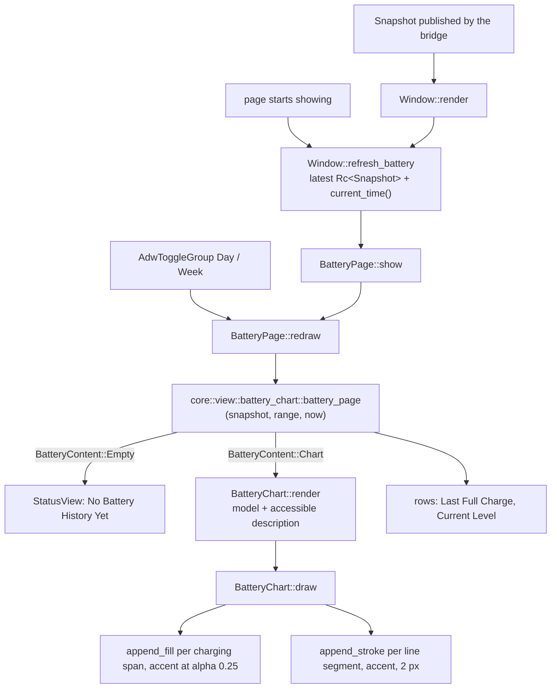
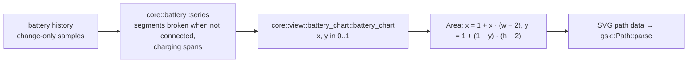

# SP12 Battery Page Implementation Plan

> **For agentic workers:** REQUIRED SUB-SKILL: Use superpowers:subagent-driven-development (recommended) or superpowers:executing-plans to implement this plan task-by-task. Steps use checkbox (`- [ ]`) syntax for tracking.

**Goal:** The `crates/ui` battery history page: an `AdwNavigationPage` tagged `battery` with a Day / Week
`AdwToggleGroup`, a custom-drawn `BatteryChart` (accent line, shaded charging spans, broken at gaps, accessible
description), the rows Last Full Charge and Current Level, and the "No Battery History Yet" empty state, reachable
from the existing Battery History row.

**Architecture:** The model already exists in core (SP6): `core::view::battery_chart::battery_page(&Snapshot,
Window, UnixSeconds) -> BatteryPageModel` with `BatteryContent::{Empty, Chart}`; SP12 changes no core code.
`Window::render` (SP9) keeps the latest `Rc<Snapshot>` and now also hands it, with the wall-clock time, to
`BatteryPage::show`; the page keeps that pair and re-renders it whenever the Day / Week toggle changes.
`BatteryChart` stores its `BatteryChartModel` and paints it in `BatteryChart::draw`: one `append_fill` per charging
span behind one `append_stroke` per line segment, built from SVG path data so the f64 geometry never needs a lossy
cast. The page emits no `Intent`.

**Tech Stack:** Rust 2024 (toolbox `arctis`), gtk4-rs 0.11.5 (`gnome_50`, `gsk` paths), libadwaita-rs 0.9.2
(`v1_9`, `AdwToggleGroup`), blueprint-compiler 0.20.4; widget tests under `weston --backend=headless`.

Spec: `docs/superpowers/specs/2026-10-11-arctis-companion-design.md` §3 (module tree: `crates/ui/src/battery_page.rs`,
`battery_chart.rs`), §5 (SP12 row); ui part §1 (`BatteryPage` in the navigation), §4 (`BatteryPage` row, empty
state, adaptive, HIG capitalization); audio part §5 (series: gaps, charging spans, last full charge); quality part
§1 (`crates/ui` row: `BatteryChart` has a description); ADR 0012; glossary `CONTEXT.md` (Battery sample, Battery
history); SP6 plan Deviations 15, 26, 30, 37; SP9 plan Deviations 4, 8, 16, 17.

---

## Conventions for every task

- Worktree: `/home/marcelo/Desenvolvimento/arctis-wt/sp12`, branch `sp12-battery-page`. Never touch
  `/home/marcelo/Desenvolvimento/arctis-companion`. Stay inside `crates/ui`, `docs/architecture/` and this plan.
  SP12 never opens `/dev/hidraw*`, never runs the `arctis-companion` binary (after a rebase onto a `main` that
  carries SP8 it opens the dongle), never edits `crates/core` or `crates/app`.
- **Run (core):** `X` means `toolbox run -c arctis bash -lc 'cd /home/marcelo/Desenvolvimento/arctis-wt/sp12 && X'`.
- **Run (ui):** `X` means

  ```bash
  toolbox run -c arctis bash -lc 'cd /home/marcelo/Desenvolvimento/arctis-wt/sp12 && export XDG_RUNTIME_DIR=$(mktemp -d) LC_ALL=C.UTF-8 && { weston --backend=headless --socket=wl-sp12 --idle-time=0 >/dev/null 2>&1 & W=$!; } && until [ -S "$XDG_RUNTIME_DIR/wl-sp12" ]; do sleep 0.1; done; GDK_BACKEND=wayland GSK_RENDERER=cairo WAYLAND_DISPLAY=wl-sp12 X; S=$?; kill $W; exit $S'
  ```

  Git and `gh` run on the host in the worktree.
- No comments in any file of any language, doc comments and Blueprint included. Names and small functions carry
  the meaning. Blueprint strings shown to people are `_("…")`; widget `name:` values, toggle names and icon names
  are not.
- Clippy policy applies to tests too: cognitive complexity 8, 40 lines per function, nesting 3, at most 4
  arguments (`self` included), no `unwrap()` (tests use `expect`), `pedantic` as errors under `-D warnings`: no
  lossy `as` casts (`f64::from`, `u64::try_from`), no `==` on floats, `#[must_use]` on public functions that return
  a value. When clippy objects, extract a function or rename; never add an `allow` or `expect` attribute.
- HIG capitalization: header case for titles, buttons and toggles, sentence case for subtitles and descriptions.
  Every row whose subtitle comes from a model has `use-markup: false`.
- Widget tests live in the one integration binary `crates/ui/tests/widgets/main.rs`, one module per widget.
  Battery fixtures and drawing helpers live in `crates/ui/tests/widgets/battery_history.rs`, added in the task
  that first uses them, so nothing is dead. Widgets are found by Blueprint `name:` through `support::named`.
  Expected strings come from the core model through `arctis_core::testkit::english::english` or
  `arctis_ui::text::resolve`, never from a copied msgid, except the chart's Blueprint label.
- Code blocks below are not rustfmt-formatted; `cargo fmt --all` reflows them and that is expected.
- Before each commit, Run (core): `cargo fmt --all && cargo clippy --workspace --all-targets -- -D warnings && cargo xtask check-rules && cargo xtask check-pure && cargo xtask check-doc-paths`,
  then Run (ui): `cargo test -p arctis-ui`.
- Commit subjects are conventional (`type(scope): summary`), short. Never write `Co-Authored-By`,
  "Generated with", or any AI or tool name in a commit message, PR title or PR body. Never use `--no-verify`.
- Push after every commit: `git push -u origin sp12-battery-page` the first time, then `git push`. After a rebase
  that moved the branch, `git push --force-with-lease`.
- SP10 and SP11 run in parallel and also add pages to `crates/ui`. Overlap is limited to
  `crates/ui/src/lib.rs` (two `mod` and two `pub use` lines), `crates/ui/resources/resources.gresource.xml` (two
  `<file>` lines), `crates/ui/resources/window.blp` (one navigation page), `crates/ui/src/window.rs` (one template
  child, one `ensure_type`, one signal, two small functions), `crates/ui/tests/widgets/main.rs` (four `mod`
  lines), `crates/ui/tests/widgets/{accessibility,layout}.rs` (appended tests, one array entry) and
  `docs/architecture/README.md` (one row). `crates/ui/tests/widgets/window.rs` is not touched: it is already 351
  lines and SP10 and SP11 append to it, so the navigation tests live in `battery_window.rs`. Before Task 1, before Task 6 and before the PR run
  `git fetch origin && git rebase origin/main`; on a conflict in those files keep both sides' lines.

## Acceptance criteria → tasks

| SP12 acceptance criterion (design §5, ui §4, quality §1) | Task |
|---|---|
| Scope: `battery_chart.rs` + `battery_chart.blp` (custom snapshot widget) | 1, 2 |
| Scope: `battery_page.rs` + `battery_page.blp` (toggle group, chart, rows, empty state) | 4, 5 |
| Scope: the page is reachable from the Battery History row (`win.show-page` `battery`) and follows each published snapshot | 6 |
| Day and Week views render a synthetic week | 3, 5 |
| charging spans shaded | 2, 3, 5 |
| gaps broken | 2, 3, 5 |
| accessible summary text present (`BatteryChart` description from `core::view::battery_chart`) | 1, 5, 7 |
| empty state ("No Battery History Yet", "History appears after the headset has been connected for a while") | 4, 6 |
| rows "Last full charge" and current level (hidden when unknown or the headset is off) | 5 |
| line in accent color, works in dark and high contrast (`accent` class, painted with `WidgetExt::color`) | 2 |
| accessibility walk: every control of the page has a name, standalone and opened in the window (back button) | 7 |
| quality §1 tree walk: `BatteryChart` has a description | 7 |
| adaptive: fits 360 px, no horizontal scroll | 7 |
| `docs/architecture/battery-page.md` (sub-project rule, design §5) | 8 |

## File structure

```
crates/ui/resources/battery_chart.blp          template: accent style class, height, accessible label
crates/ui/resources/battery_page.blp           AdwNavigationPage "battery": header bar, stack empty | chart
crates/ui/resources/resources.gresource.xml    + battery_chart.ui, battery_page.ui
crates/ui/resources/window.blp                 + $ArctisBatteryPage in the navigation view
crates/ui/src/battery_chart.rs                 BatteryChart (render, draw), Area, line_path, shade_path
crates/ui/src/battery_page.rs                  BatteryPage (show, redraw, range, render)
crates/ui/src/lib.rs                           mod battery_chart, mod battery_page, two re-exports
crates/ui/src/window.rs                        battery_page child, refresh_battery, current_time
crates/ui/tests/widgets/main.rs                mod battery_chart, battery_history, battery_page, battery_window
crates/ui/tests/widgets/battery_history.rs     NOW, synthetic_week, with_history, shown_battery_page, open_battery, drawn, count, stroke_bounds
crates/ui/tests/widgets/battery_chart.rs       chart tests
crates/ui/tests/widgets/battery_page.rs        page tests
crates/ui/tests/widgets/battery_window.rs      navigation and refresh tests
crates/ui/tests/widgets/accessibility.rs       + Radio role, battery page walks, chart description
crates/ui/tests/widgets/layout.rs              + battery page width and scrolling
docs/architecture/battery-page.md              diagrams + code paths and symbols
docs/architecture/README.md                    one new row
```

Dependency direction inside `crates/ui`: `text`, `widget_values`, `status_pages` → `battery_chart` →
`battery_page` → `window`.

## Deviations

Decisions taken where the spec is silent or ambiguous; each is the simplest option consistent with it.

| # | Decision | Why |
|---|---|---|
| 1 | SP12 changes no core code: `core::view::battery_chart::{battery_page, battery_chart}`, `BatteryContent`, the empty state and the synthetic-week, gap, span and description tables already exist from SP6 | SP6 owns `core::view` (design §5); the model covers everything ui §4 lists |
| 2 | `now` comes from `glib::real_time()` in `window.rs::current_time`, passed as `UnixSeconds` to `BatteryPage::display_history`. The page is refreshed on a snapshot only while it is the visible page, when it starts showing (`AdwNavigationPage::showing`) and every 60 s while it is shown (a `glib` timeout started on `showing`, removed on `hiding`) | `core` has no clock (SP6 Deviations 3, 37); reading the clock in one place keeps `BatteryPage` deterministic under test; the timer keeps the window sliding and shows a switched-off headset as passing time |
| 3 | The Day / Week choice is page-local view state: not an `Intent`, not persisted, Day whenever the app starts; a new snapshot keeps the current choice | ui §4 names no setting or intent for it; widgets render models and only user settings become intents |
| 4 | Drawing: path data strings (`M x y L …`, `M x 0 H x V h H x Z`) formatted from the f64 model geometry and parsed by `gsk::Path::parse`; charging spans are `append_fill` over the full height in the accent color at alpha 0.25, drawn first; each line segment is an `append_stroke` 2 px wide in the accent color; the plot is inset by 1 px so the stroke is not clipped; `y` = 1 (100 %) is the top | the model is f64 (SP6 Deviation 26) and pedantic clippy rejects `f64 as f32`; GSK parses the numbers itself. Fill and stroke nodes can be inspected in tests |
| 5 | Colour: the chart template carries the `accent` style class and draws with `WidgetExt::color()`, so dark and high-contrast variants come from the libadwaita stylesheet. No axes, grid or tick labels | ui §4 lists line, shaded spans and gaps only; the accessible description states the window and range |
| 6 | `BatteryPage` is an `adw::NavigationPage` subclass with `tag: "battery"`, its own `AdwToolbarView` and `AdwHeaderBar` (back button), added once to the navigation view in `window.blp`; `win.show-page` from SP9 pushes it (SP9 Deviation 8). Its empty state reuses `StatusView` with no button | one template per page; SP9's action already finds pages by tag |
| 7 | The toggle group is the `header-suffix` of a "Battery Level" `AdwPreferencesGroup` that holds the chart; a second group holds the rows. Rows are titled "Last Full Charge" and "Current Level" (header case for titles; the spec's "Last full charge" names the row), use the `property` style and show the model text as subtitle. Current Level hides when the model has no level. Both groups live in the chart stack page, so the empty state shows only the status page | ui §4 lists the rows but not their layout; the `property` style is libadwaita's pattern for label/value rows |
| 8 | The chart's accessible role is `Img`, its label "Battery Level Chart" comes from the Blueprint, its description from `BatteryChartModel::description` | quality §1 requires a description on `BatteryChart`; an image role is what Orca reads as a figure |
| 9 | The accessibility walk adds `AccessibleRole::Radio` to its interactive roles | `AdwToggleGroup` buttons are `GtkToggleButton`s with the Radio role; a spike showed each carries a `LabelledBy` relation, so the walk now covers them |
| 10 | The architecture page is a new `docs/architecture/battery-page.md` instead of a section of `ui.md` | SP10 and SP11 edit `ui.md` in parallel; a separate page leaves one README row as the only overlap |
| 11 | Rendering is tested by calling `BatteryChart::draw` on a fresh `gtk::Snapshot` and inspecting the top-level render nodes (`FillNode` per span, `StrokeNode` per line, `gsk::Path::bounds` of each stroke). `draw` is public because it is the body of the `snapshot` vfunc | GTK never snapshots an unmapped test widget; node bounds of a stroke are padded by the miter limit, path bounds are exact (spike) |
| 12 | The synthetic week is built in `crates/ui/tests/widgets/battery_history.rs`: one sample per hour for 7 days up to a fixed `NOW`; with `hour = hours_ago % 24`, the headset charges at hours 2, 1, 0 (60, 80, 100 %) and discharges from 100 % at hour 23 down to 40 % at hour 3, so levels fall while discharging and rise while charging; the headset is off 10 and 11 hours ago | keeps SP12 out of `core::testkit`, which SP10 and SP11 may touch; one gap and several spans fall inside both windows, no span has zero width (a spike showed GSK drops a zero-area fill, which would break the node counts) |
| 13 | The notification default action `app.show-battery` (audio §5) stays with SP8, which can activate `win.show-page` with `battery`; SP12 adds no application action | `crates/app` is SP8's scope |
| 14 | Spike results this plan relies on (gtk4-rs 0.11.5, libadwaita-rs 0.9.2, headless weston): Blueprint 0.20.4 compiles `Adw.ToggleGroup` with `Adw.Toggle` children and a `Gtk.Widget` template; pages added to an `AdwNavigationView` are parented before being pushed; `showing` fires on a push in an unmapped window; one appended node is returned bare by `to_node`, several inside a `ContainerNode`; an empty snapshot returns `None`. Re-checked with GTK 4.22.5 in the toolbox: a rectangular `append_fill` stays a `FillNode` (not folded into a `ColorNode`), fill and stroke nodes carry a `ColorNode` child, a zero-area fill is dropped, `AdwToggleGroup` buttons have role `Radio` with a label, and the navigation back button carries an accessible label | removes guesswork from Tasks 2, 6 and 7 |
| 15 | The window navigation tests live in a new `crates/ui/tests/widgets/battery_window.rs`, and `open_battery` is a shared fixture in `battery_history.rs` | `window.rs` tests are at 351 lines and SP10/SP11 append there; a separate module keeps SP12 under the 400-line guideline and out of their conflicts |
| 16 | Dark and high contrast are verified by construction, not by switching `AdwStyleManager`: the chart carries the `accent` class and every fill and stroke is painted from `WidgetExt::color()` (spans at alpha 0.25); the test asserts both | the unrooted test widget does not follow the style manager; libadwaita's `.accent` already defines dark and high-contrast colours |
| 17 | `current_time` divides `glib::real_time()` (µs) by 1 000 000 into `UnixSeconds` directly | simpler than going through `Millis` and `UnixSeconds::from_millis` |
| 18 | The toggle and `showing` signal handlers live in `BatteryPage::redraw_on_range_change` and `Window::refresh_battery_when_shown`, called from `constructed` | clippy `excessive_nesting` rejected the closures inside `constructed` |
| 19 | The `StaticTypeExt` import is needed in `battery_page.rs` for `ensure_type`; `gtk::prelude::*` is imported in `battery_history.rs` once Task 6 uses `activate_action` | compile errors found while executing |
| 20 | `BatteryPage::show` was renamed `display_history` (it shadowed `WidgetExt::show`); the displayed pair is a `Displayed` struct; the stack names are consts; the test fixtures use `ChartWindow` for the series window so `Range` is only `std::ops::Range`, named drawing constants (`PLOT_INSET`, `SHADE_ALPHA`), one shared `support::open_page`, and one `assert_never_scrolls_horizontally` | review findings, all verified real |
| 21 | `Window::is_refreshing_battery` is public so a test can assert the clock is cleared when the page hides | the source id is private to the window and a 60 s timer has no other observable effect |

---

### Task 1: The chart widget and its accessible description

**Files:**
- Create: `crates/ui/resources/battery_chart.blp`
- Create: `crates/ui/src/battery_chart.rs`
- Create: `crates/ui/tests/widgets/battery_chart.rs`
- Modify: `crates/ui/resources/resources.gresource.xml`
- Modify: `crates/ui/src/lib.rs`
- Modify: `crates/ui/tests/widgets/main.rs`

- [ ] **Step 1: Rebase**

Run on the host: `git -C /home/marcelo/Desenvolvimento/arctis-wt/sp12 fetch origin && git -C /home/marcelo/Desenvolvimento/arctis-wt/sp12 rebase origin/main`

- [ ] **Step 2: Write the failing tests**

Create `crates/ui/tests/widgets/battery_chart.rs`:

```rust
use adw::prelude::*;
use arctis_core::battery::series::Window as Range;
use arctis_core::testkit::english::english;
use arctis_core::view::battery_chart::{BatteryChartModel, ChartPoint, ChartSpan};
use arctis_core::view::text::Text;
use arctis_ui::BatteryChart;
use gtk::{AccessibleProperty, AccessibleRole};

use crate::support::{has_accessible_text, init};

fn model(lines: Vec<Vec<ChartPoint>>, charging: Vec<ChartSpan>) -> BatteryChartModel {
    BatteryChartModel {
        window: Range::Day,
        lines,
        charging,
        description: Text::plain("No battery readings in the last day"),
    }
}

fn rendered(model: &BatteryChartModel) -> BatteryChart {
    init();
    let chart = BatteryChart::default();
    chart.render(model);
    chart
}

#[gtk::test]
fn the_chart_is_a_named_image() {
    init();
    let chart = BatteryChart::default();
    assert_eq!(chart.accessible_role(), AccessibleRole::Img);
    assert!(has_accessible_text(&chart, AccessibleProperty::Label, "Battery Level Chart"));
}

#[gtk::test]
fn the_description_reaches_assistive_technology() {
    let drawn = model(Vec::new(), Vec::new());
    let chart = rendered(&drawn);
    assert!(has_accessible_text(
        &chart,
        AccessibleProperty::Description,
        &english(&drawn.description)
    ));
}
```

Add `mod battery_chart;` to `crates/ui/tests/widgets/main.rs` after `mod app_dialogs;` (alphabetical order of
the existing list).

- [ ] **Step 3: Run the tests to verify they fail**

Run (ui): `cargo test -p arctis-ui --test widgets battery_chart`
Expected: compile error, `BatteryChart` not found in `arctis_ui`.

- [ ] **Step 4: Write the template**

Create `crates/ui/resources/battery_chart.blp`:

```blueprint
using Gtk 4.0;

template $ArctisBatteryChart: Widget {
  height-request: 180;
  hexpand: true;

  accessibility {
    label: _("Battery Level Chart");
  }

  styles [
    "accent",
  ]
}
```

In `crates/ui/resources/resources.gresource.xml` add after the `shortcuts_dialog.ui` line:

```xml
    <file preprocess="xml-stripblanks">battery_chart.ui</file>
```

- [ ] **Step 5: Write the widget**

Create `crates/ui/src/battery_chart.rs`:

```rust
use arctis_core::view::battery_chart::BatteryChartModel;
use gtk::accessible::Property;
use gtk::glib;
use gtk::prelude::*;
use gtk::subclass::prelude::*;

use crate::text::resolve;

mod imp {
    use std::cell::RefCell;

    use arctis_core::view::battery_chart::BatteryChartModel;
    use gtk::glib;
    use gtk::subclass::prelude::*;

    #[derive(Default, gtk::CompositeTemplate)]
    #[template(resource = "/io/github/marcelogm/ArctisCompanion/ui/battery_chart.ui")]
    pub struct BatteryChart {
        pub model: RefCell<Option<BatteryChartModel>>,
    }

    #[glib::object_subclass]
    impl ObjectSubclass for BatteryChart {
        const NAME: &'static str = "ArctisBatteryChart";
        type Type = super::BatteryChart;
        type ParentType = gtk::Widget;

        fn class_init(klass: &mut Self::Class) {
            klass.bind_template();
            klass.set_accessible_role(gtk::AccessibleRole::Img);
        }

        fn instance_init(obj: &glib::subclass::InitializingObject<Self>) {
            obj.init_template();
        }
    }

    impl ObjectImpl for BatteryChart {}
    impl WidgetImpl for BatteryChart {}
}

glib::wrapper! {
    pub struct BatteryChart(ObjectSubclass<imp::BatteryChart>)
        @extends gtk::Widget,
        @implements gtk::Accessible, gtk::Buildable, gtk::ConstraintTarget;
}

impl Default for BatteryChart {
    fn default() -> Self {
        glib::Object::new()
    }
}

impl BatteryChart {
    pub fn render(&self, model: &BatteryChartModel) {
        self.update_property(&[Property::Description(&resolve(&model.description))]);
        self.imp().model.replace(Some(model.clone()));
        self.queue_draw();
    }
}
```

In `crates/ui/src/lib.rs` add `mod battery_chart;` before `mod equalizer_group;` and
`pub use battery_chart::BatteryChart;` before `pub use equalizer_group::EqualizerGroup;`.

- [ ] **Step 6: Run the tests to verify they pass**

Run (ui): `cargo test -p arctis-ui --test widgets battery_chart`
Expected: PASS, 2 tests.

- [ ] **Step 7: Commit**

Run the pre-commit checks from the conventions, then:

```bash
git add crates/ui/resources/battery_chart.blp crates/ui/resources/resources.gresource.xml crates/ui/src/battery_chart.rs crates/ui/src/lib.rs crates/ui/tests/widgets/battery_chart.rs crates/ui/tests/widgets/main.rs
git commit -m "feat(ui): add the battery chart widget"
git push -u origin sp12-battery-page
```

---

### Task 2: Draw charging spans and broken lines

**Files:**
- Create: `crates/ui/tests/widgets/battery_history.rs`
- Modify: `crates/ui/src/battery_chart.rs`
- Modify: `crates/ui/tests/widgets/battery_chart.rs`
- Modify: `crates/ui/tests/widgets/main.rs`

- [ ] **Step 1: Write the drawing helpers for tests**

Create `crates/ui/tests/widgets/battery_history.rs`:

```rust
use arctis_ui::BatteryChart;
use gtk::{graphene, gsk};

pub const CHART_WIDTH: f64 = 202.0;
pub const CHART_HEIGHT: f64 = 102.0;

pub fn drawn(chart: &BatteryChart, width: f64, height: f64) -> Vec<gsk::RenderNode> {
    let snapshot = gtk::Snapshot::new();
    chart.draw(&snapshot, width, height);
    snapshot.to_node().map(top_level).unwrap_or_default()
}

pub fn count(nodes: &[gsk::RenderNode], kind: gsk::RenderNodeType) -> usize {
    nodes.iter().filter(|node| node.node_type() == kind).count()
}

pub fn stroke_bounds(nodes: &[gsk::RenderNode]) -> Vec<graphene::Rect> {
    nodes
        .iter()
        .filter_map(|node| node.downcast_ref::<gsk::StrokeNode>())
        .filter_map(|stroke| stroke.path().bounds())
        .collect()
}

fn top_level(node: gsk::RenderNode) -> Vec<gsk::RenderNode> {
    match node.downcast_ref::<gsk::ContainerNode>() {
        Some(container) => (0..container.n_children()).map(|at| container.child(at)).collect(),
        None => vec![node],
    }
}
```

Every `RenderNode`, `ContainerNode`, `StrokeNode` and `gtk::Snapshot` method used here is inherent, so this file
imports no prelude (an unused glob import would fail `clippy -D warnings`).

Add `mod battery_history;` to `crates/ui/tests/widgets/main.rs` after `mod battery_chart;`.

- [ ] **Step 2: Write the failing tests**

In `crates/ui/tests/widgets/battery_chart.rs` replace the line `use gtk::{AccessibleProperty, AccessibleRole};`
and the `use crate::support::…` line with:

```rust
use gtk::{AccessibleProperty, AccessibleRole, gdk, gsk};

use crate::battery_history::{CHART_HEIGHT, CHART_WIDTH, count, drawn, stroke_bounds};
use crate::support::{assert_close, has_accessible_text, init};
```

and append:

```rust
fn point(x: f64, y: f64) -> ChartPoint {
    ChartPoint { x, y }
}

fn level_line(from: f64, to: f64, y: f64) -> Vec<ChartPoint> {
    vec![point(from, y), point(to, y)]
}

#[gtk::test]
fn charging_spans_are_shaded_across_the_full_height() {
    let chart = rendered(&model(Vec::new(), vec![ChartSpan { from: 0.5, to: 0.75 }]));
    let nodes = drawn(&chart, CHART_WIDTH, CHART_HEIGHT);
    assert_eq!(count(&nodes, gsk::RenderNodeType::FillNode), 1);
    let shade = nodes[0].bounds();
    assert_close(f64::from(shade.x()), 101.0);
    assert_close(f64::from(shade.width()), 50.0);
    assert_close(f64::from(shade.y()), 0.0);
    assert_close(f64::from(shade.height()), CHART_HEIGHT);
}

#[gtk::test]
fn gaps_break_the_line() {
    let lines = vec![level_line(0.0, 0.4, 0.8), level_line(0.6, 1.0, 0.7)];
    let nodes = drawn(&rendered(&model(lines, Vec::new())), CHART_WIDTH, CHART_HEIGHT);
    let strokes = stroke_bounds(&nodes);
    assert_eq!(strokes.len(), 2);
    assert!(strokes[0].x() + strokes[0].width() < strokes[1].x());
}

#[gtk::test]
fn a_full_battery_is_drawn_at_the_top_inside_the_chart() {
    let lines = vec![vec![point(0.0, 1.0), point(0.5, 0.0), point(1.0, 0.5)]];
    let nodes = drawn(&rendered(&model(lines, Vec::new())), CHART_WIDTH, CHART_HEIGHT);
    let line = stroke_bounds(&nodes)[0];
    assert_close(f64::from(line.x()), 1.0);
    assert_close(f64::from(line.y()), 1.0);
    assert_close(f64::from(line.width()), 200.0);
    assert_close(f64::from(line.height()), 100.0);
}

#[gtk::test]
fn spans_are_drawn_behind_the_lines() {
    let chart = rendered(&model(
        vec![level_line(0.0, 1.0, 0.5)],
        vec![ChartSpan { from: 0.0, to: 0.5 }],
    ));
    let kinds: Vec<gsk::RenderNodeType> = drawn(&chart, CHART_WIDTH, CHART_HEIGHT)
        .iter()
        .map(gsk::RenderNode::node_type)
        .collect();
    assert_eq!(kinds, vec![gsk::RenderNodeType::FillNode, gsk::RenderNodeType::StrokeNode]);
}

#[gtk::test]
fn nothing_is_drawn_without_a_model_or_without_room() {
    init();
    let chart = BatteryChart::default();
    assert!(drawn(&chart, CHART_WIDTH, CHART_HEIGHT).is_empty());
    chart.render(&model(vec![level_line(0.0, 1.0, 0.5)], Vec::new()));
    assert!(drawn(&chart, 0.0, 0.0).is_empty());
}

fn painted_color(node: &gsk::RenderNode) -> Option<gdk::RGBA> {
    let paint = node
        .downcast_ref::<gsk::FillNode>()
        .map(gsk::FillNode::child)
        .or_else(|| node.downcast_ref::<gsk::StrokeNode>().map(gsk::StrokeNode::child))?;
    paint.downcast_ref::<gsk::ColorNode>().map(gsk::ColorNode::color)
}

#[gtk::test]
fn the_chart_paints_in_the_accent_color() {
    let chart = rendered(&model(
        vec![level_line(0.0, 1.0, 0.5)],
        vec![ChartSpan { from: 0.0, to: 0.5 }],
    ));
    assert!(chart.has_css_class("accent"));
    let accent = chart.color();
    let colors: Vec<Option<gdk::RGBA>> = drawn(&chart, CHART_WIDTH, CHART_HEIGHT)
        .iter()
        .map(painted_color)
        .collect();
    assert_eq!(colors, vec![Some(accent.with_alpha(0.25)), Some(accent)]);
}
```

The numbers: the plot is inset by 1 px, so `x` maps to `1 + x · 200` and `y` to `1 + (1 − y) · 100` on a
202 × 102 chart; a span from 0.5 to 0.75 starts at 101 and is 50 wide.

- [ ] **Step 3: Run the tests to verify they fail**

Run (ui): `cargo test -p arctis-ui --test widgets battery_chart`
Expected: compile error, no method `draw` on `BatteryChart`.

- [ ] **Step 4: Implement the drawing**

In `crates/ui/src/battery_chart.rs`:

Replace the top-level `use` block with:

```rust
use arctis_core::view::battery_chart::{BatteryChartModel, ChartPoint, ChartSpan};
use gtk::accessible::Property;
use gtk::prelude::*;
use gtk::subclass::prelude::*;
use gtk::{gdk, glib, gsk};

use crate::text::resolve;

const LINE_WIDTH: f32 = 2.0;
const SHADE_ALPHA: f32 = 0.25;
const INSET: f64 = 1.0;
```

Replace `impl WidgetImpl for BatteryChart {}` inside `mod imp` with:

```rust
    impl WidgetImpl for BatteryChart {
        fn snapshot(&self, snapshot: &gtk::Snapshot) {
            let chart = self.obj();
            chart.draw(snapshot, f64::from(chart.width()), f64::from(chart.height()));
        }
    }
```

(`mod imp` also needs `use gtk::prelude::*;` for `width` and `height`.)

Add to `impl BatteryChart`:

```rust
    pub fn draw(&self, snapshot: &gtk::Snapshot, width: f64, height: f64) {
        let area = Area { width, height };
        let model = self.imp().model.borrow();
        if let Some(model) = model.as_ref().filter(|_| area.is_drawable()) {
            paint(snapshot, model, area, self.color());
        }
    }
```

Append to the file:

```rust
#[derive(Clone, Copy)]
struct Area {
    width: f64,
    height: f64,
}

impl Area {
    fn is_drawable(self) -> bool {
        self.width > 2.0 * INSET && self.height > 2.0 * INSET
    }

    fn x(self, fraction: f64) -> f64 {
        INSET + fraction * (self.width - 2.0 * INSET)
    }

    fn y(self, fraction: f64) -> f64 {
        INSET + (1.0 - fraction) * (self.height - 2.0 * INSET)
    }
}

fn paint(snapshot: &gtk::Snapshot, model: &BatteryChartModel, area: Area, accent: gdk::RGBA) {
    for span in &model.charging {
        shade(snapshot, &shade_path(*span, area), accent);
    }
    for line in &model.lines {
        stroke(snapshot, &line_path(line, area), accent);
    }
}

fn shade_path(span: ChartSpan, area: Area) -> String {
    let (from, to) = (area.x(span.from), area.x(span.to));
    format!("M {from:.2} 0 H {to:.2} V {:.2} H {from:.2} Z", area.height)
}

fn line_path(points: &[ChartPoint], area: Area) -> String {
    let steps: Vec<String> = points
        .iter()
        .map(|point| format!("{:.2} {:.2}", area.x(point.x), area.y(point.y)))
        .collect();
    format!("M {}", steps.join(" L "))
}

fn shade(snapshot: &gtk::Snapshot, data: &str, accent: gdk::RGBA) {
    if let Ok(path) = gsk::Path::parse(data) {
        snapshot.append_fill(&path, gsk::FillRule::Winding, &accent.with_alpha(SHADE_ALPHA));
    }
}

fn stroke(snapshot: &gtk::Snapshot, data: &str, accent: gdk::RGBA) {
    if let Ok(path) = gsk::Path::parse(data) {
        snapshot.append_stroke(&path, &gsk::Stroke::new(LINE_WIDTH), &accent);
    }
}
```

- [ ] **Step 5: Run the tests to verify they pass**

Run (ui): `cargo test -p arctis-ui --test widgets battery_chart`
Expected: PASS, 8 tests.

- [ ] **Step 6: Commit**

```bash
git add crates/ui/src/battery_chart.rs crates/ui/tests/widgets/battery_chart.rs crates/ui/tests/widgets/battery_history.rs crates/ui/tests/widgets/main.rs
git commit -m "feat(ui): draw charging spans and broken battery lines"
git push
```

---

### Task 3: A synthetic week in both ranges

**Files:**
- Modify: `crates/ui/tests/widgets/battery_history.rs`
- Modify: `crates/ui/tests/widgets/battery_chart.rs`

- [ ] **Step 1: Write the synthetic week**

In `crates/ui/tests/widgets/battery_history.rs` replace the `use` block with:

```rust
use std::ops::Range;

use arctis_core::battery::sample::{Reading, Sample, UnixSeconds};
use arctis_core::protocol::status::{Charging, Link};
use arctis_core::testkit::snapshots::percent;
use arctis_ui::BatteryChart;
use gtk::{graphene, gsk};
```

and add below `CHART_HEIGHT`:

```rust
pub const NOW: UnixSeconds = UnixSeconds(1_000_000_000);
const HOUR: u64 = 3_600;
const WEEK_HOURS: u64 = 7 * 24;
const CHARGING_HOURS: u64 = 3;
const FULL: u64 = 100;
const CHARGE_PER_HOUR: u64 = 20;
const DRAIN_PER_HOUR: u64 = 3;
const EMPTIEST: u64 = 31;
const HEADSET_OFF: Range<u64> = 10..12;

pub fn synthetic_week() -> Vec<Sample> {
    (0..=WEEK_HOURS).rev().map(hourly_sample).collect()
}

fn hourly_sample(hours_ago: u64) -> Sample {
    Sample {
        at: NOW.minus(hours_ago * HOUR),
        reading: hourly_reading(hours_ago),
    }
}

fn hourly_reading(hours_ago: u64) -> Reading {
    let hour_of_day = hours_ago % 24;
    let charging = hour_of_day < CHARGING_HOURS;
    Reading {
        percent: percent(level(hour_of_day, charging)),
        charging: if charging { Charging::Charging } else { Charging::Discharging },
        link: if HEADSET_OFF.contains(&hours_ago) { Link::HeadsetOff } else { Link::Connected },
    }
}

fn level(hour_of_day: u64, charging: bool) -> u8 {
    let level = if charging {
        FULL - hour_of_day * CHARGE_PER_HOUR
    } else {
        EMPTIEST + hour_of_day * DRAIN_PER_HOUR
    };
    u8::try_from(level).expect("a percent")
}
```

`hour_of_day` counts down as time moves forward, so the level falls from 100 % (hour 23) to 40 % (hour 3), then
rises 60, 80, 100 % while charging (hours 2, 1, 0). `NOW` itself is a charging sample at 100 %.

- [ ] **Step 2: Write the test**

In `crates/ui/tests/widgets/battery_chart.rs` change the imports to:

```rust
use adw::prelude::*;
use arctis_core::battery::series::{Window as Range, series};
use arctis_core::testkit::english::english;
use arctis_core::view::battery_chart::{BatteryChartModel, ChartPoint, ChartSpan, battery_chart};
use arctis_core::view::text::Text;
use arctis_ui::BatteryChart;
use gtk::{AccessibleProperty, AccessibleRole, gdk, gsk};

use crate::battery_history::{
    CHART_HEIGHT, CHART_WIDTH, NOW, count, drawn, stroke_bounds, synthetic_week,
};
use crate::support::{assert_close, has_accessible_text, init};
```

and append:

```rust
fn week_chart(range: Range) -> BatteryChartModel {
    battery_chart(&series(&synthetic_week(), range, NOW), range)
}

#[gtk::test]
fn day_and_week_draw_a_synthetic_week() {
    for range in [Range::Day, Range::Week] {
        let expected = week_chart(range);
        assert!(expected.lines.len() >= 2, "{range:?} has a gap");
        assert!(!expected.charging.is_empty(), "{range:?} has a charge");
        let nodes = drawn(&rendered(&expected), CHART_WIDTH, CHART_HEIGHT);
        assert_eq!(count(&nodes, gsk::RenderNodeType::StrokeNode), expected.lines.len(), "{range:?}");
        assert_eq!(count(&nodes, gsk::RenderNodeType::FillNode), expected.charging.len(), "{range:?}");
    }
}

#[gtk::test]
fn the_week_shows_more_charges_than_the_day() {
    assert!(week_chart(Range::Week).charging.len() > week_chart(Range::Day).charging.len());
}

#[gtk::test]
fn every_line_of_the_week_stays_inside_the_chart() {
    let nodes = drawn(&rendered(&week_chart(Range::Week)), CHART_WIDTH, CHART_HEIGHT);
    for line in stroke_bounds(&nodes) {
        assert!(line.x() >= 1.0 && line.y() >= 1.0, "{line:?}");
        assert!(f64::from(line.x() + line.width()) <= CHART_WIDTH - 1.0, "{line:?}");
        assert!(f64::from(line.y() + line.height()) <= CHART_HEIGHT - 1.0, "{line:?}");
    }
}
```

- [ ] **Step 3: Run the tests**

Run (ui): `cargo test -p arctis-ui --test widgets battery_chart`
Expected: PASS, 11 tests. This task is characterisation, not red-green: the tests exercise Task 2's code on
core's real series; if one fails, fix `battery_chart.rs` (not the fixture) until it passes.

- [ ] **Step 4: Commit**

```bash
git add crates/ui/tests/widgets/battery_history.rs crates/ui/tests/widgets/battery_chart.rs
git commit -m "test(ui): draw a synthetic week in both battery ranges"
git push
```

---

### Task 4: The battery page and its empty state

**Files:**
- Create: `crates/ui/resources/battery_page.blp`
- Create: `crates/ui/src/battery_page.rs`
- Create: `crates/ui/tests/widgets/battery_page.rs`
- Modify: `crates/ui/resources/resources.gresource.xml`
- Modify: `crates/ui/src/lib.rs`
- Modify: `crates/ui/tests/widgets/battery_history.rs`
- Modify: `crates/ui/tests/widgets/main.rs`

- [ ] **Step 1: Add the page fixtures**

In `crates/ui/tests/widgets/battery_history.rs` replace the `use` block with:

```rust
use std::ops::Range;
use std::rc::Rc;

use arctis_core::battery::sample::{Reading, Sample, UnixSeconds};
use arctis_core::companion::Snapshot;
use arctis_core::protocol::status::{Charging, Link};
use arctis_core::testkit::snapshots::{percent, snapshot};
use arctis_ui::{BatteryChart, BatteryPage};
use gtk::{graphene, gsk};

use crate::support::init;
```

and append:

```rust
pub fn with_history(history: Vec<Sample>) -> Snapshot {
    let mut s = snapshot();
    s.battery.history = history;
    s
}

pub fn shown_battery_page(s: Snapshot) -> BatteryPage {
    init();
    let page = BatteryPage::default();
    page.show(Rc::new(s), NOW);
    page
}
```

- [ ] **Step 2: Write the failing tests**

Create `crates/ui/tests/widgets/battery_page.rs`:

```rust
use std::rc::Rc;

use adw::prelude::*;
use arctis_core::battery::series::Window as Range;
use arctis_core::companion::Snapshot;
use arctis_core::testkit::english::english;
use arctis_core::testkit::snapshots::snapshot;
use arctis_core::view::battery_chart::{
    BatteryChartModel, BatteryContent, BatteryPageModel, battery_page,
};
use arctis_ui::{BatteryChart, BatteryPage};
use gtk::AccessibleProperty;

use crate::battery_history::{NOW, shown_battery_page, synthetic_week, with_history};
use crate::support::{first, has_accessible_text, named};

fn model(s: &Snapshot, range: Range) -> BatteryPageModel {
    battery_page(s, range, NOW)
}

fn chart_model(s: &Snapshot, range: Range) -> BatteryChartModel {
    match model(s, range).content {
        BatteryContent::Chart(chart) => chart,
        BatteryContent::Empty(_) => panic!("a chart"),
    }
}

fn visible(page: &BatteryPage) -> Option<String> {
    named::<gtk::Stack>(page, "battery-stack")
        .visible_child_name()
        .map(String::from)
}

fn describes(page: &BatteryPage, chart: &BatteryChartModel) -> bool {
    has_accessible_text(
        &named::<BatteryChart>(page, "battery-chart"),
        AccessibleProperty::Description,
        &english(&chart.description),
    )
}

#[gtk::test]
fn the_page_answers_to_the_battery_tag() {
    let page = shown_battery_page(snapshot());
    assert_eq!(page.tag().as_deref(), Some("battery"));
}

#[gtk::test]
fn no_history_shows_the_empty_state() {
    let s = snapshot();
    let page = shown_battery_page(s.clone());
    assert_eq!(visible(&page).as_deref(), Some("empty"));
    let BatteryContent::Empty(empty) = model(&s, Range::Day).content else {
        panic!("empty state");
    };
    let status = first::<adw::StatusPage>(&page);
    assert_eq!(status.title(), english(&empty.title));
    assert_eq!(status.description().as_deref(), Some(english(&empty.description).as_str()));
    assert!(!named::<gtk::Button>(&page, "status-button").get_visible());
}

#[gtk::test]
fn history_shows_the_day_chart_first() {
    let s = with_history(synthetic_week());
    let page = shown_battery_page(s.clone());
    assert_eq!(visible(&page).as_deref(), Some("chart"));
    assert!(describes(&page, &chart_model(&s, Range::Day)));
}

#[gtk::test]
fn emptied_history_returns_to_the_empty_state() {
    let page = shown_battery_page(with_history(synthetic_week()));
    page.show(Rc::new(snapshot()), NOW);
    assert_eq!(visible(&page).as_deref(), Some("empty"));
}
```

Add `mod battery_page;` to `crates/ui/tests/widgets/main.rs` after `mod battery_history;`.

- [ ] **Step 3: Run the tests to verify they fail**

Run (ui): `cargo test -p arctis-ui --test widgets battery_page`
Expected: compile error, `BatteryPage` not found in `arctis_ui`.

- [ ] **Step 4: Write the template**

Create `crates/ui/resources/battery_page.blp`:

```blueprint
using Gtk 4.0;
using Adw 1;

template $ArctisBatteryPage: Adw.NavigationPage {
  tag: "battery";
  title: _("Battery History");

  child: Adw.ToolbarView {
    [top]
    Adw.HeaderBar {}

    content: Stack content_stack {
      name: "battery-stack";

      StackPage {
        name: "empty";

        child: $ArctisStatusView empty_view {};
      }

      StackPage {
        name: "chart";

        child: Adw.PreferencesPage {
          Adw.PreferencesGroup {
            title: _("Battery Level");

            header-suffix: Adw.ToggleGroup range_toggle {
              name: "chart-range";
              active-name: "day";
              valign: center;

              Adw.Toggle {
                name: "day";
                label: _("Day");
              }

              Adw.Toggle {
                name: "week";
                label: _("Week");
              }
            };

            $ArctisBatteryChart chart {
              name: "battery-chart";
            }
          }

          Adw.PreferencesGroup {
            Adw.ActionRow last_full_charge {
              name: "last-full-charge";
              title: _("Last Full Charge");
              use-markup: false;

              styles [
                "property",
              ]
            }

            Adw.ActionRow current_level {
              name: "current-level";
              title: _("Current Level");
              use-markup: false;

              styles [
                "property",
              ]
            }
          }
        };
      }
    };
  };
}
```

In `crates/ui/resources/resources.gresource.xml` add after the `battery_chart.ui` line:

```xml
    <file preprocess="xml-stripblanks">battery_page.ui</file>
```

- [ ] **Step 5: Write the page**

Create `crates/ui/src/battery_page.rs`:

```rust
use std::rc::Rc;

use adw::subclass::prelude::*;
use arctis_core::battery::sample::UnixSeconds;
use arctis_core::battery::series::Window as Range;
use arctis_core::companion::Snapshot;
use arctis_core::view::battery_chart::{BatteryContent, BatteryPageModel, battery_page};
use gtk::glib;

mod imp {
    use std::cell::RefCell;
    use std::rc::Rc;

    use adw::prelude::*;
    use adw::subclass::prelude::*;
    use arctis_core::battery::sample::UnixSeconds;
    use arctis_core::companion::Snapshot;
    use gtk::glib;

    use crate::battery_chart::BatteryChart;
    use crate::status_pages::StatusView;

    #[derive(Default, gtk::CompositeTemplate)]
    #[template(resource = "/io/github/marcelogm/ArctisCompanion/ui/battery_page.ui")]
    pub struct BatteryPage {
        #[template_child]
        pub content_stack: TemplateChild<gtk::Stack>,
        #[template_child]
        pub empty_view: TemplateChild<StatusView>,
        #[template_child]
        pub range_toggle: TemplateChild<adw::ToggleGroup>,
        #[template_child]
        pub chart: TemplateChild<BatteryChart>,
        #[template_child]
        pub last_full_charge: TemplateChild<adw::ActionRow>,
        #[template_child]
        pub current_level: TemplateChild<adw::ActionRow>,
        pub shown: RefCell<Option<(Rc<Snapshot>, UnixSeconds)>>,
    }

    #[glib::object_subclass]
    impl ObjectSubclass for BatteryPage {
        const NAME: &'static str = "ArctisBatteryPage";
        type Type = super::BatteryPage;
        type ParentType = adw::NavigationPage;

        fn class_init(klass: &mut Self::Class) {
            StatusView::ensure_type();
            BatteryChart::ensure_type();
            klass.bind_template();
        }

        fn instance_init(obj: &glib::subclass::InitializingObject<Self>) {
            obj.init_template();
        }
    }

    impl ObjectImpl for BatteryPage {}
    impl WidgetImpl for BatteryPage {}
    impl NavigationPageImpl for BatteryPage {}
}

glib::wrapper! {
    pub struct BatteryPage(ObjectSubclass<imp::BatteryPage>)
        @extends adw::NavigationPage, gtk::Widget,
        @implements gtk::Accessible, gtk::Buildable, gtk::ConstraintTarget;
}

impl Default for BatteryPage {
    fn default() -> Self {
        glib::Object::new()
    }
}

impl BatteryPage {
    pub fn show(&self, snapshot: Rc<Snapshot>, now: UnixSeconds) {
        self.imp().shown.replace(Some((snapshot, now)));
        self.redraw();
    }

    fn redraw(&self) {
        let shown = self.imp().shown.borrow().clone();
        if let Some((snapshot, now)) = shown {
            self.render(&battery_page(&snapshot, Range::Day, now));
        }
    }

    fn render(&self, model: &BatteryPageModel) {
        let imp = self.imp();
        match &model.content {
            BatteryContent::Empty(empty) => {
                imp.empty_view.render(empty, None);
                imp.content_stack.set_visible_child_name("empty");
            }
            BatteryContent::Chart(chart) => {
                imp.chart.render(chart);
                imp.content_stack.set_visible_child_name("chart");
            }
        }
    }
}
```

In `crates/ui/src/lib.rs` add `mod battery_page;` after `mod battery_chart;` and
`pub use battery_page::BatteryPage;` after `pub use battery_chart::BatteryChart;`.

- [ ] **Step 6: Run the tests to verify they pass**

Run (ui): `cargo test -p arctis-ui --test widgets battery_page`
Expected: PASS, 4 tests.

- [ ] **Step 7: Commit**

```bash
git add crates/ui/resources/battery_page.blp crates/ui/resources/resources.gresource.xml crates/ui/src/battery_page.rs crates/ui/src/lib.rs crates/ui/tests/widgets/battery_page.rs crates/ui/tests/widgets/battery_history.rs crates/ui/tests/widgets/main.rs
git commit -m "feat(ui): add the battery page with its empty state"
git push
```

---

### Task 5: Day / Week toggle and the rows

**Files:**
- Modify: `crates/ui/src/battery_page.rs`
- Modify: `crates/ui/tests/widgets/battery_page.rs`

- [ ] **Step 1: Write the failing tests**

In `crates/ui/tests/widgets/battery_page.rs` change the imports to:

```rust
use std::rc::Rc;

use adw::prelude::*;
use arctis_core::battery::sample::Reading;
use arctis_core::battery::series::Window as Range;
use arctis_core::companion::Snapshot;
use arctis_core::protocol::status::Link;
use arctis_core::testkit::english::english;
use arctis_core::testkit::snapshots::snapshot;
use arctis_core::view::battery_chart::{
    BatteryChartModel, BatteryContent, BatteryPageModel, battery_page,
};
use arctis_ui::text::resolve;
use arctis_ui::{BatteryChart, BatteryPage};
use gtk::{AccessibleProperty, gsk};

use crate::battery_history::{
    CHART_HEIGHT, CHART_WIDTH, NOW, count, drawn, shown_battery_page, synthetic_week, with_history,
};
use crate::support::{first, has_accessible_text, named};
```

and append:

```rust
fn choose(page: &BatteryPage, range: &str) {
    named::<adw::ToggleGroup>(page, "chart-range").set_active_name(Some(range));
}

fn assert_draws(page: &BatteryPage, expected: &BatteryChartModel) {
    let nodes = drawn(&named::<BatteryChart>(page, "battery-chart"), CHART_WIDTH, CHART_HEIGHT);
    assert_eq!(count(&nodes, gsk::RenderNodeType::StrokeNode), expected.lines.len());
    assert_eq!(count(&nodes, gsk::RenderNodeType::FillNode), expected.charging.len());
}

#[gtk::test]
fn the_toggle_starts_on_day() {
    let page = shown_battery_page(with_history(synthetic_week()));
    assert_eq!(
        named::<adw::ToggleGroup>(&page, "chart-range").active_name().as_deref(),
        Some("day")
    );
}

#[gtk::test]
fn day_and_week_render_the_synthetic_week() {
    let s = with_history(synthetic_week());
    let page = shown_battery_page(s.clone());
    for (name, range) in [("week", Range::Week), ("day", Range::Day)] {
        choose(&page, name);
        let expected = chart_model(&s, range);
        assert!(describes(&page, &expected), "{name}");
        assert_draws(&page, &expected);
    }
}

#[gtk::test]
fn a_new_snapshot_keeps_the_chosen_range() {
    let s = with_history(synthetic_week());
    let page = shown_battery_page(s.clone());
    choose(&page, "week");
    page.show(Rc::new(s.clone()), NOW);
    assert!(describes(&page, &chart_model(&s, Range::Week)));
}

#[gtk::test]
fn the_rows_show_the_last_full_charge_and_the_level() {
    let s = with_history(synthetic_week());
    let page = shown_battery_page(s.clone());
    let expected = model(&s, Range::Day);
    let last_full = named::<adw::ActionRow>(&page, "last-full-charge").subtitle();
    assert_eq!(last_full.as_deref(), Some(resolve(&expected.last_full_charge).as_str()));
    let level = named::<adw::ActionRow>(&page, "current-level");
    assert!(level.get_visible());
    let text = expected.current_level.as_ref().map(english);
    assert_eq!(level.subtitle().as_deref(), text.as_deref());
}

#[gtk::test]
fn an_unknown_or_stale_level_hides_its_row() {
    let connected = snapshot().battery.reading;
    let headset_off = connected.map(|reading| Reading { link: Link::HeadsetOff, ..reading });
    for reading in [None, headset_off] {
        let mut s = with_history(synthetic_week());
        s.battery.reading = reading;
        assert_eq!(model(&s, Range::Day).current_level, None, "{reading:?}");
        let page = shown_battery_page(s);
        assert!(!named::<adw::ActionRow>(&page, "current-level").get_visible(), "{reading:?}");
    }
}
```

The headset-off case follows `battery_page`, which shows a level only for a connected reading; the first assert
pins that model fact so the widget assert cannot pass for the wrong reason.

- [ ] **Step 2: Run the tests to verify they fail**

Run (ui): `cargo test -p arctis-ui --test widgets battery_page`
Expected: FAIL in `day_and_week_render_the_synthetic_week` (the Week description is never shown),
`a_new_snapshot_keeps_the_chosen_range`, `the_rows_show_the_last_full_charge_and_the_level` (empty subtitles) and
`an_unknown_or_stale_level_hides_its_row` (the row stays visible). `the_toggle_starts_on_day` already passes: the
Blueprint sets `active-name`.

- [ ] **Step 3: Implement the toggle and the rows**

In `crates/ui/src/battery_page.rs`:

Replace the top-level `use` block with:

```rust
use std::rc::Rc;

use adw::prelude::*;
use adw::subclass::prelude::*;
use arctis_core::battery::sample::UnixSeconds;
use arctis_core::battery::series::Window as Range;
use arctis_core::companion::Snapshot;
use arctis_core::view::battery_chart::{BatteryContent, BatteryPageModel, battery_page};
use gtk::glib;

use crate::text::resolve;
use crate::widget_values::show_if;

const WEEK: &str = "week";
```

Replace `impl ObjectImpl for BatteryPage {}` inside `mod imp` with:

```rust
    impl ObjectImpl for BatteryPage {
        fn constructed(&self) {
            self.parent_constructed();
            let page = self.obj().downgrade();
            self.range_toggle.connect_active_name_notify(move |_| {
                if let Some(page) = page.upgrade() {
                    page.redraw();
                }
            });
        }
    }
```

In `redraw`, replace `Range::Day` with `self.range()`. Add to `impl BatteryPage`:

```rust
    fn range(&self) -> Range {
        match self.imp().range_toggle.active_name().as_deref() {
            Some(WEEK) => Range::Week,
            _ => Range::Day,
        }
    }
```

Append to the end of `render`, after the `match`:

```rust
        imp.last_full_charge
            .set_subtitle(&resolve(&model.last_full_charge));
        show_if(&*imp.current_level, model.current_level.as_ref(), |row, level| {
            row.set_subtitle(&resolve(level));
        });
```

- [ ] **Step 4: Run the tests to verify they pass**

Run (ui): `cargo test -p arctis-ui --test widgets battery_page`
Expected: PASS, 9 tests.

- [ ] **Step 5: Commit**

```bash
git add crates/ui/src/battery_page.rs crates/ui/tests/widgets/battery_page.rs
git commit -m "feat(ui): switch the battery chart between day and week"
git push
```

---

### Task 6: Open the battery page from the window

**Files:**
- Modify: `crates/ui/resources/window.blp`
- Modify: `crates/ui/src/window.rs`
- Create: `crates/ui/tests/widgets/battery_window.rs`
- Modify: `crates/ui/tests/widgets/battery_history.rs`
- Modify: `crates/ui/tests/widgets/main.rs`

- [ ] **Step 1: Rebase**

Run on the host: `git -C /home/marcelo/Desenvolvimento/arctis-wt/sp12 fetch origin && git -C /home/marcelo/Desenvolvimento/arctis-wt/sp12 rebase origin/main`,
keep both sides on conflicts in the shared files, `git push --force-with-lease` if the branch moved.

- [ ] **Step 2: Write the failing tests**

In `crates/ui/tests/widgets/battery_history.rs` change `use arctis_ui::{BatteryChart, BatteryPage};` to
`use arctis_ui::{BatteryChart, BatteryPage, Window};`, add `use gtk::prelude::*;` above `use gtk::{graphene, gsk};`
(now used by `activate_action` and `to_variant`), and append:

```rust
pub fn open_battery(window: &Window) {
    WidgetExt::activate_action(window, "win.show-page", Some(&"battery".to_variant()))
        .expect("the action exists");
}
```

Create `crates/ui/tests/widgets/battery_window.rs`:

```rust
use std::rc::Rc;

use adw::prelude::*;
use arctis_core::testkit::snapshots::snapshot;
use arctis_ui::{BatteryPage, Window};

use crate::battery_history::{NOW, open_battery, synthetic_week, with_history};
use crate::support::{named, rendered_window};

fn battery_page_of(window: &Window) -> BatteryPage {
    named::<adw::NavigationView>(window, "navigation")
        .find_page("battery")
        .and_downcast::<BatteryPage>()
        .expect("the battery page")
}

fn battery_content(window: &Window) -> Option<String> {
    named::<gtk::Stack>(&battery_page_of(window), "battery-stack")
        .visible_child_name()
        .map(String::from)
}

#[gtk::test]
fn the_battery_row_opens_the_battery_page() {
    let (window, _) = rendered_window(snapshot());
    open_battery(&window);
    let navigation = named::<adw::NavigationView>(&window, "navigation");
    let tag = navigation.visible_page().and_then(|page| page.tag());
    assert_eq!(tag.as_deref(), Some("battery"));
}

#[gtk::test]
fn each_render_reaches_the_battery_page() {
    let (window, _) = rendered_window(snapshot());
    assert_eq!(battery_content(&window).as_deref(), Some("empty"));
    window.render(&Rc::new(with_history(synthetic_week())));
    assert_eq!(battery_content(&window).as_deref(), Some("chart"));
}

#[gtk::test]
fn opening_the_battery_page_redraws_the_latest_snapshot() {
    let (window, _) = rendered_window(with_history(synthetic_week()));
    battery_page_of(&window).show(Rc::new(snapshot()), NOW);
    open_battery(&window);
    assert_eq!(battery_content(&window).as_deref(), Some("chart"));
}
```

Add `mod battery_window;` to `crates/ui/tests/widgets/main.rs` after `mod battery_page;`.

The fixture's `NOW` is in 2001 and the window uses the wall clock; the page still shows the chart because the
history is not empty (the series carries the last sample to the window's start).

- [ ] **Step 3: Run the tests to verify they fail**

Run (ui): `cargo test -p arctis-ui --test widgets battery_window`
Expected: FAIL: `the_battery_row_opens_the_battery_page` sees the tag `main`, the other two panic with "the battery
page" (`find_page("battery")` is `None`).

- [ ] **Step 4: Add the page to the navigation view**

In `crates/ui/resources/window.blp`, inside `Adw.NavigationView navigation { … }`, after the closing `}` of the
main `Adw.NavigationPage { tag: "main"; … }`, add:

```blueprint

      $ArctisBatteryPage battery_page {}
```

- [ ] **Step 5: Wire the window**

In `crates/ui/src/window.rs`:

Add to the top-level imports:

```rust
use arctis_core::battery::sample::UnixSeconds;
```

and below `const PERMISSION_ACTION …`:

```rust
const MICROS_PER_SECOND: i64 = 1_000_000;
```

Inside `mod imp`: add `use crate::battery_page::BatteryPage;`; add the field after `headset_page`:

```rust
        #[template_child]
        pub battery_page: TemplateChild<BatteryPage>,
```

add `BatteryPage::ensure_type();` after `HeadsetPage::ensure_type();` in `class_init`; replace `constructed` with:

```rust
        fn constructed(&self) {
            self.parent_constructed();
            self.headset_page.connect_intents(&self.sink);
            let window = self.obj().downgrade();
            self.battery_page.connect_showing(move |_| {
                if let Some(window) = window.upgrade() {
                    window.refresh_battery();
                }
            });
        }
```

In `impl Window`, make `render` end with the battery refresh:

```rust
    pub fn render(&self, snapshot: &Rc<Snapshot>) {
        let imp = self.imp();
        imp.snapshot.replace(Some(Rc::clone(snapshot)));
        imp.sink.rendering(|| {
            self.render_main(&headset_page(snapshot));
            self.render_preferences();
        });
        self.refresh_battery();
    }
```

and add:

```rust
    fn refresh_battery(&self) {
        let imp = self.imp();
        let snapshot = imp.snapshot.borrow().clone();
        if let Some(snapshot) = snapshot {
            imp.battery_page.show(snapshot, current_time());
        }
    }
```

At the end of the file, next to `status_action`:

```rust
fn current_time() -> UnixSeconds {
    u64::try_from(glib::real_time() / MICROS_PER_SECOND).map_or(UnixSeconds(0), UnixSeconds)
}
```

- [ ] **Step 6: Run the tests to verify they pass**

Run (ui): `cargo test -p arctis-ui`
Expected: PASS, every widget test including the existing window, accessibility and layout tests (the battery page
is parented but not shown, so the walks that filter on `shown` ignore it). The battery page brings a second
`ArctisStatusView`, so a second `adw::StatusPage` and a second `status-button` now exist under the window;
`window.rs` finds them with `first` and `named` (lines 67 and 207), which return the main page's because it is
added first and precedes the battery page in the tree. If one of those tests now reads the battery page's widget,
scope the lookup to `named::<gtk::Stack>(&window, "main-stack")` in that test; that is the only allowed edit to
`window.rs`.

- [ ] **Step 7: Commit**

```bash
git add crates/ui/resources/window.blp crates/ui/src/window.rs crates/ui/tests/widgets/battery_window.rs crates/ui/tests/widgets/battery_history.rs crates/ui/tests/widgets/main.rs
git commit -m "feat(ui): open the battery page from the window"
git push
```

---

### Task 7: Accessibility walk and narrow layout of the page

**Files:**
- Modify: `crates/ui/tests/widgets/accessibility.rs`
- Modify: `crates/ui/tests/widgets/layout.rs`

- [ ] **Step 1: Write the failing tests**

In `crates/ui/tests/widgets/accessibility.rs` change `use arctis_ui::{HeadsetStatus, PermissionDialog};` to
`use arctis_ui::{BatteryChart, HeadsetStatus, PermissionDialog};`, add
`use crate::battery_history::{open_battery, shown_battery_page, synthetic_week, with_history};` and append:

```rust
#[gtk::test]
fn every_control_of_the_battery_page_has_a_name() {
    let page = shown_battery_page(with_history(synthetic_week()));
    let controls = descendants(&page).into_iter().filter(needs_name).count();
    assert!(controls >= 2, "only {controls} controls need a name");
    assert_eq!(unnamed(&page), Vec::<String>::new());
}

#[gtk::test]
fn every_control_of_the_opened_battery_page_has_a_name() {
    let (window, _) = rendered_window(with_history(synthetic_week()));
    open_battery(&window);
    assert_eq!(unnamed(&window), Vec::<String>::new());
}

#[gtk::test]
fn the_battery_chart_has_a_description() {
    let (window, _) = rendered_window(with_history(synthetic_week()));
    open_battery(&window);
    assert!(gtk::test_accessible_has_property(
        &first::<BatteryChart>(&window),
        AccessibleProperty::Description
    ));
}
```

The window test covers the navigation back button, which a standalone page has no header slot for. The chart
test checks presence only: the window reads the wall clock, so the exact text is checked in Tasks 4 and 5 with
`NOW`.

In `crates/ui/tests/widgets/layout.rs` add to the imports
`use crate::battery_history::{open_battery, shown_battery_page, synthetic_week, with_history};` and append:

```rust
#[gtk::test]
fn the_battery_page_fits_the_narrowest_window() {
    for s in [snapshot(), with_history(synthetic_week())] {
        let page = shown_battery_page(s);
        assert!(minimum_width(&page) <= NARROWEST, "{}", minimum_width(&page));
    }
}

#[gtk::test]
fn the_opened_battery_page_fits_the_narrowest_window() {
    let (window, _) = rendered_window(with_history(synthetic_week()));
    open_battery(&window);
    let content = window.content().expect("window content");
    assert!(minimum_width(&content) <= NARROWEST, "{}", minimum_width(&content));
}

#[gtk::test]
fn the_battery_page_never_scrolls_horizontally() {
    let page = shown_battery_page(with_history(synthetic_week()));
    let scrolled: Vec<gtk::ScrolledWindow> = descendants(&page)
        .into_iter()
        .filter(shown)
        .filter_map(|widget| widget.downcast::<gtk::ScrolledWindow>().ok())
        .collect();
    assert!(!scrolled.is_empty(), "the battery page scrolls vertically");
    for view in scrolled {
        assert_eq!(view.hscrollbar_policy(), gtk::PolicyType::Never);
    }
}
```

- [ ] **Step 2: Run the tests to verify the walk fails**

Run (ui): `cargo test -p arctis-ui --test widgets -- accessibility layout`
(`cargo test` takes one test-name filter; libtest after `--` takes several.)
Expected: FAIL in `every_control_of_the_battery_page_has_a_name` with "only N controls need a name" (N below 2): the toggle
buttons have role `Radio`, which `INTERACTIVE` does not list yet. The other new tests pass.

- [ ] **Step 3: Count radio buttons as controls**

In `crates/ui/tests/widgets/accessibility.rs` change `INTERACTIVE` to nine roles by adding
`AccessibleRole::Radio,` after `AccessibleRole::Checkbox,` (and `[AccessibleRole; 8]` to `[AccessibleRole; 9]`).

- [ ] **Step 4: Run the tests to verify they pass**

Run (ui): `cargo test -p arctis-ui --test widgets -- accessibility layout`
Expected: PASS. If a walk lists a widget, give that widget an accessible label in `battery_page.blp` (a spike
showed the toggle buttons and the back button are labelled, so a failure points at a new control); if a width
test fails, find the widest child with `minimum_width` and let it shrink (for example `ellipsize` on a label),
never by relaxing `NARROWEST`.

- [ ] **Step 5: Commit**

```bash
git add crates/ui/tests/widgets/accessibility.rs crates/ui/tests/widgets/layout.rs
git commit -m "test(ui): walk the battery page for names and width"
git push
```

---

### Task 8: Architecture page

**Files:**
- Create: `docs/architecture/battery-page.md`
- Modify: `docs/architecture/README.md`

- [ ] **Step 1: Write the page**

Create `docs/architecture/battery-page.md`:

````markdown
# Battery page

`crates/ui/` shows the battery history as a navigation page with a Day / Week chart. The model comes from
`crates/core/src/view/battery_chart.rs::battery_page`; the page emits no intent. Design rationale: ui part §4,
audio part §5, ADR 0012.

## Data flow



## Chart geometry



| Piece | Code | Template |
|---|---|---|
| Page | `crates/ui/src/battery_page.rs::BatteryPage`, `crates/ui/src/battery_page.rs::redraw`, `crates/ui/src/battery_page.rs::range`, `crates/ui/src/battery_page.rs::render` | `crates/ui/resources/battery_page.blp` |
| Chart | `crates/ui/src/battery_chart.rs::BatteryChart`, `crates/ui/src/battery_chart.rs::draw`, `crates/ui/src/battery_chart.rs::Area`, `crates/ui/src/battery_chart.rs::line_path`, `crates/ui/src/battery_chart.rs::shade_path` | `crates/ui/resources/battery_chart.blp` |
| Window wiring | `crates/ui/src/window.rs::refresh_battery`, `crates/ui/src/window.rs::current_time` | `crates/ui/resources/window.blp` |
| Model | `crates/core/src/view/battery_chart.rs::battery_page`, `crates/core/src/view/battery_chart.rs::battery_chart`, `crates/core/src/view/battery_chart.rs::BatteryContent` | – |
| Series | `crates/core/src/battery/series.rs::series`, `crates/core/src/battery/series.rs::Window` | – |

The Battery History row of the headset page activates `win.show-page` with the tag `battery`
(`crates/ui/resources/headset_page.blp`); the page is tagged in its own template.

## Tests

`crates/ui/tests/widgets/battery_chart.rs` draws into a fresh `gtk::Snapshot` and counts fill and stroke nodes
and their accent colour; `crates/ui/tests/widgets/battery_page.rs` checks the empty state, Day and Week on a
synthetic week, the rows and the accessible description; fixtures live in
`crates/ui/tests/widgets/battery_history.rs`. `crates/ui/tests/widgets/battery_window.rs`,
`crates/ui/tests/widgets/accessibility.rs` and `crates/ui/tests/widgets/layout.rs` cover navigation, names, the
chart description and the 360 px width.
````

In `docs/architecture/README.md` add after the `ui.md` row:

```markdown
| [battery-page.md](battery-page.md) | battery history page and chart |
```

- [ ] **Step 2: Check the paths**

Run (core): `cargo xtask check-doc-paths`
Expected: exit 0. A failure names the path or symbol to fix in the page.

- [ ] **Step 3: Commit**

```bash
git add docs/architecture/battery-page.md docs/architecture/README.md
git commit -m "docs(architecture): add the battery page"
git push
```

---

### Task 9: Final verification and pull request

**Files:**
- Modify: `docs/superpowers/plans/2026-10-12-sp12-battery-page.md` (execution deviations, only if any)

- [ ] **Step 1: Rebase and run everything**

Run on the host: `git -C /home/marcelo/Desenvolvimento/arctis-wt/sp12 fetch origin && git -C /home/marcelo/Desenvolvimento/arctis-wt/sp12 rebase origin/main`.
Run (core): `cargo fmt --all --check && cargo clippy --workspace --all-targets -- -D warnings && cargo test --workspace --exclude arctis-ui && cargo xtask check-rules && cargo xtask check-pure && cargo xtask check-doc-paths`
Run (ui): `cargo test -p arctis-ui`
Expected: all green; `check-rules` reports no comment and no file above 400 lines among the new files.

- [ ] **Step 2: Record execution deviations**

If execution departed from this plan (renamed functions, clippy-driven rewrites, a changed assertion), append rows
to the Deviations table numbered from 18 and commit with `docs: record SP12 execution deviations`.

- [ ] **Step 3: Push and open the pull request**

```bash
git push --force-with-lease
gh pr create --base main --head sp12-battery-page --title "feat(ui): battery history page and chart" --body "Adds the battery history page with a Day/Week chart that shades charging and breaks at gaps, its empty state, and opens it from the Battery History row."
```

- [ ] **Step 4: Watch the checks**

Run: `gh pr checks --watch`
Expected: `rules`, `test` and `ui` green. Fix any failure with a new commit on the branch.

## Self-review

- Every row of "Acceptance criteria → tasks" points at a task with a test that fails before its code exists:
  synthetic week in both ranges (Tasks 3, 5), shaded spans (2, 3, 5), broken lines (2, 3, 5), accent colour (2),
  accessible description (1, 5, 7), empty state (4, 6), rows and their hidden level (5), names and width (7),
  architecture page (8). Task 3 is characterisation on core's real series and is labelled as such; Task 7 is
  red through the `Radio` role before `INTERACTIVE` lists it.
- Names used across tasks: `BatteryChart::{render, draw}`, `BatteryPage::{show, redraw, range, render}`,
  `Window::refresh_battery`, `current_time`, fixtures `NOW`, `CHART_WIDTH`, `CHART_HEIGHT`, `synthetic_week`,
  `with_history`, `shown_battery_page`, `open_battery`, `drawn`, `count`, `stroke_bounds`; Blueprint names `battery-stack`,
  `chart-range`, `battery-chart`, `last-full-charge`, `current-level`, `status-button` (SP9's `StatusView`).
- Core types used as they exist on `origin/main`: `arctis_core::view::battery_chart::{battery_page,
  battery_chart, BatteryPageModel, BatteryContent, BatteryChartModel, ChartPoint, ChartSpan}`,
  `arctis_core::battery::series::{series, Window}`, `arctis_core::battery::sample::{Sample, Reading,
  UnixSeconds}`, `arctis_core::protocol::status::{Charging, Link}`, `arctis_core::testkit::snapshots::{snapshot,
  percent}`.
