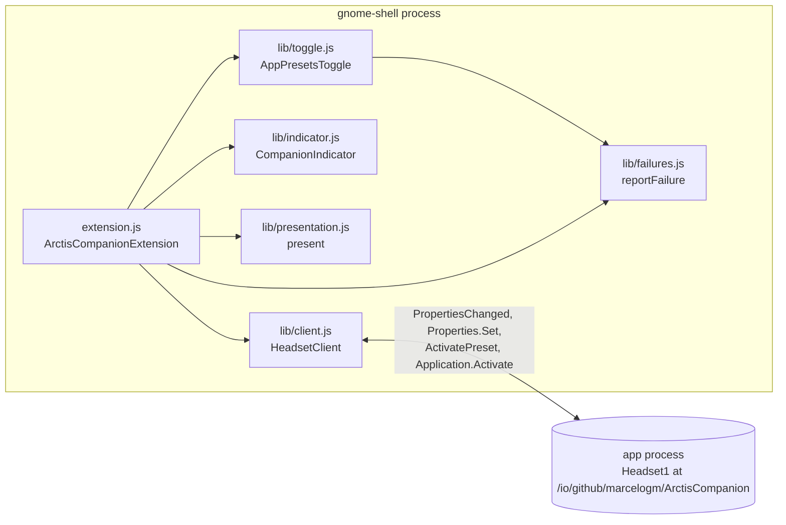
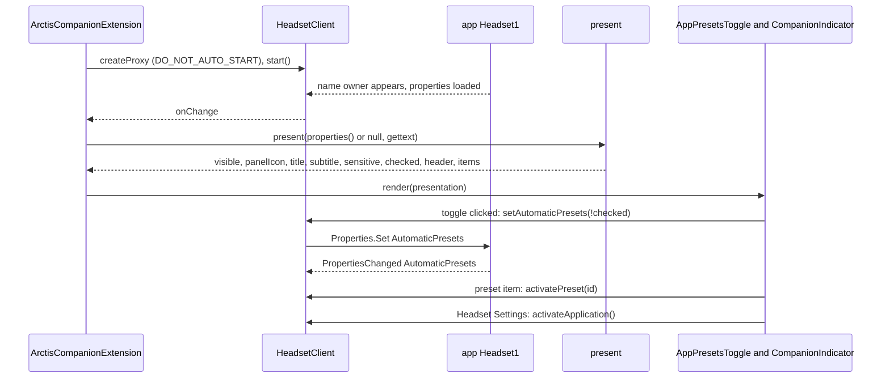
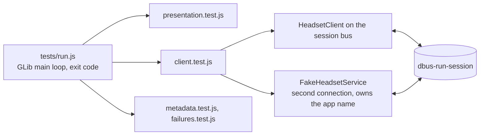
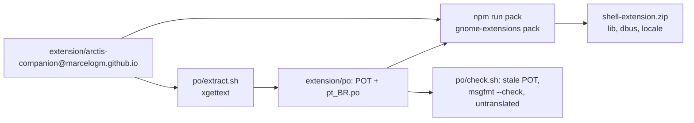

# SP13 Shell Extension Implementation Plan

> **For agentic workers:** REQUIRED SUB-SKILL: Use superpowers:subagent-driven-development (recommended) or superpowers:executing-plans to implement this plan task-by-task. Steps use checkbox (`- [ ]`) syntax for tracking.

**Goal:** A GNOME Shell 50 Quick Settings extension, "App Presets", that reads the app's frozen `Headset1` D-Bus
object, never starts the app, hides when the app is absent, and is covered by `gjs` tests against a fake service.

**Architecture:** Two pure modules carry all behaviour: `lib/presentation.js` maps the `Headset1` property bag to a
presentation object, and `lib/client.js` wraps a `Gio.DBusProxy` (flag `DO_NOT_AUTO_START`) built from the
extension's byte-equal copy of the contract XML. Thin Shell-bound modules (`lib/toggle.js`, `lib/indicator.js`,
`extension.js`) render that object onto `QuickMenuToggle` and `SystemIndicator` and disconnect everything in
`disable()`. Tests run under `dbus-run-session` with a fake `Headset1` service exported on a second bus connection.

**Tech Stack:** GJS 1.88 (ES modules), GNOME Shell 50.5 Quick Settings API, Gio D-Bus, ESLint 9, gettext 0.26
(`xgettext`, `msgfmt`, `msgcmp`, `msgattrib`), `gnome-extensions pack`, `dbus-run-session`, `gnome-shell --headless`
and `--devkit` (`mutter-devkit`), GitHub Actions on `fedora:44`.

Spec: `docs/superpowers/specs/2026-10-11-arctis-companion-design.md` §2 and §5 (SP13 row), ui part §5 (D-Bus
interface and Shell extension), quality part §1 (extension row) and §2 (extension job, nightly nested shell smoke),
ADR 0002, `CONTEXT.md` ("Quick Settings toggle", "Preset reason", "Low battery warning").

---

## Conventions for every task

- Worktree: `/home/marcelo/Desenvolvimento/arctis-wt/sp13`, branch `sp13-shell-extension`. Never touch
  `/home/marcelo/Desenvolvimento/arctis-companion`. Stay inside `extension/`, `.github/workflows/`, `.gitignore`,
  `docs/architecture/` and this plan.
- **Run (toolbox):** `X` means
  `toolbox run -c arctis bash -lc 'cd /home/marcelo/Desenvolvimento/arctis-wt/sp13/extension && X'`.
  **Run (toolbox, root):** the same with `cd /home/marcelo/Desenvolvimento/arctis-wt/sp13`.
  Git and `gh` run on the host in the worktree.
- No comments in any file of any language, doc comments included (ESLint `local/no-comments` and
  `cargo xtask check-rules`). Names and small functions carry the meaning. Never write a regex literal that
  contains `//` or `/*` (the xtask C-like scanner reports it).
- ESLint limits apply to tests too: `complexity` 6, `max-depth` 3, `no-unused-vars`, `no-undef`. When ESLint
  objects, extract a function.
- `lib/presentation.js`, `lib/client.js` and `lib/failures.js` import only `gi://` modules, never
  `resource:///` (tests read the source to enforce this for the first two).
- Before each commit, Run (toolbox): `npx eslint . && npm test`, and Run (toolbox, root):
  `cargo xtask check-rules --staged` after `git add`.
- Commit subjects are conventional (`type(scope): summary`, scope `extension` unless stated). Never write
  `Co-Authored-By`, "Generated with", or any AI or tool name in a commit message, PR title or PR body. Never use
  `--no-verify`.
- Push after every commit: `git push -u origin sp13-shell-extension` (first time), then `git push`.
- **Host safety:** the user's own GNOME session shares `~/.config/dconf/user` and `/run/user/$UID` with the
  toolbox. Never run `gsettings set org.gnome.shell …`, `gnome-extensions enable|disable` or a second
  `gnome-shell` except through `tests/nested-shell.sh`, which exports throwaway `XDG_*` dirs and
  `GSETTINGS_BACKEND=keyfile` *before* it starts the private bus. A `dconf-service` activated on a private bus
  started from an unisolated shell writes the user's real database and replaces their enabled extensions.

## Acceptance criteria → tasks

| SP13 acceptance criterion (design §5) or ui §5 requirement | Task |
|---|---|
| Shell extension for `shell-version ["50"]`, no `prefs.js` | 2 |
| `gjs` tests of `lib/presentation.js` | 3, 4, 5, 6 |
| `gjs` tests of `lib/client.js` against a fake service | 8, 9, 10 |
| ESLint clean | 1 (globals), every task, 14 (CI) |
| XML copy equals `data/dbus/…Headset1.xml` | 2 (copy + xtask check), 8 (copy parses, declares every property) |
| Manual check in `gnome-shell --devkit` | 13 |
| Hidden when the app is absent | 3 (`present(null)`, `absent`, `permission-denied`), 9 (no owner → `null`), 11 (wiring), 13 (`absent` scenario) |
| Proxy uses `DO_NOT_AUTO_START` | 8 (flag), 10 (an activatable test bus never starts the app) |
| `SystemIndicator` panel icon only for `BatteryWarning` or charging | 5, 11 |
| `QuickMenuToggle` "App Presets", checked = `AutomaticPresets`, click toggles it | 3 (`automaticPresetsAfterClick`), 10, 11 |
| Subtitles: preset name, "Footsteps · Firefox", "Bass Boost · Until Firefox stops", "No app rules" | 4 |
| Insensitive with `AppRuleCount` 0 | 3, 11 |
| Menu header: headset icon, `Model`, "73 %" or "Charging · 73 %" | 6, 11 |
| Preset items with check ornament calling `ActivatePreset`; insensitive while `connecting`, or `awaiting-headset` off Bluetooth | 6, 10, 11 |
| "Headset Settings" calls `org.freedesktop.Application.Activate` | 10, 11 |
| `disable()` disconnects everything | 9 (`HeadsetClient.destroy`), 11, 13 (headless enable then disable) |
| Numbers through `toLocaleString()`, strings through the extension's gettext domain in `extension/po/` | 6, 12 |
| CI extension job: ESLint, `gjs` tests, `gnome-extensions pack`; i18n gates; optional nightly nested shell smoke | 14 |
| `docs/architecture/` page for this area | 15 |

## File structure

```
extension/
  package.json                     scripts: lint, test, pack, pot, check-po, smoke, devkit
  eslint.config.js                 + TextDecoder, console globals
  arctis-companion@marcelogm.github.io/
    metadata.json                  uuid, shell-version ["50"], gettext-domain
    extension.js                   ArctisCompanionExtension: enable/disable wiring only
    dbus/io.github.marcelogm.ArctisCompanion.Headset1.xml   byte-equal copy of data/dbus/
    lib/presentation.js            present(bag, _) -> {visible, panelIcon, title, subtitle, sensitive, checked, header, items}; fill(); automaticPresetsAfterClick()
    lib/client.js                  BUS_NAME, OBJECT_PATH, INTERFACE_NAME, interfaceXml(), interfaceInfo(), createProxy(), HeadsetClient
    lib/failures.js                reportFailure(error, warn)
    lib/toggle.js                  AppPresetsToggle (QuickMenuToggle)
    lib/indicator.js               CompanionIndicator (SystemIndicator)
  po/
    extract.sh                     xgettext over extension.js and lib/*.js
    check.sh                       stale POT, msgfmt --check, msgcmp, no untranslated or fuzzy entries
    arctis-companion-extension.pot
    pt_BR.po
  tests/
    run.js                         imports every suite, runs them inside a GLib main loop, exit code
    assert.test.js metadata.test.js presentation.test.js failures.test.js client.test.js
    fake_app.js                    standalone fake app for nested shells, one scenario per run
    nested-shell.sh                packs, installs into temp XDG dirs, starts a private bus
    shell-session.sh               enables the extension, starts the fake app and a headless or devkit shell
    support/harness.js support/assert.js support/paths.js support/loop.js support/bags.js
    support/fake_headset_service.js
    support/session-bus.xml        private bus config for npm test: standard policy plus servicedir activation/
    support/activation/io.github.marcelogm.ArctisCompanion.service   activatable app name that touches a marker
    support/activation.js          armActivationMarker(), wasActivated(), startAppByName()
.github/workflows/ci.yml           extension job extended
.github/workflows/nightly.yml      optional shell-smoke job
.gitignore                         + /extension/dist
docs/architecture/shell-extension.md, docs/architecture/README.md
```

Responsibilities: `presentation.js` owns every user-visible decision; `client.js` owns the bus (proxy flags,
property unpacking, calls); `failures.js` turns a rejected call into one warning line; `toggle.js` and
`indicator.js` only copy a presentation onto Shell widgets; `extension.js` only creates, connects and destroys.

Shell 50.5 facts used below, read from the installed `libshell-18.so` resources: `QuickMenuToggle` binds its own
`reactive` to the menu arrow only, and its switch button is the first child of its child box; `menu.setHeader(icon,
title, subtitle)`; `PopupMenu.Ornament.CHECK` and `NONE`; `SystemIndicator._addIndicator()` returns an `St.Icon`;
`Main.panel.closeQuickSettings()`. `gnome-extensions pack` segfaults when `--out-dir` does not exist.

---

### Task 1: Toolbox prerequisites, ESLint globals and the test harness

**Files:**
- Modify: `extension/eslint.config.js`, `extension/package.json`
- Create: `extension/tests/support/harness.js`, `extension/tests/support/assert.js`, `extension/tests/run.js`
- Test: `extension/tests/assert.test.js`

- [ ] **Step 1: Install the tools the extension needs in the toolbox**

Run (toolbox): `sudo dnf install -y dbus-daemon mutter-devkit && npm ci`
Expected: `dbus-run-session`, `gnome-shell --devkit` available; `node_modules/` populated (ignored by git).

- [ ] **Step 2: Add the globals GJS code uses**

In `extension/eslint.config.js`, replace the `gjsGlobals` object with:

```js
const gjsGlobals = {
    ARGV: 'readonly',
    TextDecoder: 'readonly',
    console: 'readonly',
    imports: 'readonly',
    log: 'readonly',
    logError: 'readonly',
    print: 'readonly',
    printerr: 'readonly',
};
```

- [ ] **Step 3: Write the failing harness test**

`extension/tests/assert.test.js`:

```js
import {test} from './support/harness.js';
import {assertEqual, assertRejects, assertTrue} from './support/assert.js';

test('assertEqual ignores key order', () => assertEqual({b: 1, a: [2]}, {a: [2], b: 1}));

test('assertEqual reports a difference', () => {
    let message = '';
    try {
        assertEqual({a: 1}, {a: 2});
    } catch (error) {
        message = error.message;
    }
    assertEqual(message, 'expected {"a":2}, got {"a":1}');
});

test('assertRejects fails on a resolved promise', async () => {
    let failed = false;
    await assertRejects(Promise.resolve(), /never/).catch(() => {
        failed = true;
    });
    assertTrue(failed, 'a resolved promise must fail assertRejects');
});
```

`extension/tests/run.js`:

```js
import GLib from 'gi://GLib';
import System from 'system';

import {runAll} from './support/harness.js';
import './assert.test.js';

const loop = new GLib.MainLoop(null, false);
let failures = 1;
runAll()
    .then(count => {
        failures = count;
    })
    .catch(logError)
    .finally(() => loop.quit());
loop.run();
System.exit(failures === 0 ? 0 : 1);
```

In `extension/package.json`, set `scripts` to:

```json
  "scripts": {
    "lint": "eslint .",
    "test": "GIO_USE_VFS=local dbus-run-session -- gjs -m tests/run.js"
  },
```

- [ ] **Step 4: Run it to see it fail**

Run (toolbox): `npm test`
Expected: FAIL, `ImportError: Unable to load file from: …/tests/support/harness.js`.

- [ ] **Step 5: Write the harness and the assertions**

`extension/tests/support/harness.js`:

```js
const registered = [];

export function test(name, body) {
    registered.push({name, body});
}

export async function runAll() {
    let failures = 0;
    for (const {name, body} of registered)
        failures += await runOne(name, body);
    print(`${registered.length - failures} passed, ${failures} failed`);
    return failures;
}

async function runOne(name, body) {
    try {
        await body();
        print(`ok - ${name}`);
        return 0;
    } catch (error) {
        print(`not ok - ${name}\n  ${error.message}\n${error.stack}`);
        return 1;
    }
}
```

`extension/tests/support/assert.js`:

```js
export function assertEqual(actual, expected) {
    const [got, wanted] = [canonical(actual), canonical(expected)];
    if (got !== wanted)
        throw new Error(`expected ${wanted}, got ${got}`);
}

export function assertTrue(condition, message) {
    if (!condition)
        throw new Error(message);
}

export async function assertRejects(promise, pattern) {
    try {
        await promise;
    } catch (error) {
        assertTrue(pattern.test(error.message), `rejected with "${error.message}", expected ${pattern}`);
        return;
    }
    throw new Error(`expected a rejection matching ${pattern}`);
}

function canonical(value) {
    return JSON.stringify(value, sortedKeys);
}

function sortedKeys(key, value) {
    if (value === null || typeof value !== 'object' || Array.isArray(value))
        return value;
    return Object.fromEntries(Object.entries(value).sort(([left], [right]) => left.localeCompare(right)));
}
```

- [ ] **Step 6: Run the tests and ESLint**

Run (toolbox): `npm test; echo exit=$?`
Expected: three `ok - …` lines, `3 passed, 0 failed`, `exit=0`.
Temporarily change `{a: 2}` to `{a: 3}` in the second test, rerun, expect `not ok` and `exit=1`, then revert.
Run (toolbox): `npx eslint .` — Expected: no output.

- [ ] **Step 7: Commit**

```bash
git add extension/eslint.config.js extension/package.json extension/tests
git commit -m "test(extension): add gjs test harness"
git push -u origin sp13-shell-extension
```

---

### Task 2: Metadata and the contract copy

**Files:**
- Create: `extension/arctis-companion@marcelogm.github.io/metadata.json`
- Create: `extension/arctis-companion@marcelogm.github.io/dbus/io.github.marcelogm.ArctisCompanion.Headset1.xml`
- Create: `extension/tests/support/paths.js`
- Test: `extension/tests/metadata.test.js`
- Modify: `extension/tests/run.js`

- [ ] **Step 1: Write the failing metadata tests**

`extension/tests/support/paths.js`:

```js
import GLib from 'gi://GLib';

export const UUID = 'arctis-companion@marcelogm.github.io';

const [supportFile] = GLib.filename_from_uri(import.meta.url);
const EXTENSION_ROOT = ancestor(supportFile, 3);

export function extensionPath(...parts) {
    return GLib.build_filenamev([EXTENSION_ROOT, UUID, ...parts]);
}

export function readText(path) {
    const [, bytes] = GLib.file_get_contents(path);
    return new TextDecoder().decode(bytes);
}

function ancestor(path, levels) {
    return levels === 0 ? path : ancestor(GLib.path_get_dirname(path), levels - 1);
}
```

`extension/tests/metadata.test.js`:

```js
import GLib from 'gi://GLib';

import {test} from './support/harness.js';
import {assertEqual, assertTrue} from './support/assert.js';
import {UUID, extensionPath, readText} from './support/paths.js';

function metadata() {
    return JSON.parse(readText(extensionPath('metadata.json')));
}

test('metadata targets GNOME Shell 50 only', () => assertEqual(metadata()['shell-version'], ['50']));

test('metadata uuid names the extension directory', () => assertEqual(metadata().uuid, UUID));

test('metadata names the extension gettext domain', () =>
    assertEqual(metadata()['gettext-domain'], 'arctis-companion-extension'));

test('extension ships no preferences window', () =>
    assertTrue(!GLib.file_test(extensionPath('prefs.js'), GLib.FileTest.EXISTS), 'prefs.js must not exist'));
```

In `extension/tests/run.js`, add `import './metadata.test.js';` after `import './assert.test.js';`.

- [ ] **Step 2: Run to see it fail**

Run (toolbox): `npm test`
Expected: `not ok - metadata targets GNOME Shell 50 only` (file `metadata.json` not found), exit 1.

- [ ] **Step 3: Add the metadata and the contract copy**

`extension/arctis-companion@marcelogm.github.io/metadata.json`:

```json
{
  "uuid": "arctis-companion@marcelogm.github.io",
  "name": "Arctis Companion",
  "description": "Automatic app presets, presets and headset battery for the SteelSeries Arctis Nova 5 in Quick Settings. Needs the Arctis Companion app.",
  "shell-version": ["50"],
  "url": "https://github.com/marcelogm/arctis-companion",
  "gettext-domain": "arctis-companion-extension"
}
```

```bash
mkdir -p extension/arctis-companion@marcelogm.github.io/dbus
cp data/dbus/io.github.marcelogm.ArctisCompanion.Headset1.xml extension/arctis-companion@marcelogm.github.io/dbus/
```

- [ ] **Step 4: Run the tests and the contract check**

Run (toolbox): `npm test` — Expected: 7 passed, 0 failed.
Run (toolbox, root): `git add extension && cargo xtask check-rules --staged; echo exit=$?` — Expected: `exit=0`.
Negative check: append a line `<node/>` to the copy, `git add` it, rerun: expected
`error: extension/…/io.github.marcelogm.ArctisCompanion.Headset1.xml must be byte-equal to data/dbus/…` and
`exit=1`. Restore with `cp data/dbus/io.github.marcelogm.ArctisCompanion.Headset1.xml
extension/arctis-companion@marcelogm.github.io/dbus/` and `git add` again.

- [ ] **Step 5: Commit**

```bash
git add extension
git commit -m "feat(extension): add metadata and Headset1 contract copy"
git push
```

---

### Task 3: Presentation — visibility and toggle state

**Files:**
- Create: `extension/arctis-companion@marcelogm.github.io/lib/presentation.js`
- Create: `extension/tests/support/bags.js`
- Test: `extension/tests/presentation.test.js`
- Modify: `extension/tests/run.js`

- [ ] **Step 1: Write the failing tests**

`extension/tests/support/bags.js`:

```js
export function connectedBag(overrides = {}) {
    return {
        State: 'connected',
        Model: 'Arctis Nova 5',
        BatteryLevel: 73,
        Charging: 'discharging',
        BatteryWarning: 'none',
        Route: 'dongle',
        Presets: [['flat', 'Flat'], ['footsteps', 'Footsteps'], ['bass-boost', 'Bass Boost']],
        ActivePreset: 'flat',
        ActivePresetReason: ['route', ''],
        AppRuleCount: 2,
        AutomaticPresets: true,
        ...overrides,
    };
}
```

`extension/tests/presentation.test.js`:

```js
import {test} from './support/harness.js';
import {assertEqual, assertTrue} from './support/assert.js';
import {connectedBag} from './support/bags.js';
import {extensionPath, readText} from './support/paths.js';
import {
    HIDDEN,
    automaticPresetsAfterClick,
    fill,
    present,
} from '../arctis-companion@marcelogm.github.io/lib/presentation.js';

const VISIBLE_STATES = ['bluetooth-only', 'connecting', 'awaiting-headset', 'headset-off', 'connected'];

function presentWith(overrides) {
    return present(connectedBag(overrides));
}

test('presentation imports nothing from the Shell', () =>
    assertTrue(!readText(extensionPath('lib', 'presentation.js')).includes('resource:///'),
        'presentation.js must not import Shell modules'));

test('hidden when the app has no bus name owner', () => assertEqual(present(null), HIDDEN));

test('hidden while no dongle is found', () => assertEqual(presentWith({State: 'absent'}), HIDDEN));

test('hidden while the dongle is denied', () => assertEqual(presentWith({State: 'permission-denied'}), HIDDEN));

test('visible in every other state', () =>
    assertEqual(VISIBLE_STATES.map(State => presentWith({State}).visible), VISIBLE_STATES.map(() => true)));

test('missing properties fall back to empty values', () => {
    const presentation = present({State: 'connected'});
    assertEqual([presentation.checked, presentation.sensitive], [false, false]);
});

test('fill replaces named placeholders and keeps unknown ones', () =>
    assertEqual(fill('{preset} · {app} {other}', {preset: 'Flat', app: 'Firefox'}), 'Flat · Firefox {other}'));

test('toggle is titled App Presets', () => assertEqual(present(connectedBag()).title, 'App Presets'));

test('toggle is checked when automatic presets are on', () =>
    assertEqual([true, false].map(on => presentWith({AutomaticPresets: on}).checked), [true, false]));

test('toggle is insensitive without app rules', () =>
    assertEqual([0, 1].map(count => presentWith({AppRuleCount: count}).sensitive), [false, true]));

test('a click asks for the opposite of checked', () =>
    assertEqual([true, false].map(on => automaticPresetsAfterClick(presentWith({AutomaticPresets: on}))),
        [false, true]));

test('a click asks for nothing while insensitive', () =>
    assertEqual([presentWith({AppRuleCount: 0}), HIDDEN].map(automaticPresetsAfterClick), [null, null]));
```

In `extension/tests/run.js`, add `import './presentation.test.js';` after the metadata import.

- [ ] **Step 2: Run to see it fail**

Run (toolbox): `npm test`
Expected: FAIL, `ImportError` for `lib/presentation.js`.

- [ ] **Step 3: Write the minimal presentation**

`extension/arctis-companion@marcelogm.github.io/lib/presentation.js`:

```js
const HIDDEN_STATES = ['absent', 'permission-denied'];
const PLACEHOLDER = /\{(\w+)\}/g;

export const EMPTY_PROPERTIES = Object.freeze({
    State: 'absent',
    Model: '',
    BatteryLevel: -1,
    Charging: 'unknown',
    BatteryWarning: 'none',
    Route: 'none',
    Presets: [],
    ActivePreset: '',
    ActivePresetReason: ['route', ''],
    AppRuleCount: 0,
    AutomaticPresets: false,
});

export const HIDDEN = Object.freeze({
    visible: false,
    panelIcon: null,
    title: '',
    subtitle: null,
    sensitive: false,
    checked: false,
    header: null,
    items: [],
});

export function present(bag, _ = untranslated) {
    const properties = {...EMPTY_PROPERTIES, ...bag};
    if (bag === null || HIDDEN_STATES.includes(properties.State))
        return HIDDEN;
    return {
        visible: true,
        panelIcon: null,
        title: _('App Presets'),
        subtitle: null,
        sensitive: properties.AppRuleCount > 0,
        checked: properties.AutomaticPresets,
        header: null,
        items: [],
    };
}

export function fill(template, values) {
    return template.replace(PLACEHOLDER, (placeholder, name) => values[name] ?? placeholder);
}

export function automaticPresetsAfterClick({sensitive, checked}) {
    return sensitive ? !checked : null;
}

function untranslated(text) {
    return text;
}
```

- [ ] **Step 4: Run the tests**

Run (toolbox): `npm test && npx eslint .`
Expected: 19 passed, 0 failed; ESLint silent.

- [ ] **Step 5: Commit**

```bash
git add extension
git commit -m "feat(extension): present visibility and toggle state"
git push
```

---

### Task 4: Presentation — subtitle

**Files:**
- Modify: `extension/arctis-companion@marcelogm.github.io/lib/presentation.js`
- Test: `extension/tests/presentation.test.js`

- [ ] **Step 1: Append the failing subtitle tests to `extension/tests/presentation.test.js`**

```js
test('subtitle reads No app rules without app rules', () =>
    assertEqual(presentWith({AppRuleCount: 0, ActivePresetReason: ['app', 'Firefox']}).subtitle, 'No app rules'));

test('subtitle names the route preset', () => assertEqual(presentWith({}).subtitle, 'Flat'));

test('subtitle names the app whose rule chose the preset', () =>
    assertEqual(presentWith({ActivePreset: 'footsteps', ActivePresetReason: ['app', 'Firefox']}).subtitle,
        'Footsteps · Firefox'));

test('subtitle says until when a manual pick ends', () =>
    assertEqual(presentWith({ActivePreset: 'bass-boost', ActivePresetReason: ['manual', 'Firefox']}).subtitle,
        'Bass Boost · Until Firefox stops'));

test('subtitle of a manual pick without ruled apps is the preset', () =>
    assertEqual(presentWith({ActivePreset: 'bass-boost', ActivePresetReason: ['manual', '']}).subtitle,
        'Bass Boost'));

test('subtitle is empty when the active preset is unknown', () =>
    assertEqual(presentWith({ActivePreset: 'gone'}).subtitle, null));

test('texts go through the translator before placeholders are filled', () => {
    const presentation = present(connectedBag({ActivePreset: 'footsteps', ActivePresetReason: ['app', 'Firefox']}),
        text => `<${text}>`);
    assertEqual([presentation.title, presentation.subtitle], ['<App Presets>', '<Footsteps · Firefox>']);
});
```

- [ ] **Step 2: Run to see them fail**

Run (toolbox): `npm test`
Expected: `not ok - subtitle names the route preset` (`expected "Flat", got null`) and four more subtitle failures.

- [ ] **Step 3: Implement the subtitle**

In `present`, replace `subtitle: null,` with `subtitle: subtitle(properties, _),`. Append to the file:

```js
function subtitle(properties, _) {
    if (properties.AppRuleCount === 0)
        return _('No app rules');
    const preset = activePresetName(properties);
    if (preset === null)
        return null;
    const [reason, app] = properties.ActivePresetReason;
    return fill(reasonTemplate(reason, app, _), {preset, app});
}

function reasonTemplate(reason, app, _) {
    if (app === '')
        return '{preset}';
    if (reason === 'app')
        return _('{preset} · {app}');
    if (reason === 'manual')
        return _('{preset} · Until {app} stops');
    return '{preset}';
}

function activePresetName({Presets, ActivePreset}) {
    const active = Presets.find(([id]) => id === ActivePreset);
    return active ? active[1] : null;
}
```

- [ ] **Step 4: Run the tests**

Run (toolbox): `npm test && npx eslint .` — Expected: 26 passed, 0 failed; ESLint silent.

- [ ] **Step 5: Commit**

```bash
git add extension
git commit -m "feat(extension): present the active preset and its reason"
git push
```

---

### Task 5: Presentation — panel icon

**Files:**
- Modify: `extension/arctis-companion@marcelogm.github.io/lib/presentation.js`
- Test: `extension/tests/presentation.test.js`

- [ ] **Step 1: Append the failing panel icon tests**

```js
test('no panel icon without a warning or charging', () => assertEqual(presentWith({}).panelIcon, null));

test('panel icon shows a low battery warning', () =>
    assertEqual(presentWith({BatteryWarning: 'low', BatteryLevel: 14}).panelIcon, 'battery-caution-symbolic'));

test('panel icon shows a critical battery warning', () =>
    assertEqual(presentWith({BatteryWarning: 'critical', BatteryLevel: 4}).panelIcon, 'battery-level-0-symbolic'));

test('panel icon shows the charging level in tens', () =>
    assertEqual([0, 47, 100].map(BatteryLevel => presentWith({Charging: 'charging', BatteryLevel}).panelIcon), [
        'battery-level-0-charging-symbolic',
        'battery-level-40-charging-symbolic',
        'battery-level-90-charging-symbolic',
    ]));

test('panel icon of charging with an unknown level', () =>
    assertEqual(presentWith({Charging: 'charging', BatteryLevel: -1}).panelIcon, 'battery-missing-symbolic'));

test('a warning wins over charging', () =>
    assertEqual(presentWith({Charging: 'charging', BatteryWarning: 'low'}).panelIcon, 'battery-caution-symbolic'));

test('no panel icon once charged', () => assertEqual(presentWith({Charging: 'charged'}).panelIcon, null));
```

- [ ] **Step 2: Run to see them fail**

Run (toolbox): `npm test`
Expected: `not ok - panel icon shows a low battery warning` (`expected "battery-caution-symbolic", got null`)
and the other non-null cases.

- [ ] **Step 3: Implement the panel icon**

Below `const HIDDEN_STATES …` add:

```js
const UNKNOWN_LEVEL_ICON = 'battery-missing-symbolic';
const WARNING_ICONS = new Map([
    ['low', 'battery-caution-symbolic'],
    ['critical', 'battery-level-0-symbolic'],
]);
```

In `present`, replace `panelIcon: null,` with `panelIcon: panelIcon(properties),`. Append:

```js
function panelIcon({BatteryWarning, Charging, BatteryLevel}) {
    if (WARNING_ICONS.has(BatteryWarning))
        return WARNING_ICONS.get(BatteryWarning);
    return Charging === 'charging' ? chargingIcon(BatteryLevel) : null;
}

function chargingIcon(level) {
    if (level < 0)
        return UNKNOWN_LEVEL_ICON;
    const tens = Math.min(Math.floor(level / 10) * 10, 90);
    return `battery-level-${tens}-charging-symbolic`;
}
```

- [ ] **Step 4: Run the tests**

Run (toolbox): `npm test && npx eslint .` — Expected: 33 passed, 0 failed; ESLint silent.

- [ ] **Step 5: Commit**

```bash
git add extension
git commit -m "feat(extension): present the battery panel icon"
git push
```

---

### Task 6: Presentation — menu header and preset items

**Files:**
- Modify: `extension/arctis-companion@marcelogm.github.io/lib/presentation.js`
- Test: `extension/tests/presentation.test.js`

- [ ] **Step 1: Append the failing tests**

```js
test('header shows the model and the battery level', () =>
    assertEqual(presentWith({}).header, {icon: 'audio-headset-symbolic', title: 'Arctis Nova 5', subtitle: '73 %'}));

test('header shows charging with the level', () =>
    assertEqual(presentWith({Charging: 'charging'}).header.subtitle, 'Charging · 73 %'));

test('header hides an unknown level', () =>
    assertEqual(['discharging', 'charging'].map(Charging => presentWith({Charging, BatteryLevel: -1}).header.subtitle),
        ['', 'Charging']));

test('header falls back to Headset without a model', () =>
    assertEqual(presentWith({State: 'bluetooth-only', Model: ''}).header.title, 'Headset'));

test('items list every preset and check the active one', () =>
    assertEqual(presentWith({ActivePreset: 'footsteps'}).items.map(({id, label, checked}) => [id, label, checked]), [
        ['flat', 'Flat', false],
        ['footsteps', 'Footsteps', true],
        ['bass-boost', 'Bass Boost', false],
    ]));

test('items are insensitive while connecting', () =>
    assertEqual(presentWith({State: 'connecting'}).items.map(item => item.sensitive), [false, false, false]));

test('items are insensitive while awaiting the headset on the dongle', () =>
    assertEqual(presentWith({State: 'awaiting-headset', Route: 'dongle'}).items[0].sensitive, false));

test('items stay sensitive while awaiting the headset on Bluetooth', () =>
    assertEqual(presentWith({State: 'awaiting-headset', Route: 'bluetooth'}).items[0].sensitive, true));

test('items stay sensitive while the headset is off', () =>
    assertEqual(presentWith({State: 'headset-off'}).items[0].sensitive, true));
```

- [ ] **Step 2: Run to see them fail**

Run (toolbox): `npm test`
Expected: `not ok - header shows the model and the battery level` (`got null`), and
`TypeError: … header is null` / `items[0] is undefined` for the rest.

- [ ] **Step 3: Implement header and items**

Below `const HIDDEN_STATES …` add `const HEADSET_ICON = 'audio-headset-symbolic';`. In `present`, replace
`header: null,` with `header: header(properties, _),` and `items: [],` with `items: items(properties),`. Append:

```js
function header(properties, _) {
    return {
        icon: HEADSET_ICON,
        title: properties.Model === '' ? _('Headset') : properties.Model,
        subtitle: batteryText(properties, _),
    };
}

function batteryText({BatteryLevel, Charging}, _) {
    const charging = Charging === 'charging';
    if (BatteryLevel < 0)
        return charging ? _('Charging') : '';
    const percent = BatteryLevel.toLocaleString();
    return fill(charging ? _('Charging · {percent} %') : _('{percent} %'), {percent});
}

function items(properties) {
    const sensitive = canPick(properties);
    return properties.Presets.map(([id, label]) => ({
        id,
        label,
        checked: id === properties.ActivePreset,
        sensitive,
    }));
}

function canPick({State, Route}) {
    return State !== 'connecting' && !(State === 'awaiting-headset' && Route !== 'bluetooth');
}
```

The `HIDDEN` object keeps `header: null` and `items: []`; Shell code reads them only when `visible` is true.

- [ ] **Step 4: Run the tests**

Run (toolbox): `npm test && npx eslint .` — Expected: 42 passed, 0 failed; ESLint silent.

- [ ] **Step 5: Commit**

```bash
git add extension
git commit -m "feat(extension): present the menu header and preset items"
git push
```

---

### Task 7: Failure reporting

**Files:**
- Create: `extension/arctis-companion@marcelogm.github.io/lib/failures.js`
- Test: `extension/tests/failures.test.js`
- Modify: `extension/tests/run.js`

- [ ] **Step 1: Write the failing tests**

`extension/tests/failures.test.js`:

```js
import Gio from 'gi://Gio';
import GLib from 'gi://GLib';

import {test} from './support/harness.js';
import {assertEqual} from './support/assert.js';
import {reportFailure} from '../arctis-companion@marcelogm.github.io/lib/failures.js';

function warningsFor(error) {
    const warnings = [];
    reportFailure(error, message => warnings.push(message));
    return warnings;
}

test('a cancelled call is not reported', () =>
    assertEqual(warningsFor(new GLib.Error(Gio.IOErrorEnum, Gio.IOErrorEnum.CANCELLED, 'cancelled')), []));

test('a D-Bus error is reported with its message', () =>
    assertEqual(warningsFor(new GLib.Error(Gio.DBusError, Gio.DBusError.SERVICE_UNKNOWN, 'gone')),
        ['Arctis Companion: gone']));

test('a JavaScript error is reported with its message', () =>
    assertEqual(warningsFor(new Error('boom')), ['Arctis Companion: boom']));
```

In `extension/tests/run.js`, add `import './failures.test.js';` after the presentation import.

- [ ] **Step 2: Run to see it fail**

Run (toolbox): `npm test` — Expected: `ImportError` for `lib/failures.js`.

- [ ] **Step 3: Implement**

`extension/arctis-companion@marcelogm.github.io/lib/failures.js`:

```js
import Gio from 'gi://Gio';

export function reportFailure(error, warn = console.warn) {
    if (!isCancellation(error))
        warn(`Arctis Companion: ${error.message}`);
}

function isCancellation(error) {
    return error instanceof Gio.IOErrorEnum && error.matches(Gio.IOErrorEnum, Gio.IOErrorEnum.CANCELLED);
}
```

- [ ] **Step 4: Run the tests**

Run (toolbox): `npm test && npx eslint .` — Expected: 45 passed, 0 failed.

- [ ] **Step 5: Commit**

```bash
git add extension
git commit -m "feat(extension): report failed calls once, ignoring cancellation"
git push
```

---

### Task 8: Client — contract loading and the proxy

**Files:**
- Create: `extension/arctis-companion@marcelogm.github.io/lib/client.js`
- Test: `extension/tests/client.test.js`
- Modify: `extension/tests/run.js`

- [ ] **Step 1: Write the failing tests**

`extension/tests/client.test.js`:

```js
import Gio from 'gi://Gio';

import {test} from './support/harness.js';
import {assertEqual, assertTrue} from './support/assert.js';
import {extensionPath, readText} from './support/paths.js';
import {createProxy, interfaceInfo} from '../arctis-companion@marcelogm.github.io/lib/client.js';

const HEADSET1_PROPERTIES = [
    'State', 'Model', 'BatteryLevel', 'Charging', 'BatteryWarning', 'Route', 'Presets', 'ActivePreset',
    'ActivePresetReason', 'AppRuleCount', 'AutomaticPresets',
];

test('client imports nothing from the Shell', () =>
    assertTrue(!readText(extensionPath('lib', 'client.js')).includes('resource:///'),
        'client.js must not import Shell modules'));

test('interface copy declares every Headset1 property', () =>
    assertEqual(interfaceInfo().properties.map(property => property.name), HEADSET1_PROPERTIES));

test('proxy never starts the app', () => {
    const flags = createProxy(Gio.DBus.session).g_flags;
    assertTrue((flags & Gio.DBusProxyFlags.DO_NOT_AUTO_START) !== 0, 'DO_NOT_AUTO_START must be set');
});
```

In `extension/tests/run.js`, add `import './client.test.js';` after the failures import.

- [ ] **Step 2: Run to see it fail**

Run (toolbox): `npm test` — Expected: `ImportError` for `lib/client.js`.

- [ ] **Step 3: Implement contract loading and the proxy**

`extension/arctis-companion@marcelogm.github.io/lib/client.js`:

```js
import Gio from 'gi://Gio';
import GLib from 'gi://GLib';

export const BUS_NAME = 'io.github.marcelogm.ArctisCompanion';
export const OBJECT_PATH = '/io/github/marcelogm/ArctisCompanion';
export const INTERFACE_NAME = 'io.github.marcelogm.ArctisCompanion.Headset1';

const INTERFACE_FILE = '../dbus/io.github.marcelogm.ArctisCompanion.Headset1.xml';

export function interfaceXml() {
    const uri = GLib.Uri.resolve_relative(import.meta.url, INTERFACE_FILE, GLib.UriFlags.NONE);
    const [path] = GLib.filename_from_uri(uri);
    const [, bytes] = GLib.file_get_contents(path);
    return new TextDecoder().decode(bytes);
}

export function interfaceInfo() {
    return Gio.DBusNodeInfo.new_for_xml(interfaceXml()).lookup_interface(INTERFACE_NAME);
}

export function createProxy(connection) {
    return new Gio.DBusProxy({
        g_connection: connection,
        g_name: BUS_NAME,
        g_object_path: OBJECT_PATH,
        g_interface_name: INTERFACE_NAME,
        g_interface_info: interfaceInfo(),
        g_flags: Gio.DBusProxyFlags.DO_NOT_AUTO_START,
    });
}
```

`GLib.file_get_contents` instead of `Gio.File` keeps gvfs out of the private test bus; GJS has no `URL` global,
hence `GLib.Uri.resolve_relative`.

- [ ] **Step 4: Run the tests**

Run (toolbox): `npm test && npx eslint .` — Expected: 48 passed, 0 failed.

- [ ] **Step 5: Commit**

```bash
git add extension
git commit -m "feat(extension): build the Headset1 proxy from the contract copy"
git push
```

---

### Task 9: Client — following the app with a fake service

**Files:**
- Create: `extension/tests/support/loop.js`, `extension/tests/support/fake_headset_service.js`
- Modify: `extension/arctis-companion@marcelogm.github.io/lib/client.js`
- Test: `extension/tests/client.test.js`

- [ ] **Step 1: Write the loop helpers and the fake service**

`extension/tests/support/loop.js`:

```js
import GLib from 'gi://GLib';

const POLL_INTERVAL_MS = 10;

export function delay(milliseconds) {
    return new Promise(resolve => {
        GLib.timeout_add(GLib.PRIORITY_DEFAULT, milliseconds, () => {
            resolve();
            return GLib.SOURCE_REMOVE;
        });
    });
}

export async function waitFor(condition, timeoutMs = 2000) {
    const deadline = GLib.get_monotonic_time() + timeoutMs * 1000;
    while (!condition()) {
        if (GLib.get_monotonic_time() > deadline)
            throw new Error('timed out waiting for a condition');
        await delay(POLL_INTERVAL_MS);
    }
}
```

`extension/tests/support/fake_headset_service.js` (exports the shared XML on its own bus connection, owns the
app's name, records writes and calls; `ActivatePreset` answers `…Error.NoRoute` while `Route` is `none`):

```js
import Gio from 'gi://Gio';
import GLib from 'gi://GLib';

import {BUS_NAME, OBJECT_PATH, interfaceInfo, interfaceXml} from '../../arctis-companion@marcelogm.github.io/lib/client.js';
import {connectedBag} from './bags.js';
import {waitFor} from './loop.js';

const NO_ROUTE = 'io.github.marcelogm.ArctisCompanion.Error.NoRoute';
const APPLICATION_XML = `<node>
  <interface name="org.freedesktop.Application">
    <method name="Activate">
      <arg name="platform_data" type="a{sv}" direction="in"/>
    </method>
  </interface>
</node>`;
const CONNECTION_FLAGS = Gio.DBusConnectionFlags.AUTHENTICATION_CLIENT |
    Gio.DBusConnectionFlags.MESSAGE_BUS_CONNECTION;

Gio._promisify(Gio.DBusConnection, 'new_for_address');
Gio._promisify(Gio.DBusConnection.prototype, 'close');

export class FakeHeadsetService {
    automaticPresetWrites = [];
    activatedPresets = [];
    activations = 0;
    #bag;
    #connection = null;
    #headset = null;
    #application = null;
    #ownerId = 0;
    #owned = false;

    static async start(bag = connectedBag()) {
        const service = new FakeHeadsetService(bag);
        await service.#open();
        return service;
    }

    constructor(bag) {
        this.#bag = {...bag};
    }

    update(changes) {
        Object.assign(this.#bag, changes);
        for (const [name, value] of Object.entries(changes))
            this.#headset.emit_property_changed(name, new GLib.Variant(signatureOf(name), value));
        this.#headset.flush();
    }

    async stop() {
        Gio.bus_unown_name(this.#ownerId);
        this.#headset.unexport();
        this.#application.unexport();
        await this.#connection.close(null);
    }

    async #open() {
        const address = Gio.dbus_address_get_for_bus_sync(Gio.BusType.SESSION, null);
        this.#connection = await Gio.DBusConnection.new_for_address(address, CONNECTION_FLAGS, null, null);
        this.#headset = Gio.DBusExportedObject.wrapJSObject(interfaceXml(), this.#headsetImplementation());
        this.#headset.export(this.#connection, OBJECT_PATH);
        this.#application = Gio.DBusExportedObject.wrapJSObject(APPLICATION_XML, {Activate: () => this.#activate()});
        this.#application.export(this.#connection, OBJECT_PATH);
        this.#ownerId = Gio.bus_own_name_on_connection(this.#connection, BUS_NAME, Gio.BusNameOwnerFlags.NONE,
            () => this.#acquired(), null);
        await waitFor(() => this.#owned);
    }

    #headsetImplementation() {
        return new Proxy({}, {
            get: (target, member) => this.#member(member),
            set: (target, member, value) => this.#write(member, value),
        });
    }

    #member(member) {
        if (member === 'ActivatePresetAsync')
            return (parameters, invocation) => this.#activatePreset(parameters, invocation);
        return this.#bag[member];
    }

    #write(member, value) {
        if (member === 'AutomaticPresets') {
            this.automaticPresetWrites.push(value);
            this.update({AutomaticPresets: value});
        }
        return true;
    }

    #activatePreset([id], invocation) {
        if (this.#bag.Route === 'none') {
            invocation.return_dbus_error(NO_ROUTE, 'No picked path');
            return;
        }
        this.activatedPresets.push(id);
        invocation.return_value(null);
    }

    #activate() {
        this.activations += 1;
    }

    #acquired() {
        this.#owned = true;
    }
}

function signatureOf(name) {
    return interfaceInfo().lookup_property(name).signature;
}
```

- [ ] **Step 2: Write the failing client tests**

In `extension/tests/client.test.js`, replace the import block with:

```js
import Gio from 'gi://Gio';

import {test} from './support/harness.js';
import {assertEqual, assertTrue} from './support/assert.js';
import {connectedBag} from './support/bags.js';
import {FakeHeadsetService} from './support/fake_headset_service.js';
import {delay, waitFor} from './support/loop.js';
import {extensionPath, readText} from './support/paths.js';
import {HeadsetClient, createProxy, interfaceInfo} from '../arctis-companion@marcelogm.github.io/lib/client.js';
```

After `HEADSET1_PROPERTIES`, add the helpers:

```js
async function startClient() {
    const client = new HeadsetClient(createProxy(Gio.DBus.session));
    await client.start();
    return client;
}

async function withRunningApp(body) {
    const service = await FakeHeadsetService.start();
    const client = await startClient();
    try {
        await body(client, service);
    } finally {
        client.destroy();
        await service.stop();
    }
}
```

Append the tests:

```js
test('no properties while the app is absent', async () => {
    const client = await startClient();
    assertEqual(client.properties(), null);
    client.destroy();
});

test('client follows the app appearing and vanishing', async () => {
    const client = await startClient();
    let changes = 0;
    client.onChange(() => {
        changes += 1;
    });
    const service = await FakeHeadsetService.start();
    await waitFor(() => client.properties() !== null);
    assertEqual(client.properties(), connectedBag());
    await service.stop();
    await waitFor(() => client.properties() === null);
    assertTrue(changes >= 2, `expected two change notifications, got ${changes}`);
    client.destroy();
});

test('client relays changed properties', () => withRunningApp(async (client, service) => {
    let changes = 0;
    client.onChange(() => {
        changes += 1;
    });
    service.update({BatteryLevel: 14, BatteryWarning: 'low'});
    await waitFor(() => client.properties().BatteryLevel === 14);
    assertEqual([client.properties().BatteryWarning, changes > 0], ['low', true]);
}));

test('destroy stops change notifications', () => withRunningApp(async (client, service) => {
    let changes = 0;
    client.onChange(() => {
        changes += 1;
    });
    client.destroy();
    service.update({BatteryLevel: 50});
    await delay(100);
    assertEqual(changes, 0);
}));
```

- [ ] **Step 3: Run to see them fail**

Run (toolbox): `npm test`
Expected: `SyntaxError: … doesn't provide an export named: 'HeadsetClient'`.

- [ ] **Step 4: Implement `HeadsetClient`**

GJS 1.88 already returns a Promise from `init_async` when the callback is omitted (checked in the toolbox), so
`lib/client.js` does not promisify it. Append the class:

```js
export class HeadsetClient {
    #proxy;
    #handlerIds = [];

    constructor(proxy) {
        this.#proxy = proxy;
    }

    start(cancellable = null) {
        return this.#proxy.init_async(GLib.PRIORITY_DEFAULT, cancellable);
    }

    properties() {
        if (this.#proxy.get_name_owner() === null)
            return null;
        const names = this.#proxy.get_cached_property_names() ?? [];
        return Object.fromEntries(names.map(name => [name, this.#proxy.get_cached_property(name).deepUnpack()]));
    }

    onChange(callback) {
        this.#handlerIds.push(
            this.#proxy.connect('g-properties-changed', () => callback()),
            this.#proxy.connect('notify::g-name-owner', () => callback()));
    }

    destroy() {
        for (const id of this.#handlerIds.splice(0))
            this.#proxy.disconnect(id);
    }
}
```

`get_cached_property_names()` returns `null` once the owner leaves, hence `?? []`. GDBus loads the properties
before it notifies `g-name-owner`, so a non-null owner means a full bag.

- [ ] **Step 5: Run the tests**

Run (toolbox): `npm test && npx eslint .` — Expected: 52 passed, 0 failed.

- [ ] **Step 6: Commit**

```bash
git add extension
git commit -m "feat(extension): follow Headset1 through a proxy that never starts the app"
git push
```

---

### Task 10: Client — writes and calls

**Files:**
- Modify: `extension/arctis-companion@marcelogm.github.io/lib/client.js`, `extension/package.json`
- Create: `extension/tests/support/session-bus.xml`,
  `extension/tests/support/activation/io.github.marcelogm.ArctisCompanion.service`,
  `extension/tests/support/activation.js`
- Test: `extension/tests/client.test.js`

- [ ] **Step 1: Make the app name activatable on the test bus**

The default `dbus-run-session` bus has no service file for the app, so it could never start the app whatever the
flags; ADR 0002's "never starts the app" needs a bus that *could*. Verified in the toolbox: a relative
`<servicedir>` resolves against the config file, and `UpdateActivationEnvironment` reaches the spawned `Exec`.

`extension/tests/support/session-bus.xml`:

```xml
<!DOCTYPE busconfig PUBLIC "-//freedesktop//DTD D-Bus Bus Configuration 1.0//EN"
 "http://www.freedesktop.org/standards/dbus/1.0/busconfig.dtd">
<busconfig>
  <type>session</type>
  <keep_umask/>
  <listen>unix:tmpdir=/tmp</listen>
  <auth>EXTERNAL</auth>
  <servicedir>activation</servicedir>
  <policy context="default">
    <allow send_destination="*" eavesdrop="true"/>
    <allow eavesdrop="true"/>
    <allow own="*"/>
  </policy>
</busconfig>
```

`extension/tests/support/activation/io.github.marcelogm.ArctisCompanion.service` (`exit 1` makes the bus answer
`Spawn.ChildExited` at once instead of waiting for the name):

```ini
[D-BUS Service]
Name=io.github.marcelogm.ArctisCompanion
Exec=/bin/sh -c 'touch "$ARCTIS_ACTIVATION_MARKER"; exit 1'
```

`extension/tests/support/activation.js`:

```js
import Gio from 'gi://Gio';
import GLib from 'gi://GLib';

import {BUS_NAME} from '../../arctis-companion@marcelogm.github.io/lib/client.js';

export async function armActivationMarker() {
    const marker = GLib.build_filenamev([GLib.get_tmp_dir(), `arctis-activation-${GLib.random_int()}`]);
    await busCall('UpdateActivationEnvironment', new GLib.Variant('(a{ss})', [{ARCTIS_ACTIVATION_MARKER: marker}]));
    return marker;
}

export function wasActivated(marker) {
    return GLib.file_test(marker, GLib.FileTest.EXISTS);
}

export function startAppByName() {
    return busCall('StartServiceByName', new GLib.Variant('(su)', [BUS_NAME, 0]));
}

function busCall(method, parameters) {
    return Gio.DBus.session.call('org.freedesktop.DBus', '/org/freedesktop/DBus', 'org.freedesktop.DBus', method,
        parameters, null, Gio.DBusCallFlags.NONE, -1, null);
}
```

In `extension/package.json`, change `test` to
`"test": "GIO_USE_VFS=local dbus-run-session --config-file=tests/support/session-bus.xml -- gjs -m tests/run.js"`.
Run (toolbox): `npm test` — Expected: still 52 passed (the fake service owns the name, so nothing is activated).

- [ ] **Step 2: Write the failing tests**

In `extension/tests/client.test.js`, change the assert import to
`import {assertEqual, assertRejects, assertTrue} from './support/assert.js';`, add
`import GLib from 'gi://GLib';` below the `Gio` import and
`import {armActivationMarker, startAppByName, wasActivated} from './support/activation.js';` below the bags
import, and append:

```js
test('toggling writes AutomaticPresets', () => withRunningApp(async (client, service) => {
    await client.setAutomaticPresets(false);
    await waitFor(() => client.properties().AutomaticPresets === false);
    assertEqual(service.automaticPresetWrites, [false]);
}));

test('picking a preset calls ActivatePreset', () => withRunningApp(async (client, service) => {
    await client.activatePreset('bass-boost');
    assertEqual(service.activatedPresets, ['bass-boost']);
}));

test('ActivatePreset errors reach the caller', () => withRunningApp(async (client, service) => {
    service.update({Route: 'none'});
    await assertRejects(client.activatePreset('flat'), /Error\.NoRoute/);
}));

test('Headset Settings activates the app', () => withRunningApp(async (client, service) => {
    await client.activateApplication();
    assertEqual(service.activations, 1);
}));

test('neither the proxy nor its calls start the app', async () => {
    const marker = await armActivationMarker();
    const client = await startClient();
    await Promise.allSettled([
        client.setAutomaticPresets(true),
        client.activatePreset('flat'),
        client.activateApplication(),
    ]);
    await delay(200);
    client.destroy();
    assertTrue(!wasActivated(marker), 'the app was started');
});

test('the test bus can start the app when asked', async () => {
    const marker = await armActivationMarker();
    await startAppByName().catch(() => null);
    await waitFor(() => wasActivated(marker));
    GLib.unlink(marker);
});
```

The last test is the control: it proves the marker detects an activation, so the test before it cannot pass
vacuously.

- [ ] **Step 3: Run to see them fail**

Run (toolbox): `npm test`
Expected: `not ok - toggling writes AutomaticPresets` with `client.setAutomaticPresets is not a function`, the
same for the next three, and `ok - the test bus can start the app when asked`.

- [ ] **Step 4: Implement the calls**

In `lib/client.js`, below `const INTERFACE_FILE …` add:

```js
const CALL_FLAGS = Gio.DBusCallFlags.NO_AUTO_START;
const DEFAULT_TIMEOUT = -1;
```

below them add (GJS 1.88 still requires a callback for both `call`s outside the Shell, checked in the toolbox;
the Shell promisifies `DBusConnection.call` itself, and `_promisify` keeps callback callers working):

```js
Gio._promisify(Gio.DBusProxy.prototype, 'call');
Gio._promisify(Gio.DBusConnection.prototype, 'call');
```

and insert into `HeadsetClient`, before `destroy()`:

```js
    setAutomaticPresets(enabled) {
        const parameters = new GLib.Variant('(ssv)',
            [INTERFACE_NAME, 'AutomaticPresets', GLib.Variant.new_boolean(enabled)]);
        return this.#proxy.call('org.freedesktop.DBus.Properties.Set', parameters, CALL_FLAGS, DEFAULT_TIMEOUT, null);
    }

    activatePreset(id) {
        return this.#proxy.call('ActivatePreset', new GLib.Variant('(s)', [id]), CALL_FLAGS, DEFAULT_TIMEOUT, null);
    }

    activateApplication() {
        const parameters = new GLib.Variant('(a{sv})', [{}]);
        return this.#proxy.get_connection().call(BUS_NAME, OBJECT_PATH, 'org.freedesktop.Application', 'Activate',
            parameters, null, CALL_FLAGS, DEFAULT_TIMEOUT, null);
    }
```

- [ ] **Step 5: Run the tests**

Run (toolbox): `npm test && npx eslint .` — Expected: 58 passed, 0 failed; ESLint silent.
Run (toolbox, root): `git add extension && cargo xtask check-rules --staged` — Expected: exit 0 (`.xml` and
`.service` are known syntaxes).

- [ ] **Step 6: Commit**

```bash
git add extension
git commit -m "feat(extension): write AutomaticPresets and call ActivatePreset and Activate"
git push
```

---

### Task 11: Shell wiring — toggle, indicator, extension and pack

No unit test can load `resource:///org/gnome/shell/…` outside the Shell; these modules only copy a presentation
onto widgets. They are verified by ESLint here and by the nested shells of Task 13.

**Files:**
- Create: `extension/arctis-companion@marcelogm.github.io/lib/toggle.js`
- Create: `extension/arctis-companion@marcelogm.github.io/lib/indicator.js`
- Create: `extension/arctis-companion@marcelogm.github.io/extension.js`
- Modify: `extension/package.json`, `.gitignore`

- [ ] **Step 1: Write the toggle**

`extension/arctis-companion@marcelogm.github.io/lib/toggle.js`:

```js
import GObject from 'gi://GObject';

import {gettext as _} from 'resource:///org/gnome/shell/extensions/extension.js';
import * as Main from 'resource:///org/gnome/shell/ui/main.js';
import * as PopupMenu from 'resource:///org/gnome/shell/ui/popupMenu.js';
import {QuickMenuToggle} from 'resource:///org/gnome/shell/ui/quickSettings.js';

import {reportFailure} from './failures.js';
import {HIDDEN, automaticPresetsAfterClick} from './presentation.js';

const HEADSET_ICON = 'audio-headset-symbolic';

export const AppPresetsToggle = GObject.registerClass(
class AppPresetsToggle extends QuickMenuToggle {
    _init(client) {
        super._init({title: _('App Presets'), iconName: HEADSET_ICON, toggleMode: false, visible: false});
        this._client = client;
        this._presentation = HIDDEN;
        this._presets = new PopupMenu.PopupMenuSection();
        this.menu.addMenuItem(this._presets);
        this.menu.addMenuItem(new PopupMenu.PopupSeparatorMenuItem());
        this.menu.addAction(_('Headset Settings'), () => this._openSettings());
        this.connect('clicked', () => this._toggleAutomaticPresets());
    }

    render(presentation) {
        this._presentation = presentation;
        this.visible = presentation.visible;
        if (presentation.visible)
            this._renderVisible(presentation);
    }

    _renderVisible({title, subtitle, checked, sensitive, header, items}) {
        this.set({title, subtitle, checked});
        this._switchButton().reactive = sensitive;
        this.menu.setHeader(header.icon, header.title, header.subtitle);
        this._presets.removeAll();
        items.forEach(item => this._presets.addMenuItem(this._presetItem(item)));
    }

    _switchButton() {
        return this.get_child().get_first_child();
    }

    _presetItem({id, label, checked, sensitive}) {
        const item = new PopupMenu.PopupMenuItem(label);
        item.setOrnament(checked ? PopupMenu.Ornament.CHECK : PopupMenu.Ornament.NONE);
        item.setSensitive(sensitive);
        item.connect('activate', () => this._client.activatePreset(id).catch(reportFailure));
        return item;
    }

    _toggleAutomaticPresets() {
        const next = automaticPresetsAfterClick(this._presentation);
        if (next !== null)
            this._client.setAutomaticPresets(next).catch(reportFailure);
    }

    _openSettings() {
        Main.panel.closeQuickSettings();
        this._client.activateApplication().catch(reportFailure);
    }
});
```

`toggleMode: false` keeps `checked` under the app's control: a click only writes `AutomaticPresets`, and the
check follows the `PropertiesChanged` that comes back (ADR 0002: the extension holds no state). What a click
writes is decided by the tested `automaticPresetsAfterClick` (Task 3); the toggle only keeps the last
presentation. Shell 50.5 `QuickMenuToggle` still subclasses through `_init(params)` (read from
`libshell-18.so`), so `_init(client)` is the right override.

- [ ] **Step 2: Write the indicator**

`extension/arctis-companion@marcelogm.github.io/lib/indicator.js`:

```js
import GObject from 'gi://GObject';

import {SystemIndicator} from 'resource:///org/gnome/shell/ui/quickSettings.js';

export const CompanionIndicator = GObject.registerClass(
class CompanionIndicator extends SystemIndicator {
    _init(toggle) {
        super._init();
        this._icon = this._addIndicator();
        this._icon.visible = false;
        this.quickSettingsItems.push(toggle);
    }

    render({panelIcon}) {
        if (panelIcon !== null)
            this._icon.icon_name = panelIcon;
        this._icon.visible = panelIcon !== null;
    }

    destroyWithItems() {
        this.quickSettingsItems.forEach(item => item.destroy());
        this.destroy();
    }
});
```

- [ ] **Step 3: Write the extension entry point**

`extension/arctis-companion@marcelogm.github.io/extension.js`:

```js
import Gio from 'gi://Gio';

import {Extension, gettext as _} from 'resource:///org/gnome/shell/extensions/extension.js';
import * as Main from 'resource:///org/gnome/shell/ui/main.js';

import {HeadsetClient, createProxy} from './lib/client.js';
import {reportFailure} from './lib/failures.js';
import {CompanionIndicator} from './lib/indicator.js';
import {present} from './lib/presentation.js';
import {AppPresetsToggle} from './lib/toggle.js';

export default class ArctisCompanionExtension extends Extension {
    enable() {
        this._cancellable = new Gio.Cancellable();
        this._client = new HeadsetClient(createProxy(Gio.DBus.session));
        this._toggle = new AppPresetsToggle(this._client);
        this._indicator = new CompanionIndicator(this._toggle);
        Main.panel.statusArea.quickSettings.addExternalIndicator(this._indicator);
        this._client.onChange(() => this._render());
        this._client.start(this._cancellable).then(() => this._render()).catch(reportFailure);
    }

    disable() {
        this._cancellable.cancel();
        this._client.destroy();
        this._indicator.destroyWithItems();
        this._cancellable = null;
        this._client = null;
        this._toggle = null;
        this._indicator = null;
    }

    _render() {
        if (this._client === null)
            return;
        const presentation = present(this._client.properties(), _);
        this._toggle.render(presentation);
        this._indicator.render(presentation);
    }
}
```

The `null` guard in `_render` covers a `start()` that resolves after `disable()`.

- [ ] **Step 4: Add the pack script and ignore its output**

In `extension/package.json` `scripts`, add after `test`:

```json
    "pack": "mkdir -p dist && gnome-extensions pack arctis-companion@marcelogm.github.io --extra-source=lib --extra-source=dbus --out-dir=dist --force",
```

(`--podir` joins in Task 12.) Append `/extension/dist` to `.gitignore`.

- [ ] **Step 5: Lint, pack and inspect the bundle**

Run (toolbox): `npx eslint . && npm test && npm run pack && unzip -l dist/arctis-companion@marcelogm.github.io.shell-extension.zip`
Expected: ESLint silent, 58 passed, and the listing shows `metadata.json`, `extension.js`,
`lib/presentation.js`, `lib/client.js`, `lib/failures.js`, `lib/toggle.js`, `lib/indicator.js`,
`dbus/io.github.marcelogm.ArctisCompanion.Headset1.xml` and no `tests/` or `prefs.js`.

- [ ] **Step 6: Commit**

```bash
git add .gitignore extension
git commit -m "feat(extension): wire the App Presets toggle and battery indicator into Quick Settings"
git push
```

---

### Task 12: Translations

**Files:**
- Create: `extension/po/extract.sh`, `extension/po/check.sh`, `extension/po/arctis-companion-extension.pot`,
  `extension/po/pt_BR.po`
- Modify: `extension/package.json`

- [ ] **Step 1: Write the extraction script and the catalogue check (the check fails first)**

`extension/po/extract.sh`:

```sh
#!/bin/sh
set -eu
cd "$(dirname "$0")/.."
xgettext --from-code=UTF-8 --language=JavaScript --keyword=_ --add-location=file --sort-by-file \
    --package-name=arctis-companion-extension \
    --output="${1:-po/arctis-companion-extension.pot}" \
    arctis-companion@marcelogm.github.io/extension.js arctis-companion@marcelogm.github.io/lib/*.js
```

`extension/po/check.sh`:

```sh
#!/bin/sh
set -eu
cd "$(dirname "$0")"
fresh=$(mktemp -d)
sh extract.sh "$fresh/fresh.pot"
grep -v POT-Creation-Date arctis-companion-extension.pot > "$fresh/tracked.body"
grep -v POT-Creation-Date "$fresh/fresh.pot" > "$fresh/fresh.body"
diff -u "$fresh/tracked.body" "$fresh/fresh.body"
msgfmt --check --output-file=/dev/null pt_BR.po
msgcmp pt_BR.po arctis-companion-extension.pot
test -z "$(msgattrib --untranslated --no-obsolete pt_BR.po)"
test -z "$(msgattrib --only-fuzzy --no-obsolete pt_BR.po)"
echo "catalogue up to date"
```

In `extension/package.json` `scripts`, add `"pot": "sh po/extract.sh",` and `"check-po": "sh po/check.sh",`.

Run (toolbox): `npm run check-po` — Expected: FAIL (`grep: arctis-companion-extension.pot: No such file`).

- [ ] **Step 2: Generate the POT and the pt_BR catalogue**

Run (toolbox): `npm run pot && msginit --no-translator --locale=pt_BR.UTF-8 --input=po/arctis-companion-extension.pot --output-file=po/pt_BR.po`
Expected: `po/arctis-companion-extension.pot` with exactly these nine msgids: "App Presets", "No app rules",
"{preset} · {app}", "{preset} · Until {app} stops", "Headset", "Charging", "Charging · {percent} %",
"{percent} %", "Headset Settings".

Fill every `msgstr` in `extension/po/pt_BR.po`:

| msgid | msgstr |
|---|---|
| App Presets | Predefinições de Apps |
| No app rules | Nenhuma regra de app |
| {preset} · {app} | {preset} · {app} |
| {preset} · Until {app} stops | {preset} · Até {app} parar |
| Headset | Headset |
| Charging | Carregando |
| Charging · {percent} % | Carregando · {percent} % |
| {percent} % | {percent} % |
| Headset Settings | Configurações do Headset |

- [ ] **Step 3: Pack the translations**

In the `pack` script, insert `--podir=../po` before `--out-dir=dist`.

Run (toolbox): `npm run check-po && npm run pack && unzip -l dist/arctis-companion@marcelogm.github.io.shell-extension.zip | grep locale`
Expected: `catalogue up to date`, then `locale/pt_BR/LC_MESSAGES/arctis-companion-extension.mo`.

Run (toolbox, root): `git add extension && cargo xtask check-rules --staged` — Expected: exit 0 (`.po` and
`.pot` are exempt; `.sh` uses the hash rule).

- [ ] **Step 4: Commit**

```bash
git add extension
git commit -m "feat(extension): add the gettext catalogue with pt_BR"
git push
```

---

### Task 13: Nested shells — headless smoke and the manual devkit check

**Files:**
- Create: `extension/tests/fake_app.js`, `extension/tests/nested-shell.sh`, `extension/tests/shell-session.sh`
- Modify: `extension/package.json`

- [ ] **Step 1: Write the standalone fake app**

`extension/tests/fake_app.js`:

```js
import GLib from 'gi://GLib';

import {connectedBag} from './support/bags.js';
import {FakeHeadsetService} from './support/fake_headset_service.js';

const SCENARIOS = {
    'connected': {},
    'low-battery': {BatteryLevel: 14, BatteryWarning: 'low'},
    'charging': {Charging: 'charging', BatteryLevel: 47},
    'app-rule': {ActivePreset: 'footsteps', ActivePresetReason: ['app', 'Firefox']},
    'manual-pick': {ActivePreset: 'bass-boost', ActivePresetReason: ['manual', 'Firefox']},
    'no-rules': {AppRuleCount: 0},
    'connecting': {State: 'connecting'},
    'absent': {State: 'absent'},
};

const [scenario = 'connected'] = ARGV;
const loop = new GLib.MainLoop(null, false);
FakeHeadsetService.start(connectedBag(SCENARIOS[scenario]))
    .then(() => print(`fake app serving scenario ${scenario}`))
    .catch(error => {
        logError(error);
        loop.quit();
    });
loop.run();
```

- [ ] **Step 2: Write the nested shell scripts**

`extension/tests/nested-shell.sh` (packs, installs into throwaway XDG dirs, and starts a private session bus
only after every isolating variable is exported, so the bus and everything it activates inherit them):

```sh
#!/bin/sh
set -eu
mode=${1:-smoke}
scenario=${2:-connected}
extension_root=$(cd "$(dirname "$0")/.." && pwd)
session=$(mktemp -d)
export XDG_DATA_HOME="$session/data" XDG_CONFIG_HOME="$session/config" XDG_CACHE_HOME="$session/cache"
export GSETTINGS_BACKEND=keyfile GIO_USE_VFS=local
unset DBUS_SESSION_BUS_ADDRESS
if [ "$mode" != devkit ]; then
    export XDG_RUNTIME_DIR="$session/runtime"
    mkdir -m 700 "$XDG_RUNTIME_DIR"
    unset WAYLAND_DISPLAY DISPLAY
fi
cd "$extension_root"
npm run --silent pack
gnome-extensions install --force dist/arctis-companion@marcelogm.github.io.shell-extension.zip
exec dbus-run-session -- sh tests/shell-session.sh "$mode" "$scenario" "$session/shell.log"
```

`extension/tests/shell-session.sh`:

```sh
#!/bin/sh
set -eu
mode=$1
scenario=$2
log=$3
uuid=arctis-companion@marcelogm.github.io

run_headless() {
    gnome-shell --headless --wayland --no-x11 --virtual-monitor 1280x800 --wayland-display=arctis-smoke \
        > "$log" 2>&1 &
    shell=$!
    timeout 30 sh -c "until gnome-extensions info $uuid | grep -q 'State: ACTIVE'; do sleep 0.5; done"
    sleep 2
    gnome-extensions disable "$uuid"
    timeout 10 sh -c "until gnome-extensions info $uuid | grep -q 'State: INACTIVE'; do sleep 0.5; done"
    kill "$shell"
}

run_devkit() {
    gnome-shell --devkit --wayland > "$log" 2>&1
}

gsettings set org.gnome.shell disable-user-extensions false
gsettings set org.gnome.shell enabled-extensions "['$uuid']"
gjs -m tests/fake_app.js "$scenario" &
fake_app=$!
trap 'kill "$fake_app"' EXIT
if [ "$mode" = devkit ]; then run_devkit; else run_headless; fi
if grep -n "JS ERROR\|JS WARNING\|Arctis Companion:" "$log"; then
    exit 1
fi
echo "nested shell passed: $mode $scenario"
```

`GSETTINGS_BACKEND=keyfile` keeps `gsettings`, the nested Shell and every service the private bus activates on
`$XDG_CONFIG_HOME/glib-2.0/settings/keyfile`: no `dconf-service` can reach `~/.config/dconf/user`, and the
settings still work in a CI container without dconf (where GSettings would otherwise fall back to the memory
backend and the extension would never be enabled). The headless run also gets its own `XDG_RUNTIME_DIR`, so its
Wayland socket, dconf shm and document portal stay out of `/run/user/$UID`; devkit keeps the real one because
its window connects to the user's compositor.

The headless run enables the extension, waits for `State: ACTIVE`, lets it render against the fake app, then
disables it and waits for `State: INACTIVE`, so `enable()`, the first render and `disable()` all run; any
`JS ERROR` or `reportFailure` line fails the run. The `trap` matters: a fake app left running keeps the caller's
stdout open and hangs any pipe after it.

In `extension/package.json` `scripts`, add `"smoke": "sh tests/nested-shell.sh smoke",` and
`"devkit": "sh tests/nested-shell.sh devkit",`. Final `scripts`:

```json
  "scripts": {
    "lint": "eslint .",
    "test": "GIO_USE_VFS=local dbus-run-session --config-file=tests/support/session-bus.xml -- gjs -m tests/run.js",
    "pack": "mkdir -p dist && gnome-extensions pack arctis-companion@marcelogm.github.io --extra-source=lib --extra-source=dbus --podir=../po --out-dir=dist --force",
    "pot": "sh po/extract.sh",
    "check-po": "sh po/check.sh",
    "smoke": "sh tests/nested-shell.sh smoke",
    "devkit": "sh tests/nested-shell.sh devkit"
  },
```

- [ ] **Step 3: Run the headless smoke for every scenario**

First record the user's session state (host, in the worktree): `for k in enabled-extensions disabled-extensions
disable-user-extensions; do gsettings get org.gnome.shell $k; done > extension/dist/host-shell.before`.

Run (toolbox): `for s in connected low-battery charging app-rule manual-pick no-rules connecting absent; do timeout 120 npm run smoke -- "$s" > dist/smoke-$s.log 2>&1; echo "$s exit=$?"; grep -h "nested shell passed\|JS ERROR\|Arctis Companion:" dist/smoke-$s.log; done`
Expected: every scenario `exit=0` and `nested shell passed: smoke <scenario>`; no `JS ERROR` lines.
Afterwards `pgrep -f '^gjs -m tests/fake_app.js'` prints nothing.

Then check the user's session was not touched (host):
`for k in enabled-extensions disabled-extensions disable-user-extensions; do gsettings get org.gnome.shell $k;
done | diff - extension/dist/host-shell.before`. Expected: no output, exit 0. If it differs, stop, report the
saved values from `host-shell.before` so the user can restore them, and fix the isolation before any further
nested-shell run.

- [ ] **Step 4: Manual check in `gnome-shell --devkit`**

Run (toolbox): `npm run devkit -- <scenario>` (opens a nested Shell window on the current session; close it to
end). In each scenario open Quick Settings in the nested Shell and confirm:

| Scenario | Expected |
|---|---|
| `connected` | toggle "App Presets" checked, subtitle "Flat"; menu header "Arctis Nova 5" / "73 %"; three presets, Flat checked; no panel icon |
| `low-battery` | panel icon `battery-caution-symbolic`; header "14 %" |
| `charging` | panel icon `battery-level-40-charging-symbolic`; header "Charging · 47 %" |
| `app-rule` | subtitle "Footsteps · Firefox" |
| `manual-pick` | subtitle "Bass Boost · Until Firefox stops" |
| `no-rules` | subtitle "No app rules"; switch part insensitive; arrow still opens the menu |
| `connecting` | preset items insensitive |
| `absent` | no toggle, no panel icon |

In `connected` also click the toggle (the fake app turns it off and the check follows), pick "Bass Boost"
(the fake records the call, the check stays on Flat because the fake does not change `ActivePreset`) and choose
"Headset Settings" (Quick Settings closes). Close the nested window; the script then fails if the log holds a
`JS ERROR`. Disabling is covered by the headless run of Step 3.

If no person is at the machine, run only Step 3, and record "devkit visual check pending" with this table in a
comment on the pull request; SP14 carries it into its end-to-end checklist. If the permission system refuses a
nested-shell run (it starts a second `gnome-shell` on the user's machine), do not work around it: record the
headless smoke as pending in the same comment and rely on the CI `shell-smoke` job.

- [ ] **Step 5: Lint and commit**

Run (toolbox): `npx eslint . && npm test`; Run (toolbox, root): `git add extension && cargo xtask check-rules --staged`.

```bash
git add extension
git commit -m "test(extension): add headless and devkit nested shell runs with a fake app"
git push
```

---

### Task 14: CI

**Files:**
- Modify: `.github/workflows/ci.yml` (job `extension`), `.github/workflows/nightly.yml`

- [ ] **Step 1: Extend the extension job**

Replace the `extension` job in `.github/workflows/ci.yml` with:

```yaml
  extension:
    needs: rules
    runs-on: ubuntu-latest
    container: fedora:44
    defaults:
      run:
        working-directory: extension
    steps:
      - run: dnf install -y --setopt=install_weak_deps=False nodejs npm gjs dbus-daemon gettext gnome-shell unzip
        working-directory: /
      - uses: actions/checkout@v4
      - run: npm ci
      - run: npx eslint .
      - run: npm test
      - run: npm run check-po
      - run: npm run pack
      - run: unzip -l dist/arctis-companion@marcelogm.github.io.shell-extension.zip
      - uses: actions/upload-artifact@v4
        with:
          name: shell-extension
          path: extension/dist/arctis-companion@marcelogm.github.io.shell-extension.zip
```

(The `dnf` step runs in `/` because `extension/` does not exist before checkout.)

- [ ] **Step 2: Add the optional nightly nested shell smoke**

Append to `.github/workflows/nightly.yml` under `jobs:`:

```yaml
  shell-smoke:
    runs-on: ubuntu-latest
    container: fedora:44
    continue-on-error: true
    steps:
      - run: dnf install -y --setopt=install_weak_deps=False nodejs npm gjs dbus-daemon gettext gnome-shell mesa-dri-drivers procps-ng
      - uses: actions/checkout@v4
      - run: npm ci
        working-directory: extension
      - name: headless shell with the fake app
        working-directory: extension
        run: for scenario in connected low-battery absent; do npm run smoke -- "$scenario"; done
```

(`tests/nested-shell.sh` creates its own `XDG_RUNTIME_DIR` and keyfile settings, so the job needs neither dconf
nor a session.)

- [ ] **Step 3: Check the workflows locally**

Run (toolbox, root): `git add .github && cargo xtask check-rules --staged` — Expected: exit 0.
Run (toolbox): `npx eslint . && npm test && npm run check-po && npm run pack` — the same commands CI runs.

- [ ] **Step 4: Commit**

```bash
git add .github/workflows/ci.yml .github/workflows/nightly.yml
git commit -m "ci: run extension tests, catalogue check and pack, plus a nightly shell smoke"
git push
```

---

### Task 15: Architecture page

**Files:**
- Create: `docs/architecture/shell-extension.md`
- Modify: `docs/architecture/README.md`

- [ ] **Step 1: Write the page**

`docs/architecture/shell-extension.md` (every backticked path is a full repository path; never backtick a bare
`extension.js`-style name, since `check-doc-paths` resolves it from the repository root):

````markdown
# Shell extension

The Quick Settings toggle "App Presets" for GNOME Shell 50. It reads the app's `Headset1` object, holds no state
of its own and hides while the app's bus name has no owner (ADR 0002). Directory:
`extension/arctis-companion@marcelogm.github.io/`; contract copy
`extension/arctis-companion@marcelogm.github.io/dbus/io.github.marcelogm.ArctisCompanion.Headset1.xml`, byte-equal
to `data/dbus/io.github.marcelogm.ArctisCompanion.Headset1.xml` (`xtask/src/check_rules/dbus_copy.rs::check`).



| Module | Path | Shell imports |
|---|---|---|
| Entry point | `extension/arctis-companion@marcelogm.github.io/extension.js` | yes |
| Presentation | `extension/arctis-companion@marcelogm.github.io/lib/presentation.js` | none, tested |
| D-Bus client | `extension/arctis-companion@marcelogm.github.io/lib/client.js` | none, tested |
| Failure log | `extension/arctis-companion@marcelogm.github.io/lib/failures.js` | none, tested |
| Toggle and menu | `extension/arctis-companion@marcelogm.github.io/lib/toggle.js` | yes |
| Panel icon | `extension/arctis-companion@marcelogm.github.io/lib/indicator.js` | yes |
| Metadata | `extension/arctis-companion@marcelogm.github.io/metadata.json` | – |

## Updates



| `State` | Shown |
|---|---|
| no owner, `absent`, `permission-denied` | nothing (the window explains these) |
| `connecting` | toggle, preset items insensitive |
| `awaiting-headset` | toggle, preset items insensitive unless `Route` is `bluetooth` |
| `bluetooth-only`, `headset-off`, `connected` | toggle, preset items sensitive |

The switch part is insensitive while `AppRuleCount` is 0; the arrow still opens the preset menu. The panel icon
shows only for a battery warning or while charging.

## Tests



| Piece | Path |
|---|---|
| Runner and harness | `extension/tests/run.js`, `extension/tests/support/harness.js`, `extension/tests/support/assert.js` |
| Presentation tests | `extension/tests/presentation.test.js` |
| Client tests | `extension/tests/client.test.js` |
| Fake `Headset1` service | `extension/tests/support/fake_headset_service.js` |
| Activatable test bus | `extension/tests/support/session-bus.xml`, `extension/tests/support/activation.js` |
| Nested shells | `extension/tests/nested-shell.sh`, `extension/tests/shell-session.sh`, `extension/tests/fake_app.js` |

## Build and translations



Scripts: `extension/package.json`, `extension/po/extract.sh`, `extension/po/check.sh`. CI: job `extension` in
`.github/workflows/ci.yml`; optional `shell-smoke` in `.github/workflows/nightly.yml`.
````

- [ ] **Step 2: Link it from the README**

In `docs/architecture/README.md`, add the row
`| [shell-extension.md](shell-extension.md) | GNOME Shell Quick Settings extension and its tests |` under the
`rules.md` row. In the "Continuous integration" mermaid block, replace
`R --> X["extension: eslint"]` with `R --> X["extension: eslint, gjs tests,<br/>catalogue check, pack"]` and
`N["nightly"] --> M["cargo mutants, proptest x10"]` with
`N["nightly"] --> M["cargo mutants, proptest x10,<br/>optional shell smoke"]`.

- [ ] **Step 3: Check the doc paths**

Run (toolbox, root): `cargo xtask check-doc-paths && git add docs && cargo xtask check-rules --staged`
Expected: exit 0 for both. A failure names the backticked span that does not exist; fix the span, not the check.

- [ ] **Step 4: Commit**

```bash
git add docs/architecture
git commit -m "docs(architecture): add the shell extension page"
git push
```

---

### Task 16: Final verification and pull request

- [ ] **Step 1: Rebase on main and run everything**

```bash
git fetch origin && git rebase origin/main
```

Run (toolbox): `npm ci && npx eslint . && npm test && npm run check-po && npm run pack && npm run smoke`, with
the host check of Task 13 Step 3 before and after `npm run smoke`.
Run (toolbox, root): `cargo xtask check-rules && cargo xtask check-doc-paths && cargo xtask check-commits --range origin/main..HEAD`
Expected: all exit 0; 58 gjs tests pass.

- [ ] **Step 2: Push and open the pull request**

```bash
git push --force-with-lease
gh pr create --base main --head sp13-shell-extension \
  --title "feat(extension): add the App Presets Quick Settings extension" \
  --body "Adds the GNOME Shell 50 extension that shows the App Presets toggle, presets and battery warnings from the app's Headset1 object, with gjs tests against a fake service."
```

- [ ] **Step 3: Watch CI**

Run: `gh pr checks --watch` — Expected: `rules`, `test`, `ui`, `extension`, `flatpak` green. If the devkit
visual check of Task 13 is still pending, add it as a PR comment (`gh pr comment`) with the Task 13 table.

---

## Deviations

Decisions taken where the spec is silent or ambiguous; each is the simplest option consistent with it.

1. **Three Shell-bound modules besides `extension.js`**: `lib/toggle.js` (`AppPresetsToggle`),
   `lib/indicator.js` (`CompanionIndicator`) and `lib/failures.js` (`reportFailure`), beside the four files the
   spec's module tree names. `extension.js` still only wires; each file keeps one responsibility and low
   complexity. `lib/failures.js` imports no Shell module and is tested.
2. **Contract copy location**: `extension/arctis-companion@marcelogm.github.io/dbus/io.github.marcelogm.ArctisCompanion.Headset1.xml`,
   read at runtime relative to `lib/client.js` (`import.meta.url`), packed with `--extra-source=dbus`, checked
   byte-equal by the existing `xtask` rule (SP1 deviation 12). The proxy gets the parsed interface info, so
   property types follow the contract.
3. **`present(bag, _)` takes the translator as an argument** and `null` means "no owner": that keeps
   `lib/presentation.js` free of `resource:///` imports while every string still goes through the extension's
   gettext domain. Missing properties take `EMPTY_PROPERTIES`.
4. **"Insensitive toggle" with no app rules** means the switch part: `QuickMenuToggle` binds its own `reactive`
   only to the menu arrow (Shell 50.5 source), so the toggle sets `reactive` on its switch button (first child of
   its box) and also ignores clicks while insensitive. The arrow keeps opening the menu so presets stay
   reachable from the Shell when no rule exists.
5. **Panel icon names**: low → `battery-caution-symbolic`, critical → `battery-level-0-symbolic`, charging →
   `battery-level-N-charging-symbolic` with N the level in tens capped at 90 (Adwaita has no 100-charging icon),
   charging with unknown level → `battery-missing-symbolic`. A warning wins over charging; `charged` shows nothing.
6. **Subtitle and header edge cases**: no app rules → "No app rules" whatever the reason; a manual pick with an
   empty app name → the preset name; an `ActivePreset` absent from `Presets` → no subtitle; empty `Model` (for
   example `bluetooth-only`) → "Headset"; unknown level → empty header subtitle, or "Charging" while charging.
7. **Placeholders** use `{name}` filled by `fill()` after translation, matching the app's msgid style
   ("{preset}, chosen for {app}").
8. **Gettext domain `arctis-companion-extension`**, catalogue in `extension/po/` (POT and `pt_BR.po`), compiled
   into the zip by `gnome-extensions pack --podir`. The pt_BR wording is provisional; SP14 owns the 100 % pt_BR
   review. The i18n CI gates for the extension (stale POT, `msgfmt --check`, no untranslated or fuzzy entry) land
   here, as SP1 deviation 14 deferred them.
9. **Failed calls are logged, never shown**: `reportFailure` writes one `console.warn` line and ignores
   cancellation; the spec gives the extension no notifications, and properties alone drive the UI.
10. **"Headset Settings" also closes Quick Settings** (`Main.panel.closeQuickSettings()`), as Shell's own
    settings items do.
11. **Own minimal test harness** (`tests/support/harness.js`, plain asserts), no Jasmine: quality §1 asks for
    `gjs -m extension/tests/run.js` with plain asserts. The run uses `GIO_USE_VFS=local` so gvfs is not activated
    on the private bus.
12. **The fake service runs in the test process on a second bus connection** (`Gio.DBusExportedObject.wrapJSObject`
    over the shared XML plus a minimal `org.freedesktop.Application`), so tests can make the app appear and
    vanish deterministically. `ActivatePreset` answers `…Error.NoRoute` while `Route` is `none`.
13. **Manual devkit check is scripted**: `npm run devkit -- <scenario>` runs `gnome-shell --devkit` on a private
    bus with throwaway XDG dirs and a fake app; `npm run smoke` runs the same with `--headless`, enables then
    disables the extension (`State: ACTIVE`, then `State: INACTIVE`) and requires an error-free log. When no person is present, the visual table is recorded on the PR and
    carried into SP14's end-to-end checklist. The nightly `shell-smoke` job is `continue-on-error` (quality §2
    marks it optional).
14. **No meson install of the extension**: it ships as the `gnome-extensions pack` zip (CI artifact now, release
    asset in SP14). `extension/dist/` is ignored.
15. **No new file types**: `.js`, `.json`, `.xml`, `.sh`, `.po` and `.pot` are already known to
    `xtask/src/check_rules/comments/mod.rs` and `xtask/src/check_rules/exempt.rs`.
16. **Tests live in `extension/tests/`, outside the uuid directory**, so `gnome-extensions pack` never ships them.
17. **What a toggle click writes is a pure function**, `automaticPresetsAfterClick(presentation)` in
    `lib/presentation.js` (`!checked`, or `null` while insensitive or hidden), so "clicking toggles it" and
    "insensitive with no rules" are unit-tested instead of living untested in `lib/toggle.js`.
18. **"Never starts the app" is tested behaviourally**: `npm test` runs on a private bus whose config
    (`tests/support/session-bus.xml`) makes the app name activatable through a service file that only touches a
    marker; the proxy and all three calls must leave the marker absent, and a control test proves
    `StartServiceByName` does create it. The flag test of Task 8 stays as the cheap first check.
19. **Nested shells never share the user's settings**: `tests/nested-shell.sh` exports throwaway `XDG_*` dirs,
    `GSETTINGS_BACKEND=keyfile` and (headless) its own `XDG_RUNTIME_DIR` before it starts the private bus, and
    Task 13 compares the host's `org.gnome.shell` extension keys before and after. A probe run during plan review
    that set these variables only inside the private bus wrote `enabled-extensions` into the user's real dconf
    database through the bus-activated `dconf-service`.
