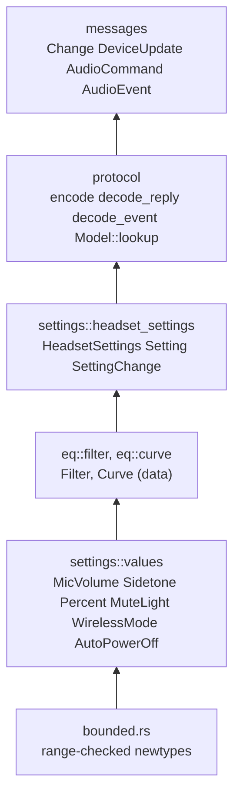
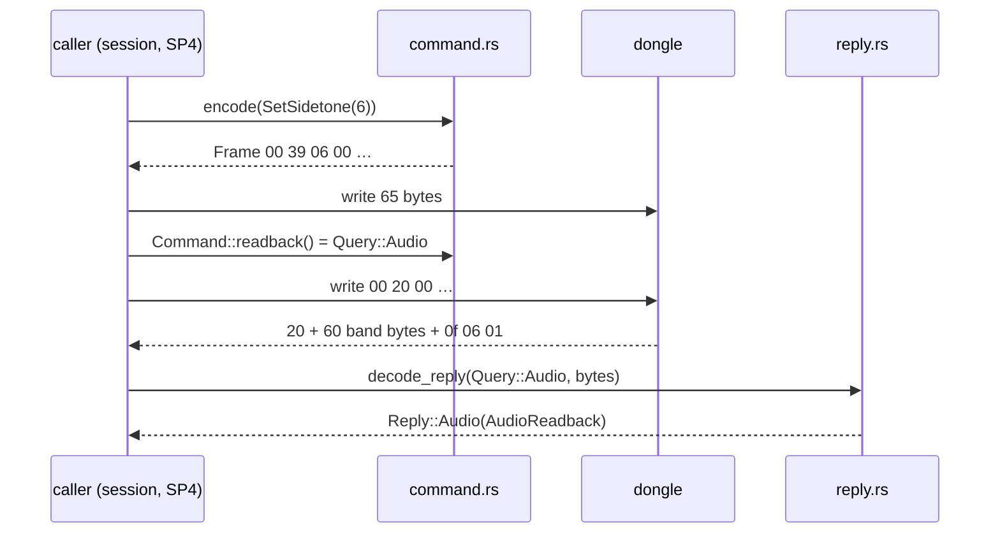
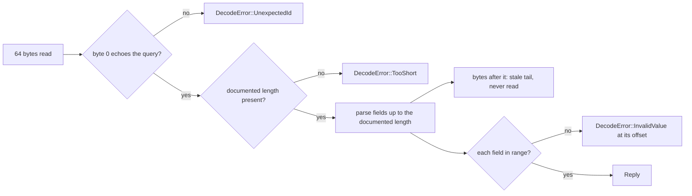
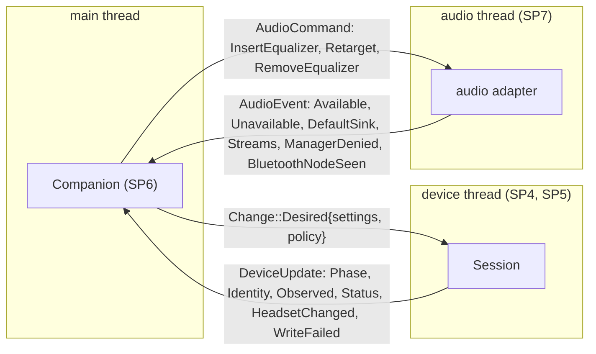

# SP2 Protocol, Settings and Messages Implementation Plan

> **For agentic workers:** REQUIRED SUB-SKILL: Use superpowers:subagent-driven-development (recommended) or superpowers:executing-plans to implement this plan task-by-task. Steps use checkbox (`- [ ]`) syntax for tracking.

**Goal:** The pure Nova 5 protocol codec (`core::protocol`), the headset setting value types (`core::settings`)
and the frozen thread-seam messages (`core::messages`) in `crates/core`, proven against the SP0 hardware captures.

**Architecture:** Everything is pure Rust in `arctis-core` with no I/O. Bounded newtypes reject out-of-range values
at construction; `Command` is the allow-list of frames and `Frame` can only be built by `encode`; replies are
parsed to their documented length so stale tails never leak; events decode to `DeviceEvent`. The message enums
that SP4, SP5, SP6, SP7 and SP8 build against are defined once in `core::messages` and pinned by an exhaustive
contract test. Tests are integration tests in `crates/core/tests/` against the public API, with the SP0 captures
as goldens and proptest for round trips and robustness.

**Tech Stack:** Rust 2024 (rustc 1.98, Fedora toolbox `arctis`), proptest 1 (dev-dependency only),
cargo-llvm-cov for the coverage criterion.

Spec: `docs/superpowers/specs/2026-10-11-arctis-companion-design.md` §3 (module tree, §3.1 interfaces, §3.2
contract) and §5 (SP2 row); device part §1, §5, §6; audio part §1, §2, §4; quality part §1; ADR 0004, ADR 0013;
facts from `docs/research/hid-protocol.md` and `docs/research/hardware-findings.md` (§2.7 firmware slots, §2.8
`HID_UNIQ`, §8 captures).

---

## Conventions for every task

- Worktree: `/home/marcelo/Desenvolvimento/arctis-wt/sp2`, branch `sp2-protocol`. Never touch
  `/home/marcelo/Desenvolvimento/arctis-companion`. Stay inside `crates/core`, `data/udev`, the moved captures,
  the two research links and `docs/architecture`.
- **Run (toolbox):** `X` means
  `toolbox run -c arctis bash -lc 'cd /home/marcelo/Desenvolvimento/arctis-wt/sp2 && X'`.
  Git and `gh` run on the host in the worktree.
- SP2 never opens `/dev/hidraw*`. All hardware facts come from the goldens.
- No comments in any file of any language, doc comments included. Names and small functions carry the meaning.
- Clippy policy applies to tests too: cognitive complexity 8, 40 lines per function, nesting 3, at most 4
  arguments, `unwrap()` only inside `#[test]` functions (helpers and `proptest!` bodies use `expect`). When clippy
  objects, extract a function or rename; never add an `allow`. Pedantic lints are on: put `#[must_use]` on public
  functions that return a value, pass small `Copy` types by value.
- Before each commit, Run (toolbox): `cargo fmt --all`, then
  `cargo clippy --workspace --all-targets -- -D warnings && cargo test --workspace --exclude arctis-ui && cargo xtask check-rules`.
  The host has `cargo` but no `rustfmt`, so `cargo fmt` runs in the toolbox too. The code blocks below are not
  rustfmt-formatted; `cargo fmt` reflows them and that is expected.
- Commit subjects are conventional (`type(scope): summary`). Never write `Co-Authored-By`, "Generated with",
  or any AI or tool name in a commit message, PR title or PR body. Never use `--no-verify`.
- Push after every commit: `git push -u origin sp2-protocol` (first time), then `git push`. After any
  `git rebase origin/main` that moved the branch, push with `git push --force-with-lease` (the branch is already
  published, so a plain push is rejected).
- SP3 builds `core::eq` in parallel. Before Task 4 and before the PR run `git fetch origin` and
  `git rebase origin/main`; see Task 4 for what to do when SP3 has already landed `eq/filter.rs` or `eq/curve.rs`.
- Tools installed with `cargo install` land in `~/.cargo/bin`, which the toolbox login shell does not put on
  `PATH`; commands that use them start with `export PATH="$HOME/.cargo/bin:$PATH" &&`.
- Clippy 1.98 denies `chunks_exact` with a constant size (`chunks_exact_to_as_chunks`) and 6-byte arrays passed by
  reference (`trivially_copy_pass_by_ref`); the code below already uses `as_chunks` and passes bands by value.

## Acceptance criteria → tasks

| SP2 acceptance criterion (design §5) | Task |
|---|---|
| every frame in `hid-protocol.md` §7.1 and SP0 decodes | 1 (goldens moved, set pinned), 6 (captured curves), 8 (`golden_replies.rs`) |
| every `Command` encodes to its cited bytes | 7 (cited-bytes table and captured setter goldens), 6 (captured `33` curves) |
| stale tails ignored | 8 (fwupd tail, A0 tail, text tail goldens; proptest: any tail leaves a reply unchanged) |
| proptest round-trip of `eq_wire` | 6 |
| no constructor yields `09`, `35 01`-as-save, `A5`, `A7`, `0x22`, `0x34` | 7 (`Frame::new` crate-private, proptest over every `Command`) |
| bootloader PIDs map to `ModelLookup::Bootloader` | 10 |
| the udev rule test passes | 10 |
| message types match §3.2 and device §6 | 11 (exhaustive contract test) |
| 100 % line coverage | 13 |
| `docs/architecture/<area>.md` page (design §5 preamble) | 12 |
| value types reject out-of-range input (quality §1 `core::settings`) | 2, 3, 4 |
| `decode_*` never panics on any 64 bytes (quality §1 `core::protocol`) | 6 (`decode_curve`), 8 (`decode_reply`), 9 (`decode_event`), each written before its decoder |
| `0x10` slots decoded per `hardware-findings.md` §2.7 | 8 |
| nightly `cargo mutants --package arctis-core` (quality §2) leaves no survivor in SP2 code | 13 |

## File structure

```
crates/core/Cargo.toml                      proptest dev-dependency
crates/core/src/lib.rs                      module list
crates/core/src/bounded.rs                  bounded! macro for range-checked newtypes
crates/core/src/settings/mod.rs
crates/core/src/settings/values.rs          OutOfRange, MicVolume, Sidetone, Percent, MuteLight, WirelessMode, AutoPowerOff
crates/core/src/settings/headset_settings.rs HeadsetSettings, Setting, SettingChange
crates/core/src/eq/mod.rs
crates/core/src/eq/filter.rs                Frequency, Gain, QFactor, FilterKind, Filter (data only; SP3 adds behaviour)
crates/core/src/eq/curve.rs                 Curve, TooManyFilters (data only; SP3 adds equivalent)
crates/core/src/protocol/mod.rs             re-exports of the §3.1 interface
crates/core/src/protocol/frame.rs           DecodeError (Task 6), Frame (Task 7), framing helpers (Task 8)
crates/core/src/protocol/status.rs          Link, Charging, Status, ChatMix
crates/core/src/protocol/eq_wire.rs         encode_curve, decode_curve
crates/core/src/protocol/command.rs         Query, Command, encode
crates/core/src/protocol/firmware.rs        Version, Firmware, 0x10 slot decoding
crates/core/src/protocol/reply.rs           Reply, AudioReadback, UxReadback, decode_reply, observed_settings
crates/core/src/protocol/event.rs           DeviceEvent, decode_event
crates/core/src/protocol/model.rs           Model, ModelLookup, Support, Capabilities, VENDOR_ID, BOOTLOADER_PIDS
crates/core/src/messages/mod.rs
crates/core/src/messages/device.rs          Change, SyncPolicy, Phase, DeviceUpdate
crates/core/src/messages/audio.rs           AudioCommand, AudioEvent, DefaultSink, SinkKind, SoundPath, StreamInfo, AppIdentifiers
crates/core/tests/golden/*.hex              moved from docs/research/captures/
crates/core/tests/support/mod.rs            golden loader and value helpers shared by the two golden test files
crates/core/tests/golden_frames.rs          the golden set, captured curves and captured setter frames
crates/core/tests/golden_replies.rs         every captured reply decodes to its expectation
crates/core/tests/strategies/mod.rs         proptest curve strategy shared by eq_wire.rs and command.rs
crates/core/tests/values.rs  status.rs  eq_types.rs  headset_settings.rs  eq_wire.rs  command.rs
crates/core/tests/reply.rs  event.rs  model.rs  udev_rule.rs  messages.rs
data/udev/70-arctis-companion.rules         uaccess for the non-bootloader PIDs (installed by SP14)
docs/architecture/protocol.md               diagrams pointing at the code above
docs/architecture/README.md                 one new row
docs/research/hardware-findings.md          links to the moved captures
docs/research/hid-protocol.md               link to the moved capture
```

Dependency direction inside `core`: `bounded` → `settings::values` → `eq` → `settings::headset_settings` →
`protocol` → `messages`. Nothing in this list depends on `session`, `companion` or `view`.

---

### Task 1: Move the captures into golden fixtures

**Files:**
- Move: `docs/research/captures/*.hex` → `crates/core/tests/golden/`
- Modify: `docs/research/hardware-findings.md`, `docs/research/hid-protocol.md`
- Create: `crates/core/tests/support/mod.rs`, `crates/core/tests/golden_frames.rs`

- [ ] **Step 1: Prepare the branch**

```bash
cd /home/marcelo/Desenvolvimento/arctis-wt/sp2
git fetch origin
git status --short
git rebase origin/main
```

Expected: clean tree on `sp2-protocol`, rebased. If the rebase moved the branch, Step 6 pushes with
`--force-with-lease` (the plan commit is already on `origin/sp2-protocol`).

- [ ] **Step 2: Write the failing test**

The hex loader lives in a shared test module because two golden test files use it (Task 8 adds
`golden_replies.rs`; one file would pass the 400-line guideline). It sits in `tests/support/`, never in
`tests/golden/`, which must hold only the captures. Every helper in `support/mod.rs` must be used by both
`golden_frames.rs` and `golden_replies.rs`, or `dead_code` fails clippy in one of them.

`crates/core/tests/support/mod.rs`:

```rust
use std::fs;
use std::path::{Path, PathBuf};

pub fn golden_dir() -> PathBuf {
    Path::new(env!("CARGO_MANIFEST_DIR")).join("tests/golden")
}

pub fn golden(name: &str) -> Vec<u8> {
    let text = fs::read_to_string(golden_dir().join(name)).expect("golden file is readable");
    text.split_whitespace()
        .map(|byte| u8::from_str_radix(byte, 16).expect("golden bytes are hex"))
        .collect()
}
```

`crates/core/tests/golden_frames.rs`:

```rust
mod support;

use std::fs;

use support::{golden, golden_dir};

const GOLDEN_NAMES: [&str; 39] = [
    "cmd_27_00.hex",
    "cmd_33_edges.hex",
    "cmd_33_kinds.hex",
    "cmd_33_odd.hex",
    "cmd_35_00.hex",
    "cmd_35_01.hex",
    "cmd_37_0e.hex",
    "cmd_39_03.hex",
    "cmd_39_06.hex",
    "cmd_39_0a.hex",
    "cmd_a3_0f.hex",
    "cmd_ae_00.hex",
    "cmd_ae_01.hex",
    "cmd_ae_04.hex",
    "reply_10_headset_off.hex",
    "reply_10_headset_on.hex",
    "reply_20_after_33_edges.hex",
    "reply_20_after_33_kinds.hex",
    "reply_20_after_33_odd.hex",
    "reply_20_after_limiter_off.hex",
    "reply_20_after_mic_volume_14.hex",
    "reply_20_after_sidetone_10.hex",
    "reply_20_after_sidetone_3.hex",
    "reply_20_after_sidetone_6.hex",
    "reply_20_flat_headset_off.hex",
    "reply_20_flat_headset_on.hex",
    "reply_22_flat_headset_off.hex",
    "reply_36_range_headset_off.hex",
    "reply_36_speed_headset_off.hex",
    "reply_36_speed_headset_on.hex",
    "reply_36_tail_from_fwupd_b0.hex",
    "reply_a0_after_auto_off_15.hex",
    "reply_a0_after_mute_light_0.hex",
    "reply_a0_after_mute_light_1.hex",
    "reply_a0_after_mute_light_4.hex",
    "reply_a0_headset_off.hex",
    "reply_a0_headset_on.hex",
    "reply_b0_link2_headset_off.hex",
    "reply_b0_link3_headset_on.hex",
];

fn golden_names() -> Vec<String> {
    let mut names: Vec<String> = fs::read_dir(golden_dir())
        .expect("golden directory exists")
        .map(|entry| entry.expect("golden entry").file_name().to_string_lossy().into_owned())
        .collect();
    names.sort();
    names
}

#[test]
fn the_golden_set_is_the_sp0_capture_set() {
    assert_eq!(golden_names(), GOLDEN_NAMES);
}

#[test]
fn every_golden_file_is_one_64_byte_frame() {
    for name in GOLDEN_NAMES {
        assert_eq!(golden(name).len(), 64, "{name}");
    }
}
```

- [ ] **Step 3: Run it to see it fail**

Run (toolbox): `cargo test -p arctis-core --test golden_frames`
Expected: FAIL, `golden directory exists` panics (no such directory).

- [ ] **Step 4: Move the files and fix the links**

```bash
cd /home/marcelo/Desenvolvimento/arctis-wt/sp2
mkdir -p crates/core/tests/golden
git mv docs/research/captures/*.hex crates/core/tests/golden/
sed -i 's#](captures/#](../../crates/core/tests/golden/#g; s#\[`captures/`\](captures)#[`crates/core/tests/golden/`](../../crates/core/tests/golden)#; s#\[`captures/\*.hex`\](captures)#[`crates/core/tests/golden/*.hex`](../../crates/core/tests/golden)#; s#SP2 moves them to `crates/core/tests/golden/`#SP2 moved them to `crates/core/tests/golden/`#' docs/research/hardware-findings.md
sed -i 's#`captures/reply_36_tail_from_fwupd_b0.hex`#`crates/core/tests/golden/reply_36_tail_from_fwupd_b0.hex`#' docs/research/hid-protocol.md
grep -n "captures/\|(captures)" docs/research/hardware-findings.md docs/research/hid-protocol.md
```

Expected: the final `grep` prints nothing.

- [ ] **Step 5: Run the test to see it pass**

Run (toolbox): `cargo test -p arctis-core --test golden_frames`
Expected: PASS, 2 tests.

- [ ] **Step 6: Commit**

```bash
git add -A crates/core/tests docs/research
git commit -m "test(core): move hardware captures into golden fixtures"
git push --force-with-lease -u origin sp2-protocol
```

---

### Task 2: Bounded values for headset settings

**Files:**
- Create: `crates/core/src/bounded.rs`, `crates/core/src/settings/mod.rs`, `crates/core/src/settings/values.rs`
- Modify: `crates/core/src/lib.rs`
- Test: `crates/core/tests/values.rs`

- [ ] **Step 1: Write the failing test**

`crates/core/tests/values.rs`:

```rust
use arctis_core::settings::values::{
    AutoPowerOff, MicVolume, MuteLight, OutOfRange, Percent, Sidetone, WirelessMode,
};

#[test]
fn mic_volume_spans_zero_to_fifteen() {
    assert_eq!(MicVolume::try_from(0).map(MicVolume::get), Ok(0));
    assert_eq!(MicVolume::try_from(15).map(MicVolume::get), Ok(15));
    assert_eq!(MicVolume::try_from(16), Err(OutOfRange));
}

#[test]
fn sidetone_spans_zero_to_ten() {
    assert_eq!(Sidetone::try_from(10).map(Sidetone::get), Ok(10));
    assert_eq!(Sidetone::try_from(11), Err(OutOfRange));
}

#[test]
fn percent_spans_zero_to_one_hundred() {
    assert_eq!(Percent::try_from(100).map(Percent::get), Ok(100));
    assert_eq!(Percent::try_from(101), Err(OutOfRange));
}

#[test]
fn mute_light_levels_use_the_raw_bytes_0_1_4_10() {
    let raws: Vec<u8> = MuteLight::ALL.into_iter().map(MuteLight::raw).collect();
    assert_eq!(raws, [0, 1, 4, 10]);
}

#[test]
fn mute_light_reads_every_level_back_from_its_raw_byte() {
    for level in MuteLight::ALL {
        assert_eq!(MuteLight::from_raw(level.raw()), level);
    }
}

#[test]
fn unknown_mute_light_bytes_read_as_medium_like_the_firmware() {
    assert_eq!(MuteLight::from_raw(7), MuteLight::Medium);
}

#[test]
fn wireless_mode_zero_is_extended_range() {
    assert_eq!(WirelessMode::try_from(0), Ok(WirelessMode::ExtendedRange));
    assert_eq!(WirelessMode::try_from(1), Ok(WirelessMode::Standard));
    assert_eq!(WirelessMode::try_from(2), Err(OutOfRange));
}

#[test]
fn wireless_mode_raw_bytes_round_trip() {
    for mode in WirelessMode::ALL {
        assert_eq!(WirelessMode::try_from(mode.raw()), Ok(mode));
    }
}

#[test]
fn auto_power_off_accepts_only_the_ten_choices() {
    let accepted: Vec<u8> = (0..=u8::MAX)
        .filter(|minutes| AutoPowerOff::try_from(*minutes).is_ok())
        .collect();
    assert_eq!(accepted, [0, 1, 5, 10, 15, 30, 45, 60, 75, 90]);
}

#[test]
fn auto_power_off_never_is_zero_minutes() {
    assert_eq!(AutoPowerOff::NEVER.minutes(), 0);
    assert_eq!(AutoPowerOff::try_from(30).map(AutoPowerOff::minutes), Ok(30));
}

#[test]
fn unlisted_auto_power_off_minutes_read_as_the_nearest_choice() {
    let nearest: Vec<u8> = [0, 2, 3, 20, 200]
        .into_iter()
        .map(|minutes| AutoPowerOff::nearest(minutes).minutes())
        .collect();
    assert_eq!(nearest, [0, 1, 1, 15, 90]);
}
```

- [ ] **Step 2: Run it to see it fail**

Run (toolbox): `cargo test -p arctis-core --test values`
Expected: FAIL to compile, `could not find settings in arctis_core`.

- [ ] **Step 3: Implement**

`crates/core/src/bounded.rs`:

```rust
macro_rules! bounded {
    ($name:ident, $raw:ty, $min:expr, $max:expr) => {
        #[derive(Clone, Copy, Debug, PartialEq, Eq, Hash)]
        pub struct $name($raw);

        impl $name {
            pub const MIN: $raw = $min;
            pub const MAX: $raw = $max;

            #[must_use]
            pub const fn get(self) -> $raw {
                self.0
            }
        }

        impl TryFrom<$raw> for $name {
            type Error = $crate::settings::values::OutOfRange;

            fn try_from(value: $raw) -> Result<Self, Self::Error> {
                if (Self::MIN..=Self::MAX).contains(&value) {
                    Ok(Self(value))
                } else {
                    Err($crate::settings::values::OutOfRange)
                }
            }
        }
    };
}

pub(crate) use bounded;
```

`crates/core/src/settings/mod.rs`:

```rust
pub mod values;
```

`crates/core/src/settings/values.rs`:

```rust
use crate::bounded::bounded;

#[derive(Clone, Copy, Debug, PartialEq, Eq)]
pub struct OutOfRange;

bounded!(MicVolume, u8, 0, 15);
bounded!(Sidetone, u8, 0, 10);
bounded!(Percent, u8, 0, 100);

#[derive(Clone, Copy, Debug, PartialEq, Eq, Hash)]
pub enum MuteLight {
    Off,
    Low,
    Medium,
    High,
}

impl MuteLight {
    pub const ALL: [Self; 4] = [Self::Off, Self::Low, Self::Medium, Self::High];

    #[must_use]
    pub const fn raw(self) -> u8 {
        match self {
            Self::Off => 0,
            Self::Low => 1,
            Self::Medium => 4,
            Self::High => 10,
        }
    }

    #[must_use]
    pub const fn from_raw(raw: u8) -> Self {
        match raw {
            0 => Self::Off,
            1 => Self::Low,
            10 => Self::High,
            _ => Self::Medium,
        }
    }
}

#[derive(Clone, Copy, Debug, PartialEq, Eq, Hash)]
pub enum WirelessMode {
    ExtendedRange,
    Standard,
}

impl WirelessMode {
    pub const ALL: [Self; 2] = [Self::ExtendedRange, Self::Standard];

    #[must_use]
    pub const fn raw(self) -> u8 {
        match self {
            Self::ExtendedRange => 0,
            Self::Standard => 1,
        }
    }
}

impl TryFrom<u8> for WirelessMode {
    type Error = OutOfRange;

    fn try_from(raw: u8) -> Result<Self, OutOfRange> {
        Self::ALL
            .into_iter()
            .find(|mode| mode.raw() == raw)
            .ok_or(OutOfRange)
    }
}

#[derive(Clone, Copy, Debug, PartialEq, Eq, Hash)]
pub struct AutoPowerOff(u8);

impl AutoPowerOff {
    pub const NEVER: Self = Self(0);
    pub const CHOICES: [Self; 10] = [
        Self(0),
        Self(1),
        Self(5),
        Self(10),
        Self(15),
        Self(30),
        Self(45),
        Self(60),
        Self(75),
        Self(90),
    ];

    #[must_use]
    pub const fn minutes(self) -> u8 {
        self.0
    }

    #[must_use]
    pub fn nearest(minutes: u8) -> Self {
        Self::CHOICES
            .into_iter()
            .min_by_key(|choice| choice.0.abs_diff(minutes))
            .unwrap_or(Self::NEVER)
    }
}

impl TryFrom<u8> for AutoPowerOff {
    type Error = OutOfRange;

    fn try_from(minutes: u8) -> Result<Self, OutOfRange> {
        Self::CHOICES
            .into_iter()
            .find(|choice| choice.0 == minutes)
            .ok_or(OutOfRange)
    }
}
```

`crates/core/src/lib.rs`:

```rust
#![forbid(unsafe_code)]

mod bounded;

pub mod settings;
pub mod time;
```

- [ ] **Step 4: Run the test to see it pass**

Run (toolbox): `cargo test -p arctis-core --test values`
Expected: PASS, 11 tests.

- [ ] **Step 5: Commit**

```bash
git add crates/core
git commit -m "feat(core): add bounded headset setting values"
git push
```

---

### Task 3: Dongle status types

**Files:**
- Create: `crates/core/src/protocol/mod.rs`, `crates/core/src/protocol/status.rs`
- Modify: `crates/core/src/lib.rs`
- Test: `crates/core/tests/status.rs`

- [ ] **Step 1: Write the failing test**

`crates/core/tests/status.rs`:

```rust
use arctis_core::protocol::status::{Charging, Link};
use arctis_core::settings::values::OutOfRange;

#[test]
fn link_bytes_follow_hid_protocol_section_5_4() {
    let links: Vec<Result<Link, OutOfRange>> = (0..=4).map(Link::try_from).collect();
    assert_eq!(
        links,
        [
            Ok(Link::NotPaired),
            Ok(Link::Searching),
            Ok(Link::HeadsetOff),
            Ok(Link::Connected),
            Err(OutOfRange),
        ]
    );
}

#[test]
fn only_link_three_means_the_headset_is_connected() {
    let connected: Vec<Link> = Link::ALL.into_iter().filter(|link| link.is_connected()).collect();
    assert_eq!(connected, [Link::Connected]);
}

#[test]
fn charging_bytes_follow_hid_protocol_section_5_4() {
    let states: Vec<Result<Charging, OutOfRange>> = (0..=4).map(Charging::try_from).collect();
    assert_eq!(
        states,
        [
            Ok(Charging::Unknown),
            Ok(Charging::Charging),
            Ok(Charging::PluggedIn),
            Ok(Charging::Discharging),
            Err(OutOfRange),
        ]
    );
}
```

- [ ] **Step 2: Run it to see it fail**

Run (toolbox): `cargo test -p arctis-core --test status`
Expected: FAIL to compile, `could not find protocol in arctis_core`.

- [ ] **Step 3: Implement**

`crates/core/src/protocol/status.rs`:

```rust
use crate::settings::values::{OutOfRange, Percent};

#[derive(Clone, Copy, Debug, PartialEq, Eq, Hash)]
pub enum Link {
    NotPaired,
    Searching,
    HeadsetOff,
    Connected,
}

impl Link {
    pub const ALL: [Self; 4] = [
        Self::NotPaired,
        Self::Searching,
        Self::HeadsetOff,
        Self::Connected,
    ];

    #[must_use]
    pub const fn raw(self) -> u8 {
        match self {
            Self::NotPaired => 0,
            Self::Searching => 1,
            Self::HeadsetOff => 2,
            Self::Connected => 3,
        }
    }

    #[must_use]
    pub const fn is_connected(self) -> bool {
        matches!(self, Self::Connected)
    }
}

impl TryFrom<u8> for Link {
    type Error = OutOfRange;

    fn try_from(raw: u8) -> Result<Self, OutOfRange> {
        Self::ALL
            .into_iter()
            .find(|link| link.raw() == raw)
            .ok_or(OutOfRange)
    }
}

#[derive(Clone, Copy, Debug, PartialEq, Eq, Hash)]
pub enum Charging {
    Unknown,
    Charging,
    PluggedIn,
    Discharging,
}

impl Charging {
    pub const ALL: [Self; 4] = [
        Self::Unknown,
        Self::Charging,
        Self::PluggedIn,
        Self::Discharging,
    ];

    #[must_use]
    pub const fn raw(self) -> u8 {
        match self {
            Self::Unknown => 0,
            Self::Charging => 1,
            Self::PluggedIn => 2,
            Self::Discharging => 3,
        }
    }
}

impl TryFrom<u8> for Charging {
    type Error = OutOfRange;

    fn try_from(raw: u8) -> Result<Self, OutOfRange> {
        Self::ALL
            .into_iter()
            .find(|state| state.raw() == raw)
            .ok_or(OutOfRange)
    }
}

#[derive(Clone, Copy, Debug, PartialEq, Eq, Hash)]
pub struct Status {
    pub link: Link,
    pub battery: Percent,
    pub charging: Charging,
}

#[derive(Clone, Copy, Debug, PartialEq, Eq, Hash)]
pub struct ChatMix {
    pub game: Percent,
    pub chat: Percent,
}
```

`crates/core/src/protocol/mod.rs`:

```rust
pub mod status;
```

`crates/core/src/lib.rs`: add `pub mod protocol;` between `mod bounded;` and `pub mod settings;`.

- [ ] **Step 4: Run the test to see it pass**

Run (toolbox): `cargo test -p arctis-core --test status`
Expected: PASS, 3 tests.

- [ ] **Step 5: Commit**

```bash
git add crates/core
git commit -m "feat(core): add dongle status types"
git push
```

---

### Task 4: Filter and curve data types

SP3 owns `core::eq` behaviour (`equivalent`, envelope validation, response, DSP). SP2 needs the data types now
because `Command::SetEqualizer(Curve)`, `HeadsetSettings::equalizer` and `AudioCommand::InsertEqualizer(Curve)`
are frozen here. First run `git fetch origin && git rebase origin/main && ls crates/core/src/eq` (then
`git push --force-with-lease` if the rebase moved the branch). If SP3 has already merged
`crates/core/src/eq/filter.rs` or `crates/core/src/eq/curve.rs`, skip Steps 3–4 for the file it owns, add only the
missing items this plan uses (`Frequency`, `Gain`, `QFactor` with `MIN`, `MAX`, `get`, `TryFrom`;
`FilterKind::ALL`; `Filter` fields `kind`, `frequency`, `gain`, `q`; `Curve::new`, `Curve::from_slots`,
`Curve::filters`, `Curve::MAX_FILTERS`, `TooManyFilters`), adapt later tasks to SP3's names, and note the adaptation
under Deviations. If SP3's `Filter` stores gain in dB and Q as floats (or carries an `enabled` flag), keep SP3's
fields: `eq_wire` converts at the boundary (gain byte `round(20 + 2·dB)`, Q byte pair `round(Q·1000)`, a disabled
filter encodes as the disabled band), the `eq_wire` round-trip strategy generates only values on that grid
(0.5 dB, Q steps of 0.001), and the derives that floats forbid (`Eq`, `Hash`) are dropped from every type that holds
a `Curve` (`HeadsetSettings`, `SettingChange`, `Command`, the messages) while the tests keep comparing with
`assert_eq!` through `PartialEq`.

**Files:**
- Create: `crates/core/src/eq/mod.rs`, `crates/core/src/eq/filter.rs`, `crates/core/src/eq/curve.rs`
- Modify: `crates/core/src/lib.rs`
- Test: `crates/core/tests/eq_types.rs`

- [ ] **Step 1: Write the failing test**

`crates/core/tests/eq_types.rs`:

```rust
use arctis_core::eq::curve::{Curve, TooManyFilters};
use arctis_core::eq::filter::{Filter, FilterKind, Frequency, Gain, QFactor};
use arctis_core::settings::values::OutOfRange;

fn peaking(hz: u16) -> Filter {
    Filter {
        kind: FilterKind::Peaking,
        frequency: Frequency::try_from(hz).expect("frequency in range"),
        gain: Gain::try_from(20).expect("flat gain"),
        q: QFactor::try_from(1410).expect("factory Q"),
    }
}

#[test]
fn frequency_spans_20_hz_to_20_khz() {
    assert_eq!(Frequency::try_from(20).map(Frequency::get), Ok(20));
    assert_eq!(Frequency::try_from(20_000).map(Frequency::get), Ok(20_000));
    assert_eq!(Frequency::try_from(19), Err(OutOfRange));
    assert_eq!(Frequency::try_from(20_001), Err(OutOfRange));
}

#[test]
fn gain_byte_spans_0_to_40() {
    assert_eq!(Gain::try_from(0).map(Gain::get), Ok(0));
    assert_eq!(Gain::try_from(40).map(Gain::get), Ok(40));
    assert_eq!(Gain::try_from(41), Err(OutOfRange));
}

#[test]
fn q_times_1000_spans_200_to_10000() {
    assert_eq!(QFactor::try_from(200).map(QFactor::get), Ok(200));
    assert_eq!(QFactor::try_from(10_000).map(QFactor::get), Ok(10_000));
    assert_eq!(QFactor::try_from(199), Err(OutOfRange));
    assert_eq!(QFactor::try_from(10_001), Err(OutOfRange));
}

#[test]
fn a_curve_keeps_up_to_ten_filters_in_order() {
    let ten: Vec<Filter> = (1..=10).map(|step| peaking(step * 100)).collect();
    let curve = Curve::new(ten.clone()).expect("ten filters fit");
    assert_eq!(curve.filters(), ten.as_slice());
}

#[test]
fn a_curve_rejects_an_eleventh_filter() {
    let eleven: Vec<Filter> = (1..=11).map(|step| peaking(step * 100)).collect();
    assert_eq!(Curve::new(eleven), Err(TooManyFilters));
}

#[test]
fn a_curve_from_ten_slots_keeps_the_filled_ones_in_order() {
    let mut slots = [None; Curve::MAX_FILTERS];
    slots[2] = Some(peaking(300));
    slots[7] = Some(peaking(800));
    assert_eq!(Curve::from_slots(slots).filters(), [peaking(300), peaking(800)]);
}
```

- [ ] **Step 2: Run it to see it fail**

Run (toolbox): `cargo test -p arctis-core --test eq_types`
Expected: FAIL to compile, `could not find eq in arctis_core`.

- [ ] **Step 3: Implement**

`crates/core/src/eq/mod.rs`:

```rust
pub mod curve;
pub mod filter;
```

`crates/core/src/eq/filter.rs`:

```rust
use crate::bounded::bounded;

bounded!(Frequency, u16, 20, 20_000);
bounded!(Gain, u8, 0, 40);
bounded!(QFactor, u16, 200, 10_000);

#[derive(Clone, Copy, Debug, PartialEq, Eq, Hash)]
pub enum FilterKind {
    Peaking,
    LowPass,
    HighPass,
    LowShelf,
    HighShelf,
}

impl FilterKind {
    pub const ALL: [Self; 5] = [
        Self::Peaking,
        Self::LowPass,
        Self::HighPass,
        Self::LowShelf,
        Self::HighShelf,
    ];
}

#[derive(Clone, Copy, Debug, PartialEq, Eq, Hash)]
pub struct Filter {
    pub kind: FilterKind,
    pub frequency: Frequency,
    pub gain: Gain,
    pub q: QFactor,
}
```

`crates/core/src/eq/curve.rs`:

```rust
use super::filter::Filter;

#[derive(Clone, Copy, Debug, PartialEq, Eq)]
pub struct TooManyFilters;

#[derive(Clone, Debug, PartialEq, Eq, Hash)]
pub struct Curve {
    filters: Vec<Filter>,
}

impl Curve {
    pub const MAX_FILTERS: usize = 10;

    pub fn new(filters: Vec<Filter>) -> Result<Self, TooManyFilters> {
        if filters.len() > Self::MAX_FILTERS {
            return Err(TooManyFilters);
        }
        Ok(Self { filters })
    }

    #[must_use]
    pub fn from_slots(slots: [Option<Filter>; Self::MAX_FILTERS]) -> Self {
        Self {
            filters: slots.into_iter().flatten().collect(),
        }
    }

    #[must_use]
    pub fn filters(&self) -> &[Filter] {
        &self.filters
    }
}
```

`crates/core/src/lib.rs`: add `pub mod eq;` after `mod bounded;`.

- [ ] **Step 4: Run the test to see it pass**

Run (toolbox): `cargo test -p arctis-core --test eq_types`
Expected: PASS, 6 tests.

- [ ] **Step 5: Commit**

```bash
git add crates/core
git commit -m "feat(core): add filter and curve data types"
git push
```

---

### Task 5: Headset settings and setting changes

**Files:**
- Create: `crates/core/src/settings/headset_settings.rs`
- Modify: `crates/core/src/settings/mod.rs`
- Test: `crates/core/tests/headset_settings.rs`

- [ ] **Step 1: Write the failing test**

`crates/core/tests/headset_settings.rs`:

```rust
use arctis_core::eq::curve::Curve;
use arctis_core::eq::filter::{Filter, FilterKind, Frequency, Gain, QFactor};
use arctis_core::settings::headset_settings::{HeadsetSettings, Setting, SettingChange};
use arctis_core::settings::values::{AutoPowerOff, MicVolume, MuteLight, Sidetone, WirelessMode};

fn sample_settings() -> HeadsetSettings {
    HeadsetSettings {
        mic_volume: MicVolume::try_from(15).expect("mic volume"),
        sidetone: Sidetone::try_from(0).expect("sidetone"),
        mute_light: MuteLight::High,
        volume_limiter: true,
        wireless_mode: WirelessMode::Standard,
        auto_power_off: AutoPowerOff::try_from(30).expect("auto power off"),
        equalizer: Curve::new(Vec::new()).expect("empty curve"),
    }
}

fn bass_curve() -> Curve {
    let filter = Filter {
        kind: FilterKind::LowShelf,
        frequency: Frequency::try_from(80).expect("frequency"),
        gain: Gain::try_from(27).expect("gain"),
        q: QFactor::try_from(707).expect("q"),
    };
    Curve::new(vec![filter]).expect("one filter")
}

fn changed(setting: Setting) -> SettingChange {
    match setting {
        Setting::MicVolume => SettingChange::MicVolume(MicVolume::try_from(7).expect("mic")),
        Setting::Sidetone => SettingChange::Sidetone(Sidetone::try_from(6).expect("sidetone")),
        Setting::MuteLight => SettingChange::MuteLight(MuteLight::Low),
        Setting::VolumeLimiter => SettingChange::VolumeLimiter(false),
        Setting::WirelessMode => SettingChange::WirelessMode(WirelessMode::ExtendedRange),
        Setting::AutoPowerOff => SettingChange::AutoPowerOff(AutoPowerOff::NEVER),
        Setting::Equalizer => SettingChange::Equalizer(bass_curve()),
    }
}

#[test]
fn every_change_names_its_setting() {
    for setting in Setting::ALL {
        assert_eq!(changed(setting).setting(), setting);
    }
}

#[test]
fn value_of_reads_the_current_field() {
    let settings = sample_settings();
    assert_eq!(
        settings.value_of(Setting::MuteLight),
        SettingChange::MuteLight(MuteLight::High)
    );
    assert_eq!(
        settings.value_of(Setting::Equalizer),
        SettingChange::Equalizer(Curve::new(Vec::new()).expect("empty curve"))
    );
}

#[test]
fn applying_a_change_sets_that_setting() {
    for setting in Setting::ALL {
        let mut settings = sample_settings();
        assert_ne!(settings.value_of(setting), changed(setting), "{setting:?}");
        settings.apply(changed(setting));
        assert_eq!(settings.value_of(setting), changed(setting));
    }
}

#[test]
fn applying_a_change_leaves_every_other_setting_alone() {
    let original = sample_settings();
    for setting in Setting::ALL {
        let mut settings = original.clone();
        settings.apply(changed(setting));
        let untouched = Setting::ALL
            .into_iter()
            .filter(|other| *other != setting)
            .all(|other| settings.value_of(other) == original.value_of(other));
        assert!(untouched, "{setting:?} touched another setting");
    }
}
```

- [ ] **Step 2: Run it to see it fail**

Run (toolbox): `cargo test -p arctis-core --test headset_settings`
Expected: FAIL to compile, `could not find headset_settings in settings`.

- [ ] **Step 3: Implement**

`crates/core/src/settings/headset_settings.rs`:

```rust
use super::values::{AutoPowerOff, MicVolume, MuteLight, Sidetone, WirelessMode};
use crate::eq::curve::Curve;

#[derive(Clone, Debug, PartialEq, Eq)]
pub struct HeadsetSettings {
    pub mic_volume: MicVolume,
    pub sidetone: Sidetone,
    pub mute_light: MuteLight,
    pub volume_limiter: bool,
    pub wireless_mode: WirelessMode,
    pub auto_power_off: AutoPowerOff,
    pub equalizer: Curve,
}

#[derive(Clone, Copy, Debug, PartialEq, Eq, Hash)]
pub enum Setting {
    MicVolume,
    Sidetone,
    MuteLight,
    VolumeLimiter,
    WirelessMode,
    AutoPowerOff,
    Equalizer,
}

impl Setting {
    pub const ALL: [Self; 7] = [
        Self::MicVolume,
        Self::Sidetone,
        Self::MuteLight,
        Self::VolumeLimiter,
        Self::WirelessMode,
        Self::AutoPowerOff,
        Self::Equalizer,
    ];
}

#[derive(Clone, Debug, PartialEq, Eq)]
pub enum SettingChange {
    MicVolume(MicVolume),
    Sidetone(Sidetone),
    MuteLight(MuteLight),
    VolumeLimiter(bool),
    WirelessMode(WirelessMode),
    AutoPowerOff(AutoPowerOff),
    Equalizer(Curve),
}

impl SettingChange {
    #[must_use]
    pub const fn setting(&self) -> Setting {
        match self {
            Self::MicVolume(_) => Setting::MicVolume,
            Self::Sidetone(_) => Setting::Sidetone,
            Self::MuteLight(_) => Setting::MuteLight,
            Self::VolumeLimiter(_) => Setting::VolumeLimiter,
            Self::WirelessMode(_) => Setting::WirelessMode,
            Self::AutoPowerOff(_) => Setting::AutoPowerOff,
            Self::Equalizer(_) => Setting::Equalizer,
        }
    }
}

impl HeadsetSettings {
    pub fn apply(&mut self, change: SettingChange) {
        match change {
            SettingChange::MicVolume(value) => self.mic_volume = value,
            SettingChange::Sidetone(value) => self.sidetone = value,
            SettingChange::MuteLight(value) => self.mute_light = value,
            SettingChange::VolumeLimiter(value) => self.volume_limiter = value,
            SettingChange::WirelessMode(value) => self.wireless_mode = value,
            SettingChange::AutoPowerOff(value) => self.auto_power_off = value,
            SettingChange::Equalizer(value) => self.equalizer = value,
        }
    }

    #[must_use]
    pub fn value_of(&self, setting: Setting) -> SettingChange {
        match setting {
            Setting::MicVolume => SettingChange::MicVolume(self.mic_volume),
            Setting::Sidetone => SettingChange::Sidetone(self.sidetone),
            Setting::MuteLight => SettingChange::MuteLight(self.mute_light),
            Setting::VolumeLimiter => SettingChange::VolumeLimiter(self.volume_limiter),
            Setting::WirelessMode => SettingChange::WirelessMode(self.wireless_mode),
            Setting::AutoPowerOff => SettingChange::AutoPowerOff(self.auto_power_off),
            Setting::Equalizer => SettingChange::Equalizer(self.equalizer.clone()),
        }
    }
}
```

`crates/core/src/settings/mod.rs`:

```rust
pub mod headset_settings;
pub mod values;
```

- [ ] **Step 4: Run the test to see it pass**

Run (toolbox): `cargo test -p arctis-core --test headset_settings`
Expected: PASS, 4 tests.

- [ ] **Step 5: Commit**

```bash
git add crates/core
git commit -m "feat(core): add headset settings and setting changes"
git push
```

---

### Task 6: Frames and the equalizer wire format

**Files:**
- Create: `crates/core/src/protocol/frame.rs`, `crates/core/src/protocol/eq_wire.rs`,
  `crates/core/tests/strategies/mod.rs`, `crates/core/tests/eq_wire.rs`
- Modify: `Cargo.toml` (workspace dependency), `crates/core/Cargo.toml`, `crates/core/src/protocol/mod.rs`,
  `crates/core/tests/support/mod.rs`, `crates/core/tests/golden_frames.rs`

- [ ] **Step 1: Add proptest as a dev-dependency**

`Cargo.toml`, in `[workspace.dependencies]` (keep alphabetical order): `proptest = "1"`.

`crates/core/Cargo.toml`, after `[package]`:

```toml
[dev-dependencies]
proptest.workspace = true
```

Run (toolbox): `cargo xtask check-pure`
Expected: PASS (dev-dependencies are free).

- [ ] **Step 2: Write the failing tests**

`crates/core/tests/strategies/mod.rs`:

```rust
use arctis_core::eq::curve::Curve;
use arctis_core::eq::filter::{Filter, FilterKind, Frequency, Gain, QFactor};
use proptest::prelude::*;
use proptest::sample::select;

fn filter() -> impl Strategy<Value = Filter> {
    (
        select(FilterKind::ALL.to_vec()),
        Frequency::MIN..=Frequency::MAX,
        Gain::MIN..=Gain::MAX,
        QFactor::MIN..=QFactor::MAX,
    )
        .prop_map(|(kind, hz, gain, q)| Filter {
            kind,
            frequency: Frequency::try_from(hz).expect("frequency in range"),
            gain: Gain::try_from(gain).expect("gain in range"),
            q: QFactor::try_from(q).expect("Q in range"),
        })
}

pub fn curve() -> impl Strategy<Value = Curve> {
    proptest::collection::vec(filter(), 0..=Curve::MAX_FILTERS)
        .prop_map(|filters| Curve::new(filters).expect("at most ten filters"))
}
```

`crates/core/tests/eq_wire.rs`:

```rust
mod strategies;

use arctis_core::eq::curve::Curve;
use arctis_core::eq::filter::{Filter, FilterKind, Frequency, Gain, QFactor};
use arctis_core::protocol::eq_wire::{decode_curve, encode_curve};
use arctis_core::protocol::frame::DecodeError;
use proptest::collection::vec;
use proptest::prelude::*;

const DISABLED_BAND: [u8; 6] = [0x21, 0x4e, 0x01, 0x14, 0xe8, 0x03];

fn filter(kind: FilterKind, hz: u16, gain: u8, q: u16) -> Filter {
    Filter {
        kind,
        frequency: Frequency::try_from(hz).expect("frequency"),
        gain: Gain::try_from(gain).expect("gain"),
        q: QFactor::try_from(q).expect("q"),
    }
}

fn frame_with_bands(bands: &[[u8; 6]]) -> Vec<u8> {
    let mut frame = vec![0x20];
    for slot in 0..Curve::MAX_FILTERS {
        frame.extend_from_slice(bands.get(slot).unwrap_or(&DISABLED_BAND));
    }
    frame
}

#[test]
fn a_filter_encodes_as_frequency_kind_gain_and_q() {
    let curve = Curve::new(vec![filter(FilterKind::LowShelf, 80, 27, 707)]).expect("one filter");
    assert_eq!(encode_curve(&curve)[..6], [0x50, 0x00, 0x04, 0x1b, 0xc3, 0x02]);
}

#[test]
fn each_kind_has_its_wire_code() {
    let codes: [(FilterKind, u8); 5] = [
        (FilterKind::Peaking, 1),
        (FilterKind::LowPass, 2),
        (FilterKind::HighPass, 3),
        (FilterKind::LowShelf, 4),
        (FilterKind::HighShelf, 5),
    ];
    for (kind, code) in codes {
        let curve = Curve::new(vec![filter(kind, 1000, 20, 1000)]).expect("one filter");
        assert_eq!(encode_curve(&curve)[2], code, "{kind:?}");
    }
}

#[test]
fn missing_filters_encode_as_disabled_bands() {
    let bytes = encode_curve(&Curve::new(Vec::new()).expect("empty curve"));
    assert!(bytes.as_chunks::<6>().0.iter().all(|band| *band == DISABLED_BAND));
}

#[test]
fn disabled_bands_decode_to_no_filter_whatever_their_other_bytes() {
    let frame = frame_with_bands(&[[0x21, 0x4e, 0x00, 0x00, 0x00, 0x00]]);
    assert_eq!(decode_curve(&frame).map(|curve| curve.filters().len()), Ok(0));
}

#[test]
fn decoding_keeps_band_order_and_skips_disabled_slots() {
    let frame = frame_with_bands(&[
        [0x50, 0x00, 0x04, 0x1b, 0xc3, 0x02],
        DISABLED_BAND,
        [0xe8, 0x03, 0x01, 0x0f, 0x86, 0x05],
    ]);
    let expected = [
        filter(FilterKind::LowShelf, 80, 27, 707),
        filter(FilterKind::Peaking, 1000, 15, 1414),
    ];
    assert_eq!(decode_curve(&frame).expect("valid bands").filters(), expected);
}

#[test]
fn out_of_envelope_bands_name_the_offending_offset() {
    let cases = [
        ([0x13, 0x00, 0x01, 0x14, 0x82, 0x05], 1),
        ([0x20, 0x00, 0x00, 0x14, 0x82, 0x05], 3),
        ([0x20, 0x00, 0x06, 0x14, 0x82, 0x05], 3),
        ([0x20, 0x00, 0x01, 0x29, 0x82, 0x05], 4),
        ([0x20, 0x00, 0x01, 0x14, 0xc7, 0x00], 5),
    ];
    for (band, offset) in cases {
        assert_eq!(
            decode_curve(&frame_with_bands(&[band])),
            Err(DecodeError::InvalidValue { offset }),
            "{band:02x?}"
        );
    }
}

#[test]
fn an_invalid_band_names_its_offset_within_the_frame() {
    let invalid_gain = [0x20, 0x00, 0x01, 0x29, 0x82, 0x05];
    let frame = frame_with_bands(&[DISABLED_BAND, DISABLED_BAND, DISABLED_BAND, invalid_gain]);
    assert_eq!(decode_curve(&frame), Err(DecodeError::InvalidValue { offset: 22 }));
}

#[test]
fn a_frame_without_ten_bands_is_too_short() {
    assert_eq!(
        decode_curve(&[0x20; 60]),
        Err(DecodeError::TooShort { needed: 61, got: 60 })
    );
}

proptest! {
    #[test]
    fn every_curve_round_trips_through_the_wire(curve in strategies::curve()) {
        let mut frame = vec![0x33];
        frame.extend_from_slice(&encode_curve(&curve));
        prop_assert_eq!(decode_curve(&frame), Ok(curve));
    }

    #[test]
    fn decode_curve_never_panics(bytes in vec(any::<u8>(), 0..=64)) {
        let _ = decode_curve(&bytes);
    }
}
```

`crates/core/tests/support/mod.rs`, add these `use` lines under the existing ones and append the helpers:

```rust
use arctis_core::eq::curve::Curve;
use arctis_core::eq::filter::{Filter, FilterKind, Frequency, Gain, QFactor};

const FACTORY_HZ: [u16; 10] = [32, 64, 125, 250, 500, 1000, 2000, 4000, 8000, 16000];

pub fn filter(kind: FilterKind, hz: u16, gain: u8, q: u16) -> Filter {
    Filter {
        kind,
        frequency: Frequency::try_from(hz).expect("frequency"),
        gain: Gain::try_from(gain).expect("gain"),
        q: QFactor::try_from(q).expect("q"),
    }
}

pub fn factory_flat() -> Curve {
    let filters = FACTORY_HZ
        .iter()
        .map(|&hz| filter(FilterKind::Peaking, hz, 20, 1410))
        .collect();
    Curve::new(filters).expect("ten filters")
}
```

Append to `crates/core/tests/golden_frames.rs` (merge the `use` lines at the top of the file; the `support`
import becomes `use support::{factory_flat, filter, golden, golden_dir};`):

```rust
use arctis_core::eq::filter::FilterKind;
use arctis_core::protocol::eq_wire::{decode_curve, encode_curve};

#[test]
fn captured_curve_writes_round_trip_bit_exact() {
    for name in ["cmd_33_kinds.hex", "cmd_33_odd.hex"] {
        let bytes = golden(name);
        let curve = decode_curve(&bytes).expect("captured curve decodes");
        assert_eq!(encode_curve(&curve).as_slice(), &bytes[1..61], "{name}");
    }
}

#[test]
fn the_kinds_curve_decodes_every_filter_kind() {
    let curve = decode_curve(&golden("cmd_33_kinds.hex")).expect("kinds curve decodes");
    let expected = [
        filter(FilterKind::LowShelf, 80, 27, 707),
        filter(FilterKind::HighPass, 30, 20, 707),
        filter(FilterKind::Peaking, 1000, 15, 1414),
        filter(FilterKind::LowPass, 18000, 20, 707),
        filter(FilterKind::HighShelf, 8000, 22, 707),
    ];
    assert_eq!(curve.filters(), expected);
}

#[test]
fn the_edges_curve_keeps_its_extremes_and_drops_its_disabled_band() {
    let curve = decode_curve(&golden("cmd_33_edges.hex")).expect("edges curve decodes");
    assert_eq!(curve.filters().len(), 9);
    assert_eq!(curve.filters()[0], filter(FilterKind::Peaking, 20, 0, 200));
    assert_eq!(curve.filters()[1], filter(FilterKind::Peaking, 20_000, 40, 10_000));
}

#[test]
fn the_bluetooth_band_layout_is_the_factory_flat_curve() {
    assert_eq!(decode_curve(&golden("reply_22_flat_headset_off.hex")), Ok(factory_flat()));
}
```

`cmd_33_edges.hex` is left out of the bit-exact round trip on purpose: its disabled band carries gain byte `00` and
Q `c8 00`, which a `Curve` does not keep, so re-encoding it yields the canonical disabled band instead (Deviation 2).

- [ ] **Step 3: Run them to see them fail**

Run (toolbox): `cargo test -p arctis-core --test eq_wire --test golden_frames`
Expected: FAIL to compile, `could not find eq_wire in protocol`.

- [ ] **Step 4: Implement**

`crates/core/src/protocol/frame.rs` (Task 7 adds `Frame`, Task 8 the framing helpers, each when its first caller
exists, so no step needs a `dead_code` exception):

```rust
#[derive(Clone, Copy, Debug, PartialEq, Eq)]
pub enum DecodeError {
    TooShort { needed: usize, got: usize },
    UnexpectedId { expected: u8, got: u8 },
    InvalidValue { offset: usize },
}
```

`crates/core/src/protocol/eq_wire.rs`:

```rust
use super::frame::DecodeError;
use crate::eq::curve::Curve;
use crate::eq::filter::{Filter, FilterKind, Frequency, Gain, QFactor};
use crate::settings::values::OutOfRange;

pub const BAND_LEN: usize = 6;
pub const BANDS_LEN: usize = BAND_LEN * Curve::MAX_FILTERS;
const FIRST_BAND: usize = 1;
const DISABLED_HZ: u16 = 20_001;
const DISABLED_BAND: [u8; BAND_LEN] = [0x21, 0x4e, 0x01, 0x14, 0xe8, 0x03];

#[must_use]
pub fn encode_curve(curve: &Curve) -> [u8; BANDS_LEN] {
    let mut bytes = [0; BANDS_LEN];
    let (bands, _) = bytes.as_chunks_mut::<BAND_LEN>();
    for (slot, band) in bands.iter_mut().enumerate() {
        *band = curve
            .filters()
            .get(slot)
            .copied()
            .map_or(DISABLED_BAND, encode_filter);
    }
    bytes
}

pub fn decode_curve(frame: &[u8]) -> Result<Curve, DecodeError> {
    let bands = frame
        .get(FIRST_BAND..FIRST_BAND + BANDS_LEN)
        .ok_or(DecodeError::TooShort {
            needed: FIRST_BAND + BANDS_LEN,
            got: frame.len(),
        })?;
    let (bands, _) = bands.as_chunks::<BAND_LEN>();
    let mut slots = [None; Curve::MAX_FILTERS];
    for (slot, band) in bands.iter().enumerate() {
        slots[slot] = decode_band(*band, FIRST_BAND + slot * BAND_LEN)?;
    }
    Ok(Curve::from_slots(slots))
}

fn encode_filter(filter: Filter) -> [u8; BAND_LEN] {
    let [hz_low, hz_high] = filter.frequency.get().to_le_bytes();
    let [q_low, q_high] = filter.q.get().to_le_bytes();
    [
        hz_low,
        hz_high,
        kind_code(filter.kind),
        filter.gain.get(),
        q_low,
        q_high,
    ]
}

fn decode_band(band: [u8; BAND_LEN], offset: usize) -> Result<Option<Filter>, DecodeError> {
    let hz = u16::from_le_bytes([band[0], band[1]]);
    if hz == DISABLED_HZ {
        return Ok(None);
    }
    Ok(Some(Filter {
        frequency: at(Frequency::try_from(hz), offset)?,
        kind: at(kind_from_code(band[2]), offset + 2)?,
        gain: at(Gain::try_from(band[3]), offset + 3)?,
        q: at(QFactor::try_from(u16::from_le_bytes([band[4], band[5]])), offset + 4)?,
    }))
}

fn at<T>(value: Result<T, OutOfRange>, offset: usize) -> Result<T, DecodeError> {
    value.map_err(|OutOfRange| DecodeError::InvalidValue { offset })
}

const fn kind_code(kind: FilterKind) -> u8 {
    match kind {
        FilterKind::Peaking => 1,
        FilterKind::LowPass => 2,
        FilterKind::HighPass => 3,
        FilterKind::LowShelf => 4,
        FilterKind::HighShelf => 5,
    }
}

fn kind_from_code(code: u8) -> Result<FilterKind, OutOfRange> {
    FilterKind::ALL
        .into_iter()
        .find(|kind| kind_code(*kind) == code)
        .ok_or(OutOfRange)
}
```

`crates/core/src/protocol/mod.rs`:

```rust
pub mod eq_wire;
pub mod frame;
pub mod status;
```

`decode_curve` collects into ten slots and builds the curve with the infallible `Curve::from_slots`: a fixed
60-byte window cannot hold more than ten filters, so a `Curve::new` error branch here would be unreachable and
would break the 100 % line criterion.

- [ ] **Step 5: Run the tests to see them pass**

Run (toolbox): `cargo test -p arctis-core --test eq_wire --test golden_frames`
Expected: PASS, eq_wire 10 tests, golden_frames 6 tests.

- [ ] **Step 6: Commit**

```bash
git add Cargo.toml Cargo.lock crates/core
git commit -m "feat(core): encode and decode equalizer bands"
git push
```

---

### Task 7: The command allow-list

**Files:**
- Create: `crates/core/src/protocol/command.rs`, `crates/core/tests/command.rs`
- Modify: `crates/core/src/protocol/frame.rs`, `crates/core/src/protocol/mod.rs`,
  `crates/core/tests/support/mod.rs`, `crates/core/tests/golden_frames.rs`

- [ ] **Step 1: Write the failing tests**

`crates/core/tests/command.rs`:

```rust
mod strategies;

use arctis_core::eq::curve::Curve;
use arctis_core::protocol::command::{Command, Query, encode};
use arctis_core::settings::headset_settings::SettingChange;
use arctis_core::settings::values::{AutoPowerOff, MicVolume, MuteLight, Sidetone, WirelessMode};
use proptest::prelude::*;
use proptest::sample::select;

const ALLOWED_IDS: [u8; 12] = [
    0xB0, 0x10, 0x20, 0xA0, 0x36, 0x37, 0x39, 0x27, 0x33, 0xAE, 0xA3, 0x35,
];
const FORBIDDEN_IDS: [u8; 5] = [0x09, 0xA5, 0xA7, 0x22, 0x34];
const SET_WIRELESS_MODE: u8 = 0x35;

fn mic(level: u8) -> MicVolume {
    MicVolume::try_from(level).expect("mic volume")
}

fn sidetone(level: u8) -> Sidetone {
    Sidetone::try_from(level).expect("sidetone")
}

fn empty_curve() -> Curve {
    Curve::new(Vec::new()).expect("empty curve")
}

#[test]
fn queries_encode_to_their_bare_command_byte() {
    for query in Query::ALL {
        let frame = encode(&Command::from(query));
        assert_eq!(frame.payload()[0], query.id());
        assert!(frame.payload()[1..].iter().all(|&byte| byte == 0), "{query:?}");
    }
    let ids: Vec<u8> = Query::ALL.into_iter().map(Query::id).collect();
    assert_eq!(ids, [0xB0, 0x10, 0x20, 0xA0, 0x36]);
}

#[test]
fn a_frame_is_65_bytes_led_by_a_zero_report_id() {
    let frame = encode(&Command::QueryStatus);
    assert_eq!(frame.as_bytes().len(), 65);
    assert_eq!(frame.as_bytes()[0], 0);
    assert_eq!(frame.payload(), &frame.as_bytes()[1..]);
}

#[test]
fn setters_encode_to_their_cited_bytes() {
    let cases = [
        (Command::SetMicVolume(mic(15)), [0x37, 0x0f]),
        (Command::SetSidetone(sidetone(6)), [0x39, 0x06]),
        (Command::SetVolumeLimiter(true), [0x27, 0x01]),
        (Command::SetMuteLight(MuteLight::High), [0xAE, 0x0A]),
        (Command::SetAutoPowerOff(AutoPowerOff::NEVER), [0xA3, 0x00]),
        (Command::SetWirelessMode(WirelessMode::ExtendedRange), [0x35, 0x00]),
    ];
    for (command, bytes) in cases {
        assert_eq!(encode(&command).payload()[..2], bytes, "{command:?}");
    }
}

#[test]
fn set_equalizer_carries_ten_bands_after_its_id() {
    let frame = encode(&Command::SetEqualizer(empty_curve()));
    assert_eq!(frame.payload()[0], 0x33);
    assert_eq!(frame.payload()[1..7], [0x21, 0x4e, 0x01, 0x14, 0xe8, 0x03]);
    assert_eq!(frame.payload()[61..], [0, 0, 0]);
}

#[test]
fn every_setter_names_its_readback_query() {
    let cases = [
        (Command::SetMicVolume(mic(1)), Query::Audio),
        (Command::SetSidetone(sidetone(1)), Query::Audio),
        (Command::SetVolumeLimiter(false), Query::Audio),
        (Command::SetEqualizer(empty_curve()), Query::Audio),
        (Command::SetMuteLight(MuteLight::Off), Query::Ux),
        (Command::SetAutoPowerOff(AutoPowerOff::NEVER), Query::Ux),
        (Command::SetWirelessMode(WirelessMode::Standard), Query::Wireless),
    ];
    for (command, query) in cases {
        assert_eq!(command.readback(), Some(query), "{command:?}");
    }
}

#[test]
fn queries_have_no_readback() {
    for query in Query::ALL {
        assert_eq!(Command::from(query).readback(), None);
    }
}

#[test]
fn each_setting_change_becomes_its_setter() {
    let cases = [
        (SettingChange::MicVolume(mic(3)), Command::SetMicVolume(mic(3))),
        (SettingChange::Sidetone(sidetone(3)), Command::SetSidetone(sidetone(3))),
        (SettingChange::MuteLight(MuteLight::Low), Command::SetMuteLight(MuteLight::Low)),
        (SettingChange::VolumeLimiter(true), Command::SetVolumeLimiter(true)),
        (
            SettingChange::WirelessMode(WirelessMode::Standard),
            Command::SetWirelessMode(WirelessMode::Standard),
        ),
        (
            SettingChange::AutoPowerOff(AutoPowerOff::NEVER),
            Command::SetAutoPowerOff(AutoPowerOff::NEVER),
        ),
        (SettingChange::Equalizer(empty_curve()), Command::SetEqualizer(empty_curve())),
    ];
    for (change, command) in cases {
        assert_eq!(Command::from(change), command);
    }
}

fn setter() -> impl Strategy<Value = Command> {
    prop_oneof![
        (0..=MicVolume::MAX).prop_map(|level| Command::SetMicVolume(mic(level))),
        (0..=Sidetone::MAX).prop_map(|level| Command::SetSidetone(sidetone(level))),
        any::<bool>().prop_map(Command::SetVolumeLimiter),
        strategies::curve().prop_map(Command::SetEqualizer),
        select(MuteLight::ALL.to_vec()).prop_map(Command::SetMuteLight),
        select(AutoPowerOff::CHOICES.to_vec()).prop_map(Command::SetAutoPowerOff),
        select(WirelessMode::ALL.to_vec()).prop_map(Command::SetWirelessMode),
    ]
}

fn command() -> impl Strategy<Value = Command> {
    prop_oneof![select(Query::ALL.to_vec()).prop_map(Command::from), setter()]
}

fn argument_len(command: &Command) -> usize {
    match command {
        Command::SetEqualizer(_) => 60,
        other if other.readback().is_none() => 0,
        _ => 1,
    }
}

proptest! {
    #[test]
    fn no_command_encodes_to_a_forbidden_frame(command in command()) {
        let frame = encode(&command);
        let id = frame.payload()[0];
        prop_assert!(ALLOWED_IDS.contains(&id));
        prop_assert!(!FORBIDDEN_IDS.contains(&id));
        prop_assert!(frame.payload()[1 + argument_len(&command)..].iter().all(|&byte| byte == 0));
        prop_assert_eq!(id == SET_WIRELESS_MODE, matches!(command, Command::SetWirelessMode(_)));
    }
}
```

`crates/core/tests/support/mod.rs`, add the `use` line and append the helpers:

```rust
use arctis_core::settings::values::{AutoPowerOff, MicVolume, Sidetone};

pub fn mic(level: u8) -> MicVolume {
    MicVolume::try_from(level).expect("mic volume")
}

pub fn sidetone(level: u8) -> Sidetone {
    Sidetone::try_from(level).expect("sidetone")
}

pub fn auto_off(minutes: u8) -> AutoPowerOff {
    AutoPowerOff::try_from(minutes).expect("auto power off choice")
}
```

Append to `crates/core/tests/golden_frames.rs` (merge the `use` lines at the top; the `support` import becomes
`use support::{auto_off, factory_flat, filter, golden, golden_dir, mic, sidetone};`):

```rust
use arctis_core::protocol::command::{Command, encode};
use arctis_core::settings::values::{MuteLight, WirelessMode};

fn captured_setters() -> [(&'static str, Command); 11] {
    [
        ("cmd_27_00.hex", Command::SetVolumeLimiter(false)),
        ("cmd_35_00.hex", Command::SetWirelessMode(WirelessMode::ExtendedRange)),
        ("cmd_35_01.hex", Command::SetWirelessMode(WirelessMode::Standard)),
        ("cmd_37_0e.hex", Command::SetMicVolume(mic(14))),
        ("cmd_39_03.hex", Command::SetSidetone(sidetone(3))),
        ("cmd_39_06.hex", Command::SetSidetone(sidetone(6))),
        ("cmd_39_0a.hex", Command::SetSidetone(sidetone(10))),
        ("cmd_a3_0f.hex", Command::SetAutoPowerOff(auto_off(15))),
        ("cmd_ae_00.hex", Command::SetMuteLight(MuteLight::Off)),
        ("cmd_ae_01.hex", Command::SetMuteLight(MuteLight::Low)),
        ("cmd_ae_04.hex", Command::SetMuteLight(MuteLight::Medium)),
    ]
}

#[test]
fn every_captured_setter_encodes_to_its_golden_bytes() {
    for (name, command) in captured_setters() {
        assert_eq!(encode(&command).payload(), golden(name).as_slice(), "{name}");
    }
}

#[test]
fn every_captured_curve_write_encodes_through_set_equalizer() {
    for name in ["cmd_33_kinds.hex", "cmd_33_odd.hex"] {
        let bytes = golden(name);
        let curve = decode_curve(&bytes).expect("captured curve decodes");
        assert_eq!(encode(&Command::SetEqualizer(curve)).payload(), bytes.as_slice(), "{name}");
    }
}
```

- [ ] **Step 2: Run them to see them fail**

Run (toolbox): `cargo test -p arctis-core --test command --test golden_frames`
Expected: FAIL to compile, `could not find command in protocol`.

- [ ] **Step 3: Implement**

`crates/core/src/protocol/frame.rs`, add above `DecodeError`:

```rust
pub const PAYLOAD_LEN: usize = 64;
pub const REPORT_LEN: usize = PAYLOAD_LEN + 1;

#[derive(Clone, Debug, PartialEq, Eq)]
pub struct Frame([u8; REPORT_LEN]);

impl Frame {
    pub(crate) fn new(id: u8, args: &[u8]) -> Self {
        let mut bytes = [0; REPORT_LEN];
        bytes[1] = id;
        bytes[2..2 + args.len()].copy_from_slice(args);
        Self(bytes)
    }

    #[must_use]
    pub const fn as_bytes(&self) -> &[u8; REPORT_LEN] {
        &self.0
    }

    #[must_use]
    pub fn payload(&self) -> &[u8] {
        &self.0[1..]
    }
}
```

`crates/core/src/protocol/command.rs`:

```rust
use super::eq_wire::encode_curve;
use super::frame::Frame;
use crate::eq::curve::Curve;
use crate::settings::headset_settings::SettingChange;
use crate::settings::values::{AutoPowerOff, MicVolume, MuteLight, Sidetone, WirelessMode};

pub(crate) const VOLUME_LIMITER: u8 = 0x27;
pub(crate) const EQUALIZER: u8 = 0x33;
pub(crate) const WIRELESS_MODE: u8 = 0x35;
pub(crate) const MIC_VOLUME: u8 = 0x37;
pub(crate) const SIDETONE: u8 = 0x39;
pub(crate) const AUTO_POWER_OFF: u8 = 0xA3;
pub(crate) const MUTE_LIGHT: u8 = 0xAE;

#[derive(Clone, Copy, Debug, PartialEq, Eq, Hash)]
pub enum Query {
    Status,
    Firmware,
    Audio,
    Ux,
    Wireless,
}

impl Query {
    pub const ALL: [Self; 5] = [
        Self::Status,
        Self::Firmware,
        Self::Audio,
        Self::Ux,
        Self::Wireless,
    ];

    #[must_use]
    pub const fn id(self) -> u8 {
        match self {
            Self::Status => 0xB0,
            Self::Firmware => 0x10,
            Self::Audio => 0x20,
            Self::Ux => 0xA0,
            Self::Wireless => 0x36,
        }
    }
}

#[derive(Clone, Debug, PartialEq, Eq)]
pub enum Command {
    QueryStatus,
    QueryFirmware,
    QueryAudio,
    QueryUx,
    QueryWireless,
    SetMicVolume(MicVolume),
    SetSidetone(Sidetone),
    SetVolumeLimiter(bool),
    SetEqualizer(Curve),
    SetMuteLight(MuteLight),
    SetAutoPowerOff(AutoPowerOff),
    SetWirelessMode(WirelessMode),
}

impl Command {
    #[must_use]
    pub const fn readback(&self) -> Option<Query> {
        match self {
            Self::QueryStatus
            | Self::QueryFirmware
            | Self::QueryAudio
            | Self::QueryUx
            | Self::QueryWireless => None,
            Self::SetMicVolume(_)
            | Self::SetSidetone(_)
            | Self::SetVolumeLimiter(_)
            | Self::SetEqualizer(_) => Some(Query::Audio),
            Self::SetMuteLight(_) | Self::SetAutoPowerOff(_) => Some(Query::Ux),
            Self::SetWirelessMode(_) => Some(Query::Wireless),
        }
    }
}

impl From<Query> for Command {
    fn from(query: Query) -> Self {
        match query {
            Query::Status => Self::QueryStatus,
            Query::Firmware => Self::QueryFirmware,
            Query::Audio => Self::QueryAudio,
            Query::Ux => Self::QueryUx,
            Query::Wireless => Self::QueryWireless,
        }
    }
}

impl From<SettingChange> for Command {
    fn from(change: SettingChange) -> Self {
        match change {
            SettingChange::MicVolume(value) => Self::SetMicVolume(value),
            SettingChange::Sidetone(value) => Self::SetSidetone(value),
            SettingChange::MuteLight(value) => Self::SetMuteLight(value),
            SettingChange::VolumeLimiter(value) => Self::SetVolumeLimiter(value),
            SettingChange::WirelessMode(value) => Self::SetWirelessMode(value),
            SettingChange::AutoPowerOff(value) => Self::SetAutoPowerOff(value),
            SettingChange::Equalizer(value) => Self::SetEqualizer(value),
        }
    }
}

#[must_use]
pub fn encode(command: &Command) -> Frame {
    match command {
        Command::QueryStatus => query_frame(Query::Status),
        Command::QueryFirmware => query_frame(Query::Firmware),
        Command::QueryAudio => query_frame(Query::Audio),
        Command::QueryUx => query_frame(Query::Ux),
        Command::QueryWireless => query_frame(Query::Wireless),
        Command::SetMicVolume(level) => Frame::new(MIC_VOLUME, &[level.get()]),
        Command::SetSidetone(level) => Frame::new(SIDETONE, &[level.get()]),
        Command::SetVolumeLimiter(on) => Frame::new(VOLUME_LIMITER, &[u8::from(*on)]),
        Command::SetEqualizer(curve) => Frame::new(EQUALIZER, &encode_curve(curve)),
        Command::SetMuteLight(light) => Frame::new(MUTE_LIGHT, &[light.raw()]),
        Command::SetAutoPowerOff(delay) => Frame::new(AUTO_POWER_OFF, &[delay.minutes()]),
        Command::SetWirelessMode(mode) => Frame::new(WIRELESS_MODE, &[mode.raw()]),
    }
}

fn query_frame(query: Query) -> Frame {
    Frame::new(query.id(), &[])
}
```

`crates/core/src/protocol/mod.rs`: add `pub mod command;` as the first line.

- [ ] **Step 4: Run the tests to see them pass**

Run (toolbox): `cargo test -p arctis-core --test command --test golden_frames`
Expected: PASS, command 8 tests, golden_frames 8 tests.

- [ ] **Step 5: Commit**

```bash
git add crates/core
git commit -m "feat(core): encode the command allow-list"
git push
```

---

### Task 8: Replies and firmware slots

**Files:**
- Create: `crates/core/src/protocol/firmware.rs`, `crates/core/src/protocol/reply.rs`, `crates/core/tests/reply.rs`,
  `crates/core/tests/golden_replies.rs`
- Modify: `crates/core/src/protocol/frame.rs`, `crates/core/src/protocol/mod.rs`

- [ ] **Step 1: Write the failing tests**

`crates/core/tests/reply.rs`:

```rust
use arctis_core::protocol::command::Query;
use arctis_core::protocol::firmware::{Firmware, Version};
use arctis_core::protocol::frame::DecodeError;
use arctis_core::protocol::reply::{Reply, UxReadback, decode_reply};
use arctis_core::protocol::status::{Charging, Link, Status};
use arctis_core::settings::values::{AutoPowerOff, MuteLight, Percent, WirelessMode};
use proptest::collection::vec;
use proptest::prelude::*;
use proptest::sample::select;

const DOCUMENTED_REPLIES: [(Query, &[u8]); 4] = [
    (Query::Status, &[0xB0, 0x03, 0x03, 0x25, 0x03]),
    (Query::Firmware, b"\x100.01.010.000............000000001.07"),
    (Query::Ux, &[0xA0, 0x1e, 0x0a]),
    (Query::Wireless, &[0x36, 0x01]),
];

const DISABLED_BAND: [u8; 6] = [0x21, 0x4e, 0x01, 0x14, 0xe8, 0x03];

fn frame(id: u8, fields: &[(usize, u8)]) -> Vec<u8> {
    let mut bytes = vec![0; 64];
    bytes[0] = id;
    for &(offset, value) in fields {
        bytes[offset] = value;
    }
    bytes
}

fn audio_frame(trailer: [u8; 3]) -> Vec<u8> {
    let mut bytes = vec![0x20];
    for _ in 0..10 {
        bytes.extend_from_slice(&DISABLED_BAND);
    }
    bytes.extend_from_slice(&trailer);
    bytes
}

fn firmware(receiver: &[u8; 12], headset: &[u8; 12]) -> Firmware {
    let mut bytes = vec![0x10];
    bytes.extend_from_slice(receiver);
    bytes.extend_from_slice(b"............");
    bytes.extend_from_slice(headset);
    bytes.resize(64, 0);
    let Ok(Reply::Firmware(firmware)) = decode_reply(Query::Firmware, &bytes) else {
        panic!("firmware frame does not decode");
    };
    firmware
}

const fn version(major: u8, minor: u8, patch: u8) -> Version {
    Version { major, minor, patch }
}

#[test]
fn a_reply_must_echo_its_query() {
    assert_eq!(
        decode_reply(Query::Ux, &frame(0xB0, &[])),
        Err(DecodeError::UnexpectedId { expected: 0xA0, got: 0xB0 })
    );
}

#[test]
fn a_reply_shorter_than_its_documented_length_is_rejected() {
    let cases = [
        (Query::Status, 5),
        (Query::Firmware, 37),
        (Query::Audio, 64),
        (Query::Ux, 3),
        (Query::Wireless, 2),
    ];
    for (query, needed) in cases {
        let short = vec![query.id(); needed - 1];
        assert_eq!(
            decode_reply(query, &short),
            Err(DecodeError::TooShort { needed, got: needed - 1 })
        );
    }
}

#[test]
fn a_reply_of_exactly_its_documented_length_decodes() {
    assert_eq!(
        decode_reply(Query::Wireless, &[0x36, 0x01]),
        Ok(Reply::Wireless(WirelessMode::Standard))
    );
    assert_eq!(
        decode_reply(Query::Ux, &[0xA0, 0x1e, 0x0a]),
        Ok(Reply::Ux(UxReadback {
            auto_power_off: AutoPowerOff::try_from(30).expect("choice"),
            mute_light: MuteLight::High,
        }))
    );
}

#[test]
fn a_status_reply_reads_link_battery_and_charging() {
    let bytes = frame(0xB0, &[(1, 3), (3, 73), (4, 1)]);
    let expected = Status {
        link: Link::Connected,
        battery: Percent::try_from(73).expect("percent"),
        charging: Charging::Charging,
    };
    assert_eq!(decode_reply(Query::Status, &bytes), Ok(Reply::Status(expected)));
}

#[test]
fn out_of_range_fields_name_their_offset() {
    let cases = [
        (Query::Status, frame(0xB0, &[(1, 4)]), 1),
        (Query::Status, frame(0xB0, &[(1, 3), (3, 101)]), 3),
        (Query::Status, frame(0xB0, &[(1, 3), (3, 50), (4, 4)]), 4),
        (Query::Audio, audio_frame([16, 0, 1]), 61),
        (Query::Audio, audio_frame([15, 11, 1]), 62),
        (Query::Audio, audio_frame([15, 0, 2]), 63),
        (Query::Wireless, frame(0x36, &[(1, 2)]), 1),
    ];
    for (query, bytes, offset) in cases {
        assert_eq!(
            decode_reply(query, &bytes),
            Err(DecodeError::InvalidValue { offset }),
            "{query:?}"
        );
    }
}

#[test]
fn an_invalid_band_in_an_audio_reply_is_reported() {
    let mut bytes = audio_frame([15, 0, 1]);
    bytes[1] = 0x13;
    bytes[2] = 0x00;
    assert_eq!(
        decode_reply(Query::Audio, &bytes),
        Err(DecodeError::InvalidValue { offset: 1 })
    );
}

#[test]
fn dotted_firmware_slots_decode_digit_pairs_in_base_16() {
    let decoded = firmware(b"0.01.010.000", b"000000000000");
    assert_eq!(decoded.receiver, Some(version(1, 16, 0)));
}

#[test]
fn packed_firmware_slots_decode_two_digit_pairs() {
    let decoded = firmware(b"0.01.010.000", b"000000001.07");
    assert_eq!(decoded.headset, Some(version(1, 7, 0)));
}

#[test]
fn an_unreachable_headset_reports_no_firmware() {
    assert_eq!(firmware(b"0.01.010.000", b"000000000000").headset, None);
}

#[test]
fn slots_with_non_digits_report_no_firmware() {
    let decoded = firmware(b"0.0:.010.000", b"0000000x1.07");
    assert_eq!(decoded, Firmware { receiver: None, headset: None });
}

#[test]
fn versions_print_as_dotted_numbers() {
    assert_eq!(version(1, 16, 0).to_string(), "1.16.0");
}

#[test]
fn an_unlisted_auto_power_off_reads_as_the_nearest_choice() {
    let Ok(Reply::Ux(readback)) = decode_reply(Query::Ux, &[0xA0, 20, 0x0a]) else {
        panic!("the UX reply does not decode");
    };
    assert_eq!(readback.auto_power_off.minutes(), 15);
}

proptest! {
    #[test]
    fn decode_reply_never_panics(query in select(Query::ALL.to_vec()), mut bytes in vec(any::<u8>(), 0..=64)) {
        if let Some(first) = bytes.first_mut() {
            *first = query.id();
        }
        let _ = decode_reply(query, &bytes);
    }

    #[test]
    fn stale_tails_never_change_a_reply(index in 0..DOCUMENTED_REPLIES.len(), tail in vec(any::<u8>(), 64)) {
        let (query, prefix) = DOCUMENTED_REPLIES[index];
        let mut bytes = prefix.to_vec();
        bytes.extend_from_slice(&tail[prefix.len()..]);
        prop_assert!(decode_reply(query, prefix).is_ok());
        prop_assert_eq!(decode_reply(query, &bytes), decode_reply(query, prefix));
    }
}
```

`:` is the byte right after `9`, so the receiver case pins the `< 10` bound of the digit check. The audio reply has no
tail (its documented length is the whole 64 bytes), so it is not in `DOCUMENTED_REPLIES`. A failure of a property
is a codec bug: fix the decoder, not the test, and add the shrunk input as a named case above first.

`crates/core/tests/golden_replies.rs` (its own file, so neither golden file passes the 400-line guideline):

```rust
mod support;

use arctis_core::protocol::command::Query;
use arctis_core::protocol::eq_wire::decode_curve;
use arctis_core::protocol::firmware::{Firmware, Version};
use arctis_core::protocol::reply::{AudioReadback, Reply, UxReadback, decode_reply, observed_settings};
use arctis_core::protocol::status::{Charging, Link, Status};
use arctis_core::settings::headset_settings::HeadsetSettings;
use arctis_core::settings::values::{MuteLight, Percent, WirelessMode};
use support::{auto_off, factory_flat, golden, mic, sidetone};

fn decoded(query: Query, name: &str) -> Reply {
    decode_reply(query, &golden(name)).expect("golden reply decodes")
}

fn audio(name: &str) -> AudioReadback {
    let Reply::Audio(readback) = decoded(Query::Audio, name) else {
        panic!("{name} is not an audio reply");
    };
    readback
}

fn ux(name: &str) -> UxReadback {
    let Reply::Ux(readback) = decoded(Query::Ux, name) else {
        panic!("{name} is not a UX reply");
    };
    readback
}

fn wireless(name: &str) -> WirelessMode {
    let Reply::Wireless(mode) = decoded(Query::Wireless, name) else {
        panic!("{name} is not a wireless reply");
    };
    mode
}

fn percent(value: u8) -> Percent {
    Percent::try_from(value).expect("percent")
}

const fn version(major: u8, minor: u8, patch: u8) -> Version {
    Version { major, minor, patch }
}

#[test]
fn status_replies_decode_link_battery_and_charging() {
    let on = Status { link: Link::Connected, battery: percent(37), charging: Charging::Discharging };
    let off = Status { link: Link::HeadsetOff, battery: percent(32), charging: Charging::Discharging };
    assert_eq!(decoded(Query::Status, "reply_b0_link3_headset_on.hex"), Reply::Status(on));
    assert_eq!(decoded(Query::Status, "reply_b0_link2_headset_off.hex"), Reply::Status(off));
}

#[test]
fn firmware_replies_decode_receiver_and_headset_versions() {
    let on = Firmware { receiver: Some(version(1, 16, 0)), headset: Some(version(1, 7, 0)) };
    let off = Firmware { receiver: Some(version(1, 16, 0)), headset: None };
    assert_eq!(decoded(Query::Firmware, "reply_10_headset_on.hex"), Reply::Firmware(on));
    assert_eq!(decoded(Query::Firmware, "reply_10_headset_off.hex"), Reply::Firmware(off));
}

#[test]
fn flat_audio_replies_decode_the_factory_curve_and_trailer() {
    let expected = AudioReadback {
        equalizer: factory_flat(),
        mic_volume: mic(15),
        sidetone: sidetone(0),
        volume_limiter: true,
    };
    for name in ["reply_20_flat_headset_on.hex", "reply_20_flat_headset_off.hex"] {
        assert_eq!(audio(name), expected, "{name}");
    }
}

#[test]
fn audio_readbacks_show_each_written_value() {
    let cases = [
        ("reply_20_after_sidetone_3.hex", mic(15), sidetone(3), true),
        ("reply_20_after_sidetone_6.hex", mic(15), sidetone(6), true),
        ("reply_20_after_sidetone_10.hex", mic(15), sidetone(10), true),
        ("reply_20_after_mic_volume_14.hex", mic(14), sidetone(0), true),
        ("reply_20_after_limiter_off.hex", mic(15), sidetone(0), false),
    ];
    for (name, mic_volume, sidetone, volume_limiter) in cases {
        let readback = audio(name);
        let trailer = (readback.mic_volume, readback.sidetone, readback.volume_limiter);
        assert_eq!(trailer, (mic_volume, sidetone, volume_limiter), "{name}");
    }
}

#[test]
fn audio_readbacks_after_curve_writes_show_the_written_curve() {
    let pairs = [
        ("reply_20_after_33_odd.hex", "cmd_33_odd.hex"),
        ("reply_20_after_33_kinds.hex", "cmd_33_kinds.hex"),
        ("reply_20_after_33_edges.hex", "cmd_33_edges.hex"),
    ];
    for (reply, command) in pairs {
        assert_eq!(Ok(audio(reply).equalizer), decode_curve(&golden(command)), "{reply}");
    }
}

#[test]
fn ux_replies_decode_auto_power_off_and_mute_light() {
    let cases = [
        ("reply_a0_headset_on.hex", 30, MuteLight::High),
        ("reply_a0_headset_off.hex", 30, MuteLight::High),
        ("reply_a0_after_auto_off_15.hex", 15, MuteLight::High),
        ("reply_a0_after_mute_light_0.hex", 30, MuteLight::Off),
        ("reply_a0_after_mute_light_1.hex", 30, MuteLight::Low),
        ("reply_a0_after_mute_light_4.hex", 30, MuteLight::Medium),
    ];
    for (name, minutes, mute_light) in cases {
        let expected = UxReadback { auto_power_off: auto_off(minutes), mute_light };
        assert_eq!(ux(name), expected, "{name}");
    }
}

#[test]
fn wireless_replies_decode_the_mode_whatever_their_stale_tail() {
    let cases = [
        ("reply_36_speed_headset_on.hex", WirelessMode::Standard),
        ("reply_36_speed_headset_off.hex", WirelessMode::Standard),
        ("reply_36_range_headset_off.hex", WirelessMode::ExtendedRange),
        ("reply_36_tail_from_fwupd_b0.hex", WirelessMode::Standard),
    ];
    for (name, mode) in cases {
        assert_eq!(wireless(name), mode, "{name}");
    }
}

#[test]
fn the_initial_headset_off_readback_assembles_the_observed_settings() {
    let observed = observed_settings(
        audio("reply_20_flat_headset_off.hex"),
        ux("reply_a0_headset_off.hex"),
        wireless("reply_36_speed_headset_off.hex"),
    );
    let expected = HeadsetSettings {
        mic_volume: mic(15),
        sidetone: sidetone(0),
        mute_light: MuteLight::High,
        volume_limiter: true,
        wireless_mode: WirelessMode::Standard,
        auto_power_off: auto_off(30),
        equalizer: factory_flat(),
    };
    assert_eq!(observed, expected);
}
```

- [ ] **Step 2: Run them to see them fail**

Run (toolbox): `cargo test -p arctis-core --test reply --test golden_replies`
Expected: FAIL to compile, `could not find firmware in protocol`.

- [ ] **Step 3: Implement**

`crates/core/src/protocol/frame.rs`, append the framing helpers (their first callers are in `reply.rs`; `flag` is
also used by `event.rs` in Task 9):

```rust
pub(crate) fn expect_frame(bytes: &[u8], id: u8, needed: usize) -> Result<&[u8], DecodeError> {
    let frame = bytes.get(..needed).ok_or(DecodeError::TooShort {
        needed,
        got: bytes.len(),
    })?;
    if frame[0] == id {
        Ok(frame)
    } else {
        Err(DecodeError::UnexpectedId {
            expected: id,
            got: frame[0],
        })
    }
}

pub(crate) fn field<T: TryFrom<u8>>(frame: &[u8], offset: usize) -> Result<T, DecodeError> {
    T::try_from(frame[offset]).map_err(|_| DecodeError::InvalidValue { offset })
}

pub(crate) const fn flag(raw: u8) -> Option<bool> {
    match raw {
        0 => Some(false),
        1 => Some(true),
        _ => None,
    }
}

pub(crate) fn flag_field(frame: &[u8], offset: usize) -> Result<bool, DecodeError> {
    flag(frame[offset]).ok_or(DecodeError::InvalidValue { offset })
}
```

`crates/core/src/protocol/firmware.rs`:

```rust
use std::fmt;

const SLOT_LEN: usize = 12;
const RECEIVER_SLOT: usize = 1;
const HEADSET_SLOT: usize = 25;
pub(crate) const FIRMWARE_LEN: usize = HEADSET_SLOT + SLOT_LEN;
const DOT_POSITIONS: [usize; 3] = [1, 4, 8];
const UNREACHABLE: Version = Version {
    major: 0,
    minor: 0,
    patch: 0,
};

#[derive(Clone, Copy, Debug, PartialEq, Eq, Hash)]
pub struct Version {
    pub major: u8,
    pub minor: u8,
    pub patch: u8,
}

impl fmt::Display for Version {
    fn fmt(&self, formatter: &mut fmt::Formatter<'_>) -> fmt::Result {
        write!(formatter, "{}.{}.{}", self.major, self.minor, self.patch)
    }
}

#[derive(Clone, Copy, Debug, PartialEq, Eq, Hash)]
pub struct Firmware {
    pub receiver: Option<Version>,
    pub headset: Option<Version>,
}

pub(crate) fn decode_firmware(frame: &[u8]) -> Firmware {
    Firmware {
        receiver: decode_slot(slot(frame, RECEIVER_SLOT)),
        headset: decode_slot(slot(frame, HEADSET_SLOT)),
    }
}

fn slot(frame: &[u8], start: usize) -> &[u8] {
    &frame[start..start + SLOT_LEN]
}

fn decode_slot(slot: &[u8]) -> Option<Version> {
    let version = if is_dotted(slot) {
        dotted(slot)
    } else {
        packed(slot)
    }?;
    (version != UNREACHABLE).then_some(version)
}

fn is_dotted(slot: &[u8]) -> bool {
    DOT_POSITIONS.iter().all(|&position| slot[position] == b'.')
}

fn dotted(slot: &[u8]) -> Option<Version> {
    Some(Version {
        major: digit_pair(slot, 2)?,
        minor: digit_pair(slot, 6)?,
        patch: digit_pair(slot, 9)?,
    })
}

fn packed(slot: &[u8]) -> Option<Version> {
    Some(Version {
        major: digit_pair(slot, 7)?,
        minor: digit_pair(slot, 10)?,
        patch: 0,
    })
}

fn digit_pair(slot: &[u8], start: usize) -> Option<u8> {
    Some(digit(slot[start])? * 16 + digit(slot[start + 1])?)
}

fn digit(byte: u8) -> Option<u8> {
    byte.checked_sub(b'0').filter(|value| *value < 10)
}
```

`crates/core/src/protocol/reply.rs`:

```rust
use super::command::Query;
use super::eq_wire::decode_curve;
use super::firmware::{FIRMWARE_LEN, Firmware, decode_firmware};
use super::frame::{DecodeError, expect_frame, field, flag_field};
use super::status::Status;
use crate::eq::curve::Curve;
use crate::settings::headset_settings::HeadsetSettings;
use crate::settings::values::{AutoPowerOff, MicVolume, MuteLight, Sidetone, WirelessMode};

const STATUS_LEN: usize = 5;
const AUDIO_LEN: usize = 64;
const UX_LEN: usize = 3;
const WIRELESS_LEN: usize = 2;

#[derive(Clone, Debug, PartialEq, Eq)]
pub struct AudioReadback {
    pub equalizer: Curve,
    pub mic_volume: MicVolume,
    pub sidetone: Sidetone,
    pub volume_limiter: bool,
}

#[derive(Clone, Copy, Debug, PartialEq, Eq)]
pub struct UxReadback {
    pub auto_power_off: AutoPowerOff,
    pub mute_light: MuteLight,
}

#[derive(Clone, Debug, PartialEq, Eq)]
pub enum Reply {
    Status(Status),
    Firmware(Firmware),
    Audio(AudioReadback),
    Ux(UxReadback),
    Wireless(WirelessMode),
}

pub fn decode_reply(query: Query, bytes: &[u8]) -> Result<Reply, DecodeError> {
    match query {
        Query::Status => decode_status(bytes).map(Reply::Status),
        Query::Firmware => expect_frame(bytes, query.id(), FIRMWARE_LEN)
            .map(|frame| Reply::Firmware(decode_firmware(frame))),
        Query::Audio => decode_audio(bytes).map(Reply::Audio),
        Query::Ux => decode_ux(bytes).map(Reply::Ux),
        Query::Wireless => decode_wireless(bytes).map(Reply::Wireless),
    }
}

#[must_use]
pub fn observed_settings(
    audio: AudioReadback,
    ux: UxReadback,
    wireless_mode: WirelessMode,
) -> HeadsetSettings {
    HeadsetSettings {
        mic_volume: audio.mic_volume,
        sidetone: audio.sidetone,
        mute_light: ux.mute_light,
        volume_limiter: audio.volume_limiter,
        wireless_mode,
        auto_power_off: ux.auto_power_off,
        equalizer: audio.equalizer,
    }
}

fn decode_status(bytes: &[u8]) -> Result<Status, DecodeError> {
    let frame = expect_frame(bytes, Query::Status.id(), STATUS_LEN)?;
    Ok(Status {
        link: field(frame, 1)?,
        battery: field(frame, 3)?,
        charging: field(frame, 4)?,
    })
}

fn decode_audio(bytes: &[u8]) -> Result<AudioReadback, DecodeError> {
    let frame = expect_frame(bytes, Query::Audio.id(), AUDIO_LEN)?;
    Ok(AudioReadback {
        equalizer: decode_curve(frame)?,
        mic_volume: field(frame, 61)?,
        sidetone: field(frame, 62)?,
        volume_limiter: flag_field(frame, 63)?,
    })
}

fn decode_ux(bytes: &[u8]) -> Result<UxReadback, DecodeError> {
    let frame = expect_frame(bytes, Query::Ux.id(), UX_LEN)?;
    Ok(UxReadback {
        auto_power_off: AutoPowerOff::nearest(frame[1]),
        mute_light: MuteLight::from_raw(frame[2]),
    })
}

fn decode_wireless(bytes: &[u8]) -> Result<WirelessMode, DecodeError> {
    let frame = expect_frame(bytes, Query::Wireless.id(), WIRELESS_LEN)?;
    field(frame, 1)
}
```

`crates/core/src/protocol/mod.rs`: add `pub mod firmware;` and `pub mod reply;` in alphabetical order.

- [ ] **Step 4: Run the tests to see them pass**

Run (toolbox): `cargo test -p arctis-core --test reply --test golden_replies`
Expected: PASS, reply 14 tests, golden_replies 8 tests.

- [ ] **Step 5: Commit**

```bash
git add crates/core
git commit -m "feat(core): decode query replies and firmware slots"
git push
```

---

### Task 9: Unsolicited events

**Files:**
- Create: `crates/core/src/protocol/event.rs`, `crates/core/tests/event.rs`
- Modify: `crates/core/src/protocol/mod.rs`

- [ ] **Step 1: Write the failing test**

`crates/core/tests/event.rs`:

```rust
use arctis_core::protocol::event::{DeviceEvent, decode_event};
use arctis_core::protocol::status::{Charging, ChatMix, Link};
use arctis_core::settings::headset_settings::SettingChange;
use arctis_core::settings::values::{AutoPowerOff, MicVolume, MuteLight, Percent, Sidetone};
use proptest::collection::vec;
use proptest::prelude::*;

fn event(bytes: &[u8]) -> Option<DeviceEvent> {
    let mut frame = bytes.to_vec();
    frame.resize(64, 0);
    decode_event(&frame)
}

fn percent(value: u8) -> Percent {
    Percent::try_from(value).expect("percent")
}

#[test]
fn status_events_decode_battery_charging_and_link() {
    assert_eq!(event(&[0xB7, 73]), Some(DeviceEvent::Battery(percent(73))));
    assert_eq!(event(&[0xBB, 1]), Some(DeviceEvent::Charging(Charging::Charging)));
    assert_eq!(event(&[0xB9, 2]), Some(DeviceEvent::Link(Link::HeadsetOff)));
}

#[test]
fn the_chat_mix_dial_decodes_game_and_chat() {
    let expected = ChatMix { game: percent(80), chat: percent(20) };
    assert_eq!(event(&[0x45, 80, 20]), Some(DeviceEvent::ChatMix(expected)));
}

#[test]
fn setting_events_decode_to_setting_changes() {
    let cases = [
        ([0x27, 0], SettingChange::VolumeLimiter(false)),
        ([0x27, 1], SettingChange::VolumeLimiter(true)),
        ([0x37, 7], SettingChange::MicVolume(MicVolume::try_from(7).expect("mic"))),
        ([0x39, 6], SettingChange::Sidetone(Sidetone::try_from(6).expect("sidetone"))),
        ([0xA3, 15], SettingChange::AutoPowerOff(AutoPowerOff::try_from(15).expect("choice"))),
        ([0xA3, 20], SettingChange::AutoPowerOff(AutoPowerOff::try_from(15).expect("choice"))),
        ([0xAE, 4], SettingChange::MuteLight(MuteLight::Medium)),
    ];
    for (bytes, change) in cases {
        assert_eq!(event(&bytes), Some(DeviceEvent::Setting(change)), "{bytes:02x?}");
    }
}

#[test]
fn out_of_range_event_values_are_dropped() {
    let frames: [&[u8]; 8] = [
        &[0xB7, 101],
        &[0xBB, 4],
        &[0xB9, 4],
        &[0x45, 101, 0],
        &[0x45, 0, 101],
        &[0x27, 2],
        &[0x37, 16],
        &[0x39, 11],
    ];
    for bytes in frames {
        assert_eq!(event(bytes), None, "{bytes:02x?}");
    }
}

#[test]
fn unknown_or_truncated_frames_are_not_events() {
    let truncated: [&[u8]; 6] = [&[], &[0xB7], &[0x45, 10], &[0x27], &[0xAE], &[0x10]];
    for bytes in truncated {
        assert_eq!(decode_event(bytes), None, "{bytes:02x?}");
    }
    assert_eq!(event(&[0x10, 1]), None);
    assert_eq!(event(&[0x20]), None);
}

proptest! {
    #[test]
    fn decode_event_never_panics(bytes in vec(any::<u8>(), 0..=64)) {
        let _ = decode_event(&bytes);
    }
}
```

- [ ] **Step 2: Run it to see it fail**

Run (toolbox): `cargo test -p arctis-core --test event`
Expected: FAIL to compile, `could not find event in protocol`.

- [ ] **Step 3: Implement**

`crates/core/src/protocol/event.rs`:

```rust
use super::command::{AUTO_POWER_OFF, MIC_VOLUME, MUTE_LIGHT, SIDETONE, VOLUME_LIMITER};
use super::frame::flag;
use super::status::{Charging, ChatMix, Link};
use crate::settings::headset_settings::SettingChange;
use crate::settings::values::{AutoPowerOff, MuteLight, Percent};

const CHAT_MIX: u8 = 0x45;
const BATTERY: u8 = 0xB7;
const LINK: u8 = 0xB9;
const CHARGING: u8 = 0xBB;

#[derive(Clone, Debug, PartialEq, Eq)]
pub enum DeviceEvent {
    Setting(SettingChange),
    ChatMix(ChatMix),
    Battery(Percent),
    Charging(Charging),
    Link(Link),
}

#[must_use]
pub fn decode_event(bytes: &[u8]) -> Option<DeviceEvent> {
    match *bytes.first()? {
        BATTERY => value(bytes, 1).map(DeviceEvent::Battery),
        CHARGING => value(bytes, 1).map(DeviceEvent::Charging),
        LINK => value(bytes, 1).map(DeviceEvent::Link),
        CHAT_MIX => chat_mix(bytes).map(DeviceEvent::ChatMix),
        id => setting_change(id, bytes).map(DeviceEvent::Setting),
    }
}

fn value<T: TryFrom<u8>>(bytes: &[u8], offset: usize) -> Option<T> {
    T::try_from(*bytes.get(offset)?).ok()
}

fn chat_mix(bytes: &[u8]) -> Option<ChatMix> {
    Some(ChatMix {
        game: value(bytes, 1)?,
        chat: value(bytes, 2)?,
    })
}

fn setting_change(id: u8, bytes: &[u8]) -> Option<SettingChange> {
    let raw = *bytes.get(1)?;
    match id {
        VOLUME_LIMITER => flag(raw).map(SettingChange::VolumeLimiter),
        MIC_VOLUME => value(bytes, 1).map(SettingChange::MicVolume),
        SIDETONE => value(bytes, 1).map(SettingChange::Sidetone),
        AUTO_POWER_OFF => Some(SettingChange::AutoPowerOff(AutoPowerOff::nearest(raw))),
        MUTE_LIGHT => Some(SettingChange::MuteLight(MuteLight::from_raw(raw))),
        _ => None,
    }
}
```

`crates/core/src/protocol/mod.rs`: add `pub mod event;` in alphabetical order.

- [ ] **Step 4: Run the test to see it pass**

Run (toolbox): `cargo test -p arctis-core --test event && cargo clippy --workspace --all-targets -- -D warnings`
Expected: PASS, 6 tests; clippy clean.

- [ ] **Step 5: Commit**

```bash
git add crates/core
git commit -m "feat(core): decode unsolicited device events"
git push
```

---

### Task 10: Models, bootloader PIDs and the udev rule

**Files:**
- Create: `crates/core/src/protocol/model.rs`, `crates/core/tests/model.rs`, `crates/core/tests/udev_rule.rs`,
  `data/udev/70-arctis-companion.rules`
- Modify: `crates/core/src/protocol/mod.rs`

- [ ] **Step 1: Write the failing tests**

`crates/core/tests/model.rs`:

```rust
use arctis_core::protocol::model::{
    BOOTLOADER_PIDS, Capabilities, Model, ModelLookup, Support, VENDOR_ID,
};
use arctis_core::settings::headset_settings::Setting;

fn supported(pid: u16) -> Model {
    let ModelLookup::Supported(model) = Model::lookup(pid) else {
        panic!("{pid:04x} is not a supported model");
    };
    model
}

#[test]
fn the_vendor_is_steelseries() {
    assert_eq!(VENDOR_ID, 0x1038);
}

#[test]
fn the_nova_5_dongle_is_a_verified_model() {
    let model = supported(0x2232);
    assert_eq!((model.name, model.support), ("Arctis Nova 5", Support::Verified));
}

#[test]
fn the_nova_5x_dongles_are_known_and_two_are_untested() {
    let supports: Vec<(u16, Support)> = [0x2253, 0x2255, 0x2264]
        .into_iter()
        .map(|pid| (pid, supported(pid).support))
        .collect();
    assert_eq!(
        supports,
        [(0x2253, Support::Verified), (0x2255, Support::Untested), (0x2264, Support::Untested)]
    );
}

#[test]
fn every_supported_pid_resolves_to_its_model() {
    for model in Model::SUPPORTED {
        assert_eq!(Model::lookup(model.pid), ModelLookup::Supported(model));
    }
}

#[test]
fn bootloader_pids_are_never_models() {
    assert_eq!(BOOTLOADER_PIDS, [0x2233, 0x2254, 0x2265]);
    for pid in BOOTLOADER_PIDS {
        assert_eq!(Model::lookup(pid), ModelLookup::Bootloader);
    }
}

#[test]
fn other_pids_are_unknown() {
    assert_eq!(Model::lookup(0x1234), ModelLookup::Unknown);
}

#[test]
fn every_model_supports_every_headset_setting() {
    for model in Model::SUPPORTED {
        let all = Setting::ALL.into_iter().all(|setting| model.capabilities.supports(setting));
        assert!(all, "{:04x}", model.pid);
    }
}

#[test]
fn capabilities_support_only_their_listed_settings() {
    let sidetone_only = Capabilities::new(&[Setting::Sidetone]);
    let supported: Vec<Setting> = Setting::ALL
        .into_iter()
        .filter(|setting| sidetone_only.supports(*setting))
        .collect();
    assert_eq!(supported, [Setting::Sidetone]);
}
```

`crates/core/tests/udev_rule.rs`:

```rust
use std::collections::BTreeSet;

use arctis_core::protocol::model::{BOOTLOADER_PIDS, Model, VENDOR_ID};

const RULE: &str = include_str!("../../../data/udev/70-arctis-companion.rules");

fn rule_lines() -> impl Iterator<Item = &'static str> {
    RULE.lines().filter(|line| !line.trim().is_empty())
}

fn attribute(line: &str, name: &str) -> Option<u16> {
    let key = format!("ATTRS{{{name}}}==\"");
    let start = line.find(&key)? + key.len();
    let value = line[start..].split('"').next()?;
    u16::from_str_radix(value, 16).ok()
}

fn rule_products() -> BTreeSet<u16> {
    rule_lines()
        .map(|line| attribute(line, "idProduct").expect("every line names a product"))
        .collect()
}

#[test]
fn every_rule_line_grants_uaccess_on_a_steelseries_hidraw_node() {
    for line in rule_lines() {
        assert!(line.starts_with("SUBSYSTEM==\"hidraw\""), "{line}");
        assert!(line.ends_with("TAG+=\"uaccess\""), "{line}");
        assert_eq!(attribute(line, "idVendor"), Some(VENDOR_ID), "{line}");
    }
}

#[test]
fn the_rule_lists_exactly_the_supported_pids() {
    let supported: BTreeSet<u16> = Model::SUPPORTED.iter().map(|model| model.pid).collect();
    assert_eq!(rule_products(), supported);
}

#[test]
fn the_rule_lists_no_bootloader_pid() {
    let products = rule_products();
    assert!(BOOTLOADER_PIDS.iter().all(|pid| !products.contains(pid)));
}
```

- [ ] **Step 2: Run them to see them fail**

Run (toolbox): `cargo test -p arctis-core --test model --test udev_rule`
Expected: FAIL to compile, `could not find model in protocol` and
`couldn't read ../../../data/udev/70-arctis-companion.rules`.

- [ ] **Step 3: Implement**

`data/udev/70-arctis-companion.rules`:

```
SUBSYSTEM=="hidraw", ATTRS{idVendor}=="1038", ATTRS{idProduct}=="2232", TAG+="uaccess"
SUBSYSTEM=="hidraw", ATTRS{idVendor}=="1038", ATTRS{idProduct}=="2253", TAG+="uaccess"
SUBSYSTEM=="hidraw", ATTRS{idVendor}=="1038", ATTRS{idProduct}=="2255", TAG+="uaccess"
SUBSYSTEM=="hidraw", ATTRS{idVendor}=="1038", ATTRS{idProduct}=="2264", TAG+="uaccess"
```

`crates/core/src/protocol/model.rs`:

```rust
use crate::settings::headset_settings::Setting;

pub const VENDOR_ID: u16 = 0x1038;
pub const BOOTLOADER_PIDS: [u16; 3] = [0x2233, 0x2254, 0x2265];

#[derive(Clone, Copy, Debug, PartialEq, Eq, Hash)]
pub enum Support {
    Verified,
    Untested,
}

#[derive(Clone, Copy, Debug, PartialEq, Eq, Hash)]
pub struct Capabilities {
    settings: &'static [Setting],
}

impl Capabilities {
    pub const ALL_SETTINGS: Self = Self::new(&Setting::ALL);

    #[must_use]
    pub const fn new(settings: &'static [Setting]) -> Self {
        Self { settings }
    }

    #[must_use]
    pub fn supports(self, setting: Setting) -> bool {
        self.settings.contains(&setting)
    }
}

#[derive(Clone, Copy, Debug, PartialEq, Eq, Hash)]
pub struct Model {
    pub pid: u16,
    pub name: &'static str,
    pub support: Support,
    pub capabilities: Capabilities,
}

#[derive(Clone, Copy, Debug, PartialEq, Eq)]
pub enum ModelLookup {
    Supported(Model),
    Bootloader,
    Unknown,
}

impl Model {
    pub const SUPPORTED: [Self; 4] = [
        Self {
            pid: 0x2232,
            name: "Arctis Nova 5",
            support: Support::Verified,
            capabilities: Capabilities::ALL_SETTINGS,
        },
        Self {
            pid: 0x2253,
            name: "Arctis Nova 5X",
            support: Support::Verified,
            capabilities: Capabilities::ALL_SETTINGS,
        },
        Self {
            pid: 0x2255,
            name: "Arctis Nova 5X",
            support: Support::Untested,
            capabilities: Capabilities::ALL_SETTINGS,
        },
        Self {
            pid: 0x2264,
            name: "Arctis Nova 5X",
            support: Support::Untested,
            capabilities: Capabilities::ALL_SETTINGS,
        },
    ];

    #[must_use]
    pub fn lookup(pid: u16) -> ModelLookup {
        if BOOTLOADER_PIDS.contains(&pid) {
            return ModelLookup::Bootloader;
        }
        Self::SUPPORTED
            .into_iter()
            .find(|model| model.pid == pid)
            .map_or(ModelLookup::Unknown, ModelLookup::Supported)
    }
}
```

`crates/core/src/protocol/mod.rs`, final form with the §3.1 interface re-exported:

```rust
pub mod command;
pub mod eq_wire;
pub mod event;
pub mod firmware;
pub mod frame;
pub mod model;
pub mod reply;
pub mod status;

pub use command::{Command, Query, encode};
pub use event::{DeviceEvent, decode_event};
pub use frame::{DecodeError, Frame};
pub use model::{Model, ModelLookup};
pub use reply::{Reply, decode_reply};
```

- [ ] **Step 4: Run the tests to see them pass**

Run (toolbox): `cargo test -p arctis-core --test model --test udev_rule && cargo xtask check-rules`
Expected: PASS, model 8 tests, udev_rule 3 tests; check-rules clean (the `.rules` file uses the hash syntax and has
no comment). `SUPPORTED` is written as struct literals rather than through a `const fn` helper: a helper called only
in a `const` item runs at compile time, so its body would show as uncovered lines in Task 13.

- [ ] **Step 5: Commit**

```bash
git add crates/core data/udev
git commit -m "feat(core): add model lookup and udev rule"
git push
```

---

### Task 11: Freeze the device and audio messages

The variants and their field names are the contract of design §3.1, §3.2 and device §6. The test constructs every
variant with named fields and matches each enum exhaustively with no wildcard, so adding, removing or renaming a
variant or a field breaks it.

**Files:**
- Create: `crates/core/src/messages/mod.rs`, `crates/core/src/messages/device.rs`,
  `crates/core/src/messages/audio.rs`, `crates/core/tests/messages.rs`
- Modify: `crates/core/src/lib.rs`

- [ ] **Step 1: Write the failing test**

`crates/core/tests/messages.rs`:

```rust
use arctis_core::eq::curve::Curve;
use arctis_core::messages::audio::{
    AppIdentifiers, AudioCommand, AudioEvent, DefaultSink, SinkKind, SoundPath, StreamInfo,
};
use arctis_core::messages::device::{Change, DeviceUpdate, Phase, SyncPolicy};
use arctis_core::protocol::firmware::{Firmware, Version};
use arctis_core::protocol::model::{Model, ModelLookup};
use arctis_core::protocol::status::{Charging, Link};
use arctis_core::settings::headset_settings::{HeadsetSettings, Setting, SettingChange};
use arctis_core::settings::values::{AutoPowerOff, MicVolume, MuteLight, Percent, Sidetone, WirelessMode};

fn settings() -> HeadsetSettings {
    HeadsetSettings {
        mic_volume: MicVolume::try_from(15).expect("mic volume"),
        sidetone: Sidetone::try_from(0).expect("sidetone"),
        mute_light: MuteLight::High,
        volume_limiter: true,
        wireless_mode: WirelessMode::Standard,
        auto_power_off: AutoPowerOff::try_from(30).expect("auto power off"),
        equalizer: Curve::new(Vec::new()).expect("empty curve"),
    }
}

fn nova_5() -> Model {
    let ModelLookup::Supported(model) = Model::lookup(0x2232) else {
        panic!("the Nova 5 is supported");
    };
    model
}

fn all_device_updates() -> Vec<DeviceUpdate> {
    let version = Version { major: 1, minor: 16, patch: 0 };
    vec![
        DeviceUpdate::Phase(Phase::Ready),
        DeviceUpdate::Identity {
            model: nova_5(),
            uniq: None,
            firmware: Firmware { receiver: Some(version), headset: None },
        },
        DeviceUpdate::Observed(settings()),
        DeviceUpdate::Status {
            battery: Percent::try_from(73).expect("percent"),
            charging: Charging::Discharging,
            link: Link::Connected,
        },
        DeviceUpdate::HeadsetChanged(SettingChange::MuteLight(MuteLight::Low)),
        DeviceUpdate::WriteFailed(Setting::Sidetone),
    ]
}

const fn device_update_name(update: &DeviceUpdate) -> &'static str {
    match update {
        DeviceUpdate::Phase(_) => "Phase",
        DeviceUpdate::Identity { .. } => "Identity",
        DeviceUpdate::Observed(_) => "Observed",
        DeviceUpdate::Status { .. } => "Status",
        DeviceUpdate::HeadsetChanged(_) => "HeadsetChanged",
        DeviceUpdate::WriteFailed(_) => "WriteFailed",
    }
}

const fn phase_name(phase: Phase) -> &'static str {
    match phase {
        Phase::Absent => "Absent",
        Phase::PermissionDenied => "PermissionDenied",
        Phase::Settling => "Settling",
        Phase::Probing => "Probing",
        Phase::HeadsetOff => "HeadsetOff",
        Phase::Syncing => "Syncing",
        Phase::Ready => "Ready",
        Phase::Rebinding => "Rebinding",
    }
}

fn stream() -> StreamInfo {
    StreamInfo {
        ids: AppIdentifiers::new(Some("org.mozilla.firefox"), None, Some("firefox")),
        name: "Firefox".to_owned(),
        running: true,
        path: Some(SoundPath::Dongle),
    }
}

fn all_audio_events() -> Vec<AudioEvent> {
    vec![
        AudioEvent::Available,
        AudioEvent::Unavailable,
        AudioEvent::DefaultSink(DefaultSink {
            terminal: SinkKind::NovaBluetooth,
            via_equalizer: true,
            via_easy_effects: false,
        }),
        AudioEvent::Streams(vec![stream()]),
        AudioEvent::ManagerDenied,
        AudioEvent::BluetoothNodeSeen,
    ]
}

const fn audio_event_name(event: &AudioEvent) -> &'static str {
    match event {
        AudioEvent::Available => "Available",
        AudioEvent::Unavailable => "Unavailable",
        AudioEvent::DefaultSink(_) => "DefaultSink",
        AudioEvent::Streams(_) => "Streams",
        AudioEvent::ManagerDenied => "ManagerDenied",
        AudioEvent::BluetoothNodeSeen => "BluetoothNodeSeen",
    }
}

const fn audio_command_name(command: &AudioCommand) -> &'static str {
    match command {
        AudioCommand::InsertEqualizer(_) => "InsertEqualizer",
        AudioCommand::Retarget(_) => "Retarget",
        AudioCommand::RemoveEqualizer => "RemoveEqualizer",
    }
}

const fn change_policy(change: &Change) -> SyncPolicy {
    match change {
        Change::Desired { policy, .. } => *policy,
    }
}

fn crosses_threads<T: Send + 'static>() {}

#[test]
fn device_updates_are_the_six_of_device_section_6() {
    let names: Vec<&str> = all_device_updates().iter().map(device_update_name).collect();
    assert_eq!(
        names,
        ["Phase", "Identity", "Observed", "Status", "HeadsetChanged", "WriteFailed"]
    );
}

#[test]
fn phases_are_the_eight_of_the_glossary() {
    let phases = [
        Phase::Absent,
        Phase::PermissionDenied,
        Phase::Settling,
        Phase::Probing,
        Phase::HeadsetOff,
        Phase::Syncing,
        Phase::Ready,
        Phase::Rebinding,
    ];
    let names: Vec<&str> = phases.into_iter().map(phase_name).collect();
    assert_eq!(
        names,
        [
            "Absent",
            "PermissionDenied",
            "Settling",
            "Probing",
            "HeadsetOff",
            "Syncing",
            "Ready",
            "Rebinding",
        ]
    );
}

#[test]
fn a_desired_change_carries_settings_and_policy_together() {
    for policy in [SyncPolicy::Adopt, SyncPolicy::Enforce] {
        let change = Change::Desired { settings: settings(), policy };
        assert_eq!(change_policy(&change), policy);
    }
}

#[test]
fn audio_events_are_the_six_of_design_section_3_2() {
    let names: Vec<&str> = all_audio_events().iter().map(audio_event_name).collect();
    assert_eq!(
        names,
        ["Available", "Unavailable", "DefaultSink", "Streams", "ManagerDenied", "BluetoothNodeSeen"]
    );
}

#[test]
fn audio_commands_are_the_three_of_design_section_3_2() {
    let curve = Curve::new(Vec::new()).expect("empty curve");
    let commands = [
        AudioCommand::InsertEqualizer(curve.clone()),
        AudioCommand::Retarget(curve),
        AudioCommand::RemoveEqualizer,
    ];
    let names: Vec<&str> = commands.iter().map(audio_command_name).collect();
    assert_eq!(names, ["InsertEqualizer", "Retarget", "RemoveEqualizer"]);
}

#[test]
fn every_message_can_cross_threads() {
    crosses_threads::<Change>();
    crosses_threads::<DeviceUpdate>();
    crosses_threads::<AudioCommand>();
    crosses_threads::<AudioEvent>();
}

#[test]
fn app_identifiers_keep_their_order_and_the_first_is_the_key() {
    let ids = AppIdentifiers::new(Some("org.mozilla.firefox"), None, Some("Firefox"));
    assert_eq!(ids.as_slice(), ["org.mozilla.firefox", "firefox"]);
    assert_eq!(ids.key(), Some("org.mozilla.firefox"));
}

#[test]
fn app_identifiers_skip_empty_and_repeated_values() {
    let ids = AppIdentifiers::new(Some(""), Some("firefox"), Some("FIREFOX"));
    assert_eq!(ids.as_slice(), ["firefox"]);
}

#[test]
fn a_stream_without_identifiers_has_no_key() {
    assert_eq!(AppIdentifiers::new(None, None, None).key(), None);
}
```

- [ ] **Step 2: Run it to see it fail**

Run (toolbox): `cargo test -p arctis-core --test messages`
Expected: FAIL to compile, `could not find messages in arctis_core`.

- [ ] **Step 3: Implement**

`crates/core/src/messages/device.rs`:

```rust
use crate::protocol::firmware::Firmware;
use crate::protocol::model::Model;
use crate::protocol::status::{Charging, Link};
use crate::settings::headset_settings::{HeadsetSettings, Setting, SettingChange};
use crate::settings::values::Percent;

#[derive(Clone, Copy, Debug, PartialEq, Eq, Hash)]
pub enum SyncPolicy {
    Adopt,
    Enforce,
}

#[derive(Clone, Debug, PartialEq, Eq)]
pub enum Change {
    Desired {
        settings: HeadsetSettings,
        policy: SyncPolicy,
    },
}

#[derive(Clone, Copy, Debug, PartialEq, Eq, Hash)]
pub enum Phase {
    Absent,
    PermissionDenied,
    Settling,
    Probing,
    HeadsetOff,
    Syncing,
    Ready,
    Rebinding,
}

#[derive(Clone, Debug, PartialEq, Eq)]
pub enum DeviceUpdate {
    Phase(Phase),
    Identity {
        model: Model,
        uniq: Option<String>,
        firmware: Firmware,
    },
    Observed(HeadsetSettings),
    Status {
        battery: Percent,
        charging: Charging,
        link: Link,
    },
    HeadsetChanged(SettingChange),
    WriteFailed(Setting),
}
```

`crates/core/src/messages/audio.rs`:

```rust
use crate::eq::curve::Curve;

#[derive(Clone, Debug, PartialEq, Eq)]
pub enum AudioCommand {
    InsertEqualizer(Curve),
    Retarget(Curve),
    RemoveEqualizer,
}

#[derive(Clone, Debug, PartialEq, Eq)]
pub enum AudioEvent {
    Available,
    Unavailable,
    DefaultSink(DefaultSink),
    Streams(Vec<StreamInfo>),
    ManagerDenied,
    BluetoothNodeSeen,
}

#[derive(Clone, Copy, Debug, PartialEq, Eq, Hash)]
pub enum SoundPath {
    Dongle,
    Bluetooth,
}

#[derive(Clone, Copy, Debug, PartialEq, Eq, Hash)]
pub enum SinkKind {
    NovaBluetooth,
    NovaDongle,
    Other,
}

#[derive(Clone, Copy, Debug, PartialEq, Eq)]
pub struct DefaultSink {
    pub terminal: SinkKind,
    pub via_equalizer: bool,
    pub via_easy_effects: bool,
}

#[derive(Clone, Debug, PartialEq, Eq)]
pub struct StreamInfo {
    pub ids: AppIdentifiers,
    pub name: String,
    pub running: bool,
    pub path: Option<SoundPath>,
}

#[derive(Clone, Debug, PartialEq, Eq, Hash)]
pub struct AppIdentifiers(Vec<String>);

impl AppIdentifiers {
    #[must_use]
    pub fn new(portal_app_id: Option<&str>, application_id: Option<&str>, binary: Option<&str>) -> Self {
        let binary = binary.map(str::to_lowercase);
        let mut ids = Self(Vec::new());
        for id in [portal_app_id, application_id, binary.as_deref()].into_iter().flatten() {
            ids.push_new(id);
        }
        ids
    }

    fn push_new(&mut self, id: &str) {
        if !id.is_empty() && !self.0.iter().any(|known| known == id) {
            self.0.push(id.to_owned());
        }
    }

    #[must_use]
    pub fn key(&self) -> Option<&str> {
        self.0.first().map(String::as_str)
    }

    #[must_use]
    pub fn as_slice(&self) -> &[String] {
        &self.0
    }
}
```

`crates/core/src/messages/mod.rs`:

```rust
pub mod audio;
pub mod device;

pub use audio::{AudioCommand, AudioEvent};
pub use device::{Change, DeviceUpdate, SyncPolicy};
```

`crates/core/src/lib.rs`, final form:

```rust
#![forbid(unsafe_code)]

mod bounded;

pub mod eq;
pub mod messages;
pub mod protocol;
pub mod settings;
pub mod time;
```

- [ ] **Step 4: Run the test to see it pass**

Run (toolbox): `cargo test -p arctis-core --test messages`
Expected: PASS, 9 tests.

- [ ] **Step 5: Commit**

```bash
git add crates/core
git commit -m "feat(core): freeze device and audio thread messages"
git push
```

---

### Task 12: Architecture page for the protocol area

**Files:**
- Create: `docs/architecture/protocol.md`
- Modify: `docs/architecture/README.md`

Only fenced blocks may contain text with `/` that is not a repository path; every backticked span with a `/` or
ending in `.rs` must exist, and every `path.rs::Item` must name a `fn`, `struct`, `enum` or `trait` declared in that
file (constants and macro-made types such as `MicVolume` cannot be cited as symbols).

- [ ] **Step 1: Write the page**

`docs/architecture/protocol.md`:

````markdown
# Protocol, headset settings and thread messages

The pure codec for the Nova 5 dongle, the headset setting values and the messages that cross the device and
audio thread seams. All of it lives in `crates/core/` and does no I/O. Design rationale: device part §1, §5 and
§6 of the spec, ADR 0004 and ADR 0013.

## Modules



| Module | Code |
|---|---|
| Range-checked values | `crates/core/src/bounded.rs`, `crates/core/src/settings/values.rs::OutOfRange`, `crates/core/src/settings/values.rs::MuteLight`, `crates/core/src/settings/values.rs::WirelessMode`, `crates/core/src/settings/values.rs::AutoPowerOff` |
| Filters and curves | `crates/core/src/eq/filter.rs::Filter`, `crates/core/src/eq/filter.rs::FilterKind`, `crates/core/src/eq/curve.rs::Curve` |
| Headset settings | `crates/core/src/settings/headset_settings.rs::HeadsetSettings`, `crates/core/src/settings/headset_settings.rs::Setting`, `crates/core/src/settings/headset_settings.rs::SettingChange`, `crates/core/src/settings/headset_settings.rs::apply` |
| Frames | `crates/core/src/protocol/frame.rs::Frame`, `crates/core/src/protocol/frame.rs::DecodeError` |
| Commands | `crates/core/src/protocol/command.rs::Command`, `crates/core/src/protocol/command.rs::Query`, `crates/core/src/protocol/command.rs::encode`, `crates/core/src/protocol/command.rs::readback` |
| Equalizer bands | `crates/core/src/protocol/eq_wire.rs::encode_curve`, `crates/core/src/protocol/eq_wire.rs::decode_curve` |
| Replies | `crates/core/src/protocol/reply.rs::decode_reply`, `crates/core/src/protocol/reply.rs::Reply`, `crates/core/src/protocol/reply.rs::observed_settings` |
| Status and firmware | `crates/core/src/protocol/status.rs::Status`, `crates/core/src/protocol/status.rs::Link`, `crates/core/src/protocol/firmware.rs::Firmware`, `crates/core/src/protocol/firmware.rs::Version` |
| Events | `crates/core/src/protocol/event.rs::decode_event`, `crates/core/src/protocol/event.rs::DeviceEvent` |
| Models | `crates/core/src/protocol/model.rs::Model`, `crates/core/src/protocol/model.rs::lookup`, `crates/core/src/protocol/model.rs::ModelLookup`, `crates/core/src/protocol/model.rs::Capabilities`, `data/udev/70-arctis-companion.rules` |
| Device seam | `crates/core/src/messages/device.rs::Change`, `crates/core/src/messages/device.rs::SyncPolicy`, `crates/core/src/messages/device.rs::Phase`, `crates/core/src/messages/device.rs::DeviceUpdate` |
| Audio seam | `crates/core/src/messages/audio.rs::AudioCommand`, `crates/core/src/messages/audio.rs::AudioEvent`, `crates/core/src/messages/audio.rs::DefaultSink`, `crates/core/src/messages/audio.rs::StreamInfo`, `crates/core/src/messages/audio.rs::AppIdentifiers` |

## A write and its readback



`Frame` has no public constructor: only `encode` builds one, from a `Command`, and `Command` has a variant only for
the allow-listed frames (B0 10 20 A0 36 queries; 37 39 27 33 AE A3 35 setters). Nothing can produce 09, A5, A7,
22, 34 or a trailing save frame.

| Command | First payload bytes | Readback |
|---|---|---|
| QueryStatus, QueryFirmware, QueryAudio, QueryUx, QueryWireless | B0, 10, 20, A0, 36 | none |
| SetMicVolume, SetSidetone, SetVolumeLimiter | 37 n, 39 n, 27 n | Query::Audio |
| SetEqualizer | 33 then ten 6-byte bands | Query::Audio |
| SetMuteLight, SetAutoPowerOff | AE raw, A3 minutes | Query::Ux |
| SetWirelessMode | 35 0 (extended range) or 35 1 | Query::Wireless |

## Replies and stale tails



| Query | Documented length | Fields |
|---|---|---|
| Status (B0) | 5 | link, battery, charging |
| Firmware (10) | 37 | receiver slot, unused slot, headset slot (fwupd digit pairs; zeros mean unreachable) |
| Audio (20) | 64 | ten bands, mic volume, sidetone, volume limiter |
| Ux (A0) | 3 | automatic power off (an unlisted minute count reads as the nearest choice), mute light (unknown raw reads as Medium) |
| Wireless (36) | 2 | wireless mode |

Band layout (equalizer wire format): frequency u16 little endian, kind 1 to 5, gain byte 20 + 2·dB, Q × 1000 u16
little endian. Frequency 20001 is a disabled band: it decodes to no filter, and missing filters encode as
21 4e 01 14 e8 03.

## Events

`decode_event` turns an unsolicited frame into a `DeviceEvent`: B7 battery, BB charging, B9 link, 45 chat mix, and
27 37 39 A3 AE as a `SettingChange`. Out-of-range values and unknown ids give no event.

## Messages across the seams



## Tests

| What | Where |
|---|---|
| SP0 captures, one 64-byte frame per file | `crates/core/tests/golden/` |
| Golden loader shared by the golden tests | `crates/core/tests/support/mod.rs` |
| The golden set, captured curves and setter frames | `crates/core/tests/golden_frames.rs` |
| Every captured reply decodes to its expectation | `crates/core/tests/golden_replies.rs` |
| Command bytes, readbacks, allow-list proptest | `crates/core/tests/command.rs` |
| Band encoding, round-trip and no-panic proptests | `crates/core/tests/eq_wire.rs`, `crates/core/tests/strategies/mod.rs` |
| Replies, firmware slots, no-panic and stale-tail proptests | `crates/core/tests/reply.rs` |
| Events, no-panic proptest | `crates/core/tests/event.rs` |
| Models and the udev rule | `crates/core/tests/model.rs`, `crates/core/tests/udev_rule.rs` |
| Value ranges | `crates/core/tests/values.rs`, `crates/core/tests/status.rs`, `crates/core/tests/eq_types.rs`, `crates/core/tests/headset_settings.rs` |
| Frozen message contract | `crates/core/tests/messages.rs` |
````

`docs/architecture/README.md`, add a row to the page table:

```markdown
| [protocol.md](protocol.md) | protocol codec, headset settings, thread messages |
```

and in the "Crate" table replace the `crates/core/` row with:

```markdown
| `crates/core/` | `crates/core/src/lib.rs`, `crates/core/src/time.rs::Millis`, `crates/core/src/protocol/mod.rs`, `crates/core/src/messages/mod.rs` |
```

- [ ] **Step 2: Check the paths**

Run (toolbox): `cargo xtask check-doc-paths && cargo xtask check-rules`
Expected: PASS. If a symbol is reported missing, cite the file path alone or a `fn`/`struct`/`enum` that exists;
never add a declaration only to satisfy the page.

- [ ] **Step 3: Commit**

```bash
git add docs/architecture
git commit -m "docs(architecture): add protocol page"
git push
```

---

### Task 13: Full verification and 100 % line coverage

**Files:** none new unless a gap is found.

- [ ] **Step 1: Install the coverage and mutation tools in the toolbox (once)**

Run (toolbox): `command -v llvm-profdata || sudo dnf install -y llvm`
Run (toolbox): `export PATH="$HOME/.cargo/bin:$PATH" && (cargo llvm-cov --version || cargo install cargo-llvm-cov --locked)`
Run (toolbox): `export PATH="$HOME/.cargo/bin:$PATH" && (cargo mutants --version || cargo install cargo-mutants --locked)`

Fedora's `rustc` is built against the system LLVM (22.1.8 in the `arctis` toolbox), so the `llvm` package's
`llvm-cov` and `llvm-profdata` read its profiles; `rustup` is not available and not needed.

- [ ] **Step 2: Measure coverage of `arctis-core`**

Run (toolbox):
`export PATH="$HOME/.cargo/bin:$PATH" && LLVM_COV=$(command -v llvm-cov) LLVM_PROFDATA=$(command -v llvm-profdata) cargo llvm-cov --package arctis-core --show-missing-lines`

Expected: the rows for `bounded.rs`, `eq/curve.rs`, `eq/filter.rs`, every file under `settings/`, `protocol/` and
`messages/` show 100.00 % in the Lines column and no "Uncovered Lines" section. The Regions column of
`protocol/firmware.rs` stays below 100 % (the `?` early returns of `dotted` and `packed` share lines with taken
paths); the criterion is lines. If the local LLVM does not match rustc's profile format, push and read the same
table from the CI `test` job log (`gh run view --log --job <test job id> | grep -A40 Filename`).

For any uncovered line: if it is reachable, add a named test for it in the matching test file; if it is a derive
line, exercise that type in an `assert_eq!` or drop the unused derive; if it is unreachable, restructure the code so
the branch does not exist (as `Curve::from_slots` does for `decode_curve`). Never exclude files from the
measurement.

- [ ] **Step 3: Mutation check of the SP2 code**

The nightly job runs `cargo mutants --package arctis-core`; a survivor in SP2 code would turn it red.

Run (toolbox):
`export PATH="$HOME/.cargo/bin:$PATH" && cargo mutants --package arctis-core --test-workspace=false -j 4 --output "$HOME/.cache/arctis-sp2-mutants"`

Expected: `0 missed` (about 160 mutants, under a minute). The output goes outside the worktree because
`mutants.out/` is not in `.gitignore` and `check-rules` rejects its `.log` and `.diff` files. For each `MISSED` line,
add a named test that fails under that mutation to the matching test file, then rerun.

- [ ] **Step 4: Full sweep**

Run (toolbox):
`cargo fmt --all --check && cargo clippy --workspace --all-targets -- -D warnings && cargo test --workspace --exclude arctis-ui && cargo xtask check-rules && cargo xtask check-doc-paths && cargo xtask check-pure`

Run (toolbox): `PROPTEST_CASES=2560 cargo test -p arctis-core --test eq_wire --test command --test reply --test event`

Expected: everything passes; check-rules prints no line-limit warning for SP2 files.

- [ ] **Step 5: Commit fixes, if any**

```bash
git add -A crates/core docs
git commit -m "test(core): cover every protocol branch"
git push
```

(Skip when there is nothing to commit.)

---

### Task 14: Pull request

- [ ] **Step 1: Rebase on main**

```bash
cd /home/marcelo/Desenvolvimento/arctis-wt/sp2
git fetch origin
git rebase origin/main
```

If SP3 has landed `crates/core/src/eq/` meanwhile, resolve as Task 4 says (SP3's file wins; adapt imports and
names), rerun Task 13 Step 4, then `git push --force-with-lease`.

- [ ] **Step 2: Open the PR**

```bash
gh pr create --base main --head sp2-protocol \
  --title "feat(core): add protocol codec, headset settings and thread messages" \
  --body "Adds the Nova 5 protocol codec, the headset setting values and the frozen device and audio messages to arctis-core, tested against the SP0 captures."
```

- [ ] **Step 3: Wait for CI**

Run: `gh pr checks --watch`
Expected: `rules`, `test`, `ui`, `extension`, `flatpak` green. Fix failures on the branch (new commits, never
`--no-verify`).

- [ ] **Step 4: Merge**

Run: `gh pr merge --rebase`
Expected: merged by rebase; the branch stays for the worktree.

---

## Deviations

Decisions taken where the spec is silent or ambiguous; each is the simplest option consistent with it.

1. **SP2 creates the `core::eq` data types** (`eq/filter.rs`, `eq/curve.rs`: `Frequency`, `Gain`, `QFactor`,
   `FilterKind`, `Filter`, `Curve`, `TooManyFilters`). `Command::SetEqualizer(Curve)`,
   `HeadsetSettings::equalizer` and `AudioCommand::{InsertEqualizer, Retarget}(Curve)` are frozen by SP2, so the
   type must exist here. They carry data only; SP3 adds `curve::equivalent`, envelope validation, response and DSP
   on top. If SP3 lands first, its definitions win and SP2 adapts (Task 4, Task 14).
2. **A disabled band is the absence of a filter.** The glossary gives a filter an "enabled" flag; on the wire a
   disabled band (frequency 20001) carries no frequency, so `Curve` keeps only the enabled filters, in band order,
   at most ten. Gaps between enabled bands close up on decode (the edges capture: 9 filters), through the
   infallible `Curve::from_slots`. Missing filters encode as `21 4e 01 14 e8 03`, the bytes the dongle reported in
   the kinds capture. The other bytes of a disabled band are not kept, so `cmd_33_edges.hex` (a disabled band with
   gain byte `00`) decodes but does not re-encode bit-exact; `curve::equivalent` (device §1) already treats all
   disabled bands as equal. A preset's enabled flag (editor, ui §3) belongs to SP3's preset type, which builds a
   `Curve` from its enabled filters.
3. **`Gain` and `QFactor` hold the device units** (gain byte 0..40 = −10..+10 dB in 0.5 dB steps; Q × 1000 in
   200..10000), so the codec is lossless over the whole envelope and `Curve` can derive `Eq`. Conversions to dB and
   Q as floats are SP3's.
4. **Extra files beyond the module tree**: `bounded.rs` (one macro for range-checked newtypes, so each value type
   is one line), `protocol/status.rs` (link, charging, status, chat mix) and `protocol/firmware.rs` (the §2.7 slot
   decoding), plus `mod.rs` files. Each keeps `reply.rs` and `values.rs` small.
5. **`Phase` lives in `messages/device.rs`.** `DeviceUpdate::Phase(Phase)` is frozen here; SP4's
   `session/phase.rs` keeps the transition logic (and the "resume to" state of Rebinding) and publishes this flat
   enum.
6. **`WirelessMode::{ExtendedRange, Standard}`**: byte 0 is extended range (hid-protocol §5.2); the glossary avoids
   "speed mode", so the other value is `Standard`.
7. **Mute light raw bytes other than 0, 1, 4, 10 read as `Medium`**, which is what the firmware does
   (hid-protocol §5.2), instead of failing the whole UX readback.
8. **`AutoPowerOff` accepts only the ten choices** of the GSettings enum (0, 1, 5, 10, 15, 30, 45, 60, 75, 90) at
   construction. A readback or event with another minute count (HeadsetControl accepts any 0..255, hid-protocol
   §5.2) reads as the nearest choice (`AutoPowerOff::nearest`, ties to the shorter delay) instead of failing the
   whole `A0` readback, which would leave Syncing unable to finish on such a headset. The headset is not rewritten
   for it: adoption copies the nearest choice into desired, and reconcile compares decoded values.
9. **Status replies are parsed to byte 4** (link, battery, charging). The chat-mix bytes 5 and 6 are not used: chat
   mix is out of scope (design §1); event 45 still decodes to `DeviceEvent::ChatMix` because the spec lists it.
10. **Firmware**: slot B is ignored; a slot that decodes to 0.0.0 or holds non-digits is `None` (the headset slot is
    twelve zeros while the headset is unreachable). `Version` prints as `major.minor.patch`.
11. **`DeviceUpdate::Identity { uniq: Option<String> }`** keeps the spec's field although the Nova 5 has no serial
    (hardware-findings §2.8); SP5 passes `None` for an empty `HID_UNIQ`, so the identity is the PID alone.
12. **Audio message payloads are named here**, since the spec names the variants only: `DefaultSink { terminal:
    SinkKind, via_equalizer, via_easy_effects }` (the routing table cases of audio §1),
    `StreamInfo { ids, name, running, path }` (audio §4 diagram), `AppIdentifiers` (ordered portal id,
    `application.id`, lowercased binary; first one is the app key), and `SoundPath::{Dongle, Bluetooth}` for the
    glossary's "path" (named to avoid `std::path::Path`). `StreamInfo::path` is an `Option`: `None` is a stream
    that plays to neither Nova 5 path. Such a stream is never a candidate for the ruled set, but seen apps
    (audio §4: "the last 50 apps seen playing") may still record it; a non-optional path would freeze that choice
    out of the contract SP6 and SP7 build against.
13. **`Capabilities` is the list of supported `Setting`s** with a `const fn new`; every model supports all seven
    today (ADR 0013 needs the type; no model lacks a row yet). The test builds a partial list through `new`, so a
    `supports` that always answers true does not survive mutation testing.
14. **Model names**: 0x2232 "Arctis Nova 5"; 0x2253, 0x2255, 0x2264 "Arctis Nova 5X". 0x2232 and 0x2253 are
    `Support::Verified` (upstream-verified per device §1), the other two `Support::Untested`.
15. **The udev rule is created by SP2** (`data/udev/70-arctis-companion.rules`, `SUBSYSTEM=="hidraw"` +
    `TAG+="uaccess"` per supported PID) because SP2's criterion tests it; SP14 installs it and documents it.
16. **`0x22` capture** decodes through `eq_wire::decode_curve` only: there is no `Query` for `0x22` (ADR 0004).
17. **Tests are integration tests** in `crates/core/tests/` against the public API; `Frame::new` and the decoding
    helpers stay crate-private. The golden checks are split in two files (`golden_frames.rs`: the set, curves,
    setter frames; `golden_replies.rs`: replies) sharing one loader in `tests/support/mod.rs`, because one file
    reaches about 410 lines after `cargo fmt`. The "never panics" and stale-tail properties live next to each
    decoder's tests (`eq_wire.rs`, `reply.rs`, `event.rs`) and are written before the decoder, instead of a
    separate test-after file.
18. **100 % line coverage is verified with `cargo llvm-cov` locally** (or from the CI log), per file for the SP2
    modules. The CI gate stays at 90 % for the whole crate; no per-file gate is added, because the modules of later
    sub-projects would need exclusions. `cargo mutants` runs locally once (Task 13) so the nightly job starts with no
    survivor in SP2 code; it is not an SP2 acceptance criterion.
19. **Captures moved** from `docs/research/captures/` to `crates/core/tests/golden/`; the links in
    `hardware-findings.md` and `hid-protocol.md` point to the new place.
20. **No serde in SP2.** Nothing here is persisted as JSON; SP3 and SP8 add serde where they store data.

### Deviations taken during execution

21. **SP2 uses SP3's `core::eq` types instead of its own Task 4 types.** When Task 4 ran, SP3 had not merged but its
    branch `sp3-eq-core` already held `eq/filter.rs` and `eq/curve.rs`, and SP3's plan owns those files and lists
    the port of SP2's names. To avoid that port, SP2 copied SP3's `filter.rs` (minus `Gain::db`, `Q::value`,
    `Filter::shapes_sound`, which SP3 tests) and the data part of `curve.rs` (minus `equivalent` and its tolerances),
    with `FilterKind::ALL` placed where SP3's Task 6 adds it. So `Frequency`, `QFactor`, the wire-byte `Gain`,
    `Curve::MAX_FILTERS`, `Curve::from_slots` and `TooManyFilters` do not exist; SP2 uses `Hertz`, `Q` (thousandths),
    `Gain` (half-dB steps, wire byte `20 + half_db`), `curve::MAX_FILTERS`, `Curve::from_array`, `Curve::default`
    and `EnvelopeError`. Deviations 1 and 3 are superseded: the codec converts at the boundary. When the second of
    SP2 and SP3 lands, SP3's `eq` files win as they are; `crates/core/tests/eq_types.rs` can then be deleted.
22. **Disabled filters** (SP3's `enabled` flag) are left out by `encode_curve`; the enabled ones close up and the
    remaining slots carry the disabled band, as SP3's port note says. `decode_curve` still drops disabled bands.
23. **A low-pass or high-pass band whose gain byte is not 20** decodes with no gain (SP3 rejects gain on pass
    filters; the gain has no effect there, and a curve set by another app must still decode). The byte must still
    be inside 0..40, or the band is `InvalidValue` at the gain offset.
24. **`decode_curve` builds the curve with `Curve::new`** (no `from_slots` in SP3's API); its `TooManyFilters`
    error cannot happen for a 60-byte window and maps to `InvalidValue` on the same line, so line coverage stays
    at 100 %.
