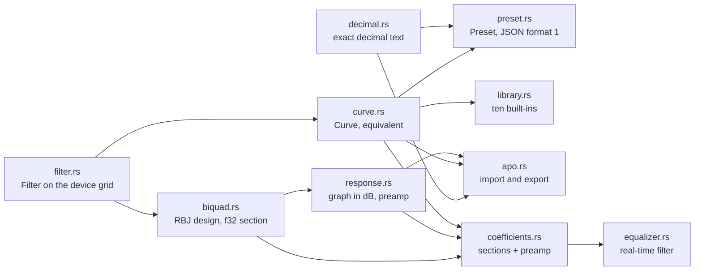
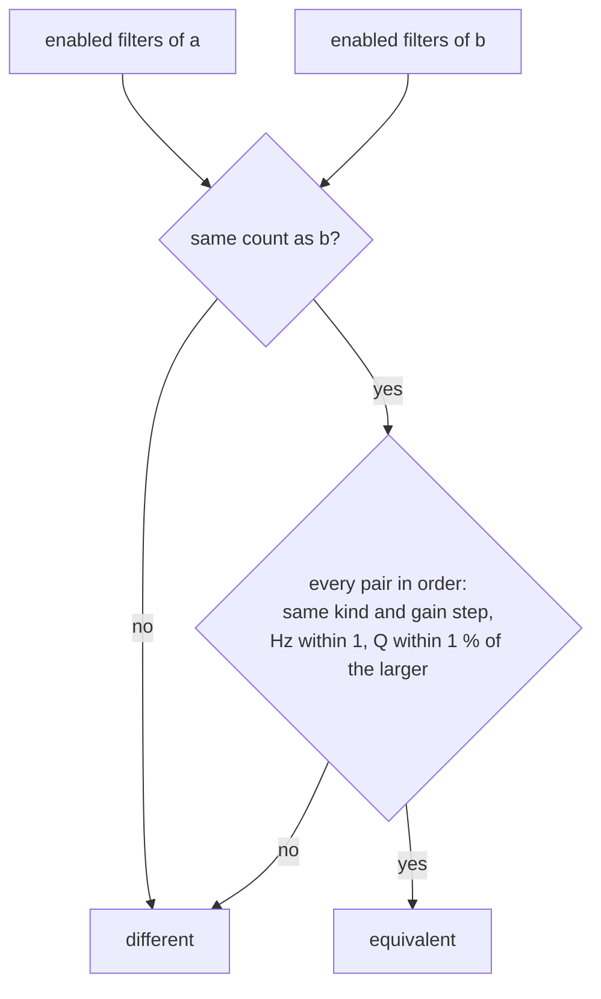
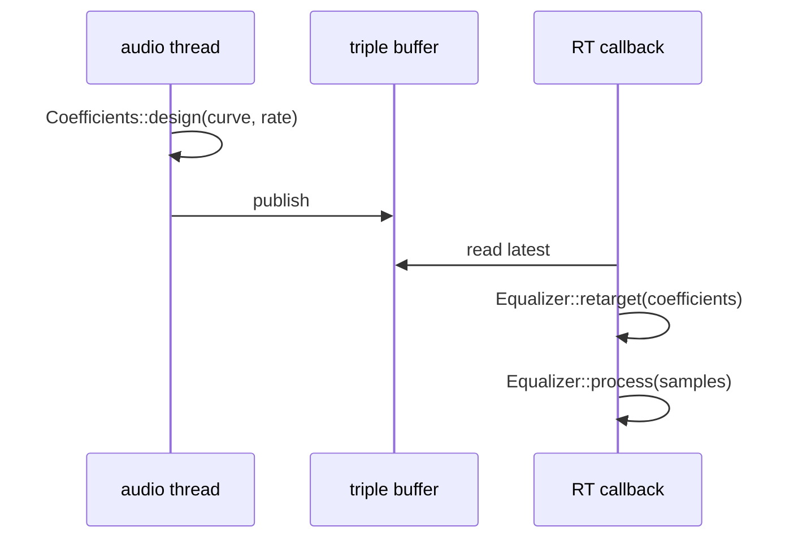
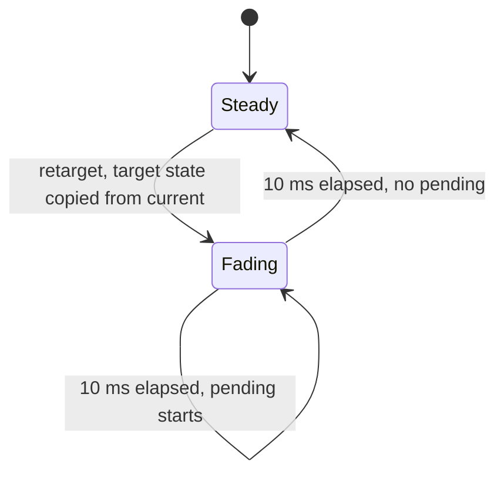
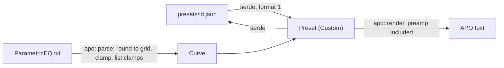

# SP3 Equalizer Core Implementation Plan

> **For agentic workers:** REQUIRED SUB-SKILL: Use superpowers:subagent-driven-development (recommended) or superpowers:executing-plans to implement this plan task-by-task. Steps use checkbox (`- [ ]`) syntax for tracking.

**Goal:** `core::eq`: the hardware envelope, curves and their device-tolerant comparison, the built-in preset
library, the preset JSON shape, Equalizer APO import and export, the RBJ response for the graph, and a real-time
equalizer that crossfades on retarget and never allocates.

**Architecture:** Pure modules under `crates/core/src/eq/`, one rule each. Values live on the device's integer grid
(`Hertz` 1 Hz, `Gain` 0.5 dB, `Q` thousandths), so a `Filter` outside the envelope cannot be built and equality is
exact. RBJ biquads are designed in `f64` (`biquad.rs`), narrowed once to `f32` sections, packed into a fixed-size
`Coefficients` (no heap), and run in transposed direct form II by `Equalizer`, which crossfades between two
section chains over 10 ms. Text formats (APO, JSON) go through exact decimal text (`decimal.rs`), never float casts.

**Tech Stack:** Rust 2024 (rustc 1.98), serde 1 (derive), dev: serde_json 1, proptest 1.12, allocation-counter 0.8.1.

Spec: `docs/superpowers/specs/2026-10-11-arctis-companion-design.md` §3, §3.1 (`core::eq` row), §5 (SP3 row);
audio part §1–§3; quality part §1 (`core::eq` row); device part §1 (curve comparison); ADR 0008, 0009, 0011;
`docs/research/hardware-findings.md` §2.5 and §9 (tolerances unchanged: ±1 Hz, Q ±1 %, gain byte exact, disabled
bands equal; the dongle stores Q 1410 as is).

---

## Conventions for every task

- Worktree: `/home/marcelo/Desenvolvimento/arctis-wt/sp3`, branch `sp3-eq-core`. Never touch
  `/home/marcelo/Desenvolvimento/arctis-companion`.
- **Run (toolbox):** `X` means
  `toolbox run -c arctis bash -lc 'cd /home/marcelo/Desenvolvimento/arctis-wt/sp3 && X'`.
  Git and `gh` run on the host in the worktree (the host has `cargo`, so the pre-commit and commit-msg hooks work).
- No comments in any file of any language, doc comments included. Names and small functions carry the meaning.
- Clippy policy applies to tests too: cognitive complexity 8, 40 lines per function, nesting 3 (a `fn` body and
  each `if`/`for`/`match` block count), at most 4 arguments (`self` included), no `unwrap()` (use `expect` in tests),
  `pedantic` as errors under `-D warnings`. So: no `as` casts (use `f64::from`, `u16::try_from`), no `==` on floats
  (compare `to_bits()` or use `assert_close`), pass `Filter` (8 bytes, `Copy`) by value. When clippy objects,
  extract a function; the only lint attribute this plan adds is the `#[expect]` on `biquad.rs::narrow` (Deviations).
- Pure core: `crates/core` may depend only on `serde` and `serde_json` (`cargo xtask check-pure`);
  dev-dependencies are free.
- Tests live in one integration binary, `crates/core/tests/eq/main.rs` with one module per source module, plus
  `crates/core/tests/eq_allocations.rs` (its own binary because it links a counting global allocator). Shared
  helpers go in `crates/core/tests/eq/support.rs`, each added in the task that first uses it, so nothing is dead.
- Before each commit: `cargo fmt --all`, then Run (toolbox):
  `cargo clippy -p arctis-core --all-targets -- -D warnings && cargo test -p arctis-core && cargo xtask check-rules && cargo xtask check-pure`.
- Commit subjects are conventional (`type(scope): summary`), short. Never write `Co-Authored-By`,
  "Generated with", or any AI or tool name in a commit message, PR title or PR body. Never use `--no-verify`.
- Push after every commit: `git push -u origin sp3-eq-core` the first time, then `git push`.

## Acceptance criteria → tasks

| SP3 acceptance criterion (design §5, quality §1) | Task |
|---|---|
| Scope: `filter` | 1 |
| Scope: `curve` | 2 |
| Scope: `preset`, `library` | 3, 14 |
| Scope: `biquad` | 4, 9 |
| Scope: `response` | 5 |
| Scope: `coefficients` | 6 |
| Scope: `equalizer` | 7, 8, 9 |
| Scope: APO | 11, 12, 13 |
| Peaking `|H(f0)|` = gain, ±0.05 dB at 44.1 and 48 kHz | 4 |
| Shelves `|H(f0)|` = gain/2, asymptotes within ±0.1 dB of gain and of 0 dB at 20 Hz / 20 kHz | 4 |
| Low-pass and high-pass `|H(f0)|` = 20·log10(Q); the gain field has no effect | 4 |
| `curve::equivalent` tolerance table (±1 Hz, Q ±1 %, gain byte exact, disabled bands equal; stored Q 1410) | 2 |
| `curve::equivalent` holds against SP2's compacted readback (disabled band mid-curve) | 2 |
| Preamp of the system engine: `−max(boost)` of the curve (audio §1) | 5, 6 |
| Flat bit-exact identity | 7 |
| Flat equivalent to the factory curve | 3 |
| Poles inside the unit circle over the envelope (and no section above Nyquist) | 6 |
| No NaN or denormals after 10 s of silence | 9 |
| `process` and `retarget` allocate nothing (counting allocator) | 10 |
| A retarget crossfades over 10 ms (length checked at 44.1 and 48 kHz) with no step above the steady-state difference | 8 |
| APO parse/render round-trip | 13 |
| Every library preset validates (envelope, and `response()` within ±10 dB) | 3, 5 |
| `docs/architecture/eq.md` (sub-project rule, design §5) | 15 |

## File structure

```
crates/core/Cargo.toml                 serde; dev: serde_json, proptest, allocation-counter
crates/core/src/lib.rs                 pub mod eq
crates/core/src/eq/
  mod.rs           module list and re-exports
  filter.rs        FilterKind, Hertz, Gain, Q, Filter, EnvelopeError: the envelope, by construction
  curve.rs         Curve (at most 10 filters), MAX_FILTERS, tolerances, equivalent
  preset.rs        PresetId, PresetKind, Preset; JSON document shape (format 1), PresetFormatError
  library.rs       ten built-in curves as const data; library, flat, find, FLAT_ID
  decimal.rs       exact decimal text <-> thousandths, rounding
  apo.rs           Equalizer APO / AutoEQ parse (clamp and list) and render
  biquad.rs        Params, Biquad (RBJ design, magnitude), Section, SectionState (TDF-II, f32), narrow
  response.rs      response(&Curve, &[f32]) -> Vec<f32> at RESPONSE_RATE; preamp_db
  coefficients.rs  Coefficients: fixed array of sections + preamp + rate; tick
  equalizer.rs     Equalizer: channels, crossfade, pending retarget
crates/core/tests/eq/
  main.rs support.rs filter.rs curve.rs preset.rs library.rs biquad.rs response.rs coefficients.rs
  equalizer.rs crossfade.rs silence.rs decimal.rs apo.rs
crates/core/tests/eq_allocations.rs    counting allocator, process and retarget
docs/architecture/eq.md                diagrams + code paths and symbols
docs/architecture/README.md            one new row
```

Boundary with SP2 (running in parallel, plan `docs/superpowers/plans/2026-10-12-sp2-protocol.md` on branch
`sp2-protocol`): SP2's Task 4 creates data-only `eq/filter.rs` and `eq/curve.rs` with other names (`Frequency`,
`Gain` as the raw wire byte 0..40, `QFactor`, public `Filter` fields `kind`/`frequency`/`gain`/`q`, no enabled flag,
`Curve::MAX_FILTERS`, `TooManyFilters`), and its `eq_wire::decode_curve` drops disabled bands, closing the gaps
(SP2 Deviation 2; the `cmd_33_edges.hex` capture has a disabled band in slot 9 of 10). SP3 owns these files and keeps
its own types: the spec puts "gain `20 + 2 dB`, Q ×1000" inside `core::protocol` (design §3.1), so `core::eq` holds
dB steps, not wire bytes. `curve::equivalent` compares the enabled filters in order and skips disabled or missing
ones (Deviation 17), so a curve written with a disabled band in the middle is equivalent to SP2's compacted
readback. Whichever branch lands second rebases onto the other; Task 16 Step 3 lists the port when SP2 lands first.

## Deviations

Decisions taken where the spec is silent or ambiguous (simplest option consistent with it):

| # | Decision | Why |
|---|---|---|
| 1 | New module `crates/core/src/eq/decimal.rs`, not in the spec's module tree | APO and JSON numbers become exact integers (thousandths) through their decimal text; clippy pedantic forbids the float-to-int casts the alternative needs |
| 2 | One lint attribute: `#[expect(clippy::cast_possible_truncation)]` on `biquad.rs::narrow(f64) -> f32` | std has no lossless `f64 → f32`; designing in `f64` and running in `f32` (audio §2: "f32") needs exactly one narrowing point |
| 3 | Values on the device grid: `Hertz(u16)`, `Gain(i8)` in 0.5 dB steps, `Q(u16)` in thousandths; constructors reject anything outside the envelope | equality is exact, wire mapping is trivial for SP2, and an out-of-envelope curve cannot exist |
| 4 | Preamp = minus the largest boost of `response()` (0 dB when the curve only cuts), probed on a 256-point log grid over 20..20000 Hz plus every filter's own frequency (`response::preamp_db`, `f64` dB, at `RESPONSE_RATE` whatever the design rate) | reading of audio §1 "−max(boost)" as the curve's boost: the loudest filter gain would leave resonant low-/high-pass filters (+20 dB at Q 10) and overlapping peaks (two +10 dB peaks a tenth of an octave apart reach +19.8 dB) clipping the Bluetooth stream; checked numerically while reviewing |
| 5 | Filters that cannot change the sound (disabled, or 0 dB peaking/shelf) get no section in `Coefficients` | makes Flat a bit-exact identity: no sections and a preamp of exactly `1.0` |
| 6 | Crossfade: a retarget during a fade is kept as `pending` (latest wins) and starts when the fade ends; the target chain starts from a copy of the current chain's state | spec only says "crossfade over 10 ms"; this stays continuous and allocation-free |
| 7 | Denormals: each biquad state value below `1e-20` is set to 0 on every sample (`biquad.rs`) | portable (no FTZ register access, no `unsafe`); −400 dB is inaudible |
| 8 | `response()` is evaluated at `RESPONSE_RATE` = 48 kHz and excludes the preamp | matches SP7's "within ±0.5 dB of `response()` minus the preamp" |
| 9 | APO: the `Preamp:` line is read and ignored (the system engine computes its own); render writes the curve's preamp. Types `PK`, `LSC`, `HSC`, `LPQ`, `HPQ` (case-insensitive); anything else rejects the file. Rounding onto the grid (1 Hz, 0.5 dB, 0.001 Q) is silent; only clamping is listed in `Import::clamped`. More than 10 filter lines, ON and OFF together, is rejected; a file with none is rejected | AutoEQ uses only these types; the toast lists clamps (audio §3) |
| 10 | Preset JSON shape lives in `preset.rs` (serde derives with `try_from`/`into` a private document); optional `"enabled": false`, omitted when enabled; `format` other than 1 is rejected; deserialized presets are `Custom`. `serde_json` is a dev-dependency only | `Preset` fields are private, so its file shape belongs with it (ADR 0011); the spec example has no `enabled`, but `Filter` has one (CONTEXT.md) |
| 11 | "Flat equivalent to the factory curve" uses the factory values of `reply_20_flat_headset_on.hex` written as literals (Q 1410, and the written Q 1414) | decoding the capture is SP2's `eq_wire`, built in parallel |
| 12 | "Gain field has no effect" for low-pass/high-pass is tested on `biquad::Params`, because `Filter` refuses gain on pass filters | the envelope makes such a `Filter` unrepresentable |
| 13 | Built-in curves authored here (values in Task 3); names are English msgids, translated by the view layer | the spec names the presets but gives only Flat's values |
| 14 | Q tolerance is ±1 % of the larger of the two Q values | symmetric, so `equivalent(a, b) == equivalent(b, a)` |
| 15 | Dependencies declared in `crates/core/Cargo.toml`, not `[workspace.dependencies]` | fewer edits to shared files while SP2 runs in parallel |
| 16 | Allocation test uses the `allocation-counter` crate (thread-local counts) instead of a hand-written `GlobalAlloc` | no `unsafe` outside `crates/hid`; parallel tests do not pollute the count |
| 17 | `curve::equivalent` compares the enabled filters of both curves in order, skipping disabled filters and missing slots wherever they sit | device §1 "all disabled bands equal whatever their other bytes"; SP2's decoder drops disabled bands and closes the gaps, so a slot-by-slot comparison would fail verify forever for a curve with a disabled band before an enabled one |
| 18 | `Coefficients::design` leaves out filters at or above the Nyquist frequency of the design rate | RBJ above Nyquist gives a negative `alpha` and an unstable section; the envelope reaches 20 kHz and the spec does not fix the stream rate |
| 19 | APO render writes the preamp rounded to 0.001 dB through `decimal.rs` | the preamp is no longer on the 0.5 dB grid (Deviation 4); parse ignores the line anyway (Deviation 9) |
| 20 | Execution: `f64::midpoint(1.0, ±cos)` for the pass-filter edges in `biquad.rs` and `f32::midpoint` in `crossfade.rs` | clippy `manual_midpoint` rejects `(a + b) / 2.0` under `-D warnings` |
| 21 | Execution: `more_than_ten_filters_are_rejected` builds its text with `str::repeat(11)` | clippy `format_collect` rejects `map(format!).collect()`; the parser ignores filter numbers |
| 22 | Execution: `Gain::MILLI_DB_PER_STEP` (500) replaces the planned `THOUSANDTHS_PER_HALF_DB` in `apo.rs` and the literal `500` in `preset.rs` | one name for the grid step shared by both text formats |
| 23 | Execution: added `format_errors_explain_themselves` in `tests/eq/preset.rs` | covers the `PresetFormatError` `Display` arms (Task 16 Step 2) |

---

### Task 1: The envelope: `FilterKind`, `Hertz`, `Gain`, `Q`, `Filter`

**Files:**
- Modify: `crates/core/src/lib.rs`
- Create: `crates/core/src/eq/mod.rs`, `crates/core/src/eq/filter.rs`
- Test: `crates/core/tests/eq/main.rs`, `crates/core/tests/eq/support.rs`, `crates/core/tests/eq/filter.rs`

- [ ] **Step 1: Write the failing tests**

`crates/core/tests/eq/main.rs`:

```rust
mod filter;
mod support;
```

`crates/core/tests/eq/support.rs`:

```rust
use arctis_core::eq::{Filter, FilterKind};

pub fn filter(kind: FilterKind, hz: u16, half_db: i8, milli_q: u16) -> Filter {
    Filter::from_parts(kind, hz, half_db, milli_q).expect("filter inside the envelope")
}

pub fn peaking(hz: u16, half_db: i8, milli_q: u16) -> Filter {
    filter(FilterKind::Peaking, hz, half_db, milli_q)
}
```

`crates/core/tests/eq/filter.rs`:

```rust
use arctis_core::eq::{EnvelopeError, Filter, FilterKind, Gain, Hertz, Q};

use crate::support::{filter, peaking};

#[test]
fn frequency_spans_twenty_hertz_to_twenty_kilohertz() {
    assert_eq!(Hertz::new(20).map(Hertz::get), Ok(20));
    assert_eq!(Hertz::new(20_000).map(Hertz::get), Ok(20_000));
    assert_eq!(Hertz::new(19), Err(EnvelopeError::Frequency));
    assert_eq!(Hertz::new(20_001), Err(EnvelopeError::Frequency));
}

#[test]
fn gain_spans_ten_decibels_either_way_in_half_steps() {
    assert_eq!(Gain::from_half_db(-20).map(Gain::half_db), Ok(-20));
    assert_eq!(Gain::from_half_db(20).map(Gain::half_db), Ok(20));
    assert_eq!(Gain::from_half_db(-21), Err(EnvelopeError::Gain));
    assert_eq!(Gain::from_half_db(21), Err(EnvelopeError::Gain));
}

#[test]
fn gain_converts_half_steps_to_decibels() {
    let gain = Gain::from_half_db(-11).expect("in range");
    assert!((gain.db() + 5.5).abs() < f64::EPSILON);
}

#[test]
fn q_spans_two_tenths_to_ten_in_thousandths() {
    assert_eq!(Q::from_milli(200).map(Q::milli), Ok(200));
    assert_eq!(Q::from_milli(10_000).map(Q::milli), Ok(10_000));
    assert_eq!(Q::from_milli(199), Err(EnvelopeError::Q));
    assert_eq!(Q::from_milli(10_001), Err(EnvelopeError::Q));
    assert!((Q::from_milli(1_410).expect("in range").value() - 1.41).abs() < 1e-12);
}

#[test]
fn pass_filters_refuse_gain() {
    for kind in [FilterKind::LowPass, FilterKind::HighPass] {
        assert_eq!(Filter::from_parts(kind, 1_000, 1, 707), Err(EnvelopeError::PassGain));
        assert!(Filter::from_parts(kind, 1_000, 0, 707).is_ok());
    }
}

#[test]
fn shaping_filters_accept_gain() {
    for kind in [FilterKind::Peaking, FilterKind::LowShelf, FilterKind::HighShelf] {
        assert_eq!(filter(kind, 1_000, 20, 707).gain().half_db(), 20);
    }
}

#[test]
fn from_parts_reports_the_first_field_outside_the_envelope() {
    let kind = FilterKind::Peaking;
    assert_eq!(Filter::from_parts(kind, 10, 40, 50), Err(EnvelopeError::Frequency));
    assert_eq!(Filter::from_parts(kind, 100, 40, 50), Err(EnvelopeError::Gain));
    assert_eq!(Filter::from_parts(kind, 100, 4, 50), Err(EnvelopeError::Q));
}

#[test]
fn filters_start_enabled_and_can_be_disabled() {
    let enabled = peaking(1_000, 6, 1_000);
    assert!(enabled.is_enabled());
    assert!(!enabled.with_enabled(false).is_enabled());
}

#[test]
fn only_enabled_filters_with_an_effect_shape_sound() {
    assert!(peaking(1_000, 6, 1_000).shapes_sound());
    assert!(!peaking(1_000, 0, 1_000).shapes_sound());
    assert!(!peaking(1_000, 6, 1_000).with_enabled(false).shapes_sound());
    assert!(filter(FilterKind::LowPass, 1_000, 0, 707).shapes_sound());
}
```

- [ ] **Step 2: Run the tests to verify they fail**

Run (toolbox): `cargo test -p arctis-core --test eq`
Expected: FAIL to compile, "unresolved import `arctis_core::eq`".

- [ ] **Step 3: Write the implementation**

`crates/core/src/lib.rs`:

```rust
#![forbid(unsafe_code)]

pub mod eq;
pub mod time;
```

`crates/core/src/eq/mod.rs`:

```rust
pub mod filter;

pub use filter::{EnvelopeError, Filter, FilterKind, Gain, Hertz, Q};
```

`crates/core/src/eq/filter.rs`:

```rust
#[derive(Clone, Copy, Debug, PartialEq, Eq, Hash)]
pub enum FilterKind {
    Peaking,
    LowShelf,
    HighShelf,
    LowPass,
    HighPass,
}

impl FilterKind {
    #[must_use]
    pub const fn has_gain(self) -> bool {
        !matches!(self, Self::LowPass | Self::HighPass)
    }
}

#[derive(Clone, Copy, Debug, PartialEq, Eq)]
pub enum EnvelopeError {
    Frequency,
    Gain,
    Q,
    PassGain,
    TooManyFilters,
}

#[derive(Clone, Copy, Debug, PartialEq, Eq, Hash, PartialOrd, Ord)]
pub struct Hertz(u16);

impl Hertz {
    pub const MIN: u16 = 20;
    pub const MAX: u16 = 20_000;

    pub const fn new(hz: u16) -> Result<Self, EnvelopeError> {
        if matches!(hz, Self::MIN..=Self::MAX) {
            Ok(Self(hz))
        } else {
            Err(EnvelopeError::Frequency)
        }
    }

    #[must_use]
    pub const fn get(self) -> u16 {
        self.0
    }
}

#[derive(Clone, Copy, Debug, PartialEq, Eq, Hash, PartialOrd, Ord)]
pub struct Gain(i8);

impl Gain {
    pub const MIN_HALF_DB: i8 = -20;
    pub const MAX_HALF_DB: i8 = 20;

    pub const fn from_half_db(half_db: i8) -> Result<Self, EnvelopeError> {
        if matches!(half_db, Self::MIN_HALF_DB..=Self::MAX_HALF_DB) {
            Ok(Self(half_db))
        } else {
            Err(EnvelopeError::Gain)
        }
    }

    #[must_use]
    pub const fn half_db(self) -> i8 {
        self.0
    }

    #[must_use]
    pub fn db(self) -> f64 {
        f64::from(self.0) / 2.0
    }
}

#[derive(Clone, Copy, Debug, PartialEq, Eq, Hash, PartialOrd, Ord)]
pub struct Q(u16);

impl Q {
    pub const MIN_MILLI: u16 = 200;
    pub const MAX_MILLI: u16 = 10_000;

    pub const fn from_milli(milli: u16) -> Result<Self, EnvelopeError> {
        if matches!(milli, Self::MIN_MILLI..=Self::MAX_MILLI) {
            Ok(Self(milli))
        } else {
            Err(EnvelopeError::Q)
        }
    }

    #[must_use]
    pub const fn milli(self) -> u16 {
        self.0
    }

    #[must_use]
    pub fn value(self) -> f64 {
        f64::from(self.0) / 1000.0
    }
}

#[derive(Clone, Copy, Debug, PartialEq, Eq, Hash)]
pub struct Filter {
    kind: FilterKind,
    hz: Hertz,
    gain: Gain,
    q: Q,
    enabled: bool,
}

impl Filter {
    pub const fn new(kind: FilterKind, hz: Hertz, gain: Gain, q: Q) -> Result<Self, EnvelopeError> {
        if kind.has_gain() || gain.half_db() == 0 {
            Ok(Self { kind, hz, gain, q, enabled: true })
        } else {
            Err(EnvelopeError::PassGain)
        }
    }

    pub const fn from_parts(
        kind: FilterKind,
        hz: u16,
        half_db: i8,
        milli_q: u16,
    ) -> Result<Self, EnvelopeError> {
        let hz = match Hertz::new(hz) {
            Ok(hz) => hz,
            Err(error) => return Err(error),
        };
        let gain = match Gain::from_half_db(half_db) {
            Ok(gain) => gain,
            Err(error) => return Err(error),
        };
        let q = match Q::from_milli(milli_q) {
            Ok(q) => q,
            Err(error) => return Err(error),
        };
        Self::new(kind, hz, gain, q)
    }

    #[must_use]
    pub const fn with_enabled(self, enabled: bool) -> Self {
        Self { enabled, ..self }
    }

    #[must_use]
    pub const fn kind(self) -> FilterKind {
        self.kind
    }

    #[must_use]
    pub const fn hz(self) -> Hertz {
        self.hz
    }

    #[must_use]
    pub const fn gain(self) -> Gain {
        self.gain
    }

    #[must_use]
    pub const fn q(self) -> Q {
        self.q
    }

    #[must_use]
    pub const fn is_enabled(self) -> bool {
        self.enabled
    }

    #[must_use]
    pub const fn shapes_sound(self) -> bool {
        self.enabled && !(self.kind.has_gain() && self.gain.half_db() == 0)
    }
}
```

`from_parts` is `const` so the library (Task 3) is checked at compile time; `?` is not usable in a `const fn`,
which is why it matches explicitly. If clippy's `question_mark` fires on these matches inside the `const fn`, it
is a false positive for const contexts: report it in the task notes and keep the matches (no `allow`).

- [ ] **Step 4: Run the tests to verify they pass**

Run (toolbox): `cargo test -p arctis-core --test eq`
Expected: PASS, 9 tests.

- [ ] **Step 5: Lint, check and commit**

Run (toolbox): `cargo fmt --all && cargo clippy -p arctis-core --all-targets -- -D warnings && cargo test -p arctis-core && cargo xtask check-rules`

```bash
git add crates/core/src/lib.rs crates/core/src/eq crates/core/tests/eq
git commit -m "feat(eq): add the filter envelope"
git push -u origin sp3-eq-core
```

---

### Task 2: `Curve` and `curve::equivalent`

**Files:**
- Modify: `crates/core/src/eq/mod.rs`
- Create: `crates/core/src/eq/curve.rs`
- Test: `crates/core/tests/eq/curve.rs`, `crates/core/tests/eq/main.rs`

- [ ] **Step 1: Write the failing tests**

`crates/core/tests/eq/main.rs`:

```rust
mod curve;
mod filter;
mod support;
```

`crates/core/tests/eq/curve.rs`:

```rust
use arctis_core::eq::curve::{self, MAX_FILTERS};
use arctis_core::eq::{Curve, EnvelopeError, Filter, FilterKind};

use crate::support::{filter, peaking};

fn single(filter: Filter) -> Curve {
    Curve::from_array([filter])
}

#[test]
fn a_curve_holds_at_most_ten_filters() {
    assert!(Curve::new(vec![peaking(1_000, 0, 1_000); MAX_FILTERS]).is_ok());
    let eleven = vec![peaking(1_000, 0, 1_000); MAX_FILTERS + 1];
    assert_eq!(Curve::new(eleven), Err(EnvelopeError::TooManyFilters));
}

#[test]
fn equivalence_follows_the_device_tolerance_table() {
    let base = peaking(1_000, 6, 1_000);
    let cases = [
        ("identical", peaking(1_000, 6, 1_000), true),
        ("one hertz above", peaking(1_001, 6, 1_000), true),
        ("one hertz below", peaking(999, 6, 1_000), true),
        ("two hertz above", peaking(1_002, 6, 1_000), false),
        ("q one percent above", peaking(1_000, 6, 1_010), true),
        ("q one percent below", peaking(1_000, 6, 990), true),
        ("q over one percent above", peaking(1_000, 6, 1_011), false),
        ("q over one percent below", peaking(1_000, 6, 989), false),
        ("half a decibel louder", peaking(1_000, 7, 1_000), false),
        ("another kind", filter(FilterKind::LowShelf, 1_000, 6, 1_000), false),
        ("disabled", base.with_enabled(false), false),
    ];
    for (case, other, expected) in cases {
        assert_eq!(curve::equivalent(&single(base), &single(other)), expected, "{case}");
        assert_eq!(curve::equivalent(&single(other), &single(base)), expected, "{case} reversed");
    }
}

#[test]
fn disabled_slots_are_equal_whatever_they_hold() {
    let quiet = peaking(1_000, 6, 1_000).with_enabled(false);
    let loud = filter(FilterKind::HighShelf, 8_000, -20, 5_000).with_enabled(false);
    assert!(curve::equivalent(&single(quiet), &single(loud)));
}

#[test]
fn missing_slots_count_as_disabled() {
    let short = single(peaking(1_000, 6, 1_000));
    let padded = Curve::from_array([
        peaking(1_000, 6, 1_000),
        peaking(50, 4, 700).with_enabled(false),
    ]);
    assert!(curve::equivalent(&short, &padded));
    let lone_disabled = single(peaking(50, 4, 700).with_enabled(false));
    assert!(curve::equivalent(&Curve::default(), &lone_disabled));
}

#[test]
fn enabled_filters_compare_in_order() {
    let forward = Curve::from_array([peaking(100, 2, 1_000), peaking(1_000, 4, 1_000)]);
    let swapped = Curve::from_array([peaking(1_000, 4, 1_000), peaking(100, 2, 1_000)]);
    assert!(!curve::equivalent(&forward, &swapped));
}

#[test]
fn a_disabled_filter_between_enabled_ones_is_skipped() {
    let written = Curve::from_array([
        peaking(100, 2, 1_000),
        peaking(500, 4, 700).with_enabled(false),
        peaking(1_000, 4, 1_000),
    ]);
    let read_back = Curve::from_array([peaking(100, 2, 1_000), peaking(1_000, 4, 1_000)]);
    assert!(curve::equivalent(&written, &read_back));
    assert!(curve::equivalent(&read_back, &written));
}

#[test]
fn a_stored_q_of_1410_matches_a_written_1414() {
    let written = single(peaking(32, 0, 1_414));
    let stored = single(peaking(32, 0, 1_410));
    assert!(curve::equivalent(&written, &stored));
}
```

- [ ] **Step 2: Run the tests to verify they fail**

Run (toolbox): `cargo test -p arctis-core --test eq curve`
Expected: FAIL to compile, "unresolved import `arctis_core::eq::curve`".

- [ ] **Step 3: Write the implementation**

`crates/core/src/eq/mod.rs`:

```rust
pub mod curve;
pub mod filter;

pub use curve::Curve;
pub use filter::{EnvelopeError, Filter, FilterKind, Gain, Hertz, Q};
```

`crates/core/src/eq/curve.rs`:

```rust
use super::filter::{EnvelopeError, Filter, Q};

pub const MAX_FILTERS: usize = 10;
pub const FREQUENCY_TOLERANCE_HZ: u16 = 1;
pub const Q_TOLERANCE_PERCENT: u32 = 1;

#[derive(Clone, Debug, Default, PartialEq, Eq, Hash)]
pub struct Curve {
    filters: Vec<Filter>,
}

impl Curve {
    pub fn new(filters: Vec<Filter>) -> Result<Self, EnvelopeError> {
        if filters.len() > MAX_FILTERS {
            return Err(EnvelopeError::TooManyFilters);
        }
        Ok(Self { filters })
    }

    #[must_use]
    pub fn from_array<const N: usize>(filters: [Filter; N]) -> Self {
        const { assert!(N <= MAX_FILTERS) };
        Self {
            filters: filters.to_vec(),
        }
    }

    #[must_use]
    pub fn filters(&self) -> &[Filter] {
        &self.filters
    }
}

#[must_use]
pub fn equivalent(a: &Curve, b: &Curve) -> bool {
    enabled(a).count() == enabled(b).count()
        && enabled(a).zip(enabled(b)).all(|(left, right)| filters_equivalent(left, right))
}

fn enabled(curve: &Curve) -> impl Iterator<Item = Filter> {
    curve.filters.iter().copied().filter(|filter| filter.is_enabled())
}

fn filters_equivalent(a: Filter, b: Filter) -> bool {
    a.kind() == b.kind()
        && a.gain() == b.gain()
        && a.hz().get().abs_diff(b.hz().get()) <= FREQUENCY_TOLERANCE_HZ
        && q_within_tolerance(a.q(), b.q())
}

fn q_within_tolerance(a: Q, b: Q) -> bool {
    let difference = u32::from(a.milli().abs_diff(b.milli()));
    let larger = u32::from(a.milli().max(b.milli()));
    difference * 100 <= larger * Q_TOLERANCE_PERCENT
}
```

- [ ] **Step 4: Run the tests to verify they pass**

Run (toolbox): `cargo test -p arctis-core --test eq`
Expected: PASS, 16 tests.

- [ ] **Step 5: Lint, check and commit**

Run (toolbox): `cargo fmt --all && cargo clippy -p arctis-core --all-targets -- -D warnings && cargo test -p arctis-core && cargo xtask check-rules`

```bash
git add crates/core/src/eq crates/core/tests/eq
git commit -m "feat(eq): compare curves within the device tolerance"
git push
```

---

### Task 3: `Preset` and the built-in library

**Files:**
- Modify: `crates/core/src/eq/mod.rs`
- Create: `crates/core/src/eq/preset.rs`, `crates/core/src/eq/library.rs`
- Test: `crates/core/tests/eq/preset.rs`, `crates/core/tests/eq/library.rs`, `crates/core/tests/eq/main.rs`,
  `crates/core/tests/eq/support.rs`

- [ ] **Step 1: Write the failing tests**

`crates/core/tests/eq/main.rs`:

```rust
mod curve;
mod filter;
mod library;
mod preset;
mod support;
```

Append to `crates/core/tests/eq/support.rs`:

```rust
use arctis_core::eq::Curve;

const FACTORY_BANDS: [u16; 10] = [32, 64, 125, 250, 500, 1_000, 2_000, 4_000, 8_000, 16_000];

pub fn factory_curve(milli_q: u16) -> Curve {
    let filters = FACTORY_BANDS.iter().map(|&hz| peaking(hz, 0, milli_q));
    Curve::new(filters.collect()).expect("ten filters")
}
```

(Merge the `use` lines at the top of `support.rs`: `use arctis_core::eq::{Curve, Filter, FilterKind};`.)

`crates/core/tests/eq/preset.rs`:

```rust
use arctis_core::eq::{Curve, Preset, PresetId, PresetKind};

use crate::support::peaking;

#[test]
fn a_custom_preset_keeps_what_it_was_given() {
    let curve = Curve::from_array([peaking(1_000, 4, 1_000)]);
    let preset = Preset::custom(PresetId::new("mine"), "Mine".to_owned(), curve.clone());
    assert_eq!(preset.id().as_str(), "mine");
    assert_eq!(preset.name(), "Mine");
    assert_eq!(preset.curve(), &curve);
    assert_eq!(preset.kind(), PresetKind::Custom);
}

#[test]
fn a_built_in_preset_is_marked_built_in() {
    let preset = Preset::built_in("flat", "Flat", Curve::default());
    assert_eq!(preset.id(), &PresetId::new("flat"));
    assert_eq!(preset.kind(), PresetKind::BuiltIn);
}
```

`crates/core/tests/eq/library.rs`:

```rust
use arctis_core::eq::curve::{self, MAX_FILTERS};
use arctis_core::eq::library::{self, FLAT_ID};
use arctis_core::eq::{EnvelopeError, Filter, PresetId, PresetKind};

use crate::support::factory_curve;

const IDS: [&str; 10] = [
    "flat",
    "bass-boost",
    "bass-reduction",
    "treble-soften",
    "vocal-clarity",
    "footsteps",
    "v-shape",
    "movie-night",
    "podcast",
    "late-night",
];

fn rebuilt(filter: Filter) -> Result<Filter, EnvelopeError> {
    let (hz, half_db, milli_q) = (filter.hz().get(), filter.gain().half_db(), filter.q().milli());
    Filter::from_parts(filter.kind(), hz, half_db, milli_q)
}

#[test]
fn the_library_ships_ten_built_in_presets() {
    let presets = library::library();
    let ids: Vec<&str> = presets.iter().map(|preset| preset.id().as_str()).collect();
    assert_eq!(ids, IDS);
    assert!(presets.iter().all(|preset| preset.kind() == PresetKind::BuiltIn));
}

#[test]
fn every_built_in_fits_the_envelope() {
    for preset in library::library() {
        let filters = preset.curve().filters();
        assert!(filters.len() <= MAX_FILTERS, "{}", preset.name());
        assert!(filters.iter().all(|&f| rebuilt(f) == Ok(f)), "{}", preset.name());
    }
}

#[test]
fn flat_is_the_factory_curve() {
    let flat = library::flat();
    assert_eq!(flat.id().as_str(), FLAT_ID);
    assert!(curve::equivalent(flat.curve(), &factory_curve(1_410)));
    assert!(curve::equivalent(flat.curve(), &factory_curve(1_414)));
}

#[test]
fn presets_are_found_by_id() {
    let footsteps = library::find(&PresetId::new("footsteps"));
    assert_eq!(footsteps.map(|preset| preset.name().to_owned()), Some("Footsteps".to_owned()));
    assert_eq!(library::find(&PresetId::new("missing")), None);
}
```

- [ ] **Step 2: Run the tests to verify they fail**

Run (toolbox): `cargo test -p arctis-core --test eq`
Expected: FAIL to compile, "unresolved imports `arctis_core::eq::library`, `arctis_core::eq::Preset`".

- [ ] **Step 3: Write the implementation**

`crates/core/src/eq/mod.rs`:

```rust
pub mod curve;
pub mod filter;
pub mod library;
pub mod preset;

pub use curve::Curve;
pub use filter::{EnvelopeError, Filter, FilterKind, Gain, Hertz, Q};
pub use library::library;
pub use preset::{Preset, PresetId, PresetKind};
```

`crates/core/src/eq/preset.rs`:

```rust
use super::curve::Curve;

#[derive(Clone, Debug, PartialEq, Eq, Hash, PartialOrd, Ord)]
pub struct PresetId(String);

impl PresetId {
    #[must_use]
    pub fn new(id: impl Into<String>) -> Self {
        Self(id.into())
    }

    #[must_use]
    pub fn as_str(&self) -> &str {
        &self.0
    }
}

#[derive(Clone, Copy, Debug, PartialEq, Eq, Hash)]
pub enum PresetKind {
    BuiltIn,
    Custom,
}

#[derive(Clone, Debug, PartialEq, Eq)]
pub struct Preset {
    id: PresetId,
    name: String,
    curve: Curve,
    kind: PresetKind,
}

impl Preset {
    #[must_use]
    pub fn built_in(id: &str, name: &str, curve: Curve) -> Self {
        Self {
            id: PresetId::new(id),
            name: name.to_owned(),
            curve,
            kind: PresetKind::BuiltIn,
        }
    }

    #[must_use]
    pub fn custom(id: PresetId, name: String, curve: Curve) -> Self {
        Self {
            id,
            name,
            curve,
            kind: PresetKind::Custom,
        }
    }

    #[must_use]
    pub fn id(&self) -> &PresetId {
        &self.id
    }

    #[must_use]
    pub fn name(&self) -> &str {
        &self.name
    }

    #[must_use]
    pub fn curve(&self) -> &Curve {
        &self.curve
    }

    #[must_use]
    pub fn kind(&self) -> PresetKind {
        self.kind
    }
}
```

`crates/core/src/eq/library.rs` (curves authored for this app, CC0; responses checked in Task 5):

```rust
use super::curve::Curve;
use super::filter::{Filter, FilterKind};
use super::preset::{Preset, PresetId};

pub const FLAT_ID: &str = "flat";

const FACTORY_Q: u16 = 1_410;
const SHELF_Q: u16 = 707;

const fn band(kind: FilterKind, hz: u16, half_db: i8, milli_q: u16) -> Filter {
    let Ok(filter) = Filter::from_parts(kind, hz, half_db, milli_q) else {
        panic!("a built-in filter lies outside the envelope");
    };
    filter
}

const fn peaking(hz: u16, half_db: i8, milli_q: u16) -> Filter {
    band(FilterKind::Peaking, hz, half_db, milli_q)
}

const fn low_shelf(hz: u16, half_db: i8) -> Filter {
    band(FilterKind::LowShelf, hz, half_db, SHELF_Q)
}

const fn high_shelf(hz: u16, half_db: i8) -> Filter {
    band(FilterKind::HighShelf, hz, half_db, SHELF_Q)
}

const FLAT: [Filter; 10] = [
    peaking(32, 0, FACTORY_Q),
    peaking(64, 0, FACTORY_Q),
    peaking(125, 0, FACTORY_Q),
    peaking(250, 0, FACTORY_Q),
    peaking(500, 0, FACTORY_Q),
    peaking(1_000, 0, FACTORY_Q),
    peaking(2_000, 0, FACTORY_Q),
    peaking(4_000, 0, FACTORY_Q),
    peaking(8_000, 0, FACTORY_Q),
    peaking(16_000, 0, FACTORY_Q),
];
const BASS_BOOST: [Filter; 1] = [low_shelf(105, 12)];
const BASS_REDUCTION: [Filter; 1] = [low_shelf(120, -12)];
const TREBLE_SOFTEN: [Filter; 2] = [peaking(3_500, -3, 1_410), high_shelf(6_000, -9)];
const VOCAL_CLARITY: [Filter; 4] = [
    low_shelf(100, -6),
    peaking(250, -4, 1_000),
    peaking(2_500, 6, 1_000),
    peaking(5_000, 3, 1_410),
];
const FOOTSTEPS: [Filter; 4] = [
    low_shelf(150, -8),
    peaking(2_000, 8, 1_000),
    peaking(4_500, 10, 1_410),
    high_shelf(10_000, -4),
];
const V_SHAPE: [Filter; 3] = [low_shelf(100, 10), peaking(1_000, -6, 700), high_shelf(8_000, 9)];
const MOVIE_NIGHT: [Filter; 3] = [
    low_shelf(80, 8),
    peaking(2_500, 4, 1_000),
    high_shelf(10_000, 3),
];
const PODCAST: [Filter; 4] = [
    low_shelf(90, -8),
    peaking(180, -4, 1_000),
    peaking(3_000, 6, 1_200),
    high_shelf(9_000, -4),
];
const LATE_NIGHT: [Filter; 3] = [
    low_shelf(120, -6),
    peaking(3_000, -2, 1_000),
    high_shelf(7_000, -6),
];

#[must_use]
pub fn flat() -> Preset {
    built_in(FLAT_ID, "Flat", FLAT)
}

#[must_use]
pub fn library() -> Vec<Preset> {
    vec![
        flat(),
        built_in("bass-boost", "Bass Boost", BASS_BOOST),
        built_in("bass-reduction", "Bass Reduction", BASS_REDUCTION),
        built_in("treble-soften", "Treble Soften", TREBLE_SOFTEN),
        built_in("vocal-clarity", "Vocal Clarity", VOCAL_CLARITY),
        built_in("footsteps", "Footsteps", FOOTSTEPS),
        built_in("v-shape", "V-Shape", V_SHAPE),
        built_in("movie-night", "Movie Night", MOVIE_NIGHT),
        built_in("podcast", "Podcast", PODCAST),
        built_in("late-night", "Late Night", LATE_NIGHT),
    ]
}

#[must_use]
pub fn find(id: &PresetId) -> Option<Preset> {
    library().into_iter().find(|preset| preset.id() == id)
}

fn built_in<const N: usize>(id: &str, name: &str, filters: [Filter; N]) -> Preset {
    Preset::built_in(id, name, Curve::from_array(filters))
}
```

The `const` arrays make an out-of-envelope built-in a compile error (the `panic!` runs in const evaluation).

- [ ] **Step 4: Run the tests to verify they pass**

Run (toolbox): `cargo test -p arctis-core --test eq`
Expected: PASS, 22 tests.

- [ ] **Step 5: Lint, check and commit**

Run (toolbox): `cargo fmt --all && cargo clippy -p arctis-core --all-targets -- -D warnings && cargo test -p arctis-core && cargo xtask check-rules`

```bash
git add crates/core/src/eq crates/core/tests/eq
git commit -m "feat(eq): add presets and the built-in library"
git push
```

---

### Task 4: RBJ biquads and the `f32` section

**Files:**
- Modify: `crates/core/src/eq/mod.rs`
- Create: `crates/core/src/eq/biquad.rs`
- Test: `crates/core/tests/eq/biquad.rs`, `crates/core/tests/eq/main.rs`, `crates/core/tests/eq/support.rs`

- [ ] **Step 1: Write the failing tests**

Add `mod biquad;` to `crates/core/tests/eq/main.rs` (modules stay alphabetical).

Append to `crates/core/tests/eq/support.rs`:

```rust
pub fn assert_close(actual: f64, expected: f64, tolerance: f64, case: &str) {
    let error = (actual - expected).abs();
    assert!(error <= tolerance, "{case}: got {actual}, expected {expected} ± {tolerance}");
}
```

`crates/core/tests/eq/biquad.rs`:

```rust
use arctis_core::eq::FilterKind;
use arctis_core::eq::biquad::{Biquad, Params, Section, SectionState};

use crate::support::assert_close;

const RATES: [f64; 2] = [44_100.0, 48_000.0];
const AT_CORNER: f64 = 0.05;
const AT_EDGE: f64 = 0.1;
const SHELF_CASES: [(f64, f64); 6] = [
    (10.0, 0.707),
    (-10.0, 0.707),
    (3.5, 0.707),
    (10.0, 1.0),
    (-10.0, 1.0),
    (3.5, 1.0),
];

fn magnitude(kind: FilterKind, (hz, gain_db, q): (f64, f64, f64), at: f64, rate: f64) -> f64 {
    Biquad::design(&Params { kind, hz, gain_db, q }, rate).magnitude_db(at, rate)
}

#[test]
fn peaking_reaches_its_gain_at_the_centre() {
    let cases = [
        (100.0, 10.0, 1.0),
        (1_000.0, -10.0, 0.7),
        (1_000.0, 3.5, 4.0),
        (10_000.0, 6.0, 1.41),
        (20.0, -10.0, 0.2),
        (20_000.0, 10.0, 10.0),
    ];
    for rate in RATES {
        for (hz, gain_db, q) in cases {
            let at_centre = magnitude(FilterKind::Peaking, (hz, gain_db, q), hz, rate);
            assert_close(at_centre, gain_db, AT_CORNER, "peaking centre");
        }
    }
}

#[test]
fn low_shelf_is_half_way_at_the_corner_and_flat_beyond() {
    for rate in RATES {
        for (gain_db, q) in SHELF_CASES {
            let at = |hz| magnitude(FilterKind::LowShelf, (1_000.0, gain_db, q), hz, rate);
            assert_close(at(1_000.0), gain_db / 2.0, AT_CORNER, "low shelf corner");
            assert_close(at(20.0), gain_db, AT_EDGE, "low shelf at 20 Hz");
            assert_close(at(20_000.0), 0.0, AT_EDGE, "low shelf at 20 kHz");
        }
    }
}

#[test]
fn high_shelf_is_half_way_at_the_corner_and_flat_beyond() {
    for rate in RATES {
        for (gain_db, q) in SHELF_CASES {
            let at = |hz| magnitude(FilterKind::HighShelf, (1_000.0, gain_db, q), hz, rate);
            assert_close(at(1_000.0), gain_db / 2.0, AT_CORNER, "high shelf corner");
            assert_close(at(20.0), 0.0, AT_EDGE, "high shelf at 20 Hz");
            assert_close(at(20_000.0), gain_db, AT_EDGE, "high shelf at 20 kHz");
        }
    }
}

#[test]
fn pass_filters_reach_q_at_the_corner() {
    for rate in RATES {
        assert_pass_corners(FilterKind::LowPass, rate);
        assert_pass_corners(FilterKind::HighPass, rate);
    }
}

fn assert_pass_corners(kind: FilterKind, rate: f64) {
    for (hz, q) in [(100.0, 0.5), (1_000.0, 0.707), (10_000.0, 2.0), (1_000.0, 10.0)] {
        let at_corner = magnitude(kind, (hz, 0.0, q), hz, rate);
        assert_close(at_corner, 20.0 * q.log10(), AT_CORNER, "pass corner");
    }
}

#[test]
fn pass_filters_ignore_the_gain_field() {
    for kind in [FilterKind::LowPass, FilterKind::HighPass] {
        let plain = Params { kind, hz: 1_000.0, gain_db: 0.0, q: 0.707 };
        let boosted = Params { gain_db: 6.0, ..plain };
        assert_eq!(Biquad::design(&plain, 48_000.0), Biquad::design(&boosted, 48_000.0));
    }
}

#[test]
fn the_identity_section_passes_samples_through() {
    let mut state = SectionState::default();
    for sample in [0.3_f32, -0.7, 0.0, 1.0] {
        assert_eq!(Section::IDENTITY.tick(&mut state, sample).to_bits(), sample.to_bits());
    }
}

#[test]
fn a_section_runs_the_biquad_difference_equation() {
    let params = Params { kind: FilterKind::Peaking, hz: 1_000.0, gain_db: 6.0, q: 1.0 };
    let biquad = Biquad::design(&params, 48_000.0);
    let section = Section::from(biquad);
    let mut state = SectionState::default();
    let mut reference = DirectForm::default();
    for input in std::iter::once(1.0_f32).chain(std::iter::repeat_n(0.0, 63)) {
        let actual = f64::from(section.tick(&mut state, input));
        assert_close(actual, reference.step(&biquad, f64::from(input)), 1e-5, "impulse");
    }
}

#[derive(Default)]
struct DirectForm {
    x1: f64,
    x2: f64,
    y1: f64,
    y2: f64,
}

impl DirectForm {
    fn step(&mut self, biquad: &Biquad, x: f64) -> f64 {
        let feedforward = biquad.b0 * x + biquad.b1 * self.x1 + biquad.b2 * self.x2;
        let y = feedforward - biquad.a1 * self.y1 - biquad.a2 * self.y2;
        (self.x2, self.x1, self.y2, self.y1) = (self.x1, x, self.y1, y);
        y
    }
}
```

The shelf and corner expectations were checked numerically while planning: at f0 = 1 kHz, Q 0.707 and 1.0,
both rates, the RBJ shelves land within 0.01 dB of gain at the far edge and exactly gain/2 at the corner; RBJ
pass filters land exactly on 20·log10(Q).

- [ ] **Step 2: Run the tests to verify they fail**

Run (toolbox): `cargo test -p arctis-core --test eq biquad`
Expected: FAIL to compile, "unresolved import `arctis_core::eq::biquad`".

- [ ] **Step 3: Write the implementation**

Add `pub mod biquad;` to `crates/core/src/eq/mod.rs` (first in the module list).

`crates/core/src/eq/biquad.rs`:

```rust
use std::f64::consts::TAU;

use super::filter::{Filter, FilterKind};

#[derive(Clone, Copy, Debug, PartialEq)]
pub struct Params {
    pub kind: FilterKind,
    pub hz: f64,
    pub gain_db: f64,
    pub q: f64,
}

impl From<Filter> for Params {
    fn from(filter: Filter) -> Self {
        Self {
            kind: filter.kind(),
            hz: f64::from(filter.hz().get()),
            gain_db: filter.gain().db(),
            q: filter.q().value(),
        }
    }
}

#[derive(Clone, Copy, Debug, PartialEq)]
pub struct Biquad {
    pub b0: f64,
    pub b1: f64,
    pub b2: f64,
    pub a1: f64,
    pub a2: f64,
}

impl Biquad {
    #[must_use]
    pub fn design(params: &Params, rate: f64) -> Self {
        let shape = Shape::new(params, rate);
        let [b0, b1, b2, a0, a1, a2] = match params.kind {
            FilterKind::Peaking => shape.peaking(),
            FilterKind::LowShelf => shape.low_shelf(),
            FilterKind::HighShelf => shape.high_shelf(),
            FilterKind::LowPass => shape.low_pass(),
            FilterKind::HighPass => shape.high_pass(),
        };
        Self {
            b0: b0 / a0,
            b1: b1 / a0,
            b2: b2 / a0,
            a1: a1 / a0,
            a2: a2 / a0,
        }
    }

    #[must_use]
    pub fn magnitude_db(&self, hz: f64, rate: f64) -> f64 {
        let omega = TAU * hz / rate;
        let numerator = power_at([self.b0, self.b1, self.b2], omega);
        let denominator = power_at([1.0, self.a1, self.a2], omega);
        10.0 * (numerator / denominator).log10()
    }
}

fn power_at([c0, c1, c2]: [f64; 3], omega: f64) -> f64 {
    let real = c0 + c1 * omega.cos() + c2 * (2.0 * omega).cos();
    let imaginary = c1 * omega.sin() + c2 * (2.0 * omega).sin();
    real * real + imaginary * imaginary
}

#[derive(Clone, Copy)]
struct Shape {
    amplitude: f64,
    cos: f64,
    alpha: f64,
}

impl Shape {
    fn new(params: &Params, rate: f64) -> Self {
        let omega = TAU * params.hz / rate;
        Self {
            amplitude: 10f64.powf(params.gain_db / 40.0),
            cos: omega.cos(),
            alpha: omega.sin() / (2.0 * params.q),
        }
    }

    fn peaking(self) -> [f64; 6] {
        let Self { amplitude: a, cos, alpha } = self;
        [
            1.0 + alpha * a,
            -2.0 * cos,
            1.0 - alpha * a,
            1.0 + alpha / a,
            -2.0 * cos,
            1.0 - alpha / a,
        ]
    }

    fn low_shelf(self) -> [f64; 6] {
        let Self { amplitude: a, cos, alpha } = self;
        let root = 2.0 * a.sqrt() * alpha;
        [
            a * ((a + 1.0) - (a - 1.0) * cos + root),
            2.0 * a * ((a - 1.0) - (a + 1.0) * cos),
            a * ((a + 1.0) - (a - 1.0) * cos - root),
            (a + 1.0) + (a - 1.0) * cos + root,
            -2.0 * ((a - 1.0) + (a + 1.0) * cos),
            (a + 1.0) + (a - 1.0) * cos - root,
        ]
    }

    fn high_shelf(self) -> [f64; 6] {
        let Self { amplitude: a, cos, alpha } = self;
        let root = 2.0 * a.sqrt() * alpha;
        [
            a * ((a + 1.0) + (a - 1.0) * cos + root),
            -2.0 * a * ((a - 1.0) + (a + 1.0) * cos),
            a * ((a + 1.0) + (a - 1.0) * cos - root),
            (a + 1.0) - (a - 1.0) * cos + root,
            2.0 * ((a - 1.0) - (a + 1.0) * cos),
            (a + 1.0) - (a - 1.0) * cos - root,
        ]
    }

    fn low_pass(self) -> [f64; 6] {
        let Self { cos, alpha, .. } = self;
        let edge = (1.0 - cos) / 2.0;
        [edge, 1.0 - cos, edge, 1.0 + alpha, -2.0 * cos, 1.0 - alpha]
    }

    fn high_pass(self) -> [f64; 6] {
        let Self { cos, alpha, .. } = self;
        let edge = (1.0 + cos) / 2.0;
        [edge, -(1.0 + cos), edge, 1.0 + alpha, -2.0 * cos, 1.0 - alpha]
    }
}

#[derive(Clone, Copy, Debug, PartialEq)]
pub struct Section {
    b0: f32,
    b1: f32,
    b2: f32,
    a1: f32,
    a2: f32,
}

#[derive(Clone, Copy, Debug, Default, PartialEq)]
pub struct SectionState {
    s1: f32,
    s2: f32,
}

impl Section {
    pub const IDENTITY: Self = Self {
        b0: 1.0,
        b1: 0.0,
        b2: 0.0,
        a1: 0.0,
        a2: 0.0,
    };

    pub fn tick(self, state: &mut SectionState, input: f32) -> f32 {
        let output = self.b0 * input + state.s1;
        state.s1 = self.b1 * input - self.a1 * output + state.s2;
        state.s2 = self.b2 * input - self.a2 * output;
        output
    }
}

impl From<Biquad> for Section {
    fn from(biquad: Biquad) -> Self {
        Self {
            b0: narrow(biquad.b0),
            b1: narrow(biquad.b1),
            b2: narrow(biquad.b2),
            a1: narrow(biquad.a1),
            a2: narrow(biquad.a2),
        }
    }
}

#[expect(clippy::cast_possible_truncation)]
pub(crate) fn narrow(value: f64) -> f32 {
    value as f32
}
```

- [ ] **Step 4: Run the tests to verify they pass**

Run (toolbox): `cargo test -p arctis-core --test eq biquad`
Expected: PASS, 7 tests.

- [ ] **Step 5: Lint, check and commit**

Run (toolbox): `cargo fmt --all && cargo clippy -p arctis-core --all-targets -- -D warnings && cargo test -p arctis-core && cargo xtask check-rules`

If clippy's `similar_names` objects to `b1`/`b2` or `s1`/`s2`, rename to `feed1`/`feed2`, `back1`/`back2`,
`delay1`/`delay2` everywhere in this file and in the test's `DirectForm` (keep the test reading the public fields).

```bash
git add crates/core/src/eq crates/core/tests/eq
git commit -m "feat(eq): design RBJ biquads"
git push
```

---

### Task 5: `response()` for the graph and the preamp

**Files:**
- Modify: `crates/core/src/eq/mod.rs`
- Create: `crates/core/src/eq/response.rs`
- Test: `crates/core/tests/eq/response.rs`, `crates/core/tests/eq/main.rs`, `crates/core/tests/eq/support.rs`

- [ ] **Step 1: Write the failing tests**

Add `mod response;` to `crates/core/tests/eq/main.rs`.

Append to `crates/core/tests/eq/support.rs`:

```rust
pub fn log_grid(points: u16) -> Vec<f32> {
    let ratio = 1_000f32.powf(1.0 / f32::from(points - 1));
    std::iter::successors(Some(20.0_f32), |hz| Some(hz * ratio))
        .take(usize::from(points))
        .collect()
}
```

`crates/core/tests/eq/response.rs`:

```rust
use arctis_core::eq::response::preamp_db;
use arctis_core::eq::{Curve, FilterKind, library, response};

use crate::support::{assert_close, filter, log_grid, peaking};

fn dense_peak(curve: &Curve) -> f64 {
    let gains = response(curve, &log_grid(2_000));
    f64::from(gains.iter().fold(0.0_f32, |loudest, &gain| loudest.max(gain)))
}

#[test]
fn flat_has_no_response() {
    let gains = response(library::flat().curve(), &log_grid(64));
    assert!(gains.iter().all(|gain| gain.abs() < 1e-6));
}

#[test]
fn a_peak_shows_its_gain_without_the_preamp() {
    let curve = Curve::from_array([peaking(1_000, 12, 1_000)]);
    assert_close(f64::from(response(&curve, &[1_000.0])[0]), 6.0, 0.05, "peak");
}

#[test]
fn disabled_filters_have_no_response() {
    let curve = Curve::from_array([peaking(1_000, 12, 1_000).with_enabled(false)]);
    assert!(response(&curve, &log_grid(16)).iter().all(|gain| gain.abs() < 1e-6));
}

#[test]
fn filters_add_up_in_decibels() {
    let low = peaking(100, 6, 1_000);
    let high = filter(FilterKind::HighShelf, 8_000, -8, 707);
    let grid = log_grid(32);
    let both = response(&Curve::from_array([low, high]), &grid);
    let low_only = response(&Curve::from_array([low]), &grid);
    let high_only = response(&Curve::from_array([high]), &grid);
    for ((sum, a), b) in both.iter().zip(&low_only).zip(&high_only) {
        assert_close(f64::from(*sum), f64::from(a + b), 1e-4, "sum");
    }
}

#[test]
fn every_built_in_stays_within_ten_decibels() {
    let grid = log_grid(200);
    for preset in library::library() {
        let gains = response(preset.curve(), &grid);
        assert!(gains.iter().all(|gain| gain.abs() <= 10.0), "{}", preset.name());
    }
}

#[test]
fn the_preamp_is_zero_when_nothing_boosts() {
    let cuts = Curve::from_array([
        peaking(100, -6, 1_000),
        filter(FilterKind::HighShelf, 8_000, -8, 707),
    ]);
    for curve in [library::flat().curve().clone(), cuts, Curve::default()] {
        assert_close(preamp_db(&curve), 0.0, 1e-9, "no boost");
    }
}

#[test]
fn the_preamp_cancels_a_lone_boost() {
    let curve = Curve::from_array([
        peaking(1_000, 12, 1_000),
        peaking(5_000, 18, 1_000).with_enabled(false),
    ]);
    assert_close(preamp_db(&curve), -6.0, 1e-6, "lone peak");
}

#[test]
fn the_preamp_cancels_overlapping_boosts() {
    let curve = Curve::from_array([peaking(1_000, 20, 1_000), peaking(1_100, 20, 1_000)]);
    assert_close(preamp_db(&curve), -dense_peak(&curve), 0.05, "overlap");
    assert!(preamp_db(&curve) < -19.0);
}

#[test]
fn the_preamp_cancels_a_resonant_pass_filter() {
    let curve = Curve::from_array([filter(FilterKind::LowPass, 1_000, 0, 10_000)]);
    assert_close(preamp_db(&curve), -20.0, 0.05, "resonance");
}
```

Numbers checked with a float64 RBJ model while reviewing: two +10 dB peaks at 1000 and 1100 Hz, Q 1, reach
+19.78 dB; a Q 10 low-pass peaks at +20.01 dB just below its corner and is exactly +20 dB at it.

- [ ] **Step 2: Run the tests to verify they fail**

Run (toolbox): `cargo test -p arctis-core --test eq response`
Expected: FAIL to compile, "unresolved import `arctis_core::eq::response`".

- [ ] **Step 3: Write the implementation**

`crates/core/src/eq/mod.rs` gains `pub mod response;` and `pub use response::response;` (`preamp_db` stays
behind the module path, `response::preamp_db`).

`crates/core/src/eq/response.rs`:

```rust
use super::biquad::{Biquad, Params, narrow};
use super::curve::Curve;
use super::filter::Hertz;

pub const RESPONSE_RATE: f64 = 48_000.0;
const PREAMP_PROBES: usize = 256;
const PREAMP_STEPS: f64 = 255.0;

#[must_use]
pub fn response(curve: &Curve, frequencies: &[f32]) -> Vec<f32> {
    let biquads = designed(curve);
    frequencies
        .iter()
        .map(|&hz| narrow(total_db(&biquads, f64::from(hz))))
        .collect()
}

#[must_use]
pub fn preamp_db(curve: &Curve) -> f64 {
    let biquads = designed(curve);
    let loudest = probes(curve)
        .map(|hz| total_db(&biquads, hz))
        .fold(0.0, f64::max);
    -loudest
}

fn designed(curve: &Curve) -> Vec<Biquad> {
    curve
        .filters()
        .iter()
        .copied()
        .filter(|filter| filter.shapes_sound())
        .map(|filter| Biquad::design(&Params::from(filter), RESPONSE_RATE))
        .collect()
}

fn probes(curve: &Curve) -> impl Iterator<Item = f64> {
    let centres = curve.filters().iter().map(|filter| f64::from(filter.hz().get()));
    audible_grid().chain(centres)
}

fn audible_grid() -> impl Iterator<Item = f64> {
    let (low, high) = (f64::from(Hertz::MIN), f64::from(Hertz::MAX));
    let ratio = (high / low).powf(PREAMP_STEPS.recip());
    std::iter::successors(Some(low), move |hz| Some(hz * ratio)).take(PREAMP_PROBES)
}

fn total_db(biquads: &[Biquad], hz: f64) -> f64 {
    biquads
        .iter()
        .map(|biquad| biquad.magnitude_db(hz, RESPONSE_RATE))
        .sum()
}
```

- [ ] **Step 4: Run the tests to verify they pass**

Run (toolbox): `cargo test -p arctis-core --test eq`
Expected: PASS, 38 tests. If `every_built_in_stays_within_ten_decibels` fails, the built-in values in Task 3
were mistyped: they were checked numerically (largest |response| 5.99 dB, Bass Boost and Bass Reduction).

- [ ] **Step 5: Lint, check and commit**

Run (toolbox): `cargo fmt --all && cargo clippy -p arctis-core --all-targets -- -D warnings && cargo test -p arctis-core && cargo xtask check-rules`

```bash
git add crates/core/src/eq crates/core/tests/eq
git commit -m "feat(eq): compute the curve response and preamp"
git push
```

---

### Task 6: `Coefficients` and stability over the envelope

**Files:**
- Modify: `crates/core/Cargo.toml`, `crates/core/src/eq/mod.rs`, `crates/core/src/eq/filter.rs`,
  `crates/core/src/eq/biquad.rs`, `Cargo.lock`
- Create: `crates/core/src/eq/coefficients.rs`
- Test: `crates/core/tests/eq/coefficients.rs`, `crates/core/tests/eq/main.rs`, `crates/core/tests/eq/support.rs`

- [ ] **Step 1: Add proptest**

`crates/core/Cargo.toml` (before `[lints]`):

```toml
[dev-dependencies]
proptest = "1.12"
```

- [ ] **Step 2: Write the failing tests**

Add `mod coefficients;` to `crates/core/tests/eq/main.rs`.

Append to `crates/core/tests/eq/support.rs` (and add `Gain, Hertz, Q` to its `arctis_core::eq` import):

```rust
use proptest::prelude::*;

pub fn any_filter() -> impl Strategy<Value = Filter> {
    let kind = proptest::sample::select(FilterKind::ALL.to_vec());
    let parts = (
        kind,
        Hertz::MIN..=Hertz::MAX,
        Gain::MIN_HALF_DB..=Gain::MAX_HALF_DB,
        Q::MIN_MILLI..=Q::MAX_MILLI,
    );
    parts.prop_map(|(kind, hz, half_db, milli_q)| {
        let half_db = if kind.has_gain() { half_db } else { 0 };
        filter(kind, hz, half_db, milli_q)
    })
}
```

`crates/core/tests/eq/coefficients.rs`:

```rust
use arctis_core::eq::{Coefficients, Curve, Filter, FilterKind, Gain, Hertz, Q, library};
use proptest::prelude::*;

use crate::support::{any_filter, assert_close, filter, peaking};

const CORNERS: [(u16, u16); 4] = [
    (Hertz::MIN, Q::MIN_MILLI),
    (Hertz::MIN, Q::MAX_MILLI),
    (Hertz::MAX, Q::MIN_MILLI),
    (Hertz::MAX, Q::MAX_MILLI),
];

fn stable(candidate: Filter, rate: u32) -> bool {
    let coefficients = Coefficients::design(&Curve::from_array([candidate]), rate);
    coefficients
        .sections()
        .iter()
        .all(|section| section.poles_inside_unit_circle())
}

fn gains_for(kind: FilterKind) -> Vec<i8> {
    if kind.has_gain() {
        vec![Gain::MIN_HALF_DB, Gain::MAX_HALF_DB]
    } else {
        vec![0]
    }
}

fn corner_filters() -> Vec<Filter> {
    let mut corners = Vec::new();
    for kind in FilterKind::ALL {
        for (hz, milli_q) in CORNERS {
            corners.extend(gains_for(kind).into_iter().map(|half_db| filter(kind, hz, half_db, milli_q)));
        }
    }
    corners
}

#[test]
fn flat_designs_no_sections_and_a_unity_preamp() {
    let coefficients = Coefficients::design(library::flat().curve(), 48_000);
    assert!(coefficients.sections().is_empty());
    assert_eq!(coefficients.preamp().to_bits(), 1.0_f32.to_bits());
}

#[test]
fn only_filters_that_shape_sound_get_a_section() {
    let curve = Curve::from_array([
        peaking(100, 6, 1_000),
        peaking(200, 0, 1_000),
        peaking(300, 6, 1_000).with_enabled(false),
        filter(FilterKind::LowPass, 8_000, 0, 707),
    ]);
    assert_eq!(Coefficients::design(&curve, 48_000).sections().len(), 2);
}

#[test]
fn the_preamp_lowers_by_the_loudest_boost() {
    let curve = Curve::from_array([peaking(100, 12, 1_000)]);
    let preamp = f64::from(Coefficients::design(&curve, 48_000).preamp());
    assert_close(preamp, 10f64.powf(-6.0 / 20.0), 1e-6, "preamp");
}

#[test]
fn the_preamp_follows_overlapping_boosts() {
    let curve = Curve::from_array([peaking(1_000, 20, 1_000), peaking(1_100, 20, 1_000)]);
    let preamp = f64::from(Coefficients::design(&curve, 48_000).preamp());
    assert!(preamp < 10f64.powf(-19.0 / 20.0), "preamp {preamp}");
}

#[test]
fn coefficients_remember_their_rate() {
    assert_eq!(Coefficients::design(&Curve::default(), 44_100).rate(), 44_100);
}

#[test]
fn filters_at_or_above_nyquist_get_no_section() {
    let curve = Curve::from_array([
        peaking(1_000, 6, 1_000),
        peaking(8_000, 6, 1_000),
        filter(FilterKind::HighPass, 20_000, 0, 707),
    ]);
    assert_eq!(Coefficients::design(&curve, 16_000).sections().len(), 1);
    assert_eq!(Coefficients::design(&curve, 32_000).sections().len(), 2);
    assert_eq!(Coefficients::design(&curve, 48_000).sections().len(), 3);
}

#[test]
fn envelope_corners_design_stable_sections() {
    for candidate in corner_filters() {
        for rate in [44_100, 48_000] {
            assert!(stable(candidate, rate), "{candidate:?} at {rate} Hz");
        }
    }
}

proptest! {
    #[test]
    fn every_filter_in_the_envelope_designs_stable_sections(
        candidate in any_filter(),
        rate in proptest::sample::select(vec![44_100_u32, 48_000]),
    ) {
        prop_assert!(stable(candidate, rate));
    }
}
```

- [ ] **Step 3: Run the tests to verify they fail**

Run (toolbox): `cargo test -p arctis-core --test eq coefficients`
Expected: FAIL to compile, "unresolved import `arctis_core::eq::Coefficients`", "no associated item named `ALL`".

- [ ] **Step 4: Write the implementation**

In `crates/core/src/eq/filter.rs`, inside `impl FilterKind`, above `has_gain`:

```rust
    pub const ALL: [Self; 5] = [
        Self::Peaking,
        Self::LowShelf,
        Self::HighShelf,
        Self::LowPass,
        Self::HighPass,
    ];
```

In `crates/core/src/eq/biquad.rs`, inside `impl Section`, after `tick`:

```rust
    #[must_use]
    pub fn poles_inside_unit_circle(self) -> bool {
        let a1 = f64::from(self.a1);
        let a2 = f64::from(self.a2);
        a2.abs() < 1.0 && a1.abs() < 1.0 + a2
    }
```

`crates/core/src/eq/mod.rs` gains `pub mod coefficients;` and `pub use coefficients::Coefficients;`.

`crates/core/src/eq/coefficients.rs`:

```rust
use super::biquad::{Biquad, Params, Section, SectionState, narrow};
use super::curve::{Curve, MAX_FILTERS};
use super::filter::Filter;
use super::response::preamp_db;

pub type ChannelState = [SectionState; MAX_FILTERS];

#[derive(Clone, Copy, Debug, PartialEq)]
pub struct Coefficients {
    sections: [Section; MAX_FILTERS],
    count: usize,
    preamp: f32,
    rate: u32,
}

impl Coefficients {
    #[must_use]
    pub fn design(curve: &Curve, rate: u32) -> Self {
        let designed = curve
            .filters()
            .iter()
            .copied()
            .filter(|filter| filter.shapes_sound() && below_nyquist(*filter, rate))
            .map(|filter| Section::from(Biquad::design(&Params::from(filter), f64::from(rate))));
        let mut sections = [Section::IDENTITY; MAX_FILTERS];
        let mut count = 0;
        for (slot, section) in sections.iter_mut().zip(designed) {
            *slot = section;
            count += 1;
        }
        let preamp = narrow(10f64.powf(preamp_db(curve) / 20.0));
        Self { sections, count, preamp, rate }
    }

    #[must_use]
    pub fn sections(&self) -> &[Section] {
        &self.sections[..self.count]
    }

    #[must_use]
    pub fn preamp(&self) -> f32 {
        self.preamp
    }

    #[must_use]
    pub fn rate(&self) -> u32 {
        self.rate
    }

    pub fn tick(&self, state: &mut ChannelState, input: f32) -> f32 {
        let shaped = self
            .sections()
            .iter()
            .zip(state.iter_mut())
            .fold(input, |sample, (section, section_state)| section.tick(section_state, sample));
        shaped * self.preamp
    }
}

fn below_nyquist(filter: Filter, rate: u32) -> bool {
    2 * u32::from(filter.hz().get()) < rate
}
```

- [ ] **Step 5: Run the tests to verify they pass**

Run (toolbox): `cargo test -p arctis-core --test eq`
Expected: PASS, 46 tests (the proptest runs 256 cases).

- [ ] **Step 6: Lint, check and commit**

Run (toolbox): `cargo fmt --all && cargo clippy -p arctis-core --all-targets -- -D warnings && cargo test -p arctis-core && cargo xtask check-rules && cargo xtask check-pure`

```bash
git add Cargo.lock crates/core/Cargo.toml crates/core/src/eq crates/core/tests/eq
git commit -m "feat(eq): design stable coefficients with a preamp"
git push
```

---

### Task 7: `Equalizer` steady state and the Flat identity

**Files:**
- Modify: `crates/core/src/eq/mod.rs`
- Create: `crates/core/src/eq/equalizer.rs`
- Test: `crates/core/tests/eq/equalizer.rs`, `crates/core/tests/eq/main.rs`, `crates/core/tests/eq/support.rs`

- [ ] **Step 1: Write the failing tests**

Add `mod equalizer;` to `crates/core/tests/eq/main.rs`.

Append to `crates/core/tests/eq/support.rs` (and add `Equalizer` to its `arctis_core::eq` import):

```rust
use std::f32::consts::TAU;

pub const BLOCK: usize = 512;

pub fn sine(hz: f32, rate: f32, frames: usize) -> Vec<f32> {
    let step = TAU * hz / rate;
    std::iter::successors(Some(0.0_f32), |phase| Some((phase + step) % TAU))
        .take(frames)
        .map(|phase| 0.5 * phase.sin())
        .collect()
}

pub fn stereo(mono: &[f32]) -> Vec<f32> {
    mono.iter().flat_map(|&sample| [sample, sample]).collect()
}

pub fn processed(equalizer: &mut Equalizer, input: &[f32]) -> Vec<f32> {
    let mut output = input.to_vec();
    for block in output.chunks_mut(BLOCK) {
        equalizer.process(block);
    }
    output
}

pub fn bits(samples: &[f32]) -> Vec<u32> {
    samples.iter().map(|sample| sample.to_bits()).collect()
}
```

`crates/core/tests/eq/equalizer.rs`:

```rust
use arctis_core::eq::response::preamp_db;
use arctis_core::eq::{Coefficients, Curve, Equalizer, library, response};

use crate::support::{assert_close, bits, peaking, processed, sine, stereo};

const RATE: u32 = 48_000;
const SECOND: usize = 48_000;
const LAST_FIFTH: usize = 38_400;

fn peak(samples: &[f32]) -> f64 {
    f64::from(samples.iter().fold(0.0_f32, |loudest, sample| loudest.max(sample.abs())))
}

#[test]
fn flat_is_a_bit_exact_identity() {
    for rate in [44_100, 48_000] {
        let coefficients = Coefficients::design(library::flat().curve(), rate);
        let mut equalizer = Equalizer::new(&coefficients, 2);
        let input = stereo(&sine(997.0, 48_000.0, 4_800));
        assert_eq!(bits(&processed(&mut equalizer, &input)), bits(&input));
    }
}

#[test]
fn each_channel_keeps_its_own_state() {
    let coefficients = Coefficients::design(&Curve::from_array([peaking(1_000, 12, 1_000)]), RATE);
    let left = sine(440.0, 48_000.0, 2_400);
    let mono = processed(&mut Equalizer::new(&coefficients, 1), &left);
    let left_and_silence: Vec<f32> = left.iter().flat_map(|&sample| [sample, 0.0]).collect();
    let both = processed(&mut Equalizer::new(&coefficients, 2), &left_and_silence);
    let left_out: Vec<f32> = both.iter().step_by(2).copied().collect();
    assert_eq!(bits(&left_out), bits(&mono));
    assert!(both.iter().skip(1).step_by(2).all(|sample| sample.to_bits() == 0));
}

#[test]
fn processing_follows_the_response_minus_the_preamp() {
    let curve = Curve::from_array([peaking(1_000, 12, 1_000)]);
    for hz in [100.0, 1_000.0] {
        let mut equalizer = Equalizer::new(&Coefficients::design(&curve, RATE), 1);
        let input = sine(hz, 48_000.0, SECOND);
        let output = processed(&mut equalizer, &input);
        let measured = 20.0 * (peak(&output[LAST_FIFTH..]) / peak(&input[LAST_FIFTH..])).log10();
        let expected = f64::from(response(&curve, &[hz])[0]) + preamp_db(&curve);
        assert_close(measured, expected, 0.1, "level");
    }
}

#[test]
fn zero_channels_leave_samples_alone() {
    let coefficients = Coefficients::design(&Curve::from_array([peaking(1_000, 12, 1_000)]), RATE);
    let mut samples = [0.25_f32, -0.5];
    Equalizer::new(&coefficients, 0).process(&mut samples);
    assert_eq!(bits(&samples), bits(&[0.25, -0.5]));
}
```

- [ ] **Step 2: Run the tests to verify they fail**

Run (toolbox): `cargo test -p arctis-core --test eq equalizer`
Expected: FAIL to compile, "unresolved import `arctis_core::eq::Equalizer`".

- [ ] **Step 3: Write the implementation**

`crates/core/src/eq/mod.rs` gains `pub mod equalizer;` and `pub use equalizer::Equalizer;`.

`crates/core/src/eq/equalizer.rs`:

```rust
use super::biquad::SectionState;
use super::coefficients::{ChannelState, Coefficients};
use super::curve::MAX_FILTERS;

pub struct Equalizer {
    current: Coefficients,
    current_states: Vec<ChannelState>,
}

impl Equalizer {
    #[must_use]
    pub fn new(coefficients: &Coefficients, channels: usize) -> Self {
        Self {
            current: *coefficients,
            current_states: vec![[SectionState::default(); MAX_FILTERS]; channels],
        }
    }

    pub fn process(&mut self, samples: &mut [f32]) {
        let channels = self.current_states.len();
        if channels == 0 {
            return;
        }
        for frame in samples.chunks_mut(channels) {
            self.steady(frame);
        }
    }

    fn steady(&mut self, frame: &mut [f32]) {
        for (sample, state) in frame.iter_mut().zip(&mut self.current_states) {
            *sample = self.current.tick(state, *sample);
        }
    }
}
```

- [ ] **Step 4: Run the tests to verify they pass**

Run (toolbox): `cargo test -p arctis-core --test eq`
Expected: PASS, 50 tests.

- [ ] **Step 5: Lint, check and commit**

Run (toolbox): `cargo fmt --all && cargo clippy -p arctis-core --all-targets -- -D warnings && cargo test -p arctis-core && cargo xtask check-rules`

```bash
git add crates/core/src/eq crates/core/tests/eq
git commit -m "feat(eq): run the equalizer per channel"
git push
```

---

### Task 8: `retarget` with a 10 ms crossfade

**Files:**
- Modify: `crates/core/src/eq/equalizer.rs`
- Test: `crates/core/tests/eq/crossfade.rs`, `crates/core/tests/eq/main.rs`

- [ ] **Step 1: Write the failing tests**

Add `mod crossfade;` to `crates/core/tests/eq/main.rs`.

`crates/core/tests/eq/crossfade.rs`:

```rust
use arctis_core::eq::{Coefficients, Curve, Equalizer, FilterKind, library};

use crate::support::{bits, filter, peaking, processed, sine};

const RATE: u32 = 48_000;
const SETTLE: usize = 24_000;
const WINDOW: usize = 4_800;
const FADE_FRAMES: usize = 480;
const FADE_FRAMES_F32: f32 = 480.0;
const F32_NOISE: f32 = 1e-6;

fn flat() -> Curve {
    library::flat().curve().clone()
}

fn bass() -> Curve {
    Curve::from_array([filter(FilterKind::LowShelf, 100, 20, 707)])
}

fn notch() -> Curve {
    Curve::from_array([peaking(1_000, -20, 1_000)])
}

fn air() -> Curve {
    Curve::from_array([filter(FilterKind::HighShelf, 2_000, 20, 707)])
}

fn equalizer_for(curve: &Curve) -> Equalizer {
    Equalizer::new(&Coefficients::design(curve, RATE), 1)
}

fn largest_step(samples: &[f32]) -> f32 {
    samples
        .windows(2)
        .fold(0.0, |largest, pair| largest.max((pair[1] - pair[0]).abs()))
}

fn largest_difference(a: &[f32], b: &[f32]) -> f32 {
    a.iter()
        .zip(b)
        .fold(0.0, |largest, (x, y)| largest.max((x - y).abs()))
}

fn switched(from: &Curve, retargets: &[Curve], input: &[f32]) -> Vec<f32> {
    let mut equalizer = equalizer_for(from);
    let (head, tail) = input.split_at(SETTLE);
    let mut output = processed(&mut equalizer, head);
    for curve in retargets {
        equalizer.retarget(&Coefficients::design(curve, RATE));
    }
    output.extend(processed(&mut equalizer, tail));
    output
}

fn assert_smooth_retarget(from: &Curve, to: &Curve) {
    let input = sine(1_000.0, 48_000.0, 2 * SETTLE);
    let before = processed(&mut equalizer_for(from), &input);
    let after = processed(&mut equalizer_for(to), &input);
    let output = switched(from, std::slice::from_ref(to), &input);
    let window = SETTLE - WINDOW..SETTLE;
    let steady_step = largest_step(&before[window.clone()]).max(largest_step(&after[2 * SETTLE - WINDOW..]));
    let steady_difference = largest_difference(&before[window.clone()], &after[window]);
    let fade_step = largest_step(&output[SETTLE - 1..=SETTLE + FADE_FRAMES]);
    let bound = steady_step + steady_difference / FADE_FRAMES_F32 + F32_NOISE;
    assert!(fade_step <= bound, "{from:?} -> {to:?}: step {fade_step} above {bound}");
}

#[test]
fn a_retarget_crossfades_without_a_step() {
    let pairs = [
        (flat(), bass()),
        (bass(), flat()),
        (flat(), notch()),
        (notch(), air()),
        (air(), bass()),
    ];
    for (from, to) in pairs {
        assert_smooth_retarget(&from, &to);
    }
}

#[test]
fn retargeting_to_the_same_curve_changes_nothing() {
    let input = sine(1_000.0, 48_000.0, 2 * SETTLE);
    let reference = processed(&mut equalizer_for(&bass()), &input);
    assert_eq!(bits(&switched(&bass(), &[bass()], &input)), bits(&reference));
}

#[test]
fn retargets_during_a_fade_end_on_the_latest_curve() {
    let input = sine(1_000.0, 48_000.0, 2 * SETTLE);
    let reference = processed(&mut equalizer_for(&air()), &input);
    let output = switched(&flat(), &[notch(), bass(), air()], &input);
    let settled = 2 * SETTLE - WINDOW;
    assert!(largest_difference(&output[settled..], &reference[settled..]) < 1e-4);
}

fn quieter() -> Curve {
    Curve::from_array([peaking(20_000, 12, 10_000)])
}

fn assert_fade_lasts(rate: u32, frames: usize) {
    let target = Coefficients::design(&quieter(), rate);
    let mut equalizer = Equalizer::new(&Coefficients::design(&flat(), rate), 1);
    equalizer.retarget(&target);
    let output = processed(&mut equalizer, &vec![0.5; 2 * frames]);
    let settled = 0.5 * target.preamp();
    let midway = (0.5 + settled) / 2.0;
    assert!((output[frames / 2 - 1] - midway).abs() < 1e-3, "{rate} Hz half-way");
    assert!((output[frames - 2] - settled).abs() > 1e-4, "{rate} Hz still fading");
    let tail = &output[frames - 1..];
    assert!(tail.iter().all(|sample| (sample - settled).abs() < 1e-4), "{rate} Hz settled");
}

#[test]
fn a_crossfade_lasts_ten_milliseconds() {
    assert_fade_lasts(48_000, 480);
    assert_fade_lasts(44_100, 441);
}
```

The fade-length test feeds a constant 0.5: Flat passes it untouched, and the target, a 20 kHz peak, has unity
gain at DC, so only its preamp (−6 dB) shows; its ringing from the step (time constant about 7 frames) is gone
long before the half-way frame. The output must sit half-way at `frames / 2 - 1`, still move at `frames - 2`, and
equal the target from `frames - 1` on.

The bound is "the largest steady-state step, plus the largest steady-state difference between the two curves'
outputs spread over the fade". An instant switch would step by up to that whole difference (about 0.3 here) and
fail; the five pairs were simulated while planning and pass with margin.

- [ ] **Step 2: Run the tests to verify they fail**

Run (toolbox): `cargo test -p arctis-core --test eq crossfade`
Expected: FAIL to compile, "no method named `retarget` found for struct `Equalizer`".

- [ ] **Step 3: Write the implementation**

Replace `crates/core/src/eq/equalizer.rs` with:

```rust
use super::biquad::SectionState;
use super::coefficients::{ChannelState, Coefficients};
use super::curve::MAX_FILTERS;

const FADES_PER_SECOND: u32 = 100;

pub struct Equalizer {
    current: Coefficients,
    target: Coefficients,
    pending: Option<Coefficients>,
    current_states: Vec<ChannelState>,
    target_states: Vec<ChannelState>,
    fade: Option<Fade>,
}

impl Equalizer {
    #[must_use]
    pub fn new(coefficients: &Coefficients, channels: usize) -> Self {
        let silence = vec![[SectionState::default(); MAX_FILTERS]; channels];
        Self {
            current: *coefficients,
            target: *coefficients,
            pending: None,
            current_states: silence.clone(),
            target_states: silence,
            fade: None,
        }
    }

    pub fn retarget(&mut self, coefficients: &Coefficients) {
        if self.fade.is_some() {
            self.pending = Some(*coefficients);
        } else {
            self.start_fade(*coefficients);
        }
    }

    pub fn process(&mut self, samples: &mut [f32]) {
        let channels = self.current_states.len();
        if channels == 0 {
            return;
        }
        for frame in samples.chunks_mut(channels) {
            self.process_frame(frame);
        }
    }

    fn process_frame(&mut self, frame: &mut [f32]) {
        match self.fade {
            None => self.steady(frame),
            Some(fade) => self.crossfade(frame, fade),
        }
    }

    fn steady(&mut self, frame: &mut [f32]) {
        for (sample, state) in frame.iter_mut().zip(&mut self.current_states) {
            *sample = self.current.tick(state, *sample);
        }
    }

    fn crossfade(&mut self, frame: &mut [f32], fade: Fade) {
        let weight = fade.weight();
        let states = self.current_states.iter_mut().zip(self.target_states.iter_mut());
        for (sample, (from, to)) in frame.iter_mut().zip(states) {
            let old = self.current.tick(from, *sample);
            let new = self.target.tick(to, *sample);
            *sample = old + (new - old) * weight;
        }
        self.advance(fade);
    }

    fn advance(&mut self, fade: Fade) {
        let next = fade.advanced();
        if next.is_complete() {
            self.finish_fade();
        } else {
            self.fade = Some(next);
        }
    }

    fn start_fade(&mut self, coefficients: Coefficients) {
        self.target = coefficients;
        self.target_states.copy_from_slice(&self.current_states);
        self.fade = Some(Fade::over(fade_length(coefficients.rate())));
    }

    fn finish_fade(&mut self) {
        self.current = self.target;
        std::mem::swap(&mut self.current_states, &mut self.target_states);
        self.fade = None;
        if let Some(pending) = self.pending.take() {
            self.start_fade(pending);
        }
    }
}

#[derive(Clone, Copy)]
struct Fade {
    elapsed: u16,
    length: u16,
}

impl Fade {
    fn over(length: u16) -> Self {
        Self {
            elapsed: 0,
            length: length.max(1),
        }
    }

    fn weight(self) -> f32 {
        f32::from(self.elapsed + 1) / f32::from(self.length)
    }

    fn advanced(self) -> Self {
        Self {
            elapsed: self.elapsed + 1,
            ..self
        }
    }

    fn is_complete(self) -> bool {
        self.elapsed >= self.length
    }
}

fn fade_length(rate: u32) -> u16 {
    u16::try_from(rate / FADES_PER_SECOND).unwrap_or(u16::MAX)
}
```

- [ ] **Step 4: Run the tests to verify they pass**

Run (toolbox): `cargo test -p arctis-core --test eq`
Expected: PASS, 54 tests.

- [ ] **Step 5: Lint, check and commit**

Run (toolbox): `cargo fmt --all && cargo clippy -p arctis-core --all-targets -- -D warnings && cargo test -p arctis-core && cargo xtask check-rules`

```bash
git add crates/core/src/eq crates/core/tests/eq
git commit -m "feat(eq): crossfade on retarget"
git push
```

---

### Task 9: No NaN or subnormals after 10 s of silence

**Files:**
- Modify: `crates/core/src/eq/biquad.rs`
- Test: `crates/core/tests/eq/silence.rs`, `crates/core/tests/eq/main.rs`

- [ ] **Step 1: Write the failing tests**

Add `mod silence;` to `crates/core/tests/eq/main.rs`.

`crates/core/tests/eq/silence.rs`:

```rust
use arctis_core::eq::{Coefficients, Curve, Equalizer, FilterKind, library};

use crate::support::{filter, peaking, processed, sine, stereo};

const RATE: u32 = 48_000;
const TEN_SECONDS: usize = 480_000;

fn harsh_curve() -> Curve {
    Curve::from_array([
        filter(FilterKind::LowPass, 20, 0, 10_000),
        filter(FilterKind::HighPass, 20_000, 0, 200),
        peaking(1_000, 20, 5_000),
        filter(FilterKind::LowShelf, 20, -20, 200),
        filter(FilterKind::HighShelf, 20_000, 20, 10_000),
    ])
}

fn clean(samples: &[f32]) -> bool {
    samples
        .iter()
        .all(|sample| sample.is_finite() && !sample.is_subnormal())
}

fn loud_then_silent(equalizer: &mut Equalizer) -> Vec<f32> {
    processed(equalizer, &stereo(&sine(1_000.0, 48_000.0, 4_800)));
    processed(equalizer, &vec![0.0; 2 * TEN_SECONDS])
}

#[test]
fn ten_seconds_of_silence_leave_no_nan_or_subnormal() {
    let mut equalizer = Equalizer::new(&Coefficients::design(&harsh_curve(), RATE), 2);
    assert!(clean(&loud_then_silent(&mut equalizer)));
}

#[test]
fn a_fade_into_silence_leaves_no_nan_or_subnormal() {
    let mut equalizer = Equalizer::new(&Coefficients::design(&harsh_curve(), RATE), 2);
    processed(&mut equalizer, &stereo(&sine(1_000.0, 48_000.0, 4_800)));
    let v_shape = library::library().into_iter().find(|preset| preset.id().as_str() == "v-shape");
    let target = v_shape.expect("built-in").curve().clone();
    equalizer.retarget(&Coefficients::design(&target, RATE));
    assert!(clean(&processed(&mut equalizer, &vec![0.0; 2 * TEN_SECONDS])));
}
```

- [ ] **Step 2: Run the tests to verify they fail**

Run (toolbox): `cargo test -p arctis-core --test eq silence`
Expected: FAIL in `ten_seconds_of_silence_leave_no_nan_or_subnormal` (a float32 simulation of this curve while
planning produced the first subnormal output at frame 429 370, about 8.9 s into the silence, from the 20 Hz Q 10
low-pass). That frame is close to the 10 s edge: if the test already passes, extend the silence in
`loud_then_silent` to 20 s (`2 * 2 * TEN_SECONDS` samples) and confirm it fails before Step 3; the spec only sets a
floor of 10 s.

- [ ] **Step 3: Write the implementation**

In `crates/core/src/eq/biquad.rs`, replace `Section::tick` and add the floor below the `impl Section` block:

```rust
    pub fn tick(self, state: &mut SectionState, input: f32) -> f32 {
        let output = self.b0 * input + state.s1;
        state.s1 = audible_or_zero(self.b1 * input - self.a1 * output + state.s2);
        state.s2 = audible_or_zero(self.b2 * input - self.a2 * output);
        output
    }
```

```rust
const INAUDIBLE: f32 = 1.0e-20;

fn audible_or_zero(value: f32) -> f32 {
    if value.abs() < INAUDIBLE { 0.0 } else { value }
}
```

- [ ] **Step 4: Run the tests to verify they pass**

Run (toolbox): `cargo test -p arctis-core --test eq`
Expected: PASS, 56 tests (`flat_is_a_bit_exact_identity` and `retargeting_to_the_same_curve_changes_nothing` still
pass: Flat has no sections, and both chains flush alike).

- [ ] **Step 5: Lint, check and commit**

Run (toolbox): `cargo fmt --all && cargo clippy -p arctis-core --all-targets -- -D warnings && cargo test -p arctis-core && cargo xtask check-rules`

```bash
git add crates/core/src/eq crates/core/tests/eq
git commit -m "fix(eq): flush inaudible filter state to zero"
git push
```

---

### Task 10: `process` and `retarget` allocate nothing

**Files:**
- Modify: `crates/core/Cargo.toml`, `Cargo.lock`
- Test: `crates/core/tests/eq_allocations.rs`

- [ ] **Step 1: Add the counting allocator**

`crates/core/Cargo.toml`, `[dev-dependencies]`:

```toml
[dev-dependencies]
allocation-counter = "0.8.1"
proptest = "1.12"
```

- [ ] **Step 2: Write the test**

`crates/core/tests/eq_allocations.rs`:

```rust
use arctis_core::eq::{Coefficients, Equalizer, PresetId, library};

fn designed(id: &str) -> Coefficients {
    let preset = library::find(&PresetId::new(id)).expect("built-in");
    Coefficients::design(preset.curve(), 48_000)
}

#[test]
fn process_and_retarget_never_allocate() {
    let flat = designed("flat");
    let shaped = designed("v-shape");
    let mut equalizer = Equalizer::new(&flat, 2);
    let mut block = vec![0.25_f32; 512];
    let counted = allocation_counter::measure(|| {
        equalizer.process(&mut block);
        equalizer.retarget(&shaped);
        equalizer.retarget(&flat);
        equalizer.retarget(&shaped);
        for _ in 0..8 {
            equalizer.process(&mut block);
        }
    });
    assert_eq!(counted.count_total, 0);
}
```

The closure covers a steady block, a retarget that starts a fade, two that queue as pending, the fade's end, the
pending fade and steady blocks after it (8 × 256 frames > 2 × 480).

- [ ] **Step 3: Run it**

Run (toolbox): `cargo test -p arctis-core --test eq_allocations`
Expected: PASS. The design already holds everything in fixed arrays and two preallocated `Vec`s; this test locks it
in. To see it bite, temporarily change `start_fade` to `self.target_states = self.current_states.clone();`, run
again (FAIL: `count_total` 1 or more), and revert.

- [ ] **Step 4: Lint, check and commit**

Run (toolbox): `cargo fmt --all && cargo clippy -p arctis-core --all-targets -- -D warnings && cargo test -p arctis-core && cargo xtask check-rules && cargo xtask check-pure`

```bash
git add Cargo.lock crates/core/Cargo.toml crates/core/tests/eq_allocations.rs
git commit -m "test(eq): prove the realtime path never allocates"
git push
```

---

### Task 11: Exact decimal text

**Files:**
- Modify: `crates/core/src/eq/mod.rs`
- Create: `crates/core/src/eq/decimal.rs`
- Test: `crates/core/tests/eq/decimal.rs`, `crates/core/tests/eq/main.rs`

- [ ] **Step 1: Write the failing tests**

Add `mod decimal;` to `crates/core/tests/eq/main.rs`.

`crates/core/tests/eq/decimal.rs`:

```rust
use arctis_core::eq::decimal::{parse_thousandths, render_thousandths, rounded_quotient, thousandths_of};

#[test]
fn decimal_text_parses_to_thousandths() {
    let cases = [
        ("5.5", Some(5_500)),
        ("-3.2", Some(-3_200)),
        ("+0.70", Some(700)),
        ("10", Some(10_000)),
        ("0.7071", Some(707)),
        ("1.9995", Some(2_000)),
        ("-0", Some(0)),
        ("", None),
        (".5", None),
        ("1.2.3", None),
        ("abc", None),
        ("1e3", None),
        ("99999999999999999999", None),
    ];
    for (text, expected) in cases {
        assert_eq!(parse_thousandths(text), expected, "{text}");
    }
}

#[test]
fn thousandths_render_as_short_decimals() {
    let cases = [
        (5_500, "5.5"),
        (-3_500, "-3.5"),
        (700, "0.7"),
        (707, "0.707"),
        (10_000, "10"),
        (0, "0"),
        (-500, "-0.5"),
    ];
    for (value, expected) in cases {
        assert_eq!(render_thousandths(value), expected, "{value}");
    }
}

#[test]
fn quotients_round_half_away_from_zero() {
    let cases = [
        (2_600, 500, 5),
        (2_750, 500, 6),
        (-2_750, 500, -6),
        (-3_200, 500, -6),
        (1_499, 1_000, 1),
        (1_500, 1_000, 2),
        (0, 500, 0),
    ];
    for (value, divisor, expected) in cases {
        assert_eq!(rounded_quotient(value, divisor), expected, "{value} / {divisor}");
    }
}

#[test]
fn floats_convert_through_their_shortest_text() {
    assert_eq!(thousandths_of(0.71), Some(710));
    assert_eq!(thousandths_of(5.5), Some(5_500));
    assert_eq!(thousandths_of(-0.5), Some(-500));
    assert_eq!(thousandths_of(f64::NAN), None);
    assert_eq!(thousandths_of(f64::INFINITY), None);
}
```

- [ ] **Step 2: Run the tests to verify they fail**

Run (toolbox): `cargo test -p arctis-core --test eq decimal`
Expected: FAIL to compile, "unresolved import `arctis_core::eq::decimal`".

- [ ] **Step 3: Write the implementation**

Add `pub mod decimal;` to `crates/core/src/eq/mod.rs`.

`crates/core/src/eq/decimal.rs`:

```rust
const SCALE: i64 = 1_000;
const DIGITS_READ: usize = 4;

#[must_use]
pub fn parse_thousandths(text: &str) -> Option<i64> {
    match text.strip_prefix('-') {
        Some(magnitude) => unsigned_thousandths(magnitude).map(|value| -value),
        None => unsigned_thousandths(text.strip_prefix('+').unwrap_or(text)),
    }
}

#[must_use]
pub fn thousandths_of(value: f64) -> Option<i64> {
    parse_thousandths(&value.to_string())
}

#[must_use]
pub fn render_thousandths(value: i64) -> String {
    let sign = if value < 0 { "-" } else { "" };
    let magnitude = value.unsigned_abs();
    let (whole, fraction) = (magnitude / 1_000, magnitude % 1_000);
    if fraction == 0 {
        return format!("{sign}{whole}");
    }
    let digits = format!("{fraction:03}");
    format!("{sign}{whole}.{}", digits.trim_end_matches('0'))
}

#[must_use]
pub fn rounded_quotient(value: i64, divisor: i64) -> i64 {
    (value + value.signum() * (divisor / 2)) / divisor
}

fn unsigned_thousandths(text: &str) -> Option<i64> {
    let (whole, fraction) = text.split_once('.').unwrap_or((text, ""));
    if whole.is_empty() || !all_digits(whole) || !all_digits(fraction) {
        return None;
    }
    let whole: i64 = whole.parse().ok()?;
    whole.checked_mul(SCALE)?.checked_add(fraction_thousandths(fraction))
}

fn all_digits(text: &str) -> bool {
    text.bytes().all(|byte| byte.is_ascii_digit())
}

fn fraction_thousandths(fraction: &str) -> i64 {
    let padded = fraction.bytes().chain(std::iter::repeat(b'0')).take(DIGITS_READ);
    let ten_thousandths = padded.fold(0, |total, digit| total * 10 + i64::from(digit - b'0'));
    (ten_thousandths + 5) / 10
}
```

- [ ] **Step 4: Run the tests to verify they pass**

Run (toolbox): `cargo test -p arctis-core --test eq`
Expected: PASS, 60 tests.

- [ ] **Step 5: Lint, check and commit**

Run (toolbox): `cargo fmt --all && cargo clippy -p arctis-core --all-targets -- -D warnings && cargo test -p arctis-core && cargo xtask check-rules`

```bash
git add crates/core/src/eq crates/core/tests/eq
git commit -m "feat(eq): read and write exact decimal text"
git push
```

---

### Task 12: APO import

**Files:**
- Modify: `crates/core/src/eq/mod.rs`
- Create: `crates/core/src/eq/apo.rs`
- Test: `crates/core/tests/eq/apo.rs`, `crates/core/tests/eq/main.rs`

- [ ] **Step 1: Write the failing tests**

Add `mod apo;` to `crates/core/tests/eq/main.rs`.

`crates/core/tests/eq/apo.rs`:

```rust
use arctis_core::eq::apo::{self, ApoError, Clamp, Field, Import};
use arctis_core::eq::{Curve, FilterKind};

use crate::support::{filter, peaking};

const AUTOEQ: &str = "Preamp: -6.4 dB
Filter 1: ON LSC Fc 105 Hz Gain 5.5 dB Q 0.70
Filter 2: ON PK Fc 186 Hz Gain -3.2 dB Q 0.54
Filter 3: ON PK Fc 1310 Hz Gain 2.3 dB Q 1.67
Filter 4: ON PK Fc 3384 Hz Gain -4.1 dB Q 3.41
Filter 5: ON PK Fc 5928 Hz Gain 4.9 dB Q 4.57
Filter 6: ON HSC Fc 10000 Hz Gain -1.6 dB Q 0.70
";

#[test]
fn an_autoeq_file_lands_on_the_envelope_grid() {
    let expected = Curve::from_array([
        filter(FilterKind::LowShelf, 105, 11, 700),
        peaking(186, -6, 540),
        peaking(1_310, 5, 1_670),
        peaking(3_384, -8, 3_410),
        peaking(5_928, 10, 4_570),
        filter(FilterKind::HighShelf, 10_000, -3, 700),
    ]);
    let imported = apo::parse(AUTOEQ);
    assert_eq!(imported, Ok(Import { curve: expected, clamped: Vec::new() }));
}

#[test]
fn windows_line_endings_parse_alike() {
    assert_eq!(apo::parse(&AUTOEQ.replace('\n', "\r\n")), apo::parse(AUTOEQ));
}

#[test]
fn values_outside_the_envelope_are_clamped_and_listed() {
    let text = "Filter 1: ON PK Fc 25000 Hz Gain 12 dB Q 15\nFilter 2: ON LPQ Fc 10 Hz Gain 3 dB Q 0.1\n";
    let import = apo::parse(text).expect("valid file");
    let expected = Curve::from_array([
        peaking(20_000, 20, 10_000),
        filter(FilterKind::LowPass, 20, 0, 200),
    ]);
    assert_eq!(import.curve, expected);
    let fields = [Field::Frequency, Field::Gain, Field::Q];
    let listed: Vec<Clamp> = [0, 1]
        .into_iter()
        .flat_map(|position| fields.map(|field| Clamp { position, field }))
        .collect();
    assert_eq!(import.clamped, listed);
}

#[test]
fn off_filters_import_disabled() {
    let import = apo::parse("Filter 1: OFF PK Fc 1000 Hz Gain 3 dB Q 1\n").expect("valid file");
    assert_eq!(import.curve, Curve::from_array([peaking(1_000, 6, 1_000).with_enabled(false)]));
}

#[test]
fn pass_filters_need_no_gain() {
    let import = apo::parse("Filter 1: ON HPQ Fc 80 Hz Q 0.71\n").expect("valid file");
    assert_eq!(import.curve, Curve::from_array([filter(FilterKind::HighPass, 80, 0, 710)]));
}

#[test]
fn other_lines_are_ignored() {
    let text = "# exported\nDevice: all\n\nPreamp: -3 dB\nFilter 1: ON PK Fc 1000 Hz Gain 3 dB Q 1\n";
    let curve = apo::parse(text).map(|import| import.curve);
    assert_eq!(curve, Ok(Curve::from_array([peaking(1_000, 6, 1_000)])));
}

#[test]
fn more_than_ten_filters_are_rejected() {
    let text: String = (1..=11)
        .map(|number| format!("Filter {number}: ON PK Fc 1000 Hz Gain 1 dB Q 1\n"))
        .collect();
    assert_eq!(apo::parse(&text), Err(ApoError::TooManyFilters(11)));
}

#[test]
fn a_file_without_filters_is_rejected() {
    assert_eq!(apo::parse("Preamp: -3 dB\n"), Err(ApoError::NoFilters));
}

#[test]
fn unknown_filter_types_are_rejected_with_their_line() {
    let text = "Preamp: 0 dB\nFilter 1: ON BP Fc 1000 Hz Q 1\n";
    assert_eq!(apo::parse(text), Err(ApoError::UnsupportedKind { line: 2 }));
}

#[test]
fn unreadable_filters_are_rejected_with_their_line() {
    let texts = [
        "Filter 1: ON PK Fc abc Hz Gain 1 dB Q 1",
        "Filter 1: ON PK Fc 100 Hz Q 1",
        "Filter 1: ON PK Fc 100 Hz Gain 1 dB",
        "Filter 1: MAYBE PK Fc 100 Hz Gain 1 dB Q 1",
        "Filter 1",
    ];
    for text in texts {
        assert_eq!(apo::parse(text), Err(ApoError::Malformed { line: 1 }), "{text}");
    }
}
```

Expected grid values: gains round half away from zero to 0.5 dB (5.5 → 11, −3.2 → −6, 2.3 → 5, −4.1 → −8,
4.9 → 10, −1.6 → −3 half-steps); Q and Hz are already on their grid.

- [ ] **Step 2: Run the tests to verify they fail**

Run (toolbox): `cargo test -p arctis-core --test eq apo`
Expected: FAIL to compile, "unresolved import `arctis_core::eq::apo`".

- [ ] **Step 3: Write the implementation**

Add `pub mod apo;` to `crates/core/src/eq/mod.rs` (first in the module list).

`crates/core/src/eq/apo.rs`:

```rust
use super::curve::Curve;
use super::decimal::{parse_thousandths, rounded_quotient};
use super::filter::{Filter, FilterKind, Gain, Hertz, Q};

#[derive(Clone, Copy, Debug, PartialEq, Eq)]
pub enum Field {
    Frequency,
    Gain,
    Q,
}

#[derive(Clone, Copy, Debug, PartialEq, Eq)]
pub struct Clamp {
    pub position: usize,
    pub field: Field,
}

#[derive(Clone, Debug, PartialEq, Eq)]
pub struct Import {
    pub curve: Curve,
    pub clamped: Vec<Clamp>,
}

#[derive(Clone, Copy, Debug, PartialEq, Eq)]
pub enum ApoError {
    NoFilters,
    TooManyFilters(usize),
    Malformed { line: usize },
    UnsupportedKind { line: usize },
}

pub fn parse(text: &str) -> Result<Import, ApoError> {
    let raw = filter_lines(text)
        .map(|(line, body)| RawFilter::parse(line, body))
        .collect::<Result<Vec<_>, _>>()?;
    if raw.is_empty() {
        return Err(ApoError::NoFilters);
    }
    let converted = raw
        .iter()
        .enumerate()
        .map(|(position, filter)| filter.to_envelope(position))
        .collect::<Result<Vec<_>, _>>()?;
    let (filters, clamps): (Vec<Filter>, Vec<Vec<Clamp>>) = converted.into_iter().unzip();
    let curve = Curve::new(filters).map_err(|_| ApoError::TooManyFilters(raw.len()))?;
    Ok(Import {
        curve,
        clamped: clamps.concat(),
    })
}

#[must_use]
pub const fn kind_name(kind: FilterKind) -> &'static str {
    match kind {
        FilterKind::Peaking => "PK",
        FilterKind::LowShelf => "LSC",
        FilterKind::HighShelf => "HSC",
        FilterKind::LowPass => "LPQ",
        FilterKind::HighPass => "HPQ",
    }
}

fn filter_lines(text: &str) -> impl Iterator<Item = (usize, &str)> {
    text.lines().enumerate().filter_map(|(index, line)| {
        let rest = line.trim_start().strip_prefix("Filter")?;
        let body = rest.split_once(':').map_or("", |(_, body)| body);
        Some((index + 1, body))
    })
}

struct RawFilter {
    line: usize,
    enabled: bool,
    kind: FilterKind,
    hz: i64,
    gain: i64,
    q: i64,
}

impl RawFilter {
    fn parse(line: usize, body: &str) -> Result<Self, ApoError> {
        let tokens: Vec<&str> = body.split_whitespace().collect();
        let malformed = ApoError::Malformed { line };
        let enabled = state(tokens.first().copied()).ok_or(malformed)?;
        let kind = kind_named(tokens.get(1).copied()).ok_or(ApoError::UnsupportedKind { line })?;
        let hz = number_after(&tokens, "Fc").ok_or(malformed)?;
        let q = number_after(&tokens, "Q").ok_or(malformed)?;
        let gain = gain_of(&tokens, kind).ok_or(malformed)?;
        Ok(Self { line, enabled, kind, hz, gain, q })
    }

    fn to_envelope(&self, position: usize) -> Result<(Filter, Vec<Clamp>), ApoError> {
        let hz = within(rounded_quotient(self.hz, 1_000), Hertz::MIN.into(), Hertz::MAX.into());
        let gain = self.half_db();
        let q = within(self.q, Q::MIN_MILLI.into(), Q::MAX_MILLI.into());
        let clamps = [(hz.1, Field::Frequency), (gain.1, Field::Gain), (q.1, Field::Q)]
            .into_iter()
            .filter(|(clamped, _)| *clamped)
            .map(|(_, field)| Clamp { position, field })
            .collect();
        Ok((self.filter(hz.0, gain.0, q.0)?, clamps))
    }

    fn half_db(&self) -> (i64, bool) {
        let half_db = rounded_quotient(self.gain, 500);
        if self.kind.has_gain() {
            within(half_db, Gain::MIN_HALF_DB.into(), Gain::MAX_HALF_DB.into())
        } else {
            (0, half_db != 0)
        }
    }

    fn filter(&self, hz: i64, half_db: i64, milli_q: i64) -> Result<Filter, ApoError> {
        let malformed = ApoError::Malformed { line: self.line };
        let hz = u16::try_from(hz).map_err(|_| malformed)?;
        let half_db = i8::try_from(half_db).map_err(|_| malformed)?;
        let milli_q = u16::try_from(milli_q).map_err(|_| malformed)?;
        let filter = Filter::from_parts(self.kind, hz, half_db, milli_q).map_err(|_| malformed)?;
        Ok(filter.with_enabled(self.enabled))
    }
}

fn within(value: i64, min: i64, max: i64) -> (i64, bool) {
    let bounded = value.clamp(min, max);
    (bounded, bounded != value)
}

fn state(token: Option<&str>) -> Option<bool> {
    let token = token?;
    if token.eq_ignore_ascii_case("ON") {
        Some(true)
    } else if token.eq_ignore_ascii_case("OFF") {
        Some(false)
    } else {
        None
    }
}

fn kind_named(token: Option<&str>) -> Option<FilterKind> {
    let token = token?;
    FilterKind::ALL
        .into_iter()
        .find(|kind| kind_name(*kind).eq_ignore_ascii_case(token))
}

fn gain_of(tokens: &[&str], kind: FilterKind) -> Option<i64> {
    match value_after(tokens, "Gain") {
        Some(text) => parse_thousandths(text),
        None if !kind.has_gain() => Some(0),
        None => None,
    }
}

fn number_after(tokens: &[&str], keyword: &str) -> Option<i64> {
    value_after(tokens, keyword).and_then(parse_thousandths)
}

fn value_after<'a>(tokens: &[&'a str], keyword: &str) -> Option<&'a str> {
    let index = tokens
        .iter()
        .position(|token| token.eq_ignore_ascii_case(keyword))?;
    tokens.get(index + 1).copied()
}
```

`kind_name` is `pub` because Task 13's renderer and the future export path use it; the conversions in
`RawFilter::filter` cannot fail after clamping, and map to `Malformed` instead of panicking.

- [ ] **Step 4: Run the tests to verify they pass**

Run (toolbox): `cargo test -p arctis-core --test eq`
Expected: PASS, 70 tests.

- [ ] **Step 5: Lint, check and commit**

Run (toolbox): `cargo fmt --all && cargo clippy -p arctis-core --all-targets -- -D warnings && cargo test -p arctis-core && cargo xtask check-rules`

```bash
git add crates/core/src/eq crates/core/tests/eq
git commit -m "feat(eq): import Equalizer APO filters"
git push
```

---

### Task 13: APO export and the round-trip

**Files:**
- Modify: `crates/core/src/eq/apo.rs`
- Test: `crates/core/tests/eq/apo.rs`

- [ ] **Step 1: Write the failing tests**

Append to `crates/core/tests/eq/apo.rs` (and extend its imports: `use arctis_core::eq::curve::MAX_FILTERS;`,
`library` in the `arctis_core::eq` list, `use proptest::prelude::*;`, `any_filter` from `crate::support`):

```rust
#[test]
fn render_writes_the_preamp_and_one_line_per_filter() {
    let curve = Curve::from_array([
        peaking(1_000, 11, 1_410),
        filter(FilterKind::LowShelf, 105, -7, 710).with_enabled(false),
        filter(FilterKind::LowPass, 18_000, 0, 707),
    ]);
    let expected = "Preamp: -5.5 dB\n\
                    Filter 1: ON PK Fc 1000 Hz Gain 5.5 dB Q 1.41\n\
                    Filter 2: OFF LSC Fc 105 Hz Gain -3.5 dB Q 0.71\n\
                    Filter 3: ON LPQ Fc 18000 Hz Q 0.707\n";
    assert_eq!(apo::render(&curve), expected);
}

#[test]
fn every_built_in_survives_a_round_trip() {
    for preset in library::library() {
        let imported = apo::parse(&apo::render(preset.curve()));
        let expected = Import { curve: preset.curve().clone(), clamped: Vec::new() };
        assert_eq!(imported, Ok(expected), "{}", preset.name());
    }
}

fn any_curve() -> impl Strategy<Value = Curve> {
    proptest::collection::vec((any_filter(), any::<bool>()), 1..=MAX_FILTERS).prop_map(|parts| {
        let filters = parts.into_iter().map(|(filter, enabled)| filter.with_enabled(enabled));
        Curve::new(filters.collect()).expect("at most ten filters")
    })
}

proptest! {
    #[test]
    fn any_curve_survives_a_round_trip(curve in any_curve()) {
        let imported = apo::parse(&apo::render(&curve));
        prop_assert_eq!(imported, Ok(Import { curve, clamped: Vec::new() }));
    }
}
```

- [ ] **Step 2: Run the tests to verify they fail**

Run (toolbox): `cargo test -p arctis-core --test eq apo`
Expected: FAIL to compile, "cannot find function `render` in module `apo`".

- [ ] **Step 3: Write the implementation**

In `crates/core/src/eq/apo.rs`, change the decimal import to
`use super::decimal::{parse_thousandths, render_thousandths, rounded_quotient, thousandths_of};`, add
`use super::response::preamp_db;`, and add after `parse`:

```rust
const THOUSANDTHS_PER_HALF_DB: i64 = 500;

#[must_use]
pub fn render(curve: &Curve) -> String {
    let preamp = format!("Preamp: {} dB\n", preamp_text(curve));
    curve
        .filters()
        .iter()
        .enumerate()
        .fold(preamp, |mut text, (index, filter)| {
            text.push_str(&filter_line(index + 1, *filter));
            text
        })
}

fn filter_line(number: usize, filter: Filter) -> String {
    let state = if filter.is_enabled() { "ON" } else { "OFF" };
    let kind = kind_name(filter.kind());
    let hz = filter.hz().get();
    let gain = if filter.kind().has_gain() {
        format!(" Gain {} dB", decibels(filter.gain()))
    } else {
        String::new()
    };
    let q = render_thousandths(i64::from(filter.q().milli()));
    format!("Filter {number}: {state} {kind} Fc {hz} Hz{gain} Q {q}\n")
}

fn decibels(gain: Gain) -> String {
    render_thousandths(i64::from(gain.half_db()) * THOUSANDTHS_PER_HALF_DB)
}

fn preamp_text(curve: &Curve) -> String {
    render_thousandths(thousandths_of(preamp_db(curve)).unwrap_or(0))
}
```

The render test's preamp is exact to 0.001 dB: a lone +5.5 dB peak reaches +5.499996 dB at its centre with the
18 kHz low-pass in the chain (float64 RBJ model), which renders as `-5.5`.

Also replace the literal `500` in `RawFilter::half_db` with `THOUSANDTHS_PER_HALF_DB`.

- [ ] **Step 4: Run the tests to verify they pass**

Run (toolbox): `cargo test -p arctis-core --test eq`
Expected: PASS, 73 tests.

- [ ] **Step 5: Lint, check and commit**

Run (toolbox): `cargo fmt --all && cargo clippy -p arctis-core --all-targets -- -D warnings && cargo test -p arctis-core && cargo xtask check-rules`

```bash
git add crates/core/src/eq crates/core/tests/eq
git commit -m "feat(eq): export curves as Equalizer APO text"
git push
```

---

### Task 14: Preset JSON (format 1)

**Files:**
- Modify: `crates/core/Cargo.toml`, `Cargo.lock`, `crates/core/src/eq/filter.rs`, `crates/core/src/eq/preset.rs`
- Test: `crates/core/tests/eq/preset.rs`

- [ ] **Step 1: Add serde**

`crates/core/Cargo.toml`:

```toml
[dependencies]
serde = { version = "1", features = ["derive"] }

[dev-dependencies]
allocation-counter = "0.8.1"
proptest = "1.12"
serde_json = "1"
```

- [ ] **Step 2: Write the failing tests**

Append to `crates/core/tests/eq/preset.rs` (imports become
`use arctis_core::eq::{Curve, FilterKind, Preset, PresetId, PresetKind, library};` and
`use crate::support::{filter, peaking};`):

```rust
const SPEC_EXAMPLE: &str = r#"{"format": 1, "id": "bass-boost-mine", "name": "Bass Boost (Mine)",
 "filters": [{"kind": "low-shelf", "hz": 105, "gain_db": 5.5, "q": 0.71}]}"#;

fn document(format: u32, filters: &str) -> String {
    format!(r#"{{"format": {format}, "id": "x", "name": "X", "filters": [{filters}]}}"#)
}

#[test]
fn the_spec_example_reads_as_a_custom_preset() {
    let preset: Preset = serde_json::from_str(SPEC_EXAMPLE).expect("valid preset");
    assert_eq!(preset.id().as_str(), "bass-boost-mine");
    assert_eq!(preset.name(), "Bass Boost (Mine)");
    let expected = Curve::from_array([filter(FilterKind::LowShelf, 105, 11, 710)]);
    assert_eq!(preset.curve(), &expected);
    assert_eq!(preset.kind(), PresetKind::Custom);
}

#[test]
fn a_preset_writes_the_spec_shape() {
    let preset: Preset = serde_json::from_str(SPEC_EXAMPLE).expect("valid preset");
    let written = serde_json::to_value(&preset).expect("serializable");
    let expected: serde_json::Value = serde_json::from_str(SPEC_EXAMPLE).expect("valid json");
    assert_eq!(written, expected);
}

#[test]
fn only_disabled_filters_write_enabled() {
    let curve = Curve::from_array([
        peaking(100, 2, 1_000),
        peaking(200, 2, 1_000).with_enabled(false),
    ]);
    let preset = Preset::custom(PresetId::new("p"), "P".to_owned(), curve.clone());
    let written = serde_json::to_value(&preset).expect("serializable");
    assert_eq!(written["filters"][0].get("enabled"), None);
    assert_eq!(written["filters"][1]["enabled"], serde_json::Value::Bool(false));
    let read: Preset = serde_json::from_value(written).expect("readable");
    assert_eq!(read.curve(), &curve);
}

#[test]
fn every_built_in_survives_json() {
    for preset in library::library() {
        let text = serde_json::to_string(&preset).expect("serializable");
        let read: Preset = serde_json::from_str(&text).expect("readable");
        assert_eq!((read.id(), read.name(), read.curve()), (preset.id(), preset.name(), preset.curve()));
        assert_eq!(read.kind(), PresetKind::Custom);
    }
}

#[test]
fn files_outside_the_format_or_the_envelope_are_refused() {
    let low_shelf = r#"{"kind": "low-shelf", "hz": 105, "gain_db": 5.5, "q": 0.71}"#;
    let cases = [
        document(2, low_shelf),
        document(1, r#"{"kind": "peaking", "hz": 100, "gain_db": 5.3, "q": 1}"#),
        document(1, r#"{"kind": "peaking", "hz": 100, "gain_db": 10.5, "q": 1}"#),
        document(1, r#"{"kind": "low-pass", "hz": 100, "gain_db": 3, "q": 1}"#),
        document(1, r#"{"kind": "peaking", "hz": 19, "gain_db": 0, "q": 1}"#),
        document(1, r#"{"kind": "peaking", "hz": 100, "gain_db": 0, "q": 0.1}"#),
        document(1, r#"{"kind": "band-pass", "hz": 100, "gain_db": 0, "q": 1}"#),
        document(1, &[low_shelf; 11].join(",")),
    ];
    for text in cases {
        assert!(serde_json::from_str::<Preset>(&text).is_err(), "{text}");
    }
}

#[test]
fn an_unknown_format_names_itself() {
    let error = serde_json::from_str::<Preset>(&document(2, "")).expect_err("format 2");
    assert!(error.to_string().contains("unsupported preset format 2"), "{error}");
}
```

- [ ] **Step 3: Run the tests to verify they fail**

Run (toolbox): `cargo test -p arctis-core --test eq preset`
Expected: FAIL to compile, "the trait bound `Preset: Deserialize<'_>` is not satisfied".

- [ ] **Step 4: Write the implementation**

In `crates/core/src/eq/filter.rs`, add `use serde::{Deserialize, Serialize};` at the top and derive serde on
`FilterKind`:

```rust
#[derive(Clone, Copy, Debug, PartialEq, Eq, Hash, Serialize, Deserialize)]
#[serde(rename_all = "kebab-case")]
pub enum FilterKind {
```

Replace `crates/core/src/eq/preset.rs` with:

```rust
use std::fmt;

use serde::{Deserialize, Serialize};

use super::curve::Curve;
use super::decimal::thousandths_of;
use super::filter::{EnvelopeError, Filter, FilterKind};

pub const FORMAT: u32 = 1;

#[derive(Clone, Debug, PartialEq, Eq, Hash, PartialOrd, Ord, Serialize, Deserialize)]
#[serde(transparent)]
pub struct PresetId(String);

impl PresetId {
    #[must_use]
    pub fn new(id: impl Into<String>) -> Self {
        Self(id.into())
    }

    #[must_use]
    pub fn as_str(&self) -> &str {
        &self.0
    }
}

#[derive(Clone, Copy, Debug, PartialEq, Eq, Hash)]
pub enum PresetKind {
    BuiltIn,
    Custom,
}

#[derive(Clone, Debug, PartialEq, Eq, Serialize, Deserialize)]
#[serde(try_from = "PresetDocument", into = "PresetDocument")]
pub struct Preset {
    id: PresetId,
    name: String,
    curve: Curve,
    kind: PresetKind,
}

impl Preset {
    #[must_use]
    pub fn built_in(id: &str, name: &str, curve: Curve) -> Self {
        Self {
            id: PresetId::new(id),
            name: name.to_owned(),
            curve,
            kind: PresetKind::BuiltIn,
        }
    }

    #[must_use]
    pub fn custom(id: PresetId, name: String, curve: Curve) -> Self {
        Self {
            id,
            name,
            curve,
            kind: PresetKind::Custom,
        }
    }

    #[must_use]
    pub fn id(&self) -> &PresetId {
        &self.id
    }

    #[must_use]
    pub fn name(&self) -> &str {
        &self.name
    }

    #[must_use]
    pub fn curve(&self) -> &Curve {
        &self.curve
    }

    #[must_use]
    pub fn kind(&self) -> PresetKind {
        self.kind
    }
}

#[derive(Clone, Copy, Debug, PartialEq, Eq)]
pub enum PresetFormatError {
    UnsupportedFormat(u32),
    NotADecimal,
    OffGrid,
    Envelope(EnvelopeError),
}

impl fmt::Display for PresetFormatError {
    fn fmt(&self, formatter: &mut fmt::Formatter<'_>) -> fmt::Result {
        match self {
            Self::UnsupportedFormat(format) => write!(formatter, "unsupported preset format {format}"),
            Self::NotADecimal => formatter.write_str("a gain or Q is not a plain decimal number"),
            Self::OffGrid => formatter.write_str("a gain is not a multiple of 0.5 dB"),
            Self::Envelope(error) => write!(formatter, "a filter lies outside the envelope: {error:?}"),
        }
    }
}

#[derive(Serialize, Deserialize)]
struct PresetDocument {
    format: u32,
    id: PresetId,
    name: String,
    filters: Vec<FilterDocument>,
}

#[derive(Serialize, Deserialize)]
struct FilterDocument {
    kind: FilterKind,
    hz: u16,
    gain_db: f64,
    q: f64,
    #[serde(default, skip_serializing_if = "Option::is_none")]
    enabled: Option<bool>,
}

impl From<Preset> for PresetDocument {
    fn from(preset: Preset) -> Self {
        let filters = preset.curve.filters().iter().map(|&filter| FilterDocument::from(filter));
        Self {
            format: FORMAT,
            filters: filters.collect(),
            id: preset.id,
            name: preset.name,
        }
    }
}

impl From<Filter> for FilterDocument {
    fn from(filter: Filter) -> Self {
        Self {
            kind: filter.kind(),
            hz: filter.hz().get(),
            gain_db: filter.gain().db(),
            q: filter.q().value(),
            enabled: (!filter.is_enabled()).then_some(false),
        }
    }
}

impl TryFrom<PresetDocument> for Preset {
    type Error = PresetFormatError;

    fn try_from(document: PresetDocument) -> Result<Self, Self::Error> {
        if document.format != FORMAT {
            return Err(PresetFormatError::UnsupportedFormat(document.format));
        }
        let filters = document
            .filters
            .iter()
            .map(FilterDocument::to_filter)
            .collect::<Result<Vec<_>, _>>()?;
        let curve = Curve::new(filters).map_err(PresetFormatError::Envelope)?;
        Ok(Self::custom(document.id, document.name, curve))
    }
}

impl FilterDocument {
    fn to_filter(&self) -> Result<Filter, PresetFormatError> {
        let half_db = steps(self.gain_db, 500, EnvelopeError::Gain)?;
        let milli_q = steps(self.q, 1, EnvelopeError::Q)?;
        let filter = Filter::from_parts(self.kind, self.hz, half_db, milli_q)
            .map_err(PresetFormatError::Envelope)?;
        Ok(filter.with_enabled(self.enabled.unwrap_or(true)))
    }
}

fn steps<T: TryFrom<i64>>(
    value: f64,
    step: i64,
    out_of_range: EnvelopeError,
) -> Result<T, PresetFormatError> {
    let thousandths = thousandths_of(value).ok_or(PresetFormatError::NotADecimal)?;
    if thousandths % step != 0 {
        return Err(PresetFormatError::OffGrid);
    }
    T::try_from(thousandths / step).map_err(|_| PresetFormatError::Envelope(out_of_range))
}
```

`crates/core/src/eq/mod.rs`: `pub use preset::{Preset, PresetFormatError, PresetId, PresetKind};`.

- [ ] **Step 5: Run the tests to verify they pass**

Run (toolbox): `cargo test -p arctis-core`
Expected: PASS, 79 tests in `eq`, 1 in `eq_allocations`, 5 unit tests in `time`.

- [ ] **Step 6: Lint, check and commit**

Run (toolbox): `cargo fmt --all && cargo clippy -p arctis-core --all-targets -- -D warnings && cargo test -p arctis-core && cargo xtask check-rules && cargo xtask check-pure`
Expected: `check-pure` passes (`serde` is the only normal dependency of `arctis-core`).

```bash
git add Cargo.lock crates/core/Cargo.toml crates/core/src/eq crates/core/tests/eq
git commit -m "feat(eq): read and write presets as JSON"
git push
```

---

### Task 15: `docs/architecture/eq.md`

**Files:**
- Create: `docs/architecture/eq.md`
- Modify: `docs/architecture/README.md`

- [ ] **Step 1: Write the page**

`docs/architecture/eq.md` (the outer fence below is only for this plan; the file holds what is inside it):

````markdown
# Equalizer core

`crates/core/src/eq/` holds every equalizer decision that needs neither the headset nor PipeWire: the hardware
envelope, curves and how two curves compare, the built-in presets, the preset file shape, Equalizer APO text,
the response drawn by the graph and the real-time filter of the system engine. Entry: `crates/core/src/eq/mod.rs`.

## Modules



| Concept | Code |
|---|---|
| Envelope: 20..20000 Hz, ±10 dB in 0.5 dB steps, Q 0.2..10, no gain on pass filters | `crates/core/src/eq/filter.rs::Filter`, `crates/core/src/eq/filter.rs::from_parts`, `crates/core/src/eq/filter.rs::EnvelopeError` |
| Grid types | `crates/core/src/eq/filter.rs::Hertz`, `crates/core/src/eq/filter.rs::Gain`, `crates/core/src/eq/filter.rs::Q` |
| At most ten filters | `crates/core/src/eq/curve.rs::Curve` |
| Equivalent curves | `crates/core/src/eq/curve.rs::equivalent` |
| Preamp of the system engine | `crates/core/src/eq/response.rs::preamp_db` |
| Built-in presets | `crates/core/src/eq/library.rs::library`, `crates/core/src/eq/library.rs::flat`, `crates/core/src/eq/library.rs::find` |
| Custom preset files | `crates/core/src/eq/preset.rs::Preset`, `crates/core/src/eq/preset.rs::PresetFormatError` |
| APO import and export | `crates/core/src/eq/apo.rs::parse`, `crates/core/src/eq/apo.rs::render`, `crates/core/src/eq/apo.rs::Import` |
| Exact decimals | `crates/core/src/eq/decimal.rs::parse_thousandths`, `crates/core/src/eq/decimal.rs::render_thousandths` |
| Graph | `crates/core/src/eq/response.rs::response` |
| RBJ maths | `crates/core/src/eq/biquad.rs::Biquad`, `crates/core/src/eq/biquad.rs::design`, `crates/core/src/eq/biquad.rs::magnitude_db` |
| Real-time filter | `crates/core/src/eq/coefficients.rs::Coefficients`, `crates/core/src/eq/equalizer.rs::Equalizer`, `crates/core/src/eq/equalizer.rs::retarget`, `crates/core/src/eq/equalizer.rs::process` |

## Comparing curves

The headset may store a value other than the one written, so verify, "already matches" and adoption compare
through `crates/core/src/eq/curve.rs::equivalent`. Disabled filters and missing slots are skipped wherever they sit,
because the protocol decoder drops disabled bands and closes the gaps; the enabled filters left are compared pair
by pair, in order.



## The system engine's filter

The audio thread designs `Coefficients` for a curve and a sample rate; the real-time callback only retargets and
processes. `Coefficients` is a fixed array, and `Equalizer` preallocates both state sets, so neither call
allocates (`crates/core/tests/eq_allocations.rs`).



`crates/core/src/eq/coefficients.rs::design` skips filters that cannot change the sound
(`crates/core/src/eq/filter.rs::shapes_sound`) and filters at or above the rate's Nyquist frequency
(`crates/core/src/eq/coefficients.rs::below_nyquist`), so Flat runs no section and a preamp of exactly 1: a bit-exact
identity. The preamp cancels the loudest point of the response, so overlapping peaks and resonant pass filters
cannot clip (`crates/core/src/eq/response.rs::preamp_db`). Each section is RBJ, designed in `f64` and run in `f32` transposed direct form II
(`crates/core/src/eq/biquad.rs::Section`); state below 1e-20 is flushed to zero, so silence never turns subnormal.



During a fade both chains run and the output moves linearly from the old to the new over `rate / 100` frames
(`crates/core/src/eq/equalizer.rs::Fade`).

## Presets in and out



Numbers in both formats pass through `crates/core/src/eq/decimal.rs::thousandths_of` and
`crates/core/src/eq/decimal.rs::rounded_quotient`, so a file value becomes an exact step of the grid.

## Tests

| What | Where |
|---|---|
| Envelope, tolerance table, library, JSON, APO, response, magnitudes per kind, poles, identity, crossfade, silence | `crates/core/tests/eq/main.rs` and its modules |
| No allocation in `process` and `retarget` | `crates/core/tests/eq_allocations.rs` |
````

- [ ] **Step 2: Link it from the index**

In `docs/architecture/README.md`, add a row to the page table:

```markdown
| [eq.md](eq.md) | equalizer core: envelope, curves, presets, APO, response, real-time filter |
```

- [ ] **Step 3: Check the paths and symbols**

Run (toolbox): `cargo xtask check-doc-paths && cargo xtask check-rules`
Expected: both pass. A failure names the missing path or symbol; fix the page, not the code.

- [ ] **Step 4: Commit**

```bash
git add docs/architecture/eq.md docs/architecture/README.md
git commit -m "docs(architecture): add the equalizer core page"
git push
```

---

### Task 16: Full verification and pull request

**Files:** none new.

- [ ] **Step 1: Whole-workspace checks**

Run (toolbox): `cargo fmt --all --check && cargo clippy --workspace --all-targets -- -D warnings && cargo test --workspace --exclude arctis-ui && cargo xtask check-rules && cargo xtask check-pure && cargo xtask check-doc-paths && cargo xtask check-commits --range origin/main..HEAD`
Expected: all pass, no warnings.

- [ ] **Step 2: Coverage gate as CI runs it**

Run (toolbox): `rpm -q llvm || sudo dnf install -y llvm`, then
`cargo install cargo-llvm-cov --locked` (once), then
`LLVM_COV=/usr/bin/llvm-cov LLVM_PROFDATA=/usr/bin/llvm-profdata cargo llvm-cov --package arctis-core --fail-under-lines 90`
Expected: PASS (≥ 90 % lines). If uncovered lines show up, add the missing test case in the matching
`crates/core/tests/eq/*.rs` module; the likely ones are `PresetFormatError`'s `Display` arms (assert each message
through `serde_json` errors) and the unreachable `Malformed` mapping in `apo.rs::RawFilter::filter` (acceptable).
If `cargo install` cannot reach the network, record that in the PR follow-up and rely on the CI `test` job.

- [ ] **Step 3: Rebase on main**

```bash
git fetch origin
git rebase origin/main
```

If SP2 has landed first (its Task 4 data types in `eq/filter.rs` and `eq/curve.rs`), keep this branch's
`crates/core/src/eq/` files (SP3 owns them) and port SP2's users in one commit, `refactor(core): use the eq
envelope types`:

| SP2 name | SP3 replacement |
|---|---|
| `Filter { kind, frequency, gain, q }` literal | `Filter::from_parts(kind, hz, half_db, milli_q)`; fields become `kind()`, `hz()`, `gain()`, `q()` |
| `Frequency`, `Frequency::get`, `Frequency::MIN`/`MAX` | `Hertz`, `Hertz::get`, `Hertz::MIN`/`MAX` |
| `Gain` (wire byte 0..40), `Gain::get` | `Gain` in half-dB steps: wire byte = `20 + half_db`; decode with `Gain::from_half_db(byte - 20)` (as `i16` then `i8::try_from`) |
| `QFactor`, `QFactor::get` | `Q`, `Q::milli`, `Q::MIN_MILLI`/`MAX_MILLI` |
| `Curve::MAX_FILTERS`, `TooManyFilters` | `curve::MAX_FILTERS`, `EnvelopeError::TooManyFilters` |

`eq_wire::encode_curve` writes the enabled filters in order and pads with the disabled band; `decode_curve` keeps
dropping disabled bands (`curve::equivalent` skips them, Deviation 17). A pass band read with a gain byte other
than 20 decodes with gain 0, since the gain has no effect on a pass filter (quality §1), so a curve set by another
app still decodes. SP2's proptest strategy builds filters with `Filter::from_parts`, gain 0 for low-pass and
high-pass. Delete `crates/core/tests/eq_types.rs` (superseded by `crates/core/tests/eq/filter.rs` and
`crates/core/tests/eq/curve.rs`). For `Cargo.toml` conflicts keep both sides' entries (SP2 adds
`proptest = "1"` to `[workspace.dependencies]`; keep one `proptest` line in `crates/core/Cargo.toml`), then run
`cargo update -w` in the toolbox. Re-run Step 1, then `git push --force-with-lease`.

- [ ] **Step 4: Open the pull request**

```bash
gh pr create --base main --head sp3-eq-core \
  --title "feat(eq): add the equalizer core" \
  --body "Adds core::eq: envelope, curve comparison, built-in presets, preset JSON, APO import and export, RBJ response and the real-time equalizer with crossfade."
```

- [ ] **Step 5: Watch CI**

Run: `gh pr checks --watch`
Expected: `rules`, `test` and the other jobs green. Fix failures on the branch with new commits (never
`--no-verify`), push, and watch again. Merging is rebase-only and is left to the orchestrator.
