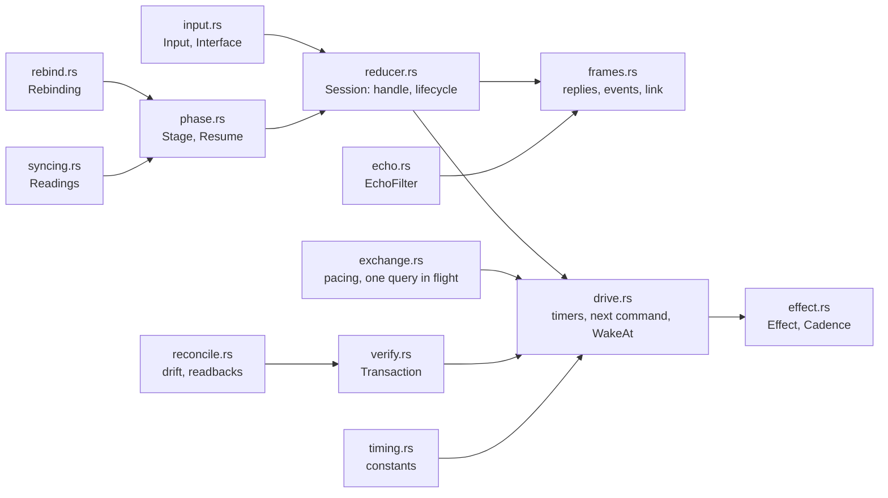
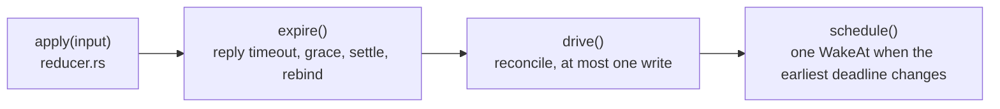
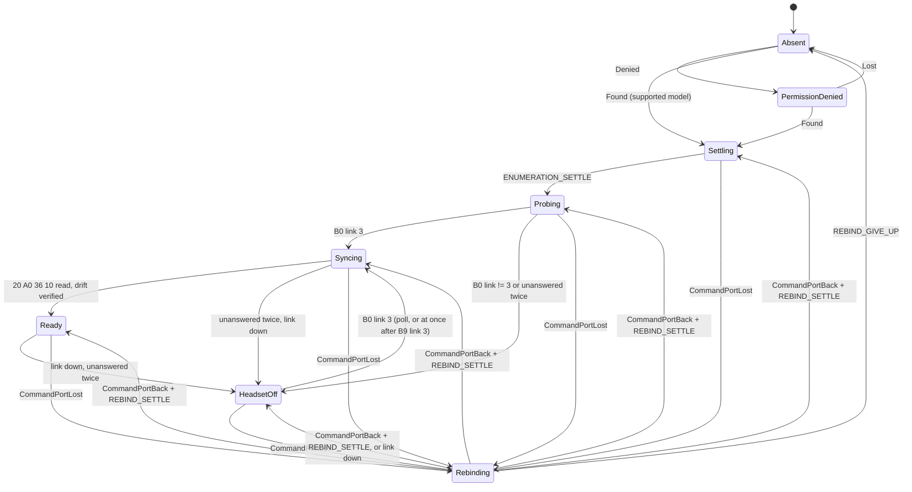
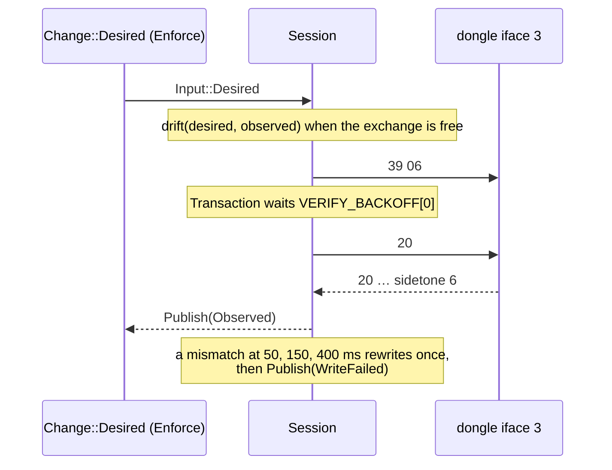
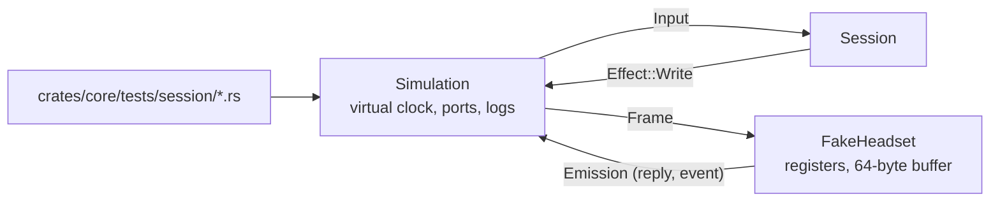

# SP4 Device Session and Testkit Implementation Plan

> **For agentic workers:** REQUIRED SUB-SKILL: Use superpowers:subagent-driven-development (recommended) or superpowers:executing-plans to implement this plan task-by-task. Steps use checkbox (`- [ ]`) syntax for tracking.

**Goal:** The sans-I/O device reducer `core::session` (lifecycle, settles, probe, silent Rebinding, echo filtering,
reconcile, pacing, write-then-verify) and `core::testkit` (`FakeHeadset`, `Simulation` with a virtual clock) in
`crates/core`, proven by one scenario table row per arrow of the device §2 diagram, every `core::session` scenario of
quality §1, and `cargo mutants` with no survivor in `session`.

**Architecture:** `Session::handle(Input, Millis) -> Vec<Effect>` is a pure state machine: it never sleeps, never
touches a descriptor and returns `WakeAt` for its next deadline. Its behaviour is split into small modules
(`exchange.rs` pacing and one query in flight, `syncing.rs` the four reads, `reconcile.rs` drift, `verify.rs` the
write transaction, `echo.rs`, `rebind.rs`, `phase.rs`), with `Session`'s own methods spread over `reducer.rs`
(inputs, lifecycle), `frames.rs` (replies and events) and `drive.rs` (timers, next command, wake). The testkit models
the dongle from the SP0 captures and drives the reducer on a virtual clock; every test is an integration test in
`crates/core/tests/session/` against the public API, as SP2 did.

**Tech Stack:** Rust 2024 (rustc 1.98, Fedora toolbox `arctis`), no new dependency (the `testkit` feature is turned on
for the crate's own tests by a dev-dependency on itself), cargo-mutants 27, cargo-llvm-cov.

Spec: `docs/superpowers/specs/2026-10-11-arctis-companion-design.md` §3 (module tree, §3.1 `core::session` interface)
and §5 (SP4 row); device part §2 (lifecycle, timing), §3 (events, echoes), §4 (write then verify), §5 (settings and
reconciliation), §6 (seam tables); quality part §1 (`core::session` row) and §2 (nightly mutants); ADR 0005, 0006,
0007; `docs/research/hardware-findings.md` §2, §4, §9 (SP0: `REBIND_SETTLE` 100 ms, the dongle answers in about 1 ms
even with the headset off so a timeout is not a headset-off signal, the first reply after a rebind carries the tail of
fwupd's `B0`).

Every code block below was compiled, formatted and tested task by task before this plan was written (and replayed
again by the plan review): each task's new tests fail on the previous task's code and pass on its own, except the
guard tests that each Step 2 names (they pin a behaviour the earlier code already has, such as "no desired, no
write", so a later change cannot break it), and the final tree has no `cargo mutants` survivor in
`crates/core/src/session/`.

---

## Conventions for every task

- Worktree: `/home/marcelo/Desenvolvimento/arctis-wt/sp4`, branch `sp4-session`. Never touch
  `/home/marcelo/Desenvolvimento/arctis-companion`. Stay inside `crates/core` (session, testkit, their tests, the
  manifest and `lib.rs`), `.cargo/mutants.toml`, `Cargo.lock` and `docs/architecture/`.
- **Run (toolbox):** `X` means
  `toolbox run -c arctis bash -lc 'cd /home/marcelo/Desenvolvimento/arctis-wt/sp4 && X'`.
  Git and `gh` run on the host in the worktree. Tools from `cargo install` live in `~/.cargo/bin`, which the toolbox
  login shell does not put on `PATH`: commands that use them start with `export PATH="$HOME/.cargo/bin:$PATH" &&`.
- SP4 never opens `/dev/hidraw*`. All hardware facts come from the goldens in `crates/core/tests/golden/` and
  `docs/research/hardware-findings.md`.
- No comments in any file of any language, doc comments included. Names and small functions carry the meaning.
- Clippy policy applies to tests too: cognitive complexity 8, 40 lines per function, nesting 3, at most 4 arguments
  (`self` counts), `unwrap()` only inside `#[test]` functions. When clippy objects, extract a function or rename;
  never add an `allow` or `expect` attribute. No dead code at any commit: each task adds only what its tests use.
- Code blocks are the `cargo fmt` output. Diff blocks are unified diffs against the state the previous task left
  (after `cargo fmt`); apply them by hand or save them and run `git apply`.
- Commit subjects are conventional (`type(scope): summary`). Never write `Co-Authored-By`, "Generated with", or any
  AI or tool name in a commit message, PR title or PR body. Never use `--no-verify`.
- Push after every commit: `git push -u origin sp4-session` the first time, then `git push`. After a
  `git rebase origin/main` that moved the published branch, push with `git push --force-with-lease`.
- SP6 (`core::companion`, `core::battery`, `core::view`, `core::ports`, `testkit::memory_repositories`) and SP7 are
  built in parallel. Before Task 1 and before the pull request run `git fetch origin && git rebase origin/main`.
  Expected conflicts are additive only: `crates/core/src/lib.rs` (both module lists stay, sorted),
  `crates/core/Cargo.toml` (one `[features] testkit = []` and one self dev-dependency, whoever adds them first),
  `crates/core/src/testkit/mod.rs` (both `mod` and `pub use` lines stay), `docs/architecture/README.md` (both rows
  stay) and `Cargo.lock` (regenerate with `cargo metadata --format-version 1 >/dev/null` in the toolbox).

## Acceptance criteria → tasks

SP4 row of design §5: "every arrow of the device §2 diagram and every scenario listed in quality §1 for
`core::session` passes; `cargo mutants` leaves no survivor in `session`", plus the `docs/architecture/<area>.md`
page every sub-project ends with.

| Criterion | Where it is proven | Task |
|---|---|---|
| every arrow of the device §2 diagram | `crates/core/tests/session/lifecycle.rs::every_arrow_without_rebinding_holds` (16 rows) and `crates/core/tests/session/rebinding.rs::every_rebinding_arrow_holds` (13 rows), through `support.rs::assert_arrows`; the two arrows whose trigger needs desired settings are proven in Task 4: "Ready -> Ready: desired changes (write then verify)" by `reconcile.rs::enforce_writes_only_the_drifted_fields` and "Syncing -> Ready: reconcile verified" by `reconcile.rs::desired_settings_arriving_after_probing_are_applied_before_ready` | 3, 4, 7 |
| 20 s flap for 10 virtual minutes with zero queries | `rebinding.rs::a_flap_every_20_s_for_10_minutes_sends_no_query_and_publishes_no_phase` | 7 |
| flap during Settling and during Probing | `rebinding.rs::a_flap_while_settling_restarts_the_settle`, `a_flap_while_probing_resends_the_status_query` | 7 |
| `Lost` from every phase | `lifecycle.rs::lost_from_every_present_phase_reaches_absent`, `rebinding.rs::lost_while_rebinding_reaches_absent`, arrow "PermissionDenied -> Absent" | 3, 7 |
| `REBIND_GIVE_UP` | `rebinding.rs::rebinding_gives_up_into_absent_after_rebind_give_up`, `an_event_handled_as_rebinding_gives_up_is_still_published` | 7 |
| reopen EACCES twice then succeeds, no `Phase::PermissionDenied` published | `rebinding.rs::eacces_twice_then_success_publishes_no_permission_denied` | 7 |
| node unreadable for 10 ms during a rebind | `rebinding.rs::a_node_unreadable_for_10_ms_is_retried_on_the_next_rescan` | 7 |
| stale tail from another claimant after a rebind is dropped | `rebinding.rs::a_stale_frame_from_another_claimant_is_dropped`, `the_first_reply_after_a_rebind_ignores_the_tail_of_another_claimant`, `testkit.rs::another_claimant_leaves_its_status_tail_behind` | 2, 7 |
| EIO mid-write | `rebinding.rs::a_write_lost_to_eio_is_redone_and_verified_after_reopen` | 7 |
| readback that shows the value only at the 400 ms step | `verify.rs::a_value_visible_only_at_the_400_ms_readback_passes` | 4 |
| verify mismatch | `verify.rs::a_mismatch_is_retried_once_then_reported`, `a_failed_setting_waits_for_the_next_desired_change`, `a_failed_setting_is_retried_on_the_next_syncing` (device §4: every later Syncing retries the unapplied value) | 4 |
| device that quantizes Q on write passes verify | `verify.rs::a_headset_that_quantizes_q_passes_verify` | 4 |
| `35` followed by `B9` link 2 then 3 within the grace | `wireless.rs::a_link_drop_within_the_grace_waits_for_the_link_to_return` (+ grace end, silence, boundary tests) | 6 |
| query timeout | `polling.rs::an_unanswered_query_is_resent_once_before_headset_off`, arrows "unanswered twice", `verify.rs::an_unanswered_readback_after_an_ordinary_write_means_headset_off` | 3, 4 |
| no events and the headset powers on: Syncing within `HEADSET_OFF_POLL` + settle | `polling.rs::a_headset_without_events_is_synced_within_headset_off_poll_of_powering_on`, arrow "HEADSET_OFF_POLL B0 link 3" | 3 |
| echo of an older value during a drag is consumed | `echo.rs::an_echo_of_an_older_value_during_a_drag_is_consumed` (+ command-interface echo, window end) | 5 |
| real button press during an unrelated write becomes `HeadsetChanged` | `echo.rs::a_real_press_during_an_unrelated_write_becomes_headset_changed` (+ press on the setting being written) | 5 |
| no desired → no write | `reconcile.rs::without_desired_settings_the_session_never_writes_a_setter` | 4 |
| `Adopt` and `Enforce` | `reconcile.rs::adopt_writes_nothing_and_publishes_observed`, `enforce_writes_only_the_drifted_fields` | 4 |
| desired arriving after Probing | `reconcile.rs::desired_settings_arriving_after_probing_are_applied_before_ready` | 4 |
| headset-off queueing | `reconcile.rs::desired_changes_while_the_headset_is_off_apply_on_the_next_syncing`, `rebinding.rs::desired_changes_while_rebinding_are_written_after_resume` | 4, 7 |
| safety-poll cadence | `polling.rs::ready_polls_the_status_only_after_status_safety_poll`, `battery_events_postpone_the_safety_poll`, `the_safety_poll_waits_for_the_write_transaction` | 3, 4 |
| `FakeHeadset` models registers, stale tails, Q quantization, readback latency, echo events, dropped writes, flapping iface 3, EACCES windows, silent device, bootloader PIDs; virtual clock | `crates/core/tests/session/testkit.rs` (golden fidelity), `Simulation::flap`, `Flap::unreadable_for`, `lifecycle.rs::a_bootloader_dongle_is_never_opened` | 2, 3 |
| `cargo mutants` leaves no survivor in `session` | Task 9 | 9 |
| `docs/architecture/session.md` | Task 8 | 8 |

## File structure

```
.cargo/mutants.toml                         excludes crates/core/src/testkit/** from mutation testing
crates/core/Cargo.toml                      feature `testkit`; dev-dependency on itself with that feature
crates/core/src/lib.rs                      `pub mod session;` and `#[cfg(feature = "testkit")] pub mod testkit;`
crates/core/src/session/mod.rs              module list, re-exports Session, Input, Interface, Effect, Cadence
crates/core/src/session/timing.rs           every timing constant of device §2
crates/core/src/session/input.rs            Input, Interface, From<Change>
crates/core/src/session/effect.rs           Effect, Cadence
crates/core/src/session/reducer.rs          Session: fields, handle, inputs, lifecycle, publishing
crates/core/src/session/frames.rs           Session: replies, readbacks, events, link
crates/core/src/session/drive.rs            Session: expiries, reconcile, next command, WakeAt
crates/core/src/session/phase.rs            Stage (internal phases), Resume
crates/core/src/session/syncing.rs          Readings: the four Syncing reads
crates/core/src/session/exchange.rs         Exchange: spacing, one query in flight, reply match, resend; Outgoing
crates/core/src/session/reconcile.rs        drift, same, readbacks, readings
crates/core/src/session/verify.rs           Transaction: writes, backoff readbacks, retry, grace; Progress
crates/core/src/session/echo.rs             EchoFilter
crates/core/src/session/rebind.rs           Rebinding, RebindStep
crates/core/src/testkit/mod.rs              re-exports FakeHeadset, Behaviour, Emission, Simulation, Flap
crates/core/src/testkit/fake_headset.rs     FakeHeadset, Behaviour, Emission
crates/core/src/testkit/replies.rs          reply byte layouts of the fake
crates/core/src/testkit/simulation.rs       Simulation, Flap
crates/core/tests/session/main.rs           one test binary
crates/core/tests/session/support.rs        builders, Arrow table helper, golden loader
crates/core/tests/session/contract.rs       constants, cadences, Input from Change
crates/core/tests/session/testkit.rs        FakeHeadset against the SP0 captures
crates/core/tests/session/lifecycle.rs      16 arrows, identity, bootloader, Lost, settle drain
crates/core/tests/session/polling.rs        timeouts, headset-off poll, safety poll, status events
crates/core/tests/session/reconcile.rs      desired, Adopt/Enforce, drift, Syncing, headset off, Lost
crates/core/tests/session/verify.rs         write then verify
crates/core/tests/session/echo.rs           echoes and presses
crates/core/tests/session/wireless.rs       wireless-mode grace
crates/core/tests/session/rebinding.rs      12 arrows and the Rebinding scenarios
docs/architecture/session.md                diagrams pointing at the code above
docs/architecture/README.md                 one new row, two entry points
```

Every file stays under 400 lines (largest: `rebinding.rs` tests 371, `simulation.rs` 352). Dependency direction
inside `core`: `session` uses `protocol`, `settings`, `messages`, `eq::curve`, `time`; `testkit` uses `session` and
`protocol`; nothing in `session` depends on `testkit`.

---

## Task 0: Prepare the branch

- [ ] **Step 1: Rebase and publish**

```bash
cd /home/marcelo/Desenvolvimento/arctis-wt/sp4
git fetch origin
git status --short
git rebase origin/main
git push -u origin sp4-session
```

Expected: a clean tree on `sp4-session` that contains this plan. If the push is rejected because the branch moved,
use `git push --force-with-lease`.

- [ ] **Step 2: Baseline**

Run (toolbox): `cargo test -p arctis-core && cargo xtask check-rules`
Expected: all tests pass, `check-rules` exits 0.


### Task 1: Session seam types: timing, inputs, effects

The public vocabulary of `core::session` that the hid worker (SP5) builds against: the timing constants of
device §2 (with the SP0 decisions of `docs/research/hardware-findings.md` §9), the `Input` and `Effect` tables of
device §6 and the rescan `Cadence`. Nothing here has behaviour beyond `Cadence::interval` and `From<Change>`.

**Files:**
- Modify: `crates/core/src/lib.rs`
- Create: `crates/core/src/session/effect.rs`
- Create: `crates/core/src/session/input.rs`
- Create: `crates/core/src/session/mod.rs`
- Create: `crates/core/src/session/timing.rs`
- Create: `crates/core/tests/session/contract.rs`
- Create: `crates/core/tests/session/main.rs`

- [ ] **Step 1: Write the failing tests**

Create `crates/core/tests/session/contract.rs`:

```rust
use arctis_core::eq::Curve;
use arctis_core::messages::device::{Change, SyncPolicy};
use arctis_core::session::timing::{
    COMMAND_SPACING, ECHO_WINDOW, ENUMERATION_SETTLE, HEADSET_OFF_POLL, REBIND_GIVE_UP,
    REBIND_NOTICE, REBIND_SETTLE, REPLY_TIMEOUT, RESCAN_ABSENT, RESCAN_REBINDING,
    STATUS_SAFETY_POLL, STATUS_SAFETY_POLL_FLOOR, VERIFY_BACKOFF, WIRELESS_MODE_GRACE,
};
use arctis_core::session::{Cadence, Input};
use arctis_core::settings::headset_settings::HeadsetSettings;
use arctis_core::settings::values::{AutoPowerOff, MicVolume, MuteLight, Sidetone, WirelessMode};

#[test]
fn the_timing_constants_hold_the_designed_defaults() {
    let constants = [
        (COMMAND_SPACING, 50),
        (ENUMERATION_SETTLE, 3_000),
        (REBIND_SETTLE, 100),
        (REBIND_NOTICE, 5_000),
        (REBIND_GIVE_UP, 30_000),
        (REPLY_TIMEOUT, 500),
        (ECHO_WINDOW, 1_000),
        (WIRELESS_MODE_GRACE, 5_000),
        (HEADSET_OFF_POLL, 10_000),
        (STATUS_SAFETY_POLL, 300_000),
        (STATUS_SAFETY_POLL_FLOOR, 60_000),
        (RESCAN_ABSENT, 2_000),
        (RESCAN_REBINDING, 250),
    ];
    for (constant, designed) in constants {
        assert_eq!(constant, designed);
    }
    assert_eq!(VERIFY_BACKOFF, [50, 150, 400]);
}

#[test]
fn each_cadence_names_its_rescan_interval() {
    assert_eq!(Cadence::Absent.interval(), Some(RESCAN_ABSENT));
    assert_eq!(Cadence::Rebinding.interval(), Some(RESCAN_REBINDING));
    assert_eq!(Cadence::Off.interval(), None);
}

#[test]
fn a_desired_change_becomes_a_desired_input() {
    let settings = HeadsetSettings {
        mic_volume: MicVolume::try_from(15).expect("mic volume"),
        sidetone: Sidetone::try_from(0).expect("sidetone"),
        mute_light: MuteLight::High,
        volume_limiter: true,
        wireless_mode: WirelessMode::Standard,
        auto_power_off: AutoPowerOff::NEVER,
        equalizer: Curve::default(),
    };
    let change = Change::Desired {
        settings: settings.clone(),
        policy: SyncPolicy::Adopt,
    };
    assert_eq!(
        Input::from(change),
        Input::Desired {
            settings,
            policy: SyncPolicy::Adopt
        }
    );
}
```

Create `crates/core/tests/session/main.rs`:

```rust
mod contract;
```

- [ ] **Step 2: Run them and watch them fail**

Run (toolbox): `cargo test -p arctis-core --test session`
Expected: compile error: `arctis_core::session` does not exist.

- [ ] **Step 3: Implement**

Change `crates/core/src/lib.rs` as follows (unified diff against the previous task):

```diff
--- a/crates/core/src/lib.rs
+++ b/crates/core/src/lib.rs
@@ -5,5 +5,6 @@ mod bounded;
 pub mod eq;
 pub mod messages;
 pub mod protocol;
+pub mod session;
 pub mod settings;
 pub mod time;
```

Create `crates/core/src/session/effect.rs`:

```rust
use super::timing::{RESCAN_ABSENT, RESCAN_REBINDING};
use crate::messages::device::DeviceUpdate;
use crate::protocol::Frame;
use crate::time::Millis;

#[derive(Clone, Copy, Debug, PartialEq, Eq, Hash)]
pub enum Cadence {
    Absent,
    Rebinding,
    Off,
}

impl Cadence {
    #[must_use]
    pub const fn interval(self) -> Option<u64> {
        match self {
            Self::Absent => Some(RESCAN_ABSENT),
            Self::Rebinding => Some(RESCAN_REBINDING),
            Self::Off => None,
        }
    }
}

#[derive(Clone, Debug, PartialEq, Eq)]
pub enum Effect {
    Write(Frame),
    WakeAt(Millis),
    Rescan(Cadence),
    Publish(DeviceUpdate),
}
```

Create `crates/core/src/session/input.rs`:

```rust
use crate::messages::device::{Change, SyncPolicy};
use crate::settings::headset_settings::HeadsetSettings;

#[derive(Clone, Copy, Debug, PartialEq, Eq, Hash)]
pub enum Interface {
    Command,
    Events,
}

#[derive(Clone, Debug, PartialEq, Eq)]
pub enum Input {
    Found {
        pid: u16,
        uniq: Option<String>,
    },
    Denied,
    Lost,
    CommandPortLost,
    CommandPortDenied,
    CommandPortBack,
    Reply(Vec<u8>),
    Unsolicited {
        interface: Interface,
        bytes: Vec<u8>,
    },
    Woke,
    Desired {
        settings: HeadsetSettings,
        policy: SyncPolicy,
    },
}

impl From<Change> for Input {
    fn from(change: Change) -> Self {
        match change {
            Change::Desired { settings, policy } => Self::Desired { settings, policy },
        }
    }
}
```

Create `crates/core/src/session/mod.rs`:

```rust
mod effect;
mod input;
pub mod timing;

pub use effect::{Cadence, Effect};
pub use input::{Input, Interface};
```

Create `crates/core/src/session/timing.rs`:

```rust
pub const COMMAND_SPACING: u64 = 50;
pub const ENUMERATION_SETTLE: u64 = 3_000;
pub const REBIND_SETTLE: u64 = 100;
pub const REBIND_NOTICE: u64 = 5_000;
pub const REBIND_GIVE_UP: u64 = 30_000;
pub const REPLY_TIMEOUT: u64 = 500;
pub const VERIFY_BACKOFF: [u64; 3] = [50, 150, 400];
pub const ECHO_WINDOW: u64 = 1_000;
pub const WIRELESS_MODE_GRACE: u64 = 5_000;
pub const HEADSET_OFF_POLL: u64 = 10_000;
pub const STATUS_SAFETY_POLL: u64 = 300_000;
pub const STATUS_SAFETY_POLL_FLOOR: u64 = 60_000;
pub const RESCAN_ABSENT: u64 = 2_000;
pub const RESCAN_REBINDING: u64 = 250;

const _: () = assert!(STATUS_SAFETY_POLL >= STATUS_SAFETY_POLL_FLOOR);
```

- [ ] **Step 4: Run the tests**

Run (toolbox): `cargo fmt --all && cargo test -p arctis-core --test session`
Expected: 3 passed.

- [ ] **Step 5: Full gate, commit, push**

Run (toolbox): `cargo fmt --all && cargo clippy --workspace --all-targets -- -D warnings && cargo test --workspace --exclude arctis-ui && cargo xtask check-rules && cargo xtask check-pure`
Expected: no warning, every test passes, both checks exit 0.

```bash
cd /home/marcelo/Desenvolvimento/arctis-wt/sp4
git add crates/core/tests/session/contract.rs crates/core/tests/session/main.rs crates/core/src/lib.rs crates/core/src/session/effect.rs crates/core/src/session/input.rs crates/core/src/session/mod.rs crates/core/src/session/timing.rs
git commit -m "feat(core): add session timing, inputs and effects"
git push
```

### Task 2: Testkit: the fake headset

`core::testkit` behind the cargo feature `testkit`. `FakeHeadset` models the dongle from the SP0 facts: it
answers every query in about 1 ms from its own copy (even with the headset off), reuses one 64-byte buffer so every
reply keeps the stale tail of the previous one (the SP0 captures are reproduced byte for byte), applies setters after
an optional readback latency, can quantize Q to steps of 10, echo writes as events on either interface, drop writes,
stay silent, emit link, battery and button events, and leave another claimant's `B0` reply (fwupd) in its buffer.
The crate's own tests turn the feature on through a dev-dependency on itself; `.cargo/mutants.toml` keeps the
testkit out of mutation testing (it is test code, the nightly job mutates the whole crate).

**Files:**
- Create: `.cargo/mutants.toml`
- Modify: `Cargo.lock`
- Modify: `crates/core/Cargo.toml`
- Modify: `crates/core/src/lib.rs`
- Create: `crates/core/src/testkit/fake_headset.rs`
- Create: `crates/core/src/testkit/mod.rs`
- Create: `crates/core/src/testkit/replies.rs`
- Modify: `crates/core/tests/session/main.rs`
- Create: `crates/core/tests/session/support.rs`
- Create: `crates/core/tests/session/testkit.rs`

- [ ] **Step 1: Write the failing tests**

Replace the whole of `crates/core/tests/session/main.rs` with:

```rust
mod support;

mod contract;
mod testkit;
```

Create `crates/core/tests/session/support.rs`:

```rust
use std::fs;
use std::path::Path;

use arctis_core::eq::{Filter, FilterKind};
use arctis_core::settings::values::Sidetone;

pub fn golden(name: &str) -> Vec<u8> {
    let path = Path::new(env!("CARGO_MANIFEST_DIR"))
        .join("tests/golden")
        .join(name);
    let text = fs::read_to_string(path).expect("golden file is readable");
    text.split_whitespace()
        .map(|byte| u8::from_str_radix(byte, 16).expect("golden bytes are hex"))
        .collect()
}

pub fn filter(kind: FilterKind, hz: u16, half_db: i8, milli_q: u16) -> Filter {
    Filter::from_parts(kind, hz, half_db, milli_q).expect("filter in envelope")
}

pub fn sidetone(level: u8) -> Sidetone {
    Sidetone::try_from(level).expect("sidetone")
}
```

Create `crates/core/tests/session/testkit.rs`:

```rust
use arctis_core::eq::{Curve, FilterKind};
use arctis_core::protocol::{Command, Query, encode};
use arctis_core::session::Interface;
use arctis_core::settings::headset_settings::SettingChange;
use arctis_core::settings::values::Percent;
use arctis_core::testkit::{Behaviour, FakeHeadset};
use arctis_core::time::Millis;

use crate::support::{filter, golden, sidetone};

fn ask(headset: &mut FakeHeadset, query: Query) -> Vec<u8> {
    let emissions = headset.receive(&encode(&Command::from(query)), Millis(0));
    emissions.into_iter().next().expect("a reply").bytes
}

#[test]
fn replies_with_the_headset_on_match_the_captures() {
    let mut headset = FakeHeadset::nova_5();
    assert_eq!(
        ask(&mut headset, Query::Firmware),
        golden("reply_10_headset_on.hex")
    );
    assert_eq!(
        ask(&mut headset, Query::Status),
        golden("reply_b0_link3_headset_on.hex")
    );
    assert_eq!(
        ask(&mut headset, Query::Audio),
        golden("reply_20_flat_headset_on.hex")
    );
    assert_eq!(
        ask(&mut headset, Query::Ux),
        golden("reply_a0_headset_on.hex")
    );
}

#[test]
fn the_wireless_reply_keeps_the_audio_reply_tail() {
    let mut headset = FakeHeadset::nova_5();
    ask(&mut headset, Query::Audio);
    assert_eq!(
        ask(&mut headset, Query::Wireless),
        golden("reply_36_speed_headset_on.hex")
    );
}

#[test]
fn replies_with_the_headset_off_match_the_captures() {
    let mut headset = FakeHeadset::nova_5()
        .powered_off()
        .with_battery(Percent::try_from(32).expect("percent"));
    ask(&mut headset, Query::Audio);
    assert_eq!(
        ask(&mut headset, Query::Ux),
        golden("reply_a0_headset_off.hex")
    );
    assert_eq!(
        ask(&mut headset, Query::Status),
        golden("reply_b0_link2_headset_off.hex")
    );
    ask(&mut headset, Query::Audio);
    assert_eq!(
        ask(&mut headset, Query::Firmware),
        golden("reply_10_headset_off.hex")
    );
}

#[test]
fn another_claimant_leaves_its_status_tail_behind() {
    let mut headset = FakeHeadset::nova_5();
    ask(&mut headset, Query::Audio);
    headset.claimed_by_other();
    assert_eq!(
        ask(&mut headset, Query::Wireless),
        golden("reply_36_tail_from_fwupd_b0.hex")
    );
}

#[test]
fn a_setter_changes_the_register_it_names() {
    let mut headset = FakeHeadset::nova_5();
    headset.receive(&encode(&Command::SetSidetone(sidetone(6))), Millis(0));
    assert_eq!(headset.settings().sidetone, sidetone(6));
}

#[test]
fn a_write_lands_after_the_readback_latency() {
    let mut headset = FakeHeadset::nova_5().with_behaviour(Behaviour {
        readback_latency: 300,
        ..Behaviour::default()
    });
    headset.receive(&encode(&Command::SetSidetone(sidetone(6))), Millis(0));
    ask(&mut headset, Query::Audio);
    assert_eq!(headset.settings().sidetone, sidetone(0));
    headset.receive(&encode(&Command::from(Query::Audio)), Millis(300));
    assert_eq!(headset.settings().sidetone, sidetone(6));
}

#[test]
fn a_quantizing_headset_stores_q_in_steps_of_ten() {
    let mut headset = FakeHeadset::nova_5().with_behaviour(Behaviour {
        quantizes_q: true,
        ..Behaviour::default()
    });
    let curve = Curve::from_array([filter(FilterKind::Peaking, 1_000, 4, 1_414)]);
    headset.receive(&encode(&Command::SetEqualizer(curve)), Millis(0));
    assert_eq!(headset.settings().equalizer.filters()[0].q().milli(), 1_410);
}

#[test]
fn an_echoing_headset_reports_the_written_value_as_an_event() {
    let mut headset = FakeHeadset::nova_5().with_behaviour(Behaviour {
        echo_delay: Some(20),
        ..Behaviour::default()
    });
    let emissions = headset.receive(&encode(&Command::SetSidetone(sidetone(6))), Millis(100));
    assert_eq!(emissions.len(), 1);
    assert_eq!(emissions[0].at, Millis(120));
    assert_eq!(emissions[0].interface, Interface::Events);
    assert_eq!(emissions[0].bytes[..2], [0x39, 0x06]);
}

#[test]
fn a_press_changes_the_register_and_sends_an_event() {
    let mut headset = FakeHeadset::nova_5();
    let emissions = headset.press(SettingChange::Sidetone(sidetone(3)), Millis(5));
    assert_eq!(headset.settings().sidetone, sidetone(3));
    assert_eq!(emissions[0].bytes[..2], [0x39, 0x03]);
}

#[test]
fn a_silent_headset_answers_nothing() {
    let mut headset = FakeHeadset::nova_5().with_behaviour(Behaviour {
        reply_latency: None,
        ..Behaviour::default()
    });
    let emissions = headset.receive(&encode(&Command::from(Query::Status)), Millis(0));
    assert!(emissions.is_empty());
}
```

- [ ] **Step 2: Run them and watch them fail**

Run (toolbox): `cargo test -p arctis-core --test session`
Expected: compile error: `arctis_core::testkit` does not exist.

- [ ] **Step 3: Implement**

Create `.cargo/mutants.toml`:

```toml
exclude_globs = ["crates/core/src/testkit/**"]
```

Change `crates/core/Cargo.toml` as follows (unified diff against the previous task):

```diff
--- a/crates/core/Cargo.toml
+++ b/crates/core/Cargo.toml
@@ -8,7 +8,11 @@ publish.workspace = true
 [dependencies]
 serde = { version = "1", features = ["derive"] }
 
+[features]
+testkit = []
+
 [dev-dependencies]
+arctis-core = { path = ".", features = ["testkit"] }
 allocation-counter = "0.8.1"
 proptest = "1.12"
 serde_json = "1"
```

Change `crates/core/src/lib.rs` as follows (unified diff against the previous task):

```diff
--- a/crates/core/src/lib.rs
+++ b/crates/core/src/lib.rs
@@ -7,4 +7,6 @@ pub mod messages;
 pub mod protocol;
 pub mod session;
 pub mod settings;
+#[cfg(feature = "testkit")]
+pub mod testkit;
 pub mod time;
```

Create `crates/core/src/testkit/fake_headset.rs`:

```rust
use super::replies;
use crate::eq::library::flat;
use crate::eq::{Curve, Filter};
use crate::protocol::eq_wire::decode_curve;
use crate::protocol::event::{DeviceEvent, decode_event};
use crate::protocol::frame::PAYLOAD_LEN;
use crate::protocol::status::{Charging, Link, Status};
use crate::protocol::{Command, Frame, Query, encode};
use crate::session::Interface;
use crate::settings::headset_settings::{HeadsetSettings, SettingChange};
use crate::settings::values::{
    AutoPowerOff, MicVolume, MuteLight, Percent, Sidetone, WirelessMode,
};
use crate::time::Millis;

const NOVA_5: u16 = 0x2232;
const FWUPD_STATUS: [u8; 8] = [0xB0, 0x02, 0x02, 0x20, 0x03, 0x00, 0x00, 0x01];
const Q_STEP: u16 = 10;

#[derive(Clone, Copy, Debug, PartialEq, Eq)]
pub struct Behaviour {
    pub reply_latency: Option<u64>,
    pub readback_latency: u64,
    pub echo_delay: Option<u64>,
    pub event_interface: Interface,
    pub quantizes_q: bool,
    pub drops_writes: bool,
    pub sends_events: bool,
}

impl Default for Behaviour {
    fn default() -> Self {
        Self {
            reply_latency: Some(1),
            readback_latency: 0,
            echo_delay: None,
            event_interface: Interface::Events,
            quantizes_q: false,
            drops_writes: false,
            sends_events: true,
        }
    }
}

#[derive(Clone, Debug, PartialEq, Eq)]
pub struct Emission {
    pub at: Millis,
    pub interface: Interface,
    pub bytes: Vec<u8>,
}

#[derive(Clone, Debug)]
pub struct FakeHeadset {
    pub pid: u16,
    pub uniq: Option<String>,
    pub behaviour: Behaviour,
    settings: HeadsetSettings,
    landing: Vec<(Millis, SettingChange)>,
    status: Status,
    buffer: [u8; PAYLOAD_LEN],
    received: Vec<Frame>,
}

impl FakeHeadset {
    #[must_use]
    pub fn nova_5() -> Self {
        Self {
            pid: NOVA_5,
            uniq: None,
            behaviour: Behaviour::default(),
            settings: factory_settings(),
            landing: Vec::new(),
            status: Status {
                link: Link::Connected,
                battery: percent(37),
                charging: Charging::Discharging,
            },
            buffer: [0; PAYLOAD_LEN],
            received: Vec::new(),
        }
    }

    #[must_use]
    pub fn with_pid(mut self, pid: u16) -> Self {
        self.pid = pid;
        self
    }

    #[must_use]
    pub fn with_behaviour(mut self, behaviour: Behaviour) -> Self {
        self.behaviour = behaviour;
        self
    }

    #[must_use]
    pub fn powered_off(mut self) -> Self {
        self.status.link = Link::HeadsetOff;
        self
    }

    #[must_use]
    pub fn with_battery(mut self, battery: Percent) -> Self {
        self.status.battery = battery;
        self
    }

    #[must_use]
    pub fn settings(&self) -> &HeadsetSettings {
        &self.settings
    }

    #[must_use]
    pub fn status(&self) -> Status {
        self.status
    }

    #[must_use]
    pub fn received(&self) -> &[Frame] {
        &self.received
    }

    pub fn set(&mut self, change: SettingChange) {
        self.settings.apply(change);
    }

    pub fn receive(&mut self, frame: &Frame, now: Millis) -> Vec<Emission> {
        self.received.push(frame.clone());
        self.land(now);
        let payload = frame.payload();
        match payload.first().copied().and_then(query_for) {
            Some(query) => self.reply(query, now),
            None => self.write(payload, now),
        }
    }

    pub fn link_event(&mut self, link: Link, now: Millis) -> Vec<Emission> {
        self.status.link = link;
        self.event(vec![0xB9, link.raw()], now)
    }

    pub fn battery_event(&mut self, battery: Percent, now: Millis) -> Vec<Emission> {
        self.status.battery = battery;
        self.event(vec![0xB7, battery.get()], now)
    }

    pub fn press(&mut self, change: SettingChange, now: Millis) -> Vec<Emission> {
        let bytes = event_bytes(&change);
        self.settings.apply(change);
        self.event(bytes, now)
    }

    pub fn claimed_by_other(&mut self) {
        self.fill(&FWUPD_STATUS);
    }

    #[must_use]
    pub fn other_claimant_reply() -> Vec<u8> {
        let mut bytes = FWUPD_STATUS.to_vec();
        bytes.resize(PAYLOAD_LEN, 0);
        bytes
    }

    fn reply(&mut self, query: Query, now: Millis) -> Vec<Emission> {
        let Some(latency) = self.behaviour.reply_latency else {
            return Vec::new();
        };
        let bytes = self.reply_bytes(query);
        self.fill(&bytes);
        vec![Emission {
            at: now.after(latency),
            interface: Interface::Command,
            bytes: self.buffer.to_vec(),
        }]
    }

    fn reply_bytes(&self, query: Query) -> Vec<u8> {
        match query {
            Query::Status => replies::status(self.status),
            Query::Firmware => replies::firmware(self.status.link.is_connected()),
            Query::Audio => replies::audio(&self.settings),
            Query::Ux => replies::ux(&self.settings, self.status.link.is_connected()),
            Query::Wireless => replies::wireless(&self.settings),
        }
    }

    fn write(&mut self, payload: &[u8], now: Millis) -> Vec<Emission> {
        let Some(change) = self.decode_setter(payload) else {
            return Vec::new();
        };
        if self.behaviour.drops_writes {
            return Vec::new();
        }
        let echo = self.echo(&change, now);
        self.landing
            .push((now.after(self.behaviour.readback_latency), change));
        self.land(now);
        echo
    }

    fn decode_setter(&self, payload: &[u8]) -> Option<SettingChange> {
        match payload.first()? {
            0x33 => decode_curve(payload)
                .ok()
                .map(|curve| SettingChange::Equalizer(self.stored(curve))),
            0x35 => WirelessMode::try_from(*payload.get(1)?)
                .ok()
                .map(SettingChange::WirelessMode),
            _ => match decode_event(payload)? {
                DeviceEvent::Setting(change) => Some(change),
                _ => None,
            },
        }
    }

    fn stored(&self, curve: Curve) -> Curve {
        if !self.behaviour.quantizes_q {
            return curve;
        }
        let filters = curve
            .filters()
            .iter()
            .map(|filter| quantized(*filter))
            .collect();
        Curve::new(filters).unwrap_or(curve)
    }

    fn echo(&self, change: &SettingChange, now: Millis) -> Vec<Emission> {
        let Some(delay) = self.behaviour.echo_delay else {
            return Vec::new();
        };
        if matches!(
            change,
            SettingChange::Equalizer(_) | SettingChange::WirelessMode(_)
        ) {
            return Vec::new();
        }
        vec![self.emission(event_bytes(change), now.after(delay))]
    }

    fn event(&self, bytes: Vec<u8>, now: Millis) -> Vec<Emission> {
        if !self.behaviour.sends_events {
            return Vec::new();
        }
        vec![self.emission(bytes, now)]
    }

    fn emission(&self, mut bytes: Vec<u8>, at: Millis) -> Emission {
        bytes.resize(PAYLOAD_LEN, 0);
        Emission {
            at,
            interface: self.behaviour.event_interface,
            bytes,
        }
    }

    fn land(&mut self, now: Millis) {
        let (landed, waiting) = self.landing.drain(..).partition(|(at, _)| *at <= now);
        self.landing = waiting;
        for (_, change) in landed {
            self.settings.apply(change);
        }
    }

    fn fill(&mut self, bytes: &[u8]) {
        let length = bytes.len().min(PAYLOAD_LEN);
        self.buffer[..length].copy_from_slice(&bytes[..length]);
    }
}

fn query_for(id: u8) -> Option<Query> {
    Query::ALL.into_iter().find(|query| query.id() == id)
}

fn event_bytes(change: &SettingChange) -> Vec<u8> {
    let frame = encode(&Command::from(change.clone()));
    frame.payload()[..2].to_vec()
}

fn quantized(filter: Filter) -> Filter {
    let milli = filter.q().milli();
    let rounded = (milli + Q_STEP / 2) / Q_STEP * Q_STEP;
    Filter::from_parts(
        filter.kind(),
        filter.hz().get(),
        filter.gain().half_db(),
        rounded,
    )
    .map_or(filter, |rounded| rounded.with_enabled(filter.is_enabled()))
}

fn factory_settings() -> HeadsetSettings {
    HeadsetSettings {
        mic_volume: MicVolume::try_from(15).expect("a factory value is in range"),
        sidetone: Sidetone::try_from(0).expect("a factory value is in range"),
        mute_light: MuteLight::High,
        volume_limiter: true,
        wireless_mode: WirelessMode::Standard,
        auto_power_off: AutoPowerOff::CHOICES[5],
        equalizer: flat().curve().clone(),
    }
}

fn percent(value: u8) -> Percent {
    Percent::try_from(value).expect("a factory value is in range")
}
```

Create `crates/core/src/testkit/mod.rs`:

```rust
mod fake_headset;
mod replies;

pub use fake_headset::{Behaviour, Emission, FakeHeadset};
```

Create `crates/core/src/testkit/replies.rs`:

```rust
use crate::protocol::eq_wire::encode_curve;
use crate::protocol::status::Status;
use crate::settings::headset_settings::HeadsetSettings;

const RECEIVER_AND_UNKNOWN: &[u8; 24] = b"0.01.010.000............";
const HEADSET_REACHABLE: &[u8; 12] = b"000000001.07";
const HEADSET_UNREACHABLE: &[u8; 12] = b"000000000000";
const UX_TRAILER: [u8; 4] = [0x01, 0x01, 0x00, 0x01];
const UX_HEADSET_ON: u8 = 0x00;
const UX_HEADSET_OFF: u8 = 0xFF;

pub(super) fn status(status: Status) -> Vec<u8> {
    let link = status.link.raw();
    vec![
        0xB0,
        link,
        link,
        status.battery.get(),
        status.charging.raw(),
        0x00,
        0x00,
    ]
}

pub(super) fn firmware(headset_on: bool) -> Vec<u8> {
    let headset = if headset_on {
        HEADSET_REACHABLE
    } else {
        HEADSET_UNREACHABLE
    };
    let mut bytes = vec![0x10];
    bytes.extend_from_slice(RECEIVER_AND_UNKNOWN);
    bytes.extend_from_slice(headset);
    bytes
}

pub(super) fn audio(settings: &HeadsetSettings) -> Vec<u8> {
    let mut bytes = vec![0x20];
    bytes.extend_from_slice(&encode_curve(&settings.equalizer));
    bytes.extend_from_slice(&[
        settings.mic_volume.get(),
        settings.sidetone.get(),
        u8::from(settings.volume_limiter),
    ]);
    bytes
}

pub(super) fn ux(settings: &HeadsetSettings, headset_on: bool) -> Vec<u8> {
    let presence = if headset_on {
        UX_HEADSET_ON
    } else {
        UX_HEADSET_OFF
    };
    let mut bytes = vec![
        0xA0,
        settings.auto_power_off.minutes(),
        settings.mute_light.raw(),
        presence,
    ];
    bytes.extend_from_slice(&UX_TRAILER);
    bytes
}

pub(super) fn wireless(settings: &HeadsetSettings) -> Vec<u8> {
    vec![0x36, settings.wireless_mode.raw()]
}
```

`Cargo.lock` gains the line `"arctis-core",` in the dependencies of `arctis-core` (cargo writes it; commit it).

- [ ] **Step 4: Run the tests**

Run (toolbox): `cargo fmt --all && cargo test -p arctis-core --test session`
Expected: 13 passed (3 contract + 10 testkit).

- [ ] **Step 5: Full gate, commit, push**

Run (toolbox): `cargo fmt --all && cargo clippy --workspace --all-targets -- -D warnings && cargo test --workspace --exclude arctis-ui && cargo xtask check-rules && cargo xtask check-pure`
Expected: no warning, every test passes, both checks exit 0.

```bash
cd /home/marcelo/Desenvolvimento/arctis-wt/sp4
git add crates/core/tests/session/main.rs crates/core/tests/session/support.rs crates/core/tests/session/testkit.rs .cargo/mutants.toml crates/core/Cargo.toml crates/core/src/lib.rs crates/core/src/testkit/fake_headset.rs crates/core/src/testkit/mod.rs crates/core/src/testkit/replies.rs Cargo.lock
git commit -m "test(core): add the fake headset testkit"
git push
```

### Task 3: Session lifecycle without writes: discovery, settle, probe, sync, headset off

The reducer itself plus the `Simulation` driver. This task delivers every arrow of the device §2 diagram that does
not involve Rebinding, the query timeout and resend, the `HEADSET_OFF_POLL` and `STATUS_SAFETY_POLL` cadences, status
events and the Identity/Observed publishes of Syncing. No setter is ever written yet (`Input::Desired` and the
command-port inputs are accepted and ignored until Tasks 4 and 7).

How `Session::handle` works (all tasks keep this shape): `now` and the outbox are fields for the duration of one call
(every function stays at four parameters or fewer); `apply` routes the input, `expire` handles reply deadlines and
stage timers, `drive` sends at most one frame when `Exchange::free_at` allows it (`COMMAND_SPACING`, one query in
flight), `schedule` emits one `WakeAt` when the earliest deadline changes. A spurious `Woke` is harmless.

`Simulation` keeps a virtual clock and executes effects: `Write` goes to the `FakeHeadset` (its emissions are queued
by time), `WakeAt` arms the clock, `Rescan(Rebinding)` makes it rescan every `RESCAN_REBINDING` and feed
`CommandPortDenied`/`CommandPortBack` according to the scripted `Flap`, `Publish` is logged. It asserts that the
session never writes while the command node is gone and stops after 20 000 steps so a runaway loop fails fast.

**Files:**
- Create: `crates/core/src/session/drive.rs`
- Create: `crates/core/src/session/exchange.rs`
- Create: `crates/core/src/session/frames.rs`
- Modify: `crates/core/src/session/mod.rs`
- Create: `crates/core/src/session/phase.rs`
- Create: `crates/core/src/session/reducer.rs`
- Create: `crates/core/src/session/syncing.rs`
- Modify: `crates/core/src/testkit/mod.rs`
- Create: `crates/core/src/testkit/simulation.rs`
- Create: `crates/core/tests/session/lifecycle.rs`
- Modify: `crates/core/tests/session/main.rs`
- Create: `crates/core/tests/session/polling.rs`
- Modify: `crates/core/tests/session/support.rs`

- [ ] **Step 1: Write the failing tests**

Create `crates/core/tests/session/lifecycle.rs`:

```rust
use arctis_core::messages::device::{DeviceUpdate, Phase};
use arctis_core::protocol::firmware::{Firmware, Version};
use arctis_core::protocol::model::{Model, ModelLookup};
use arctis_core::session::timing::{
    COMMAND_SPACING, ENUMERATION_SETTLE, HEADSET_OFF_POLL, REPLY_TIMEOUT, STATUS_SAFETY_POLL,
};
use arctis_core::session::{Cadence, Interface, Session};
use arctis_core::testkit::{Behaviour, Emission, FakeHeadset, Simulation};
use arctis_core::time::Millis;

use crate::support::{
    Arrow, SETTLED, absent, arrow, assert_arrows, headset_off, percent, plugged, probing,
    probing_silent, ready, settling, silent, syncing, syncing_silent,
};

const ARROWS: [Arrow; 16] = [
    arrow(
        "Absent -> PermissionDenied: open EACCES",
        absent,
        Simulation::deny,
        Phase::PermissionDenied,
    ),
    arrow(
        "Absent -> Settling: both interfaces opened",
        absent,
        Simulation::plug,
        Phase::Settling,
    ),
    arrow(
        "PermissionDenied -> Settling: open succeeds on rescan",
        permission_denied,
        Simulation::plug,
        Phase::Settling,
    ),
    arrow(
        "PermissionDenied -> Absent: dongle gone",
        permission_denied,
        Simulation::unplug,
        Phase::Absent,
    ),
    arrow(
        "Settling -> Probing: ENUMERATION_SETTLE",
        settling,
        run_settle,
        Phase::Probing,
    ),
    arrow(
        "Probing -> HeadsetOff: B0 link != 3",
        probing_headset_off,
        run_reply,
        Phase::HeadsetOff,
    ),
    arrow(
        "Probing -> HeadsetOff: B0 unanswered twice",
        probing_silent,
        run_two_timeouts,
        Phase::HeadsetOff,
    ),
    arrow(
        "Probing -> Syncing: B0 link == 3",
        probing,
        run_reply,
        Phase::Syncing,
    ),
    arrow(
        "HeadsetOff -> Syncing: event B9 link 3",
        headset_off,
        power_on_with_event,
        Phase::Syncing,
    ),
    arrow(
        "HeadsetOff -> Syncing: HEADSET_OFF_POLL B0 link 3",
        headset_off_without_events,
        power_on_silently,
        Phase::Syncing,
    ),
    arrow(
        "Syncing -> Ready: replies decoded, reconcile verified",
        syncing,
        run_sync,
        Phase::Ready,
    ),
    arrow(
        "Syncing -> HeadsetOff: query unanswered twice",
        syncing_silent,
        run_two_timeouts,
        Phase::HeadsetOff,
    ),
    arrow(
        "Ready -> HeadsetOff: event B9 link != 3",
        ready,
        power_off_with_event,
        Phase::HeadsetOff,
    ),
    arrow(
        "Ready -> HeadsetOff: query unanswered twice",
        ready,
        silence_then_safety_poll,
        Phase::HeadsetOff,
    ),
    arrow("Ready -> Ready: events", ready, battery_event, Phase::Ready),
    arrow(
        "Present -> Absent: Lost",
        ready,
        Simulation::unplug,
        Phase::Absent,
    ),
];

#[test]
fn a_new_session_is_absent() {
    assert_eq!(Session::new().phase(), Phase::Absent);
}

#[test]
fn every_arrow_without_rebinding_holds() {
    assert_arrows(&ARROWS);
}

#[test]
fn the_identity_is_published_once_the_firmware_is_read() {
    let simulation = ready();
    let ModelLookup::Supported(model) = Model::lookup(0x2232) else {
        panic!("the Nova 5 is supported");
    };
    let identity = DeviceUpdate::Identity {
        model,
        uniq: None,
        firmware: Firmware {
            receiver: Some(Version {
                major: 1,
                minor: 16,
                patch: 0,
            }),
            headset: Some(Version {
                major: 1,
                minor: 7,
                patch: 0,
            }),
        },
    };
    assert!(
        simulation
            .updates()
            .iter()
            .any(|(_, update)| *update == identity)
    );
}

#[test]
fn a_bootloader_dongle_is_never_opened() {
    let mut simulation = plugged(FakeHeadset::nova_5().with_pid(0x2233));
    simulation.run_for(2 * ENUMERATION_SETTLE);
    assert_eq!(simulation.phase(), Phase::Absent);
    assert!(simulation.writes().is_empty());
    assert!(simulation.updates().is_empty());
    assert!(simulation.rescans().is_empty());
}

#[test]
fn a_found_dongle_stops_the_rescan_and_a_lost_one_restarts_it() {
    let mut simulation = settling();
    simulation.unplug();
    assert_eq!(simulation.rescans(), [Cadence::Off, Cadence::Absent]);
}

#[test]
fn lost_from_every_present_phase_reaches_absent() {
    let setups: [fn() -> Simulation; 5] = [settling, probing, syncing, headset_off, ready];
    for setup in setups {
        let mut simulation = setup();
        let before = simulation.phase();
        simulation.unplug();
        assert_eq!(simulation.phase(), Phase::Absent, "from {before:?}");
        assert_eq!(
            simulation.rescans().last(),
            Some(&Cadence::Absent),
            "from {before:?}"
        );
        assert_eq!(
            simulation.published_phases().last(),
            Some(&Phase::Absent),
            "from {before:?}"
        );
    }
}

#[test]
fn a_command_frame_during_the_enumeration_settle_is_dropped() {
    let mut simulation = settling();
    simulation.emit(vec![Emission {
        at: Millis(0),
        interface: Interface::Command,
        bytes: vec![0x39, 0x05],
    }]);
    simulation.run_for(1);
    let only_phases = simulation
        .updates()
        .iter()
        .all(|(_, update)| matches!(update, DeviceUpdate::Phase(_)));
    assert!(only_phases);
}

fn permission_denied() -> Simulation {
    let mut simulation = absent();
    simulation.deny();
    simulation
}

fn probing_headset_off() -> Simulation {
    let mut simulation = plugged(FakeHeadset::nova_5().powered_off());
    simulation.run_for(ENUMERATION_SETTLE);
    simulation
}

fn headset_off_without_events() -> Simulation {
    let quiet = Behaviour {
        sends_events: false,
        ..Behaviour::default()
    };
    let mut simulation = plugged(FakeHeadset::nova_5().powered_off().with_behaviour(quiet));
    simulation.run_until(Phase::HeadsetOff, SETTLED);
    simulation
}

fn run_settle(simulation: &mut Simulation) {
    simulation.run_for(ENUMERATION_SETTLE);
}

fn run_reply(simulation: &mut Simulation) {
    simulation.run_for(1);
}

fn run_two_timeouts(simulation: &mut Simulation) {
    simulation.run_for(2 * REPLY_TIMEOUT + COMMAND_SPACING);
}

fn run_sync(simulation: &mut Simulation) {
    simulation.run_for(1_000);
}

fn power_on_with_event(simulation: &mut Simulation) {
    simulation.power_on();
    simulation.run_for(100);
}

fn power_on_silently(simulation: &mut Simulation) {
    simulation.power_on();
    simulation.run_for(HEADSET_OFF_POLL + 10);
}

fn power_off_with_event(simulation: &mut Simulation) {
    simulation.power_off();
    simulation.run_for(10);
}

fn silence_then_safety_poll(simulation: &mut Simulation) {
    simulation.headset_mut().behaviour = silent();
    simulation.run_for(STATUS_SAFETY_POLL + 2 * REPLY_TIMEOUT);
}

fn battery_event(simulation: &mut Simulation) {
    simulation.battery(percent(50));
    simulation.run_for(10);
}
```

Change `crates/core/tests/session/main.rs` as follows (unified diff against the previous task):

```diff
--- a/crates/core/tests/session/main.rs
+++ b/crates/core/tests/session/main.rs
@@ -1,4 +1,6 @@
 mod support;
 
 mod contract;
+mod lifecycle;
+mod polling;
 mod testkit;
```

Create `crates/core/tests/session/polling.rs`:

```rust
use arctis_core::messages::device::{DeviceUpdate, Phase};
use arctis_core::protocol::status::{Charging, Link};
use arctis_core::session::timing::{
    COMMAND_SPACING, ENUMERATION_SETTLE, HEADSET_OFF_POLL, REPLY_TIMEOUT, STATUS_SAFETY_POLL,
};
use arctis_core::testkit::{Behaviour, FakeHeadset};

use crate::support::{SETTLED, headset_off, percent, plugged, ready, sent, silent};

#[test]
fn an_unanswered_query_is_resent_once_before_headset_off() {
    let mut simulation = plugged(FakeHeadset::nova_5().with_behaviour(silent()));
    simulation.run_until(Phase::HeadsetOff, SETTLED);
    let times: Vec<_> = simulation.writes().iter().map(|(at, _)| at.0).collect();
    assert_eq!(
        times,
        [ENUMERATION_SETTLE, ENUMERATION_SETTLE + REPLY_TIMEOUT]
    );
    assert_eq!(simulation.now().0, ENUMERATION_SETTLE + 2 * REPLY_TIMEOUT);
}

#[test]
fn a_headset_without_events_is_synced_within_headset_off_poll_of_powering_on() {
    let quiet = Behaviour {
        sends_events: false,
        ..Behaviour::default()
    };
    let mut simulation = plugged(FakeHeadset::nova_5().powered_off().with_behaviour(quiet));
    simulation.run_until(Phase::HeadsetOff, SETTLED);
    simulation.power_on();
    let waited = simulation.run_until(Phase::Syncing, HEADSET_OFF_POLL + COMMAND_SPACING);
    assert!(waited <= HEADSET_OFF_POLL + 1);
}

#[test]
fn headset_off_polls_the_status_every_headset_off_poll() {
    let mut simulation = headset_off();
    simulation.clear_logs();
    simulation.run_for(6 * HEADSET_OFF_POLL);
    assert_eq!(simulation.sent_ids(), [0xB0; 6]);
}

#[test]
fn ready_polls_the_status_only_after_status_safety_poll() {
    let mut simulation = ready();
    simulation.clear_logs();
    simulation.run_for(STATUS_SAFETY_POLL - 1_000);
    assert_eq!(sent(&simulation, 0xB0), 0);
    simulation.run_for(STATUS_SAFETY_POLL);
    assert_eq!(simulation.sent_ids(), [0xB0]);
}

#[test]
fn battery_events_postpone_the_safety_poll() {
    let mut simulation = ready();
    simulation.clear_logs();
    for _ in 0..4 {
        simulation.run_for(STATUS_SAFETY_POLL - 60_000);
        simulation.battery(percent(40));
    }
    assert_eq!(sent(&simulation, 0xB0), 0);
}

#[test]
fn status_events_are_published_with_the_last_known_status() {
    let mut simulation = ready();
    simulation.clear_logs();
    simulation.battery(percent(50));
    simulation.run_for(1);
    let expected = DeviceUpdate::Status {
        battery: percent(50),
        charging: Charging::Discharging,
        link: Link::Connected,
    };
    assert_eq!(
        simulation.updates().last().map(|(_, update)| update),
        Some(&expected)
    );
}
```

Replace the whole of `crates/core/tests/session/support.rs` with:

```rust
use std::fs;
use std::path::Path;

use arctis_core::eq::{Filter, FilterKind};
use arctis_core::messages::device::Phase;
use arctis_core::session::timing::ENUMERATION_SETTLE;
use arctis_core::settings::values::{Percent, Sidetone};
use arctis_core::testkit::{Behaviour, FakeHeadset, Simulation};

pub const SETTLED: u64 = ENUMERATION_SETTLE + 1_000;

pub struct Arrow {
    pub name: &'static str,
    pub from: fn() -> Simulation,
    pub trigger: fn(&mut Simulation),
    pub to: Phase,
}

pub const fn arrow(
    name: &'static str,
    from: fn() -> Simulation,
    trigger: fn(&mut Simulation),
    to: Phase,
) -> Arrow {
    Arrow {
        name,
        from,
        trigger,
        to,
    }
}

pub fn assert_arrows(arrows: &[Arrow]) {
    let mut names: Vec<_> = arrows.iter().map(|arrow| arrow.name).collect();
    names.sort_unstable();
    names.dedup();
    assert_eq!(names.len(), arrows.len(), "each arrow is named once");
    for arrow in arrows {
        let mut simulation = (arrow.from)();
        (arrow.trigger)(&mut simulation);
        assert_eq!(simulation.phase(), arrow.to, "{}", arrow.name);
    }
}

pub fn silent() -> Behaviour {
    Behaviour {
        reply_latency: None,
        ..Behaviour::default()
    }
}

pub fn absent() -> Simulation {
    Simulation::new(FakeHeadset::nova_5())
}

pub fn plugged(headset: FakeHeadset) -> Simulation {
    let mut simulation = Simulation::new(headset);
    simulation.plug();
    simulation
}

pub fn settling() -> Simulation {
    plugged(FakeHeadset::nova_5())
}

pub fn probing() -> Simulation {
    let mut simulation = settling();
    simulation.run_for(ENUMERATION_SETTLE);
    simulation
}

pub fn probing_silent() -> Simulation {
    let mut simulation = plugged(FakeHeadset::nova_5().with_behaviour(silent()));
    simulation.run_for(ENUMERATION_SETTLE);
    simulation
}

pub fn syncing() -> Simulation {
    let mut simulation = probing();
    simulation.run_for(1);
    simulation
}

pub fn syncing_silent() -> Simulation {
    let mut simulation = syncing();
    simulation.headset_mut().behaviour = silent();
    simulation
}

pub fn headset_off() -> Simulation {
    let mut simulation = plugged(FakeHeadset::nova_5().powered_off());
    simulation.run_until(Phase::HeadsetOff, SETTLED);
    simulation
}

pub fn ready() -> Simulation {
    ready_with(FakeHeadset::nova_5())
}

pub fn ready_with(headset: FakeHeadset) -> Simulation {
    let mut simulation = plugged(headset);
    simulation.run_until(Phase::Ready, SETTLED);
    simulation
}

pub fn sent(simulation: &Simulation, id: u8) -> usize {
    simulation
        .writes()
        .iter()
        .filter(|(_, frame)| frame.payload()[0] == id)
        .count()
}

pub fn sidetone(level: u8) -> Sidetone {
    Sidetone::try_from(level).expect("sidetone")
}

pub fn percent(value: u8) -> Percent {
    Percent::try_from(value).expect("percent")
}

pub fn golden(name: &str) -> Vec<u8> {
    let path = Path::new(env!("CARGO_MANIFEST_DIR"))
        .join("tests/golden")
        .join(name);
    let text = fs::read_to_string(path).expect("golden file is readable");
    text.split_whitespace()
        .map(|byte| u8::from_str_radix(byte, 16).expect("golden bytes are hex"))
        .collect()
}

pub fn filter(kind: FilterKind, hz: u16, half_db: i8, milli_q: u16) -> Filter {
    Filter::from_parts(kind, hz, half_db, milli_q).expect("filter in envelope")
}
```

- [ ] **Step 2: Run them and watch them fail**

Run (toolbox): `cargo test -p arctis-core --test session`
Expected: compile error: `Session`, `Simulation` and `Flap` do not exist.

- [ ] **Step 3: Implement**

Create `crates/core/src/session/drive.rs`:

```rust
use super::effect::Effect;
use super::exchange::Expiry;
use super::phase::Stage;
use super::reducer::Session;
use super::timing::{HEADSET_OFF_POLL, STATUS_SAFETY_POLL};
use crate::protocol::Query;
use crate::time::Millis;

impl Session {
    pub(super) fn expire(&mut self) {
        match self.exchange.expire(self.now) {
            Some(Expiry::Resend(frame)) => self.outbox.push(Effect::Write(frame)),
            Some(Expiry::GaveUp) => self.unanswered(),
            None => {}
        }
        self.expire_stage();
    }

    fn unanswered(&mut self) {
        if matches!(
            self.stage,
            Stage::Probing | Stage::Syncing(_) | Stage::Ready
        ) {
            self.headset_off();
        }
    }

    fn expire_stage(&mut self) {
        if let Stage::Settling { until } = self.stage
            && self.now >= until
        {
            self.enter(Stage::Probing);
        }
    }

    pub(super) fn drive(&mut self) {
        self.reconcile();
        let free = self.exchange.free_at().is_some_and(|free| self.now >= free);
        if free && let Some(query) = self.next_query() {
            let frame = self.exchange.send(query, self.now);
            self.outbox.push(Effect::Write(frame));
        }
    }

    fn reconcile(&mut self) {
        if matches!(&self.stage, Stage::Syncing(readings) if readings.is_complete()) {
            self.enter(Stage::Ready);
        }
    }

    fn next_query(&mut self) -> Option<Query> {
        let now = self.now;
        match &mut self.stage {
            Stage::Probing => Some(Query::Status),
            Stage::HeadsetOff { next_poll } if now >= *next_poll => {
                *next_poll = now.after(HEADSET_OFF_POLL);
                Some(Query::Status)
            }
            Stage::Syncing(readings) if readings.wants_query() => readings.next_query(),
            Stage::Ready => (now >= self.safety_poll_at()).then_some(Query::Status),
            _ => None,
        }
    }

    fn safety_poll_at(&self) -> Millis {
        self.last_status_at.after(STATUS_SAFETY_POLL)
    }

    pub(super) fn schedule(&mut self) {
        let wake = self.next_wake();
        if wake != self.scheduled {
            self.outbox.extend(wake.map(Effect::WakeAt));
        }
        self.scheduled = wake;
    }

    fn next_wake(&self) -> Option<Millis> {
        let free = self.exchange.free_at();
        let spacing = free.filter(|free| *free > self.now);
        let timed = self
            .timed_command()
            .zip(free)
            .map(|(due, free)| due.max(free));
        [
            spacing,
            timed,
            self.exchange.deadline(),
            self.stage_deadline(),
        ]
        .into_iter()
        .flatten()
        .min()
    }

    fn timed_command(&self) -> Option<Millis> {
        match &self.stage {
            Stage::HeadsetOff { next_poll } => Some(*next_poll),
            Stage::Ready => Some(self.safety_poll_at()),
            _ => None,
        }
    }

    fn stage_deadline(&self) -> Option<Millis> {
        match &self.stage {
            Stage::Settling { until } => Some(*until),
            _ => None,
        }
    }
}
```

Create `crates/core/src/session/exchange.rs`:

```rust
use super::timing::{COMMAND_SPACING, REPLY_TIMEOUT};
use crate::protocol::{Command, Frame, Query, Reply, decode_reply, encode};
use crate::time::Millis;

#[derive(Clone, Debug, PartialEq, Eq)]
pub(crate) enum Expiry {
    Resend(Frame),
    GaveUp,
}

#[derive(Clone, Copy, Debug, PartialEq, Eq)]
struct Awaiting {
    query: Query,
    asked_at: Millis,
    deadline: Millis,
    resent: bool,
}

#[derive(Clone, Debug, Default)]
pub(crate) struct Exchange {
    awaiting: Option<Awaiting>,
    last_write: Option<Millis>,
}

impl Exchange {
    pub(crate) fn free_at(&self) -> Option<Millis> {
        if self.awaiting.is_some() {
            return None;
        }
        Some(
            self.last_write
                .map_or(Millis(0), |at| at.after(COMMAND_SPACING)),
        )
    }

    pub(crate) fn deadline(&self) -> Option<Millis> {
        self.awaiting.map(|awaiting| awaiting.deadline)
    }

    pub(crate) fn send(&mut self, query: Query, now: Millis) -> Frame {
        self.ask(query, now, now)
    }

    pub(crate) fn answer(&mut self, bytes: &[u8]) -> Option<Reply> {
        let awaiting = self.awaiting?;
        if bytes.first() != Some(&awaiting.query.id()) {
            return None;
        }
        let reply = decode_reply(awaiting.query, bytes).ok()?;
        self.awaiting = None;
        Some(reply)
    }

    pub(crate) fn expire(&mut self, now: Millis) -> Option<Expiry> {
        let awaiting = self.awaiting.filter(|awaiting| now >= awaiting.deadline)?;
        if !awaiting.resent {
            let frame = self.ask(awaiting.query, awaiting.asked_at, now);
            return Some(Expiry::Resend(frame));
        }
        self.awaiting = None;
        Some(Expiry::GaveUp)
    }

    pub(crate) fn abandon(&mut self) {
        self.awaiting = None;
    }

    fn ask(&mut self, query: Query, asked_at: Millis, now: Millis) -> Frame {
        self.awaiting = Some(Awaiting {
            query,
            asked_at,
            deadline: now.after(REPLY_TIMEOUT),
            resent: asked_at < now,
        });
        self.write(&Command::from(query), now)
    }

    fn write(&mut self, command: &Command, now: Millis) -> Frame {
        self.last_write = Some(now);
        encode(command)
    }
}
```

Create `crates/core/src/session/frames.rs`:

```rust
use super::input::Interface;
use super::phase::Stage;
use super::reducer::Session;
use super::syncing::Readings;
use crate::messages::device::DeviceUpdate;
use crate::protocol::Reply;
use crate::protocol::event::{DeviceEvent, decode_event};
use crate::protocol::status::{Link, Status};
use crate::settings::headset_settings::SettingChange;

impl Session {
    pub(super) fn command_frame(&mut self, bytes: &[u8]) {
        if self.stage.drains_command_frames() {
            return;
        }
        match self.exchange.answer(bytes) {
            Some(reply) => self.on_reply(reply),
            None => self.on_event(bytes),
        }
    }

    pub(super) fn unsolicited(&mut self, interface: Interface, bytes: &[u8]) {
        let drained = match interface {
            Interface::Command => self.stage.drains_command_frames(),
            Interface::Events => !self.stage.is_present(),
        };
        if !drained {
            self.on_event(bytes);
        }
    }

    fn on_reply(&mut self, reply: Reply) {
        match reply {
            Reply::Status(status) => self.on_status(status),
            other => self.on_readback(&other),
        }
    }

    fn on_status(&mut self, status: Status) {
        self.status = Some(status);
        self.last_status_at = self.now;
        self.publish_status(status);
        self.on_link(status.link);
    }

    fn on_readback(&mut self, reply: &Reply) {
        if let Stage::Syncing(readings) = &mut self.stage
            && !readings.is_complete()
        {
            readings.absorb(reply.clone());
            self.after_read();
        }
    }

    fn after_read(&mut self) {
        let Stage::Syncing(readings) = &self.stage else {
            return;
        };
        let Some((settings, firmware)) = readings.finish() else {
            return;
        };
        self.observed = Some(settings);
        if let Some(dongle) = self.dongle.clone() {
            self.publish(DeviceUpdate::Identity {
                model: dongle.model,
                uniq: dongle.uniq,
                firmware,
            });
        }
        self.publish_observed();
    }

    fn on_event(&mut self, bytes: &[u8]) {
        match decode_event(bytes) {
            Some(DeviceEvent::Setting(change)) => self.on_setting_event(change),
            Some(DeviceEvent::Battery(battery)) => {
                self.last_status_at = self.now;
                self.update_status(|status| status.battery = battery);
            }
            Some(DeviceEvent::Charging(charging)) => {
                self.update_status(|status| status.charging = charging);
            }
            Some(DeviceEvent::Link(link)) => self.on_link_event(link),
            Some(DeviceEvent::ChatMix(_)) | None => {}
        }
    }

    fn on_setting_event(&mut self, change: SettingChange) {
        if let Some(observed) = &mut self.observed {
            observed.apply(change.clone());
        }
        self.publish(DeviceUpdate::HeadsetChanged(change));
    }

    fn on_link_event(&mut self, link: Link) {
        self.update_status(|status| status.link = link);
        if let Stage::HeadsetOff { next_poll } = &mut self.stage
            && link.is_connected()
        {
            *next_poll = self.now;
            return;
        }
        self.on_link(link);
    }

    fn on_link(&mut self, link: Link) {
        match (&self.stage, link.is_connected()) {
            (Stage::Probing | Stage::HeadsetOff { .. }, true) => {
                self.enter(Stage::Syncing(Readings::default()));
            }
            (Stage::Probing | Stage::Syncing(_) | Stage::Ready, false) => self.headset_off(),
            _ => {}
        }
    }

    fn update_status(&mut self, change: impl FnOnce(&mut Status)) {
        if let Some(mut status) = self.status {
            change(&mut status);
            self.status = Some(status);
            self.publish_status(status);
        }
    }

    fn publish_status(&mut self, status: Status) {
        self.publish(DeviceUpdate::Status {
            battery: status.battery,
            charging: status.charging,
            link: status.link,
        });
    }
}
```

Replace the whole of `crates/core/src/session/mod.rs` with:

```rust
mod drive;
mod effect;
mod exchange;
mod frames;
mod input;
mod phase;
mod reducer;
mod syncing;
pub mod timing;

pub use effect::{Cadence, Effect};
pub use input::{Input, Interface};
pub use reducer::Session;
```

Create `crates/core/src/session/phase.rs`:

```rust
use super::syncing::Readings;
use crate::messages::device::Phase;
use crate::time::Millis;

#[derive(Clone, Debug)]
pub(crate) enum Stage {
    Absent,
    PermissionDenied,
    Settling { until: Millis },
    Probing,
    HeadsetOff { next_poll: Millis },
    Syncing(Readings),
    Ready,
}

impl Stage {
    pub(crate) const fn phase(&self) -> Phase {
        match self {
            Self::Absent => Phase::Absent,
            Self::PermissionDenied => Phase::PermissionDenied,
            Self::Settling { .. } => Phase::Settling,
            Self::Probing => Phase::Probing,
            Self::HeadsetOff { .. } => Phase::HeadsetOff,
            Self::Syncing(_) => Phase::Syncing,
            Self::Ready => Phase::Ready,
        }
    }

    pub(crate) const fn drains_command_frames(&self) -> bool {
        !matches!(
            self,
            Self::Probing | Self::HeadsetOff { .. } | Self::Syncing(_) | Self::Ready
        )
    }

    pub(crate) const fn is_present(&self) -> bool {
        !matches!(self, Self::Absent | Self::PermissionDenied)
    }
}
```

Create `crates/core/src/session/reducer.rs`:

```rust
use super::effect::{Cadence, Effect};
use super::exchange::Exchange;
use super::input::Input;
use super::phase::Stage;
use super::timing::{ENUMERATION_SETTLE, HEADSET_OFF_POLL};
use crate::messages::device::{DeviceUpdate, Phase};
use crate::protocol::model::{Model, ModelLookup};
use crate::protocol::status::Status;
use crate::settings::headset_settings::HeadsetSettings;
use crate::time::Millis;

#[derive(Clone, Debug)]
pub(super) struct Dongle {
    pub(super) model: Model,
    pub(super) uniq: Option<String>,
}

#[derive(Clone, Debug)]
pub struct Session {
    pub(super) now: Millis,
    pub(super) outbox: Vec<Effect>,
    pub(super) stage: Stage,
    pub(super) dongle: Option<Dongle>,
    pub(super) observed: Option<HeadsetSettings>,
    pub(super) status: Option<Status>,
    pub(super) last_status_at: Millis,
    pub(super) exchange: Exchange,
    pub(super) published: Phase,
    pub(super) scheduled: Option<Millis>,
}

impl Default for Session {
    fn default() -> Self {
        Self::new()
    }
}

impl Session {
    #[must_use]
    pub fn new() -> Self {
        Self {
            now: Millis(0),
            outbox: Vec::new(),
            stage: Stage::Absent,
            dongle: None,
            observed: None,
            status: None,
            last_status_at: Millis(0),
            exchange: Exchange::default(),
            published: Phase::Absent,
            scheduled: None,
        }
    }

    #[must_use]
    pub const fn phase(&self) -> Phase {
        self.stage.phase()
    }

    pub fn handle(&mut self, input: Input, now: Millis) -> Vec<Effect> {
        self.now = now;
        self.apply(input);
        self.expire();
        self.drive();
        self.schedule();
        std::mem::take(&mut self.outbox)
    }

    fn apply(&mut self, input: Input) {
        match input {
            Input::Found { pid, uniq } => self.found(pid, uniq),
            Input::Denied => self.denied(),
            Input::Lost => self.lost(),
            Input::Woke => self.scheduled = None,
            Input::Reply(bytes) => self.command_frame(&bytes),
            Input::Unsolicited { interface, bytes } => self.unsolicited(interface, &bytes),
            Input::CommandPortLost
            | Input::CommandPortBack
            | Input::CommandPortDenied
            | Input::Desired { .. } => {}
        }
    }

    fn found(&mut self, pid: u16, uniq: Option<String>) {
        if self.stage.is_present() {
            return;
        }
        let ModelLookup::Supported(model) = Model::lookup(pid) else {
            return;
        };
        self.dongle = Some(Dongle { model, uniq });
        self.outbox.push(Effect::Rescan(Cadence::Off));
        let until = self.now.after(ENUMERATION_SETTLE);
        self.enter(Stage::Settling { until });
    }

    fn denied(&mut self) {
        if matches!(self.stage, Stage::Absent) {
            self.enter(Stage::PermissionDenied);
        }
    }

    pub(super) fn lost(&mut self) {
        if matches!(self.stage, Stage::Absent) {
            return;
        }
        let outbox = std::mem::take(&mut self.outbox);
        *self = Self {
            outbox,
            published: self.published,
            ..Self::new()
        };
        self.outbox.push(Effect::Rescan(Cadence::Absent));
        self.announce();
    }

    pub(super) fn enter(&mut self, stage: Stage) {
        self.stage = stage;
        self.announce();
    }

    pub(super) fn announce(&mut self) {
        let phase = self.stage.phase();
        if phase != self.published {
            self.publish_phase(phase);
        }
    }

    pub(super) fn publish_phase(&mut self, phase: Phase) {
        self.published = phase;
        self.publish(DeviceUpdate::Phase(phase));
    }

    pub(super) fn publish_observed(&mut self) {
        if let Some(observed) = self.observed.clone() {
            self.publish(DeviceUpdate::Observed(observed));
        }
    }

    pub(super) fn publish(&mut self, update: DeviceUpdate) {
        self.outbox.push(Effect::Publish(update));
    }

    pub(super) fn headset_off(&mut self) {
        self.interrupt();
        let next_poll = self.now.after(HEADSET_OFF_POLL);
        self.enter(Stage::HeadsetOff { next_poll });
    }

    pub(super) fn interrupt(&mut self) {
        self.exchange.abandon();
    }
}
```

Create `crates/core/src/session/syncing.rs`:

```rust
use crate::protocol::firmware::Firmware;
use crate::protocol::reply::{AudioReadback, UxReadback, observed_settings};
use crate::protocol::{Query, Reply};
use crate::settings::headset_settings::HeadsetSettings;
use crate::settings::values::WirelessMode;

const READS: [Query; 4] = [Query::Audio, Query::Ux, Query::Wireless, Query::Firmware];

#[derive(Clone, Debug, Default)]
pub(crate) struct Readings {
    asked: usize,
    audio: Option<AudioReadback>,
    ux: Option<UxReadback>,
    wireless: Option<WirelessMode>,
    firmware: Option<Firmware>,
}

impl Readings {
    pub(crate) fn next_query(&mut self) -> Option<Query> {
        let query = READS.get(self.asked).copied()?;
        self.asked += 1;
        Some(query)
    }

    pub(crate) const fn wants_query(&self) -> bool {
        self.asked < READS.len()
    }

    pub(crate) fn is_complete(&self) -> bool {
        self.audio.is_some()
            && self.ux.is_some()
            && self.wireless.is_some()
            && self.firmware.is_some()
    }

    pub(crate) fn absorb(&mut self, reply: Reply) {
        match reply {
            Reply::Audio(audio) => self.audio = Some(audio),
            Reply::Ux(ux) => self.ux = Some(ux),
            Reply::Wireless(mode) => self.wireless = Some(mode),
            Reply::Firmware(firmware) => self.firmware = Some(firmware),
            Reply::Status(_) => {}
        }
    }

    pub(crate) fn finish(&self) -> Option<(HeadsetSettings, Firmware)> {
        let settings = observed_settings(self.audio.clone()?, self.ux?, self.wireless?);
        Some((settings, self.firmware?))
    }
}
```

Change `crates/core/src/testkit/mod.rs` as follows (unified diff against the previous task):

```diff
--- a/crates/core/src/testkit/mod.rs
+++ b/crates/core/src/testkit/mod.rs
@@ -1,4 +1,6 @@
 mod fake_headset;
 mod replies;
+mod simulation;
 
 pub use fake_headset::{Behaviour, Emission, FakeHeadset};
+pub use simulation::{Flap, Simulation};
```

Create `crates/core/src/testkit/simulation.rs`:

```rust
use super::fake_headset::{Emission, FakeHeadset};
use crate::messages::device::{DeviceUpdate, Phase, SyncPolicy};
use crate::protocol::Frame;
use crate::protocol::status::Link;
use crate::session::{Cadence, Effect, Input, Interface, Session};
use crate::settings::headset_settings::{HeadsetSettings, SettingChange};
use crate::settings::values::Percent;
use crate::time::Millis;

const STEP_LIMIT: usize = 20_000;

#[derive(Clone, Copy, Debug, Default, PartialEq, Eq)]
pub struct Flap {
    pub node_back_after: u64,
    pub unreadable_for: u64,
    pub stale_frame: bool,
}

#[derive(Clone, Copy, Debug, PartialEq, Eq)]
enum CommandNode {
    Open,
    Missing {
        back_at: Option<Millis>,
        readable_at: Millis,
        stale_frame: bool,
    },
}

#[derive(Debug)]
pub struct Simulation {
    session: Session,
    headset: FakeHeadset,
    now: Millis,
    wake: Option<Millis>,
    inbox: Vec<Emission>,
    node: CommandNode,
    next_rescan: Option<Millis>,
    fail_next_write: bool,
    steps: usize,
    writes: Vec<(Millis, Frame)>,
    updates: Vec<(Millis, DeviceUpdate)>,
    rescans: Vec<Cadence>,
}

impl Simulation {
    #[must_use]
    pub fn new(headset: FakeHeadset) -> Self {
        Self {
            session: Session::new(),
            headset,
            now: Millis(0),
            wake: None,
            inbox: Vec::new(),
            node: CommandNode::Open,
            next_rescan: None,
            fail_next_write: false,
            steps: 0,
            writes: Vec::new(),
            updates: Vec::new(),
            rescans: Vec::new(),
        }
    }

    #[must_use]
    pub const fn now(&self) -> Millis {
        self.now
    }

    #[must_use]
    pub const fn phase(&self) -> Phase {
        self.session.phase()
    }

    #[must_use]
    pub fn headset(&self) -> &FakeHeadset {
        &self.headset
    }

    pub fn headset_mut(&mut self) -> &mut FakeHeadset {
        &mut self.headset
    }

    #[must_use]
    pub fn writes(&self) -> &[(Millis, Frame)] {
        &self.writes
    }

    #[must_use]
    pub fn updates(&self) -> &[(Millis, DeviceUpdate)] {
        &self.updates
    }

    #[must_use]
    pub fn rescans(&self) -> &[Cadence] {
        &self.rescans
    }

    #[must_use]
    pub fn published_phases(&self) -> Vec<Phase> {
        self.updates
            .iter()
            .filter_map(|(_, update)| match update {
                DeviceUpdate::Phase(phase) => Some(*phase),
                _ => None,
            })
            .collect()
    }

    #[must_use]
    pub fn sent_ids(&self) -> Vec<u8> {
        self.writes
            .iter()
            .map(|(_, frame)| frame.payload()[0])
            .collect()
    }

    pub fn clear_logs(&mut self) {
        self.writes.clear();
        self.updates.clear();
        self.rescans.clear();
    }

    pub fn plug(&mut self) {
        let input = Input::Found {
            pid: self.headset.pid,
            uniq: self.headset.uniq.clone(),
        };
        self.feed(input);
    }

    pub fn deny(&mut self) {
        self.feed(Input::Denied);
    }

    pub fn unplug(&mut self) {
        self.node = CommandNode::Open;
        self.feed(Input::Lost);
    }

    pub fn desire(&mut self, settings: HeadsetSettings, policy: SyncPolicy) {
        self.feed(Input::Desired { settings, policy });
    }

    pub fn flap(&mut self, flap: Flap) {
        self.headset.claimed_by_other();
        self.node = CommandNode::Missing {
            back_at: Some(self.now.after(flap.node_back_after)),
            readable_at: self.now.after(flap.node_back_after + flap.unreadable_for),
            stale_frame: flap.stale_frame,
        };
        self.feed(Input::CommandPortLost);
    }

    pub fn remove_command_node(&mut self) {
        self.node = CommandNode::Missing {
            back_at: None,
            readable_at: self.now,
            stale_frame: false,
        };
        self.feed(Input::CommandPortLost);
    }

    pub fn fail_next_write(&mut self) {
        self.fail_next_write = true;
    }

    pub fn press(&mut self, change: SettingChange) {
        let emissions = self.headset.press(change, self.now);
        self.inbox.extend(emissions);
    }

    pub fn emit(&mut self, emissions: Vec<Emission>) {
        self.inbox.extend(emissions);
    }

    pub fn power_on(&mut self) {
        self.link(Link::Connected);
    }

    pub fn power_off(&mut self) {
        self.link(Link::HeadsetOff);
    }

    pub fn link(&mut self, link: Link) {
        let emissions = self.headset.link_event(link, self.now);
        self.emit(emissions);
    }

    pub fn battery(&mut self, battery: Percent) {
        let emissions = self.headset.battery_event(battery, self.now);
        self.emit(emissions);
    }

    pub fn run_for(&mut self, duration: u64) {
        let end = self.now.after(duration);
        while let Some(at) = self.next_moment().filter(|at| *at <= end) {
            self.steps += 1;
            assert!(
                self.steps < STEP_LIMIT,
                "the simulation took more than {STEP_LIMIT} steps"
            );
            self.now = self.now.max(at);
            self.step();
        }
        self.now = end;
    }

    pub fn run_until(&mut self, phase: Phase, limit: u64) -> u64 {
        let start = self.now;
        while self.phase() != phase {
            assert!(
                self.now.since(start) < limit,
                "{phase:?} not reached within {limit} ms"
            );
            self.run_for(1);
        }
        self.now.since(start)
    }

    pub fn run_until_sent(&mut self, id: u8, limit: u64) {
        let start = self.now;
        let sent = |simulation: &Self| simulation.sent_ids().contains(&id);
        while !sent(self) {
            assert!(
                self.now.since(start) < limit,
                "{id:#04x} not sent within {limit} ms"
            );
            self.run_for(1);
        }
    }

    fn next_moment(&self) -> Option<Millis> {
        let delivery = self.inbox.iter().map(|emission| emission.at).min();
        [self.wake, delivery, self.next_rescan]
            .into_iter()
            .flatten()
            .min()
    }

    fn step(&mut self) {
        if let Some(index) = self.due_emission() {
            let emission = self.inbox.remove(index);
            self.deliver(emission);
        } else if self.next_rescan.is_some_and(|at| at <= self.now) {
            self.rescan();
        } else if self.wake.is_some_and(|at| at <= self.now) {
            self.wake = None;
            self.feed(Input::Woke);
        }
    }

    fn due_emission(&self) -> Option<usize> {
        self.inbox
            .iter()
            .enumerate()
            .filter(|(_, emission)| emission.at <= self.now)
            .min_by_key(|(_, emission)| emission.at)
            .map(|(index, _)| index)
    }

    fn deliver(&mut self, emission: Emission) {
        match emission.interface {
            Interface::Command if self.node != CommandNode::Open => {}
            Interface::Command => self.feed(Input::Reply(emission.bytes)),
            Interface::Events => self.feed(Input::Unsolicited {
                interface: Interface::Events,
                bytes: emission.bytes,
            }),
        }
    }

    fn rescan(&mut self) {
        self.next_rescan = self.next_rescan.map(|at| at.after(rescan_interval()));
        let CommandNode::Missing {
            back_at,
            readable_at,
            stale_frame,
        } = self.node
        else {
            return;
        };
        if back_at.is_none_or(|back| self.now < back) {
            return;
        }
        if self.now < readable_at {
            self.feed(Input::CommandPortDenied);
            return;
        }
        self.reopen(stale_frame);
    }

    fn reopen(&mut self, stale_frame: bool) {
        self.node = CommandNode::Open;
        if stale_frame {
            self.inbox.push(Emission {
                at: self.now.after(1),
                interface: Interface::Command,
                bytes: FakeHeadset::other_claimant_reply(),
            });
        }
        self.feed(Input::CommandPortBack);
    }

    fn feed(&mut self, input: Input) {
        let effects = self.session.handle(input, self.now);
        for effect in effects {
            self.execute(effect);
        }
    }

    fn execute(&mut self, effect: Effect) {
        match effect {
            Effect::Write(frame) => self.write(frame),
            Effect::WakeAt(at) => self.wake = Some(at),
            Effect::Rescan(cadence) => self.set_cadence(cadence),
            Effect::Publish(update) => self.updates.push((self.now, update)),
        }
    }

    fn write(&mut self, frame: Frame) {
        assert_eq!(
            self.node,
            CommandNode::Open,
            "the session wrote while the command node was gone"
        );
        let now = self.now;
        self.writes.push((now, frame));
        if std::mem::take(&mut self.fail_next_write) {
            self.flap(Flap {
                node_back_after: 60,
                ..Flap::default()
            });
            return;
        }
        let emissions = self
            .headset
            .receive(&self.writes[self.writes.len() - 1].1, now);
        self.inbox.extend(emissions);
    }

    fn set_cadence(&mut self, cadence: Cadence) {
        self.rescans.push(cadence);
        self.next_rescan = match cadence {
            Cadence::Rebinding => Some(self.now.after(rescan_interval())),
            Cadence::Absent | Cadence::Off => None,
        };
    }
}

fn rescan_interval() -> u64 {
    Cadence::Rebinding.interval().unwrap_or(1)
}
```

- [ ] **Step 4: Run the tests**

Run (toolbox): `cargo fmt --all && cargo test -p arctis-core --test session`
Expected: 26 passed.

- [ ] **Step 5: Full gate, commit, push**

Run (toolbox): `cargo fmt --all && cargo clippy --workspace --all-targets -- -D warnings && cargo test --workspace --exclude arctis-ui && cargo xtask check-rules && cargo xtask check-pure`
Expected: no warning, every test passes, both checks exit 0.

```bash
cd /home/marcelo/Desenvolvimento/arctis-wt/sp4
git add crates/core/tests/session/lifecycle.rs crates/core/tests/session/main.rs crates/core/tests/session/polling.rs crates/core/tests/session/support.rs crates/core/src/session/drive.rs crates/core/src/session/exchange.rs crates/core/src/session/frames.rs crates/core/src/session/mod.rs crates/core/src/session/phase.rs crates/core/src/session/reducer.rs crates/core/src/session/syncing.rs crates/core/src/testkit/mod.rs crates/core/src/testkit/simulation.rs
git commit -m "feat(core): run the session through probe, sync and headset off"
git push
```

### Task 4: Reconcile and write then verify

Desired settings, drift and the verify transaction (device §4, §5). `Change::Desired { policy: Enforce }`
stores desired; `Adopt` drops it and republishes observed; nothing is written without desired settings. When the
exchange is free and the session is Ready (or Syncing with all four reads done), `reconcile::drift` lists the
fields where desired and observed differ (curves through `curve::equivalent`, wireless mode last, settings that
failed since the last `Change::Desired` or the last entry into Syncing skipped) and a `Transaction` writes them,
then sends one readback per query kind at `VERIFY_BACKOFF` 50/150/400 ms after the last write, rewrites once, and
finally publishes `WriteFailed(setting)`. Syncing reaches Ready only once its drift is verified. A link drop or an
unanswered readback during a transaction means HeadsetOff (Task 6 adds the wireless-mode exception). The transaction
is created only when a write can go out, so a slider drag writes only the latest value.

**Files:**
- Modify: `crates/core/src/session/drive.rs`
- Modify: `crates/core/src/session/exchange.rs`
- Modify: `crates/core/src/session/frames.rs`
- Modify: `crates/core/src/session/mod.rs`
- Create: `crates/core/src/session/reconcile.rs`
- Modify: `crates/core/src/session/reducer.rs`
- Create: `crates/core/src/session/verify.rs`
- Modify: `crates/core/tests/session/main.rs`
- Modify: `crates/core/tests/session/polling.rs`
- Create: `crates/core/tests/session/reconcile.rs`
- Modify: `crates/core/tests/session/support.rs`
- Create: `crates/core/tests/session/verify.rs`

- [ ] **Step 1: Write the failing tests**

Change `crates/core/tests/session/main.rs` as follows (unified diff against the previous task):

```diff
--- a/crates/core/tests/session/main.rs
+++ b/crates/core/tests/session/main.rs
@@ -3,4 +3,6 @@ mod support;
 mod contract;
 mod lifecycle;
 mod polling;
+mod reconcile;
 mod testkit;
+mod verify;
```

Change `crates/core/tests/session/polling.rs` as follows (unified diff against the previous task):

```diff
--- a/crates/core/tests/session/polling.rs
+++ b/crates/core/tests/session/polling.rs
@@ -1,11 +1,13 @@
-use arctis_core::messages::device::{DeviceUpdate, Phase};
+use arctis_core::messages::device::{DeviceUpdate, Phase, SyncPolicy};
 use arctis_core::protocol::status::{Charging, Link};
 use arctis_core::session::timing::{
     COMMAND_SPACING, ENUMERATION_SETTLE, HEADSET_OFF_POLL, REPLY_TIMEOUT, STATUS_SAFETY_POLL,
 };
 use arctis_core::testkit::{Behaviour, FakeHeadset};
 
-use crate::support::{SETTLED, headset_off, percent, plugged, ready, sent, silent};
+use crate::support::{
+    SETTLED, headset_off, percent, plugged, ready, ready_with, sent, silent, with_sidetone,
+};
 
 #[test]
 fn an_unanswered_query_is_resent_once_before_headset_off() {
@@ -77,3 +79,21 @@ fn status_events_are_published_with_the_last_known_status() {
         Some(&expected)
     );
 }
+
+#[test]
+fn the_safety_poll_waits_for_the_write_transaction() {
+    let lossy = Behaviour {
+        drops_writes: true,
+        ..Behaviour::default()
+    };
+    let mut simulation = ready_with(FakeHeadset::nova_5().with_behaviour(lossy));
+    simulation.run_for(STATUS_SAFETY_POLL - 1_000);
+    simulation.clear_logs();
+    let desired = with_sidetone(simulation.headset().settings(), 6);
+    simulation.desire(desired, SyncPolicy::Enforce);
+    simulation.run_for(5_000);
+    let ids = simulation.sent_ids();
+    assert_eq!(ids.last(), Some(&0xB0));
+    assert_eq!(sent(&simulation, 0xB0), 1);
+    assert_eq!(sent(&simulation, 0x39), 2);
+}
```

Create `crates/core/tests/session/reconcile.rs`:

```rust
use arctis_core::messages::device::{Phase, SyncPolicy};
use arctis_core::session::timing::VERIFY_BACKOFF;
use arctis_core::settings::headset_settings::SettingChange;
use arctis_core::testkit::{Behaviour, FakeHeadset, Simulation};

use crate::support::{
    SETTLED, headset_off, mic, observed, plugged, ready, sent, sidetone, with_sidetone,
};

const SETTERS: [u8; 7] = [0x27, 0x33, 0x35, 0x37, 0x39, 0xA3, 0xAE];

fn setter_writes(simulation: &Simulation) -> usize {
    SETTERS.iter().map(|id| sent(simulation, *id)).sum()
}

#[test]
fn without_desired_settings_the_session_never_writes_a_setter() {
    let mut simulation = ready();
    simulation.run_for(900_000);
    assert_eq!(setter_writes(&simulation), 0);
}

#[test]
fn adopt_writes_nothing_and_publishes_observed() {
    let mut simulation = ready();
    let headset = simulation.headset().settings().clone();
    simulation.clear_logs();
    simulation.desire(with_sidetone(&headset, 6), SyncPolicy::Adopt);
    simulation.run_for(60_000);
    assert_eq!(setter_writes(&simulation), 0);
    assert_eq!(observed(&simulation), Some(headset));
}

#[test]
fn enforce_writes_only_the_drifted_fields() {
    let mut simulation = ready();
    let desired = with_sidetone(simulation.headset().settings(), 6);
    simulation.clear_logs();
    simulation.desire(desired, SyncPolicy::Enforce);
    simulation.run_for(1_000);
    assert_eq!(setter_writes(&simulation), 1);
    assert_eq!(sent(&simulation, 0x39), 1);
    assert_eq!(simulation.phase(), Phase::Ready);
}

#[test]
fn desired_settings_arriving_after_probing_are_applied_before_ready() {
    let mut simulation = plugged(FakeHeadset::nova_5());
    simulation.run_until(Phase::Syncing, SETTLED);
    let desired = with_sidetone(simulation.headset().settings(), 6);
    simulation.desire(desired.clone(), SyncPolicy::Enforce);
    simulation.run_until(Phase::Ready, SETTLED);
    let ready_at = simulation.now();
    let sidetone_at = simulation
        .writes()
        .iter()
        .find(|(_, frame)| frame.payload()[0] == 0x39)
        .map(|(at, _)| *at);
    assert!(sidetone_at.is_some_and(|at| at < ready_at));
    assert_eq!(simulation.headset().settings(), &desired);
}

#[test]
fn a_reconcile_while_syncing_waits_through_the_verify_backoff() {
    let slow = Behaviour {
        readback_latency: VERIFY_BACKOFF[2] - 10,
        ..Behaviour::default()
    };
    let mut simulation = plugged(FakeHeadset::nova_5().with_behaviour(slow));
    simulation.run_until(Phase::Syncing, SETTLED);
    let desired = with_sidetone(simulation.headset().settings(), 6);
    simulation.desire(desired.clone(), SyncPolicy::Enforce);
    simulation.run_until(Phase::Ready, SETTLED);
    assert_eq!(sent(&simulation, 0x39), 1);
    assert_eq!(simulation.headset().settings(), &desired);
}

#[test]
fn desired_changes_while_the_headset_is_off_apply_on_the_next_syncing() {
    let mut simulation = headset_off();
    let desired = with_sidetone(simulation.headset().settings(), 6);
    simulation.desire(desired.clone(), SyncPolicy::Enforce);
    simulation.run_for(30_000);
    assert_eq!(setter_writes(&simulation), 0);
    simulation.power_on();
    simulation.run_until(Phase::Ready, SETTLED);
    assert_eq!(simulation.headset().settings(), &desired);
}

#[test]
fn a_reconnect_writes_only_the_fields_that_drifted() {
    let mut simulation = ready();
    let desired = with_sidetone(simulation.headset().settings(), 6);
    simulation.desire(desired, SyncPolicy::Enforce);
    simulation.run_for(1_000);
    simulation.power_off();
    simulation.run_for(100);
    simulation
        .headset_mut()
        .set(SettingChange::MicVolume(mic(3)));
    simulation.clear_logs();
    simulation.power_on();
    simulation.run_until(Phase::Ready, SETTLED);
    assert_eq!(setter_writes(&simulation), 1);
    assert_eq!(sent(&simulation, 0x37), 1);
    assert_eq!(simulation.headset().settings().sidetone, sidetone(6));
}

#[test]
fn an_unplugged_dongle_forgets_the_desired_settings() {
    let mut simulation = ready();
    let desired = with_sidetone(simulation.headset().settings(), 6);
    simulation.desire(desired, SyncPolicy::Enforce);
    simulation.run_for(1_000);
    simulation.unplug();
    simulation
        .headset_mut()
        .set(SettingChange::Sidetone(sidetone(1)));
    simulation.clear_logs();
    simulation.plug();
    simulation.run_until(Phase::Ready, SETTLED);
    assert_eq!(setter_writes(&simulation), 0);
}
```

Change `crates/core/tests/session/support.rs` as follows (unified diff against the previous task):

```diff
--- a/crates/core/tests/session/support.rs
+++ b/crates/core/tests/session/support.rs
@@ -2,9 +2,10 @@ use std::fs;
 use std::path::Path;
 
 use arctis_core::eq::{Filter, FilterKind};
-use arctis_core::messages::device::Phase;
+use arctis_core::messages::device::{DeviceUpdate, Phase};
 use arctis_core::session::timing::ENUMERATION_SETTLE;
-use arctis_core::settings::values::{Percent, Sidetone};
+use arctis_core::settings::headset_settings::HeadsetSettings;
+use arctis_core::settings::values::{MicVolume, Percent, Sidetone};
 use arctis_core::testkit::{Behaviour, FakeHeadset, Simulation};
 
 pub const SETTLED: u64 = ENUMERATION_SETTLE + 1_000;
@@ -103,6 +104,25 @@ pub fn ready_with(headset: FakeHeadset) -> Simulation {
     simulation
 }
 
+pub fn observed(simulation: &Simulation) -> Option<HeadsetSettings> {
+    simulation
+        .updates()
+        .iter()
+        .rev()
+        .find_map(|(_, update)| match update {
+            DeviceUpdate::Observed(settings) => Some(settings.clone()),
+            _ => None,
+        })
+}
+
+pub fn published(simulation: &Simulation, wanted: impl Fn(&DeviceUpdate) -> bool) -> usize {
+    simulation
+        .updates()
+        .iter()
+        .filter(|(_, update)| wanted(update))
+        .count()
+}
+
 pub fn sent(simulation: &Simulation, id: u8) -> usize {
     simulation
         .writes()
@@ -111,10 +131,21 @@ pub fn sent(simulation: &Simulation, id: u8) -> usize {
         .count()
 }
 
+pub fn with_sidetone(settings: &HeadsetSettings, level: u8) -> HeadsetSettings {
+    HeadsetSettings {
+        sidetone: sidetone(level),
+        ..settings.clone()
+    }
+}
+
 pub fn sidetone(level: u8) -> Sidetone {
     Sidetone::try_from(level).expect("sidetone")
 }
 
+pub fn mic(level: u8) -> MicVolume {
+    MicVolume::try_from(level).expect("mic volume")
+}
+
 pub fn percent(value: u8) -> Percent {
     Percent::try_from(value).expect("percent")
 }
```

Create `crates/core/tests/session/verify.rs`:

```rust
use arctis_core::eq::{Curve, FilterKind};
use arctis_core::messages::device::{DeviceUpdate, Phase, SyncPolicy};
use arctis_core::protocol::status::Link;
use arctis_core::session::timing::{COMMAND_SPACING, REPLY_TIMEOUT, VERIFY_BACKOFF};
use arctis_core::settings::headset_settings::{HeadsetSettings, Setting};
use arctis_core::settings::values::{AutoPowerOff, MuteLight};
use arctis_core::testkit::{Behaviour, FakeHeadset, Simulation};

use crate::support::{SETTLED, filter, mic, observed, published, ready_with, sent, with_sidetone};

pub fn ready_behaving(behaviour: Behaviour) -> Simulation {
    let mut simulation = ready_with(FakeHeadset::nova_5().with_behaviour(behaviour));
    simulation.clear_logs();
    simulation
}

pub fn desire(simulation: &mut Simulation, settings: &HeadsetSettings) {
    simulation.desire(settings.clone(), SyncPolicy::Enforce);
}

fn sidetone_bytes(simulation: &Simulation) -> Vec<u8> {
    simulation
        .writes()
        .iter()
        .map(|(_, frame)| frame.payload())
        .filter(|payload| payload[0] == 0x39)
        .map(|payload| payload[1])
        .collect()
}

fn write_failures(simulation: &Simulation) -> Vec<Setting> {
    simulation
        .updates()
        .iter()
        .filter_map(|(_, update)| match update {
            DeviceUpdate::WriteFailed(setting) => Some(*setting),
            _ => None,
        })
        .collect()
}

#[test]
fn a_setter_is_followed_by_its_readback_after_the_first_backoff() {
    let mut simulation = ready_behaving(Behaviour::default());
    let desired = with_sidetone(simulation.headset().settings(), 6);
    desire(&mut simulation, &desired);
    simulation.run_for(1_000);
    let writes = simulation.writes();
    assert_eq!(simulation.sent_ids(), [0x39, 0x20]);
    assert_eq!(writes[1].0.since(writes[0].0), VERIFY_BACKOFF[0]);
    assert_eq!(observed(&simulation), Some(desired));
    assert!(write_failures(&simulation).is_empty());
}

#[test]
fn a_value_visible_only_at_the_400_ms_readback_passes() {
    let mut simulation = ready_behaving(Behaviour {
        readback_latency: VERIFY_BACKOFF[2] - 10,
        ..Behaviour::default()
    });
    let desired = with_sidetone(simulation.headset().settings(), 6);
    desire(&mut simulation, &desired);
    simulation.run_for(1_000);
    assert_eq!(simulation.sent_ids(), [0x39, 0x20, 0x20, 0x20]);
    let start = simulation.writes()[0].0;
    let offsets: Vec<u64> = simulation.writes()[1..]
        .iter()
        .map(|(at, _)| at.since(start))
        .collect();
    assert_eq!(offsets, VERIFY_BACKOFF);
    assert_eq!(observed(&simulation), Some(desired));
    assert!(write_failures(&simulation).is_empty());
}

#[test]
fn a_mismatch_is_retried_once_then_reported() {
    let mut simulation = ready_behaving(Behaviour {
        drops_writes: true,
        ..Behaviour::default()
    });
    let before = simulation.headset().settings().clone();
    desire(&mut simulation, &with_sidetone(&before, 6));
    simulation.run_for(10_000);
    let attempt = [0x39, 0x20, 0x20, 0x20];
    assert_eq!(simulation.sent_ids(), [attempt, attempt].concat());
    assert_eq!(write_failures(&simulation), [Setting::Sidetone]);
    assert_eq!(observed(&simulation), Some(before));
}

#[test]
fn a_failed_setting_waits_for_the_next_desired_change() {
    let mut simulation = ready_behaving(Behaviour {
        drops_writes: true,
        ..Behaviour::default()
    });
    let desired = with_sidetone(simulation.headset().settings(), 6);
    desire(&mut simulation, &desired);
    simulation.run_for(10_000);
    simulation.clear_logs();
    simulation.run_for(60_000);
    assert!(simulation.writes().is_empty());
    desire(&mut simulation, &desired);
    simulation.run_for(1);
    assert_eq!(simulation.sent_ids(), [0x39]);
}

#[test]
fn a_failed_setting_is_retried_on_the_next_syncing() {
    let mut simulation = ready_behaving(Behaviour {
        drops_writes: true,
        ..Behaviour::default()
    });
    let desired = with_sidetone(simulation.headset().settings(), 6);
    desire(&mut simulation, &desired);
    simulation.run_for(10_000);
    simulation.power_off();
    simulation.run_for(100);
    simulation.headset_mut().behaviour.drops_writes = false;
    simulation.clear_logs();
    simulation.power_on();
    simulation.run_until(Phase::Ready, SETTLED);
    assert_eq!(sent(&simulation, 0x39), 1);
    assert_eq!(simulation.headset().settings(), &desired);
}

#[test]
fn a_headset_that_quantizes_q_passes_verify() {
    let mut simulation = ready_behaving(Behaviour {
        quantizes_q: true,
        ..Behaviour::default()
    });
    let curve = Curve::from_array([filter(FilterKind::Peaking, 1_000, 4, 1_414)]);
    let desired = HeadsetSettings {
        equalizer: curve,
        ..simulation.headset().settings().clone()
    };
    desire(&mut simulation, &desired);
    simulation.run_for(1_000);
    assert_eq!(simulation.sent_ids(), [0x33, 0x20]);
    assert!(write_failures(&simulation).is_empty());
    let stored = &simulation.headset().settings().equalizer;
    assert_eq!(stored.filters()[0].q().milli(), 1_410);
}

#[test]
fn a_slider_drag_writes_only_the_latest_value() {
    let mut simulation = ready_behaving(Behaviour::default());
    let base = simulation.headset().settings().clone();
    for level in 3..=6 {
        desire(&mut simulation, &with_sidetone(&base, level));
    }
    simulation.run_until_sent(0x39, 1_000);
    for level in 7..=9 {
        desire(&mut simulation, &with_sidetone(&base, level));
    }
    simulation.run_for(1_000);
    assert_eq!(sidetone_bytes(&simulation), [6, 9]);
}

#[test]
fn a_reconcile_batches_writes_then_reads_back_once_per_query_kind() {
    let mut simulation = ready_behaving(Behaviour::default());
    let desired = HeadsetSettings {
        mic_volume: mic(7),
        mute_light: MuteLight::Low,
        auto_power_off: AutoPowerOff::NEVER,
        ..with_sidetone(simulation.headset().settings(), 6)
    };
    desire(&mut simulation, &desired);
    simulation.run_for(2_000);
    assert_eq!(simulation.sent_ids(), [0x37, 0x39, 0xAE, 0xA3, 0x20, 0xA0]);
    let readbacks = &simulation.writes()[4..];
    assert_eq!(readbacks[1].0.since(readbacks[0].0), COMMAND_SPACING);
    assert_eq!(observed(&simulation), Some(desired));
}

#[test]
fn consecutive_writes_keep_the_command_spacing() {
    let mut simulation = ready_behaving(Behaviour::default());
    let desired = HeadsetSettings {
        mic_volume: mic(7),
        mute_light: MuteLight::Low,
        ..with_sidetone(simulation.headset().settings(), 6)
    };
    desire(&mut simulation, &desired);
    simulation.run_for(2_000);
    let times: Vec<_> = simulation.writes().iter().map(|(at, _)| *at).collect();
    assert!(
        times
            .windows(2)
            .all(|pair| pair[1].since(pair[0]) >= COMMAND_SPACING)
    );
    assert_eq!(sent(&simulation, 0x20), 1);
    let observations = published(&simulation, |update| {
        matches!(update, DeviceUpdate::Observed(_))
    });
    assert_eq!(observations, 1);
}

#[test]
fn an_unanswered_readback_after_an_ordinary_write_means_headset_off() {
    let mut simulation = ready_behaving(Behaviour::default());
    let desired = with_sidetone(simulation.headset().settings(), 6);
    desire(&mut simulation, &desired);
    simulation.run_until_sent(0x39, 1_000);
    simulation.headset_mut().behaviour.reply_latency = None;
    simulation.run_for(VERIFY_BACKOFF[0] + 2 * REPLY_TIMEOUT);
    assert_eq!(simulation.phase(), Phase::HeadsetOff);
}

#[test]
fn a_link_drop_during_an_ordinary_write_means_headset_off() {
    let mut simulation = ready_behaving(Behaviour::default());
    let desired = with_sidetone(simulation.headset().settings(), 6);
    desire(&mut simulation, &desired);
    simulation.run_until_sent(0x39, 1_000);
    simulation.link(Link::HeadsetOff);
    simulation.run_for(1);
    assert_eq!(simulation.phase(), Phase::HeadsetOff);
}
```

- [ ] **Step 2: Run them and watch them fail**

Run (toolbox): `cargo test -p arctis-core --test session`
Expected: 18 failures (Desired is ignored, nothing is written). The guard tests
`reconcile::without_desired_settings_the_session_never_writes_a_setter` and
`reconcile::an_unplugged_dongle_forgets_the_desired_settings` already pass.

- [ ] **Step 3: Implement**

Change `crates/core/src/session/drive.rs` as follows (unified diff against the previous task):

```diff
--- a/crates/core/src/session/drive.rs
+++ b/crates/core/src/session/drive.rs
@@ -1,9 +1,12 @@
 use super::effect::Effect;
-use super::exchange::Expiry;
+use super::exchange::{Expiry, Outgoing};
 use super::phase::Stage;
+use super::reconcile::drift;
 use super::reducer::Session;
 use super::timing::{HEADSET_OFF_POLL, STATUS_SAFETY_POLL};
+use super::verify::Transaction;
 use crate::protocol::Query;
+use crate::settings::headset_settings::SettingChange;
 use crate::time::Millis;
 
 impl Session {
@@ -13,6 +16,13 @@ impl Session {
             Some(Expiry::GaveUp) => self.unanswered(),
             None => {}
         }
+        if self
+            .transaction
+            .as_ref()
+            .is_some_and(|transaction| transaction.lost_link_for_good(self.now))
+        {
+            self.headset_off();
+        }
         self.expire_stage();
     }
 
@@ -34,34 +44,69 @@ impl Session {
     }
 
     pub(super) fn drive(&mut self) {
-        self.reconcile();
         let free = self.exchange.free_at().is_some_and(|free| self.now >= free);
-        if free && let Some(query) = self.next_query() {
-            let frame = self.exchange.send(query, self.now);
-            self.outbox.push(Effect::Write(frame));
+        self.reconcile(free);
+        if free && let Some(outgoing) = self.next_outgoing() {
+            self.send(outgoing);
         }
     }
 
-    fn reconcile(&mut self) {
-        if matches!(&self.stage, Stage::Syncing(readings) if readings.is_complete()) {
+    fn send(&mut self, outgoing: Outgoing) {
+        let frame = self.exchange.send(outgoing, self.now);
+        self.outbox.push(Effect::Write(frame));
+    }
+
+    fn reconcile(&mut self, free: bool) {
+        if self.transaction.is_some() || !self.reconciles() {
+            return;
+        }
+        let changes = self.drift();
+        if changes.is_empty() && matches!(self.stage, Stage::Syncing(_)) {
             self.enter(Stage::Ready);
+        } else if !changes.is_empty() && free {
+            self.transaction = Some(Transaction::new(changes));
         }
     }
 
-    fn next_query(&mut self) -> Option<Query> {
+    fn reconciles(&self) -> bool {
+        match &self.stage {
+            Stage::Syncing(readings) => readings.is_complete(),
+            Stage::Ready => true,
+            _ => false,
+        }
+    }
+
+    fn drift(&self) -> Vec<SettingChange> {
+        match (&self.desired, &self.observed) {
+            (Some(desired), Some(observed)) => drift(desired, observed, &self.failed),
+            _ => Vec::new(),
+        }
+    }
+
+    fn next_outgoing(&mut self) -> Option<Outgoing> {
         let now = self.now;
         match &mut self.stage {
-            Stage::Probing => Some(Query::Status),
+            Stage::Probing => Some(Outgoing::Ask(Query::Status)),
             Stage::HeadsetOff { next_poll } if now >= *next_poll => {
                 *next_poll = now.after(HEADSET_OFF_POLL);
-                Some(Query::Status)
+                Some(Outgoing::Ask(Query::Status))
             }
-            Stage::Syncing(readings) if readings.wants_query() => readings.next_query(),
-            Stage::Ready => (now >= self.safety_poll_at()).then_some(Query::Status),
+            Stage::Syncing(readings) if readings.wants_query() => {
+                readings.next_query().map(Outgoing::Ask)
+            }
+            Stage::Syncing(_) => self.transaction.as_mut()?.next(now),
+            Stage::Ready => self.ready_outgoing(),
             _ => None,
         }
     }
 
+    fn ready_outgoing(&mut self) -> Option<Outgoing> {
+        match &mut self.transaction {
+            Some(transaction) => transaction.next(self.now),
+            None => (self.now >= self.safety_poll_at()).then_some(Outgoing::Ask(Query::Status)),
+        }
+    }
+
     fn safety_poll_at(&self) -> Millis {
         self.last_status_at.after(STATUS_SAFETY_POLL)
     }
@@ -86,6 +131,9 @@ impl Session {
             timed,
             self.exchange.deadline(),
             self.stage_deadline(),
+            self.transaction
+                .as_ref()
+                .and_then(Transaction::link_lost_at),
         ]
         .into_iter()
         .flatten()
@@ -95,7 +143,11 @@ impl Session {
     fn timed_command(&self) -> Option<Millis> {
         match &self.stage {
             Stage::HeadsetOff { next_poll } => Some(*next_poll),
-            Stage::Ready => Some(self.safety_poll_at()),
+            Stage::Syncing(_) => self.transaction.as_ref().and_then(Transaction::due_at),
+            Stage::Ready => self
+                .transaction
+                .as_ref()
+                .map_or(Some(self.safety_poll_at()), Transaction::due_at),
             _ => None,
         }
     }
```

Change `crates/core/src/session/exchange.rs` as follows (unified diff against the previous task):

```diff
--- a/crates/core/src/session/exchange.rs
+++ b/crates/core/src/session/exchange.rs
@@ -1,7 +1,14 @@
 use super::timing::{COMMAND_SPACING, REPLY_TIMEOUT};
 use crate::protocol::{Command, Frame, Query, Reply, decode_reply, encode};
+use crate::settings::headset_settings::SettingChange;
 use crate::time::Millis;
 
+#[derive(Clone, Debug, PartialEq, Eq)]
+pub(crate) enum Outgoing {
+    Ask(Query),
+    Write(SettingChange),
+}
+
 #[derive(Clone, Debug, PartialEq, Eq)]
 pub(crate) enum Expiry {
     Resend(Frame),
@@ -37,8 +44,11 @@ impl Exchange {
         self.awaiting.map(|awaiting| awaiting.deadline)
     }
 
-    pub(crate) fn send(&mut self, query: Query, now: Millis) -> Frame {
-        self.ask(query, now, now)
+    pub(crate) fn send(&mut self, outgoing: Outgoing, now: Millis) -> Frame {
+        match outgoing {
+            Outgoing::Ask(query) => self.ask(query, now, now),
+            Outgoing::Write(change) => self.write(&Command::from(change), now),
+        }
     }
 
     pub(crate) fn answer(&mut self, bytes: &[u8]) -> Option<Reply> {
```

Change `crates/core/src/session/frames.rs` as follows (unified diff against the previous task):

```diff
--- a/crates/core/src/session/frames.rs
+++ b/crates/core/src/session/frames.rs
@@ -1,12 +1,14 @@
 use super::input::Interface;
 use super::phase::Stage;
+use super::reconcile::readings;
 use super::reducer::Session;
 use super::syncing::Readings;
+use super::verify::Progress;
 use crate::messages::device::DeviceUpdate;
 use crate::protocol::Reply;
 use crate::protocol::event::{DeviceEvent, decode_event};
 use crate::protocol::status::{Link, Status};
-use crate::settings::headset_settings::SettingChange;
+use crate::settings::headset_settings::{Setting, SettingChange};
 
 impl Session {
     pub(super) fn command_frame(&mut self, bytes: &[u8]) {
@@ -49,7 +51,9 @@ impl Session {
         {
             readings.absorb(reply.clone());
             self.after_read();
+            return;
         }
+        self.verify(reply);
     }
 
     fn after_read(&mut self) {
@@ -70,6 +74,33 @@ impl Session {
         self.publish_observed();
     }
 
+    fn verify(&mut self, reply: &Reply) {
+        let readings = readings(reply);
+        if let Some(observed) = &mut self.observed {
+            readings
+                .iter()
+                .cloned()
+                .for_each(|reading| observed.apply(reading));
+        }
+        let Some(transaction) = &mut self.transaction else {
+            return;
+        };
+        match transaction.check(&readings) {
+            Progress::Pending => {}
+            Progress::Done => self.finish_transaction(Vec::new()),
+            Progress::Failed(settings) => self.finish_transaction(settings),
+        }
+    }
+
+    fn finish_transaction(&mut self, failed: Vec<Setting>) {
+        self.transaction = None;
+        for setting in &failed {
+            self.publish(DeviceUpdate::WriteFailed(*setting));
+        }
+        self.failed.extend(failed);
+        self.publish_observed();
+    }
+
     fn on_event(&mut self, bytes: &[u8]) {
         match decode_event(bytes) {
             Some(DeviceEvent::Setting(change)) => self.on_setting_event(change),
@@ -86,6 +117,9 @@ impl Session {
     }
 
     fn on_setting_event(&mut self, change: SettingChange) {
+        if let Some(desired) = &mut self.desired {
+            desired.apply(change.clone());
+        }
         if let Some(observed) = &mut self.observed {
             observed.apply(change.clone());
         }
@@ -94,6 +128,9 @@ impl Session {
 
     fn on_link_event(&mut self, link: Link) {
         self.update_status(|status| status.link = link);
+        if let Some(transaction) = &mut self.transaction {
+            transaction.link(link.is_connected());
+        }
         if let Stage::HeadsetOff { next_poll } = &mut self.stage
             && link.is_connected()
         {
@@ -108,11 +145,19 @@ impl Session {
             (Stage::Probing | Stage::HeadsetOff { .. }, true) => {
                 self.enter(Stage::Syncing(Readings::default()));
             }
-            (Stage::Probing | Stage::Syncing(_) | Stage::Ready, false) => self.headset_off(),
+            (Stage::Probing, false) => self.headset_off(),
+            (Stage::Syncing(_) | Stage::Ready, false) => self.link_down(),
             _ => {}
         }
     }
 
+    fn link_down(&mut self) {
+        match &mut self.transaction {
+            Some(transaction) => transaction.link(false),
+            None => self.headset_off(),
+        }
+    }
+
     fn update_status(&mut self, change: impl FnOnce(&mut Status)) {
         if let Some(mut status) = self.status {
             change(&mut status);
```

Change `crates/core/src/session/mod.rs` as follows (unified diff against the previous task):

```diff
--- a/crates/core/src/session/mod.rs
+++ b/crates/core/src/session/mod.rs
@@ -4,9 +4,11 @@ mod exchange;
 mod frames;
 mod input;
 mod phase;
+mod reconcile;
 mod reducer;
 mod syncing;
 pub mod timing;
+mod verify;
 
 pub use effect::{Cadence, Effect};
 pub use input::{Input, Interface};
```

Create `crates/core/src/session/reconcile.rs`:

```rust
use crate::eq::curve::equivalent;
use crate::protocol::{Command, Query, Reply};
use crate::settings::headset_settings::{HeadsetSettings, Setting, SettingChange};

const WRITE_ORDER: [Setting; 7] = [
    Setting::MicVolume,
    Setting::Sidetone,
    Setting::MuteLight,
    Setting::VolumeLimiter,
    Setting::AutoPowerOff,
    Setting::Equalizer,
    Setting::WirelessMode,
];

#[must_use]
pub(crate) fn drift(
    desired: &HeadsetSettings,
    observed: &HeadsetSettings,
    skipped: &[Setting],
) -> Vec<SettingChange> {
    WRITE_ORDER
        .into_iter()
        .filter(|setting| !skipped.contains(setting))
        .map(|setting| desired.value_of(setting))
        .filter(|wanted| !holds(observed, wanted))
        .collect()
}

#[must_use]
pub(crate) fn holds(settings: &HeadsetSettings, wanted: &SettingChange) -> bool {
    same(&settings.value_of(wanted.setting()), wanted)
}

#[must_use]
pub(crate) fn same(a: &SettingChange, b: &SettingChange) -> bool {
    match (a, b) {
        (SettingChange::Equalizer(left), SettingChange::Equalizer(right)) => {
            equivalent(left, right)
        }
        _ => a == b,
    }
}

#[must_use]
pub(crate) fn readbacks(changes: &[SettingChange]) -> Vec<Query> {
    let mut queries = Vec::new();
    for query in changes
        .iter()
        .filter_map(|change| Command::from(change.clone()).readback())
    {
        if !queries.contains(&query) {
            queries.push(query);
        }
    }
    queries
}

#[must_use]
pub(crate) fn readings(reply: &Reply) -> Vec<SettingChange> {
    match reply {
        Reply::Audio(audio) => vec![
            SettingChange::MicVolume(audio.mic_volume),
            SettingChange::Sidetone(audio.sidetone),
            SettingChange::VolumeLimiter(audio.volume_limiter),
            SettingChange::Equalizer(audio.equalizer.clone()),
        ],
        Reply::Ux(ux) => vec![
            SettingChange::MuteLight(ux.mute_light),
            SettingChange::AutoPowerOff(ux.auto_power_off),
        ],
        Reply::Wireless(mode) => vec![SettingChange::WirelessMode(*mode)],
        Reply::Status(_) | Reply::Firmware(_) => Vec::new(),
    }
}
```

Change `crates/core/src/session/reducer.rs` as follows (unified diff against the previous task):

```diff
--- a/crates/core/src/session/reducer.rs
+++ b/crates/core/src/session/reducer.rs
@@ -3,10 +3,11 @@ use super::exchange::Exchange;
 use super::input::Input;
 use super::phase::Stage;
 use super::timing::{ENUMERATION_SETTLE, HEADSET_OFF_POLL};
-use crate::messages::device::{DeviceUpdate, Phase};
+use super::verify::Transaction;
+use crate::messages::device::{DeviceUpdate, Phase, SyncPolicy};
 use crate::protocol::model::{Model, ModelLookup};
 use crate::protocol::status::Status;
-use crate::settings::headset_settings::HeadsetSettings;
+use crate::settings::headset_settings::{HeadsetSettings, Setting};
 use crate::time::Millis;
 
 #[derive(Clone, Debug)]
@@ -21,9 +22,12 @@ pub struct Session {
     pub(super) outbox: Vec<Effect>,
     pub(super) stage: Stage,
     pub(super) dongle: Option<Dongle>,
+    pub(super) desired: Option<HeadsetSettings>,
     pub(super) observed: Option<HeadsetSettings>,
     pub(super) status: Option<Status>,
     pub(super) last_status_at: Millis,
+    pub(super) transaction: Option<Transaction>,
+    pub(super) failed: Vec<Setting>,
     pub(super) exchange: Exchange,
     pub(super) published: Phase,
     pub(super) scheduled: Option<Millis>,
@@ -43,9 +47,12 @@ impl Session {
             outbox: Vec::new(),
             stage: Stage::Absent,
             dongle: None,
+            desired: None,
             observed: None,
             status: None,
             last_status_at: Millis(0),
+            transaction: None,
+            failed: Vec::new(),
             exchange: Exchange::default(),
             published: Phase::Absent,
             scheduled: None,
@@ -74,10 +81,8 @@ impl Session {
             Input::Woke => self.scheduled = None,
             Input::Reply(bytes) => self.command_frame(&bytes),
             Input::Unsolicited { interface, bytes } => self.unsolicited(interface, &bytes),
-            Input::CommandPortLost
-            | Input::CommandPortBack
-            | Input::CommandPortDenied
-            | Input::Desired { .. } => {}
+            Input::Desired { settings, policy } => self.desire(settings, policy),
+            Input::CommandPortLost | Input::CommandPortBack | Input::CommandPortDenied => {}
         }
     }
 
@@ -114,7 +119,21 @@ impl Session {
         self.announce();
     }
 
+    fn desire(&mut self, settings: HeadsetSettings, policy: SyncPolicy) {
+        self.failed.clear();
+        match policy {
+            SyncPolicy::Enforce => self.desired = Some(settings),
+            SyncPolicy::Adopt => {
+                self.desired = None;
+                self.publish_observed();
+            }
+        }
+    }
+
     pub(super) fn enter(&mut self, stage: Stage) {
+        if matches!(stage, Stage::Syncing(_)) {
+            self.failed.clear();
+        }
         self.stage = stage;
         self.announce();
     }
@@ -148,6 +167,7 @@ impl Session {
     }
 
     pub(super) fn interrupt(&mut self) {
+        self.transaction = None;
         self.exchange.abandon();
     }
 }
```

Create `crates/core/src/session/verify.rs`:

```rust
use std::collections::VecDeque;

use super::exchange::Outgoing;
use super::reconcile::{readbacks, same};
use super::timing::VERIFY_BACKOFF;
use crate::protocol::Query;
use crate::settings::headset_settings::{Setting, SettingChange};
use crate::time::Millis;

#[derive(Clone, Debug, PartialEq, Eq)]
pub(crate) enum Progress {
    Pending,
    Done,
    Failed(Vec<Setting>),
}

#[derive(Clone, Debug)]
pub(crate) struct Transaction {
    targets: Vec<SettingChange>,
    unwritten: VecDeque<SettingChange>,
    unread: VecDeque<Query>,
    written_at: Millis,
    step: usize,
    retried: bool,
    link_down: bool,
}

impl Transaction {
    pub(crate) fn new(changes: Vec<SettingChange>) -> Self {
        Self {
            unwritten: changes.iter().cloned().collect(),
            targets: changes,
            unread: VecDeque::new(),
            written_at: Millis(0),
            step: 0,
            retried: false,
            link_down: false,
        }
    }

    pub(crate) fn next(&mut self, now: Millis) -> Option<Outgoing> {
        if let Some(change) = self.unwritten.pop_front() {
            self.wrote(now);
            return Some(Outgoing::Write(change));
        }
        if self.due_at().is_none_or(|due| now < due) {
            return None;
        }
        self.unread.pop_front().map(Outgoing::Ask)
    }

    pub(crate) fn due_at(&self) -> Option<Millis> {
        if !self.unwritten.is_empty() {
            return Some(self.written_at);
        }
        if self.link_down || self.unread.is_empty() {
            return None;
        }
        Some(self.written_at.after(backoff(self.step)))
    }

    pub(crate) fn check(&mut self, readings: &[SettingChange]) -> Progress {
        self.targets
            .retain(|target| !readings.iter().any(|reading| same(reading, target)));
        if !self.unread.is_empty() {
            return Progress::Pending;
        }
        if self.targets.is_empty() {
            return Progress::Done;
        }
        self.next_step()
    }

    pub(crate) fn link(&mut self, up: bool) {
        self.link_down = !up;
    }

    pub(crate) fn link_lost_at(&self) -> Option<Millis> {
        self.link_down.then_some(self.written_at)
    }

    pub(crate) fn lost_link_for_good(&self, now: Millis) -> bool {
        self.link_lost_at().is_some_and(|at| now >= at)
    }

    fn wrote(&mut self, now: Millis) {
        self.written_at = now;
        if self.unwritten.is_empty() {
            self.step = 0;
            self.unread = readbacks(&self.targets).into();
        }
    }

    fn next_step(&mut self) -> Progress {
        if self.step + 1 < VERIFY_BACKOFF.len() {
            self.step += 1;
            self.unread = readbacks(&self.targets).into();
            return Progress::Pending;
        }
        if !self.retried {
            self.retried = true;
            self.unwritten = self.targets.iter().cloned().collect();
            return Progress::Pending;
        }
        Progress::Failed(self.targets.iter().map(SettingChange::setting).collect())
    }
}

fn backoff(step: usize) -> u64 {
    VERIFY_BACKOFF.get(step).copied().unwrap_or(0)
}
```

- [ ] **Step 4: Run the tests**

Run (toolbox): `cargo fmt --all && cargo test -p arctis-core --test session`
Expected: 46 passed.

- [ ] **Step 5: Full gate, commit, push**

Run (toolbox): `cargo fmt --all && cargo clippy --workspace --all-targets -- -D warnings && cargo test --workspace --exclude arctis-ui && cargo xtask check-rules && cargo xtask check-pure`
Expected: no warning, every test passes, both checks exit 0.

```bash
cd /home/marcelo/Desenvolvimento/arctis-wt/sp4
git add crates/core/tests/session/main.rs crates/core/tests/session/polling.rs crates/core/tests/session/reconcile.rs crates/core/tests/session/support.rs crates/core/tests/session/verify.rs crates/core/src/session/drive.rs crates/core/src/session/exchange.rs crates/core/src/session/frames.rs crates/core/src/session/mod.rs crates/core/src/session/reconcile.rs crates/core/src/session/reducer.rs crates/core/src/session/verify.rs
git commit -m "feat(core): reconcile desired settings with write then verify"
git push
```

### Task 5: Echoes and presses as intent

`echo.rs` (device §3): every value written is remembered while its transaction is open and for `ECHO_WINDOW`
after it closes; a setting event equal to one of them is consumed. Any other setting event is published as
`HeadsetChanged`, replaces the field in desired and observed, and removes that setting from an open transaction (the
press wins: no rewrite, no verify, no write if it was not sent yet).

**Files:**
- Modify: `crates/core/src/session/drive.rs`
- Create: `crates/core/src/session/echo.rs`
- Modify: `crates/core/src/session/frames.rs`
- Modify: `crates/core/src/session/mod.rs`
- Modify: `crates/core/src/session/reducer.rs`
- Modify: `crates/core/src/session/verify.rs`
- Create: `crates/core/tests/session/echo.rs`
- Modify: `crates/core/tests/session/main.rs`

- [ ] **Step 1: Write the failing tests**

Create `crates/core/tests/session/echo.rs`:

```rust
use arctis_core::messages::device::{DeviceUpdate, SyncPolicy};
use arctis_core::session::Interface;
use arctis_core::session::timing::ECHO_WINDOW;
use arctis_core::settings::headset_settings::{HeadsetSettings, SettingChange};
use arctis_core::testkit::{Behaviour, FakeHeadset, Simulation};

use crate::support::{mic, ready_with, sent, sidetone, with_sidetone};

fn echoing(delay: u64, event_interface: Interface) -> Simulation {
    let behaviour = Behaviour {
        echo_delay: Some(delay),
        event_interface,
        ..Behaviour::default()
    };
    let mut simulation = ready_with(FakeHeadset::nova_5().with_behaviour(behaviour));
    simulation.clear_logs();
    simulation
}

fn headset_changes(simulation: &Simulation) -> Vec<SettingChange> {
    simulation
        .updates()
        .iter()
        .filter_map(|(_, update)| match update {
            DeviceUpdate::HeadsetChanged(change) => Some(change.clone()),
            _ => None,
        })
        .collect()
}

#[test]
fn an_echo_of_an_older_value_during_a_drag_is_consumed() {
    let mut simulation = echoing(300, Interface::Events);
    let base = simulation.headset().settings().clone();
    simulation.desire(with_sidetone(&base, 3), SyncPolicy::Enforce);
    simulation.run_until_sent(0x39, 1_000);
    simulation.run_for(100);
    let target = with_sidetone(&base, 6);
    simulation.desire(target.clone(), SyncPolicy::Enforce);
    simulation.run_for(2_000);
    assert!(headset_changes(&simulation).is_empty());
    assert_eq!(simulation.headset().settings(), &target);
}

#[test]
fn an_echo_on_the_command_interface_is_consumed() {
    let mut simulation = echoing(20, Interface::Command);
    let desired = with_sidetone(simulation.headset().settings(), 6);
    simulation.desire(desired.clone(), SyncPolicy::Enforce);
    simulation.run_for(2_000);
    assert!(headset_changes(&simulation).is_empty());
    assert_eq!(simulation.headset().settings(), &desired);
}

#[test]
fn an_echo_after_the_echo_window_is_taken_as_intent() {
    let mut simulation = echoing(ECHO_WINDOW + 500, Interface::Events);
    let desired = with_sidetone(simulation.headset().settings(), 6);
    simulation.desire(desired, SyncPolicy::Enforce);
    simulation.run_for(3_000);
    assert_eq!(
        headset_changes(&simulation),
        [SettingChange::Sidetone(sidetone(6))]
    );
}

#[test]
fn a_real_press_during_an_unrelated_write_becomes_headset_changed() {
    let mut simulation = echoing(20, Interface::Events);
    let desired = with_sidetone(simulation.headset().settings(), 6);
    simulation.desire(desired, SyncPolicy::Enforce);
    simulation.run_until_sent(0x39, 1_000);
    simulation.press(SettingChange::MicVolume(mic(7)));
    simulation.run_for(5_000);
    assert_eq!(
        headset_changes(&simulation),
        [SettingChange::MicVolume(mic(7))]
    );
    assert_eq!(sent(&simulation, 0x37), 0);
    assert_eq!(sent(&simulation, 0x39), 1);
    assert_eq!(simulation.headset().settings().mic_volume, mic(7));
}

#[test]
fn a_press_on_the_setting_being_written_wins() {
    let mut simulation = echoing(20, Interface::Events);
    let desired = with_sidetone(simulation.headset().settings(), 6);
    simulation.desire(desired, SyncPolicy::Enforce);
    simulation.run_until_sent(0x39, 1_000);
    simulation.press(SettingChange::Sidetone(sidetone(2)));
    simulation.run_for(5_000);
    assert_eq!(
        headset_changes(&simulation),
        [SettingChange::Sidetone(sidetone(2))]
    );
    assert_eq!(sent(&simulation, 0x39), 1);
    assert_eq!(simulation.headset().settings().sidetone, sidetone(2));
}

#[test]
fn a_press_on_a_setting_not_yet_written_cancels_its_write() {
    let mut simulation = echoing(20, Interface::Events);
    let desired = HeadsetSettings {
        mic_volume: mic(7),
        ..with_sidetone(simulation.headset().settings(), 6)
    };
    simulation.desire(desired, SyncPolicy::Enforce);
    simulation.run_until_sent(0x37, 1_000);
    simulation.press(SettingChange::Sidetone(sidetone(2)));
    simulation.run_for(2_000);
    assert_eq!(sent(&simulation, 0x39), 0);
    assert_eq!(simulation.headset().settings().sidetone, sidetone(2));
}
```

Change `crates/core/tests/session/main.rs` as follows (unified diff against the previous task):

```diff
--- a/crates/core/tests/session/main.rs
+++ b/crates/core/tests/session/main.rs
@@ -1,6 +1,7 @@
 mod support;
 
 mod contract;
+mod echo;
 mod lifecycle;
 mod polling;
 mod reconcile;
```

- [ ] **Step 2: Run them and watch them fail**

Run (toolbox): `cargo test -p arctis-core --test session`
Expected: 5 failures (echoes published as HeadsetChanged, a press is fought by the verify). The guard test
`echo::an_echo_after_the_echo_window_is_taken_as_intent` already passes.

- [ ] **Step 3: Implement**

Change `crates/core/src/session/drive.rs` as follows (unified diff against the previous task):

```diff
--- a/crates/core/src/session/drive.rs
+++ b/crates/core/src/session/drive.rs
@@ -52,6 +52,9 @@ impl Session {
     }
 
     fn send(&mut self, outgoing: Outgoing) {
+        if let Outgoing::Write(change) = &outgoing {
+            self.echoes.record(change.clone());
+        }
         let frame = self.exchange.send(outgoing, self.now);
         self.outbox.push(Effect::Write(frame));
     }
```

Create `crates/core/src/session/echo.rs`:

```rust
use super::timing::ECHO_WINDOW;
use crate::settings::headset_settings::SettingChange;
use crate::time::Millis;

#[derive(Clone, Debug)]
struct Written {
    change: SettingChange,
    until: Option<Millis>,
}

#[derive(Clone, Debug, Default)]
pub(crate) struct EchoFilter {
    written: Vec<Written>,
}

impl EchoFilter {
    pub(crate) fn record(&mut self, change: SettingChange) {
        self.written.push(Written {
            change,
            until: None,
        });
    }

    pub(crate) fn close(&mut self, now: Millis) {
        self.forget_expired(now);
        let until = now.after(ECHO_WINDOW);
        for written in self
            .written
            .iter_mut()
            .filter(|written| written.until.is_none())
        {
            written.until = Some(until);
        }
    }

    pub(crate) fn consume(&mut self, change: &SettingChange, now: Millis) -> bool {
        self.forget_expired(now);
        self.written.iter().any(|written| written.change == *change)
    }

    fn forget_expired(&mut self, now: Millis) {
        self.written
            .retain(|written| written.until.is_none_or(|until| now <= until));
    }
}
```

Change `crates/core/src/session/frames.rs` as follows (unified diff against the previous task):

```diff
--- a/crates/core/src/session/frames.rs
+++ b/crates/core/src/session/frames.rs
@@ -94,6 +94,7 @@ impl Session {
 
     fn finish_transaction(&mut self, failed: Vec<Setting>) {
         self.transaction = None;
+        self.echoes.close(self.now);
         for setting in &failed {
             self.publish(DeviceUpdate::WriteFailed(*setting));
         }
@@ -117,12 +118,22 @@ impl Session {
     }
 
     fn on_setting_event(&mut self, change: SettingChange) {
+        if self.echoes.consume(&change, self.now) {
+            return;
+        }
         if let Some(desired) = &mut self.desired {
             desired.apply(change.clone());
         }
         if let Some(observed) = &mut self.observed {
             observed.apply(change.clone());
         }
+        if self
+            .transaction
+            .as_mut()
+            .is_some_and(|transaction| transaction.forget(change.setting()))
+        {
+            self.finish_transaction(Vec::new());
+        }
         self.publish(DeviceUpdate::HeadsetChanged(change));
     }
 
```

Change `crates/core/src/session/mod.rs` as follows (unified diff against the previous task):

```diff
--- a/crates/core/src/session/mod.rs
+++ b/crates/core/src/session/mod.rs
@@ -1,4 +1,5 @@
 mod drive;
+mod echo;
 mod effect;
 mod exchange;
 mod frames;
```

Change `crates/core/src/session/reducer.rs` as follows (unified diff against the previous task):

```diff
--- a/crates/core/src/session/reducer.rs
+++ b/crates/core/src/session/reducer.rs
@@ -1,3 +1,4 @@
+use super::echo::EchoFilter;
 use super::effect::{Cadence, Effect};
 use super::exchange::Exchange;
 use super::input::Input;
@@ -28,6 +29,7 @@ pub struct Session {
     pub(super) last_status_at: Millis,
     pub(super) transaction: Option<Transaction>,
     pub(super) failed: Vec<Setting>,
+    pub(super) echoes: EchoFilter,
     pub(super) exchange: Exchange,
     pub(super) published: Phase,
     pub(super) scheduled: Option<Millis>,
@@ -53,6 +55,7 @@ impl Session {
             last_status_at: Millis(0),
             transaction: None,
             failed: Vec::new(),
+            echoes: EchoFilter::default(),
             exchange: Exchange::default(),
             published: Phase::Absent,
             scheduled: None,
@@ -169,5 +172,6 @@ impl Session {
     pub(super) fn interrupt(&mut self) {
         self.transaction = None;
         self.exchange.abandon();
+        self.echoes.close(self.now);
     }
 }
```

Change `crates/core/src/session/verify.rs` as follows (unified diff against the previous task):

```diff
--- a/crates/core/src/session/verify.rs
+++ b/crates/core/src/session/verify.rs
@@ -71,6 +71,12 @@ impl Transaction {
         self.next_step()
     }
 
+    pub(crate) fn forget(&mut self, setting: Setting) -> bool {
+        self.targets.retain(|target| target.setting() != setting);
+        self.unwritten.retain(|change| change.setting() != setting);
+        self.targets.is_empty()
+    }
+
     pub(crate) fn link(&mut self, up: bool) {
         self.link_down = !up;
     }
```

- [ ] **Step 4: Run the tests**

Run (toolbox): `cargo fmt --all && cargo test -p arctis-core --test session`
Expected: 52 passed.

- [ ] **Step 5: Full gate, commit, push**

Run (toolbox): `cargo fmt --all && cargo clippy --workspace --all-targets -- -D warnings && cargo test --workspace --exclude arctis-ui && cargo xtask check-rules && cargo xtask check-pure`
Expected: no warning, every test passes, both checks exit 0.

```bash
cd /home/marcelo/Desenvolvimento/arctis-wt/sp4
git add crates/core/tests/session/echo.rs crates/core/tests/session/main.rs crates/core/src/session/drive.rs crates/core/src/session/echo.rs crates/core/src/session/frames.rs crates/core/src/session/mod.rs crates/core/src/session/reducer.rs crates/core/src/session/verify.rs
git commit -m "feat(core): consume echoes and take presses as intent"
git push
```

### Task 6: Wireless-mode grace

After `SetWirelessMode` is written the transaction opens `WIRELESS_MODE_GRACE`: a link drop pauses the
readbacks until `B9` link 3 returns, a readback asked before the grace ends and unanswered twice is asked again, and
only a link still down when the grace ends means HeadsetOff (device §4).

**Files:**
- Modify: `crates/core/src/session/drive.rs`
- Modify: `crates/core/src/session/exchange.rs`
- Modify: `crates/core/src/session/verify.rs`
- Modify: `crates/core/tests/session/main.rs`
- Create: `crates/core/tests/session/wireless.rs`

- [ ] **Step 1: Write the failing tests**

Change `crates/core/tests/session/main.rs` as follows (unified diff against the previous task):

```diff
--- a/crates/core/tests/session/main.rs
+++ b/crates/core/tests/session/main.rs
@@ -7,3 +7,4 @@ mod polling;
 mod reconcile;
 mod testkit;
 mod verify;
+mod wireless;
```

Create `crates/core/tests/session/wireless.rs`:

```rust
use arctis_core::messages::device::Phase;
use arctis_core::protocol::status::Link;
use arctis_core::session::Interface;
use arctis_core::session::timing::{REPLY_TIMEOUT, WIRELESS_MODE_GRACE};
use arctis_core::settings::headset_settings::HeadsetSettings;
use arctis_core::settings::values::WirelessMode;
use arctis_core::testkit::{Behaviour, Emission, Simulation};

use crate::support::observed;
use crate::verify::{desire, ready_behaving};

fn extended_range_written() -> (Simulation, HeadsetSettings) {
    let mut simulation = ready_behaving(Behaviour::default());
    let desired = HeadsetSettings {
        wireless_mode: WirelessMode::ExtendedRange,
        ..simulation.headset().settings().clone()
    };
    desire(&mut simulation, &desired);
    simulation.run_until_sent(0x35, 1_000);
    (simulation, desired)
}

#[test]
fn a_link_drop_within_the_grace_waits_for_the_link_to_return() {
    let (mut simulation, desired) = extended_range_written();
    simulation.link(Link::HeadsetOff);
    simulation.run_for(2_000);
    assert_eq!(simulation.sent_ids(), [0x35]);
    simulation.link(Link::Connected);
    simulation.run_for(1_000);
    assert_eq!(simulation.phase(), Phase::Ready);
    assert_eq!(simulation.sent_ids(), [0x35, 0x36]);
    assert_eq!(observed(&simulation), Some(desired));
}

#[test]
fn a_link_still_down_when_the_grace_ends_means_headset_off() {
    let (mut simulation, _) = extended_range_written();
    simulation.link(Link::HeadsetOff);
    simulation.run_for(WIRELESS_MODE_GRACE - 20);
    assert_eq!(simulation.phase(), Phase::Ready);
    simulation.run_for(20);
    assert_eq!(simulation.phase(), Phase::HeadsetOff);
}

#[test]
fn silence_within_the_grace_is_tolerated() {
    let (mut simulation, desired) = extended_range_written();
    simulation.headset_mut().behaviour.reply_latency = None;
    simulation.run_for(WIRELESS_MODE_GRACE - 100);
    assert_eq!(simulation.phase(), Phase::Ready);
    simulation.headset_mut().behaviour.reply_latency = Some(1);
    simulation.run_for(2_000);
    assert_eq!(simulation.phase(), Phase::Ready);
    assert_eq!(observed(&simulation), Some(desired));
}

#[test]
fn a_link_drop_at_the_end_of_the_grace_means_headset_off() {
    let (mut simulation, _) = extended_range_written();
    simulation.headset_mut().behaviour.reply_latency = None;
    simulation.run_for(WIRELESS_MODE_GRACE);
    assert_eq!(simulation.phase(), Phase::Ready);
    simulation.link(Link::HeadsetOff);
    simulation.run_for(1);
    assert_eq!(simulation.phase(), Phase::HeadsetOff);
}

#[test]
fn a_readback_asked_as_the_grace_ends_is_no_longer_tolerated() {
    let (mut simulation, _) = extended_range_written();
    simulation.link(Link::HeadsetOff);
    simulation.headset_mut().behaviour.reply_latency = None;
    simulation.run_for(WIRELESS_MODE_GRACE - 1);
    simulation.emit(vec![Emission {
        at: simulation.now().after(1),
        interface: Interface::Events,
        bytes: vec![0xB9, Link::Connected.raw()],
    }]);
    simulation.run_for(1 + 2 * REPLY_TIMEOUT);
    assert_eq!(simulation.phase(), Phase::HeadsetOff);
}
```

- [ ] **Step 2: Run them and watch them fail**

Run (toolbox): `cargo test -p arctis-core --test session`
Expected: 4 failures (link drop or silence after `35` turns the headset off at once). The guard test
`wireless::a_readback_asked_as_the_grace_ends_is_no_longer_tolerated` already passes.

- [ ] **Step 3: Implement**

Change `crates/core/src/session/drive.rs` as follows (unified diff against the previous task):

```diff
--- a/crates/core/src/session/drive.rs
+++ b/crates/core/src/session/drive.rs
@@ -1,5 +1,5 @@
 use super::effect::Effect;
-use super::exchange::{Expiry, Outgoing};
+use super::exchange::{Expiry, Outgoing, Unanswered};
 use super::phase::Stage;
 use super::reconcile::drift;
 use super::reducer::Session;
@@ -13,7 +13,7 @@ impl Session {
     pub(super) fn expire(&mut self) {
         match self.exchange.expire(self.now) {
             Some(Expiry::Resend(frame)) => self.outbox.push(Effect::Write(frame)),
-            Some(Expiry::GaveUp) => self.unanswered(),
+            Some(Expiry::GaveUp(unanswered)) => self.unanswered(unanswered),
             None => {}
         }
         if self
@@ -26,7 +26,13 @@ impl Session {
         self.expire_stage();
     }
 
-    fn unanswered(&mut self) {
+    fn unanswered(&mut self, unanswered: Unanswered) {
+        if let Some(transaction) = &mut self.transaction
+            && transaction.tolerates(unanswered.asked_at)
+        {
+            transaction.requeue(unanswered.query);
+            return;
+        }
         if matches!(
             self.stage,
             Stage::Probing | Stage::Syncing(_) | Stage::Ready
```

Change `crates/core/src/session/exchange.rs` as follows (unified diff against the previous task):

```diff
--- a/crates/core/src/session/exchange.rs
+++ b/crates/core/src/session/exchange.rs
@@ -9,10 +9,16 @@ pub(crate) enum Outgoing {
     Write(SettingChange),
 }
 
+#[derive(Clone, Copy, Debug, PartialEq, Eq)]
+pub(crate) struct Unanswered {
+    pub(crate) query: Query,
+    pub(crate) asked_at: Millis,
+}
+
 #[derive(Clone, Debug, PartialEq, Eq)]
 pub(crate) enum Expiry {
     Resend(Frame),
-    GaveUp,
+    GaveUp(Unanswered),
 }
 
 #[derive(Clone, Copy, Debug, PartialEq, Eq)]
@@ -64,11 +70,17 @@ impl Exchange {
     pub(crate) fn expire(&mut self, now: Millis) -> Option<Expiry> {
         let awaiting = self.awaiting.filter(|awaiting| now >= awaiting.deadline)?;
         if !awaiting.resent {
-            let frame = self.ask(awaiting.query, awaiting.asked_at, now);
-            return Some(Expiry::Resend(frame));
+            return Some(Expiry::Resend(self.ask(
+                awaiting.query,
+                awaiting.asked_at,
+                now,
+            )));
         }
         self.awaiting = None;
-        Some(Expiry::GaveUp)
+        Some(Expiry::GaveUp(Unanswered {
+            query: awaiting.query,
+            asked_at: awaiting.asked_at,
+        }))
     }
 
     pub(crate) fn abandon(&mut self) {
```

Change `crates/core/src/session/verify.rs` as follows (unified diff against the previous task):

```diff
--- a/crates/core/src/session/verify.rs
+++ b/crates/core/src/session/verify.rs
@@ -2,7 +2,7 @@ use std::collections::VecDeque;
 
 use super::exchange::Outgoing;
 use super::reconcile::{readbacks, same};
-use super::timing::VERIFY_BACKOFF;
+use super::timing::{VERIFY_BACKOFF, WIRELESS_MODE_GRACE};
 use crate::protocol::Query;
 use crate::settings::headset_settings::{Setting, SettingChange};
 use crate::time::Millis;
@@ -22,6 +22,7 @@ pub(crate) struct Transaction {
     written_at: Millis,
     step: usize,
     retried: bool,
+    grace_until: Option<Millis>,
     link_down: bool,
 }
 
@@ -34,13 +35,14 @@ impl Transaction {
             written_at: Millis(0),
             step: 0,
             retried: false,
+            grace_until: None,
             link_down: false,
         }
     }
 
     pub(crate) fn next(&mut self, now: Millis) -> Option<Outgoing> {
         if let Some(change) = self.unwritten.pop_front() {
-            self.wrote(now);
+            self.wrote(&change, now);
             return Some(Outgoing::Write(change));
         }
         if self.due_at().is_none_or(|due| now < due) {
@@ -77,20 +79,32 @@ impl Transaction {
         self.targets.is_empty()
     }
 
+    pub(crate) fn requeue(&mut self, query: Query) {
+        self.unread.push_front(query);
+    }
+
+    pub(crate) fn tolerates(&self, asked_at: Millis) -> bool {
+        self.grace_until.is_some_and(|until| asked_at < until)
+    }
+
     pub(crate) fn link(&mut self, up: bool) {
         self.link_down = !up;
     }
 
     pub(crate) fn link_lost_at(&self) -> Option<Millis> {
-        self.link_down.then_some(self.written_at)
+        self.link_down
+            .then(|| self.grace_until.unwrap_or(self.written_at))
     }
 
     pub(crate) fn lost_link_for_good(&self, now: Millis) -> bool {
         self.link_lost_at().is_some_and(|at| now >= at)
     }
 
-    fn wrote(&mut self, now: Millis) {
+    fn wrote(&mut self, change: &SettingChange, now: Millis) {
         self.written_at = now;
+        if change.setting() == Setting::WirelessMode {
+            self.grace_until = Some(now.after(WIRELESS_MODE_GRACE));
+        }
         if self.unwritten.is_empty() {
             self.step = 0;
             self.unread = readbacks(&self.targets).into();
```

- [ ] **Step 4: Run the tests**

Run (toolbox): `cargo fmt --all && cargo test -p arctis-core --test session`
Expected: 57 passed.

- [ ] **Step 5: Full gate, commit, push**

Run (toolbox): `cargo fmt --all && cargo clippy --workspace --all-targets -- -D warnings && cargo test --workspace --exclude arctis-ui && cargo xtask check-rules && cargo xtask check-pure`
Expected: no warning, every test passes, both checks exit 0.

```bash
cd /home/marcelo/Desenvolvimento/arctis-wt/sp4
git add crates/core/tests/session/main.rs crates/core/tests/session/wireless.rs crates/core/src/session/drive.rs crates/core/src/session/exchange.rs crates/core/src/session/verify.rs
git commit -m "feat(core): tolerate the wireless mode grace"
git push
```

### Task 7: Silent Rebinding

ADR 0005 and device §2: `CommandPortLost` (iface 3 EIO/ENODEV) from any present phase enters Rebinding,
abandons the query in flight and the open transaction, sends nothing and asks the worker to rescan every
`RESCAN_REBINDING`. `CommandPortDenied` (EACCES on reopen) is a missing node. `CommandPortBack` starts
`REBIND_SETTLE`; frames on iface 3 are drained meanwhile; then the interrupted phase is re-entered from its start
(Settling waits again, Probing resends `B0`, Syncing rereads, HeadsetOff keeps its poll deadline) except Ready, which
keeps its snapshot and writes whatever drift is left (the interrupted write included). A link reported down while
Rebinding resumes into HeadsetOff. `Phase::Rebinding` is published only once `REBIND_NOTICE` has passed; after
`REBIND_GIVE_UP` without a node the session forgets the dongle like `Lost`.

**Files:**
- Modify: `crates/core/src/session/drive.rs`
- Modify: `crates/core/src/session/mod.rs`
- Modify: `crates/core/src/session/phase.rs`
- Create: `crates/core/src/session/rebind.rs`
- Modify: `crates/core/src/session/reducer.rs`
- Modify: `crates/core/tests/session/main.rs`
- Create: `crates/core/tests/session/rebinding.rs`

- [ ] **Step 1: Write the failing tests**

Change `crates/core/tests/session/main.rs` as follows (unified diff against the previous task):

```diff
--- a/crates/core/tests/session/main.rs
+++ b/crates/core/tests/session/main.rs
@@ -4,6 +4,7 @@ mod contract;
 mod echo;
 mod lifecycle;
 mod polling;
+mod rebinding;
 mod reconcile;
 mod testkit;
 mod verify;
```

Create `crates/core/tests/session/rebinding.rs`:

```rust
use arctis_core::messages::device::{DeviceUpdate, Phase, SyncPolicy};
use arctis_core::session::timing::{
    ENUMERATION_SETTLE, HEADSET_OFF_POLL, REBIND_GIVE_UP, REBIND_NOTICE, REBIND_SETTLE,
    RESCAN_REBINDING,
};
use arctis_core::session::{Cadence, Interface};
use arctis_core::testkit::{Emission, FakeHeadset, Flap, Simulation};

use crate::support::{
    Arrow, SETTLED, arrow, assert_arrows, headset_off, observed, percent, probing, probing_silent,
    published, ready, sent, settling, syncing, syncing_silent, with_sidetone,
};

const QUICK_FLAP: Flap = Flap {
    node_back_after: 60,
    unreadable_for: 0,
    stale_frame: false,
};
const FLAP_DONE: u64 = 60 + RESCAN_REBINDING + REBIND_SETTLE + 50;
const FLAP_PERIOD: u64 = 20_000;
const TEN_MINUTES: u64 = 600_000;

const ARROWS: [Arrow; 13] = [
    arrow(
        "Settling -> Rebinding: iface 3 EIO",
        settling,
        lose_command_port,
        Phase::Rebinding,
    ),
    arrow(
        "Probing -> Rebinding: iface 3 EIO",
        probing_silent,
        lose_command_port,
        Phase::Rebinding,
    ),
    arrow(
        "Syncing -> Rebinding: iface 3 EIO",
        syncing,
        lose_command_port,
        Phase::Rebinding,
    ),
    arrow(
        "Ready -> Rebinding: iface 3 EIO",
        ready,
        lose_command_port,
        Phase::Rebinding,
    ),
    arrow(
        "HeadsetOff -> Rebinding: iface 3 EIO",
        headset_off,
        lose_command_port,
        Phase::Rebinding,
    ),
    arrow(
        "Rebinding -> Rebinding: rescan finds no node",
        ready,
        node_stays_away,
        Phase::Rebinding,
    ),
    arrow(
        "Rebinding -> Rebinding: open EACCES",
        ready,
        node_stays_unreadable,
        Phase::Rebinding,
    ),
    arrow(
        "Rebinding -> Settling: reopened + REBIND_SETTLE",
        settling,
        quick_flap,
        Phase::Settling,
    ),
    arrow(
        "Rebinding -> Probing: reopened + REBIND_SETTLE",
        probing_silent,
        quick_flap,
        Phase::Probing,
    ),
    arrow(
        "Rebinding -> Syncing: reopened + REBIND_SETTLE",
        syncing_silent,
        quick_flap,
        Phase::Syncing,
    ),
    arrow(
        "Rebinding -> Ready: reopened + REBIND_SETTLE",
        ready,
        quick_flap,
        Phase::Ready,
    ),
    arrow(
        "Rebinding -> HeadsetOff: reopened + REBIND_SETTLE",
        headset_off,
        quick_flap,
        Phase::HeadsetOff,
    ),
    arrow(
        "Present -> Absent: Rebinding longer than REBIND_GIVE_UP",
        ready,
        give_up,
        Phase::Absent,
    ),
];

fn lose_command_port(simulation: &mut Simulation) {
    simulation.flap(QUICK_FLAP);
}

fn quick_flap(simulation: &mut Simulation) {
    simulation.flap(QUICK_FLAP);
    simulation.run_for(FLAP_DONE);
}

fn node_stays_away(simulation: &mut Simulation) {
    simulation.remove_command_node();
    simulation.run_for(REBIND_GIVE_UP - 1_000);
}

fn node_stays_unreadable(simulation: &mut Simulation) {
    simulation.flap(Flap {
        unreadable_for: REBIND_GIVE_UP,
        ..QUICK_FLAP
    });
    simulation.run_for(REBIND_GIVE_UP - 1_000);
}

fn give_up(simulation: &mut Simulation) {
    simulation.remove_command_node();
    simulation.run_for(REBIND_GIVE_UP + 1);
}

#[test]
fn every_rebinding_arrow_holds() {
    assert_arrows(&ARROWS);
}

#[test]
fn a_flap_every_20_s_for_10_minutes_sends_no_query_and_publishes_no_phase() {
    let mut simulation = ready();
    simulation.clear_logs();
    for flap in 0..TEN_MINUTES / FLAP_PERIOD {
        let stale_frame = flap % 2 == 0;
        simulation.flap(Flap {
            stale_frame,
            ..QUICK_FLAP
        });
        if flap % 3 == 0 {
            simulation.battery(percent(50));
        }
        simulation.run_for(FLAP_PERIOD);
    }
    assert!(simulation.writes().is_empty());
    assert!(simulation.published_phases().is_empty());
    assert_eq!(simulation.phase(), Phase::Ready);
}

#[test]
fn a_flap_while_settling_restarts_the_settle() {
    let mut simulation = settling();
    simulation.run_for(ENUMERATION_SETTLE - 100);
    simulation.flap(QUICK_FLAP);
    simulation.run_for(FLAP_DONE);
    let resumed = simulation.now();
    simulation.run_until(Phase::Probing, SETTLED);
    assert!(simulation.now().since(resumed) >= ENUMERATION_SETTLE - FLAP_DONE);
}

#[test]
fn a_flap_while_probing_resends_the_status_query() {
    let mut simulation = probing();
    simulation.flap(QUICK_FLAP);
    simulation.run_for(FLAP_DONE);
    assert_eq!(simulation.phase(), Phase::Syncing);
    assert_eq!(sent(&simulation, 0xB0), 2);
}

#[test]
fn lost_while_rebinding_reaches_absent() {
    let mut simulation = ready();
    simulation.remove_command_node();
    simulation.unplug();
    assert_eq!(simulation.phase(), Phase::Absent);
    assert_eq!(simulation.rescans().last(), Some(&Cadence::Absent));
}

#[test]
fn rebinding_gives_up_into_absent_after_rebind_give_up() {
    let mut simulation = ready();
    simulation.clear_logs();
    simulation.remove_command_node();
    simulation.run_for(REBIND_GIVE_UP - 1);
    assert_eq!(simulation.phase(), Phase::Rebinding);
    simulation.run_for(1);
    assert_eq!(simulation.phase(), Phase::Absent);
    assert_eq!(
        simulation.published_phases(),
        [Phase::Rebinding, Phase::Absent]
    );
    assert_eq!(simulation.rescans(), [Cadence::Rebinding, Cadence::Absent]);
}

#[test]
fn an_event_handled_as_rebinding_gives_up_is_still_published() {
    let mut simulation = ready();
    simulation.remove_command_node();
    simulation.run_for(REBIND_GIVE_UP - 1);
    simulation.clear_logs();
    simulation.emit(vec![Emission {
        at: simulation.now().after(1),
        interface: Interface::Events,
        bytes: vec![0xB7, 0x30],
    }]);
    simulation.run_for(1);
    assert_eq!(simulation.phase(), Phase::Absent);
    let statuses = published(&simulation, |update| {
        matches!(update, DeviceUpdate::Status { .. })
    });
    assert_eq!(statuses, 1);
}

#[test]
fn eacces_twice_then_success_publishes_no_permission_denied() {
    let mut simulation = ready();
    simulation.clear_logs();
    simulation.flap(Flap {
        unreadable_for: 2 * RESCAN_REBINDING,
        ..QUICK_FLAP
    });
    simulation.run_for(4 * RESCAN_REBINDING);
    assert_eq!(simulation.phase(), Phase::Ready);
    assert!(simulation.published_phases().is_empty());
}

#[test]
fn a_node_unreadable_for_10_ms_is_retried_on_the_next_rescan() {
    let mut simulation = ready();
    simulation.clear_logs();
    simulation.flap(Flap {
        node_back_after: RESCAN_REBINDING,
        unreadable_for: 10,
        stale_frame: false,
    });
    simulation.run_for(2 * RESCAN_REBINDING);
    assert_eq!(simulation.phase(), Phase::Rebinding);
    simulation.run_for(RESCAN_REBINDING);
    assert_eq!(simulation.phase(), Phase::Ready);
    assert!(simulation.published_phases().is_empty());
}

#[test]
fn a_node_that_vanishes_again_during_the_rebind_settle_keeps_rebinding() {
    let mut simulation = ready();
    simulation.flap(QUICK_FLAP);
    simulation.run_for(RESCAN_REBINDING + 10);
    simulation.flap(Flap {
        node_back_after: 1_000,
        ..QUICK_FLAP
    });
    simulation.run_for(REBIND_SETTLE);
    assert_eq!(simulation.phase(), Phase::Rebinding);
    simulation.run_for(1_000 + FLAP_DONE);
    assert_eq!(simulation.phase(), Phase::Ready);
}

#[test]
fn a_stale_frame_from_another_claimant_is_dropped() {
    let mut simulation = ready();
    simulation.clear_logs();
    simulation.flap(Flap {
        stale_frame: true,
        ..QUICK_FLAP
    });
    simulation.run_for(FLAP_DONE);
    assert_eq!(simulation.phase(), Phase::Ready);
    let statuses = published(&simulation, |update| {
        matches!(update, DeviceUpdate::Status { .. })
    });
    assert_eq!(statuses, 0);
}

#[test]
fn the_first_reply_after_a_rebind_ignores_the_tail_of_another_claimant() {
    let mut simulation = syncing();
    simulation.flap(QUICK_FLAP);
    simulation.run_until(Phase::Ready, SETTLED);
    let settings = simulation.headset().settings().clone();
    assert_eq!(observed(&simulation), Some(settings));
}

#[test]
fn a_write_lost_to_eio_is_redone_and_verified_after_reopen() {
    let mut simulation = ready();
    let desired = with_sidetone(simulation.headset().settings(), 6);
    simulation.clear_logs();
    simulation.fail_next_write();
    simulation.desire(desired.clone(), SyncPolicy::Enforce);
    simulation.run_for(FLAP_DONE + 1_000);
    assert_eq!(sent(&simulation, 0x39), 2);
    assert_eq!(simulation.headset().settings(), &desired);
    assert_eq!(observed(&simulation), Some(desired));
    let failures = published(&simulation, |update| {
        matches!(update, DeviceUpdate::WriteFailed(_))
    });
    assert_eq!(failures, 0);
}

#[test]
fn rebinding_is_published_only_after_rebind_notice() {
    let mut simulation = ready();
    simulation.clear_logs();
    simulation.flap(Flap {
        node_back_after: REBIND_NOTICE + 1_000,
        ..QUICK_FLAP
    });
    simulation.run_for(REBIND_NOTICE - 1);
    assert!(simulation.published_phases().is_empty());
    simulation.run_for(1);
    assert_eq!(simulation.published_phases(), [Phase::Rebinding]);
    simulation.run_for(1_000 + FLAP_DONE);
    assert_eq!(
        simulation.published_phases(),
        [Phase::Rebinding, Phase::Ready]
    );
}

#[test]
fn desired_changes_while_rebinding_are_written_after_resume() {
    let mut simulation = ready();
    let desired = with_sidetone(simulation.headset().settings(), 6);
    simulation.clear_logs();
    simulation.flap(Flap {
        node_back_after: 1_000,
        ..QUICK_FLAP
    });
    simulation.desire(desired.clone(), SyncPolicy::Enforce);
    simulation.run_for(1_000);
    assert!(simulation.writes().is_empty());
    simulation.run_for(FLAP_DONE + 1_000);
    assert_eq!(simulation.headset().settings(), &desired);
    assert_eq!(observed(&simulation), Some(desired));
}

#[test]
fn a_link_lost_while_rebinding_resumes_into_headset_off() {
    let mut simulation = ready();
    simulation.flap(Flap {
        node_back_after: 1_000,
        ..QUICK_FLAP
    });
    simulation.power_off();
    simulation.run_for(1_000 + FLAP_DONE);
    assert_eq!(simulation.phase(), Phase::HeadsetOff);
}

#[test]
fn a_headset_off_poll_keeps_its_schedule_across_a_flap() {
    let mut simulation = headset_off();
    simulation.clear_logs();
    simulation.run_for(HEADSET_OFF_POLL - 1_000);
    simulation.flap(QUICK_FLAP);
    simulation.run_for(1_000 + FLAP_DONE);
    assert_eq!(sent(&simulation, 0xB0), 1);
}

#[test]
fn a_bootloader_node_never_reaches_rebinding() {
    let mut simulation = Simulation::new(FakeHeadset::nova_5().with_pid(0x2254));
    simulation.plug();
    simulation.remove_command_node();
    assert_eq!(simulation.phase(), Phase::Absent);
    assert!(simulation.rescans().is_empty());
}
```

- [ ] **Step 2: Run them and watch them fail**

Run (toolbox): `cargo test -p arctis-core --test session`
Expected: 12 failures (the session stays in its phase and writes while the node is gone). Six guard tests already
pass: `a_bootloader_node_never_reaches_rebinding`, `lost_while_rebinding_reaches_absent`,
`a_stale_frame_from_another_claimant_is_dropped`, `eacces_twice_then_success_publishes_no_permission_denied`,
`a_link_lost_while_rebinding_resumes_into_headset_off` and
`a_flap_every_20_s_for_10_minutes_sends_no_query_and_publishes_no_phase` (until this task the session ignores the
command-port inputs, so these outcomes hold by accident; they pin them for the Rebinding code).

- [ ] **Step 3: Implement**

Change `crates/core/src/session/drive.rs` as follows (unified diff against the previous task):

```diff
--- a/crates/core/src/session/drive.rs
+++ b/crates/core/src/session/drive.rs
@@ -1,10 +1,12 @@
 use super::effect::Effect;
 use super::exchange::{Expiry, Outgoing, Unanswered};
 use super::phase::Stage;
+use super::rebind::RebindStep;
 use super::reconcile::drift;
 use super::reducer::Session;
 use super::timing::{HEADSET_OFF_POLL, STATUS_SAFETY_POLL};
 use super::verify::Transaction;
+use crate::messages::device::Phase;
 use crate::protocol::Query;
 use crate::settings::headset_settings::SettingChange;
 use crate::time::Millis;
@@ -42,13 +44,35 @@ impl Session {
     }
 
     fn expire_stage(&mut self) {
-        if let Stage::Settling { until } = self.stage
-            && self.now >= until
-        {
-            self.enter(Stage::Probing);
+        let now = self.now;
+        match &mut self.stage {
+            Stage::Settling { until } if now >= *until => {
+                self.enter(Stage::Probing);
+            }
+            Stage::Rebinding(rebinding) => {
+                let step = rebinding.step(now);
+                self.rebinding_step(step);
+            }
+            _ => {}
         }
     }
 
+    fn rebinding_step(&mut self, step: RebindStep) {
+        match step {
+            RebindStep::Wait => {}
+            RebindStep::Notice => self.publish_phase(Phase::Rebinding),
+            RebindStep::GiveUp => self.lost(),
+            RebindStep::Resume(resume) if resume.needs_link() && !self.link_up() => {
+                self.headset_off();
+            }
+            RebindStep::Resume(resume) => self.enter(resume.restart(self.now)),
+        }
+    }
+
+    fn link_up(&self) -> bool {
+        self.status.is_none_or(|status| status.link.is_connected())
+    }
+
     pub(super) fn drive(&mut self) {
         let free = self.exchange.free_at().is_some_and(|free| self.now >= free);
         self.reconcile(free);
@@ -164,6 +188,7 @@ impl Session {
     fn stage_deadline(&self) -> Option<Millis> {
         match &self.stage {
             Stage::Settling { until } => Some(*until),
+            Stage::Rebinding(rebinding) => Some(rebinding.deadline()),
             _ => None,
         }
     }
```

Change `crates/core/src/session/mod.rs` as follows (unified diff against the previous task):

```diff
--- a/crates/core/src/session/mod.rs
+++ b/crates/core/src/session/mod.rs
@@ -5,6 +5,7 @@ mod exchange;
 mod frames;
 mod input;
 mod phase;
+mod rebind;
 mod reconcile;
 mod reducer;
 mod syncing;
```

Replace the whole of `crates/core/src/session/phase.rs` with:

```rust
use super::rebind::Rebinding;
use super::syncing::Readings;
use super::timing::ENUMERATION_SETTLE;
use crate::messages::device::Phase;
use crate::time::Millis;

#[derive(Clone, Copy, Debug, PartialEq, Eq)]
pub(crate) enum Resume {
    Settling,
    Probing,
    HeadsetOff(Millis),
    Syncing,
    Ready,
}

#[derive(Clone, Debug)]
pub(crate) enum Stage {
    Absent,
    PermissionDenied,
    Settling { until: Millis },
    Probing,
    HeadsetOff { next_poll: Millis },
    Syncing(Readings),
    Ready,
    Rebinding(Rebinding),
}

impl Stage {
    pub(crate) const fn phase(&self) -> Phase {
        match self {
            Self::Absent => Phase::Absent,
            Self::PermissionDenied => Phase::PermissionDenied,
            Self::Settling { .. } => Phase::Settling,
            Self::Probing => Phase::Probing,
            Self::HeadsetOff { .. } => Phase::HeadsetOff,
            Self::Syncing(_) => Phase::Syncing,
            Self::Ready => Phase::Ready,
            Self::Rebinding(_) => Phase::Rebinding,
        }
    }

    pub(crate) const fn resume_point(&self) -> Option<Resume> {
        match self {
            Self::Settling { .. } => Some(Resume::Settling),
            Self::Probing => Some(Resume::Probing),
            Self::HeadsetOff { next_poll } => Some(Resume::HeadsetOff(*next_poll)),
            Self::Syncing(_) => Some(Resume::Syncing),
            Self::Ready => Some(Resume::Ready),
            Self::Absent | Self::PermissionDenied | Self::Rebinding(_) => None,
        }
    }

    pub(crate) const fn drains_command_frames(&self) -> bool {
        !matches!(
            self,
            Self::Probing | Self::HeadsetOff { .. } | Self::Syncing(_) | Self::Ready
        )
    }

    pub(crate) const fn is_present(&self) -> bool {
        !matches!(self, Self::Absent | Self::PermissionDenied)
    }
}

impl Resume {
    pub(crate) fn restart(self, now: Millis) -> Stage {
        match self {
            Self::Settling => Stage::Settling {
                until: now.after(ENUMERATION_SETTLE),
            },
            Self::Probing => Stage::Probing,
            Self::HeadsetOff(next_poll) => Stage::HeadsetOff { next_poll },
            Self::Syncing => Stage::Syncing(Readings::default()),
            Self::Ready => Stage::Ready,
        }
    }

    pub(crate) const fn needs_link(self) -> bool {
        matches!(self, Self::Syncing | Self::Ready)
    }
}
```

Create `crates/core/src/session/rebind.rs`:

```rust
use super::phase::Resume;
use super::timing::{REBIND_GIVE_UP, REBIND_NOTICE, REBIND_SETTLE};
use crate::time::Millis;

#[derive(Clone, Copy, Debug, PartialEq, Eq)]
pub(crate) enum RebindStep {
    Wait,
    Notice,
    Resume(Resume),
    GiveUp,
}

#[derive(Clone, Copy, Debug, PartialEq, Eq)]
pub(crate) struct Rebinding {
    resume: Resume,
    since: Millis,
    settle_until: Option<Millis>,
    noticed: bool,
}

impl Rebinding {
    pub(crate) fn new(resume: Resume, now: Millis) -> Self {
        Self {
            resume,
            since: now,
            settle_until: None,
            noticed: false,
        }
    }

    pub(crate) fn reopened(&mut self, now: Millis) {
        self.settle_until = Some(now.after(REBIND_SETTLE));
    }

    pub(crate) fn vanished(&mut self) {
        self.settle_until = None;
    }

    pub(crate) fn deadline(&self) -> Millis {
        let end = self
            .settle_until
            .unwrap_or_else(|| self.since.after(REBIND_GIVE_UP));
        if self.noticed {
            return end;
        }
        end.min(self.since.after(REBIND_NOTICE))
    }

    pub(crate) fn step(&mut self, now: Millis) -> RebindStep {
        match self.settle_until {
            Some(until) if now >= until => return RebindStep::Resume(self.resume),
            None if now >= self.since.after(REBIND_GIVE_UP) => return RebindStep::GiveUp,
            _ => {}
        }
        if self.noticed || now < self.since.after(REBIND_NOTICE) {
            return RebindStep::Wait;
        }
        self.noticed = true;
        RebindStep::Notice
    }
}
```

Change `crates/core/src/session/reducer.rs` as follows (unified diff against the previous task):

```diff
--- a/crates/core/src/session/reducer.rs
+++ b/crates/core/src/session/reducer.rs
@@ -3,6 +3,7 @@ use super::effect::{Cadence, Effect};
 use super::exchange::Exchange;
 use super::input::Input;
 use super::phase::Stage;
+use super::rebind::Rebinding;
 use super::timing::{ENUMERATION_SETTLE, HEADSET_OFF_POLL};
 use super::verify::Transaction;
 use crate::messages::device::{DeviceUpdate, Phase, SyncPolicy};
@@ -81,11 +82,13 @@ impl Session {
             Input::Found { pid, uniq } => self.found(pid, uniq),
             Input::Denied => self.denied(),
             Input::Lost => self.lost(),
+            Input::CommandPortLost => self.command_port_lost(),
+            Input::CommandPortBack => self.command_port_back(),
+            Input::CommandPortDenied => {}
             Input::Woke => self.scheduled = None,
             Input::Reply(bytes) => self.command_frame(&bytes),
             Input::Unsolicited { interface, bytes } => self.unsolicited(interface, &bytes),
             Input::Desired { settings, policy } => self.desire(settings, policy),
-            Input::CommandPortLost | Input::CommandPortBack | Input::CommandPortDenied => {}
         }
     }
 
@@ -122,6 +125,27 @@ impl Session {
         self.announce();
     }
 
+    fn command_port_lost(&mut self) {
+        if let Stage::Rebinding(rebinding) = &mut self.stage {
+            rebinding.vanished();
+            self.outbox.push(Effect::Rescan(Cadence::Rebinding));
+            return;
+        }
+        let Some(resume) = self.stage.resume_point() else {
+            return;
+        };
+        self.interrupt();
+        self.stage = Stage::Rebinding(Rebinding::new(resume, self.now));
+        self.outbox.push(Effect::Rescan(Cadence::Rebinding));
+    }
+
+    fn command_port_back(&mut self) {
+        if let Stage::Rebinding(rebinding) = &mut self.stage {
+            rebinding.reopened(self.now);
+            self.outbox.push(Effect::Rescan(Cadence::Off));
+        }
+    }
+
     fn desire(&mut self, settings: HeadsetSettings, policy: SyncPolicy) {
         self.failed.clear();
         match policy {
@@ -143,7 +167,7 @@ impl Session {
 
     pub(super) fn announce(&mut self) {
         let phase = self.stage.phase();
-        if phase != self.published {
+        if phase != Phase::Rebinding && phase != self.published {
             self.publish_phase(phase);
         }
     }
```

- [ ] **Step 4: Run the tests**

Run (toolbox): `cargo fmt --all && cargo test -p arctis-core --test session`
Expected: 75 passed.

- [ ] **Step 5: Full gate, commit, push**

Run (toolbox): `cargo fmt --all && cargo clippy --workspace --all-targets -- -D warnings && cargo test --workspace --exclude arctis-ui && cargo xtask check-rules && cargo xtask check-pure`
Expected: no warning, every test passes, both checks exit 0.

```bash
cd /home/marcelo/Desenvolvimento/arctis-wt/sp4
git add crates/core/tests/session/main.rs crates/core/tests/session/rebinding.rs crates/core/src/session/drive.rs crates/core/src/session/mod.rs crates/core/src/session/phase.rs crates/core/src/session/rebind.rs crates/core/src/session/reducer.rs
git commit -m "feat(core): ride through rebinds silently"
git push
```

### Task 8: Architecture page for the session area

**Files:**
- Modify: `docs/architecture/README.md`
- Create: `docs/architecture/session.md`

- [ ] **Step 1: Write the page**

Create `docs/architecture/session.md`:

````markdown
# Device session and testkit

`crates/core/src/session/` is the sans-I/O reducer that owns one dongle's life on the device thread: lifecycle
phases, settles, the probe, silent Rebinding, echo filtering, reconcile, pacing and write-then-verify. It never
sleeps and never touches a file descriptor: `crates/core/src/session/reducer.rs::Session` takes an `Input` and the
current `Millis` and returns `Effect`s. `crates/core/src/testkit/` (cargo feature `testkit`) drives it against a
modelled dongle on a virtual clock. Design rationale: device part §2 to §6 of the spec, ADR 0005, 0006 and 0007.

## Modules



| Concern | Code |
|---|---|
| Entry point | `crates/core/src/session/reducer.rs::Session`, `crates/core/src/session/reducer.rs::handle`, `crates/core/src/session/reducer.rs::phase` |
| Inputs from the worker | `crates/core/src/session/input.rs::Input`, `crates/core/src/session/input.rs::Interface` |
| Effects for the worker | `crates/core/src/session/effect.rs::Effect`, `crates/core/src/session/effect.rs::Cadence` |
| Timing constants | `crates/core/src/session/timing.rs` |
| Phases and resume points | `crates/core/src/session/phase.rs::Stage`, `crates/core/src/session/phase.rs::Resume`, `crates/core/src/session/phase.rs::restart` |
| Syncing reads | `crates/core/src/session/syncing.rs::Readings` |
| Pacing, reply matching, resend | `crates/core/src/session/exchange.rs::Exchange`, `crates/core/src/session/exchange.rs::answer`, `crates/core/src/session/exchange.rs::expire` |
| Drift and readbacks | `crates/core/src/session/reconcile.rs::drift`, `crates/core/src/session/reconcile.rs::readbacks`, `crates/core/src/session/reconcile.rs::same` |
| Write then verify | `crates/core/src/session/verify.rs::Transaction`, `crates/core/src/session/verify.rs::check`, `crates/core/src/session/verify.rs::Progress` |
| Echoes | `crates/core/src/session/echo.rs::EchoFilter`, `crates/core/src/session/echo.rs::consume` |
| Rebinding | `crates/core/src/session/rebind.rs::Rebinding`, `crates/core/src/session/rebind.rs::RebindStep` |

## One call to `handle`

Every input runs the same four steps, so a late `Woke` and an early reply are handled alike.



`crates/core/src/session/drive.rs::drive` sends at most one frame per call and only when
`crates/core/src/session/exchange.rs::free_at` allows it (`COMMAND_SPACING` after the last write, nothing in
flight). `crates/core/src/session/drive.rs::next_wake` is the earliest of: the spacing gate, the next timed command
(headset-off poll, safety poll, verify backoff), the reply deadline, the settle or rebind deadline and the end of a
wireless-mode grace.

## Lifecycle



| Rule | Code |
|---|---|
| Unsupported and bootloader PIDs are never opened | `crates/core/src/session/reducer.rs::found` |
| `Lost` from any phase forgets the dongle, desired settings included | `crates/core/src/session/reducer.rs::lost` |
| Frames on iface 3 are drained while Settling and Rebinding | `crates/core/src/session/phase.rs::drains_command_frames`, `crates/core/src/session/frames.rs::command_frame` |
| A query unanswered twice means HeadsetOff, unless asked inside a wireless-mode grace | `crates/core/src/session/drive.rs::unanswered`, `crates/core/src/session/verify.rs::tolerates` |
| Link events | `crates/core/src/session/frames.rs::on_link_event`, `crates/core/src/session/frames.rs::on_link` |
| Rebinding sends nothing, publishes `Phase::Rebinding` only after `REBIND_NOTICE`, resumes the interrupted phase | `crates/core/src/session/rebind.rs::step`, `crates/core/src/session/drive.rs::rebinding_step`, `crates/core/src/session/reducer.rs::command_port_lost` |
| The published phase never repeats | `crates/core/src/session/reducer.rs::announce` |

## Write then verify



| Rule | Code |
|---|---|
| No desired settings, no write; `Adopt` writes nothing and republishes observed | `crates/core/src/session/reducer.rs::desire` |
| Only drifted fields are written, wireless mode last, failed fields skipped until the next `Change::Desired` or the next Syncing | `crates/core/src/session/reconcile.rs::drift`, `crates/core/src/session/drive.rs::reconcile`, `crates/core/src/session/reducer.rs::enter` |
| One readback per query kind, backoff steps, one retry | `crates/core/src/session/verify.rs::next`, `crates/core/src/session/verify.rs::check` |
| Curves compare with `equivalent` | `crates/core/src/session/reconcile.rs::same`, `crates/core/src/eq/curve.rs::equivalent` |
| A wireless-mode write opens a grace: link drops and silence wait for it | `crates/core/src/session/verify.rs::link_lost_at`, `crates/core/src/session/frames.rs::link_down` |
| An echo of a value written in the transaction or within `ECHO_WINDOW` is consumed; any other setting event is intent | `crates/core/src/session/frames.rs::on_setting_event`, `crates/core/src/session/echo.rs::close` |
| A press on a setting in flight wins over the write | `crates/core/src/session/verify.rs::forget` |
| The safety poll waits for the transaction and is postponed by battery events | `crates/core/src/session/drive.rs::ready_outgoing`, `crates/core/src/session/frames.rs::on_event` |

## Testkit



| Piece | Code |
|---|---|
| Modelled dongle: registers, stale tails through one reused buffer, readback latency, Q quantization, echoes, dropped writes, silence, events, another claimant's leftover reply | `crates/core/src/testkit/fake_headset.rs::FakeHeadset`, `crates/core/src/testkit/fake_headset.rs::Behaviour`, `crates/core/src/testkit/fake_headset.rs::Emission`, `crates/core/src/testkit/replies.rs` |
| Virtual clock, rescans while Rebinding, flaps with EACCES windows, EIO on a write, wire and update logs | `crates/core/src/testkit/simulation.rs::Simulation`, `crates/core/src/testkit/simulation.rs::Flap`, `crates/core/src/testkit/simulation.rs::run_for` |
| Fidelity to the SP0 captures | `crates/core/tests/session/testkit.rs` |
| One table row per arrow of the lifecycle | `crates/core/tests/session/lifecycle.rs`, `crates/core/tests/session/rebinding.rs`, `crates/core/tests/session/support.rs::assert_arrows` |
| Scenarios | `crates/core/tests/session/polling.rs`, `crates/core/tests/session/reconcile.rs`, `crates/core/tests/session/verify.rs`, `crates/core/tests/session/echo.rs`, `crates/core/tests/session/wireless.rs` |
| Mutation testing skips the testkit | `.cargo/mutants.toml` |
````

Change `docs/architecture/README.md` as follows (unified diff):

```diff
--- a/docs/architecture/README.md
+++ b/docs/architecture/README.md
@@ -8,6 +8,7 @@ Diagrams of the code as it is. Every backticked path below is checked by `cargo
 | [rules.md](rules.md) | engineering rules and how `xtask/` enforces them |
 | [eq.md](eq.md) | equalizer core: envelope, curves, presets, APO, response, real-time filter |
 | [protocol.md](protocol.md) | protocol codec, headset settings, thread messages |
+| [session.md](session.md) | device session reducer, lifecycle, write-then-verify, testkit |
 
 ## Workspace
 
@@ -24,7 +25,7 @@ flowchart BT
 
 | Crate | Entry points |
 |---|---|
-| `crates/core/` | `crates/core/src/lib.rs`, `crates/core/src/time.rs::Millis`, `crates/core/src/protocol/mod.rs`, `crates/core/src/messages/mod.rs` |
+| `crates/core/` | `crates/core/src/lib.rs`, `crates/core/src/time.rs::Millis`, `crates/core/src/protocol/mod.rs`, `crates/core/src/messages/mod.rs`, `crates/core/src/session/mod.rs`, `crates/core/src/testkit/mod.rs` |
 | `crates/hid/` | `crates/hid/src/lib.rs` |
 | `crates/audio/` | `crates/audio/src/lib.rs::init` |
 | `crates/ui/` | `crates/ui/src/lib.rs::register_resources`, `crates/ui/src/window.rs::Window` |
```

- [ ] **Step 2: Check every path and symbol**

Run (toolbox): `cargo xtask check-doc-paths && cargo xtask check-rules`
Expected: both exit 0. A failure names the line whose path or `path.rs::Item` does not exist; fix the page, never
the code, unless the code really lacks the item.

- [ ] **Step 3: Commit**

```bash
cd /home/marcelo/Desenvolvimento/arctis-wt/sp4
git add docs/architecture/session.md docs/architecture/README.md
git commit -m "docs(architecture): add session page"
git push
```

### Task 9: Mutation testing, coverage and the full gate

**Files:** none expected. If a step below finds something, the fix is a new test in `crates/core/tests/session/`
(or a simplification of the mutated code) committed as `test(core): kill <what> mutant` or
`refactor(core): <what>`.

- [ ] **Step 1: Mutants in `session`**

Run (toolbox): `export PATH="$HOME/.cargo/bin:$PATH" && (cargo mutants --version || cargo install cargo-mutants --locked) && cargo mutants -p arctis-core -f 'crates/core/src/session/*.rs' --test-workspace=false -j 4`
Expected: about 236 mutants, `0 missed`, no timeout (the last line reads like
`236 mutants tested in 3m: 222 caught, 14 unviable`; the caught/unviable split and the exact counts may move by a few
with formatting and the build cache).
A survivor is either a missing scenario (write the test that tells the two behaviours apart) or an equivalent
mutant (rewrite the code so the distinction disappears, as the plan already did for the probe flag, the wake
schedule and the grace boundary; see Deviations 11 and 12).

- [ ] **Step 2: The testkit is excluded and the nightly scope still lists it**

Run (toolbox): `export PATH="$HOME/.cargo/bin:$PATH" && cargo mutants --list -p arctis-core | grep -c testkit`
Expected: `0`.

- [ ] **Step 3: Coverage**

Run (toolbox): `export PATH="$HOME/.cargo/bin:$PATH" && LLVM_COV=$(command -v llvm-cov) LLVM_PROFDATA=$(command -v llvm-profdata) cargo llvm-cov --package arctis-core --fail-under-lines 90`
Expected: exits 0; every `session/*.rs` file above 93 % of lines (measured when the plan was written: TOTAL
98.3 % lines, `verify.rs`, `phase.rs`, `rebind.rs`, `echo.rs` 100 %).

- [ ] **Step 4: Full gate on the whole tree**

Run (toolbox): `cargo fmt --all --check && cargo clippy --workspace --all-targets -- -D warnings && cargo test --workspace --exclude arctis-ui && cargo xtask check-rules && cargo xtask check-doc-paths && cargo xtask check-pure`
Expected: everything passes; `check-rules` may print line-limit warnings only for files outside this sub-project.

- [ ] **Step 5: Commit any fix and push**

Only if Steps 1 to 4 changed a file:

```bash
cd /home/marcelo/Desenvolvimento/arctis-wt/sp4
git add crates/core
git commit -m "test(core): kill the remaining session mutants"
git push
```

### Task 10: Pull request

- [ ] **Step 1: Rebase on the latest main**

```bash
cd /home/marcelo/Desenvolvimento/arctis-wt/sp4
git fetch origin
git rebase origin/main
```

Resolve only the additive conflicts listed in the conventions, rerun Task 9 Step 4, then
`git push --force-with-lease`.

- [ ] **Step 2: Check the commit range**

Run (toolbox): `cargo xtask check-commits --range origin/main..HEAD --pr-title "feat(core): add the device session and its testkit" --pr-body "Adds the sans-I/O device session reducer (lifecycle, silent rebinding, echo filtering, reconcile with write then verify) and the fake headset and simulation testkit it is proven with."`
Expected: exit 0.

- [ ] **Step 3: Open the pull request**

```bash
cd /home/marcelo/Desenvolvimento/arctis-wt/sp4
gh pr create --base main --head sp4-session \
  --title "feat(core): add the device session and its testkit" \
  --body "Adds the sans-I/O device session reducer (lifecycle, silent rebinding, echo filtering, reconcile with write then verify) and the fake headset and simulation testkit it is proven with."
```

Expected: the PR URL. Wait for the `rules` and `test` jobs (`gh pr checks --watch`); `main` accepts rebase merges
only, so leave the merge to the orchestrator unless told otherwise.

## Deviations

Decisions taken where the spec is silent, ambiguous or in conflict with the lint policy; each is the simplest option
consistent with it.

1. **`session/session.rs` is `session/reducer.rs`.** A module named like its parent trips `clippy::module_inception`,
   which `-D warnings` turns into an error, and allows are forbidden. "Reducer" is the design's own word for
   `Session` (design §3.1). The type, its path `core::session::Session` and every other file of the module tree keep
   their spec names.
2. **More files than the module tree lists.** `Session`'s methods are spread over `reducer.rs`, `frames.rs` and
   `drive.rs`, and the pieces it delegates to get their own files (`exchange.rs`, `syncing.rs`, `rebind.rs`), so
   every function stays within the complexity, length and four-argument limits and every file well under 400 lines.
   `input.rs`, `effect.rs`, `phase.rs`, `timing.rs`, `reconcile.rs`, `verify.rs`, `echo.rs` are as named.
   `testkit/replies.rs` holds the fake's reply layouts. `testkit/memory_repositories.rs` belongs to SP6.
3. **`Input::Found { pid, uniq }` without `command` and `events`.** The descriptors stay in the worker (`core` does no
   I/O); the worker sends `Found` once both interfaces are open, `Denied` when an open fails with EACCES (SP0: or
   ENOENT) while Absent.
4. **`Reply(bytes)` is every read on iface 3**; the session decides whether it answers the query in flight or is an
   event. iface 5 reads arrive as `Unsolicited { interface: Events }`. `Unsolicited { interface: Command }` is accepted
   too and handled like an iface 3 frame that answers nothing.
5. **`Phase::Rebinding` is published only once `REBIND_NOTICE` has passed**, and the resumed phase only if
   Rebinding was published. A normal 20 s flap therefore publishes nothing, which is what "the UI reads Rebinding as
   connected; only after `REBIND_NOTICE` it shows Reconnecting…" needs without a second timer on the main thread.
   `Session::phase()` reports Rebinding at once.
6. **`B9` link 3 while HeadsetOff queries `B0` at once** (spacing permitting) and the reply enters Syncing. This keeps
   one entry path into Syncing (a `B0` with link 3) and is the "B0 on B9" of device §3; the delay is one round trip
   of about 1 ms.
7. **Resume points.** Syncing re-enters from its first read; Ready keeps its snapshot and writes the drift left
   (an interrupted write is still drift, so it is redone and verified with no special case); HeadsetOff keeps its
   poll deadline, so frequent flaps cannot postpone the poll; Settling restarts its wait; Probing resends `B0`.
   A link reported down by an iface 5 event while Rebinding resumes Syncing or Ready into HeadsetOff.
8. **Desired settings are forgotten with the dongle** (`Lost`, `REBIND_GIVE_UP`). A new dongle must not receive the
   previous one's settings before `Companion` decides between Adopt and Enforce (ADR 0007), so SP6/SP8 send
   `Change::Desired` again after each `DeviceUpdate::Identity`. Rebinding and HeadsetOff keep desired. Consequence:
   the first Syncing after `Found` has no desired settings, so it reaches Ready without writing, and the `Enforce`
   that `Companion` sends on `Identity` is reconciled in Ready (write then verify, as for any desired change).
9. **Failed settings are skipped until the next `Change::Desired` or the next Syncing.** Device §4: nothing is
   retried automatically within a connection, and Retry re-sends the desired value; since `Change` has a single
   variant, any new `Change::Desired` clears the failures. Entering Syncing clears them too
   (`Session::enter`), so every later Syncing retries the unapplied value once more, as specified
   (`verify.rs::a_failed_setting_is_retried_on_the_next_syncing`).
10. **Writes go out in a fixed order with wireless mode last** (mic volume, sidetone, mute light, limiter, automatic
    power off, equalizer, wireless mode), so a link drop caused by `35` cannot swallow the other writes.
11. **The transaction is created when a write can go out**, so values that change while the exchange waits for
    `COMMAND_SPACING` coalesce into the latest one; a value already written is verified before the newer one is
    written (two transactions, never a queue of slider steps). The probe has no "asked" flag: the exchange already
    allows one query at a time, and the flag only produced an equivalent mutant.
12. **Wireless-mode grace.** A link drop during any other transaction means HeadsetOff at once; during the grace it
    pauses the readbacks until `B9` link 3. A readback asked before the grace ends is tolerated when it times out
    after it; one asked at or after the end is not. The link counts as lost for good when the grace ends with the
    link down (`Transaction::link_lost_at`).
13. **Events on iface 5 are handled in every present phase**, Settling and Rebinding included (only iface 3 frames are
    drained during settles, device §2), so a button press is never lost to a flap. Status events before the first
    `B0` reply are ignored: there is no full status to publish yet.
14. **A setting event updates observed as well as desired** and removes that setting from an open transaction (the
    press wins: its write is skipped or its verify dropped), so verify never fights a press (device §3).
15. **Echo memory spans transactions.** Values written stay echo candidates while their transaction is open and for
    `ECHO_WINDOW` after it closes, so the echo of an older value during a drag (two transactions) is consumed.
    Expired candidates are forgotten whenever a transaction closes as well as when an event arrives, so a headset
    that never sends setting events cannot make the list grow for the life of the process.
16. **Rescan cadence effects are emitted on change only:** `Off` on `Found` and `CommandPortBack`, `Rebinding` on
    `CommandPortLost`, `Absent` on `Lost` and give-up. The worker starts at the Absent cadence; PermissionDenied keeps
    it, so `Denied` emits none.
17. **`STATUS_SAFETY_POLL_FLOOR` (60 s) is a constant** with a compile-time assertion that the safety poll never goes
    below it, so the "floor 60 s" of ADR 0006 is enforced when SP14 tunes the poll.
18. **`DeviceUpdate::Identity` is published on every Syncing**, right after `10` is read and before `Observed`; the
    headset firmware is unknown while it is off, and `Companion` compares identities anyway.
19. **The `testkit` feature is turned on for the crate's tests by a dev-dependency on itself** (one extra line in
    `Cargo.lock`), so `cargo test` and the nightly `cargo mutants --package arctis-core` need no flag; `check-pure`
    only inspects normal dependencies. `.cargo/mutants.toml` excludes `crates/core/src/testkit/**`: it is test code,
    and its surviving mutants would fail the nightly job.
20. **The fake models fwupd's leftover reply as `b0 02 02 20 03 00 00 01`**, the bytes that make
    `reply_36_tail_from_fwupd_b0.hex` reproduce exactly; the headset-off goldens are reproduced by the query order
    `20, A0, B0`.
21. **Scenarios live in `crates/core/tests/session/`, not inside `testkit`.** SP5 reuses `FakeHeadset` behind its
    socketpair port and `Simulation`'s `Flap` model for its worker scenarios; exporting the scenario functions would
    put test assertions in library code.
22. **`Simulation` stops after 20 000 steps** (the longest scenario needs under 500), so a runaway loop, such as a
    mutant that ignores the spacing gate, fails within milliseconds instead of hitting the mutation timeout.
23. **`Session` keeps `now` and the outbox as fields during `handle`**, which keeps every method at four parameters
    or fewer without threading them through every call; both are reset at the start of the next call and `Lost`
    preserves the outbox so an effect produced earlier in the same call is not dropped.
24. **`ModelLookup::Unknown` is ignored like a bootloader PID**: discovery (SP5) should not report such a node, and
    the session never opens what it does not know.
