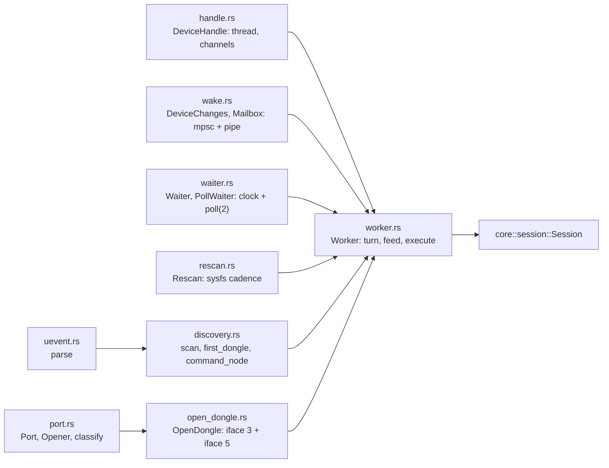
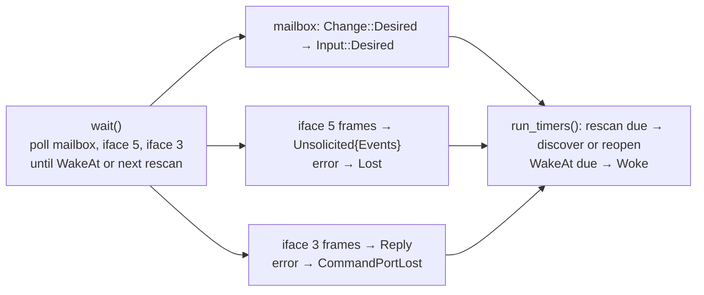
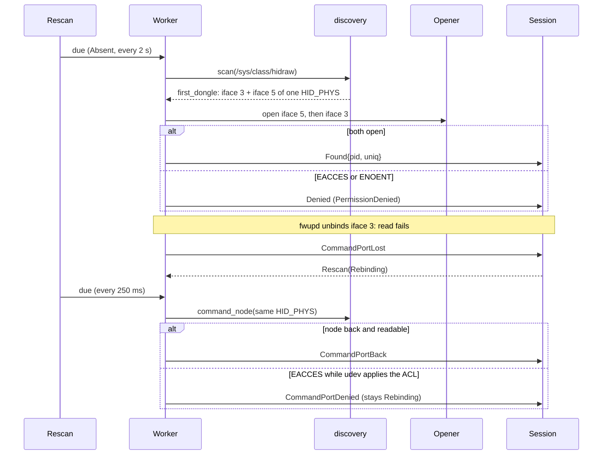
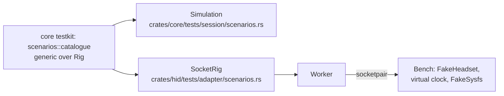

# SP5 HID Adapter Implementation Plan

> **For agentic workers:** REQUIRED SUB-SKILL: Use superpowers:subagent-driven-development (recommended) or superpowers:executing-plans to implement this plan task-by-task. Steps use checkbox (`- [ ]`) syntax for tracking.

**Goal:** `crates/hid`: find the dongle in sysfs, keep iface 3 and iface 5 open as raw hidraw ports, and run
`core::session::Session` on a `poll(2)` device thread behind `DeviceHandle`, so desired settings go in and
`DeviceUpdate`s come out, with fwupd's 20 s rebinds of iface 3 ridden through silently.

**Architecture:** A thin shell around the pure session. `discovery.rs` (with `uevent.rs`) reads
`/sys/class/hidraw/*/device/uevent`; `port.rs` opens, reads and writes `/dev/hidrawN` through `rustix`; `wake.rs` is
the mailbox (mpsc plus a pipe the poll loop watches); `waiter.rs` is the clock and `poll(2)`; `worker.rs` turns
readiness, rescans and timers into session `Input`s and executes its `Effect`s; `handle.rs` owns the thread. Two
seams, `Opener` and `Waiter`, let the integration tests run the real `Worker` over socketpairs on a virtual clock
against the same scenario catalogue that `Simulation` passes (`core::testkit::scenarios`, generic over a `Rig`).

**Tech Stack:** Rust 2024 (rustc 1.98.1), `rustix` 1.1 (`event`, `fs`, `pipe`; tests add `net`, `process`),
`async-channel` 2.5; dev: `tempfile` 3, `arctis-core` with feature `testkit`. No `unsafe`: the crate keeps
`#![forbid(unsafe_code)]`.

Spec: `docs/superpowers/specs/2026-10-11-arctis-companion-design.md` §2 (device thread, wake pipe), §3, §3.1
(`hid::handle` row), §5 (SP5 row); device part §2 (lifecycle, ports, discovery, rescan cadence, EACCES while
Rebinding, transport) and §6 (messages, `Input`, `Effect`); quality part §1 (`crates/hid` and hardware rows);
ADR 0005, ADR 0015; `docs/research/hardware-findings.md` §4 (the flap, 56–60 ms unreadable window), §6.1 (Flatpak
`ENOENT`), §9. Seams already on `origin/main`: `crates/core/src/session/input.rs::Input`,
`crates/core/src/session/effect.rs::Effect`, `crates/core/src/session/effect.rs::Cadence`,
`crates/core/src/messages/device.rs` (`Change`, `DeviceUpdate`, `Phase`), `crates/core/src/testkit/simulation.rs`.

Every code block below, in its final form, was applied to a scratch copy of `origin/main` (`51d3bf9`) and passed
`cargo fmt --check`, `clippy -D warnings` with the workspace policy, `cargo test -p arctis-core -p arctis-hid`,
`check-rules`, `check-doc-paths` and `check-pure` inside the toolbox on 2026-10-12. The hardware steps of Task 9
were not part of that check: their results are whatever the executor's own run on the real dongle prints, and
nothing in this plan is a hardware result to copy. If a snippet still trips clippy after an upstream change, fix
the names or split the function, keeping the behaviour its test asserts.

---

## Conventions for every task

- Worktree: `/home/marcelo/Desenvolvimento/arctis-wt/sp5`, branch `sp5-hid-adapter`. Never touch
  `/home/marcelo/Desenvolvimento/arctis-companion`.
- **Run (toolbox):** a step labelled so runs its command as
  `toolbox run -c arctis bash -lc 'cd /home/marcelo/Desenvolvimento/arctis-wt/sp5 && <command>'` (spelled out in
  each step). Git and `gh` run on the host in the worktree; the hooks there call `cargo xtask` on the host.
- No comments in any file of any language, doc comments included. Names and small functions carry the meaning.
- Clippy policy applies to tests too: cognitive complexity 8, 40 lines per function, nesting 3 (an `impl` block, a
  `fn` body, a `loop`, an `if` and a braced `match` arm each count), at most 4 arguments (`self` included), no
  `unwrap()` (use `expect` in tests), `pedantic` as errors under `-D warnings`. When clippy objects, extract a
  function. A helper in a test module that no test of the current task uses is dead code and fails the gate, so
  each task adds only the helpers its tests use.
- Only this sub-project and SP0 may open `/dev/hidraw*`, and only through `Session` (allow-listed `Command`s).
  The adapter tests never open a real device: they use socketpairs and tempdirs. Real-dongle tests are
  `#[ignore]` and need `ARCTIS_HW=1` (Task 9).
- If `/tmp` fills up (it is a shared tmpfs), the build fails with "No space left on device"; the worktree's
  `target/` is on `/home`, so build in the worktree only.
- "The crate gate" is, for crate `C`:
  `cargo fmt --all --check && cargo clippy -p C --all-targets -- -D warnings && cargo test -p C && cargo xtask check-rules`
  (run `cargo fmt --all` first if the check complains).
- Commits: conventional subject, no body unless it adds something the diff does not say, never a
  `Co-Authored-By`, "Generated with" or tool mention (the `commit-msg` hook rejects them; never `--no-verify`).
  Push after every commit.

## Acceptance criteria → tasks

| SP5 acceptance criterion (design §5, quality §1, task notes) | Where it is proven |
|---|---|
| Discovery against sysfs fixture trees: Nova 5 | Task 3 `a_nova_5_is_found_with_both_interfaces` |
| … Nova 5X | Task 3 `a_nova_5x_is_found` |
| … untested models (`0x2255`, `0x2264`) are reported, unknown SteelSeries products are not (device §1 Models) | Task 3 `an_untested_model_is_found`, `an_unknown_steelseries_product_is_ignored` |
| … bootloader | Task 3 `a_bootloader_is_never_reported` |
| … two dongles | Task 3 `the_first_dongle_by_physical_path_wins` |
| … missing iface 5 | Task 3 `a_dongle_without_its_events_interface_is_not_found` |
| … `HID_UNIQ` present and empty | Task 3 `a_present_hid_uniq_is_kept`, `an_empty_hid_uniq_is_none` |
| … nodes without the 0666 rule | Task 4 `a_node_without_the_access_rule_is_denied`; Task 7 scenarios `a denied dongle waits for permission`, `a denied dongle that leaves is Absent` |
| … EACCES (and the EACCES window after a rebind, never shown as PermissionDenied) | Task 4 `open_errors_split_into_denied_and_gone`; Task 7 scenario `an unreadable node after a rebind never shows PermissionDenied` |
| `ENOENT` on a node sysfs reports (Flatpak without `--device=all`) is PermissionDenied | Task 4 `a_reported_node_missing_from_dev_is_denied`; Task 8 `a_dongle_whose_nodes_cannot_be_opened_is_permission_denied` |
| A recreated node is unopenable for 56–60 ms after a rebind | Task 7: the `Rebinding` rescan treats `Denied` as `CommandPortDenied` (scenario with a 510 ms window); Task 9 soak on the real node |
| A rebound iface 3 may come back as another `hidrawN` | Task 3 `a_renumbered_command_node_is_found_by_physical_path` |
| Flap during Settling and during Probing; `Lost` from Ready, HeadsetOff, Rebinding and PermissionDenied; a dongle plugged back in (quality §1 `core::session` row, over the ports) | Task 2 and Task 7 scenarios `a flap while settling resumes Settling`, `a flap while probing resumes Probing`, `unplugging a ready dongle reaches Absent`, `unplugging while the headset is off reaches Absent`, `losing the dongle while rebinding reaches Absent`, `a denied dongle that leaves is Absent`, `a dongle plugged back in reaches Ready again` |
| The worker passes the `Simulation` scenarios over a socketpair port | Task 2 (catalogue, green on `Simulation`), Task 7 (same catalogue, green on the real `Worker` over socketpairs) |
| Real dongle, 30 min, fwupd running: no user-visible disconnect | Task 9 soak: no `Absent`, `PermissionDenied` or `Rebinding` published after connecting; rebinds counted |
| … zero lost writes | Task 9 soak: sidetone write each minute while Ready, each confirmed by `Observed` (or interrupted by the headset's auto-off and counted apart), no `WriteFailed`; with the headset off, recorded and moved to SP14 checklist item 14 |
| `DeviceHandle::spawn(SysfsRoot)` with `changes` and `updates` (design §3.1) | Task 5 (`DeviceChanges`, wake pipe), Task 8 |
| `poll(2)` on both ports plus a wake pipe, timeout = next `WakeAt`, no busy polling | Task 6, Task 7 |
| Rescan cadence `Absent` 2 s, `Rebinding` 250 ms, none otherwise | Task 7 `crates/hid/tests/adapter/rescan.rs` (`the_first_scan_is_due_at_start`, `each_scanning_cadence_repeats_at_its_interval`, `cadence_off_never_scans`); the worker sets it from `Effect::Rescan` |
| Raw hidraw through `rustix`, no hidapi (ADR 0015) | Task 4 |
| `docs/architecture/hid.md` with code paths and symbols | Task 10 |
| CI green, rules, doc paths, coverage | Task 11 |

## File structure

| File | Responsibility |
|---|---|
| `crates/core/src/testkit/report.rs` | `frame_from_report`: the 65 bytes a worker wrote back into a `Frame` (testkit only) |
| `crates/core/src/testkit/rig.rs` | `Rig` trait: what a scenario needs from a harness; `impl Rig for Simulation` |
| `crates/core/src/testkit/scenarios/mod.rs` | `Scenario`, `catalogue::<R>()`, `run_all::<R>()`, shared helpers |
| `crates/core/src/testkit/scenarios/{lifecycle,rebinding,verify,intent}.rs` | the 28 scenarios, by theme |
| `crates/core/tests/session/scenarios.rs` | the catalogue on `Simulation` |
| `crates/hid/Cargo.toml` | `rustix`, `async-channel`; dev `tempfile`, `arctis-core/testkit` |
| `crates/hid/src/lib.rs` | `forbid(unsafe_code)`, modules, `SysfsRoot`, `DeviceHandle`, `DeviceChanges` |
| `crates/hid/src/uevent.rs` | `parse`: `HID_ID`, `HID_PHYS`, `HID_UNIQ` |
| `crates/hid/src/discovery.rs` | `SysfsRoot`, `Node`, `Dongle`, `scan`, `first_dongle`, `command_node` |
| `crates/hid/src/port.rs` | `Port`, `Received`, `PortGone`, `OpenError`, `classify`, `Opener`, `HidrawOpener` |
| `crates/hid/src/wake.rs` | `DeviceChanges`, `Mailbox`, `Mail`, `mailbox()` |
| `crates/hid/src/waiter.rs` | `Waiter`, `PollWaiter` |
| `crates/hid/src/rescan.rs` | `Rescan`: the sysfs cadence the session asked for |
| `crates/hid/src/open_dongle.rs` | `OpenDongle` (iface 3 optional, iface 5), `Source` |
| `crates/hid/src/worker.rs` | `Wiring`, `Flow`, `Worker`: `turn`, `feed`, `execute`, discovery and reopen |
| `crates/hid/src/handle.rs` | `DeviceHandle::spawn`, drop = quit + join |
| `crates/hid/tests/adapter/main.rs` | the adapter test binary |
| `crates/hid/tests/adapter/sysfs.rs` | `FakeSysfs`, `NodeSpec`: fixture trees in tempdirs |
| `crates/hid/tests/adapter/sockets.rs` | socketpair helpers |
| `crates/hid/tests/adapter/{discovery,opening,port,wake,waiter,rescan,handle}.rs` | unit-level tests per module |
| `crates/hid/tests/adapter/bench.rs` | `Bench`: fake headset, virtual clock, fake nodes and peers |
| `crates/hid/tests/adapter/rig.rs` | `SocketRig`, `FakeOpener`, `VirtualWaiter` |
| `crates/hid/tests/adapter/scenarios.rs` | the catalogue on the real `Worker` |
| `crates/hid/tests/hardware/{main,discovery,soak,soak_log}.rs` | real-dongle checks, `ARCTIS_HW=1` |
| `docs/architecture/hid.md` | the architecture page |

## Tasks

### Task 0: Prepare the branch

The worktree already exists on `sp5-hid-adapter`, created from `origin/main` (`51d3bf9`); this plan is its first commit. Every commit step pushes with `--force-with-lease`, because this step may rebase the already-pushed plan commit.

- [ ] **Step 1: Confirm the tree is clean (host). Expected: `## sp5-hid-adapter...origin/sp5-hid-adapter` and no changed files**

```bash
git -C /home/marcelo/Desenvolvimento/arctis-wt/sp5 status --short --branch
```

- [ ] **Step 2: Rebase on the latest `origin/main` before starting (host). If `crates/core/src/testkit/` or `crates/core/src/session/` changed upstream, re-read them before Task 1**

```bash
git -C /home/marcelo/Desenvolvimento/arctis-wt/sp5 fetch origin && git -C /home/marcelo/Desenvolvimento/arctis-wt/sp5 rebase origin/main
```

- [ ] **Step 3: Run (toolbox): the baseline builds and the session suite passes**

```bash
toolbox run -c arctis bash -lc 'cd /home/marcelo/Desenvolvimento/arctis-wt/sp5 && cargo test -p arctis-core --test session && cargo build -p arctis-hid'
```

### Task 1: Testkit: read a written report back as a frame

**Files:**
- Create: `crates/core/src/testkit/report.rs`
- Modify: `crates/core/src/testkit/mod.rs`
- Test: `crates/core/tests/session/testkit.rs`

The socket rig of Task 7 reads the 65 bytes the worker wrote and must hand a `Frame` to `FakeHeadset::receive`. `Frame` has no public byte constructor (the allow-list, ADR 0004), so the testkit (cargo feature `testkit`, never in a release build) gets one.

- [ ] **Step 1: Write the failing tests: import `frame_from_report` in `crates/core/tests/session/testkit.rs`**

In `crates/core/tests/session/testkit.rs`, replace

```rust
use arctis_core::testkit::{Behaviour, FakeHeadset};
```

with

```rust
use arctis_core::testkit::{Behaviour, FakeHeadset, frame_from_report};
```

- [ ] **Step 2: Append the two tests to the end of `crates/core/tests/session/testkit.rs`**

```rust
#[test]
fn a_written_report_reads_back_as_its_frame() {
    let frame = encode(&Command::from(Query::Status));
    assert_eq!(frame_from_report(frame.as_bytes()), Some(frame));
}

#[test]
fn a_report_of_the_wrong_shape_is_refused() {
    assert_eq!(frame_from_report(&[0xB0; 65]), None);
    assert_eq!(frame_from_report(&[0; 64]), None);
}
```

- [ ] **Step 3: Run (toolbox), expect a compile error: `frame_from_report` not found in `testkit`**

```bash
toolbox run -c arctis bash -lc 'cd /home/marcelo/Desenvolvimento/arctis-wt/sp5 && cargo test -p arctis-core --test session testkit'
```

- [ ] **Step 4: Implement `crates/core/src/testkit/report.rs`**

`crates/core/src/testkit/report.rs`:

```rust
use crate::protocol::Frame;
use crate::protocol::frame::{PAYLOAD_LEN, REPORT_LEN};

#[must_use]
pub fn frame_from_report(report: &[u8]) -> Option<Frame> {
    if report.len() != REPORT_LEN || report[0] != 0 {
        return None;
    }
    let args: &[u8; PAYLOAD_LEN - 1] = report[2..].try_into().ok()?;
    Some(Frame::new(report[1], args))
}
```

- [ ] **Step 5: Export it from `crates/core/src/testkit/mod.rs`**

`crates/core/src/testkit/mod.rs`:

```rust
pub mod english;
mod fake_headset;
pub mod memory_repositories;
mod replies;
mod report;
pub mod repository_contracts;
mod simulation;

pub use fake_headset::{Behaviour, Emission, FakeHeadset};
pub use report::frame_from_report;
pub use simulation::{Flap, Simulation};
```

- [ ] **Step 6: Run (toolbox), expect PASS**

```bash
toolbox run -c arctis bash -lc 'cd /home/marcelo/Desenvolvimento/arctis-wt/sp5 && cargo test -p arctis-core --test session testkit'
```

- [ ] **Step 7: Run (toolbox) the crate gate**

```bash
toolbox run -c arctis bash -lc 'cd /home/marcelo/Desenvolvimento/arctis-wt/sp5 && cargo fmt --all --check && cargo clippy -p arctis-core --all-targets -- -D warnings && cargo test -p arctis-core && cargo xtask check-rules'
```

- [ ] **Step 8: Commit and push (host)**

```bash
cd /home/marcelo/Desenvolvimento/arctis-wt/sp5
git add crates/core/src/testkit/report.rs crates/core/src/testkit/mod.rs crates/core/tests/session/testkit.rs
git commit -m "test(core): rebuild frames from written reports in the testkit"
git push --force-with-lease -u origin sp5-hid-adapter
```

### Task 2: Testkit: one scenario catalogue for every rig

**Files:**
- Create: `crates/core/src/testkit/rig.rs`
- Create: `crates/core/src/testkit/scenarios/mod.rs`
- Create: `crates/core/src/testkit/scenarios/lifecycle.rs`
- Create: `crates/core/src/testkit/scenarios/rebinding.rs`
- Create: `crates/core/src/testkit/scenarios/verify.rs`
- Create: `crates/core/src/testkit/scenarios/intent.rs`
- Modify: `crates/core/src/testkit/mod.rs`
- Test: `crates/core/tests/session/scenarios.rs`
- Modify: `crates/core/tests/session/main.rs`

SP5's acceptance asks the worker to pass the `Simulation` scenarios over a socketpair. The scenarios become generic over a `Rig` trait that `Simulation` implements here and `crates/hid`'s `SocketRig` implements in Task 7. The catalogue keeps the scenarios that cross the I/O boundary: every way a dongle appears, is denied, leaves, flaps or answers late, plus the write, verify and echo paths that ride on the ports. Assertions are relative (`run_until` with a limit), so a rig that discovers on its own rescan cadence passes the same table. The existing SP4 tests stay as they are.

- [ ] **Step 1: Write the failing test `crates/core/tests/session/scenarios.rs`**

`crates/core/tests/session/scenarios.rs`:

```rust
use arctis_core::testkit::{Simulation, scenarios};

#[test]
fn the_scenario_catalogue_holds_on_the_simulation() {
    scenarios::run_all::<Simulation>();
}

#[test]
fn the_scenario_catalogue_names_each_scenario_once() {
    let mut names: Vec<_> = scenarios::catalogue::<Simulation>()
        .iter()
        .map(|scenario| scenario.name)
        .collect();
    let count = names.len();
    names.sort_unstable();
    names.dedup();
    assert_eq!(names.len(), count);
}
```

- [ ] **Step 2: Register it in `crates/core/tests/session/main.rs`**

In `crates/core/tests/session/main.rs`, replace

```rust
mod reconcile;
mod testkit;
```

with

```rust
mod reconcile;
mod scenarios;
mod testkit;
```

- [ ] **Step 3: Run (toolbox), expect a compile error: no `scenarios` in `testkit`**

```bash
toolbox run -c arctis bash -lc 'cd /home/marcelo/Desenvolvimento/arctis-wt/sp5 && cargo test -p arctis-core --test session scenarios'
```

- [ ] **Step 4: Create `crates/core/src/testkit/rig.rs`: the trait and its `Simulation` implementation (each method delegates with `Self::method(self, …)` so it never recurses into itself)**

`crates/core/src/testkit/rig.rs`:

```rust
use super::fake_headset::FakeHeadset;
use super::simulation::{Flap, Simulation};
use crate::messages::device::{DeviceUpdate, Phase, SyncPolicy};
use crate::protocol::Frame;
use crate::protocol::status::Link;
use crate::settings::headset_settings::{HeadsetSettings, SettingChange};
use crate::settings::values::Percent;
use crate::time::Millis;

pub trait Rig: Sized {
    fn start(headset: FakeHeadset) -> Self;
    fn plug(&mut self);
    fn deny(&mut self);
    fn unplug(&mut self);
    fn desire(&mut self, settings: HeadsetSettings, policy: SyncPolicy);
    fn flap(&mut self, flap: Flap);
    fn remove_command_node(&mut self);
    fn fail_next_write(&mut self);
    fn press(&mut self, change: SettingChange);
    fn link(&mut self, link: Link);
    fn battery(&mut self, battery: Percent);
    fn run_for(&mut self, duration: u64);
    fn now(&self) -> Millis;
    fn phase(&self) -> Phase;
    fn headset(&self) -> FakeHeadset;
    fn writes(&self) -> Vec<(Millis, Frame)>;
    fn updates(&self) -> Vec<(Millis, DeviceUpdate)>;
    fn clear_logs(&mut self);

    fn run_until(&mut self, phase: Phase, limit: u64) -> u64 {
        let start = self.now();
        while self.phase() != phase {
            assert!(
                self.now().since(start) < limit,
                "{phase:?} not reached within {limit} ms"
            );
            self.run_for(1);
        }
        self.now().since(start)
    }

    fn sent_ids(&self) -> Vec<u8> {
        self.writes()
            .iter()
            .map(|(_, frame)| frame.payload()[0])
            .collect()
    }

    fn published_phases(&self) -> Vec<Phase> {
        self.updates()
            .into_iter()
            .filter_map(|(_, update)| match update {
                DeviceUpdate::Phase(phase) => Some(phase),
                _ => None,
            })
            .collect()
    }
}

impl Rig for Simulation {
    fn start(headset: FakeHeadset) -> Self {
        Self::new(headset)
    }

    fn plug(&mut self) {
        Self::plug(self);
    }

    fn deny(&mut self) {
        Self::deny(self);
    }

    fn unplug(&mut self) {
        Self::unplug(self);
    }

    fn desire(&mut self, settings: HeadsetSettings, policy: SyncPolicy) {
        Self::desire(self, settings, policy);
    }

    fn flap(&mut self, flap: Flap) {
        Self::flap(self, flap);
    }

    fn remove_command_node(&mut self) {
        Self::remove_command_node(self);
    }

    fn fail_next_write(&mut self) {
        Self::fail_next_write(self);
    }

    fn press(&mut self, change: SettingChange) {
        Self::press(self, change);
    }

    fn link(&mut self, link: Link) {
        Self::link(self, link);
    }

    fn battery(&mut self, battery: Percent) {
        Self::battery(self, battery);
    }

    fn run_for(&mut self, duration: u64) {
        Self::run_for(self, duration);
    }

    fn now(&self) -> Millis {
        Self::now(self)
    }

    fn phase(&self) -> Phase {
        Self::phase(self)
    }

    fn headset(&self) -> FakeHeadset {
        Self::headset(self).clone()
    }

    fn writes(&self) -> Vec<(Millis, Frame)> {
        Self::writes(self).to_vec()
    }

    fn updates(&self) -> Vec<(Millis, DeviceUpdate)> {
        Self::updates(self).to_vec()
    }

    fn clear_logs(&mut self) {
        Self::clear_logs(self);
    }
}
```

- [ ] **Step 5: Create `crates/core/src/testkit/scenarios/mod.rs`: the catalogue, the runner and the shared helpers**

`crates/core/src/testkit/scenarios/mod.rs`:

```rust
mod intent;
mod lifecycle;
mod rebinding;
mod verify;

use super::fake_headset::{Behaviour, FakeHeadset};
use super::rig::Rig;
use crate::messages::device::{DeviceUpdate, Phase};
use crate::protocol::{Command, encode};
use crate::session::timing::{ENUMERATION_SETTLE, RESCAN_ABSENT};
use crate::settings::headset_settings::{HeadsetSettings, Setting, SettingChange};
use crate::settings::values::Sidetone;

const DISCOVERY: u64 = RESCAN_ABSENT + 100;
const SETTLED: u64 = DISCOVERY + ENUMERATION_SETTLE + 1_000;

pub struct Scenario {
    pub name: &'static str,
    pub run: fn(),
}

const fn scenario(name: &'static str, run: fn()) -> Scenario {
    Scenario { name, run }
}

#[must_use]
pub fn catalogue<R: Rig>() -> Vec<Scenario> {
    let mut scenarios = lifecycle::scenarios::<R>();
    scenarios.extend(rebinding::scenarios::<R>());
    scenarios.extend(verify::scenarios::<R>());
    scenarios.extend(intent::scenarios::<R>());
    scenarios
}

pub fn run_all<R: Rig>() {
    for scenario in catalogue::<R>() {
        eprintln!("scenario: {}", scenario.name);
        (scenario.run)();
    }
}

fn plugged<R: Rig>(headset: FakeHeadset) -> R {
    let mut rig = R::start(headset);
    rig.plug();
    rig
}

fn ready<R: Rig>(behaviour: Behaviour) -> R {
    let mut rig = plugged::<R>(FakeHeadset::nova_5().with_behaviour(behaviour));
    rig.run_until(Phase::Ready, SETTLED);
    rig.clear_logs();
    rig
}

fn headset_off<R: Rig>(behaviour: Behaviour) -> R {
    let headset = FakeHeadset::nova_5()
        .with_behaviour(behaviour)
        .powered_off();
    let mut rig = plugged::<R>(headset);
    rig.run_until(Phase::HeadsetOff, SETTLED);
    rig.clear_logs();
    rig
}

fn with_sidetone(settings: &HeadsetSettings, level: u8) -> HeadsetSettings {
    HeadsetSettings {
        sidetone: sidetone(level),
        ..settings.clone()
    }
}

fn sidetone(level: u8) -> Sidetone {
    Sidetone::try_from(level).expect("a sidetone level in range")
}

fn setter(setting: Setting) -> u8 {
    let value = FakeHeadset::nova_5().settings().value_of(setting);
    encode(&Command::from(value)).payload()[0]
}

fn observed<R: Rig>(rig: &R) -> Option<HeadsetSettings> {
    rig.updates()
        .into_iter()
        .rev()
        .find_map(|(_, update)| match update {
            DeviceUpdate::Observed(settings) => Some(settings),
            _ => None,
        })
}

fn write_failures<R: Rig>(rig: &R) -> Vec<Setting> {
    rig.updates()
        .into_iter()
        .filter_map(|(_, update)| match update {
            DeviceUpdate::WriteFailed(setting) => Some(setting),
            _ => None,
        })
        .collect()
}

fn headset_changes<R: Rig>(rig: &R) -> Vec<SettingChange> {
    rig.updates()
        .into_iter()
        .filter_map(|(_, update)| match update {
            DeviceUpdate::HeadsetChanged(change) => Some(change),
            _ => None,
        })
        .collect()
}
```

- [ ] **Step 6: Create `crates/core/src/testkit/scenarios/lifecycle.rs`**

`crates/core/src/testkit/scenarios/lifecycle.rs`:

```rust
use super::{DISCOVERY, SETTLED, Scenario, headset_off, plugged, ready, scenario};
use crate::messages::device::{DeviceUpdate, Phase};
use crate::protocol::status::Link;
use crate::session::timing::{HEADSET_OFF_POLL, REPLY_TIMEOUT};
use crate::testkit::fake_headset::{Behaviour, FakeHeadset};
use crate::testkit::rig::Rig;

pub(super) fn scenarios<R: Rig>() -> Vec<Scenario> {
    vec![
        scenario(
            "plugging in reaches Ready through every connecting phase",
            plugging_in_reaches_ready::<R>,
        ),
        scenario(
            "a headset that is off returns on its link event",
            a_headset_that_is_off_returns_on_its_link_event::<R>,
        ),
        scenario(
            "a headset without events is found by the headset-off poll",
            a_headset_without_events_is_found_by_the_headset_off_poll::<R>,
        ),
        scenario(
            "an unanswered probe means HeadsetOff",
            an_unanswered_probe_means_headset_off::<R>,
        ),
        scenario(
            "unplugging a ready dongle reaches Absent",
            unplugging_a_ready_dongle_reaches_absent::<R>,
        ),
        scenario(
            "unplugging while the headset is off reaches Absent",
            unplugging_while_the_headset_is_off_reaches_absent::<R>,
        ),
        scenario(
            "a dongle plugged back in reaches Ready again",
            a_dongle_plugged_back_in_reaches_ready_again::<R>,
        ),
        scenario(
            "a denied dongle waits for permission",
            a_denied_dongle_waits_for_permission::<R>,
        ),
        scenario(
            "a denied dongle that leaves is Absent",
            a_denied_dongle_that_leaves_is_absent::<R>,
        ),
    ]
}

fn plugging_in_reaches_ready<R: Rig>() {
    let mut rig = plugged::<R>(FakeHeadset::nova_5());
    rig.run_until(Phase::Ready, SETTLED);
    assert_eq!(
        rig.published_phases(),
        [
            Phase::Settling,
            Phase::Probing,
            Phase::Syncing,
            Phase::Ready
        ]
    );
    let identities = rig
        .updates()
        .into_iter()
        .filter(|(_, update)| matches!(update, DeviceUpdate::Identity { .. }))
        .count();
    assert!(identities >= 1);
}

fn a_headset_that_is_off_returns_on_its_link_event<R: Rig>() {
    let mut rig = headset_off::<R>(Behaviour::default());
    rig.link(Link::Connected);
    rig.run_until(Phase::Ready, 2_000);
}

fn a_headset_without_events_is_found_by_the_headset_off_poll<R: Rig>() {
    let mut rig = headset_off::<R>(Behaviour {
        sends_events: false,
        ..Behaviour::default()
    });
    rig.link(Link::Connected);
    rig.run_until(Phase::Ready, HEADSET_OFF_POLL + 2_000);
}

fn an_unanswered_probe_means_headset_off<R: Rig>() {
    let headset = FakeHeadset::nova_5().with_behaviour(Behaviour {
        reply_latency: None,
        ..Behaviour::default()
    });
    let mut rig = plugged::<R>(headset);
    rig.run_until(Phase::HeadsetOff, SETTLED + 3 * REPLY_TIMEOUT);
}

fn unplugging_a_ready_dongle_reaches_absent<R: Rig>() {
    let mut rig = ready::<R>(Behaviour::default());
    rig.unplug();
    rig.run_until(Phase::Absent, 1_000);
    assert_eq!(rig.published_phases(), [Phase::Absent]);
}

fn unplugging_while_the_headset_is_off_reaches_absent<R: Rig>() {
    let mut rig = headset_off::<R>(Behaviour::default());
    rig.unplug();
    rig.run_until(Phase::Absent, 1_000);
    assert_eq!(rig.published_phases(), [Phase::Absent]);
}

fn a_dongle_plugged_back_in_reaches_ready_again<R: Rig>() {
    let mut rig = ready::<R>(Behaviour::default());
    rig.unplug();
    rig.run_until(Phase::Absent, 1_000);
    rig.plug();
    rig.run_until(Phase::Ready, SETTLED);
}

fn a_denied_dongle_waits_for_permission<R: Rig>() {
    let mut rig = R::start(FakeHeadset::nova_5());
    rig.deny();
    rig.run_until(Phase::PermissionDenied, DISCOVERY);
    rig.plug();
    rig.run_until(Phase::Settling, DISCOVERY);
}

fn a_denied_dongle_that_leaves_is_absent<R: Rig>() {
    let mut rig = R::start(FakeHeadset::nova_5());
    rig.deny();
    rig.run_until(Phase::PermissionDenied, DISCOVERY);
    rig.unplug();
    rig.run_until(Phase::Absent, DISCOVERY);
}
```

- [ ] **Step 7: Create `crates/core/src/testkit/scenarios/rebinding.rs`**

`crates/core/src/testkit/scenarios/rebinding.rs`:

```rust
use super::{SETTLED, Scenario, plugged, ready, scenario, setter, with_sidetone, write_failures};
use crate::messages::device::{Phase, SyncPolicy};
use crate::session::timing::{
    REBIND_GIVE_UP, REBIND_SETTLE, REPLY_TIMEOUT, RESCAN_ABSENT, RESCAN_REBINDING, VERIFY_BACKOFF,
};
use crate::settings::headset_settings::Setting;
use crate::settings::values::Percent;
use crate::testkit::fake_headset::{Behaviour, FakeHeadset};
use crate::testkit::rig::Rig;
use crate::testkit::simulation::Flap;

const QUICK_FLAP: Flap = Flap {
    node_back_after: 60,
    unreadable_for: 0,
    stale_frame: false,
};
const FLAP_DONE: u64 = 60 + RESCAN_REBINDING + REBIND_SETTLE + 50;
const FLAP_PERIOD: u64 = 20_000;
const TEN_MINUTES: u64 = 600_000;
const SLOW_REPLY: u64 = REPLY_TIMEOUT - 100;

pub(super) fn scenarios<R: Rig>() -> Vec<Scenario> {
    vec![
        scenario("a flap in Ready is silent", a_flap_in_ready_is_silent::<R>),
        scenario(
            "a flap every 20 s for ten minutes sends nothing",
            a_flap_every_20_s_for_ten_minutes_sends_nothing::<R>,
        ),
        scenario(
            "an unreadable node after a rebind never shows PermissionDenied",
            an_unreadable_node_after_a_rebind_never_shows_permission_denied::<R>,
        ),
        scenario(
            "a stale frame after a rebind is dropped",
            a_stale_frame_after_a_rebind_is_dropped::<R>,
        ),
        scenario(
            "a flap while settling resumes Settling",
            a_flap_while_settling_resumes_settling::<R>,
        ),
        scenario(
            "a flap while probing resumes Probing",
            a_flap_while_probing_resumes_probing::<R>,
        ),
        scenario(
            "a command node that never returns gives up into Absent",
            a_command_node_that_never_returns_gives_up_into_absent::<R>,
        ),
        scenario(
            "a write that fails is redone after the rebind",
            a_write_that_fails_is_redone_after_the_rebind::<R>,
        ),
        scenario(
            "losing the dongle while rebinding reaches Absent",
            losing_the_dongle_while_rebinding_reaches_absent::<R>,
        ),
    ]
}

fn a_flap_in_ready_is_silent<R: Rig>() {
    let mut rig = ready::<R>(Behaviour::default());
    rig.flap(QUICK_FLAP);
    rig.run_for(FLAP_DONE);
    assert_eq!(rig.phase(), Phase::Ready);
    assert!(rig.writes().is_empty());
    assert!(rig.published_phases().is_empty());
}

fn a_flap_every_20_s_for_ten_minutes_sends_nothing<R: Rig>() {
    let mut rig = ready::<R>(Behaviour::default());
    for flap in 0..TEN_MINUTES / FLAP_PERIOD {
        rig.flap(Flap {
            stale_frame: flap % 2 == 0,
            ..QUICK_FLAP
        });
        if flap % 3 == 0 {
            rig.battery(Percent::try_from(50).expect("a battery level in range"));
        }
        rig.run_for(FLAP_PERIOD);
    }
    assert!(rig.writes().is_empty());
    assert!(rig.published_phases().is_empty());
    assert_eq!(rig.phase(), Phase::Ready);
}

fn an_unreadable_node_after_a_rebind_never_shows_permission_denied<R: Rig>() {
    let mut rig = ready::<R>(Behaviour::default());
    rig.flap(Flap {
        unreadable_for: 2 * RESCAN_REBINDING + 10,
        ..QUICK_FLAP
    });
    rig.run_for(2_000);
    assert_eq!(rig.phase(), Phase::Ready);
    assert!(rig.published_phases().is_empty());
}

fn a_stale_frame_after_a_rebind_is_dropped<R: Rig>() {
    let mut rig = ready::<R>(Behaviour::default());
    rig.flap(Flap {
        stale_frame: true,
        ..QUICK_FLAP
    });
    rig.run_for(FLAP_DONE);
    assert_eq!(rig.phase(), Phase::Ready);
    assert!(rig.updates().is_empty());
}

fn a_flap_while_settling_resumes_settling<R: Rig>() {
    let mut rig = plugged::<R>(FakeHeadset::nova_5());
    rig.run_until(Phase::Settling, RESCAN_ABSENT);
    rig.run_for(1_000);
    rig.flap(QUICK_FLAP);
    rig.run_for(FLAP_DONE);
    assert_eq!(rig.phase(), Phase::Settling);
    rig.run_until(Phase::Ready, SETTLED);
}

fn a_flap_while_probing_resumes_probing<R: Rig>() {
    let headset = FakeHeadset::nova_5().with_behaviour(Behaviour {
        reply_latency: Some(SLOW_REPLY),
        ..Behaviour::default()
    });
    let mut rig = plugged::<R>(headset);
    rig.run_until(Phase::Probing, SETTLED);
    rig.flap(QUICK_FLAP);
    rig.run_until(Phase::Ready, SETTLED);
    assert_eq!(
        rig.published_phases(),
        [
            Phase::Settling,
            Phase::Probing,
            Phase::Syncing,
            Phase::Ready
        ]
    );
}

fn a_command_node_that_never_returns_gives_up_into_absent<R: Rig>() {
    let mut rig = ready::<R>(Behaviour::default());
    rig.remove_command_node();
    rig.run_for(REBIND_GIVE_UP - 1_000);
    assert_eq!(rig.phase(), Phase::Rebinding);
    rig.run_until(Phase::Absent, 2_000);
    assert_eq!(rig.published_phases(), [Phase::Rebinding, Phase::Absent]);
}

fn a_write_that_fails_is_redone_after_the_rebind<R: Rig>() {
    let mut rig = ready::<R>(Behaviour::default());
    let desired = with_sidetone(rig.headset().settings(), 6);
    rig.fail_next_write();
    rig.desire(desired.clone(), SyncPolicy::Enforce);
    rig.run_for(FLAP_DONE + 4 * VERIFY_BACKOFF[2]);
    assert_eq!(rig.headset().settings(), &desired);
    assert!(rig.sent_ids().contains(&setter(Setting::Sidetone)));
    assert!(write_failures(&rig).is_empty());
    assert_eq!(rig.phase(), Phase::Ready);
}

fn losing_the_dongle_while_rebinding_reaches_absent<R: Rig>() {
    let mut rig = ready::<R>(Behaviour::default());
    rig.remove_command_node();
    rig.run_for(100);
    rig.unplug();
    rig.run_until(Phase::Absent, 1_000);
}
```

- [ ] **Step 8: Create `crates/core/src/testkit/scenarios/verify.rs`**

`crates/core/src/testkit/scenarios/verify.rs`:

```rust
use super::{Scenario, observed, ready, scenario, setter, with_sidetone, write_failures};
use crate::messages::device::{Phase, SyncPolicy};
use crate::protocol::Query;
use crate::protocol::status::Link;
use crate::session::timing::VERIFY_BACKOFF;
use crate::settings::headset_settings::{HeadsetSettings, Setting};
use crate::settings::values::WirelessMode;
use crate::testkit::fake_headset::Behaviour;
use crate::testkit::rig::Rig;

pub(super) fn scenarios<R: Rig>() -> Vec<Scenario> {
    vec![
        scenario(
            "a desired change is written then verified",
            a_desired_change_is_written_then_verified::<R>,
        ),
        scenario(
            "a value visible only at the last readback passes",
            a_value_visible_only_at_the_last_readback_passes::<R>,
        ),
        scenario(
            "a dropped write is reported",
            a_dropped_write_is_reported::<R>,
        ),
        scenario(
            "a wireless mode change rides through its link drop",
            a_wireless_mode_change_rides_through_its_link_drop::<R>,
        ),
    ]
}

fn a_desired_change_is_written_then_verified<R: Rig>() {
    let mut rig = ready::<R>(Behaviour::default());
    let desired = with_sidetone(rig.headset().settings(), 6);
    rig.desire(desired.clone(), SyncPolicy::Enforce);
    rig.run_for(1_000);
    assert_eq!(
        rig.sent_ids(),
        [setter(Setting::Sidetone), Query::Audio.id()]
    );
    assert_eq!(rig.headset().settings(), &desired);
    assert_eq!(observed(&rig), Some(desired));
}

fn a_value_visible_only_at_the_last_readback_passes<R: Rig>() {
    let mut rig = ready::<R>(Behaviour {
        readback_latency: VERIFY_BACKOFF[2] - 10,
        ..Behaviour::default()
    });
    let desired = with_sidetone(rig.headset().settings(), 6);
    rig.desire(desired.clone(), SyncPolicy::Enforce);
    rig.run_for(2_000);
    assert!(write_failures(&rig).is_empty());
    assert_eq!(observed(&rig), Some(desired));
}

fn a_dropped_write_is_reported<R: Rig>() {
    let mut rig = ready::<R>(Behaviour {
        drops_writes: true,
        ..Behaviour::default()
    });
    let desired = with_sidetone(rig.headset().settings(), 6);
    rig.desire(desired, SyncPolicy::Enforce);
    rig.run_for(3_000);
    assert_eq!(write_failures(&rig), [Setting::Sidetone]);
}

fn a_wireless_mode_change_rides_through_its_link_drop<R: Rig>() {
    let mut rig = ready::<R>(Behaviour::default());
    let desired = HeadsetSettings {
        wireless_mode: WirelessMode::ExtendedRange,
        ..rig.headset().settings().clone()
    };
    rig.desire(desired.clone(), SyncPolicy::Enforce);
    rig.run_for(10);
    rig.link(Link::HeadsetOff);
    rig.run_for(2_000);
    rig.link(Link::Connected);
    rig.run_for(1_000);
    assert_eq!(rig.phase(), Phase::Ready);
    assert_eq!(observed(&rig), Some(desired));
}
```

- [ ] **Step 9: Create `crates/core/src/testkit/scenarios/intent.rs`**

`crates/core/src/testkit/scenarios/intent.rs`:

```rust
use super::{
    Scenario, headset_changes, headset_off, observed, ready, scenario, setter, sidetone,
    with_sidetone,
};
use crate::messages::device::{Phase, SyncPolicy};
use crate::protocol::status::Link;
use crate::session::Interface;
use crate::settings::headset_settings::{Setting, SettingChange};
use crate::testkit::fake_headset::Behaviour;
use crate::testkit::rig::Rig;

pub(super) fn scenarios<R: Rig>() -> Vec<Scenario> {
    vec![
        scenario(
            "an echo on the events interface is consumed",
            an_echo_on_the_events_interface_is_consumed::<R>,
        ),
        scenario(
            "an echo on the command interface is consumed",
            an_echo_on_the_command_interface_is_consumed::<R>,
        ),
        scenario(
            "a press becomes HeadsetChanged",
            a_press_becomes_headset_changed::<R>,
        ),
        scenario(
            "without desired settings nothing is written",
            without_desired_settings_nothing_is_written::<R>,
        ),
        scenario(
            "adopt writes nothing and publishes observed",
            adopt_writes_nothing_and_publishes_observed::<R>,
        ),
        scenario(
            "changes made while the headset is off apply when it turns on",
            changes_made_while_the_headset_is_off_apply_when_it_turns_on::<R>,
        ),
    ]
}

fn an_echo_on_the_events_interface_is_consumed<R: Rig>() {
    assert_echo_consumed::<R>(Interface::Events);
}

fn an_echo_on_the_command_interface_is_consumed<R: Rig>() {
    assert_echo_consumed::<R>(Interface::Command);
}

fn assert_echo_consumed<R: Rig>(event_interface: Interface) {
    let mut rig = ready::<R>(Behaviour {
        echo_delay: Some(20),
        event_interface,
        ..Behaviour::default()
    });
    let desired = with_sidetone(rig.headset().settings(), 6);
    rig.desire(desired.clone(), SyncPolicy::Enforce);
    rig.run_for(2_000);
    assert!(headset_changes(&rig).is_empty());
    assert_eq!(rig.headset().settings(), &desired);
}

fn a_press_becomes_headset_changed<R: Rig>() {
    let mut rig = ready::<R>(Behaviour::default());
    rig.press(SettingChange::Sidetone(sidetone(3)));
    rig.run_for(100);
    assert_eq!(
        headset_changes(&rig),
        [SettingChange::Sidetone(sidetone(3))]
    );
}

fn without_desired_settings_nothing_is_written<R: Rig>() {
    let mut rig = ready::<R>(Behaviour::default());
    rig.run_for(60_000);
    assert!(rig.writes().is_empty());
}

fn adopt_writes_nothing_and_publishes_observed<R: Rig>() {
    let mut rig = ready::<R>(Behaviour::default());
    let desired = with_sidetone(rig.headset().settings(), 6);
    rig.desire(desired, SyncPolicy::Adopt);
    rig.run_for(1_000);
    assert!(rig.writes().is_empty());
    assert_eq!(observed(&rig).as_ref(), Some(rig.headset().settings()));
}

fn changes_made_while_the_headset_is_off_apply_when_it_turns_on<R: Rig>() {
    let mut rig = headset_off::<R>(Behaviour::default());
    let desired = with_sidetone(rig.headset().settings(), 6);
    rig.desire(desired.clone(), SyncPolicy::Enforce);
    rig.run_for(1_000);
    assert!(!rig.sent_ids().contains(&setter(Setting::Sidetone)));
    rig.link(Link::Connected);
    rig.run_until(Phase::Ready, 3_000);
    assert_eq!(rig.headset().settings(), &desired);
}
```

- [ ] **Step 10: Export the rig and the catalogue from `crates/core/src/testkit/mod.rs`**

`crates/core/src/testkit/mod.rs`:

```rust
pub mod english;
mod fake_headset;
pub mod memory_repositories;
mod replies;
mod report;
pub mod repository_contracts;
mod rig;
pub mod scenarios;
mod simulation;

pub use fake_headset::{Behaviour, Emission, FakeHeadset};
pub use report::frame_from_report;
pub use rig::Rig;
pub use simulation::{Flap, Simulation};
```

- [ ] **Step 11: Run (toolbox), expect PASS and 28 `scenario:` lines on stderr**

```bash
toolbox run -c arctis bash -lc 'cd /home/marcelo/Desenvolvimento/arctis-wt/sp5 && cargo test -p arctis-core --test session scenarios -- --nocapture'
```

- [ ] **Step 12:** Check that the catalogue bites: temporarily change `QUICK_FLAP.node_back_after` in `crates/core/src/testkit/scenarios/rebinding.rs` to `40_000`, run the test again and see `a flap in Ready is silent` fail on `left: Rebinding, right: Ready`; then restore `60`.

- [ ] **Step 13: Run (toolbox) the crate gate**

```bash
toolbox run -c arctis bash -lc 'cd /home/marcelo/Desenvolvimento/arctis-wt/sp5 && cargo fmt --all --check && cargo clippy -p arctis-core --all-targets -- -D warnings && cargo test -p arctis-core && cargo xtask check-rules'
```

- [ ] **Step 14: Commit and push (host)**

```bash
cd /home/marcelo/Desenvolvimento/arctis-wt/sp5
git add crates/core/src/testkit/rig.rs crates/core/src/testkit/scenarios crates/core/src/testkit/mod.rs crates/core/tests/session/scenarios.rs crates/core/tests/session/main.rs
git commit -m "test(core): share session scenarios through a rig"
git push --force-with-lease -u origin sp5-hid-adapter
```

### Task 3: sysfs discovery

**Files:**
- Modify: `crates/hid/Cargo.toml`
- Create: `crates/hid/src/uevent.rs`
- Create: `crates/hid/src/discovery.rs`
- Modify: `crates/hid/src/lib.rs`
- Test: `crates/hid/tests/adapter/main.rs`
- Test: `crates/hid/tests/adapter/sysfs.rs`
- Test: `crates/hid/tests/adapter/discovery.rs`

`discovery::scan` reads `<class>/<name>/device/uevent` for every entry of the hidraw class directory and keeps the nodes of supported, non-bootloader models of vendor `1038` (`Model::lookup`). `first_dongle` groups them by `HID_PHYS` without its `/inputN` suffix and returns the first physical path that has both iface 3 and iface 5. `command_node` finds iface 3 of a known physical path again after a rebind, when `hidrawN` may differ. The fixture trees are built in tempdirs by `FakeSysfs` (Deviation 2). Real uevent text, captured on this host:

```
DRIVER=hid-generic
HID_ID=0003:00001038:00002232
HID_NAME=SteelSeries SteelSeries Arctis Nova 5
HID_PHYS=usb-0000:0c:00.0-5.2.1/input3
HID_UNIQ=
MODALIAS=hid:b0003g0001v00001038p00002232
```

- [ ] **Step 1: Set the dependencies in `crates/hid/Cargo.toml` (`rustix` 1.1 is already in `Cargo.lock`; `tempfile` 3.27 too)**

`crates/hid/Cargo.toml`:

```toml
[package]
name = "arctis-hid"
version.workspace = true
edition.workspace = true
license.workspace = true
publish.workspace = true

[dependencies]
arctis-core.workspace = true
async-channel = "2.5"
rustix = { version = "1.1", features = ["event", "fs", "pipe", "std"] }

[dev-dependencies]
arctis-core = { workspace = true, features = ["testkit"] }
rustix = { version = "1.1", features = ["event", "fs", "net", "pipe", "process", "std"] }
tempfile = "3"

[lints]
workspace = true
```

- [ ] **Step 2: Write the fixture builder `crates/hid/tests/adapter/sysfs.rs`**

`crates/hid/tests/adapter/sysfs.rs`:

```rust
use std::fs;
use std::path::PathBuf;

use arctis_hid::SysfsRoot;
use tempfile::TempDir;

pub const NOVA_5: u16 = 0x2232;
pub const PHYSICAL: &str = "usb-0000:0c:00.0-5.2.1";
pub const COMMAND_NODE: &str = "hidraw6";
pub const EVENTS_NODE: &str = "hidraw8";

#[derive(Clone, Copy, Debug)]
pub struct NodeSpec<'a> {
    pub vendor: u16,
    pub pid: u16,
    pub physical: &'a str,
    pub interface: u8,
    pub uniq: &'a str,
}

impl NodeSpec<'_> {
    pub const fn nova_5(interface: u8) -> Self {
        Self {
            vendor: 0x1038,
            pid: NOVA_5,
            physical: PHYSICAL,
            interface,
            uniq: "",
        }
    }

    fn uevent(&self) -> String {
        format!(
            "DRIVER=hid-generic\nHID_ID=0003:{:08X}:{:08X}\nHID_NAME=SteelSeries Arctis Nova 5\nHID_PHYS={}/input{}\nHID_UNIQ={}\nMODALIAS=hid:b0003g0001\n",
            self.vendor, self.pid, self.physical, self.interface, self.uniq
        )
    }
}

pub struct FakeSysfs {
    dir: TempDir,
}

impl FakeSysfs {
    pub fn new() -> Self {
        let dir = tempfile::tempdir().expect("a temporary directory");
        fs::create_dir_all(dir.path().join("class")).expect("the class directory");
        fs::create_dir_all(dir.path().join("dev")).expect("the dev directory");
        Self { dir }
    }

    pub fn root(&self) -> SysfsRoot {
        SysfsRoot::new(self.dir.path().join("class"), self.dir.path().join("dev"))
    }

    pub fn dev_node(&self, name: &str) -> PathBuf {
        self.dir.path().join("dev").join(name)
    }

    pub fn add(&self, name: &str, spec: &NodeSpec<'_>) {
        self.add_raw(name, &spec.uevent());
    }

    pub fn add_raw(&self, name: &str, uevent: &str) {
        let device = self.dir.path().join("class").join(name).join("device");
        fs::create_dir_all(&device).expect("the device directory");
        fs::write(device.join("uevent"), uevent).expect("the uevent file");
    }

    pub fn add_nova_5(&self) {
        self.add(COMMAND_NODE, &NodeSpec::nova_5(3));
        self.add(EVENTS_NODE, &NodeSpec::nova_5(5));
    }
}
```

- [ ] **Step 3: Write the failing tests `crates/hid/tests/adapter/discovery.rs`**

`crates/hid/tests/adapter/discovery.rs`:

```rust
use arctis_hid::discovery::{self, Dongle};

use crate::sysfs::{COMMAND_NODE, EVENTS_NODE, FakeSysfs, NOVA_5, NodeSpec, PHYSICAL};

fn found(sysfs: &FakeSysfs) -> Option<Dongle> {
    discovery::first_dongle(&discovery::scan(&sysfs.root()))
}

fn add_model(sysfs: &FakeSysfs, pid: u16) {
    for interface in [3, 5] {
        let spec = NodeSpec {
            pid,
            ..NodeSpec::nova_5(interface)
        };
        sysfs.add(&format!("hidraw{interface}"), &spec);
    }
}

#[test]
fn a_nova_5_is_found_with_both_interfaces() {
    let sysfs = FakeSysfs::new();
    sysfs.add_nova_5();
    assert_eq!(
        found(&sysfs),
        Some(Dongle {
            pid: NOVA_5,
            uniq: None,
            physical: PHYSICAL.to_owned(),
            command: sysfs.dev_node(COMMAND_NODE),
            events: sysfs.dev_node(EVENTS_NODE),
        })
    );
}

#[test]
fn a_nova_5x_is_found() {
    let sysfs = FakeSysfs::new();
    add_model(&sysfs, 0x2253);
    assert_eq!(found(&sysfs).map(|dongle| dongle.pid), Some(0x2253));
}

#[test]
fn an_untested_model_is_found() {
    let sysfs = FakeSysfs::new();
    add_model(&sysfs, 0x2255);
    assert_eq!(found(&sysfs).map(|dongle| dongle.pid), Some(0x2255));
}

#[test]
fn a_bootloader_is_never_reported() {
    let sysfs = FakeSysfs::new();
    add_model(&sysfs, 0x2233);
    assert!(discovery::scan(&sysfs.root()).is_empty());
}

#[test]
fn an_unknown_steelseries_product_is_ignored() {
    let sysfs = FakeSysfs::new();
    add_model(&sysfs, 0x1836);
    assert!(discovery::scan(&sysfs.root()).is_empty());
}

#[test]
fn other_vendors_are_ignored() {
    let sysfs = FakeSysfs::new();
    let keyboard = NodeSpec {
        vendor: 0x3434,
        pid: 0x0A30,
        ..NodeSpec::nova_5(0)
    };
    sysfs.add("hidraw1", &keyboard);
    assert!(discovery::scan(&sysfs.root()).is_empty());
}

#[test]
fn the_first_dongle_by_physical_path_wins() {
    let sysfs = FakeSysfs::new();
    let later = "usb-0000:0e:00.3-1";
    let earlier = "usb-0000:0c:00.0-5.2.1";
    for (name, physical, interface) in [
        ("hidraw0", later, 3),
        ("hidraw1", later, 5),
        ("hidraw6", earlier, 3),
        ("hidraw8", earlier, 5),
    ] {
        sysfs.add(
            name,
            &NodeSpec {
                physical,
                ..NodeSpec::nova_5(interface)
            },
        );
    }
    assert_eq!(
        found(&sysfs).map(|dongle| dongle.physical),
        Some(earlier.to_owned())
    );
}

#[test]
fn a_dongle_without_its_events_interface_is_not_found() {
    let sysfs = FakeSysfs::new();
    sysfs.add(COMMAND_NODE, &NodeSpec::nova_5(3));
    sysfs.add("hidraw7", &NodeSpec::nova_5(4));
    assert_eq!(found(&sysfs), None);
}

#[test]
fn a_present_hid_uniq_is_kept() {
    let sysfs = FakeSysfs::new();
    for (name, interface) in [(COMMAND_NODE, 3), (EVENTS_NODE, 5)] {
        let spec = NodeSpec {
            uniq: "ABC123",
            ..NodeSpec::nova_5(interface)
        };
        sysfs.add(name, &spec);
    }
    assert_eq!(
        found(&sysfs).and_then(|dongle| dongle.uniq),
        Some("ABC123".to_owned())
    );
}

#[test]
fn an_empty_hid_uniq_is_none() {
    let sysfs = FakeSysfs::new();
    sysfs.add_nova_5();
    assert_eq!(found(&sysfs).and_then(|dongle| dongle.uniq), None);
}

#[test]
fn malformed_uevents_are_skipped() {
    let sysfs = FakeSysfs::new();
    sysfs.add_raw("hidraw2", "HID_ID=garbage\nHID_PHYS=usb-1/input3\n");
    sysfs.add_raw(
        "hidraw3",
        "HID_ID=0003:00001038:00002232\nHID_PHYS=no-interface\n",
    );
    sysfs.add_raw("hidraw4", "DRIVER=hid-generic\n");
    assert!(discovery::scan(&sysfs.root()).is_empty());
}

#[test]
fn a_missing_class_directory_finds_nothing() {
    let sysfs = FakeSysfs::new();
    let root = arctis_hid::SysfsRoot::new(sysfs.dev_node("nowhere"), sysfs.dev_node(""));
    assert!(discovery::scan(&root).is_empty());
}

#[test]
fn the_command_node_is_found_by_physical_path() {
    let sysfs = FakeSysfs::new();
    sysfs.add_nova_5();
    let nodes = discovery::scan(&sysfs.root());
    assert_eq!(
        discovery::command_node(&nodes, PHYSICAL),
        Some(sysfs.dev_node(COMMAND_NODE))
    );
    assert_eq!(discovery::command_node(&nodes, "usb-elsewhere"), None);
}

#[test]
fn a_renumbered_command_node_is_found_by_physical_path() {
    let sysfs = FakeSysfs::new();
    sysfs.add(EVENTS_NODE, &NodeSpec::nova_5(5));
    sysfs.add("hidraw9", &NodeSpec::nova_5(3));
    let nodes = discovery::scan(&sysfs.root());
    assert_eq!(
        discovery::command_node(&nodes, PHYSICAL),
        Some(sysfs.dev_node("hidraw9"))
    );
}
```

- [ ] **Step 4: Create the test binary `crates/hid/tests/adapter/main.rs`**

`crates/hid/tests/adapter/main.rs`:

```rust
mod discovery;
mod sysfs;
```

- [ ] **Step 5: Run (toolbox), expect a compile error: unresolved `arctis_hid::discovery`**

```bash
toolbox run -c arctis bash -lc 'cd /home/marcelo/Desenvolvimento/arctis-wt/sp5 && cargo test -p arctis-hid --test adapter'
```

- [ ] **Step 6: Implement `crates/hid/src/uevent.rs`**

`crates/hid/src/uevent.rs`:

```rust
#[derive(Clone, Debug, PartialEq, Eq)]
pub struct Uevent {
    pub vendor: u16,
    pub product: u16,
    pub physical: String,
    pub interface: u8,
    pub uniq: Option<String>,
}

pub fn parse(text: &str) -> Option<Uevent> {
    let (vendor, product) = hid_id(value_of(text, "HID_ID")?)?;
    let (physical, interface) = hid_phys(value_of(text, "HID_PHYS")?)?;
    Some(Uevent {
        vendor,
        product,
        physical: physical.to_owned(),
        interface,
        uniq: value_of(text, "HID_UNIQ")
            .filter(|uniq| !uniq.is_empty())
            .map(str::to_owned),
    })
}

fn value_of<'a>(text: &'a str, key: &str) -> Option<&'a str> {
    text.lines()
        .filter_map(|line| line.split_once('='))
        .find(|(name, _)| *name == key)
        .map(|(_, value)| value.trim())
}

fn hid_id(value: &str) -> Option<(u16, u16)> {
    let mut parts = value.split(':').skip(1);
    let vendor = hex_u16(parts.next()?)?;
    let product = hex_u16(parts.next()?)?;
    Some((vendor, product))
}

fn hex_u16(text: &str) -> Option<u16> {
    u32::from_str_radix(text, 16)
        .ok()
        .and_then(|value| u16::try_from(value).ok())
}

fn hid_phys(value: &str) -> Option<(&str, u8)> {
    let (physical, interface) = value.rsplit_once("/input")?;
    Some((physical, interface.parse().ok()?))
}
```

- [ ] **Step 7: Implement `crates/hid/src/discovery.rs`**

`crates/hid/src/discovery.rs`:

```rust
use std::fs;
use std::path::{Path, PathBuf};

use arctis_core::protocol::model::{Model, ModelLookup, VENDOR_ID};

use crate::uevent::{self, Uevent};

pub const COMMAND_INTERFACE: u8 = 3;
pub const EVENTS_INTERFACE: u8 = 5;

#[derive(Clone, Debug, PartialEq, Eq)]
pub struct SysfsRoot {
    class: PathBuf,
    dev: PathBuf,
}

impl SysfsRoot {
    #[must_use]
    pub fn new(class: impl Into<PathBuf>, dev: impl Into<PathBuf>) -> Self {
        Self {
            class: class.into(),
            dev: dev.into(),
        }
    }

    #[must_use]
    pub fn system() -> Self {
        Self::new("/sys/class/hidraw", "/dev")
    }
}

#[derive(Clone, Debug, PartialEq, Eq)]
pub struct Node {
    pub pid: u16,
    pub uniq: Option<String>,
    pub physical: String,
    pub interface: u8,
    pub path: PathBuf,
}

#[derive(Clone, Debug, PartialEq, Eq)]
pub struct Dongle {
    pub pid: u16,
    pub uniq: Option<String>,
    pub physical: String,
    pub command: PathBuf,
    pub events: PathBuf,
}

#[must_use]
pub fn scan(root: &SysfsRoot) -> Vec<Node> {
    let Ok(entries) = fs::read_dir(&root.class) else {
        return Vec::new();
    };
    let mut nodes: Vec<Node> = entries
        .filter_map(Result::ok)
        .filter_map(|entry| node(root, &entry.file_name().to_string_lossy()))
        .collect();
    nodes.sort_by(|a, b| (&a.physical, a.interface).cmp(&(&b.physical, b.interface)));
    nodes
}

#[must_use]
pub fn first_dongle(nodes: &[Node]) -> Option<Dongle> {
    nodes
        .iter()
        .find_map(|node| dongle_at(nodes, &node.physical))
}

#[must_use]
pub fn command_node(nodes: &[Node], physical: &str) -> Option<PathBuf> {
    interface_node(nodes, physical, COMMAND_INTERFACE).map(|node| node.path.clone())
}

fn dongle_at(nodes: &[Node], physical: &str) -> Option<Dongle> {
    let command = interface_node(nodes, physical, COMMAND_INTERFACE)?;
    let events = interface_node(nodes, physical, EVENTS_INTERFACE)?;
    Some(Dongle {
        pid: command.pid,
        uniq: command.uniq.clone(),
        physical: physical.to_owned(),
        command: command.path.clone(),
        events: events.path.clone(),
    })
}

fn interface_node<'a>(nodes: &'a [Node], physical: &str, interface: u8) -> Option<&'a Node> {
    nodes
        .iter()
        .find(|node| node.physical == physical && node.interface == interface)
}

fn node(root: &SysfsRoot, name: &str) -> Option<Node> {
    let text = fs::read_to_string(uevent_path(&root.class, name)).ok()?;
    let uevent = uevent::parse(&text).filter(is_supported)?;
    Some(Node {
        pid: uevent.product,
        uniq: uevent.uniq,
        physical: uevent.physical,
        interface: uevent.interface,
        path: root.dev.join(name),
    })
}

fn uevent_path(class: &Path, name: &str) -> PathBuf {
    class.join(name).join("device").join("uevent")
}

fn is_supported(uevent: &Uevent) -> bool {
    uevent.vendor == VENDOR_ID && matches!(Model::lookup(uevent.product), ModelLookup::Supported(_))
}
```

- [ ] **Step 8: Replace `crates/hid/src/lib.rs`**

`crates/hid/src/lib.rs`:

```rust
#![forbid(unsafe_code)]

pub mod discovery;
mod uevent;

pub use discovery::SysfsRoot;
```

- [ ] **Step 9: Run (toolbox), expect 14 tests PASS**

```bash
toolbox run -c arctis bash -lc 'cd /home/marcelo/Desenvolvimento/arctis-wt/sp5 && cargo test -p arctis-hid --test adapter'
```

- [ ] **Step 10: Run (toolbox) the crate gate**

```bash
toolbox run -c arctis bash -lc 'cd /home/marcelo/Desenvolvimento/arctis-wt/sp5 && cargo fmt --all --check && cargo clippy -p arctis-hid --all-targets -- -D warnings && cargo test -p arctis-hid && cargo xtask check-rules'
```

- [ ] **Step 11: Commit and push (host)**

```bash
cd /home/marcelo/Desenvolvimento/arctis-wt/sp5
git add crates/hid/Cargo.toml Cargo.lock crates/hid/src crates/hid/tests/adapter/
git commit -m "feat(hid): discover dongles in sysfs"
git push --force-with-lease -u origin sp5-hid-adapter
```

### Task 4: Raw hidraw ports

**Files:**
- Create: `crates/hid/src/port.rs`
- Modify: `crates/hid/src/lib.rs`
- Test: `crates/hid/tests/adapter/sockets.rs`
- Test: `crates/hid/tests/adapter/port.rs`
- Test: `crates/hid/tests/adapter/opening.rs`
- Modify: `crates/hid/tests/adapter/main.rs`

`Port` wraps one non-blocking file descriptor: `write` sends the 65-byte report of a `Frame`, `read` returns one frame, `Received::Empty` on `EAGAIN`, and `PortGone` on any other error or on end of file (a socket peer that left; hidraw itself answers `EIO` after an unbind, SP0 §4). `EINTR` retries. `classify` maps open errors: `EACCES`, `EPERM` and `ENOENT` are `Denied` (ENOENT is the Flatpak without `--device=all`, hardware-findings §6.1 and §9), everything else is `Gone` (the node vanished between scan and open; the next rescan retries). `Opener` is the seam the worker opens through; `HidrawOpener` is the real one.

- [ ] **Step 1: Write the socketpair helpers `crates/hid/tests/adapter/sockets.rs` (`SOCK_SEQPACKET` keeps frame boundaries, as hidraw does)**

`crates/hid/tests/adapter/sockets.rs`:

```rust
use std::os::fd::OwnedFd;

use rustix::net::{AddressFamily, SocketFlags, SocketType};

pub fn pair() -> (OwnedFd, OwnedFd) {
    rustix::net::socketpair(
        AddressFamily::UNIX,
        SocketType::SEQPACKET,
        SocketFlags::NONBLOCK | SocketFlags::CLOEXEC,
        None,
    )
    .expect("a socket pair")
}

pub fn send(fd: &OwnedFd, bytes: &[u8]) {
    rustix::io::write(fd, bytes).expect("a frame sent");
}

pub fn receive(fd: &OwnedFd) -> Option<Vec<u8>> {
    let mut buffer = [0; 256];
    match rustix::io::read(fd, &mut buffer) {
        Ok(length) if length > 0 => Some(buffer[..length].to_vec()),
        _ => None,
    }
}
```

- [ ] **Step 2: Write the failing port tests `crates/hid/tests/adapter/port.rs`**

`crates/hid/tests/adapter/port.rs`:

```rust
use std::fs;

use arctis_core::protocol::{Command, Query, encode};
use arctis_hid::port::{Port, PortGone, Received};
use rustix::net::Shutdown;

use crate::sockets::{pair, receive, send};

#[test]
fn a_write_sends_the_whole_report() {
    let (ours, theirs) = pair();
    let port = Port::from_fd(ours);
    let frame = encode(&Command::from(Query::Status));
    port.write(&frame).expect("written");
    assert_eq!(receive(&theirs), Some(frame.as_bytes().to_vec()));
}

#[test]
fn a_read_returns_one_frame() {
    let (ours, theirs) = pair();
    let port = Port::from_fd(ours);
    send(&theirs, &[0xB0, 0x02, 0x02]);
    let Ok(Received::Frame(bytes)) = port.read() else {
        panic!("a frame");
    };
    assert_eq!(bytes, [0xB0, 0x02, 0x02]);
}

#[test]
fn a_read_with_nothing_pending_is_empty() {
    let (ours, _theirs) = pair();
    assert!(matches!(Port::from_fd(ours).read(), Ok(Received::Empty)));
}

#[test]
fn a_read_after_the_peer_left_is_gone() {
    let (ours, theirs) = pair();
    drop(theirs);
    assert_eq!(Port::from_fd(ours).read().err(), Some(PortGone));
}

#[test]
fn a_write_the_peer_refuses_is_gone() {
    let (ours, theirs) = pair();
    rustix::net::shutdown(&theirs, Shutdown::Read).expect("shutdown");
    let frame = encode(&Command::from(Query::Status));
    assert_eq!(Port::from_fd(ours).write(&frame), Err(PortGone));
}

#[test]
fn a_regular_file_opens_as_a_port() {
    let dir = tempfile::tempdir().expect("a temporary directory");
    let node = dir.path().join("hidraw6");
    fs::write(&node, b"").expect("a stand-in node");
    assert!(Port::open(&node).is_ok());
}
```

- [ ] **Step 3: Write the failing open tests `crates/hid/tests/adapter/opening.rs` (a node reported by sysfs but absent from `/dev`, a node without the access rule, the errno table; as root the mode-0000 open succeeds, which the test accepts)**

`crates/hid/tests/adapter/opening.rs`:

```rust
use std::fs;
use std::os::unix::fs::PermissionsExt;

use arctis_hid::discovery;
use arctis_hid::port::{OpenError, Port, classify};
use rustix::io::Errno;

use crate::sysfs::{COMMAND_NODE, FakeSysfs};

#[test]
fn a_reported_node_missing_from_dev_is_denied() {
    let sysfs = FakeSysfs::new();
    sysfs.add_nova_5();
    let nodes = discovery::scan(&sysfs.root());
    let dongle = discovery::first_dongle(&nodes).expect("the dongle");
    assert_eq!(Port::open(&dongle.command).err(), Some(OpenError::Denied));
}

#[test]
fn a_node_without_the_access_rule_is_denied() {
    let sysfs = FakeSysfs::new();
    sysfs.add_nova_5();
    let node = sysfs.dev_node(COMMAND_NODE);
    fs::write(&node, b"").expect("a stand-in node");
    fs::set_permissions(&node, fs::Permissions::from_mode(0o000)).expect("mode 0000");
    let opened = Port::open(&node);
    if rustix::process::geteuid().is_root() {
        assert!(opened.is_ok());
    } else {
        assert_eq!(opened.err(), Some(OpenError::Denied));
    }
}

#[test]
fn open_errors_split_into_denied_and_gone() {
    for errno in [Errno::ACCESS, Errno::PERM, Errno::NOENT] {
        assert_eq!(classify(errno), OpenError::Denied, "{errno:?}");
    }
    for errno in [Errno::NODEV, Errno::IO, Errno::NXIO, Errno::BUSY] {
        assert_eq!(classify(errno), OpenError::Gone, "{errno:?}");
    }
}
```

- [ ] **Step 4: Register them in `crates/hid/tests/adapter/main.rs`**

`crates/hid/tests/adapter/main.rs`:

```rust
mod discovery;
mod opening;
mod port;
mod sockets;
mod sysfs;
```

- [ ] **Step 5: Run (toolbox), expect a compile error: unresolved `arctis_hid::port`**

```bash
toolbox run -c arctis bash -lc 'cd /home/marcelo/Desenvolvimento/arctis-wt/sp5 && cargo test -p arctis-hid --test adapter'
```

- [ ] **Step 6: Implement `crates/hid/src/port.rs`**

`crates/hid/src/port.rs`:

```rust
use std::os::fd::{AsFd, BorrowedFd, OwnedFd};
use std::path::Path;

use arctis_core::protocol::Frame;
use rustix::fs::{Mode, OFlags};
use rustix::io::Errno;

const READ_CAPACITY: usize = 256;

#[derive(Clone, Copy, Debug, PartialEq, Eq)]
pub enum OpenError {
    Denied,
    Gone,
}

#[derive(Clone, Copy, Debug, PartialEq, Eq)]
pub struct PortGone;

#[derive(Debug)]
pub enum Received {
    Frame(Vec<u8>),
    Empty,
}

pub trait Opener {
    fn open(&mut self, path: &Path) -> Result<Port, OpenError>;
}

#[derive(Clone, Copy, Debug, Default)]
pub struct HidrawOpener;

impl Opener for HidrawOpener {
    fn open(&mut self, path: &Path) -> Result<Port, OpenError> {
        Port::open(path)
    }
}

#[derive(Debug)]
pub struct Port {
    fd: OwnedFd,
}

impl Port {
    pub fn open(path: &Path) -> Result<Self, OpenError> {
        let flags = OFlags::RDWR | OFlags::NONBLOCK | OFlags::CLOEXEC | OFlags::NOCTTY;
        rustix::fs::open(path, flags, Mode::empty())
            .map(Self::from_fd)
            .map_err(classify)
    }

    #[must_use]
    pub const fn from_fd(fd: OwnedFd) -> Self {
        Self { fd }
    }

    pub fn write(&self, frame: &Frame) -> Result<(), PortGone> {
        retrying(|| rustix::io::write(&self.fd, frame.as_bytes()))
            .map(|_| ())
            .map_err(|_| PortGone)
    }

    pub fn read(&self) -> Result<Received, PortGone> {
        let mut buffer = [0; READ_CAPACITY];
        match retrying(|| rustix::io::read(&self.fd, &mut buffer)) {
            Ok(0) => Err(PortGone),
            Ok(length) => Ok(Received::Frame(buffer[..length].to_vec())),
            Err(Errno::AGAIN) => Ok(Received::Empty),
            Err(_) => Err(PortGone),
        }
    }
}

impl AsFd for Port {
    fn as_fd(&self) -> BorrowedFd<'_> {
        self.fd.as_fd()
    }
}

#[must_use]
pub fn classify(errno: Errno) -> OpenError {
    match errno {
        Errno::ACCESS | Errno::PERM | Errno::NOENT => OpenError::Denied,
        _ => OpenError::Gone,
    }
}

fn retrying<T>(mut call: impl FnMut() -> rustix::io::Result<T>) -> rustix::io::Result<T> {
    loop {
        let result = call();
        if !matches!(result, Err(Errno::INTR)) {
            return result;
        }
    }
}
```

- [ ] **Step 7: Add the module to `crates/hid/src/lib.rs`**

`crates/hid/src/lib.rs`:

```rust
#![forbid(unsafe_code)]

pub mod discovery;
pub mod port;
mod uevent;

pub use discovery::SysfsRoot;
```

- [ ] **Step 8: Run (toolbox), expect 23 tests PASS**

```bash
toolbox run -c arctis bash -lc 'cd /home/marcelo/Desenvolvimento/arctis-wt/sp5 && cargo test -p arctis-hid --test adapter'
```

- [ ] **Step 9: Run (toolbox) the crate gate**

```bash
toolbox run -c arctis bash -lc 'cd /home/marcelo/Desenvolvimento/arctis-wt/sp5 && cargo fmt --all --check && cargo clippy -p arctis-hid --all-targets -- -D warnings && cargo test -p arctis-hid && cargo xtask check-rules'
```

- [ ] **Step 10: Commit and push (host)**

```bash
cd /home/marcelo/Desenvolvimento/arctis-wt/sp5
git add crates/hid/src crates/hid/tests/adapter/
git commit -m "feat(hid): open, read and write raw hidraw ports"
git push --force-with-lease -u origin sp5-hid-adapter
```

### Task 5: Mailbox and wake pipe

**Files:**
- Create: `crates/hid/src/wake.rs`
- Modify: `crates/hid/src/lib.rs`
- Test: `crates/hid/tests/adapter/wake.rs`
- Modify: `crates/hid/tests/adapter/main.rs`

The main thread sends `Change`s over a `std::sync::mpsc` channel and rings a non-blocking pipe that the worker's `poll(2)` watches (spec §2). `Mailbox::take` empties the pipe first, then the channel, so a ring that races a send is never lost: at worst the next poll wakes for an empty mailbox. `quit` and dropping every `DeviceChanges` both end the worker.

- [ ] **Step 1: Write the failing tests `crates/hid/tests/adapter/wake.rs`**

`crates/hid/tests/adapter/wake.rs`:

```rust
use std::os::fd::AsFd;

use arctis_core::messages::device::{Change, SyncPolicy};
use arctis_core::testkit::FakeHeadset;
use arctis_hid::wake::{self, Mail};
use rustix::event::{PollFd, PollFlags, Timespec};

fn ringing(mailbox: &impl AsFd) -> bool {
    let mut fds = [PollFd::from_borrowed_fd(mailbox.as_fd(), PollFlags::IN)];
    let zero = Timespec {
        tv_sec: 0,
        tv_nsec: 0,
    };
    rustix::event::poll(&mut fds, Some(&zero)).expect("poll") > 0
}

fn change() -> Change {
    Change::Desired {
        settings: FakeHeadset::nova_5().settings().clone(),
        policy: SyncPolicy::Enforce,
    }
}

#[test]
fn a_sent_change_rings_the_mailbox() {
    let (changes, mailbox) = wake::mailbox().expect("a mailbox");
    assert!(!ringing(&mailbox));
    assert!(changes.send(change()));
    assert!(ringing(&mailbox));
}

#[test]
fn taking_the_mail_returns_every_change_and_silences_the_bell() {
    let (changes, mailbox) = wake::mailbox().expect("a mailbox");
    assert!(changes.send(change()));
    assert!(changes.send(change()));
    assert_eq!(
        mailbox.take(),
        Mail {
            changes: vec![change(), change()],
            quit: false,
        }
    );
    assert!(!ringing(&mailbox));
}

#[test]
fn a_quit_message_ends_the_mail() {
    let (changes, mailbox) = wake::mailbox().expect("a mailbox");
    changes.quit();
    assert!(changes.send(change()));
    assert_eq!(
        mailbox.take(),
        Mail {
            changes: Vec::new(),
            quit: true,
        }
    );
}

#[test]
fn dropping_every_sender_means_quit() {
    let (changes, mailbox) = wake::mailbox().expect("a mailbox");
    drop(changes);
    assert!(mailbox.take().quit);
}

#[test]
fn a_change_sent_after_the_worker_left_reports_failure() {
    let (changes, mailbox) = wake::mailbox().expect("a mailbox");
    drop(mailbox);
    assert!(!changes.send(change()));
}
```

- [ ] **Step 2: Register them in `crates/hid/tests/adapter/main.rs`**

`crates/hid/tests/adapter/main.rs`:

```rust
mod discovery;
mod opening;
mod port;
mod sockets;
mod sysfs;
mod wake;
```

- [ ] **Step 3: Run (toolbox), expect a compile error: unresolved `arctis_hid::wake`**

```bash
toolbox run -c arctis bash -lc 'cd /home/marcelo/Desenvolvimento/arctis-wt/sp5 && cargo test -p arctis-hid --test adapter wake'
```

- [ ] **Step 4: Implement `crates/hid/src/wake.rs`**

`crates/hid/src/wake.rs`:

```rust
use std::io;
use std::os::fd::{AsFd, BorrowedFd, OwnedFd};
use std::sync::Arc;
use std::sync::mpsc::{self, Receiver, Sender, TryRecvError};

use arctis_core::messages::device::Change;
use rustix::io::Errno;
use rustix::pipe::PipeFlags;

const DRAIN_CAPACITY: usize = 64;

enum Message {
    Change(Change),
    Quit,
}

#[derive(Debug, Default, PartialEq, Eq)]
pub struct Mail {
    pub changes: Vec<Change>,
    pub quit: bool,
}

#[derive(Clone)]
pub struct DeviceChanges {
    sender: Sender<Message>,
    bell: Arc<OwnedFd>,
}

impl DeviceChanges {
    #[must_use]
    pub fn send(&self, change: Change) -> bool {
        self.post(Message::Change(change))
    }

    pub fn quit(&self) {
        let _ = self.post(Message::Quit);
    }

    fn post(&self, message: Message) -> bool {
        let sent = self.sender.send(message).is_ok();
        ring(&self.bell);
        sent
    }
}

pub struct Mailbox {
    receiver: Receiver<Message>,
    doorbell: OwnedFd,
}

impl Mailbox {
    #[must_use]
    pub fn take(&self) -> Mail {
        silence(&self.doorbell);
        let mut mail = Mail::default();
        while !mail.quit {
            match self.receiver.try_recv() {
                Ok(Message::Change(change)) => mail.changes.push(change),
                Ok(Message::Quit) | Err(TryRecvError::Disconnected) => mail.quit = true,
                Err(TryRecvError::Empty) => break,
            }
        }
        mail
    }
}

impl AsFd for Mailbox {
    fn as_fd(&self) -> BorrowedFd<'_> {
        self.doorbell.as_fd()
    }
}

pub fn mailbox() -> io::Result<(DeviceChanges, Mailbox)> {
    let (doorbell, bell) = rustix::pipe::pipe_with(PipeFlags::CLOEXEC | PipeFlags::NONBLOCK)?;
    let (sender, receiver) = mpsc::channel();
    Ok((
        DeviceChanges {
            sender,
            bell: Arc::new(bell),
        },
        Mailbox { receiver, doorbell },
    ))
}

fn ring(bell: &OwnedFd) {
    let _ = rustix::io::write(bell, &[1]);
}

fn silence(doorbell: &OwnedFd) {
    let mut buffer = [0; DRAIN_CAPACITY];
    loop {
        match rustix::io::read(doorbell, &mut buffer) {
            Ok(length) if length > 0 => {}
            Err(Errno::INTR) => {}
            _ => return,
        }
    }
}
```

- [ ] **Step 5: Add the module and the `DeviceChanges` re-export to `crates/hid/src/lib.rs`**

`crates/hid/src/lib.rs`:

```rust
#![forbid(unsafe_code)]

pub mod discovery;
pub mod port;
mod uevent;
pub mod wake;

pub use discovery::SysfsRoot;
pub use wake::DeviceChanges;
```

- [ ] **Step 6: Run (toolbox), expect 5 tests PASS**

```bash
toolbox run -c arctis bash -lc 'cd /home/marcelo/Desenvolvimento/arctis-wt/sp5 && cargo test -p arctis-hid --test adapter wake'
```

- [ ] **Step 7: Run (toolbox) the crate gate**

```bash
toolbox run -c arctis bash -lc 'cd /home/marcelo/Desenvolvimento/arctis-wt/sp5 && cargo fmt --all --check && cargo clippy -p arctis-hid --all-targets -- -D warnings && cargo test -p arctis-hid && cargo xtask check-rules'
```

- [ ] **Step 8: Commit and push (host)**

```bash
cd /home/marcelo/Desenvolvimento/arctis-wt/sp5
git add crates/hid/src crates/hid/tests/adapter/
git commit -m "feat(hid): wake the device thread through a pipe"
git push --force-with-lease -u origin sp5-hid-adapter
```

### Task 6: Clock and poll

**Files:**
- Create: `crates/hid/src/waiter.rs`
- Modify: `crates/hid/src/lib.rs`
- Test: `crates/hid/tests/adapter/waiter.rs`
- Modify: `crates/hid/tests/adapter/main.rs`

`Waiter` is the worker's only notion of time and blocking: `now()` in `Millis` and `wait(fds, deadline)` that returns which fds are readable (`POLLIN`, `POLLHUP` or `POLLERR`, so a dead port reads as ready and its read reports `PortGone`). `PollWaiter` counts from its creation with `Instant` and blocks in `poll(2)`; the test rig of Task 7 implements the same trait on a virtual clock.

- [ ] **Step 1: Write the failing tests `crates/hid/tests/adapter/waiter.rs`**

`crates/hid/tests/adapter/waiter.rs`:

```rust
use std::os::fd::AsFd;

use arctis_hid::waiter::{PollWaiter, Waiter};

use crate::sockets::{pair, send};

#[test]
fn a_readable_fd_is_reported_ready() {
    let (ours, theirs) = pair();
    let (quiet, _other) = pair();
    send(&theirs, &[1]);
    let mut waiter = PollWaiter::new();
    let deadline = waiter.now().after(1_000);
    assert_eq!(
        waiter.wait(&[quiet.as_fd(), ours.as_fd()], Some(deadline)),
        [false, true]
    );
}

#[test]
fn a_hung_up_fd_is_reported_ready() {
    let (ours, theirs) = pair();
    drop(theirs);
    let mut waiter = PollWaiter::new();
    assert_eq!(waiter.wait(&[ours.as_fd()], None), [true]);
}

#[test]
fn the_wait_ends_at_the_deadline() {
    let (ours, _theirs) = pair();
    let mut waiter = PollWaiter::new();
    let deadline = waiter.now().after(30);
    assert_eq!(waiter.wait(&[ours.as_fd()], Some(deadline)), [false]);
    assert!(waiter.now() >= deadline);
}
```

- [ ] **Step 2: Register them in `crates/hid/tests/adapter/main.rs`**

`crates/hid/tests/adapter/main.rs`:

```rust
mod discovery;
mod opening;
mod port;
mod sockets;
mod sysfs;
mod waiter;
mod wake;
```

- [ ] **Step 3: Run (toolbox), expect a compile error: unresolved `arctis_hid::waiter`**

```bash
toolbox run -c arctis bash -lc 'cd /home/marcelo/Desenvolvimento/arctis-wt/sp5 && cargo test -p arctis-hid --test adapter waiter'
```

- [ ] **Step 4: Implement `crates/hid/src/waiter.rs`**

`crates/hid/src/waiter.rs`:

```rust
use std::os::fd::BorrowedFd;
use std::time::Instant;

use arctis_core::time::Millis;
use rustix::event::{PollFd, PollFlags, Timespec};

pub trait Waiter {
    fn now(&self) -> Millis;

    fn wait(&mut self, fds: &[BorrowedFd<'_>], deadline: Option<Millis>) -> Vec<bool>;
}

#[derive(Clone, Copy, Debug)]
pub struct PollWaiter {
    epoch: Instant,
}

impl Default for PollWaiter {
    fn default() -> Self {
        Self::new()
    }
}

impl PollWaiter {
    #[must_use]
    pub fn new() -> Self {
        Self {
            epoch: Instant::now(),
        }
    }
}

impl Waiter for PollWaiter {
    fn now(&self) -> Millis {
        let elapsed = self.epoch.elapsed().as_millis();
        Millis(u64::try_from(elapsed).unwrap_or(u64::MAX))
    }

    fn wait(&mut self, fds: &[BorrowedFd<'_>], deadline: Option<Millis>) -> Vec<bool> {
        let mut polled: Vec<PollFd<'_>> = fds
            .iter()
            .map(|fd| PollFd::from_borrowed_fd(*fd, PollFlags::IN))
            .collect();
        let timeout = deadline.map(|at| timespec(at.since(self.now())));
        match rustix::event::poll(&mut polled, timeout.as_ref()) {
            Ok(_) => polled.iter().map(is_ready).collect(),
            Err(_) => vec![false; fds.len()],
        }
    }
}

fn is_ready(fd: &PollFd<'_>) -> bool {
    fd.revents()
        .intersects(PollFlags::IN | PollFlags::HUP | PollFlags::ERR)
}

fn timespec(millis: u64) -> Timespec {
    Timespec {
        tv_sec: i64::try_from(millis / 1_000).unwrap_or(i64::MAX),
        tv_nsec: i64::try_from(millis % 1_000 * 1_000_000).unwrap_or(0),
    }
}
```

- [ ] **Step 5: Add the module to `crates/hid/src/lib.rs`**

`crates/hid/src/lib.rs`:

```rust
#![forbid(unsafe_code)]

pub mod discovery;
pub mod port;
mod uevent;
pub mod waiter;
pub mod wake;

pub use discovery::SysfsRoot;
pub use wake::DeviceChanges;
```

- [ ] **Step 6: Run (toolbox), expect 3 tests PASS**

```bash
toolbox run -c arctis bash -lc 'cd /home/marcelo/Desenvolvimento/arctis-wt/sp5 && cargo test -p arctis-hid --test adapter waiter'
```

- [ ] **Step 7: Run (toolbox) the crate gate**

```bash
toolbox run -c arctis bash -lc 'cd /home/marcelo/Desenvolvimento/arctis-wt/sp5 && cargo fmt --all --check && cargo clippy -p arctis-hid --all-targets -- -D warnings && cargo test -p arctis-hid && cargo xtask check-rules'
```

- [ ] **Step 8: Commit and push (host)**

```bash
cd /home/marcelo/Desenvolvimento/arctis-wt/sp5
git add crates/hid/src crates/hid/tests/adapter/
git commit -m "feat(hid): wait on ports with poll and a monotonic clock"
git push --force-with-lease -u origin sp5-hid-adapter
```

### Task 7: The worker, driven by the scenario catalogue over sockets

**Files:**
- Create: `crates/hid/src/rescan.rs`
- Create: `crates/hid/src/open_dongle.rs`
- Create: `crates/hid/src/worker.rs`
- Modify: `crates/hid/src/lib.rs`
- Test: `crates/hid/tests/adapter/bench.rs`
- Test: `crates/hid/tests/adapter/rig.rs`
- Test: `crates/hid/tests/adapter/scenarios.rs`
- Test: `crates/hid/tests/adapter/rescan.rs`
- Modify: `crates/hid/tests/adapter/sysfs.rs`
- Modify: `crates/hid/tests/adapter/main.rs`

`Worker::turn` is one iteration of the device loop: wait until the earliest of `WakeAt` and the next rescan (or a readable fd), take the mail, drain iface 5 then iface 3, then run the due rescan and the due `Woke`. Every input goes through `feed`, which runs the session's effects in order and queues a `CommandPortLost` when a write fails, so no effect recurses into the session. Iface 5 failing means `Lost`; iface 3 failing means `CommandPortLost`. The rescan cadence the session asks for decides what a rescan does: `Absent` discovers (or reports a denied dongle that left as `Lost`), `Rebinding` reopens iface 3 by physical path (`EACCES` or `ENOENT` → `CommandPortDenied`), `Off` does nothing. When the session leaves the present phases the worker closes both ports.

The test rig runs the real `Worker` single-threaded over `SOCK_SEQPACKET` socketpairs: `Bench` owns the `FakeHeadset`, the virtual clock, the fake sysfs tree and the peer ends; `FakeOpener` hands out socket ends for the fake `/dev` paths (or `Denied`/`Gone` as the scenario dictates); `VirtualWaiter` reads what the worker wrote, feeds it to the headset, and, when nothing is readable, advances the clock to the next emission (delivering exactly one) or to the worker's deadline, never past the horizon `run_for` set. A flap closes the command peer (the worker sees a hang-up), removes the node from sysfs until `node_back_after`, and answers `Denied` until `unreadable_for` has passed. A failed write shuts the peer's read side down, so the worker's next write fails with `EPIPE`.

- [ ] **Step 1: Let the fixture remove a node: add `remove` before `add_nova_5` in `crates/hid/tests/adapter/sysfs.rs`**

In `crates/hid/tests/adapter/sysfs.rs`, replace

```rust
    pub fn add_nova_5(&self) {
```

with

```rust
    pub fn remove(&self, name: &str) {
        let _ = fs::remove_dir_all(self.dir.path().join("class").join(name));
    }

    pub fn add_nova_5(&self) {
```

- [ ] **Step 2: Write the bench `crates/hid/tests/adapter/bench.rs`**

`crates/hid/tests/adapter/bench.rs`:

```rust
use std::os::fd::OwnedFd;
use std::path::Path;

use arctis_core::protocol::Frame;
use arctis_core::session::Interface;
use arctis_core::testkit::{Emission, FakeHeadset, Flap, frame_from_report};
use arctis_core::time::Millis;
use arctis_hid::port::{OpenError, Port};
use rustix::net::Shutdown;

use crate::sockets::{pair, receive, send};
use crate::sysfs::{COMMAND_NODE, EVENTS_NODE, FakeSysfs, NodeSpec};

const FAILED_WRITE_FLAP: u64 = 60;

enum CommandNode {
    Closed,
    Open(OwnedFd),
    Missing {
        back_at: Option<Millis>,
        readable_at: Millis,
        stale_frame: bool,
    },
}

enum Stop {
    Emission(Millis),
    Deadline(Millis),
    Horizon,
}

#[derive(Clone, Copy, PartialEq, Eq)]
pub enum Advance {
    Delivered,
    TimedOut,
}

pub struct Bench {
    pub now: Millis,
    pub horizon: Millis,
    pub reached: bool,
    pub headset: FakeHeadset,
    pub writes: Vec<(Millis, Frame)>,
    pub sysfs: FakeSysfs,
    inbox: Vec<Emission>,
    plugged: bool,
    denied: bool,
    command: CommandNode,
    events_peer: Option<OwnedFd>,
    severed: Vec<OwnedFd>,
}

impl Bench {
    pub fn new(headset: FakeHeadset) -> Self {
        Self {
            now: Millis(0),
            horizon: Millis(0),
            reached: false,
            headset,
            writes: Vec::new(),
            sysfs: FakeSysfs::new(),
            inbox: Vec::new(),
            plugged: false,
            denied: false,
            command: CommandNode::Closed,
            events_peer: None,
            severed: Vec::new(),
        }
    }

    pub fn plug(&mut self) {
        self.denied = false;
        if !self.plugged {
            self.sysfs.add_nova_5();
            self.plugged = true;
            self.command = CommandNode::Closed;
        }
    }

    pub fn deny(&mut self) {
        self.plug();
        self.denied = true;
    }

    pub fn unplug(&mut self) {
        self.sysfs.remove(COMMAND_NODE);
        self.sysfs.remove(EVENTS_NODE);
        self.plugged = false;
        self.command = CommandNode::Closed;
        self.events_peer = None;
    }

    pub fn flap(&mut self, flap: Flap) {
        self.headset.claimed_by_other();
        self.command = CommandNode::Missing {
            back_at: Some(self.now.after(flap.node_back_after)),
            readable_at: self.now.after(flap.node_back_after + flap.unreadable_for),
            stale_frame: flap.stale_frame,
        };
        self.sysfs.remove(COMMAND_NODE);
    }

    pub fn remove_command_node(&mut self) {
        self.command = CommandNode::Missing {
            back_at: None,
            readable_at: self.now,
            stale_frame: false,
        };
        self.sysfs.remove(COMMAND_NODE);
    }

    pub fn fail_next_write(&mut self) {
        if let CommandNode::Open(peer) = std::mem::replace(&mut self.command, CommandNode::Closed) {
            rustix::net::shutdown(&peer, Shutdown::Read).expect("shutdown");
            self.severed.push(peer);
        }
        self.flap(Flap {
            node_back_after: FAILED_WRITE_FLAP,
            ..Flap::default()
        });
    }

    pub fn emit(&mut self, emissions: Vec<Emission>) {
        self.inbox.extend(emissions);
    }

    pub fn open(&mut self, path: &Path) -> Result<Port, OpenError> {
        if self.denied {
            return Err(OpenError::Denied);
        }
        if !self.plugged {
            return Err(OpenError::Gone);
        }
        if path == self.sysfs.dev_node(EVENTS_NODE) {
            let (ours, theirs) = pair();
            self.events_peer = Some(theirs);
            return Ok(Port::from_fd(ours));
        }
        if path == self.sysfs.dev_node(COMMAND_NODE) {
            return self.open_command();
        }
        Err(OpenError::Gone)
    }

    fn open_command(&mut self) -> Result<Port, OpenError> {
        let stale_frame = match self.command {
            CommandNode::Missing { back_at, .. } if back_at.is_none_or(|at| self.now < at) => {
                return Err(OpenError::Gone);
            }
            CommandNode::Missing { readable_at, .. } if self.now < readable_at => {
                return Err(OpenError::Denied);
            }
            CommandNode::Missing { stale_frame, .. } => stale_frame,
            CommandNode::Closed | CommandNode::Open(_) => false,
        };
        let (ours, theirs) = pair();
        self.command = CommandNode::Open(theirs);
        if stale_frame {
            self.inbox.push(Emission {
                at: self.now.after(1),
                interface: Interface::Command,
                bytes: FakeHeadset::other_claimant_reply(),
            });
        }
        Ok(Port::from_fd(ours))
    }

    pub fn advance(&mut self, deadline: Option<Millis>) -> Advance {
        match self.next_stop(deadline) {
            Stop::Emission(at) => {
                self.advance_to(at);
                self.deliver_due();
                Advance::Delivered
            }
            Stop::Deadline(at) => {
                self.advance_to(at);
                Advance::TimedOut
            }
            Stop::Horizon => {
                self.advance_to(self.horizon);
                self.reached = true;
                Advance::TimedOut
            }
        }
    }

    fn advance_to(&mut self, at: Millis) {
        self.now = self.now.max(at);
        if self.command_node_is_back() {
            self.sysfs.add(COMMAND_NODE, &NodeSpec::nova_5(3));
        }
    }

    fn command_node_is_back(&self) -> bool {
        let CommandNode::Missing {
            back_at: Some(back),
            ..
        } = self.command
        else {
            return false;
        };
        back <= self.now && self.plugged
    }

    pub fn collect_writes(&mut self) {
        let CommandNode::Open(peer) = &self.command else {
            return;
        };
        while let Some(report) = receive(peer) {
            let frame = frame_from_report(&report).expect("the worker writes whole reports");
            let emissions = self.headset.receive(&frame, self.now);
            self.inbox.extend(emissions);
            self.writes.push((self.now, frame));
        }
    }

    fn next_stop(&self, deadline: Option<Millis>) -> Stop {
        let emission = self.inbox.iter().map(|emission| emission.at).min();
        let emission = emission.filter(|at| *at <= self.horizon);
        let deadline = deadline.filter(|at| *at <= self.horizon);
        match (emission, deadline) {
            (Some(emission), Some(deadline)) if emission <= deadline => Stop::Emission(emission),
            (_, Some(deadline)) => Stop::Deadline(deadline),
            (Some(emission), None) => Stop::Emission(emission),
            (None, None) => Stop::Horizon,
        }
    }

    fn deliver_due(&mut self) {
        let due = self
            .inbox
            .iter()
            .enumerate()
            .filter(|(_, emission)| emission.at <= self.now)
            .min_by_key(|(_, emission)| emission.at)
            .map(|(index, _)| index);
        if let Some(index) = due {
            let emission = self.inbox.remove(index);
            self.deliver(&emission);
        }
    }

    fn deliver(&self, emission: &Emission) {
        let peer = match (emission.interface, &self.command) {
            (Interface::Command, CommandNode::Open(peer)) => Some(peer),
            (Interface::Events, _) => self.events_peer.as_ref(),
            (Interface::Command, _) => None,
        };
        if let Some(peer) = peer {
            send(peer, &emission.bytes);
        }
    }
}
```

- [ ] **Step 3: Write the rig `crates/hid/tests/adapter/rig.rs`**

`crates/hid/tests/adapter/rig.rs`:

```rust
use std::cell::RefCell;
use std::os::fd::BorrowedFd;
use std::path::Path;
use std::rc::Rc;

use arctis_core::messages::device::{Change, DeviceUpdate, Phase, SyncPolicy};
use arctis_core::protocol::Frame;
use arctis_core::protocol::status::Link;
use arctis_core::settings::headset_settings::{HeadsetSettings, SettingChange};
use arctis_core::settings::values::Percent;
use arctis_core::testkit::{FakeHeadset, Flap, Rig};
use arctis_core::time::Millis;
use arctis_hid::DeviceChanges;
use arctis_hid::port::{OpenError, Opener, Port};
use arctis_hid::waiter::Waiter;
use arctis_hid::wake;
use arctis_hid::worker::{Wiring, Worker};
use rustix::event::{PollFd, PollFlags, Timespec};

use crate::bench::{Advance, Bench};

const TURN_LIMIT: usize = 200_000;

type Shared = Rc<RefCell<Bench>>;

pub struct FakeOpener(Shared);

impl Opener for FakeOpener {
    fn open(&mut self, path: &Path) -> Result<Port, OpenError> {
        self.0.borrow_mut().open(path)
    }
}

pub struct VirtualWaiter(Shared);

impl Waiter for VirtualWaiter {
    fn now(&self) -> Millis {
        self.0.borrow().now
    }

    fn wait(&mut self, fds: &[BorrowedFd<'_>], deadline: Option<Millis>) -> Vec<bool> {
        wait_on(&mut self.0.borrow_mut(), fds, deadline)
    }
}

fn wait_on(bench: &mut Bench, fds: &[BorrowedFd<'_>], deadline: Option<Millis>) -> Vec<bool> {
    loop {
        bench.collect_writes();
        let ready = ready_now(fds);
        if ready.contains(&true) || bench.advance(deadline) == Advance::TimedOut {
            return ready;
        }
    }
}

fn ready_now(fds: &[BorrowedFd<'_>]) -> Vec<bool> {
    let mut polled: Vec<PollFd<'_>> = fds
        .iter()
        .map(|fd| PollFd::from_borrowed_fd(*fd, PollFlags::IN))
        .collect();
    let zero = Timespec {
        tv_sec: 0,
        tv_nsec: 0,
    };
    rustix::event::poll(&mut polled, Some(&zero)).expect("poll");
    polled.iter().map(|fd| !fd.revents().is_empty()).collect()
}

pub struct SocketRig {
    bench: Shared,
    worker: Worker<FakeOpener, VirtualWaiter>,
    changes: DeviceChanges,
    published: async_channel::Receiver<DeviceUpdate>,
    updates: Vec<(Millis, DeviceUpdate)>,
    turns: usize,
}

impl SocketRig {
    fn turn(&mut self) {
        self.turns += 1;
        assert!(
            self.turns < TURN_LIMIT,
            "the worker took more than {TURN_LIMIT} turns"
        );
        self.worker.turn();
        let now = self.bench.borrow().now;
        while let Ok(update) = self.published.try_recv() {
            self.updates.push((now, update));
        }
    }

    fn bench(&self) -> std::cell::RefMut<'_, Bench> {
        self.bench.borrow_mut()
    }
}

impl Rig for SocketRig {
    fn start(headset: FakeHeadset) -> Self {
        let bench = Rc::new(RefCell::new(Bench::new(headset)));
        let (changes, mailbox) = wake::mailbox().expect("a mailbox");
        let (outbox, published) = async_channel::unbounded();
        let root = bench.borrow().sysfs.root();
        let worker = Worker::new(Wiring {
            root,
            opener: FakeOpener(bench.clone()),
            waiter: VirtualWaiter(bench.clone()),
            mailbox,
            updates: outbox,
        });
        Self {
            bench,
            worker,
            changes,
            published,
            updates: Vec::new(),
            turns: 0,
        }
    }

    fn plug(&mut self) {
        self.bench().plug();
    }

    fn deny(&mut self) {
        self.bench().deny();
    }

    fn unplug(&mut self) {
        self.bench().unplug();
    }

    fn desire(&mut self, settings: HeadsetSettings, policy: SyncPolicy) {
        assert!(self.changes.send(Change::Desired { settings, policy }));
    }

    fn flap(&mut self, flap: Flap) {
        self.bench().flap(flap);
    }

    fn remove_command_node(&mut self) {
        self.bench().remove_command_node();
    }

    fn fail_next_write(&mut self) {
        self.bench().fail_next_write();
    }

    fn press(&mut self, change: SettingChange) {
        let mut bench = self.bench();
        let now = bench.now;
        let emissions = bench.headset.press(change, now);
        bench.emit(emissions);
    }

    fn link(&mut self, link: Link) {
        let mut bench = self.bench();
        let now = bench.now;
        let emissions = bench.headset.link_event(link, now);
        bench.emit(emissions);
    }

    fn battery(&mut self, battery: Percent) {
        let mut bench = self.bench();
        let now = bench.now;
        let emissions = bench.headset.battery_event(battery, now);
        bench.emit(emissions);
    }

    fn run_for(&mut self, duration: u64) {
        {
            let mut bench = self.bench();
            bench.horizon = bench.now.after(duration);
            bench.reached = false;
        }
        while !self.bench.borrow().reached {
            self.turn();
        }
    }

    fn now(&self) -> Millis {
        self.bench.borrow().now
    }

    fn phase(&self) -> Phase {
        self.worker.phase()
    }

    fn headset(&self) -> FakeHeadset {
        self.bench.borrow().headset.clone()
    }

    fn writes(&self) -> Vec<(Millis, Frame)> {
        self.bench.borrow().writes.clone()
    }

    fn updates(&self) -> Vec<(Millis, DeviceUpdate)> {
        self.updates.clone()
    }

    fn clear_logs(&mut self) {
        self.bench().writes.clear();
        self.updates.clear();
    }
}
```

- [ ] **Step 4: Write the failing tests `crates/hid/tests/adapter/scenarios.rs` and `crates/hid/tests/adapter/rescan.rs` (the cadence the session asks for: due at start, then every `RESCAN_ABSENT` or `RESCAN_REBINDING`, never while `Off`)**

`crates/hid/tests/adapter/scenarios.rs`:

```rust
use arctis_core::testkit::scenarios;

use crate::rig::SocketRig;

#[test]
fn the_worker_passes_the_scenario_catalogue_over_sockets() {
    scenarios::run_all::<SocketRig>();
}
```

`crates/hid/tests/adapter/rescan.rs`:

```rust
use arctis_core::session::Cadence;
use arctis_core::session::timing::{RESCAN_ABSENT, RESCAN_REBINDING};
use arctis_core::time::Millis;
use arctis_hid::rescan::Rescan;

#[test]
fn the_first_scan_is_due_at_start() {
    let mut rescan = Rescan::starting_at(Millis(0));
    assert_eq!(rescan.take_due(Millis(0)), Some(Cadence::Absent));
    assert_eq!(rescan.next(), Some(Millis(RESCAN_ABSENT)));
}

#[test]
fn each_scanning_cadence_repeats_at_its_interval() {
    for (cadence, interval) in [
        (Cadence::Absent, RESCAN_ABSENT),
        (Cadence::Rebinding, RESCAN_REBINDING),
    ] {
        let mut rescan = Rescan::starting_at(Millis(0));
        rescan.set(cadence, Millis(10));
        assert_eq!(rescan.take_due(Millis(9 + interval)), None);
        assert_eq!(rescan.take_due(Millis(10 + interval)), Some(cadence));
        assert_eq!(rescan.next(), Some(Millis(10 + 2 * interval)));
    }
}

#[test]
fn cadence_off_never_scans() {
    let mut rescan = Rescan::starting_at(Millis(0));
    rescan.set(Cadence::Off, Millis(0));
    assert_eq!(rescan.next(), None);
    assert_eq!(rescan.take_due(Millis(u64::MAX)), None);
}
```

- [ ] **Step 5: Register them in `crates/hid/tests/adapter/main.rs`**

`crates/hid/tests/adapter/main.rs`:

```rust
mod bench;
mod discovery;
mod opening;
mod port;
mod rescan;
mod rig;
mod scenarios;
mod sockets;
mod sysfs;
mod waiter;
mod wake;
```

- [ ] **Step 6: Run (toolbox), expect a compile error: unresolved `arctis_hid::worker` and `arctis_hid::rescan`**

```bash
toolbox run -c arctis bash -lc 'cd /home/marcelo/Desenvolvimento/arctis-wt/sp5 && cargo test -p arctis-hid --test adapter scenarios'
```

- [ ] **Step 7: Implement `crates/hid/src/rescan.rs`**

`crates/hid/src/rescan.rs`:

```rust
use arctis_core::session::Cadence;
use arctis_core::time::Millis;

#[derive(Clone, Copy, Debug, PartialEq, Eq)]
pub struct Rescan {
    cadence: Cadence,
    next: Option<Millis>,
}

impl Rescan {
    #[must_use]
    pub const fn starting_at(now: Millis) -> Self {
        Self {
            cadence: Cadence::Absent,
            next: Some(now),
        }
    }

    #[must_use]
    pub const fn next(self) -> Option<Millis> {
        self.next
    }

    pub fn set(&mut self, cadence: Cadence, now: Millis) {
        self.cadence = cadence;
        self.next = cadence.interval().map(|interval| now.after(interval));
    }

    pub fn take_due(&mut self, now: Millis) -> Option<Cadence> {
        self.next.filter(|at| *at <= now)?;
        self.next = self.cadence.interval().map(|interval| now.after(interval));
        Some(self.cadence)
    }
}
```

- [ ] **Step 8: Implement `crates/hid/src/open_dongle.rs` (iface 5 opens first, so a denied dongle never holds a half-open pair)**

`crates/hid/src/open_dongle.rs`:

```rust
use std::os::fd::{AsFd, BorrowedFd};

use crate::discovery::Dongle;
use crate::port::{OpenError, Opener, Port};

#[derive(Debug)]
pub struct OpenDongle {
    pub physical: String,
    pub command: Option<Port>,
    pub events: Port,
}

impl OpenDongle {
    pub fn open(opener: &mut impl Opener, dongle: &Dongle) -> Result<Self, OpenError> {
        let events = opener.open(&dongle.events)?;
        let command = opener.open(&dongle.command)?;
        Ok(Self {
            physical: dongle.physical.clone(),
            command: Some(command),
            events,
        })
    }

    #[must_use]
    pub fn fds(&self) -> Vec<(Source, BorrowedFd<'_>)> {
        let events = (Source::Events, self.events.as_fd());
        let command = self
            .command
            .as_ref()
            .map(|port| (Source::Command, port.as_fd()));
        [Some(events), command].into_iter().flatten().collect()
    }
}

#[derive(Clone, Copy, Debug, PartialEq, Eq)]
pub enum Source {
    Mailbox,
    Events,
    Command,
}
```

- [ ] **Step 9: Implement `crates/hid/src/worker.rs`**

`crates/hid/src/worker.rs`:

```rust
use std::collections::VecDeque;
use std::os::fd::{AsFd, BorrowedFd};

use arctis_core::messages::device::{DeviceUpdate, Phase};
use arctis_core::protocol::Frame;
use arctis_core::session::{Cadence, Effect, Input, Interface, Session};
use arctis_core::time::Millis;

use crate::discovery::{self, Node, SysfsRoot};
use crate::open_dongle::{OpenDongle, Source};
use crate::port::{OpenError, Opener, Port, PortGone, Received};
use crate::rescan::Rescan;
use crate::waiter::Waiter;
use crate::wake::Mailbox;

pub struct Wiring<O, W> {
    pub root: SysfsRoot,
    pub opener: O,
    pub waiter: W,
    pub mailbox: Mailbox,
    pub updates: async_channel::Sender<DeviceUpdate>,
}

#[derive(Clone, Copy, Debug, PartialEq, Eq)]
pub enum Flow {
    Continue,
    Quit,
}

pub struct Worker<O, W> {
    session: Session,
    root: SysfsRoot,
    opener: O,
    waiter: W,
    mailbox: Mailbox,
    updates: async_channel::Sender<DeviceUpdate>,
    dongle: Option<OpenDongle>,
    rescan: Rescan,
    wake_at: Option<Millis>,
}

impl<O: Opener, W: Waiter> Worker<O, W> {
    pub fn new(wiring: Wiring<O, W>) -> Self {
        let now = wiring.waiter.now();
        Self {
            session: Session::new(),
            root: wiring.root,
            opener: wiring.opener,
            waiter: wiring.waiter,
            mailbox: wiring.mailbox,
            updates: wiring.updates,
            dongle: None,
            rescan: Rescan::starting_at(now),
            wake_at: None,
        }
    }

    #[must_use]
    pub const fn phase(&self) -> Phase {
        self.session.phase()
    }

    pub fn run(mut self) {
        while self.turn() == Flow::Continue {}
    }

    pub fn turn(&mut self) -> Flow {
        let ready = self.wait();
        if ready
            .into_iter()
            .any(|source| self.serve(source) == Flow::Quit)
        {
            return Flow::Quit;
        }
        self.run_timers();
        Flow::Continue
    }

    fn wait(&mut self) -> Vec<Source> {
        let deadline = [self.wake_at, self.rescan.next()]
            .into_iter()
            .flatten()
            .min();
        let mut sources = vec![(Source::Mailbox, self.mailbox.as_fd())];
        sources.extend(self.dongle.iter().flat_map(OpenDongle::fds));
        let fds: Vec<BorrowedFd<'_>> = sources.iter().map(|(_, fd)| *fd).collect();
        let ready = self.waiter.wait(&fds, deadline);
        sources
            .iter()
            .zip(ready)
            .filter(|(_, ready)| *ready)
            .map(|((source, _), _)| *source)
            .collect()
    }

    fn serve(&mut self, source: Source) -> Flow {
        if source != Source::Mailbox {
            self.drain(source);
            return Flow::Continue;
        }
        let mail = self.mailbox.take();
        for change in mail.changes {
            self.feed(Input::from(change));
        }
        if mail.quit {
            Flow::Quit
        } else {
            Flow::Continue
        }
    }

    fn drain(&mut self, source: Source) {
        while let Some(received) = self.port(source).map(Port::read) {
            match received {
                Ok(Received::Frame(bytes)) => self.feed(frame_input(source, bytes)),
                Ok(Received::Empty) => return,
                Err(PortGone) => return self.port_gone(source),
            }
        }
    }

    fn port(&self, source: Source) -> Option<&Port> {
        let dongle = self.dongle.as_ref()?;
        match source {
            Source::Events => Some(&dongle.events),
            Source::Command => dongle.command.as_ref(),
            Source::Mailbox => None,
        }
    }

    fn port_gone(&mut self, source: Source) {
        if source == Source::Events {
            return self.feed(Input::Lost);
        }
        if let Some(dongle) = self.dongle.as_mut() {
            dongle.command = None;
        }
        self.feed(Input::CommandPortLost);
    }

    fn run_timers(&mut self) {
        let now = self.waiter.now();
        if let Some(cadence) = self.rescan.take_due(now) {
            self.rescan_for(cadence);
        }
        if self.wake_at.is_some_and(|at| at <= now) {
            self.wake_at = None;
            self.feed(Input::Woke);
        }
    }

    fn rescan_for(&mut self, cadence: Cadence) {
        let nodes = discovery::scan(&self.root);
        match cadence {
            Cadence::Absent => self.discover(&nodes),
            Cadence::Rebinding => self.reopen_command(&nodes),
            Cadence::Off => {}
        }
    }

    fn discover(&mut self, nodes: &[Node]) {
        let Some(found) = discovery::first_dongle(nodes) else {
            return self.forget_denied_dongle();
        };
        match OpenDongle::open(&mut self.opener, &found) {
            Ok(open) => {
                self.dongle = Some(open);
                self.feed(Input::Found {
                    pid: found.pid,
                    uniq: found.uniq,
                });
            }
            Err(OpenError::Denied) => self.feed(Input::Denied),
            Err(OpenError::Gone) => {}
        }
    }

    fn forget_denied_dongle(&mut self) {
        if self.session.phase() == Phase::PermissionDenied {
            self.feed(Input::Lost);
        }
    }

    fn reopen_command(&mut self, nodes: &[Node]) {
        let Some(dongle) = self.dongle.as_mut() else {
            return;
        };
        let Some(path) = discovery::command_node(nodes, &dongle.physical) else {
            return;
        };
        match self.opener.open(&path) {
            Ok(port) => {
                dongle.command = Some(port);
                self.feed(Input::CommandPortBack);
            }
            Err(OpenError::Denied) => self.feed(Input::CommandPortDenied),
            Err(OpenError::Gone) => {}
        }
    }

    fn feed(&mut self, input: Input) {
        let mut queue = VecDeque::from([input]);
        while let Some(input) = queue.pop_front() {
            let now = self.waiter.now();
            let effects = self.session.handle(input, now);
            queue.extend(
                effects
                    .into_iter()
                    .filter_map(|effect| self.execute(effect, now)),
            );
        }
        if !self.session.phase().is_present() {
            self.dongle = None;
        }
    }

    fn execute(&mut self, effect: Effect, now: Millis) -> Option<Input> {
        match effect {
            Effect::Write(frame) => return self.write(&frame),
            Effect::WakeAt(at) => self.wake_at = Some(at),
            Effect::Rescan(cadence) => self.rescan.set(cadence, now),
            Effect::Publish(update) => {
                let _ = self.updates.try_send(update);
            }
        }
        None
    }

    fn write(&mut self, frame: &Frame) -> Option<Input> {
        let dongle = self.dongle.as_mut()?;
        let written = dongle.command.as_ref()?.write(frame);
        if written.is_ok() {
            return None;
        }
        dongle.command = None;
        Some(Input::CommandPortLost)
    }
}

fn frame_input(source: Source, bytes: Vec<u8>) -> Input {
    match source {
        Source::Events => Input::Unsolicited {
            interface: Interface::Events,
            bytes,
        },
        Source::Command | Source::Mailbox => Input::Reply(bytes),
    }
}
```

- [ ] **Step 10: Add the modules to `crates/hid/src/lib.rs`**

`crates/hid/src/lib.rs`:

```rust
#![forbid(unsafe_code)]

pub mod discovery;
mod open_dongle;
pub mod port;
pub mod rescan;
mod uevent;
pub mod waiter;
pub mod wake;
pub mod worker;

pub use discovery::SysfsRoot;
pub use wake::DeviceChanges;
```

- [ ] **Step 11: Run (toolbox), expect PASS with 28 `scenario:` lines and the 3 rescan tests, in well under a second**

```bash
toolbox run -c arctis bash -lc 'cd /home/marcelo/Desenvolvimento/arctis-wt/sp5 && cargo test -p arctis-hid --test adapter scenarios -- --nocapture'
```

- [ ] **Step 12:** Check that the rig bites: temporarily replace `self.feed(Input::CommandPortBack);` in `crates/hid/src/worker.rs::reopen_command` with `{}`; the test must fail in `a flap in Ready is silent` with `left: Rebinding, right: Ready`. Restore the line.

- [ ] **Step 13: Run (toolbox) the crate gate**

```bash
toolbox run -c arctis bash -lc 'cd /home/marcelo/Desenvolvimento/arctis-wt/sp5 && cargo fmt --all --check && cargo clippy -p arctis-hid --all-targets -- -D warnings && cargo test -p arctis-hid && cargo xtask check-rules'
```

- [ ] **Step 14: Commit and push (host)**

```bash
cd /home/marcelo/Desenvolvimento/arctis-wt/sp5
git add crates/hid/src crates/hid/tests/adapter/
git commit -m "feat(hid): run the session on a poll loop over both ports"
git push --force-with-lease -u origin sp5-hid-adapter
```

### Task 8: DeviceHandle

**Files:**
- Create: `crates/hid/src/handle.rs`
- Modify: `crates/hid/src/lib.rs`
- Test: `crates/hid/tests/adapter/handle.rs`
- Modify: `crates/hid/tests/adapter/main.rs`

`DeviceHandle::spawn(SysfsRoot)` starts the thread named `device` with the real opener and `PollWaiter`, and returns `changes` (`DeviceChanges`) and `updates` (`async_channel::Receiver<DeviceUpdate>`, read by the bridge with `glib::spawn_future_local` in SP8). Dropping the handle sends `quit` and joins the thread. The end-to-end test uses a fixture tree whose `/dev` nodes do not exist, which is the Flatpak without `--device=all`: the first discovery publishes `PermissionDenied`.

- [ ] **Step 1: Write the failing tests `crates/hid/tests/adapter/handle.rs`**

`crates/hid/tests/adapter/handle.rs`:

```rust
use std::time::{Duration, Instant};

use arctis_core::messages::device::{DeviceUpdate, Phase};
use arctis_hid::DeviceHandle;

use crate::sysfs::FakeSysfs;

const PATIENCE: Duration = Duration::from_secs(2);

fn next_update(handle: &DeviceHandle) -> Option<DeviceUpdate> {
    let start = Instant::now();
    while start.elapsed() < PATIENCE {
        if let Ok(update) = handle.updates.try_recv() {
            return Some(update);
        }
        std::thread::sleep(Duration::from_millis(5));
    }
    None
}

#[test]
fn a_dongle_whose_nodes_cannot_be_opened_is_permission_denied() {
    let sysfs = FakeSysfs::new();
    sysfs.add_nova_5();
    let handle = DeviceHandle::spawn(sysfs.root()).expect("the device thread");
    assert_eq!(
        next_update(&handle),
        Some(DeviceUpdate::Phase(Phase::PermissionDenied))
    );
}

#[test]
fn dropping_the_handle_stops_the_thread_promptly() {
    let sysfs = FakeSysfs::new();
    let handle = DeviceHandle::spawn(sysfs.root()).expect("the device thread");
    let start = Instant::now();
    drop(handle);
    assert!(start.elapsed() < Duration::from_millis(500));
}
```

- [ ] **Step 2: Register them in `crates/hid/tests/adapter/main.rs`**

`crates/hid/tests/adapter/main.rs`:

```rust
mod bench;
mod discovery;
mod handle;
mod opening;
mod port;
mod rescan;
mod rig;
mod scenarios;
mod sockets;
mod sysfs;
mod waiter;
mod wake;
```

- [ ] **Step 3: Run (toolbox), expect a compile error: no `DeviceHandle` in the crate root**

```bash
toolbox run -c arctis bash -lc 'cd /home/marcelo/Desenvolvimento/arctis-wt/sp5 && cargo test -p arctis-hid --test adapter handle'
```

- [ ] **Step 4: Implement `crates/hid/src/handle.rs`**

`crates/hid/src/handle.rs`:

```rust
use std::io;
use std::thread::{self, JoinHandle};

use arctis_core::messages::device::DeviceUpdate;

use crate::discovery::SysfsRoot;
use crate::port::HidrawOpener;
use crate::waiter::PollWaiter;
use crate::wake::{self, DeviceChanges};
use crate::worker::{Wiring, Worker};

const THREAD_NAME: &str = "device";

pub struct DeviceHandle {
    pub changes: DeviceChanges,
    pub updates: async_channel::Receiver<DeviceUpdate>,
    thread: Option<JoinHandle<()>>,
}

impl DeviceHandle {
    pub fn spawn(root: SysfsRoot) -> io::Result<Self> {
        let (changes, mailbox) = wake::mailbox()?;
        let (publisher, updates) = async_channel::unbounded();
        let wiring = Wiring {
            root,
            opener: HidrawOpener,
            waiter: PollWaiter::new(),
            mailbox,
            updates: publisher,
        };
        let thread = thread::Builder::new()
            .name(THREAD_NAME.to_owned())
            .spawn(move || Worker::new(wiring).run())?;
        Ok(Self {
            changes,
            updates,
            thread: Some(thread),
        })
    }
}

impl Drop for DeviceHandle {
    fn drop(&mut self) {
        self.changes.quit();
        if let Some(thread) = self.thread.take() {
            let _ = thread.join();
        }
    }
}
```

- [ ] **Step 5: Export it from `crates/hid/src/lib.rs`**

`crates/hid/src/lib.rs`:

```rust
#![forbid(unsafe_code)]

pub mod discovery;
pub mod handle;
mod open_dongle;
pub mod port;
pub mod rescan;
mod uevent;
pub mod waiter;
pub mod wake;
pub mod worker;

pub use discovery::SysfsRoot;
pub use handle::DeviceHandle;
pub use wake::DeviceChanges;
```

- [ ] **Step 6: Run (toolbox), expect 37 adapter tests PASS and 2 hardware tests ignored**

```bash
toolbox run -c arctis bash -lc 'cd /home/marcelo/Desenvolvimento/arctis-wt/sp5 && cargo test -p arctis-hid'
```

- [ ] **Step 7: Run (toolbox) the crate gate**

```bash
toolbox run -c arctis bash -lc 'cd /home/marcelo/Desenvolvimento/arctis-wt/sp5 && cargo fmt --all --check && cargo clippy -p arctis-hid --all-targets -- -D warnings && cargo test -p arctis-hid && cargo xtask check-rules'
```

- [ ] **Step 8: Commit and push (host)**

```bash
cd /home/marcelo/Desenvolvimento/arctis-wt/sp5
git add crates/hid/src crates/hid/tests/adapter/
git commit -m "feat(hid): spawn the device thread behind DeviceHandle"
git push --force-with-lease -u origin sp5-hid-adapter
```

### Task 9: Real-dongle acceptance: discovery and the 30-minute soak

**Files:**
- Test: `crates/hid/tests/hardware/main.rs`
- Test: `crates/hid/tests/hardware/discovery.rs`
- Test: `crates/hid/tests/hardware/soak.rs`
- Test: `crates/hid/tests/hardware/soak_log.rs`
- Modify: `docs/research/hardware-findings.md`

Hardware tests are `#[ignore]` and also return early unless `ARCTIS_HW=1` (quality §1, hardware row), so `cargo test --workspace --include-ignored` in any CI never touches a device. The soak runs the real `Worker` on `SysfsRoot::system()` with an opener that counts successful opens (two at connect, then one per rebind). Every frame it writes comes from `Session`, so only allow-listed commands reach the dongle; the only setter it causes is `39` sidetone, one step away from the observed value and back, and the first observed settings are restored at the end. With the headset off (auto-off timer) the run still checks discovery, the `HeadsetOff` poll and the rebind ride-through, prints that no write was exercised, and the write check moves to SP14's checklist (item 14 below). If the headset turns itself off during the run, a write still waiting for its `Observed` is counted as interrupted, not lost: the session keeps it as desired and applies it on the next Syncing (device §5). Run it on the host's toolbox: the toolbox sees `/sys` and `/dev`. Never run two soaks at once and never alongside SP0's scripts.

- [ ] **Step 1: Create `crates/hid/tests/hardware/main.rs`**

`crates/hid/tests/hardware/main.rs`:

```rust
mod discovery;
mod soak;
mod soak_log;

const HARDWARE: &str = "ARCTIS_HW";

fn hardware_enabled() -> bool {
    let enabled = std::env::var(HARDWARE).is_ok_and(|value| value == "1");
    if !enabled {
        eprintln!("skipped: set {HARDWARE}=1 with the dongle plugged in");
    }
    enabled
}
```

- [ ] **Step 2: Create `crates/hid/tests/hardware/discovery.rs`**

`crates/hid/tests/hardware/discovery.rs`:

```rust
use arctis_core::protocol::model::{Model, ModelLookup};
use arctis_hid::SysfsRoot;
use arctis_hid::discovery;

use crate::hardware_enabled;

#[test]
#[ignore = "needs the real dongle: ARCTIS_HW=1"]
fn the_real_dongle_is_found_in_sysfs() {
    if !hardware_enabled() {
        return;
    }
    let nodes = discovery::scan(&SysfsRoot::system());
    let dongle = discovery::first_dongle(&nodes).expect("a supported dongle is plugged in");
    eprintln!("found {dongle:?}");
    assert!(matches!(
        Model::lookup(dongle.pid),
        ModelLookup::Supported(_)
    ));
}
```

- [ ] **Step 3: Create `crates/hid/tests/hardware/soak_log.rs`: what the soak observed**

`crates/hid/tests/hardware/soak_log.rs`:

```rust
use std::time::Duration;

use arctis_core::messages::device::{DeviceUpdate, Phase};
use arctis_core::settings::headset_settings::HeadsetSettings;

#[derive(Debug, Default)]
pub struct SoakLog {
    pub phases: Vec<(Duration, Phase)>,
    pub original: Option<HeadsetSettings>,
    pub observed: Option<HeadsetSettings>,
    pub requested: usize,
    pub confirmed: usize,
    pub failed: usize,
    pub interrupted: usize,
    pub waiting_for: Option<HeadsetSettings>,
}

impl SoakLog {
    pub fn record(&mut self, at: Duration, update: DeviceUpdate) {
        match update {
            DeviceUpdate::Phase(phase) => self.enter(at, phase),
            DeviceUpdate::Observed(settings) => self.observe(settings),
            DeviceUpdate::WriteFailed(_) => self.failed += 1,
            _ => {}
        }
    }

    fn enter(&mut self, at: Duration, phase: Phase) {
        if phase != Phase::Ready && self.waiting_for.take().is_some() {
            self.interrupted += 1;
        }
        self.phases.push((at, phase));
    }

    fn observe(&mut self, settings: HeadsetSettings) {
        if self.original.is_none() {
            self.original = Some(settings.clone());
        }
        if self.waiting_for.as_ref() == Some(&settings) {
            self.waiting_for = None;
            self.confirmed += 1;
        }
        self.observed = Some(settings);
    }

    pub fn phase(&self) -> Option<Phase> {
        self.phases.last().map(|(_, phase)| *phase)
    }

    pub fn disconnects(&self) -> Vec<(Duration, Phase)> {
        let connected_at = self
            .phases
            .iter()
            .position(|(_, phase)| matches!(phase, Phase::Ready | Phase::HeadsetOff));
        let Some(start) = connected_at else {
            return Vec::new();
        };
        self.phases[start..]
            .iter()
            .filter(|(_, phase)| !phase.is_present() || *phase == Phase::Rebinding)
            .copied()
            .collect()
    }
}
```

- [ ] **Step 4: Create `crates/hid/tests/hardware/soak.rs`**

`crates/hid/tests/hardware/soak.rs`:

```rust
use std::path::Path;
use std::sync::Arc;
use std::sync::atomic::{AtomicUsize, Ordering};
use std::thread;
use std::time::{Duration, Instant};

use arctis_core::messages::device::{Change, DeviceUpdate, Phase, SyncPolicy};
use arctis_core::settings::headset_settings::HeadsetSettings;
use arctis_core::settings::values::Sidetone;
use arctis_hid::port::{HidrawOpener, OpenError, Opener, Port};
use arctis_hid::waiter::PollWaiter;
use arctis_hid::worker::{Wiring, Worker};
use arctis_hid::{DeviceChanges, SysfsRoot, wake};

use crate::hardware_enabled;
use crate::soak_log::SoakLog;

const MINUTES: &str = "ARCTIS_SOAK_MINUTES";
const DEFAULT_MINUTES: u64 = 30;
const WRITE_EVERY: Duration = Duration::from_secs(60);
const RESTORE_WITHIN: Duration = Duration::from_secs(5);
const TICK: Duration = Duration::from_millis(50);
const REBINDS_PER_MINUTE: u64 = 3;

struct CountingOpener {
    opens: Arc<AtomicUsize>,
}

impl Opener for CountingOpener {
    fn open(&mut self, path: &Path) -> Result<Port, OpenError> {
        let opened = HidrawOpener.open(path);
        if opened.is_ok() {
            self.opens.fetch_add(1, Ordering::Relaxed);
        }
        opened
    }
}

struct Soak {
    started: Instant,
    changes: DeviceChanges,
    updates: async_channel::Receiver<DeviceUpdate>,
    log: SoakLog,
}

impl Soak {
    fn pump(&mut self) {
        while let Ok(update) = self.updates.try_recv() {
            self.log.record(self.started.elapsed(), update);
        }
    }

    fn run_for(&mut self, duration: Duration) {
        let end = Instant::now() + duration;
        while Instant::now() < end {
            self.pump();
            thread::sleep(TICK);
        }
    }

    fn write_toggle(&mut self) {
        let (Some(original), Some(observed)) = (&self.log.original, &self.log.observed) else {
            return;
        };
        if self.log.phase() != Some(Phase::Ready) || self.log.waiting_for.is_some() {
            return;
        }
        let desired = toggled(original, observed);
        self.log.requested += 1;
        self.log.waiting_for = Some(desired.clone());
        self.desire(desired);
    }

    fn restore(&mut self) {
        let Some(original) = self.log.original.clone() else {
            return;
        };
        if self.log.observed.as_ref() == Some(&original) {
            return;
        }
        self.log.requested += 1;
        self.log.waiting_for = Some(original.clone());
        self.desire(original);
        self.run_for(RESTORE_WITHIN);
    }

    fn desire(&self, settings: HeadsetSettings) {
        let change = Change::Desired {
            settings,
            policy: SyncPolicy::Enforce,
        };
        assert!(self.changes.send(change), "the device thread is gone");
    }
}

fn toggled(original: &HeadsetSettings, observed: &HeadsetSettings) -> HeadsetSettings {
    let level = original.sidetone.get();
    let other = if level == 0 { 1 } else { level - 1 };
    let next = if observed.sidetone.get() == level {
        other
    } else {
        level
    };
    HeadsetSettings {
        sidetone: Sidetone::try_from(next).expect("a sidetone level in range"),
        ..observed.clone()
    }
}

fn minutes() -> u64 {
    std::env::var(MINUTES)
        .ok()
        .and_then(|value| value.parse().ok())
        .unwrap_or(DEFAULT_MINUTES)
}

#[test]
#[ignore = "needs the real dongle: ARCTIS_HW=1, runs ARCTIS_SOAK_MINUTES (30)"]
fn the_worker_rides_through_fwupd_rebinds_on_the_real_dongle() {
    if !hardware_enabled() {
        return;
    }
    let minutes = minutes();
    let opens = Arc::new(AtomicUsize::new(0));
    let (changes, mailbox) = wake::mailbox().expect("a mailbox");
    let (outbox, updates) = async_channel::unbounded();
    let wiring = Wiring {
        root: SysfsRoot::system(),
        opener: CountingOpener {
            opens: opens.clone(),
        },
        waiter: PollWaiter::new(),
        mailbox,
        updates: outbox,
    };
    let thread = thread::spawn(move || Worker::new(wiring).run());
    let mut soak = Soak {
        started: Instant::now(),
        changes,
        updates,
        log: SoakLog::default(),
    };
    for _ in 0..minutes * 60 / WRITE_EVERY.as_secs() {
        soak.write_toggle();
        soak.run_for(WRITE_EVERY);
    }
    soak.restore();
    let Soak { changes, log, .. } = soak;
    drop(changes);
    thread.join().expect("the device thread ends");
    report(minutes, opens.load(Ordering::Relaxed), &log);
}

fn report(minutes: u64, opens: usize, log: &SoakLog) {
    let rebinds = opens.saturating_sub(2);
    eprintln!(
        "soak: {minutes} min, {rebinds} rebinds ridden, phases {:?}, writes requested {}, confirmed {}, failed {}, interrupted by the headset turning off {}",
        log.phases, log.requested, log.confirmed, log.failed, log.interrupted
    );
    if log.requested == 0 {
        eprintln!("soak: the headset never reached Ready, so no write was exercised");
    }
    let expected = usize::try_from(minutes * REBINDS_PER_MINUTE / 2).unwrap_or(usize::MAX);
    assert!(rebinds >= expected, "too few rebinds: is fwupd running?");
    assert_eq!(log.disconnects(), [], "a user-visible disconnect");
    assert_eq!(log.failed, 0, "a write failed");
    assert_eq!(
        log.confirmed + log.interrupted,
        log.requested,
        "a write was lost"
    );
}
```

- [ ] **Step 5: Run (toolbox) without the gate: expect `2 ignored` and nothing opened**

```bash
toolbox run -c arctis bash -lc 'cd /home/marcelo/Desenvolvimento/arctis-wt/sp5 && cargo test -p arctis-hid --test hardware'
```

- [ ] **Step 6: Run (toolbox) discovery on the real dongle. Expected: `found Dongle { pid: 8754, uniq: None, physical: "usb-0000:0c:00.0-5.2.1", command: "/dev/hidraw6", events: "/dev/hidraw8" }` (node numbers may differ) and PASS**

```bash
toolbox run -c arctis bash -lc 'cd /home/marcelo/Desenvolvimento/arctis-wt/sp5 && ARCTIS_HW=1 cargo test -p arctis-hid --test hardware the_real_dongle -- --ignored --nocapture'
```

- [ ] **Step 7: Run (toolbox) a 3-minute smoke soak. Expected: a `soak: 3 min, N rebinds ridden, phases [...]` line (N about 9) with no `Absent`, `PermissionDenied` or `Rebinding` after the first `Ready`/`HeadsetOff`, and PASS. If it fails on `too few rebinds`, check `systemctl is-active fwupd` on the host and record it; do not stop or restart fwupd**

```bash
toolbox run -c arctis bash -lc 'cd /home/marcelo/Desenvolvimento/arctis-wt/sp5 && ARCTIS_HW=1 ARCTIS_SOAK_MINUTES=3 cargo test -p arctis-hid --test hardware soak -- --ignored --nocapture'
```

- [ ] **Step 8: Run (toolbox) the 30-minute acceptance soak with fwupd running (spec §5, SP5 row). Keep the `soak:` line from `target/sp5-soak.log`. Expected: PASS**

```bash
toolbox run -c arctis bash -lc 'cd /home/marcelo/Desenvolvimento/arctis-wt/sp5 && timeout 2400 env ARCTIS_HW=1 ARCTIS_SOAK_MINUTES=30 cargo test -p arctis-hid --test hardware soak -- --ignored --nocapture 2>&1 | tee target/sp5-soak.log'
```

- [ ] **Step 9: Add item 14 to the SP14 checklist table in `docs/research/hardware-findings.md` §7**

In `docs/research/hardware-findings.md`, replace

```markdown
| 13 | Optional flap confirmation | `systemctl stop fwupd` for 2 min, `journalctl -k` shows no `input3` rebind, start it again | fwupd is the cause (§4) |
```

with

```markdown
| 13 | Optional flap confirmation | `systemctl stop fwupd` for 2 min, `journalctl -k` shows no `input3` rebind, start it again | fwupd is the cause (§4) |
| 14 | SP5 soak with the headset on | only if §11 says the headset was off: turn it on, set Automatic power off to Never for the run, then `ARCTIS_HW=1 cargo test -p arctis-hid --test hardware -- --ignored --nocapture`; the `soak:` line must show writes requested = confirmed and failed 0 | write then verify (device §4) |
```

- [ ] **Step 10: Append §11 to `docs/research/hardware-findings.md`. Every `<…>` is a placeholder: fill each one from the `soak:` line in `target/sp5-soak.log` of your own 30-minute run, and leave no `<` in the file. If the headset was off, write Headset `off for the whole run (auto-off timer)`, writes `0 / 0 / 0 / 0`, and point to §7 item 14. Never copy numbers from anywhere else**

In `docs/research/hardware-findings.md`, replace

```markdown
| The device spec's timing table and ADR 0005 now point here instead of saying "SP0 measures/confirms" | keeps the authoritative docs in step with the results |
```

with

````markdown
| The device spec's timing table and ADR 0005 now point here instead of saying "SP0 measures/confirms" | keeps the authoritative docs in step with the results |

## 11. SP5 soak

`crates/hid/tests/hardware/soak.rs` ran the real `crates/hid/src/worker.rs::Worker` (sysfs discovery, `poll(2)`,
raw hidraw) against this dongle for 30 minutes on <date> with fwupd <version> running. Each minute, while the
session was Ready, it asked for the sidetone one step away from the value it first observed (and back the next
minute), and counted the `Observed` that confirmed each write; at the end it restored the first observed settings.

```
<the soak: line, verbatim>
```

| Item | Result |
|---|---|
| Headset | <on for the whole run, or off, or when it turned off> |
| Rebinds ridden (iface 3 reopened after an `EIO`) | <rebinds> |
| User-visible disconnect (`Absent`, `PermissionDenied` or `Rebinding` published after connecting) | <none, or the phases and times> |
| Sidetone writes requested / confirmed by `Observed` / `WriteFailed` / interrupted by auto-off | <requested> / <confirmed> / <failed> / <interrupted> |
````

- [ ] **Step 11: Run (toolbox) the crate gate**

```bash
toolbox run -c arctis bash -lc 'cd /home/marcelo/Desenvolvimento/arctis-wt/sp5 && cargo fmt --all --check && cargo clippy -p arctis-hid --all-targets -- -D warnings && cargo test -p arctis-hid && cargo xtask check-rules'
```

- [ ] **Step 12: Commit and push (host)**

```bash
cd /home/marcelo/Desenvolvimento/arctis-wt/sp5
git add crates/hid/tests/hardware/ docs/research/hardware-findings.md
git commit -m "test(hid): soak the worker on the real dongle"
git push --force-with-lease -u origin sp5-hid-adapter
```

### Task 10: Architecture page for the HID adapter

**Files:**
- Create: `docs/architecture/hid.md`
- Modify: `docs/architecture/README.md`
- Modify: `docs/architecture/session.md`

One page, `docs/architecture/hid.md`, diagrams plus code paths and symbols, checked by `cargo xtask check-doc-paths` (every backticked path must exist; `path.rs::Item` must name a `fn`, `struct`, `enum` or `trait` declared in that file). The README index and the session page's testkit table point to it.

- [ ] **Step 1: Create `docs/architecture/hid.md`**

`docs/architecture/hid.md`:

````markdown
# HID adapter

`crates/hid/` is the only code that reads `/sys/class/hidraw` and opens `/dev/hidraw*`. It runs one
`crates/core/src/session/reducer.rs::Session` on the device thread: it turns sysfs scans, port reads, port errors,
the poll timeout and desired settings from the main thread into `Input`s, and executes the `Effect`s that come back.
It decides nothing about the protocol: every frame it writes comes from the session, so only allow-listed commands
reach the dongle. Design rationale: device part §2 and §6 of the spec, ADR 0005 and ADR 0015.

## Modules



| Concern | Code |
|---|---|
| Public seam to the main thread | `crates/hid/src/handle.rs::DeviceHandle`, `crates/hid/src/handle.rs::spawn`, `crates/hid/src/wake.rs::DeviceChanges` |
| Desired settings in, wake the loop | `crates/hid/src/wake.rs::mailbox`, `crates/hid/src/wake.rs::Mailbox`, `crates/hid/src/wake.rs::take` |
| Clock and `poll(2)` | `crates/hid/src/waiter.rs::Waiter`, `crates/hid/src/waiter.rs::PollWaiter` |
| One loop iteration | `crates/hid/src/worker.rs::Worker`, `crates/hid/src/worker.rs::turn`, `crates/hid/src/worker.rs::feed`, `crates/hid/src/worker.rs::execute` |
| sysfs discovery | `crates/hid/src/discovery.rs::SysfsRoot`, `crates/hid/src/discovery.rs::scan`, `crates/hid/src/discovery.rs::first_dongle`, `crates/hid/src/discovery.rs::command_node`, `crates/hid/src/uevent.rs::parse` |
| Rescan cadence (`Absent` 2 s, `Rebinding` 250 ms, `Off`) | `crates/hid/src/rescan.rs::Rescan`, `crates/core/src/session/effect.rs::Cadence` |
| Raw hidraw: open, 65-byte write, read | `crates/hid/src/port.rs::Port`, `crates/hid/src/port.rs::HidrawOpener` |
| `EACCES`, `EPERM` and `ENOENT` mean denied; anything else means gone | `crates/hid/src/port.rs::classify`, `crates/hid/src/port.rs::OpenError` |
| The open pair; iface 5 error means `Lost`, iface 3 error means `CommandPortLost` | `crates/hid/src/open_dongle.rs::OpenDongle`, `crates/hid/src/worker.rs::port_gone` |

## One turn



`crates/hid/src/worker.rs::feed` hands each `Input` to the session with the waiter's clock and runs the returned
effects in order: `Write` goes to iface 3 (a failed write queues `CommandPortLost` for the same feed),
`WakeAt` sets the poll deadline, `Rescan` resets `crates/hid/src/rescan.rs::Rescan`, `Publish` goes to the
`async-channel` the bridge reads. When the session leaves the present phases (`Lost`, `REBIND_GIVE_UP`) the worker
closes both ports.

## Discovery and rebinding



| Rule | Code |
|---|---|
| Only supported, non-bootloader models of vendor `1038` are reported | `crates/hid/src/discovery.rs::scan` |
| A dongle needs both iface 3 and iface 5 on one physical path; the lowest `HID_PHYS` wins | `crates/hid/src/discovery.rs::first_dongle` |
| A denied dongle that disappears from sysfs is `Lost` | `crates/hid/src/worker.rs::discover` |
| The command node is looked up again by physical path, since its `hidrawN` may change | `crates/hid/src/worker.rs::reopen_command` |

## Tests



| Piece | Code |
|---|---|
| Scenario catalogue shared by both rigs | `crates/core/src/testkit/scenarios/mod.rs::catalogue`, `crates/core/src/testkit/rig.rs::Rig` |
| Worker over socketpairs on a virtual clock | `crates/hid/tests/adapter/rig.rs::SocketRig`, `crates/hid/tests/adapter/rig.rs::VirtualWaiter`, `crates/hid/tests/adapter/bench.rs::Bench` |
| sysfs fixture trees in tempdirs | `crates/hid/tests/adapter/sysfs.rs::FakeSysfs` |
| Discovery, ports, mailbox, waiter, rescan cadence, handle | `crates/hid/tests/adapter/discovery.rs`, `crates/hid/tests/adapter/port.rs`, `crates/hid/tests/adapter/wake.rs`, `crates/hid/tests/adapter/waiter.rs`, `crates/hid/tests/adapter/rescan.rs`, `crates/hid/tests/adapter/handle.rs` |
| Real dongle, `ARCTIS_HW=1` | `crates/hid/tests/hardware/discovery.rs`, `crates/hid/tests/hardware/soak.rs` |
````

- [ ] **Step 2: Add the page to the index in `docs/architecture/README.md`**

In `docs/architecture/README.md`, replace

```markdown
| [session.md](session.md) | device session reducer, lifecycle, write-then-verify, testkit |
```

with

```markdown
| [session.md](session.md) | device session reducer, lifecycle, write-then-verify, testkit |
| [hid.md](hid.md) | HID adapter: sysfs discovery, hidraw ports, the device thread |
```

- [ ] **Step 3: Name the crate's entry points in the same file**

In `docs/architecture/README.md`, replace

```markdown
| `crates/hid/` | `crates/hid/src/lib.rs` |
```

with

```markdown
| `crates/hid/` | `crates/hid/src/lib.rs`, `crates/hid/src/handle.rs::DeviceHandle`, `crates/hid/src/worker.rs::Worker` |
```

- [ ] **Step 4: Add the catalogue to the testkit table of `docs/architecture/session.md`**

In `docs/architecture/session.md`, replace

```markdown
| Mutation testing skips the testkit | `.cargo/mutants.toml` |
```

with

```markdown
| Scenario catalogue, also run by `crates/hid` over sockets (`docs/architecture/hid.md`) | `crates/core/src/testkit/scenarios/mod.rs::catalogue`, `crates/core/src/testkit/rig.rs::Rig`, `crates/core/tests/session/scenarios.rs` |
| Mutation testing skips the testkit | `.cargo/mutants.toml` |
```

- [ ] **Step 5: Run (toolbox), expect both to pass**

```bash
toolbox run -c arctis bash -lc 'cd /home/marcelo/Desenvolvimento/arctis-wt/sp5 && cargo xtask check-doc-paths && cargo xtask check-rules'
```

- [ ] **Step 6: Commit and push (host)**

```bash
cd /home/marcelo/Desenvolvimento/arctis-wt/sp5
git add docs/architecture
git commit -m "docs(architecture): add the hid adapter page"
git push --force-with-lease -u origin sp5-hid-adapter
```

### Task 11: Full gate and pull request

The same checks as CI (`.github/workflows/ci.yml`), then the PR. The PR body is one sentence.

- [ ] **Step 1: Run (toolbox) the CI checks. Expected: all pass; core line coverage at least 90 %**

```bash
toolbox run -c arctis bash -lc 'cd /home/marcelo/Desenvolvimento/arctis-wt/sp5 && cargo fmt --all --check && cargo clippy --workspace --all-targets -- -D warnings && cargo test --workspace --exclude arctis-ui && cargo xtask check-rules && cargo xtask check-doc-paths && cargo xtask check-pure && LLVM_COV=/usr/bin/llvm-cov LLVM_PROFDATA=/usr/bin/llvm-profdata cargo llvm-cov --package arctis-core --fail-under-lines 90'
```

- [ ] **Step 2: Rebase on `origin/main` (host). On a conflict in `crates/core/src/testkit/mod.rs` or `docs/architecture/README.md`, keep both sides' lines; rerun the previous step**

```bash
git -C /home/marcelo/Desenvolvimento/arctis-wt/sp5 fetch origin && git -C /home/marcelo/Desenvolvimento/arctis-wt/sp5 rebase origin/main
```

- [ ] **Step 3: Run (toolbox) the commit and PR text check**

```bash
toolbox run -c arctis bash -lc 'cd /home/marcelo/Desenvolvimento/arctis-wt/sp5 && cargo xtask check-commits --range origin/main..HEAD --pr-title "feat(hid): add the hid adapter" --pr-body "Adds crates/hid: sysfs discovery, raw hidraw ports and the device thread that runs the session, tested over socketpairs with the shared scenario catalogue and soaked on the real dongle."'
```

- [ ] **Step 4: Push and open the PR (host). No attribution lines anywhere**

```bash
git -C /home/marcelo/Desenvolvimento/arctis-wt/sp5 push --force-with-lease origin sp5-hid-adapter && gh pr create --repo marcelogm/arctis-companion --base main --head sp5-hid-adapter --title 'feat(hid): add the hid adapter' --body 'Adds crates/hid: sysfs discovery, raw hidraw ports and the device thread that runs the session, tested over socketpairs with the shared scenario catalogue and soaked on the real dongle.'
```

- [ ] **Step 5: Watch CI until green (host); fix and push on any failure**

```bash
gh pr checks sp5-hid-adapter --repo marcelogm/arctis-companion --watch
```

## Deviations

Decisions taken where the spec is silent or ambiguous; each is the simplest option consistent with it.

| # | Deviation | Why |
|---|---|---|
| 1 | "The worker passes the `Simulation` scenarios" is met by a shared catalogue of 28 scenarios in `core::testkit::scenarios`, generic over a new `Rig` trait that `Simulation` and `SocketRig` both implement. The SP4 test files stay `Simulation`-only | most SP4 tests assert exact virtual timestamps of a harness that feeds `Found` instantly; the catalogue keeps every scenario that crosses the I/O boundary (each way a dongle appears, is denied, leaves, comes back, flaps while settling, probing or ready, stays unreadable, gives up, fails a write, plus write, verify, echo, press, adopt, headset-off and wireless-grace paths) with relative limits, so one table proves both rigs |
| 2 | sysfs fixture trees are built in tempdirs by `crates/hid/tests/adapter/sysfs.rs::FakeSysfs` instead of tracked files under `crates/hid/tests/sysfs/` | the socket rig must add and remove nodes during flaps; tracked `uevent` files have no extension and would also need registering in the xtask comment check |
| 3 | `crates/hid` depends on `async-channel` besides `core` and `rustix` | the bridge reads `updates` with `glib::spawn_future_local` (spec §2); `crates/audio` already does the same |
| 4 | `DeviceHandle.changes` is `DeviceChanges` (mpsc sender plus wake-pipe bell, `send(Change) -> bool`, `quit()`), not a bare `Sender<Change>`; `updates` is `async_channel::Receiver<DeviceUpdate>` | the `poll(2)` loop has to be woken when a change arrives (spec §2); mirrors `AudioCommands` |
| 5 | `crates/hid` keeps `#![forbid(unsafe_code)]` | `rustix`'s safe API covers open, read, write, poll and pipe; ADR 0015 allows `unsafe` here but nothing needs it |
| 6 | Modules beyond the spec's list (`discovery port wake worker handle`): `uevent.rs`, `rescan.rs`, `waiter.rs`, `open_dongle.rs` | one responsibility per file, each well under 400 lines |
| 7 | `Worker`, `Wiring`, `Opener`, `Waiter`, `Rescan`, `Port::from_fd` and `wake::mailbox` are public | the integration tests drive the real worker through these seams; the app only needs `DeviceHandle` |
| 8 | `core::testkit::frame_from_report` builds a `Frame` from 65 bytes, behind the `testkit` feature | the fake dongle must read back what the worker wrote; `Command` stays the only production constructor (ADR 0004) |
| 9 | A dongle without both iface 3 and iface 5 on one `HID_PHYS` is not reported | device §2: Present means both interfaces opened |
| 10 | "First dongle by sysfs path order" is the lowest `HID_PHYS` | stable across rebinds, when `hidrawN` can change |
| 11 | `EPERM` and `ENOENT` count as denied with `EACCES`; any other open error means the node is gone and the next rescan retries | hardware-findings §9 for `ENOENT`. Accepted cost: a dongle unplugged between a scan and its open publishes `PermissionDenied` for one `RESCAN_ABSENT` before the next scan reports it `Lost`; telling that race from a sandbox without `--device=all` would need a second scan for no user benefit |
| 12 | A read of 0 bytes counts as a lost port | a socket peer that left reads as end of file; hidraw never returns 0 |
| 13 | The first discovery runs as soon as the worker starts, then every `RESCAN_ABSENT` | no reason to wait 2 s at startup |
| 14 | "No user-visible disconnect" is measured as no `Phase::Absent`, `PermissionDenied` or `Rebinding` published after the first `Ready` or `HeadsetOff`; "zero lost writes" as one sidetone write per minute while Ready, each confirmed by `Observed`, with no `WriteFailed` | `Rebinding` is published only after `REBIND_NOTICE`, which is what the UI shows as "Reconnecting…"; sidetone is allow-listed, audible only in the mic monitor and restored at the end |
| 15 | With the headset off the soak still passes and records that no write was exercised; the write half moves to SP14 checklist item 14 | the headset may have powered itself off; the session never writes in HeadsetOff (device §5) |
| 16 | The mode-0000 open test accepts success when run as root | the CI container runs as root; `classify` covers the errno mapping on every runner |
| 17 | `DeviceHandle::spawn` returns `io::Result<DeviceHandle>` | creating the wake pipe and the thread can fail; `crates/audio/src/handle.rs::AudioHandle::spawn` already returns `io::Result` |
| 18 | The soak counts a write still unconfirmed when the headset turns itself off as interrupted, not lost | the session keeps it as desired and applies it on the next Syncing (device §5); a write is lost only if it never lands while the headset stays on |
| 19 | The soak's request rules live in `crates/hid/tests/hardware/soak_log.rs::SoakLog` (`toggle_request`, `restore_request`) with plain tests in `crates/hid/tests/hardware/soak_log_rules.rs`, and the final restore is requested only while the session is Ready; otherwise the run prints the sidetone a person must set back | the first 30-minute run failed on `a write was lost` because the headset turned itself off before the end and the restore asked for settings the session can never write in HeadsetOff (device §5) |
| 20 | Task 9 Step 6 runs discovery with the filter `discovery::` and the soak with `soak::`; Task 9 lands as two commits (the tests, then the findings) | `the_real_dongle` also matches the soak test, so the plan's Step 6 command started a full 30-minute soak |
