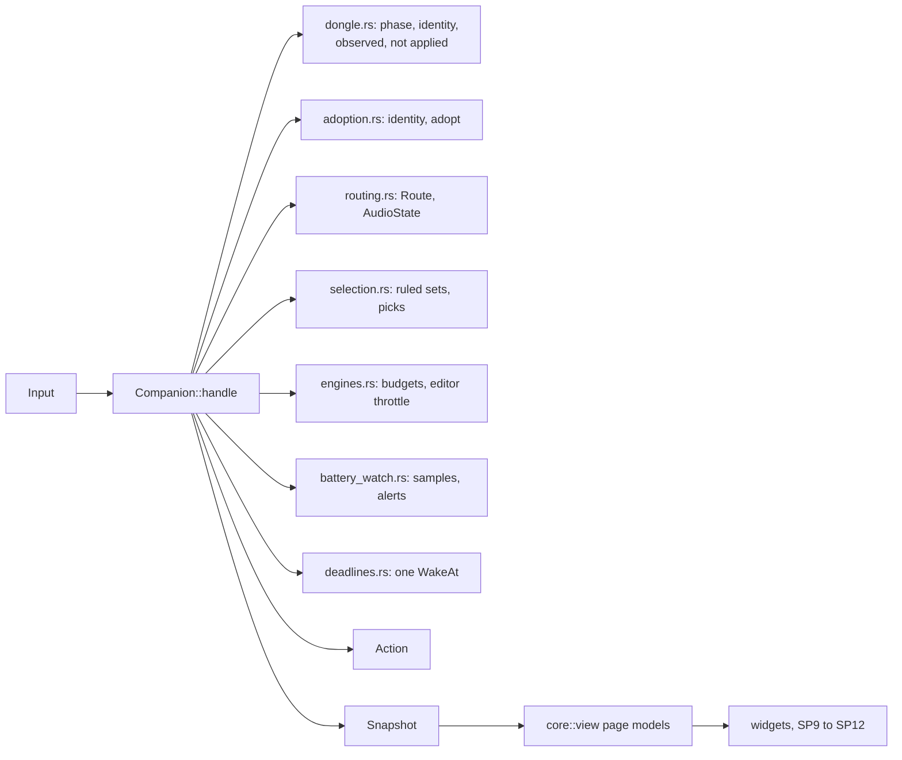
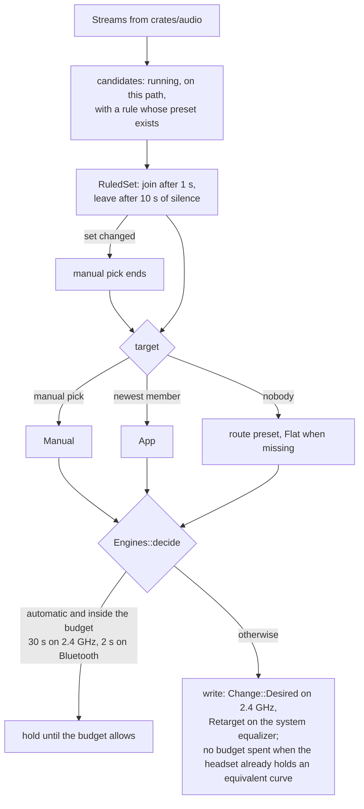
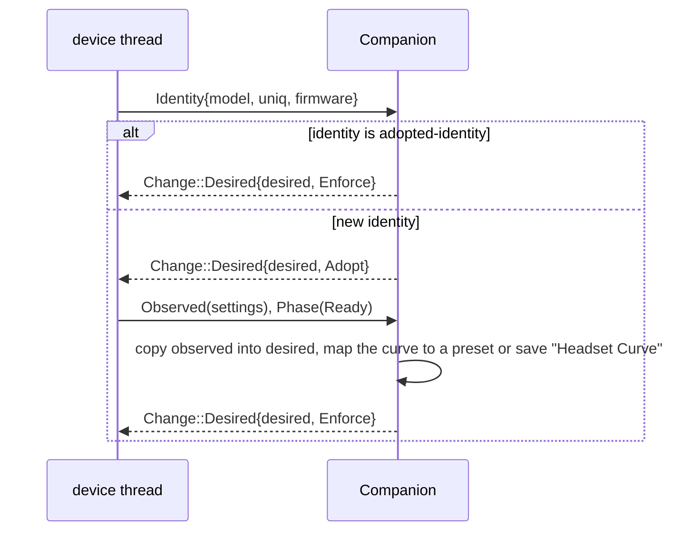
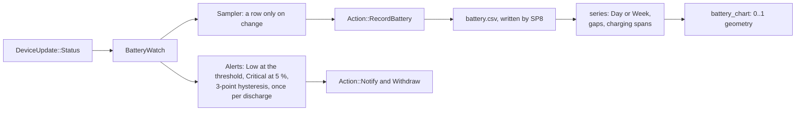
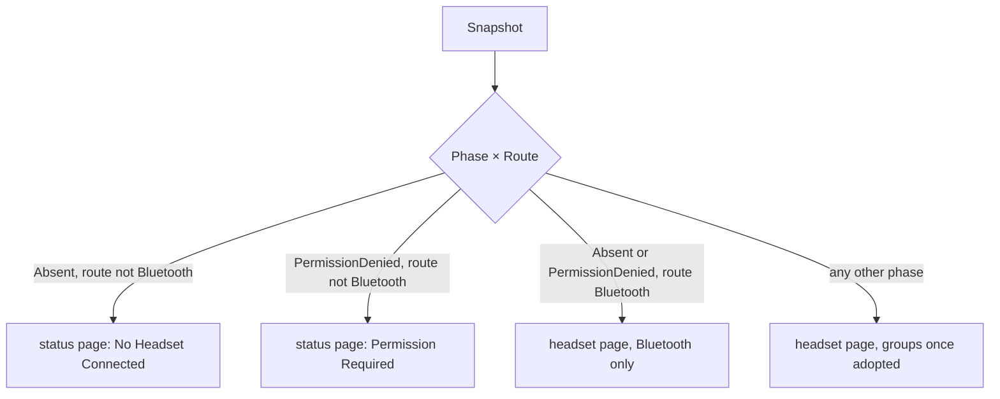

# SP6 Companion, Battery, Ports and View Models Implementation Plan

> **For agentic workers:** REQUIRED SUB-SKILL: Use superpowers:subagent-driven-development (recommended) or superpowers:executing-plans to implement this plan task-by-task. Steps use checkbox (`- [ ]`) syntax for tracking.

**Goal:** The main-thread reducer `core::companion::Companion` (adoption, routing, per-app preset selection with
hysteresis and budgets, user picks, alerts, battery sampling, deadlines, quit), the battery history model
(`core::battery`), the repository ports (`core::ports`) with in-memory adapters and a contract suite
(`core::testkit`), the intents (`core::intent`) and every page model of `core::view`, all pure and table-tested.

**Architecture:** `Companion::handle(Input, Millis) -> Vec<Action>` is a sans-I/O reducer. It dispatches each input
to one small module per rule (`adoption.rs`, `routing.rs`, `selection.rs`, `alerts.rs`, `engines.rs`, …), then runs
one `advance` pass (ruled sets, per-path settle with budgets, editor throttle, quit) and one `finish` pass (a single
`WakeAt` for the earliest deadline, `Publish(Rc<Snapshot>)` only when the snapshot changed). `core::view` turns a
`Snapshot` into page models made only of `Text` values and plain data; widgets (SP9–SP12) render them and emit
`core::intent::Intent`s. Battery history is change-only samples, a CSV line format and a windowed series.

**Tech Stack:** Rust 2024 (rustc 1.98, toolbox `arctis`), serde 1 (derive) in `arctis-core`; dev: the crate itself
with feature `testkit`, serde_json 1, proptest 1.12.

Spec: `docs/superpowers/specs/2026-10-11-arctis-companion-design.md` §2, §3 (module tree), §3.1 (`core::companion`,
`core::view`, `core::ports` rows), §3.2 (the `Companion` contract), §5 (SP6 row); audio part §1, §3, §4, §5;
device part §5 (adoption, identity, never read, event is intent); ui part §1, §2, §3, §4, §5 (`State`,
`ActivePresetReason`, errors); quality part §1 (`core::companion`, `core::battery`, `core::view` rows); ADR 0007,
0008, 0010, 0011, 0012, 0013; glossary `CONTEXT.md`; `docs/research/hardware-findings.md` §2.8 (`HID_UNIQ` is empty
on the Nova 5) and §2.6 (sidetone marks 0/3/6/10).

---

## Conventions for every task

- Worktree: `/home/marcelo/Desenvolvimento/arctis-wt/sp6`, branch `sp6-companion`. Never touch
  `/home/marcelo/Desenvolvimento/arctis-companion`. Stay inside `crates/core`, `docs/architecture`
  and this plan. SP6 never opens `/dev/hidraw*` and never talks to PipeWire.
- **Run (toolbox):** `X` means
  `toolbox run -c arctis bash -lc 'cd /home/marcelo/Desenvolvimento/arctis-wt/sp6 && X'`.
  Git and `gh` run on the host in the worktree (the host has `cargo`, so the hooks work).
- No comments in any file of any language, doc comments included. Names and small functions carry the meaning.
- Clippy policy applies to tests too: cognitive complexity 8, 40 lines per function, nesting 3 (a `fn` body and
  each `if`/`for`/`match` block count), at most 4 arguments (`self` included), no `unwrap()` (tests use `expect`),
  at most 3 `bool` fields per struct, `pedantic` as errors under `-D warnings`. So: no `as` casts (use
  `f64::from`, `u32::try_from`), no `==` on floats (use `assert_close`), `#[must_use]` on public functions that
  return a value, small `Copy` types by value, and a non-`Copy` parameter that is only read is taken by reference
  (`needless_pass_by_value`, also for `impl Trait` parameters other than closures). When clippy objects, extract a function or rename; never add an
  `allow` or `expect` attribute.
- Pure core: `crates/core` may depend only on `serde` and `serde_json` (`cargo xtask check-pure`); dev-dependencies
  are free.
- Tests are integration binaries, one per area, each with one module per source module:
  `crates/core/tests/battery/main.rs`, `crates/core/tests/companion/main.rs`, `crates/core/tests/ports/main.rs`,
  `crates/core/tests/view/main.rs`. Shared helpers live in each binary's `support.rs`, added in the task that first
  uses them, so nothing is dead. The `testkit` feature is turned on for tests by a self dev-dependency (Task 1).
- Code blocks below are not rustfmt-formatted; `cargo fmt --all` reflows them and that is expected.
- Before each commit, Run (toolbox): `cargo fmt --all`, then
  `cargo clippy -p arctis-core --all-targets --features testkit -- -D warnings && cargo test -p arctis-core && cargo xtask check-rules && cargo xtask check-pure`.
- Commit subjects are conventional (`type(scope): summary`), short. Never write `Co-Authored-By`,
  "Generated with", or any AI or tool name in a commit message, PR title or PR body. Never use `--no-verify`.
- Push after every commit: `git push -u origin sp6-companion` the first time, then `git push`. After a rebase that
  moved the branch, `git push --force-with-lease`.
- SP4 (`core::session` + `core::testkit` with `FakeHeadset` and `Simulation`) and SP7 (`crates/audio`) run in
  parallel. Overlap with SP4 is limited to `crates/core/src/lib.rs`, `crates/core/Cargo.toml` (the `testkit`
  feature and the self dev-dependency), `crates/core/src/testkit/mod.rs` and `docs/architecture/README.md`
  (one page row each, and both sides' entries in the `crates/core/` row). Before Task 1, before Task 14 and
  before the PR run `git fetch origin && git rebase origin/main`; on a conflict in those files keep both sides'
  lines (module lists are unions; the feature and dev-dependency are identical). SP4 publishes
  `DeviceUpdate::Identity` on every Syncing and forgets desired settings with the dongle (SP4 Deviations 8 and
  18), which is why `Companion` answers every `Identity` with a `Change::Desired`.

## Acceptance criteria → tasks

| SP6 acceptance criterion (design §5, quality §1) | Task |
|---|---|
| Scope: `core::battery` (`sample.rs`, `log_format.rs`, `series.rs`) | 3, 4, 5 |
| Scope: `core::ports` and in-memory adapters in `testkit` | 9 |
| Scope: `core::intent` | 12 |
| Scope: `core::companion` (`reducer.rs` `input.rs` `action.rs` `snapshot.rs` `adoption.rs` `routing.rs` `selection.rs` `alerts.rs` `deadlines.rs` `timing.rs`) | 6, 7, 8, 10, 11, 13–21 |
| Scope: `core::view` (`headset_page.rs` `presets.rs` `eq_editor.rs` `app_presets.rs` `battery_chart.rs` `text.rs`) | 2, 22–28 |
| §3.2 contract: every `Input` and `Action` variant exists with its payload | 13, 15 |
| companion: adoption by identity (new identity, same identity, firmware change) | 8, 13, 16 |
| companion: field mapping and "Headset Curve" | 8, 16 |
| companion: routing from the default sink (bluez, behind our EQ sink, USB, EasyEffects in between and appearing after insertion, speakers, PipeWire down with dongle Ready) | 6, 17, 19 |
| companion: selection: enter, leave, cork and uncork within 10 s, recency by join time | 11, 18 |
| companion: selection: per-path budget, no budget spent when the observed curve is equivalent, a switch back before the readback still reaches the session | 14, 18 |
| companion: selection: combo pick and Shell pick with and without ruled apps | 19 |
| companion: selection: pick then restart, pick then a new ruled app, missing preset id | 7, 11, 15, 18, 19 |
| companion: never adopted + HeadsetOff | 16, 19, 25 |
| companion: alerts with hysteresis and `BatteryWarning` | 10, 14, 15, 19, 21 |
| companion: quit restores the route preset and waits at most `QUIT_GRACE` | 21 |
| battery: sampling dedupe, CSV round-trip, 8-day retention, series gaps (link down, dongle gone, app quit) | 3, 4, 5, 14, 15, 21 |
| `core::ports` contract suite usable by SP8's stores | 9 |
| view: every `Phase` × `Route` gives a page model (Absent × Bluetooth has the equalizer rows) | 25 |
| view: banner priority | 25 |
| view: sidetone marks and value texts | 23 |
| view: "Not applied" rows | 13, 15, 23 |
| view: empty states (Custom presets, app presets, Add Rule, battery) | 22, 27, 28 |
| view: chart geometry | 28 |
| view: accessible descriptions (header, response graph, battery chart) | 25, 26, 28 |
| view: `Text` values only (every user-visible string is a `Text`; `english` panics on an unbound placeholder) | 2, 22–28 |
| `docs/architecture/companion.md` (sub-project rule, design §5) | 29 |

## File structure

```
crates/core/Cargo.toml                        feature testkit; dev: arctis-core with testkit
crates/core/src/lib.rs                        pub mod battery, companion, intent, ports, view; testkit behind the feature
crates/core/src/intent.rs                     Intent and its widget constructors
crates/core/src/ports.rs                      StoreError, PresetRepository, BatteryRepository, SeenAppsRepository
crates/core/src/battery/
  mod.rs
  sample.rs        UnixSeconds, Reading, Sample, Sampler (change-only)
  log_format.rs    CSV line format, parse_log, render_line, retain_recent, RETENTION_SECONDS
  series.rs        Window, Point, Span, Series, series, last_full_charge
crates/core/src/companion/
  mod.rs           module list and re-exports
  timing.rs        RULE_ENTER RULE_LEAVE auto_switch_min_interval EDITOR_THROTTLE QUIT_GRACE battery levels
  app_settings.rs  HeadsetValues, RoutePresets, AppRules, AppSettings, PersistedChange, Persisted
  adoption.rs      DongleIdentity, Adoption, adopt
  catalog.rs       Catalog (built-ins + custom), fresh_id, HEADSET_CURVE_NAME
  seen_apps.rs     SeenApp, remember, newly_playing, MAX_SEEN_APPS
  routing.rs       Route, route, needs_equalizer, AudioService, AudioState
  alerts.rs        BatteryWarning, AlertId, Alert, warning_for, Alerts
  selection.rs     PresetReason, ActivePreset, Candidate, RuledSet, ManualPick, PathSelection, Selection, candidates, picked_path, ActivateError, PATHS
  engines.rs       Cause, Trigger, Decision, EditorThrottle, Engines
  deadlines.rs     Deadlines, earliest
  dongle.rs        DongleState, AdoptionStatus, WriteFailure
  battery_watch.rs BatteryWatch (sampler + history + alerts + the closing row of a disconnect)
  input.rs         Input
  action.rs        Action, PresetChange
  reducer.rs       Companion: new, handle, device and audio inputs, advance, finish
  intents.rs       Companion's intent handlers
  quitting.rs      Quit, start_quit, finish_quit
  snapshot.rs      Snapshot and its parts, Companion::snapshot
crates/core/src/view/
  mod.rs
  text.rs          Arg, Args, Text, preset_title, preset_arg
  status_page.rs   StatusPageModel (status pages and empty states)
  headset_page.rs  HeadsetPageModel, banner, header, failure toast, settings area
  equalizer_rows.rs EqualizerGroupModel, preset combos, Now Playing, warning rows
  headset_rows.rs  HeadsetGroupsModel, ScaleModel, SwitchModel, ChoiceModel, DeviceModel, sidetone marks
  presets.rs       PresetItem, PresetsPageModel, preset_uses, deleted_toast
  eq_editor.rs     EqEditorModel, BandModel, GraphModel, band_title, kind_name
  app_presets.rs   AppPresetsModel, RuleRowModel, AddRuleModel
  battery_chart.rs BatteryPageModel, BatteryChartModel, ChartPoint, ChartSpan
crates/core/src/testkit/
  mod.rs
  english.rs               english(&Text): placeholder substitution without translation
  memory_repositories.rs   MemoryPresets, MemoryBattery, MemorySeenApps
  repository_contracts.rs  preset_/battery_/seen_apps_repository_contract
crates/core/tests/battery/   main.rs support.rs sample.rs log_format.rs series.rs
crates/core/tests/ports/     main.rs
crates/core/tests/companion/ main.rs support.rs timing.rs routing.rs catalog.rs seen_apps.rs app_settings.rs
                             adoption.rs alerts.rs selection.rs intent.rs dongle.rs engines.rs contract.rs
                             lifecycle.rs adoption_flow.rs routing_flow.rs selection_flow.rs picks_flow.rs
                             presets_flow.rs quit_flow.rs settings_flow.rs
crates/core/tests/view/      main.rs support.rs text.rs presets.rs headset_rows.rs equalizer_rows.rs
                             headset_page.rs eq_editor.rs app_presets.rs battery_chart.rs
docs/architecture/companion.md                 diagrams + code paths and symbols
docs/architecture/README.md                    one new row
```

Dependency direction inside `core`: `battery` → `view::text` → `companion::{timing, app_settings, adoption, catalog,
seen_apps, routing, alerts, selection, engines, deadlines, dongle}` → `companion::{input, action, snapshot,
companion, intents}` → `view::*` page models. `ports` depends on `battery`, `eq` and `companion::seen_apps`;
`testkit` on `ports` and `view::text`. Nothing here depends on `core::session`.

## Deviations

Decisions taken where the spec is silent or ambiguous; each is the simplest option consistent with it.

| # | Decision | Why |
|---|---|---|
| 1 | Extra files beyond the module tree: `companion/{app_settings, catalog, seen_apps, engines, dongle, battery_watch, intents, quitting}.rs`, `view/{status_page, equalizer_rows, headset_rows}.rs`, `testkit/{english, repository_contracts}.rs` | each keeps one rule per file and every file well under 400 lines; the spec's tree lists the floor |
| 2 | The spec's `companion/companion.rs` is `companion/reducer.rs`, a private module re-exported as `companion::Companion` | clippy's `module_inception` rejects a module named like its public parent (`allow-private-module-inception` only helps when the parent is private, checked); a rename is simpler than an attribute. SP4 meets the same with `session/session.rs` |
| 3 | The `Millis` passed to `Companion::handle` is wall-clock milliseconds since the Unix epoch (SP8 passes `glib::real_time() / 1000`) | battery rows need Unix seconds and `core` has no clock; deadlines of 1–30 s tolerate a rare clock step |
| 4 | `Action::Publish(Rc<Snapshot>)` and `Companion::snapshot() -> Rc<Snapshot>`; `Publish` is emitted only when the snapshot differs from the last one published | the bridge hands one snapshot to the window and to `Headset1` without copying; the main thread is single-threaded |
| 5 | `ActivatePreset` errors (`NoRoute`, `NotReady`) come from `Snapshot::picked_path()`, which the D-Bus object checks before it forwards the intent. `Companion` ignores an `ActivatePreset` with no picked path, or for an unknown preset id | §3.2 has no reply action; the D-Bus object always holds the latest snapshot on the same thread |
| 6 | `Text` = `Plain(msgid)`, `Verbatim(user text)`, `Format { msgid, args }`, `Plural { singular, plural, n, args }` with named args `Vec<(&'static str, Arg)>`; `Arg` adds `Number(u32)`, `Time(UnixSeconds)` and `Msgid(String)` (a translatable fragment such as a built-in preset name) to `Percent`, `Decibels`, `Hertz`, `Str`. Msgids are `String` | named placeholders need names; custom preset and app names are user text; `{n}` is substituted by the resolver |
| 7 | `Intent` has one variant per headset setting (`SetSidetone(Sidetone)`, as in the design's sequence diagram), `SetExtendedRange(bool)`, `RetryWrite(Setting)`, `UseRoutePreset(SoundPath)` (Now Playing button), `StartPreview`/`EndPreview`, preset, rule and threshold intents; `Intent::from_scale`, `from_switch`, `from_auto_power_off_choice` map widget values | widgets stay trivial and the mapping is tested once |
| 8 | Adoption: on `Identity` for an identity that is not adopted, `Companion` sends `Change::Desired { settings, Adopt }`; once the phase is Ready and observed settings are known it copies them into desired, maps the curve to a built-in, else to an existing custom preset, else saves "Headset Curve" (id `headset-curve`, then `headset-curve-2`, …; the name is stored in English as user text), stores the identity and sends `Enforce`. For an adopted identity `Identity` sends `Enforce` at once | follows device §5 in order; checking custom presets too avoids a second "Headset Curve" when a second dongle with the same curve is adopted |
| 9 | `adopted-identity` text is `"{pid:04x}"` or `"{pid:04x}:{uniq}"`; an empty string is "never adopted"; an empty `HID_UNIQ` is no serial | `hardware-findings.md` §2.8: the Nova 5 has no serial, so the identity is the PID |
| 10 | The switch budget applies to switches not caused by an intent or by quit. Every switch of the 2.4 GHz target still sends `Change::Desired` (the session's desired must always be the latest target), but one whose curve is `equivalent` to the observed headset curve spends no budget: the session writes only drift, so no `0x33` frame goes out. A held switch is re-decided at its deadline from the latest target (coalescing) | audio §4 "later changes coalesce to the latest choice; no write when the observed curve is equivalent"; skipping the `Change` itself would leave the session enforcing a stale curve when the target returns to the observed curve before the readback (e.g. a pick undone within 400 ms); user picks must feel instant |
| 11 | A preview is a manual pick flagged `preview`; `EndPreview` ends it, and a ruled-set change or route change ends it like any manual pick | one rule for both (ui §3 Preview, audio §4) |
| 12 | Deleting a custom preset keeps route-preset and rule ids unchanged; they resolve to Flat (route) or "Preset missing" (rules) until Undo saves the preset back. A member already in the ruled set keeps its id until it leaves | audio §3 "Missing presets"; Undo restores everything with one `SavePreset` |
| 13 | Alerts: `Charging::Charging` and `PluggedIn` both count as "charging starts"; a reading whose link is not connected keeps the previous warning; reaching Critical withdraws the Low notification; each warning notifies once per discharge | audio §5; one notification on screen at a time |
| 14 | CSV columns are `unix_seconds,percent,charging,link` with words (`discharging`, `plugged-in`, `connected`, `headset-off`, …); malformed lines are skipped on parse | readable file; one bad line never loses the history |
| 15 | `series` draws a staircase (each reading holds until the next sample or `now`), carries the last sample before the window to its start, breaks the line on any reading whose link is not connected, shades `Charging` and `PluggedIn` holds, and takes the last full charge as the latest sample at 100 %. When the dongle leaves (Absent, PermissionDenied) or the app quits, `BatteryWatch::disconnect` records the last reading once more with `Link::HeadsetOff`, so downtime breaks the line instead of holding the old level across it. `parse_log` sorts rows by time | audio §5 "line segments broken when the link is not connected, charging spans, last full charge"; rows are change-only, so without a closing row an unplugged dongle or a stopped app would draw a flat line through hours without data; a wall-clock step back (Deviation 3) can append an older row |
| 16 | No notice timer in `Companion`: `REBIND_NOTICE` stays in `core::session::timing` and the session publishes `Phase::Rebinding` only once it has passed (SP4 Deviation 5), so the header shows "Reconnecting…" whenever the published phase is Rebinding | a second 5 s timer on the main thread would delay the notice to 10 s and duplicate a session constant |
| 17 | Ports return `Result<_, StoreError>`; `SeenAppsRepository::record(&SeenApp)` and the store applies `seen_apps::remember` (newest first, at most 50); the contract suite lives in `testkit::repository_contracts` | SP8's file stores and the memory adapters share one rule and one suite |
| 18 | Tests turn on `testkit` through `arctis-core = { path = ".", features = ["testkit"] }` in `[dev-dependencies]` | integration tests cannot see `cfg(test)` items; cargo accepts the self dev-dependency (checked) and `check-pure` ignores dev-dependencies |
| 19 | `AppSettings` holds only what `Companion` reads (headset values, route presets, app rules, automatic presets, adopted identity, `bluetooth-sink-seen`, low-battery threshold). Run in Background stays in SP8: `Intent::SetRunInBackground(bool)` exists so the preferences switch (SP9) emits an intent like every widget, and `Companion` ignores it; the bridge acts on it (GSettings and the Background portal) | the Background portal is an app concern; widgets never touch GSettings (ui §1), so the intent must exist in `core::intent`, which SP6 owns |
| 20 | Now Playing texts: "{preset}, chosen for {app}", "{preset}, until {app} stops", and "{preset}, chosen by hand" for a manual pick with no ruled app (a preview) | ui §2 gives the first two |
| 21 | A write failure is `Snapshot.dongle.last_failure = Some(WriteFailure { serial, setting })`; the window shows a toast when the serial changes. "Not applied" lasts until observed equals desired for that setting | a snapshot is state; the serial turns the failure edge into state |
| 22 | `RetryWrite` re-sends the whole desired settings with `Enforce`; the session writes only the drifted fields | device §4 "Retry re-sends the desired value" |
| 23 | Before adoption, a `HeadsetChanged` event only updates observed; after adoption it updates desired and persists | desired does not exist before adoption (device §5 "Never read") |
| 24 | `SettingsChanged` equal to the current settings does nothing; changed headset values send `Enforce` when adopted; a changed threshold re-evaluates alerts | the bridge may echo our own `Persist` back through GSettings |
| 25 | Seen apps are recorded when an app key starts playing on any output, once per start | audio §4 "the last 50 apps seen playing" |
| 26 | Battery chart geometry is normalized: `x` in 0..1 over the window, `y` = percent / 100. The response graph samples `GRAPH_POINTS` = 96 log-spaced frequencies; its accessible description names the preset and the number of active bands | the widget scales to its allocation; a short description is what a screen reader can use |
| 27 | Warning rows: "Choose “Arctis Nova 5 (Equalizer)” as output in Sound settings" (Manager role denied), "EasyEffects is processing audio; the system equalizer is off", "App presets unavailable: audio service not reachable" (audio service down) | ui §2 lists them |
| 28 | The picked path for Preview is the same as for the Shell (`picked_path`) | ui §3 "the manual pick of the picked path" |
| 29 | `AdoptionStatus` lives in `adoption.rs`; `Alerts::update` returns `AlertChange` values that `Action::from` turns into `Notify`/`Withdraw` | `alerts.rs` is built and tested before `action.rs` exists and stays independent of it |
| 30 | Large models inside enums are boxed (`HeadsetPageModel`, `SettingsArea::Groups`, `AppPresetsContent::Empty`, `BatteryContent::Empty`) | clippy `large_enum_variant` under `-D warnings` |
| 31 | `Companion` is built incrementally (Tasks 15–21): each task replaces whole functions of `reducer.rs` and adds new ones, so every field and function is used the moment it exists | `-D warnings` rejects dead code, and each behaviour stays test-first |
| 32 | `AudioState::equalizer` holds the curve the system equalizer runs; a `Retarget` is sent only when the new curve differs from it | the first settle after an insertion would otherwise retarget to the curve just inserted |
| 33 | EasyEffects in the default sink's chain also removes an equalizer that is already inserted, not only blocks a new insertion | audio §1 "the system equalizer is off" while EasyEffects processes audio; otherwise the two would stack (ADR 0008) |
| 34 | Delete-toast texts are eight whole-sentence msgids (route paths × with or without app rules), never a sentence with a translated fragment inserted | ui §4 "Msgids are whole sentences …, never concatenated"; translators need the whole sentence for agreement |
| 35 | The repository contract suite takes `fresh` and `reopen` (`impl Fn(R) -> R`) and reads back only after `reopen`; the memory adapters pass the identity | SP8's file stores must prove that what they write survives a new store over the same directory, which an in-instance check cannot show |
| 36 | Known cross-sub-project gap, not fixed here: `AdoptionStatus` needs `DeviceUpdate::Identity`, which SP4 publishes on Syncing only (SP4 Deviation 18). After a restart with the headset off, the page therefore shows banner 2 ("Turn on the headset to read its settings") instead of banner 3 until the headset turns on. `Companion` already handles `Identity` in any phase, so it needs no change if the session publishes `Identity` on `Found` (`Firmware` fields are `Option`s) | reported to the orchestrator for SP4/SP8; SP6 cannot invent a dongle identity, and presuming adoption would send a previous dongle's settings to a new one |
| 37 | The design's `AUTO_SWITCH_MIN_INTERVAL` "30 s (2.4 GHz) and 2 s (Bluetooth)" is `timing::auto_switch_min_interval(SoundPath)` over `DONGLE_SWITCH_INTERVAL` and `BLUETOOTH_SWITCH_INTERVAL`; `battery::series` takes a third argument `now: UnixSeconds` | one constant cannot hold two values; `core` has no clock, so the window's end must be passed in |
| 38 | The English test resolver checks placeholders in the msgid, not in the rendered text, so user text (`Arg::Str`, `Text::Verbatim`) may contain braces | a custom preset or app named "{x}" is legal user text and must not fail a view test |

---
### Task 1: The `testkit` feature

**Files:**
- Modify: `crates/core/Cargo.toml`

- [x] **Step 1: Rebase on main**

```bash
cd /home/marcelo/Desenvolvimento/arctis-wt/sp6
git fetch origin
git rebase origin/main
```

If SP4 has already landed a `testkit` feature in `crates/core/Cargo.toml`, keep it and skip the matching lines of
Step 2.

- [x] **Step 2: Add the feature and the self dev-dependency**

`crates/core/Cargo.toml` becomes:

```toml
[package]
name = "arctis-core"
version.workspace = true
edition.workspace = true
license.workspace = true
publish.workspace = true

[features]
testkit = []

[dependencies]
serde = { version = "1", features = ["derive"] }

[dev-dependencies]
allocation-counter = "0.8.1"
arctis-core = { path = ".", features = ["testkit"] }
proptest = "1.12"
serde_json = "1"

[lints]
workspace = true
```

- [x] **Step 3: Check the workspace still builds and passes**

Run (toolbox): `cargo clippy -p arctis-core --all-targets --features testkit -- -D warnings && cargo test -p arctis-core && cargo xtask check-pure && cargo xtask check-rules`
Expected: PASS (`check-pure` ignores the dev-dependency on itself).

- [x] **Step 4: Commit**

```bash
git add crates/core/Cargo.toml Cargo.lock
git commit -m "build(core): add the testkit feature"
git push -u origin sp6-companion
```

---

### Task 2: `Text`, its arguments, and the English test resolver

**Files:**
- Create: `crates/core/src/view/mod.rs`, `crates/core/src/view/text.rs`
- Create: `crates/core/src/testkit/mod.rs`, `crates/core/src/testkit/english.rs`
- Modify: `crates/core/src/lib.rs`
- Test: `crates/core/tests/view/main.rs`, `crates/core/tests/view/support.rs`, `crates/core/tests/view/text.rs`

- [x] **Step 1: Write the failing tests**

`crates/core/tests/view/main.rs`:

```rust
mod support;

mod text;
```

`crates/core/tests/view/support.rs`:

```rust
use arctis_core::eq::{Gain, Hertz};
use arctis_core::settings::values::Percent;

pub fn percent(value: u8) -> Percent {
    Percent::try_from(value).expect("percent")
}

pub fn gain(half_db: i8) -> Gain {
    Gain::from_half_db(half_db).expect("gain in the envelope")
}

pub fn hertz(hz: u16) -> Hertz {
    Hertz::new(hz).expect("frequency in the envelope")
}
```

`crates/core/tests/view/text.rs`:

```rust
use arctis_core::eq::library;
use arctis_core::eq::preset::{Preset, PresetId};
use arctis_core::testkit::english::english;
use arctis_core::view::text::{Arg, Text, preset_arg, preset_title};

use crate::support::{gain, hertz, percent};

fn custom(name: &str) -> Preset {
    Preset::custom(PresetId::new("mine"), name.to_owned(), library::flat().curve().clone())
}

#[test]
fn plain_text_is_its_msgid() {
    assert_eq!(english(&Text::plain("Sidetone")), "Sidetone");
}

#[test]
fn verbatim_text_is_kept_as_written() {
    assert_eq!(english(&Text::verbatim("Bass (Mine)")), "Bass (Mine)");
}

#[test]
fn format_binds_named_arguments() {
    let text = Text::format(
        "{preset}, chosen for {app}",
        vec![
            ("preset", Arg::Msgid("Footsteps".to_owned())),
            ("app", Arg::Str("Firefox".to_owned())),
        ],
    );
    assert_eq!(english(&text), "Footsteps, chosen for Firefox");
}

#[test]
fn plural_picks_the_form_and_binds_n() {
    let forms = ["{n} minute", "{n} minutes"];
    assert_eq!(english(&Text::plural(forms, 1, Vec::new())), "1 minute");
    assert_eq!(english(&Text::plural(forms, 5, Vec::new())), "5 minutes");
}

#[test]
fn arguments_render_with_their_units() {
    let cases = [
        (Arg::Percent(percent(73)), "73 %"),
        (Arg::Decibels(gain(4)), "+2.0 dB"),
        (Arg::Decibels(gain(-3)), "-1.5 dB"),
        (Arg::Hertz(hertz(250)), "250 Hz"),
        (Arg::Number(7), "7"),
    ];
    for (arg, expected) in cases {
        assert_eq!(english(&Text::format("{x}", vec![("x", arg)])), expected);
    }
}

#[test]
fn built_in_names_are_msgids_and_custom_names_are_user_text() {
    assert_eq!(preset_title(&library::flat()), Text::plain("Flat"));
    assert_eq!(preset_title(&custom("Mine")), Text::verbatim("Mine"));
    assert_eq!(preset_arg(&library::flat()), Arg::Msgid("Flat".to_owned()));
    assert_eq!(preset_arg(&custom("Mine")), Arg::Str("Mine".to_owned()));
}

#[test]
#[should_panic(expected = "unbound placeholder")]
fn english_rejects_an_unbound_placeholder() {
    let _ = english(&Text::format("{missing} remaining", Vec::new()));
}

#[test]
fn user_text_may_contain_braces() {
    let text = Text::format(
        "{preset}, chosen by hand",
        vec![("preset", Arg::Str("{Mine}".to_owned()))],
    );
    assert_eq!(english(&text), "{Mine}, chosen by hand");
}
```

- [x] **Step 2: Run the tests to see them fail**

Run (toolbox): `cargo test -p arctis-core --test view`
Expected: FAIL to compile (`arctis_core::view` and `arctis_core::testkit` do not exist).

- [x] **Step 3: Implement `view::text`**

`crates/core/src/view/mod.rs`:

```rust
pub mod text;
```

`crates/core/src/view/text.rs`:

```rust
use crate::battery::sample::UnixSeconds;
use crate::eq::filter::{Gain, Hertz};
use crate::eq::preset::{Preset, PresetKind};
use crate::settings::values::Percent;

#[derive(Clone, Debug, PartialEq, Eq)]
pub enum Arg {
    Percent(Percent),
    Decibels(Gain),
    Hertz(Hertz),
    Number(u32),
    Time(UnixSeconds),
    Msgid(String),
    Str(String),
}

pub type Args = Vec<(&'static str, Arg)>;

#[derive(Clone, Debug, PartialEq, Eq)]
pub enum Text {
    Plain(String),
    Verbatim(String),
    Format {
        msgid: String,
        args: Args,
    },
    Plural {
        singular: String,
        plural: String,
        n: u32,
        args: Args,
    },
}

impl Text {
    #[must_use]
    pub fn plain(msgid: &str) -> Self {
        Self::Plain(msgid.to_owned())
    }

    #[must_use]
    pub fn verbatim(text: &str) -> Self {
        Self::Verbatim(text.to_owned())
    }

    #[must_use]
    pub fn format(msgid: &str, args: Args) -> Self {
        Self::Format {
            msgid: msgid.to_owned(),
            args,
        }
    }

    #[must_use]
    pub fn plural(forms: [&str; 2], n: u32, args: Args) -> Self {
        let [singular, plural] = forms;
        Self::Plural {
            singular: singular.to_owned(),
            plural: plural.to_owned(),
            n,
            args,
        }
    }
}

#[must_use]
pub fn preset_title(preset: &Preset) -> Text {
    match preset.kind() {
        PresetKind::BuiltIn => Text::plain(preset.name()),
        PresetKind::Custom => Text::verbatim(preset.name()),
    }
}

#[must_use]
pub fn preset_arg(preset: &Preset) -> Arg {
    match preset.kind() {
        PresetKind::BuiltIn => Arg::Msgid(preset.name().to_owned()),
        PresetKind::Custom => Arg::Str(preset.name().to_owned()),
    }
}
```

`text.rs` uses `crate::battery::sample::UnixSeconds`, which Task 3 creates. To keep this task green on its own,
create the minimal `battery` module now with only that type (Task 3 adds the rest test-first):

`crates/core/src/battery/mod.rs`:

```rust
pub mod sample;
```

`crates/core/src/battery/sample.rs`:

```rust
#[derive(Clone, Copy, Debug, Default, PartialEq, Eq, PartialOrd, Ord, Hash)]
pub struct UnixSeconds(pub u64);
```

- [x] **Step 4: Implement the English resolver**

`crates/core/src/testkit/mod.rs`:

```rust
pub mod english;
```

`crates/core/src/testkit/english.rs`:

```rust
use crate::view::text::{Arg, Text};

#[must_use]
pub fn english(text: &Text) -> String {
    match text {
        Text::Verbatim(text) => text.clone(),
        Text::Plain(msgid) => substitute(msgid, &[]),
        Text::Format { msgid, args } => substitute(msgid, args),
        Text::Plural {
            singular,
            plural,
            n,
            args,
        } => {
            let form = if *n == 1 { singular } else { plural };
            substitute(&form.replace("{n}", &n.to_string()), args)
        }
    }
}

fn substitute(template: &str, args: &[(&str, Arg)]) -> String {
    let unbound = args
        .iter()
        .fold(template.to_owned(), |text, (name, _)| text.replace(&placeholder(name), ""));
    assert!(!unbound.contains('{'), "unbound placeholder in {template:?}");
    args.iter().fold(template.to_owned(), |text, (name, arg)| {
        text.replace(&placeholder(name), &argument(arg))
    })
}

fn placeholder(name: &str) -> String {
    format!("{{{name}}}")
}

fn argument(arg: &Arg) -> String {
    match arg {
        Arg::Percent(percent) => format!("{} %", percent.get()),
        Arg::Decibels(gain) => format!("{:+.1} dB", gain.db()),
        Arg::Hertz(hertz) => format!("{} Hz", hertz.get()),
        Arg::Number(number) => number.to_string(),
        Arg::Time(at) => format!("@{}", at.0),
        Arg::Msgid(text) | Arg::Str(text) => text.clone(),
    }
}
```

- [x] **Step 5: Register the modules**

`crates/core/src/lib.rs`:

```rust
#![forbid(unsafe_code)]

mod bounded;

pub mod battery;
pub mod eq;
pub mod messages;
pub mod protocol;
pub mod settings;
#[cfg(feature = "testkit")]
pub mod testkit;
pub mod time;
pub mod view;
```

(Keep any module SP4 has added meanwhile, such as `pub mod session;`.)

- [x] **Step 6: Run the tests to see them pass**

Run (toolbox): `cargo test -p arctis-core --test view`
Expected: PASS, 8 tests.

- [x] **Step 7: Commit**

```bash
git add crates/core/src crates/core/tests/view
git commit -m "feat(core): add typed view text"
git push
```

---

### Task 3: Battery samples and change-only sampling

**Files:**
- Modify: `crates/core/src/battery/sample.rs`
- Test: `crates/core/tests/battery/main.rs`, `crates/core/tests/battery/support.rs`, `crates/core/tests/battery/sample.rs`

- [x] **Step 1: Write the failing tests**

`crates/core/tests/battery/main.rs`:

```rust
mod support;

mod sample;
```

`crates/core/tests/battery/support.rs`:

```rust
use arctis_core::battery::sample::{Reading, Sample, UnixSeconds};
use arctis_core::protocol::status::{Charging, Link};
use arctis_core::settings::values::Percent;

pub fn reading(percent: u8, charging: Charging, link: Link) -> Reading {
    Reading {
        percent: Percent::try_from(percent).expect("percent"),
        charging,
        link,
    }
}

pub fn discharging(percent: u8) -> Reading {
    reading(percent, Charging::Discharging, Link::Connected)
}

pub fn sample(at: u64, reading: Reading) -> Sample {
    Sample {
        at: UnixSeconds(at),
        reading,
    }
}
```

`crates/core/tests/battery/sample.rs`:

```rust
use arctis_core::battery::sample::{Sampler, UnixSeconds};
use arctis_core::protocol::status::{Charging, Link};
use arctis_core::time::Millis;

use crate::support::{discharging, reading, sample};

#[test]
fn unix_seconds_come_from_wall_clock_millis() {
    assert_eq!(
        UnixSeconds::from_millis(Millis(1_760_000_000_999)),
        UnixSeconds(1_760_000_000)
    );
}

#[test]
fn unix_seconds_subtract_without_wrapping() {
    assert_eq!(UnixSeconds(100).minus(30), UnixSeconds(70));
    assert_eq!(UnixSeconds(10).minus(30), UnixSeconds(0));
    assert_eq!(UnixSeconds(100).since(UnixSeconds(40)), 60);
    assert_eq!(UnixSeconds(40).since(UnixSeconds(100)), 0);
}

#[test]
fn only_a_connected_link_is_connected() {
    for link in Link::ALL {
        let connected = reading(50, Charging::Discharging, link).is_connected();
        assert_eq!(connected, link == Link::Connected, "{link:?}");
    }
}

#[test]
fn the_first_reading_is_recorded() {
    let mut sampler = Sampler::default();
    assert_eq!(
        sampler.observe(discharging(73), UnixSeconds(10)),
        Some(sample(10, discharging(73)))
    );
}

#[test]
fn an_unchanged_reading_is_not_recorded_again() {
    let mut sampler = Sampler::default();
    let _ = sampler.observe(discharging(73), UnixSeconds(10));
    assert_eq!(sampler.observe(discharging(73), UnixSeconds(20)), None);
}

#[test]
fn a_change_of_percent_charging_or_link_is_recorded() {
    let changes = [
        discharging(72),
        reading(73, Charging::Charging, Link::Connected),
        reading(73, Charging::Discharging, Link::HeadsetOff),
    ];
    for change in changes {
        let mut sampler = Sampler::default();
        let _ = sampler.observe(discharging(73), UnixSeconds(10));
        assert_eq!(
            sampler.observe(change, UnixSeconds(20)),
            Some(sample(20, change)),
            "{change:?}"
        );
    }
}

#[test]
fn history_seeds_the_last_reading() {
    let mut sampler = Sampler::starting_from(&[sample(1, discharging(73))]);
    assert_eq!(sampler.observe(discharging(73), UnixSeconds(30)), None);
}

#[test]
fn plugged_means_charging_or_plugged_in() {
    let cases = [
        (Charging::Charging, true),
        (Charging::PluggedIn, true),
        (Charging::Discharging, false),
        (Charging::Unknown, false),
    ];
    for (charging, plugged) in cases {
        assert_eq!(reading(50, charging, Link::Connected).is_plugged(), plugged);
    }
}
```

- [x] **Step 2: Run the tests to see them fail**

Run (toolbox): `cargo test -p arctis-core --test battery`
Expected: FAIL to compile (`Sampler`, `Reading`, `Sample`, `from_millis` missing).

- [x] **Step 3: Implement `battery::sample`**

`crates/core/src/battery/sample.rs`:

```rust
use crate::protocol::status::{Charging, Link};
use crate::settings::values::Percent;
use crate::time::Millis;

const MILLIS_PER_SECOND: u64 = 1_000;

#[derive(Clone, Copy, Debug, Default, PartialEq, Eq, PartialOrd, Ord, Hash)]
pub struct UnixSeconds(pub u64);

impl UnixSeconds {
    #[must_use]
    pub const fn from_millis(now: Millis) -> Self {
        Self(now.0 / MILLIS_PER_SECOND)
    }

    #[must_use]
    pub const fn minus(self, seconds: u64) -> Self {
        Self(self.0.saturating_sub(seconds))
    }

    #[must_use]
    pub const fn since(self, earlier: Self) -> u64 {
        self.0.saturating_sub(earlier.0)
    }
}

#[derive(Clone, Copy, Debug, PartialEq, Eq, Hash)]
pub struct Reading {
    pub percent: Percent,
    pub charging: Charging,
    pub link: Link,
}

impl Reading {
    #[must_use]
    pub const fn is_plugged(self) -> bool {
        matches!(self.charging, Charging::Charging | Charging::PluggedIn)
    }

    #[must_use]
    pub const fn is_connected(self) -> bool {
        self.link.is_connected()
    }
}

#[derive(Clone, Copy, Debug, PartialEq, Eq, Hash)]
pub struct Sample {
    pub at: UnixSeconds,
    pub reading: Reading,
}

#[derive(Clone, Copy, Debug, Default, PartialEq, Eq)]
pub struct Sampler {
    last: Option<Reading>,
}

impl Sampler {
    #[must_use]
    pub fn starting_from(history: &[Sample]) -> Self {
        Self {
            last: history.last().map(|sample| sample.reading),
        }
    }

    pub fn observe(&mut self, reading: Reading, at: UnixSeconds) -> Option<Sample> {
        if self.last == Some(reading) {
            return None;
        }
        self.last = Some(reading);
        Some(Sample { at, reading })
    }
}
```

`crates/core/src/battery/mod.rs`:

```rust
pub mod sample;

pub use sample::{Reading, Sample, Sampler, UnixSeconds};
```

- [x] **Step 4: Run the tests to see them pass**

Run (toolbox): `cargo test -p arctis-core --test battery`
Expected: PASS, 8 tests.

- [x] **Step 5: Commit**

```bash
git add crates/core/src/battery crates/core/tests/battery
git commit -m "feat(core): sample battery readings on change"
git push
```

---

### Task 4: The battery CSV line format and 8-day retention

**Files:**
- Create: `crates/core/src/battery/log_format.rs`
- Modify: `crates/core/src/battery/mod.rs`
- Test: `crates/core/tests/battery/log_format.rs`, `crates/core/tests/battery/main.rs`

- [ ] **Step 1: Write the failing tests**

Add `mod log_format;` to `crates/core/tests/battery/main.rs`.

`crates/core/tests/battery/log_format.rs`:

```rust
use arctis_core::battery::log_format::{
    RETENTION_SECONDS, parse_log, render_line, render_log, retain_recent,
};
use arctis_core::battery::sample::{Sample, UnixSeconds};
use arctis_core::protocol::status::{Charging, Link};

use crate::support::{discharging, reading, sample};

fn every_word() -> Vec<Sample> {
    Charging::ALL
        .into_iter()
        .flat_map(|charging| Link::ALL.into_iter().map(move |link| (charging, link)))
        .zip(1_u64..)
        .map(|((charging, link), at)| sample(at, reading(40, charging, link)))
        .collect()
}

#[test]
fn a_sample_renders_as_one_csv_line() {
    assert_eq!(
        render_line(&sample(1_760_000_000, discharging(73))),
        "1760000000,73,discharging,connected\n"
    );
}

#[test]
fn every_charging_and_link_word_round_trips() {
    let samples = every_word();
    assert_eq!(parse_log(&render_log(&samples)), samples);
}

#[test]
fn malformed_lines_are_skipped() {
    let lines = [
        "",
        "abc",
        "1,101,charging,connected",
        "1,50,flying,connected",
        "1,50,charging,orbiting",
        "1,50,charging,connected,extra",
        "1,50,charging",
        "-1,50,charging,connected",
    ];
    for line in lines {
        assert_eq!(parse_log(line), Vec::new(), "{line:?}");
    }
}

#[test]
fn good_lines_survive_their_bad_neighbours() {
    let text = "1,50,charging,connected\nnot a row\n2,51,charging,connected\n";
    assert_eq!(
        parse_log(text),
        vec![
            sample(1, reading(50, Charging::Charging, Link::Connected)),
            sample(2, reading(51, Charging::Charging, Link::Connected)),
        ]
    );
}

#[test]
fn rows_written_out_of_time_order_load_in_time_order() {
    let text = "20,50,discharging,connected\n10,51,discharging,connected\n";
    let times: Vec<UnixSeconds> = parse_log(text).iter().map(|row| row.at).collect();
    assert_eq!(times, [UnixSeconds(10), UnixSeconds(20)]);
}

#[test]
fn retention_keeps_exactly_eight_days() {
    let now = UnixSeconds(10 * RETENTION_SECONDS);
    let oldest_kept = now.minus(RETENTION_SECONDS).0;
    let samples = [
        sample(oldest_kept - 1, discharging(90)),
        sample(oldest_kept, discharging(80)),
        sample(now.0, discharging(70)),
    ];
    assert_eq!(retain_recent(&samples, now), samples[1..].to_vec());
}

#[test]
fn retention_is_eight_days() {
    assert_eq!(RETENTION_SECONDS, 8 * 24 * 60 * 60);
}
```

- [ ] **Step 2: Run the tests to see them fail**

Run (toolbox): `cargo test -p arctis-core --test battery log_format`
Expected: FAIL to compile (`battery::log_format` missing).

- [ ] **Step 3: Implement `battery::log_format`**

`crates/core/src/battery/log_format.rs`:

```rust
use super::sample::{Reading, Sample, UnixSeconds};
use crate::protocol::status::{Charging, Link};
use crate::settings::values::Percent;

pub const RETENTION_SECONDS: u64 = 8 * 24 * 60 * 60;

#[must_use]
pub fn render_line(sample: &Sample) -> String {
    let reading = sample.reading;
    format!(
        "{},{},{},{}\n",
        sample.at.0,
        reading.percent.get(),
        charging_word(reading.charging),
        link_word(reading.link)
    )
}

#[must_use]
pub fn render_log(samples: &[Sample]) -> String {
    samples.iter().map(render_line).collect()
}

#[must_use]
pub fn parse_log(text: &str) -> Vec<Sample> {
    let mut samples: Vec<Sample> = text.lines().filter_map(parse_line).collect();
    samples.sort_by_key(|sample| sample.at);
    samples
}

#[must_use]
pub fn retain_recent(samples: &[Sample], now: UnixSeconds) -> Vec<Sample> {
    let cutoff = now.minus(RETENTION_SECONDS);
    samples
        .iter()
        .filter(|sample| sample.at >= cutoff)
        .copied()
        .collect()
}

fn parse_line(text: &str) -> Option<Sample> {
    let mut fields = text.trim().split(',');
    let at = UnixSeconds(fields.next()?.parse().ok()?);
    let percent = Percent::try_from(fields.next()?.parse::<u8>().ok()?).ok()?;
    let charging = parse_charging(fields.next()?)?;
    let link = parse_link(fields.next()?)?;
    let reading = Reading {
        percent,
        charging,
        link,
    };
    fields.next().is_none().then_some(Sample { at, reading })
}

const fn charging_word(charging: Charging) -> &'static str {
    match charging {
        Charging::Unknown => "unknown",
        Charging::Charging => "charging",
        Charging::PluggedIn => "plugged-in",
        Charging::Discharging => "discharging",
    }
}

const fn link_word(link: Link) -> &'static str {
    match link {
        Link::NotPaired => "not-paired",
        Link::Searching => "searching",
        Link::HeadsetOff => "headset-off",
        Link::Connected => "connected",
    }
}

fn parse_charging(word: &str) -> Option<Charging> {
    Charging::ALL
        .into_iter()
        .find(|charging| charging_word(*charging) == word)
}

fn parse_link(word: &str) -> Option<Link> {
    Link::ALL.into_iter().find(|link| link_word(*link) == word)
}
```

Add `pub mod log_format;` to `crates/core/src/battery/mod.rs` (before `pub mod sample;`).

- [ ] **Step 4: Run the tests to see them pass**

Run (toolbox): `cargo test -p arctis-core --test battery`
Expected: PASS, 15 tests.

- [ ] **Step 5: Commit**

```bash
git add crates/core/src/battery crates/core/tests/battery
git commit -m "feat(core): add the battery log format"
git push
```

---

### Task 5: Battery series for the Day and Week views

**Files:**
- Create: `crates/core/src/battery/series.rs`
- Modify: `crates/core/src/battery/mod.rs`
- Test: `crates/core/tests/battery/series.rs`, `crates/core/tests/battery/main.rs`

- [ ] **Step 1: Write the failing tests**

Add `mod series;` to `crates/core/tests/battery/main.rs`.

`crates/core/tests/battery/series.rs`:

```rust
use arctis_core::battery::sample::UnixSeconds;
use arctis_core::battery::series::{DAY_SECONDS, Point, Span, Window, series};
use arctis_core::protocol::status::{Charging, Link};
use arctis_core::settings::values::Percent;

use crate::support::{discharging, reading, sample};

const NOW: u64 = 1_000_000;

fn point(at: u64, percent: u8) -> Point {
    Point {
        at: UnixSeconds(at),
        percent: Percent::try_from(percent).expect("percent"),
    }
}

fn span(start: u64, end: u64) -> Span {
    Span {
        start: UnixSeconds(start),
        end: UnixSeconds(end),
    }
}

#[test]
fn an_empty_history_has_no_line() {
    let empty = series(&[], Window::Day, UnixSeconds(NOW));
    assert_eq!(empty.span, span(NOW - DAY_SECONDS, NOW));
    assert!(empty.segments.is_empty());
    assert!(empty.charging.is_empty());
    assert_eq!(empty.last_full_charge, None);
}

#[test]
fn readings_hold_until_the_next_sample() {
    let samples = [sample(NOW - 100, discharging(80)), sample(NOW - 50, discharging(79))];
    let drawn = series(&samples, Window::Day, UnixSeconds(NOW));
    assert_eq!(
        drawn.segments,
        vec![vec![
            point(NOW - 100, 80),
            point(NOW - 50, 80),
            point(NOW - 50, 79),
            point(NOW, 79),
        ]]
    );
}

#[test]
fn a_disconnected_reading_breaks_the_line() {
    let samples = [
        sample(NOW - 300, discharging(80)),
        sample(NOW - 200, reading(80, Charging::Unknown, Link::HeadsetOff)),
        sample(NOW - 100, discharging(78)),
    ];
    let drawn = series(&samples, Window::Day, UnixSeconds(NOW));
    assert_eq!(
        drawn.segments,
        vec![
            vec![point(NOW - 300, 80), point(NOW - 200, 80)],
            vec![point(NOW - 100, 78), point(NOW, 78)],
        ]
    );
}

#[test]
fn the_sample_before_the_window_is_carried_to_its_start() {
    let start = NOW - DAY_SECONDS;
    let samples = [
        sample(start - 900, discharging(95)),
        sample(start - 500, discharging(90)),
        sample(NOW - 10, discharging(60)),
    ];
    let drawn = series(&samples, Window::Day, UnixSeconds(NOW));
    assert_eq!(drawn.segments[0][0], point(start, 90));
    assert_eq!(drawn.segments[0].len(), 4);
}

#[test]
fn charging_holds_merge_into_one_span() {
    let samples = [
        sample(NOW - 300, reading(50, Charging::Charging, Link::Connected)),
        sample(NOW - 200, reading(60, Charging::PluggedIn, Link::Connected)),
        sample(NOW - 100, discharging(60)),
    ];
    let drawn = series(&samples, Window::Day, UnixSeconds(NOW));
    assert_eq!(drawn.charging, vec![span(NOW - 300, NOW - 100)]);
}

#[test]
fn the_week_window_spans_seven_days() {
    let drawn = series(&[], Window::Week, UnixSeconds(NOW));
    assert_eq!(drawn.span, span(NOW - 7 * DAY_SECONDS, NOW));
}

#[test]
fn the_last_full_charge_is_the_latest_reading_at_full() {
    let samples = [
        sample(NOW - 900_000, reading(100, Charging::PluggedIn, Link::Connected)),
        sample(NOW - 300, reading(100, Charging::Charging, Link::Connected)),
        sample(NOW - 100, discharging(99)),
    ];
    let drawn = series(&samples, Window::Day, UnixSeconds(NOW));
    assert_eq!(drawn.last_full_charge, Some(UnixSeconds(NOW - 300)));
}
```

- [ ] **Step 2: Run the tests to see them fail**

Run (toolbox): `cargo test -p arctis-core --test battery series`
Expected: FAIL to compile (`battery::series` missing).

- [ ] **Step 3: Implement `battery::series`**

`crates/core/src/battery/series.rs`:

```rust
use std::iter;

use super::sample::{Sample, UnixSeconds};
use crate::settings::values::Percent;

pub const DAY_SECONDS: u64 = 24 * 60 * 60;
const FULL: u8 = 100;

#[derive(Clone, Copy, Debug, PartialEq, Eq, Hash)]
pub enum Window {
    Day,
    Week,
}

impl Window {
    #[must_use]
    pub const fn seconds(self) -> u64 {
        match self {
            Self::Day => DAY_SECONDS,
            Self::Week => 7 * DAY_SECONDS,
        }
    }
}

#[derive(Clone, Copy, Debug, PartialEq, Eq, Hash)]
pub struct Point {
    pub at: UnixSeconds,
    pub percent: Percent,
}

#[derive(Clone, Copy, Debug, PartialEq, Eq, Hash)]
pub struct Span {
    pub start: UnixSeconds,
    pub end: UnixSeconds,
}

#[derive(Clone, Debug, PartialEq, Eq)]
pub struct Series {
    pub span: Span,
    pub segments: Vec<Vec<Point>>,
    pub charging: Vec<Span>,
    pub last_full_charge: Option<UnixSeconds>,
}

#[must_use]
pub fn series(samples: &[Sample], window: Window, now: UnixSeconds) -> Series {
    let start = now.minus(window.seconds());
    let visible = visible(samples, start);
    Series {
        span: Span { start, end: now },
        segments: segments(&visible, now),
        charging: charging_spans(&visible, now),
        last_full_charge: last_full_charge(samples),
    }
}

#[must_use]
pub fn last_full_charge(samples: &[Sample]) -> Option<UnixSeconds> {
    samples
        .iter()
        .rev()
        .find(|sample| sample.reading.percent.get() == FULL)
        .map(|sample| sample.at)
}

fn visible(samples: &[Sample], start: UnixSeconds) -> Vec<Sample> {
    let first_inside = samples.partition_point(|sample| sample.at < start);
    let carried = first_inside
        .checked_sub(1)
        .and_then(|index| samples.get(index))
        .map(|sample| Sample { at: start, ..*sample });
    carried
        .into_iter()
        .chain(samples.iter().skip(first_inside).copied())
        .collect()
}

fn holds(visible: &[Sample], now: UnixSeconds) -> impl Iterator<Item = (Sample, UnixSeconds)> + '_ {
    let ends = visible
        .iter()
        .skip(1)
        .map(|sample| sample.at)
        .chain(iter::once(now));
    visible.iter().copied().zip(ends)
}

fn segments(visible: &[Sample], now: UnixSeconds) -> Vec<Vec<Point>> {
    let mut segments: Vec<Vec<Point>> = Vec::new();
    let mut open = false;
    for (sample, until) in holds(visible, now) {
        let connected = sample.reading.is_connected();
        if connected && !open {
            segments.push(Vec::new());
        }
        open = connected;
        if let (true, Some(segment)) = (connected, segments.last_mut()) {
            segment.extend([point(sample.at, &sample), point(until, &sample)]);
        }
    }
    segments
}

fn charging_spans(visible: &[Sample], now: UnixSeconds) -> Vec<Span> {
    let mut spans: Vec<Span> = Vec::new();
    let plugged = holds(visible, now).filter(|(sample, _)| sample.reading.is_plugged());
    for (sample, until) in plugged {
        match spans.last_mut() {
            Some(last) if last.end == sample.at => last.end = until,
            _ => spans.push(Span {
                start: sample.at,
                end: until,
            }),
        }
    }
    spans
}

const fn point(at: UnixSeconds, sample: &Sample) -> Point {
    Point {
        at,
        percent: sample.reading.percent,
    }
}
```

`crates/core/src/battery/mod.rs`:

```rust
pub mod log_format;
pub mod sample;
pub mod series;

pub use sample::{Reading, Sample, Sampler, UnixSeconds};
pub use series::{Series, Window, series};
```

- [ ] **Step 4: Run the tests to see them pass**

Run (toolbox): `cargo test -p arctis-core --test battery`
Expected: PASS, 22 tests.

- [ ] **Step 5: Commit**

```bash
git add crates/core/src/battery crates/core/tests/battery
git commit -m "feat(core): build battery series for the chart"
git push
```

---
### Task 6: Companion timing and the route

**Files:**
- Create: `crates/core/src/companion/mod.rs`, `crates/core/src/companion/timing.rs`, `crates/core/src/companion/routing.rs`
- Modify: `crates/core/src/lib.rs`
- Test: `crates/core/tests/companion/main.rs`, `crates/core/tests/companion/support.rs`, `crates/core/tests/companion/timing.rs`, `crates/core/tests/companion/routing.rs`

- [ ] **Step 1: Write the failing tests**

`crates/core/tests/companion/main.rs`:

```rust
mod support;

mod routing;
mod timing;
```

`crates/core/tests/companion/support.rs`:

```rust
use arctis_core::messages::audio::{DefaultSink, SinkKind};

pub fn sink(terminal: SinkKind, via_equalizer: bool, via_easy_effects: bool) -> DefaultSink {
    DefaultSink {
        terminal,
        via_equalizer,
        via_easy_effects,
    }
}
```

`crates/core/tests/companion/timing.rs`:

```rust
use arctis_core::companion::timing::{
    BATTERY_HYSTERESIS, CRITICAL_BATTERY, EDITOR_THROTTLE, QUIT_GRACE, RULE_ENTER, RULE_LEAVE,
    auto_switch_min_interval,
};
use arctis_core::messages::audio::SoundPath;

#[test]
fn constants_match_the_design() {
    assert_eq!(RULE_ENTER, 1_000);
    assert_eq!(RULE_LEAVE, 10_000);
    assert_eq!(EDITOR_THROTTLE, 250);
    assert_eq!(QUIT_GRACE, 1_000);
    assert_eq!(CRITICAL_BATTERY, 5);
    assert_eq!(BATTERY_HYSTERESIS, 3);
}

#[test]
fn each_path_has_its_switch_budget() {
    assert_eq!(auto_switch_min_interval(SoundPath::Dongle), 30_000);
    assert_eq!(auto_switch_min_interval(SoundPath::Bluetooth), 2_000);
}
```

`crates/core/tests/companion/routing.rs`:

```rust
use arctis_core::companion::routing::{AudioService, AudioState, Route, needs_equalizer, route};
use arctis_core::messages::audio::{AudioEvent, SinkKind, SoundPath};

use crate::support::sink;

#[test]
fn the_route_follows_the_terminal_sink_of_the_default() {
    let cases = [
        ("bluez node", Some(sink(SinkKind::NovaBluetooth, false, false)), Route::Bluetooth),
        ("behind our EQ sink", Some(sink(SinkKind::NovaBluetooth, true, false)), Route::Bluetooth),
        ("USB sink", Some(sink(SinkKind::NovaDongle, false, false)), Route::Dongle),
        ("EasyEffects in between", Some(sink(SinkKind::NovaBluetooth, false, true)), Route::Bluetooth),
        ("speakers", Some(sink(SinkKind::Other, false, false)), Route::None),
        ("no default sink", None, Route::None),
    ];
    for (case, default_sink, expected) in cases {
        assert_eq!(route(default_sink), expected, "{case}");
    }
}

#[test]
fn the_equalizer_replaces_only_the_bluez_node_itself() {
    let cases = [
        (sink(SinkKind::NovaBluetooth, false, false), true),
        (sink(SinkKind::NovaBluetooth, true, false), false),
        (sink(SinkKind::NovaBluetooth, false, true), false),
        (sink(SinkKind::NovaDongle, false, false), false),
        (sink(SinkKind::Other, false, false), false),
    ];
    for (default_sink, expected) in cases {
        assert_eq!(needs_equalizer(default_sink), expected, "{default_sink:?}");
    }
}

#[test]
fn routes_name_their_paths() {
    assert_eq!(Route::Dongle.path(), Some(SoundPath::Dongle));
    assert_eq!(Route::Bluetooth.path(), Some(SoundPath::Bluetooth));
    assert_eq!(Route::None.path(), None);
}

#[test]
fn pipewire_down_forgets_the_default_sink() {
    let mut audio = AudioState::new();
    audio.apply(&AudioEvent::DefaultSink(sink(SinkKind::NovaDongle, false, false)));
    audio.apply(&AudioEvent::ManagerDenied);
    audio.apply(&AudioEvent::Unavailable);
    assert_eq!(audio.route(), Route::None);
    assert_eq!(audio.service, AudioService::Unavailable);
    assert!(!audio.manager_denied);
}

#[test]
fn audio_events_update_the_state() {
    let mut audio = AudioState::new();
    assert_eq!(audio.service, AudioService::Unknown);
    audio.apply(&AudioEvent::Available);
    audio.apply(&AudioEvent::ManagerDenied);
    audio.apply(&AudioEvent::DefaultSink(sink(SinkKind::NovaBluetooth, false, true)));
    assert_eq!(audio.service, AudioService::Available);
    assert!(audio.manager_denied);
    assert!(audio.easy_effects_active());
    assert_eq!(audio.route(), Route::Bluetooth);
}
```

- [ ] **Step 2: Run the tests to see them fail**

Run (toolbox): `cargo test -p arctis-core --test companion`
Expected: FAIL to compile (`arctis_core::companion` missing).

- [ ] **Step 3: Implement `timing` and `routing`**

`crates/core/src/companion/mod.rs`:

```rust
pub mod routing;
pub mod timing;
```

`crates/core/src/companion/timing.rs`:

```rust
use crate::messages::audio::SoundPath;

pub const RULE_ENTER: u64 = 1_000;
pub const RULE_LEAVE: u64 = 10_000;
pub const DONGLE_SWITCH_INTERVAL: u64 = 30_000;
pub const BLUETOOTH_SWITCH_INTERVAL: u64 = 2_000;
pub const EDITOR_THROTTLE: u64 = 250;
pub const QUIT_GRACE: u64 = 1_000;
pub const CRITICAL_BATTERY: u8 = 5;
pub const BATTERY_HYSTERESIS: u8 = 3;

#[must_use]
pub const fn auto_switch_min_interval(path: SoundPath) -> u64 {
    match path {
        SoundPath::Dongle => DONGLE_SWITCH_INTERVAL,
        SoundPath::Bluetooth => BLUETOOTH_SWITCH_INTERVAL,
    }
}
```

`crates/core/src/companion/routing.rs`:

```rust
use crate::eq::curve::Curve;
use crate::messages::audio::{AudioEvent, DefaultSink, SinkKind, SoundPath, StreamInfo};

#[derive(Clone, Copy, Debug, PartialEq, Eq, Hash)]
pub enum Route {
    Dongle,
    Bluetooth,
    None,
}

impl Route {
    #[must_use]
    pub const fn path(self) -> Option<SoundPath> {
        match self {
            Self::Dongle => Some(SoundPath::Dongle),
            Self::Bluetooth => Some(SoundPath::Bluetooth),
            Self::None => None,
        }
    }
}

#[must_use]
pub const fn route(default_sink: Option<DefaultSink>) -> Route {
    match default_sink {
        Some(DefaultSink {
            terminal: SinkKind::NovaBluetooth,
            ..
        }) => Route::Bluetooth,
        Some(DefaultSink {
            terminal: SinkKind::NovaDongle,
            ..
        }) => Route::Dongle,
        _ => Route::None,
    }
}

#[must_use]
pub const fn needs_equalizer(sink: DefaultSink) -> bool {
    matches!(sink.terminal, SinkKind::NovaBluetooth) && !sink.via_equalizer && !sink.via_easy_effects
}

#[derive(Clone, Copy, Debug, PartialEq, Eq, Hash)]
pub enum AudioService {
    Unknown,
    Available,
    Unavailable,
}

#[derive(Clone, Debug, PartialEq, Eq)]
pub struct AudioState {
    pub service: AudioService,
    pub default_sink: Option<DefaultSink>,
    pub streams: Vec<StreamInfo>,
    pub manager_denied: bool,
    pub equalizer: Option<Curve>,
}

impl AudioState {
    #[must_use]
    pub const fn new() -> Self {
        Self {
            service: AudioService::Unknown,
            default_sink: None,
            streams: Vec::new(),
            manager_denied: false,
            equalizer: None,
        }
    }

    #[must_use]
    pub const fn route(&self) -> Route {
        route(self.default_sink)
    }

    #[must_use]
    pub const fn easy_effects_active(&self) -> bool {
        matches!(self.default_sink, Some(sink) if sink.via_easy_effects)
    }

    pub fn apply(&mut self, event: &AudioEvent) {
        match event {
            AudioEvent::Available => self.service = AudioService::Available,
            AudioEvent::Unavailable => *self = Self::unavailable(),
            AudioEvent::DefaultSink(sink) => self.default_sink = Some(*sink),
            AudioEvent::Streams(streams) => self.streams.clone_from(streams),
            AudioEvent::ManagerDenied => self.manager_denied = true,
            AudioEvent::BluetoothNodeSeen => {}
        }
    }

    fn unavailable() -> Self {
        Self {
            service: AudioService::Unavailable,
            ..Self::new()
        }
    }
}

impl Default for AudioState {
    fn default() -> Self {
        Self::new()
    }
}
```

Add `pub mod companion;` to `crates/core/src/lib.rs` (after `pub mod battery;`).

- [ ] **Step 4: Run the tests to see them pass**

Run (toolbox): `cargo test -p arctis-core --test companion`
Expected: PASS, 7 tests.

- [ ] **Step 5: Commit**

```bash
git add crates/core/src crates/core/tests/companion
git commit -m "feat(core): decide the route from the default sink"
git push
```

---

### Task 7: The preset catalog and seen apps

**Files:**
- Create: `crates/core/src/companion/catalog.rs`, `crates/core/src/companion/seen_apps.rs`
- Modify: `crates/core/src/companion/mod.rs`
- Test: `crates/core/tests/companion/catalog.rs`, `crates/core/tests/companion/seen_apps.rs`, `crates/core/tests/companion/main.rs`, `crates/core/tests/companion/support.rs`

- [ ] **Step 1: Write the failing tests**

Add `mod catalog;` and `mod seen_apps;` to `crates/core/tests/companion/main.rs`.

Append to `crates/core/tests/companion/support.rs`:

```rust
use arctis_core::eq::library;
use arctis_core::eq::preset::{Preset, PresetId};
use arctis_core::eq::{Curve, Filter, FilterKind};
use arctis_core::messages::audio::{AppIdentifiers, SoundPath, StreamInfo};

pub fn id(text: &str) -> PresetId {
    PresetId::new(text)
}

pub fn curve_of(preset: &str) -> Curve {
    library::find(&id(preset))
        .expect("built-in preset")
        .curve()
        .clone()
}

pub fn unique_curve() -> Curve {
    let filter = Filter::from_parts(FilterKind::Peaking, 1_000, 12, 1_000).expect("filter");
    Curve::from_array([filter])
}

pub fn custom(preset: &str, curve: Curve) -> Preset {
    Preset::custom(id(preset), preset.to_uppercase(), curve)
}

pub fn stream(app: &str, path: Option<SoundPath>, running: bool) -> StreamInfo {
    StreamInfo {
        ids: AppIdentifiers::new(Some(&format!("org.{app}.App")), None, Some(app)),
        name: app.to_owned(),
        running,
        path,
    }
}
```

(Merge the `use` lines at the top of `support.rs`.)

`crates/core/tests/companion/catalog.rs`:

```rust
use arctis_core::companion::catalog::Catalog;
use arctis_core::eq::library;

use crate::support::{curve_of, custom, id, unique_curve};

#[test]
fn the_catalog_lists_built_ins_then_custom_presets() {
    let catalog = Catalog::new(vec![custom("mine", unique_curve())]);
    let ids: Vec<String> = catalog.all().iter().map(|p| p.id().as_str().to_owned()).collect();
    assert_eq!(ids.len(), 11);
    assert_eq!(ids.first().map(String::as_str), Some("flat"));
    assert_eq!(ids.last().map(String::as_str), Some("mine"));
}

#[test]
fn an_unknown_id_resolves_to_flat() {
    let catalog = Catalog::default();
    assert!(!catalog.contains(&id("gone")));
    assert_eq!(catalog.resolve(&id("gone")), library::flat());
    assert_eq!(catalog.resolve_id(&id("gone")), id("flat"));
}

#[test]
fn a_known_id_resolves_to_itself() {
    let catalog = Catalog::new(vec![custom("mine", unique_curve())]);
    assert_eq!(catalog.resolve(&id("mine")), custom("mine", unique_curve()));
    assert_eq!(catalog.resolve_id(&id("bass-boost")), id("bass-boost"));
}

#[test]
fn matching_prefers_built_ins_then_custom_presets() {
    let catalog = Catalog::new(vec![
        custom("copy", curve_of("bass-boost")),
        custom("mine", unique_curve()),
    ]);
    assert_eq!(catalog.matching(&curve_of("bass-boost")), Some(id("bass-boost")));
    assert_eq!(catalog.matching(&unique_curve()), Some(id("mine")));
    assert_eq!(Catalog::default().matching(&unique_curve()), None);
}

#[test]
fn saving_replaces_by_id_and_refuses_built_in_ids() {
    let mut catalog = Catalog::default();
    assert!(catalog.save(custom("mine", unique_curve())));
    assert!(catalog.save(custom("mine", curve_of("podcast"))));
    assert_eq!(catalog.custom(), [custom("mine", curve_of("podcast"))]);
    assert!(!catalog.save(custom("flat", unique_curve())));
    assert!(!catalog.save(library::flat()));
}

#[test]
fn deleting_removes_only_custom_presets() {
    let mut catalog = Catalog::new(vec![custom("mine", unique_curve())]);
    assert!(!catalog.delete(&id("flat")));
    assert!(catalog.delete(&id("mine")));
    assert!(!catalog.delete(&id("mine")));
}

#[test]
fn fresh_ids_are_slugs_with_a_free_suffix() {
    let taken = Catalog::new(vec![custom("headset-curve", unique_curve())]);
    let cases = [
        (Catalog::default(), "Headset Curve", "headset-curve"),
        (taken, "Headset Curve", "headset-curve-2"),
        (Catalog::default(), "Bass Boost", "bass-boost-2"),
        (Catalog::default(), "!!!", "preset"),
        (Catalog::default(), "Late  Night (v2)", "late-night-v2"),
    ];
    for (catalog, name, expected) in cases {
        assert_eq!(catalog.fresh_id(name), id(expected), "{name}");
    }
}
```

`crates/core/tests/companion/seen_apps.rs`:

```rust
use arctis_core::companion::seen_apps::{MAX_SEEN_APPS, SeenApp, newly_playing, remember};
use arctis_core::messages::audio::{AppIdentifiers, SoundPath, StreamInfo};

use crate::support::stream;

fn app(key: &str) -> SeenApp {
    SeenApp {
        key: key.to_owned(),
        name: key.to_owned(),
        identifiers: vec![key.to_owned()],
    }
}

fn keys(apps: &[SeenApp]) -> Vec<&str> {
    apps.iter().map(|app| app.key.as_str()).collect()
}

#[test]
fn remembering_puts_the_newest_app_first_once() {
    let apps = remember(&[app("a"), app("b")], app("b"));
    assert_eq!(keys(&apps), ["b", "a"]);
}

#[test]
fn at_most_fifty_apps_are_remembered() {
    let many: Vec<SeenApp> = (0..MAX_SEEN_APPS).map(|n| app(&format!("app{n}"))).collect();
    let apps = remember(&many, app("new"));
    assert_eq!(apps.len(), MAX_SEEN_APPS);
    assert_eq!(apps.first().map(|a| a.key.as_str()), Some("new"));
    assert_eq!(MAX_SEEN_APPS, 50);
}

#[test]
fn an_app_that_starts_playing_is_seen() {
    let seen = newly_playing(&[], &[stream("firefox", Some(SoundPath::Dongle), true)]);
    assert_eq!(
        seen,
        [SeenApp {
            key: "org.firefox.App".to_owned(),
            name: "firefox".to_owned(),
            identifiers: vec!["org.firefox.App".to_owned(), "firefox".to_owned()],
        }]
    );
}

#[test]
fn an_app_already_playing_is_not_seen_again() {
    let playing = [stream("firefox", Some(SoundPath::Dongle), true)];
    assert!(newly_playing(&playing, &playing).is_empty());
}

#[test]
fn a_paused_stream_is_not_playing() {
    assert!(newly_playing(&[], &[stream("firefox", None, false)]).is_empty());
}

#[test]
fn an_app_playing_on_another_output_is_seen() {
    assert_eq!(newly_playing(&[], &[stream("mpv", None, true)]).len(), 1);
}

#[test]
fn two_streams_of_one_app_are_seen_once() {
    let streams = [
        stream("firefox", Some(SoundPath::Dongle), true),
        stream("firefox", Some(SoundPath::Dongle), true),
    ];
    assert_eq!(newly_playing(&[], &streams).len(), 1);
}

#[test]
fn a_stream_without_identifiers_is_ignored() {
    let anonymous = StreamInfo {
        ids: AppIdentifiers::new(None, None, None),
        name: String::new(),
        running: true,
        path: None,
    };
    assert!(newly_playing(&[], &[anonymous]).is_empty());
}

#[test]
fn an_app_answers_to_any_identifier_in_any_case() {
    let firefox = SeenApp {
        key: "org.mozilla.firefox".to_owned(),
        name: "Firefox".to_owned(),
        identifiers: vec!["org.mozilla.firefox".to_owned(), "firefox".to_owned()],
    };
    assert!(firefox.answers_to("FIREFOX"));
    assert!(!firefox.answers_to("chromium"));
}
```

- [ ] **Step 2: Run the tests to see them fail**

Run (toolbox): `cargo test -p arctis-core --test companion`
Expected: FAIL to compile (`companion::catalog`, `companion::seen_apps` missing).

- [ ] **Step 3: Implement `catalog`**

`crates/core/src/companion/catalog.rs`:

```rust
use crate::eq::curve::{Curve, equivalent};
use crate::eq::library::{self, FLAT_ID};
use crate::eq::preset::{Preset, PresetId, PresetKind};

pub const HEADSET_CURVE_NAME: &str = "Headset Curve";
const FALLBACK_SLUG: &str = "preset";

#[derive(Clone, Debug, Default, PartialEq, Eq)]
pub struct Catalog {
    custom: Vec<Preset>,
}

impl Catalog {
    #[must_use]
    pub const fn new(custom: Vec<Preset>) -> Self {
        Self { custom }
    }

    #[must_use]
    pub fn all(&self) -> Vec<Preset> {
        library::library()
            .into_iter()
            .chain(self.custom.iter().cloned())
            .collect()
    }

    #[must_use]
    pub fn custom(&self) -> &[Preset] {
        &self.custom
    }

    #[must_use]
    pub fn find(&self, id: &PresetId) -> Option<Preset> {
        library::find(id).or_else(|| self.custom.iter().find(|preset| preset.id() == id).cloned())
    }

    #[must_use]
    pub fn contains(&self, id: &PresetId) -> bool {
        self.find(id).is_some()
    }

    #[must_use]
    pub fn resolve(&self, id: &PresetId) -> Preset {
        self.find(id).unwrap_or_else(library::flat)
    }

    #[must_use]
    pub fn resolve_id(&self, id: &PresetId) -> PresetId {
        if self.contains(id) {
            id.clone()
        } else {
            PresetId::new(FLAT_ID)
        }
    }

    #[must_use]
    pub fn matching(&self, curve: &Curve) -> Option<PresetId> {
        self.all()
            .into_iter()
            .find(|preset| equivalent(preset.curve(), curve))
            .map(|preset| preset.id().clone())
    }

    pub fn save(&mut self, preset: Preset) -> bool {
        if preset.kind() == PresetKind::BuiltIn || library::find(preset.id()).is_some() {
            return false;
        }
        match self.custom.iter_mut().find(|known| known.id() == preset.id()) {
            Some(known) => *known = preset,
            None => self.custom.push(preset),
        }
        true
    }

    pub fn delete(&mut self, id: &PresetId) -> bool {
        let before = self.custom.len();
        self.custom.retain(|preset| preset.id() != id);
        self.custom.len() != before
    }

    #[must_use]
    pub fn fresh_id(&self, name: &str) -> PresetId {
        fresh_id(&self.all(), name)
    }
}

#[must_use]
pub fn fresh_id(taken: &[Preset], name: &str) -> PresetId {
    let base = slug(name);
    let is_free = |candidate: &PresetId| taken.iter().all(|preset| preset.id() != candidate);
    (1..=taken.len() + 1)
        .map(|n| numbered(&base, n))
        .find(is_free)
        .unwrap_or_else(|| PresetId::new(base.clone()))
}

fn numbered(base: &str, n: usize) -> PresetId {
    if n == 1 {
        PresetId::new(base)
    } else {
        PresetId::new(format!("{base}-{n}"))
    }
}

fn slug(name: &str) -> String {
    let words: Vec<String> = name
        .split(|c: char| !c.is_ascii_alphanumeric())
        .filter(|word| !word.is_empty())
        .map(str::to_ascii_lowercase)
        .collect();
    if words.is_empty() {
        FALLBACK_SLUG.to_owned()
    } else {
        words.join("-")
    }
}
```

- [ ] **Step 4: Implement `seen_apps`**

`crates/core/src/companion/seen_apps.rs`:

```rust
use std::iter;

use serde::{Deserialize, Serialize};

use crate::messages::audio::StreamInfo;

pub const MAX_SEEN_APPS: usize = 50;

#[derive(Clone, Debug, PartialEq, Eq, Hash, Serialize, Deserialize)]
pub struct SeenApp {
    pub key: String,
    pub name: String,
    pub identifiers: Vec<String>,
}

impl SeenApp {
    #[must_use]
    pub fn from_stream(stream: &StreamInfo) -> Option<Self> {
        let key = stream.ids.key()?;
        Some(Self {
            key: key.to_owned(),
            name: stream.name.clone(),
            identifiers: stream.ids.as_slice().to_vec(),
        })
    }

    #[must_use]
    pub fn answers_to(&self, identifier: &str) -> bool {
        self.identifiers
            .iter()
            .any(|known| known.eq_ignore_ascii_case(identifier))
    }
}

#[must_use]
pub fn remember(apps: &[SeenApp], app: SeenApp) -> Vec<SeenApp> {
    let key = app.key.clone();
    let older = apps.iter().filter(|known| known.key != key).cloned();
    iter::once(app).chain(older).take(MAX_SEEN_APPS).collect()
}

#[must_use]
pub fn newly_playing(before: &[StreamInfo], after: &[StreamInfo]) -> Vec<SeenApp> {
    let mut started: Vec<SeenApp> = Vec::new();
    for app in playing(after) {
        let known = playing(before).any(|old| old.key == app.key)
            || started.iter().any(|new| new.key == app.key);
        if !known {
            started.push(app);
        }
    }
    started
}

fn playing(streams: &[StreamInfo]) -> impl Iterator<Item = SeenApp> + '_ {
    streams
        .iter()
        .filter(|stream| stream.running)
        .filter_map(SeenApp::from_stream)
}
```

`crates/core/src/companion/mod.rs`:

```rust
pub mod catalog;
pub mod routing;
pub mod seen_apps;
pub mod timing;
```

- [ ] **Step 5: Run the tests to see them pass**

Run (toolbox): `cargo test -p arctis-core --test companion`
Expected: PASS, 23 tests.

- [ ] **Step 6: Commit**

```bash
git add crates/core/src/companion crates/core/tests/companion
git commit -m "feat(core): add the preset catalog and seen apps"
git push
```

---

### Task 8: App settings and adoption by dongle identity

**Files:**
- Create: `crates/core/src/companion/app_settings.rs`, `crates/core/src/companion/adoption.rs`
- Modify: `crates/core/src/companion/mod.rs`
- Test: `crates/core/tests/companion/app_settings.rs`, `crates/core/tests/companion/adoption.rs`, `crates/core/tests/companion/main.rs`, `crates/core/tests/companion/support.rs`

- [ ] **Step 1: Write the failing tests**

Add `mod adoption;` and `mod app_settings;` to `crates/core/tests/companion/main.rs`.

Append to `crates/core/tests/companion/support.rs`:

```rust
use arctis_core::settings::headset_settings::HeadsetSettings;
use arctis_core::settings::values::{AutoPowerOff, MicVolume, MuteLight, Sidetone, WirelessMode};

pub fn observed_with(equalizer: Curve) -> HeadsetSettings {
    HeadsetSettings {
        mic_volume: MicVolume::try_from(7).expect("mic volume"),
        sidetone: Sidetone::try_from(3).expect("sidetone"),
        mute_light: MuteLight::Low,
        volume_limiter: false,
        wireless_mode: WirelessMode::ExtendedRange,
        auto_power_off: AutoPowerOff::try_from(15).expect("auto power off"),
        equalizer,
    }
}

pub fn observed() -> HeadsetSettings {
    observed_with(curve_of("flat"))
}
```

`crates/core/tests/companion/app_settings.rs`:

```rust
use arctis_core::companion::app_settings::{AppRules, HeadsetValues, RoutePresets};
use arctis_core::messages::audio::{AppIdentifiers, SoundPath};
use arctis_core::settings::headset_settings::SettingChange;
use arctis_core::settings::values::{MicVolume, MuteLight, Sidetone, WirelessMode};

use crate::support::{curve_of, id, observed, unique_curve};

fn rules(entries: &[(&str, &str)]) -> AppRules {
    entries
        .iter()
        .map(|(identifier, preset)| ((*identifier).to_owned(), id(preset)))
        .collect()
}

fn firefox() -> AppIdentifiers {
    AppIdentifiers::new(Some("org.mozilla.firefox"), None, Some("firefox"))
}

#[test]
fn headset_values_round_trip_through_settings() {
    let values = HeadsetValues::from_settings(&observed());
    assert_eq!(values.with_curve(curve_of("flat")), observed());
}

#[test]
fn applying_a_change_updates_one_value() {
    let changes = [
        SettingChange::MicVolume(MicVolume::try_from(1).expect("mic")),
        SettingChange::Sidetone(Sidetone::try_from(10).expect("sidetone")),
        SettingChange::MuteLight(MuteLight::High),
        SettingChange::VolumeLimiter(true),
        SettingChange::WirelessMode(WirelessMode::Standard),
    ];
    for change in changes {
        let mut values = HeadsetValues::from_settings(&observed());
        values.apply(&change);
        let mut expected = observed();
        expected.apply(change.clone());
        assert_eq!(values, HeadsetValues::from_settings(&expected), "{change:?}");
    }
}

#[test]
fn an_equalizer_change_leaves_headset_values_alone() {
    let mut values = HeadsetValues::from_settings(&observed());
    values.apply(&SettingChange::Equalizer(unique_curve()));
    assert_eq!(values, HeadsetValues::from_settings(&observed()));
}

#[test]
fn rules_match_any_identifier_in_any_case() {
    assert_eq!(rules(&[("FIREFOX", "footsteps")]).matching(&firefox()), Some(&id("footsteps")));
    assert_eq!(rules(&[("chromium", "footsteps")]).matching(&firefox()), None);
}

#[test]
fn rules_follow_the_identifier_order_of_the_stream() {
    let both = rules(&[("firefox", "footsteps"), ("org.mozilla.firefox", "podcast")]);
    assert_eq!(both.matching(&firefox()), Some(&id("podcast")));
}

#[test]
fn rules_can_be_set_and_removed() {
    let mut app_rules = AppRules::default();
    app_rules.set("firefox".to_owned(), id("footsteps"));
    assert_eq!(app_rules.len(), 1);
    app_rules.remove("firefox");
    assert!(app_rules.is_empty());
}

#[test]
fn route_presets_are_kept_per_path() {
    let mut presets = RoutePresets {
        dongle: id("flat"),
        bluetooth: id("flat"),
    };
    presets.set(SoundPath::Bluetooth, id("podcast"));
    assert_eq!(presets.get(SoundPath::Bluetooth), &id("podcast"));
    assert_eq!(presets.get(SoundPath::Dongle), &id("flat"));
}
```

`crates/core/tests/companion/adoption.rs`:

```rust
use arctis_core::companion::adoption::{DongleIdentity, adopt};
use arctis_core::companion::app_settings::HeadsetValues;
use arctis_core::companion::catalog::Catalog;
use arctis_core::eq::preset::Preset;

use crate::support::{curve_of, custom, id, observed, observed_with, unique_curve};

#[test]
fn an_identity_without_a_serial_is_the_pid() {
    assert_eq!(DongleIdentity::new(0x2232, None).to_setting(), "2232");
    assert_eq!(DongleIdentity::new(0x2232, Some("")), DongleIdentity::new(0x2232, None));
}

#[test]
fn an_identity_with_a_serial_keeps_it() {
    let identity = DongleIdentity::new(0x2253, Some("ABC123"));
    assert_eq!(identity.to_setting(), "2253:ABC123");
    assert_eq!(DongleIdentity::from_setting("2253:ABC123"), Some(identity));
}

#[test]
fn an_empty_or_broken_setting_was_never_adopted() {
    assert_eq!(DongleIdentity::from_setting(""), None);
    assert_eq!(DongleIdentity::from_setting("zz"), None);
}

#[test]
fn adoption_copies_every_observed_value() {
    let adoption = adopt(&observed(), &Catalog::default());
    assert_eq!(adoption.values, HeadsetValues::from_settings(&observed()));
}

#[test]
fn a_factory_curve_adopts_flat() {
    let adoption = adopt(&observed(), &Catalog::default());
    assert_eq!(adoption.preset, id("flat"));
    assert_eq!(adoption.new_preset, None);
}

#[test]
fn a_library_curve_adopts_that_preset() {
    let adoption = adopt(&observed_with(curve_of("bass-boost")), &Catalog::default());
    assert_eq!(adoption.preset, id("bass-boost"));
}

#[test]
fn a_known_custom_curve_adopts_that_custom_preset() {
    let catalog = Catalog::new(vec![custom("mine", unique_curve())]);
    let adoption = adopt(&observed_with(unique_curve()), &catalog);
    assert_eq!(adoption.preset, id("mine"));
    assert_eq!(adoption.new_preset, None);
}

#[test]
fn an_unknown_curve_becomes_the_headset_curve() {
    let adoption = adopt(&observed_with(unique_curve()), &Catalog::default());
    let expected = Preset::custom(id("headset-curve"), "Headset Curve".to_owned(), unique_curve());
    assert_eq!(adoption.preset, id("headset-curve"));
    assert_eq!(adoption.new_preset, Some(expected));
}

#[test]
fn a_second_unknown_curve_gets_a_free_id() {
    let catalog = Catalog::new(vec![custom("headset-curve", curve_of("podcast"))]);
    let adoption = adopt(&observed_with(unique_curve()), &catalog);
    assert_eq!(adoption.preset, id("headset-curve-2"));
}
```

Note `custom("headset-curve", curve_of("podcast"))` matches the built-in Podcast curve, so `adopt` of
`unique_curve()` is still unknown and must pick the free id.

- [ ] **Step 2: Run the tests to see them fail**

Run (toolbox): `cargo test -p arctis-core --test companion`
Expected: FAIL to compile (`app_settings`, `adoption` missing).

- [ ] **Step 3: Implement `app_settings`**

`crates/core/src/companion/app_settings.rs`:

```rust
use std::collections::BTreeMap;

use super::adoption::DongleIdentity;
use super::seen_apps::SeenApp;
use crate::battery::sample::Sample;
use crate::eq::curve::Curve;
use crate::eq::preset::{Preset, PresetId};
use crate::messages::audio::{AppIdentifiers, SoundPath};
use crate::settings::headset_settings::{HeadsetSettings, SettingChange};
use crate::settings::values::{AutoPowerOff, MicVolume, MuteLight, Percent, Sidetone, WirelessMode};

#[derive(Clone, Copy, Debug, PartialEq, Eq, Hash)]
pub struct HeadsetValues {
    pub mic_volume: MicVolume,
    pub sidetone: Sidetone,
    pub mute_light: MuteLight,
    pub volume_limiter: bool,
    pub wireless_mode: WirelessMode,
    pub auto_power_off: AutoPowerOff,
}

impl HeadsetValues {
    #[must_use]
    pub const fn from_settings(settings: &HeadsetSettings) -> Self {
        Self {
            mic_volume: settings.mic_volume,
            sidetone: settings.sidetone,
            mute_light: settings.mute_light,
            volume_limiter: settings.volume_limiter,
            wireless_mode: settings.wireless_mode,
            auto_power_off: settings.auto_power_off,
        }
    }

    #[must_use]
    pub const fn with_curve(self, equalizer: Curve) -> HeadsetSettings {
        HeadsetSettings {
            mic_volume: self.mic_volume,
            sidetone: self.sidetone,
            mute_light: self.mute_light,
            volume_limiter: self.volume_limiter,
            wireless_mode: self.wireless_mode,
            auto_power_off: self.auto_power_off,
            equalizer,
        }
    }

    pub fn apply(&mut self, change: &SettingChange) {
        let mut settings = self.with_curve(Curve::default());
        settings.apply(change.clone());
        *self = Self::from_settings(&settings);
    }
}

#[derive(Clone, Debug, PartialEq, Eq, Hash)]
pub struct RoutePresets {
    pub dongle: PresetId,
    pub bluetooth: PresetId,
}

impl RoutePresets {
    #[must_use]
    pub const fn get(&self, path: SoundPath) -> &PresetId {
        match path {
            SoundPath::Dongle => &self.dongle,
            SoundPath::Bluetooth => &self.bluetooth,
        }
    }

    pub fn set(&mut self, path: SoundPath, preset: PresetId) {
        match path {
            SoundPath::Dongle => self.dongle = preset,
            SoundPath::Bluetooth => self.bluetooth = preset,
        }
    }
}

#[derive(Clone, Debug, Default, PartialEq, Eq, Hash)]
pub struct AppRules(BTreeMap<String, PresetId>);

impl AppRules {
    pub fn set(&mut self, identifier: String, preset: PresetId) {
        self.0.insert(identifier, preset);
    }

    pub fn remove(&mut self, identifier: &str) {
        self.0.remove(identifier);
    }

    #[must_use]
    pub fn len(&self) -> usize {
        self.0.len()
    }

    #[must_use]
    pub fn is_empty(&self) -> bool {
        self.0.is_empty()
    }

    pub fn entries(&self) -> impl Iterator<Item = (&str, &PresetId)> {
        self.0.iter().map(|(identifier, preset)| (identifier.as_str(), preset))
    }

    #[must_use]
    pub fn preset_for(&self, identifier: &str) -> Option<&PresetId> {
        self.0
            .iter()
            .find(|(stored, _)| stored.eq_ignore_ascii_case(identifier))
            .map(|(_, preset)| preset)
    }

    #[must_use]
    pub fn matching(&self, ids: &AppIdentifiers) -> Option<&PresetId> {
        ids.as_slice().iter().find_map(|id| self.preset_for(id))
    }
}

impl FromIterator<(String, PresetId)> for AppRules {
    fn from_iter<I: IntoIterator<Item = (String, PresetId)>>(entries: I) -> Self {
        Self(entries.into_iter().collect())
    }
}

#[derive(Clone, Debug, PartialEq, Eq)]
pub struct AppSettings {
    pub headset: HeadsetValues,
    pub route_presets: RoutePresets,
    pub app_rules: AppRules,
    pub automatic_presets: bool,
    pub adopted_identity: Option<DongleIdentity>,
    pub bluetooth_sink_seen: bool,
    pub low_battery_threshold: Percent,
}

#[derive(Clone, Debug, PartialEq, Eq)]
pub enum PersistedChange {
    Headset(HeadsetValues),
    RoutePreset(SoundPath, PresetId),
    AppRule {
        identifier: String,
        preset: Option<PresetId>,
    },
    AutomaticPresets(bool),
    AdoptedIdentity(DongleIdentity),
    BluetoothSinkSeen,
    LowBatteryThreshold(Percent),
}

#[derive(Clone, Debug, PartialEq, Eq)]
pub struct Persisted {
    pub settings: AppSettings,
    pub custom_presets: Vec<Preset>,
    pub seen_apps: Vec<SeenApp>,
    pub battery: Vec<Sample>,
}
```

- [ ] **Step 4: Implement `adoption`**

`crates/core/src/companion/adoption.rs`:

```rust
use super::app_settings::HeadsetValues;
use super::catalog::{Catalog, HEADSET_CURVE_NAME};
use crate::eq::preset::{Preset, PresetId};
use crate::settings::headset_settings::HeadsetSettings;

#[derive(Clone, Debug, PartialEq, Eq, Hash)]
pub struct DongleIdentity {
    pid: u16,
    uniq: Option<String>,
}

impl DongleIdentity {
    #[must_use]
    pub fn new(pid: u16, uniq: Option<&str>) -> Self {
        Self {
            pid,
            uniq: uniq.filter(|serial| !serial.is_empty()).map(str::to_owned),
        }
    }

    #[must_use]
    pub fn to_setting(&self) -> String {
        match &self.uniq {
            Some(uniq) => format!("{:04x}:{uniq}", self.pid),
            None => format!("{:04x}", self.pid),
        }
    }

    #[must_use]
    pub fn from_setting(text: &str) -> Option<Self> {
        let (pid, uniq) = text
            .split_once(':')
            .map_or((text, None), |(pid, uniq)| (pid, Some(uniq)));
        let pid = u16::from_str_radix(pid, 16).ok()?;
        Some(Self::new(pid, uniq))
    }
}

#[derive(Clone, Debug, PartialEq, Eq)]
pub struct Adoption {
    pub values: HeadsetValues,
    pub preset: PresetId,
    pub new_preset: Option<Preset>,
}

#[must_use]
pub fn adopt(observed: &HeadsetSettings, catalog: &Catalog) -> Adoption {
    let values = HeadsetValues::from_settings(observed);
    if let Some(preset) = catalog.matching(&observed.equalizer) {
        return Adoption {
            values,
            preset,
            new_preset: None,
        };
    }
    let preset = Preset::custom(
        catalog.fresh_id(HEADSET_CURVE_NAME),
        HEADSET_CURVE_NAME.to_owned(),
        observed.equalizer.clone(),
    );
    Adoption {
        values,
        preset: preset.id().clone(),
        new_preset: Some(preset),
    }
}
```

`crates/core/src/companion/mod.rs`:

```rust
pub mod adoption;
pub mod app_settings;
pub mod catalog;
pub mod routing;
pub mod seen_apps;
pub mod timing;
```

- [ ] **Step 5: Run the tests to see them pass**

Run (toolbox): `cargo test -p arctis-core --test companion`
Expected: PASS, 39 tests.

- [ ] **Step 6: Commit**

```bash
git add crates/core/src/companion crates/core/tests/companion
git commit -m "feat(core): add app settings and dongle adoption"
git push
```

---

### Task 9: Repository ports, memory adapters and their contract suite

**Files:**
- Create: `crates/core/src/ports.rs`
- Create: `crates/core/src/testkit/memory_repositories.rs`, `crates/core/src/testkit/repository_contracts.rs`
- Modify: `crates/core/src/lib.rs`, `crates/core/src/testkit/mod.rs`
- Test: `crates/core/tests/ports/main.rs`

- [ ] **Step 1: Write the failing tests**

`crates/core/tests/ports/main.rs`:

```rust
use arctis_core::ports::StoreError;
use arctis_core::testkit::memory_repositories::{MemoryBattery, MemoryPresets, MemorySeenApps};
use arctis_core::testkit::repository_contracts::{
    battery_repository_contract, preset_repository_contract, seen_apps_repository_contract,
};

const fn same<R>(store: R) -> R {
    store
}

#[test]
fn memory_presets_pass_the_contract() {
    preset_repository_contract(MemoryPresets::default, same);
}

#[test]
fn memory_battery_passes_the_contract() {
    battery_repository_contract(MemoryBattery::default, same);
}

#[test]
fn memory_seen_apps_pass_the_contract() {
    seen_apps_repository_contract(MemorySeenApps::default, same);
}

#[test]
#[should_panic(expected = "presets survive a reopen")]
fn a_store_that_forgets_on_reopen_fails_the_contract() {
    preset_repository_contract(MemoryPresets::default, |_| MemoryPresets::default());
}

#[test]
fn a_store_error_shows_its_message() {
    assert_eq!(StoreError("disk full".to_owned()).to_string(), "disk full");
}
```

- [ ] **Step 2: Run the tests to see them fail**

Run (toolbox): `cargo test -p arctis-core --test ports`
Expected: FAIL to compile (`arctis_core::ports` missing).

- [ ] **Step 3: Implement the ports**

`crates/core/src/ports.rs`:

```rust
use std::error::Error;
use std::fmt;

use crate::battery::sample::{Sample, UnixSeconds};
use crate::companion::seen_apps::SeenApp;
use crate::eq::preset::{Preset, PresetId};

#[derive(Clone, Debug, PartialEq, Eq)]
pub struct StoreError(pub String);

impl fmt::Display for StoreError {
    fn fmt(&self, formatter: &mut fmt::Formatter<'_>) -> fmt::Result {
        formatter.write_str(&self.0)
    }
}

impl Error for StoreError {}

pub trait PresetRepository {
    fn load(&self) -> Result<Vec<Preset>, StoreError>;
    fn save(&mut self, preset: &Preset) -> Result<(), StoreError>;
    fn delete(&mut self, id: &PresetId) -> Result<(), StoreError>;
}

pub trait BatteryRepository {
    fn load(&self) -> Result<Vec<Sample>, StoreError>;
    fn append(&mut self, sample: &Sample) -> Result<(), StoreError>;
    fn retain_since(&mut self, cutoff: UnixSeconds) -> Result<(), StoreError>;
}

pub trait SeenAppsRepository {
    fn load(&self) -> Result<Vec<SeenApp>, StoreError>;
    fn record(&mut self, app: &SeenApp) -> Result<(), StoreError>;
}
```

Add `pub mod ports;` to `crates/core/src/lib.rs` (after `pub mod messages;`).

- [ ] **Step 4: Implement the memory adapters**

`crates/core/src/testkit/memory_repositories.rs`:

```rust
use crate::battery::sample::{Sample, UnixSeconds};
use crate::companion::seen_apps::{SeenApp, remember};
use crate::eq::preset::{Preset, PresetId};
use crate::ports::{BatteryRepository, PresetRepository, SeenAppsRepository, StoreError};

#[derive(Clone, Debug, Default, PartialEq, Eq)]
pub struct MemoryPresets {
    presets: Vec<Preset>,
}

impl PresetRepository for MemoryPresets {
    fn load(&self) -> Result<Vec<Preset>, StoreError> {
        Ok(self.presets.clone())
    }

    fn save(&mut self, preset: &Preset) -> Result<(), StoreError> {
        self.presets.retain(|known| known.id() != preset.id());
        self.presets.push(preset.clone());
        Ok(())
    }

    fn delete(&mut self, id: &PresetId) -> Result<(), StoreError> {
        self.presets.retain(|known| known.id() != id);
        Ok(())
    }
}

#[derive(Clone, Debug, Default, PartialEq, Eq)]
pub struct MemoryBattery {
    samples: Vec<Sample>,
}

impl BatteryRepository for MemoryBattery {
    fn load(&self) -> Result<Vec<Sample>, StoreError> {
        Ok(self.samples.clone())
    }

    fn append(&mut self, sample: &Sample) -> Result<(), StoreError> {
        self.samples.push(*sample);
        Ok(())
    }

    fn retain_since(&mut self, cutoff: UnixSeconds) -> Result<(), StoreError> {
        self.samples.retain(|sample| sample.at >= cutoff);
        Ok(())
    }
}

#[derive(Clone, Debug, Default, PartialEq, Eq)]
pub struct MemorySeenApps {
    apps: Vec<SeenApp>,
}

impl SeenAppsRepository for MemorySeenApps {
    fn load(&self) -> Result<Vec<SeenApp>, StoreError> {
        Ok(self.apps.clone())
    }

    fn record(&mut self, app: &SeenApp) -> Result<(), StoreError> {
        self.apps = remember(&self.apps, app.clone());
        Ok(())
    }
}
```

- [ ] **Step 5: Implement the contract suite**

`crates/core/src/testkit/repository_contracts.rs`:

```rust
use crate::battery::sample::{Reading, Sample, UnixSeconds};
use crate::companion::seen_apps::{MAX_SEEN_APPS, SeenApp};
use crate::eq::library;
use crate::eq::preset::{Preset, PresetId};
use crate::ports::{BatteryRepository, PresetRepository, SeenAppsRepository};
use crate::protocol::status::{Charging, Link};
use crate::settings::values::Percent;

pub fn preset_repository_contract<R: PresetRepository>(fresh: impl Fn() -> R, reopen: impl Fn(R) -> R) {
    assert_eq!(loaded_presets(&fresh()), Vec::new());
    saved_presets_load_back(&reopen(saved(fresh())));
    saving_an_id_again_replaces_it(&reopen(saved_twice(fresh())));
    deleted_presets_are_gone(&reopen(deleted(fresh())));
}

pub fn battery_repository_contract<R: BatteryRepository>(fresh: impl Fn() -> R, reopen: impl Fn(R) -> R) {
    assert_eq!(fresh().load().expect("samples load"), Vec::new());
    appended_samples_load_back_in_order(&reopen(appended(fresh())));
    retention_drops_only_older_samples(&reopen(retained(fresh())));
}

pub fn seen_apps_repository_contract<R: SeenAppsRepository>(fresh: impl Fn() -> R, reopen: impl Fn(R) -> R) {
    assert_eq!(fresh().load().expect("seen apps load"), Vec::new());
    recorded_apps_load_newest_first(&reopen(recorded(fresh())));
    at_most_fifty_apps_are_kept(&reopen(recorded_many(fresh())));
}

fn custom(id: &str, name: &str) -> Preset {
    Preset::custom(PresetId::new(id), name.to_owned(), library::flat().curve().clone())
}

fn loaded_presets(store: &impl PresetRepository) -> Vec<Preset> {
    let mut presets = store.load().expect("presets load");
    presets.sort_by(|a, b| a.id().cmp(b.id()));
    presets
}

fn saved<R: PresetRepository>(mut store: R) -> R {
    store.save(&custom("b", "B")).expect("save b");
    store.save(&custom("a", "A")).expect("save a");
    store
}

fn saved_presets_load_back(store: &impl PresetRepository) {
    assert_eq!(loaded_presets(store), [custom("a", "A"), custom("b", "B")], "presets survive a reopen");
}

fn saved_twice<R: PresetRepository>(mut store: R) -> R {
    store.save(&custom("a", "A")).expect("save a");
    store.save(&custom("a", "Renamed")).expect("save a again");
    store
}

fn saving_an_id_again_replaces_it(store: &impl PresetRepository) {
    assert_eq!(loaded_presets(store), [custom("a", "Renamed")]);
}

fn deleted<R: PresetRepository>(mut store: R) -> R {
    store.save(&custom("a", "A")).expect("save a");
    store.save(&custom("b", "B")).expect("save b");
    store.delete(&PresetId::new("a")).expect("delete a");
    store.delete(&PresetId::new("a")).expect("delete a twice");
    store
}

fn deleted_presets_are_gone(store: &impl PresetRepository) {
    assert_eq!(loaded_presets(store), [custom("b", "B")]);
}

fn row(at: u64, percent: u8) -> Sample {
    Sample {
        at: UnixSeconds(at),
        reading: Reading {
            percent: Percent::try_from(percent).expect("percent"),
            charging: Charging::Discharging,
            link: Link::Connected,
        },
    }
}

fn appended<R: BatteryRepository>(mut store: R) -> R {
    store.append(&row(1, 90)).expect("append");
    store.append(&row(2, 89)).expect("append");
    store
}

fn appended_samples_load_back_in_order(store: &impl BatteryRepository) {
    assert_eq!(store.load().expect("load"), [row(1, 90), row(2, 89)]);
}

fn retained<R: BatteryRepository>(mut store: R) -> R {
    for (at, percent) in [(1, 90), (2, 89), (3, 88)] {
        store.append(&row(at, percent)).expect("append");
    }
    store.retain_since(UnixSeconds(2)).expect("retain");
    store
}

fn retention_drops_only_older_samples(store: &impl BatteryRepository) {
    assert_eq!(store.load().expect("load"), [row(2, 89), row(3, 88)]);
}

fn app(key: &str) -> SeenApp {
    SeenApp {
        key: key.to_owned(),
        name: key.to_uppercase(),
        identifiers: vec![key.to_owned()],
    }
}

fn recorded<R: SeenAppsRepository>(mut store: R) -> R {
    for key in ["a", "b", "a"] {
        store.record(&app(key)).expect("record");
    }
    store
}

fn recorded_apps_load_newest_first(store: &impl SeenAppsRepository) {
    assert_eq!(store.load().expect("load"), [app("a"), app("b")]);
}

fn recorded_many<R: SeenAppsRepository>(mut store: R) -> R {
    for n in 0..=MAX_SEEN_APPS {
        store.record(&app(&format!("app{n}"))).expect("record");
    }
    store
}

fn at_most_fifty_apps_are_kept(store: &impl SeenAppsRepository) {
    let apps = store.load().expect("load");
    assert_eq!(apps.len(), MAX_SEEN_APPS);
    assert_eq!(apps.first(), Some(&app(&format!("app{MAX_SEEN_APPS}"))));
}
```

`crates/core/src/testkit/mod.rs`:

```rust
pub mod english;
pub mod memory_repositories;
pub mod repository_contracts;
```

(Keep SP4's `testkit` modules if they are already there.)

- [ ] **Step 6: Run the tests to see them pass**

Run (toolbox): `cargo test -p arctis-core --test ports`
Expected: PASS, 5 tests. SP8 runs the same three contracts on its file stores, with a `reopen` that builds a new store over the same directory.

- [ ] **Step 7: Commit**

```bash
git add crates/core/src crates/core/tests/ports
git commit -m "feat(core): add repository ports and their contract suite"
git push
```

---
### Task 10: Battery warnings and their notifications

**Files:**
- Create: `crates/core/src/companion/alerts.rs`
- Modify: `crates/core/src/companion/mod.rs`
- Test: `crates/core/tests/companion/alerts.rs`, `crates/core/tests/companion/main.rs`, `crates/core/tests/companion/support.rs`

- [ ] **Step 1: Write the failing tests**

Add `mod alerts;` to `crates/core/tests/companion/main.rs`.

Append to `crates/core/tests/companion/support.rs` (merge the `use` lines):

```rust
use arctis_core::battery::sample::Reading;
use arctis_core::protocol::status::{Charging, Link};
use arctis_core::settings::values::Percent;

pub fn percent(value: u8) -> Percent {
    Percent::try_from(value).expect("percent")
}

pub fn reading(value: u8, charging: Charging, link: Link) -> Reading {
    Reading {
        percent: percent(value),
        charging,
        link,
    }
}

pub fn discharging(value: u8) -> Reading {
    reading(value, Charging::Discharging, Link::Connected)
}
```

`crates/core/tests/companion/alerts.rs`:

```rust
use arctis_core::companion::alerts::{AlertChange, AlertId, Alerts, BatteryWarning, warning_for};
use arctis_core::protocol::status::{Charging, Link};
use arctis_core::testkit::english::english;

use crate::support::{discharging, percent, reading};

fn ids(changes: &[AlertChange]) -> Vec<(bool, AlertId)> {
    changes
        .iter()
        .map(|change| match change {
            AlertChange::Notify(alert) => (true, alert.id),
            AlertChange::Withdraw(id) => (false, *id),
        })
        .collect()
}

#[test]
fn warning_levels_follow_the_threshold_with_hysteresis() {
    use BatteryWarning as W;
    let cases = [
        (W::None, 16, W::None),
        (W::None, 15, W::Low),
        (W::None, 6, W::Low),
        (W::None, 5, W::Critical),
        (W::Low, 17, W::Low),
        (W::Low, 18, W::None),
        (W::Low, 5, W::Critical),
        (W::Critical, 7, W::Critical),
        (W::Critical, 8, W::Low),
        (W::Critical, 17, W::Low),
        (W::Critical, 18, W::None),
    ];
    for (previous, value, expected) in cases {
        let warning = warning_for(previous, discharging(value), percent(15));
        assert_eq!(warning, expected, "{previous:?} at {value} %");
    }
}

#[test]
fn charging_clears_the_warning() {
    for charging in [Charging::Charging, Charging::PluggedIn] {
        let plugged = reading(3, charging, Link::Connected);
        assert_eq!(warning_for(BatteryWarning::Critical, plugged, percent(15)), BatteryWarning::None);
    }
}

#[test]
fn a_reading_without_a_link_keeps_the_warning() {
    let off = reading(0, Charging::Unknown, Link::HeadsetOff);
    assert_eq!(warning_for(BatteryWarning::Low, off, percent(15)), BatteryWarning::Low);
}

#[test]
fn the_threshold_is_the_users() {
    assert_eq!(warning_for(BatteryWarning::None, discharging(20), percent(20)), BatteryWarning::Low);
}

#[test]
fn low_battery_notifies_once_per_discharge() {
    let mut alerts = Alerts::default();
    assert_eq!(ids(&alerts.update(discharging(15), percent(15))), [(true, AlertId::LowBattery)]);
    for value in [14, 18, 15] {
        assert!(alerts.update(discharging(value), percent(15)).is_empty(), "{value} %");
    }
}

#[test]
fn critical_battery_replaces_the_low_notification() {
    let mut alerts = Alerts::default();
    let _ = alerts.update(discharging(15), percent(15));
    assert_eq!(
        ids(&alerts.update(discharging(5), percent(15))),
        [(false, AlertId::LowBattery), (true, AlertId::CriticalBattery)]
    );
    assert_eq!(alerts.warning(), BatteryWarning::Critical);
    assert!(alerts.update(discharging(9), percent(15)).is_empty());
}

#[test]
fn charging_withdraws_what_was_sent_and_starts_a_new_discharge() {
    let mut alerts = Alerts::default();
    let _ = alerts.update(discharging(4), percent(15));
    let plugged = reading(4, Charging::Charging, Link::Connected);
    assert_eq!(ids(&alerts.update(plugged, percent(15))), [(false, AlertId::CriticalBattery)]);
    assert_eq!(ids(&alerts.update(discharging(15), percent(15))), [(true, AlertId::LowBattery)]);
}

#[test]
fn alert_texts_name_the_level_and_the_percent() {
    let mut alerts = Alerts::default();
    let changes = alerts.update(discharging(14), percent(15));
    let Some(AlertChange::Notify(alert)) = changes.first() else {
        panic!("a low battery notification");
    };
    assert_eq!(english(&alert.title), "Headset Battery Low");
    assert_eq!(english(&alert.body), "14 % remaining");
}
```

- [ ] **Step 2: Run the tests to see them fail**

Run (toolbox): `cargo test -p arctis-core --test companion alerts`
Expected: FAIL to compile (`companion::alerts` missing).

- [ ] **Step 3: Implement `alerts`**

`crates/core/src/companion/alerts.rs`:

```rust
use std::mem;

use super::timing::{BATTERY_HYSTERESIS, CRITICAL_BATTERY};
use crate::battery::sample::Reading;
use crate::settings::values::Percent;
use crate::view::text::{Arg, Text};

#[derive(Clone, Copy, Debug, Default, PartialEq, Eq, PartialOrd, Ord, Hash)]
pub enum BatteryWarning {
    #[default]
    None,
    Low,
    Critical,
}

#[derive(Clone, Copy, Debug, PartialEq, Eq, Hash)]
pub enum AlertId {
    LowBattery,
    CriticalBattery,
}

#[derive(Clone, Debug, PartialEq, Eq)]
pub struct Alert {
    pub id: AlertId,
    pub title: Text,
    pub body: Text,
}

#[derive(Clone, Debug, PartialEq, Eq)]
pub enum AlertChange {
    Notify(Alert),
    Withdraw(AlertId),
}

#[must_use]
pub fn warning_for(previous: BatteryWarning, reading: Reading, threshold: Percent) -> BatteryWarning {
    if reading.is_plugged() {
        return BatteryWarning::None;
    }
    if !reading.is_connected() {
        return previous;
    }
    let value = reading.percent.get();
    entered(value, threshold.get()).max(held(previous, value, threshold.get()))
}

const fn entered(value: u8, threshold: u8) -> BatteryWarning {
    if value <= CRITICAL_BATTERY {
        BatteryWarning::Critical
    } else if value <= threshold {
        BatteryWarning::Low
    } else {
        BatteryWarning::None
    }
}

fn held(previous: BatteryWarning, value: u8, threshold: u8) -> BatteryWarning {
    let below = |level: u8| value < level.saturating_add(BATTERY_HYSTERESIS);
    match previous {
        BatteryWarning::Critical if below(CRITICAL_BATTERY) => BatteryWarning::Critical,
        BatteryWarning::Critical | BatteryWarning::Low if below(threshold) => BatteryWarning::Low,
        _ => BatteryWarning::None,
    }
}

#[derive(Clone, Copy, Debug, Default, PartialEq, Eq)]
struct Sent {
    low: bool,
    critical: bool,
}

#[derive(Clone, Copy, Debug, Default, PartialEq, Eq)]
pub struct Alerts {
    warning: BatteryWarning,
    sent: Sent,
}

impl Alerts {
    #[must_use]
    pub const fn warning(&self) -> BatteryWarning {
        self.warning
    }

    pub fn update(&mut self, reading: Reading, threshold: Percent) -> Vec<AlertChange> {
        self.warning = warning_for(self.warning, reading, threshold);
        if reading.is_plugged() {
            return self.withdraw_all();
        }
        match self.warning {
            BatteryWarning::Critical => self.notify_critical(reading.percent),
            BatteryWarning::Low => self.notify_low(reading.percent),
            BatteryWarning::None => Vec::new(),
        }
    }

    fn withdraw_all(&mut self) -> Vec<AlertChange> {
        let sent = mem::take(&mut self.sent);
        [(sent.low, AlertId::LowBattery), (sent.critical, AlertId::CriticalBattery)]
            .into_iter()
            .filter(|(was_sent, _)| *was_sent)
            .map(|(_, id)| AlertChange::Withdraw(id))
            .collect()
    }

    fn notify_low(&mut self, level: Percent) -> Vec<AlertChange> {
        if self.sent.low || self.sent.critical {
            return Vec::new();
        }
        self.sent.low = true;
        vec![AlertChange::Notify(low_alert(level))]
    }

    fn notify_critical(&mut self, level: Percent) -> Vec<AlertChange> {
        if self.sent.critical {
            return Vec::new();
        }
        let withdrawn = self.sent.low.then_some(AlertChange::Withdraw(AlertId::LowBattery));
        self.sent = Sent {
            low: false,
            critical: true,
        };
        withdrawn
            .into_iter()
            .chain([AlertChange::Notify(critical_alert(level))])
            .collect()
    }
}

fn low_alert(level: Percent) -> Alert {
    Alert {
        id: AlertId::LowBattery,
        title: Text::plain("Headset Battery Low"),
        body: Text::format("{percent} remaining", vec![("percent", Arg::Percent(level))]),
    }
}

fn critical_alert(level: Percent) -> Alert {
    Alert {
        id: AlertId::CriticalBattery,
        title: Text::plain("Headset Battery Critical"),
        body: Text::format(
            "{percent} remaining. Charge the headset soon.",
            vec![("percent", Arg::Percent(level))],
        ),
    }
}
```

Add `pub mod alerts;` to `crates/core/src/companion/mod.rs`.

- [ ] **Step 4: Run the tests to see them pass**

Run (toolbox): `cargo test -p arctis-core --test companion alerts`
Expected: PASS, 8 tests.

- [ ] **Step 5: Commit**

```bash
git add crates/core/src/companion crates/core/tests/companion
git commit -m "feat(core): warn about low and critical battery"
git push
```

---

### Task 11: Ruled sets, manual picks and the picked path

**Files:**
- Create: `crates/core/src/companion/selection.rs`
- Modify: `crates/core/src/companion/adoption.rs` (add `AdoptionStatus`), `crates/core/src/companion/mod.rs`
- Test: `crates/core/tests/companion/selection.rs`, `crates/core/tests/companion/main.rs`

- [ ] **Step 1: Write the failing tests**

Add `mod selection;` to `crates/core/tests/companion/main.rs`.

`crates/core/tests/companion/selection.rs`:

```rust
use arctis_core::companion::adoption::AdoptionStatus;
use arctis_core::companion::app_settings::AppRules;
use arctis_core::companion::catalog::Catalog;
use arctis_core::companion::routing::Route;
use arctis_core::companion::selection::{
    ActivateError, ActivePreset, Candidate, ManualPick, PATHS, PathSelection, PresetReason,
    RuledSet, Selection, candidates, picked_path,
};
use arctis_core::companion::timing::{RULE_ENTER, RULE_LEAVE};
use arctis_core::messages::audio::SoundPath;
use arctis_core::time::Millis;

use crate::support::{id, stream};

const T: Millis = Millis(1_000_000);

fn candidate(key: &str, preset: &str) -> Candidate {
    Candidate {
        key: key.to_owned(),
        name: key.to_owned(),
        preset: id(preset),
    }
}

fn joined(running: &[Candidate], at: Millis) -> RuledSet {
    let mut set = RuledSet::default();
    set.observe(running, at);
    let _ = set.advance(at.after(RULE_ENTER));
    set
}

fn newest(set: &RuledSet) -> Option<&str> {
    set.newest().map(|member| member.candidate.key.as_str())
}

#[test]
fn a_ruled_app_joins_after_one_second_of_playback() {
    let mut set = RuledSet::default();
    set.observe(&[candidate("firefox", "footsteps")], T);
    assert_eq!(set.next_deadline(), Some(T.after(RULE_ENTER)));
    assert!(!set.advance(T.after(RULE_ENTER - 1)));
    assert!(set.advance(T.after(RULE_ENTER)));
    assert_eq!(newest(&set), Some("firefox"));
    assert_eq!(set.next_deadline(), None);
}

#[test]
fn an_app_that_stops_within_one_second_never_joins() {
    let mut set = RuledSet::default();
    set.observe(&[candidate("firefox", "footsteps")], T);
    set.observe(&[], T.after(500));
    assert!(!set.advance(T.after(RULE_ENTER)));
    assert!(set.is_empty());
}

#[test]
fn a_member_leaves_after_ten_seconds_of_silence() {
    let mut set = joined(&[candidate("firefox", "footsteps")], T);
    let silent = T.after(2_000);
    set.observe(&[], silent);
    assert_eq!(set.next_deadline(), Some(silent.after(RULE_LEAVE)));
    assert!(!set.advance(silent.after(RULE_LEAVE - 1)));
    assert!(set.advance(silent.after(RULE_LEAVE)));
    assert!(set.is_empty());
}

#[test]
fn pausing_and_resuming_within_ten_seconds_changes_nothing() {
    let firefox = [candidate("firefox", "footsteps")];
    let mut set = joined(&firefox, T);
    set.observe(&[], T.after(2_000));
    set.observe(&firefox, T.after(7_000));
    assert!(!set.advance(T.after(2_000 + RULE_LEAVE)));
    assert_eq!(newest(&set), Some("firefox"));
}

#[test]
fn the_newest_member_is_the_last_to_join() {
    let firefox = candidate("firefox", "footsteps");
    let spotify = candidate("spotify", "podcast");
    let mut set = joined(std::slice::from_ref(&firefox), T);
    set.observe(&[firefox.clone(), spotify.clone()], T.after(5_000));
    let _ = set.advance(T.after(6_000));
    assert_eq!(newest(&set), Some("spotify"));
    set.observe(&[firefox], T.after(7_000));
    let _ = set.advance(T.after(17_000));
    assert_eq!(newest(&set), Some("firefox"));
}

#[test]
fn a_member_follows_a_changed_rule() {
    let mut set = joined(&[candidate("firefox", "footsteps")], T);
    set.observe(&[candidate("firefox", "podcast")], T.after(3_000));
    assert_eq!(set.newest().map(|m| m.candidate.preset.clone()), Some(id("podcast")));
}

#[test]
fn the_active_preset_is_a_pick_then_the_newest_app_then_the_route_preset() {
    let mut selection = PathSelection::default();
    assert_eq!(selection.active(&id("flat")), ActivePreset::route(id("flat")));
    selection.ruled = joined(&[candidate("firefox", "footsteps")], T);
    let app = ActivePreset {
        preset: id("footsteps"),
        reason: PresetReason::App("firefox".to_owned()),
    };
    assert_eq!(selection.active(&id("flat")), app);
    selection.manual = Some(ManualPick {
        preset: id("bass-boost"),
        preview: false,
    });
    let manual = ActivePreset {
        preset: id("bass-boost"),
        reason: PresetReason::Manual(Some("firefox".to_owned())),
    };
    assert_eq!(selection.active(&id("flat")), manual);
}

#[test]
fn a_ruled_set_change_ends_the_manual_pick() {
    let mut selection = PathSelection {
        manual: Some(ManualPick {
            preset: id("bass-boost"),
            preview: false,
        }),
        ..PathSelection::default()
    };
    selection.observe(&[candidate("firefox", "footsteps")], T);
    selection.advance(T.after(RULE_ENTER - 1));
    assert!(selection.manual.is_some());
    selection.advance(T.after(RULE_ENTER));
    assert_eq!(selection.manual, None);
}

#[test]
fn ending_a_preview_keeps_a_real_pick() {
    let pick = ManualPick {
        preset: id("bass-boost"),
        preview: false,
    };
    let mut selection = PathSelection {
        manual: Some(pick.clone()),
        ..PathSelection::default()
    };
    selection.end_preview();
    assert_eq!(selection.manual, Some(pick));
    selection.manual = Some(ManualPick {
        preset: id("podcast"),
        preview: true,
    });
    selection.end_preview();
    assert_eq!(selection.manual, None);
}

#[test]
fn the_selection_wakes_for_the_earliest_path() {
    let mut selection = Selection::default();
    selection
        .path_mut(SoundPath::Bluetooth)
        .observe(&[candidate("spotify", "podcast")], T);
    selection
        .path_mut(SoundPath::Dongle)
        .observe(&[candidate("firefox", "footsteps")], T.after(500));
    assert_eq!(selection.next_deadline(), Some(T.after(RULE_ENTER)));
}

#[test]
fn ending_manual_picks_ends_them_on_both_paths() {
    let mut selection = Selection::default();
    for path in PATHS {
        selection.path_mut(path).manual = Some(ManualPick {
            preset: id("podcast"),
            preview: false,
        });
    }
    selection.end_manual_picks();
    assert!(PATHS.iter().all(|path| selection.path(*path).manual.is_none()));
}

#[test]
fn candidates_are_running_ruled_streams_on_the_path() {
    let rules: AppRules = [("firefox", "footsteps"), ("spotify", "podcast"), ("mpv", "flat")]
        .into_iter()
        .map(|(app, preset)| (app.to_owned(), id(preset)))
        .collect();
    let streams = [
        stream("firefox", Some(SoundPath::Dongle), true),
        stream("firefox", Some(SoundPath::Dongle), true),
        stream("spotify", Some(SoundPath::Bluetooth), true),
        stream("mpv", Some(SoundPath::Dongle), false),
        stream("vlc", Some(SoundPath::Dongle), true),
    ];
    let found = candidates(&streams, &rules, &Catalog::default(), SoundPath::Dongle);
    let firefox = Candidate {
        key: "org.firefox.App".to_owned(),
        name: "firefox".to_owned(),
        preset: id("footsteps"),
    };
    assert_eq!(found, [firefox]);
}

#[test]
fn a_rule_naming_a_missing_preset_never_applies() {
    let rules: AppRules = [("firefox".to_owned(), id("deleted"))].into_iter().collect();
    let streams = [stream("firefox", Some(SoundPath::Dongle), true)];
    assert!(candidates(&streams, &rules, &Catalog::default(), SoundPath::Dongle).is_empty());
}

#[test]
fn the_picked_path_is_the_route_else_the_dongle() {
    use AdoptionStatus::{Adopted, NeverAdopted, Unknown};
    let cases = [
        (Route::Bluetooth, false, Unknown, Ok(SoundPath::Bluetooth)),
        (Route::Dongle, true, Adopted, Ok(SoundPath::Dongle)),
        (Route::None, true, Adopted, Ok(SoundPath::Dongle)),
        (Route::None, true, NeverAdopted, Err(ActivateError::NotReady)),
        (Route::Dongle, true, Unknown, Err(ActivateError::NotReady)),
        (Route::None, false, Unknown, Err(ActivateError::NoRoute)),
    ];
    for (route, present, adoption, expected) in cases {
        assert_eq!(picked_path(route, present, adoption), expected, "{route:?} {present} {adoption:?}");
    }
}
```

- [ ] **Step 2: Run the tests to see them fail**

Run (toolbox): `cargo test -p arctis-core --test companion selection`
Expected: FAIL to compile (`companion::selection` and `AdoptionStatus` missing).

- [ ] **Step 3: Add `AdoptionStatus` to `adoption.rs`**

Append to `crates/core/src/companion/adoption.rs`:

```rust
#[derive(Clone, Copy, Debug, PartialEq, Eq, Hash)]
pub enum AdoptionStatus {
    Unknown,
    NeverAdopted,
    Adopted,
}
```

- [ ] **Step 4: Implement `selection`**

`crates/core/src/companion/selection.rs`:

```rust
use super::adoption::AdoptionStatus;
use super::app_settings::AppRules;
use super::catalog::Catalog;
use super::routing::Route;
use super::timing::{RULE_ENTER, RULE_LEAVE};
use crate::eq::preset::PresetId;
use crate::messages::audio::{SoundPath, StreamInfo};
use crate::time::Millis;

pub const PATHS: [SoundPath; 2] = [SoundPath::Dongle, SoundPath::Bluetooth];

#[derive(Clone, Debug, PartialEq, Eq, Hash)]
pub enum PresetReason {
    Route,
    App(String),
    Manual(Option<String>),
}

#[derive(Clone, Debug, PartialEq, Eq, Hash)]
pub struct ActivePreset {
    pub preset: PresetId,
    pub reason: PresetReason,
}

impl ActivePreset {
    #[must_use]
    pub const fn route(preset: PresetId) -> Self {
        Self {
            preset,
            reason: PresetReason::Route,
        }
    }
}

#[derive(Clone, Debug, PartialEq, Eq, Hash)]
pub struct Candidate {
    pub key: String,
    pub name: String,
    pub preset: PresetId,
}

#[derive(Clone, Debug, PartialEq, Eq, Hash)]
pub struct Member {
    pub candidate: Candidate,
    pub joined: Millis,
}

#[derive(Clone, Debug, Default, PartialEq, Eq)]
pub struct RuledSet {
    members: Vec<Member>,
    arriving: Vec<(Candidate, Millis)>,
    leaving: Vec<(String, Millis)>,
}

impl RuledSet {
    pub fn observe(&mut self, running: &[Candidate], now: Millis) {
        self.arriving.retain(|(waiting, _)| is_running(running, &waiting.key));
        self.leaving.retain(|(key, _)| !is_running(running, key));
        for candidate in running {
            self.track(candidate, now);
        }
        self.refresh(running);
        let silent: Vec<String> = self
            .members
            .iter()
            .map(|member| member.candidate.key.clone())
            .filter(|key| !is_running(running, key) && !self.leaving.iter().any(|(gone, _)| gone == key))
            .collect();
        self.leaving.extend(silent.into_iter().map(|key| (key, now)));
    }

    pub fn advance(&mut self, now: Millis) -> bool {
        let joined = self.join_due(now);
        let left = self.leave_due(now);
        joined || left
    }

    #[must_use]
    pub fn next_deadline(&self) -> Option<Millis> {
        let joins = self.arriving.iter().map(|(_, since)| since.after(RULE_ENTER));
        let leaves = self.leaving.iter().map(|(_, since)| since.after(RULE_LEAVE));
        joins.chain(leaves).min()
    }

    #[must_use]
    pub fn newest(&self) -> Option<&Member> {
        self.members.iter().max_by_key(|member| member.joined)
    }

    #[must_use]
    pub fn is_empty(&self) -> bool {
        self.members.is_empty()
    }

    pub fn clear(&mut self) -> bool {
        let changed = !self.members.is_empty();
        *self = Self::default();
        changed
    }

    fn track(&mut self, candidate: &Candidate, now: Millis) {
        let known = self.members.iter().any(|member| member.candidate.key == candidate.key)
            || self.arriving.iter().any(|(waiting, _)| waiting.key == candidate.key);
        if !known {
            self.arriving.push((candidate.clone(), now));
        }
    }

    fn refresh(&mut self, running: &[Candidate]) {
        for member in &mut self.members {
            let current = running.iter().find(|c| c.key == member.candidate.key);
            member.candidate = current.unwrap_or(&member.candidate).clone();
        }
    }

    fn join_due(&mut self, now: Millis) -> bool {
        let (due, waiting): (Vec<_>, Vec<_>) = self
            .arriving
            .drain(..)
            .partition(|(_, since)| since.after(RULE_ENTER) <= now);
        self.arriving = waiting;
        let changed = !due.is_empty();
        self.members.extend(due.into_iter().map(|(candidate, since)| Member {
            candidate,
            joined: since.after(RULE_ENTER),
        }));
        changed
    }

    fn leave_due(&mut self, now: Millis) -> bool {
        let (due, waiting): (Vec<_>, Vec<_>) = self
            .leaving
            .drain(..)
            .partition(|(_, since)| since.after(RULE_LEAVE) <= now);
        self.leaving = waiting;
        self.members
            .retain(|member| !due.iter().any(|(key, _)| *key == member.candidate.key));
        !due.is_empty()
    }
}

fn is_running(running: &[Candidate], key: &str) -> bool {
    running.iter().any(|candidate| candidate.key == key)
}

#[derive(Clone, Debug, PartialEq, Eq, Hash)]
pub struct ManualPick {
    pub preset: PresetId,
    pub preview: bool,
}

#[derive(Clone, Debug, Default, PartialEq, Eq)]
pub struct PathSelection {
    pub ruled: RuledSet,
    pub manual: Option<ManualPick>,
}

impl PathSelection {
    #[must_use]
    pub fn active(&self, route_preset: &PresetId) -> ActivePreset {
        let newest = self.ruled.newest();
        match (&self.manual, newest) {
            (Some(pick), _) => ActivePreset {
                preset: pick.preset.clone(),
                reason: PresetReason::Manual(newest.map(|member| member.candidate.name.clone())),
            },
            (None, Some(member)) => ActivePreset {
                preset: member.candidate.preset.clone(),
                reason: PresetReason::App(member.candidate.name.clone()),
            },
            (None, None) => ActivePreset::route(route_preset.clone()),
        }
    }

    pub fn observe(&mut self, running: &[Candidate], now: Millis) {
        self.ruled.observe(running, now);
    }

    pub fn follow(&mut self, running: Option<&[Candidate]>, now: Millis) {
        let Some(running) = running else {
            self.clear();
            return;
        };
        self.observe(running, now);
        self.advance(now);
    }

    pub fn advance(&mut self, now: Millis) {
        if self.ruled.advance(now) {
            self.manual = None;
        }
    }

    pub fn clear(&mut self) {
        if self.ruled.clear() {
            self.manual = None;
        }
    }

    pub fn end_preview(&mut self) {
        if self.manual.as_ref().is_some_and(|pick| pick.preview) {
            self.manual = None;
        }
    }
}

#[derive(Clone, Debug, Default, PartialEq, Eq)]
pub struct Selection {
    dongle: PathSelection,
    bluetooth: PathSelection,
}

impl Selection {
    #[must_use]
    pub const fn path(&self, path: SoundPath) -> &PathSelection {
        match path {
            SoundPath::Dongle => &self.dongle,
            SoundPath::Bluetooth => &self.bluetooth,
        }
    }

    pub fn path_mut(&mut self, path: SoundPath) -> &mut PathSelection {
        match path {
            SoundPath::Dongle => &mut self.dongle,
            SoundPath::Bluetooth => &mut self.bluetooth,
        }
    }

    pub fn end_manual_picks(&mut self) {
        self.dongle.manual = None;
        self.bluetooth.manual = None;
    }

    #[must_use]
    pub fn next_deadline(&self) -> Option<Millis> {
        [&self.dongle, &self.bluetooth]
            .into_iter()
            .filter_map(|selection| selection.ruled.next_deadline())
            .min()
    }
}

#[must_use]
pub fn candidates(streams: &[StreamInfo], rules: &AppRules, catalog: &Catalog, path: SoundPath) -> Vec<Candidate> {
    let mut found: Vec<Candidate> = Vec::new();
    let playing = streams.iter().filter(|stream| stream.running && stream.path == Some(path));
    for candidate in playing.filter_map(|stream| candidate(stream, rules, catalog)) {
        if !found.iter().any(|known| known.key == candidate.key) {
            found.push(candidate);
        }
    }
    found
}

fn candidate(stream: &StreamInfo, rules: &AppRules, catalog: &Catalog) -> Option<Candidate> {
    let key = stream.ids.key()?;
    let preset = rules.matching(&stream.ids).filter(|preset| catalog.contains(preset))?;
    Some(Candidate {
        key: key.to_owned(),
        name: stream.name.clone(),
        preset: preset.clone(),
    })
}

#[derive(Clone, Copy, Debug, PartialEq, Eq, Hash)]
pub enum ActivateError {
    NoRoute,
    NotReady,
}

pub fn picked_path(route: Route, dongle_present: bool, adoption: AdoptionStatus) -> Result<SoundPath, ActivateError> {
    let path = route
        .path()
        .or(dongle_present.then_some(SoundPath::Dongle))
        .ok_or(ActivateError::NoRoute)?;
    if path == SoundPath::Dongle && adoption != AdoptionStatus::Adopted {
        return Err(ActivateError::NotReady);
    }
    Ok(path)
}
```

Add `pub mod selection;` to `crates/core/src/companion/mod.rs`.

- [ ] **Step 5: Run the tests to see them pass**

Run (toolbox): `cargo test -p arctis-core --test companion selection`
Expected: PASS, 14 tests.

- [ ] **Step 6: Commit**

```bash
git add crates/core/src/companion crates/core/tests/companion
git commit -m "feat(core): track ruled sets and manual picks"
git push
```

---

### Task 12: Intents and their widget constructors

**Files:**
- Create: `crates/core/src/intent.rs`
- Modify: `crates/core/src/lib.rs`
- Test: `crates/core/tests/companion/intent.rs`, `crates/core/tests/companion/main.rs`

- [ ] **Step 1: Write the failing tests**

Add `mod intent;` to `crates/core/tests/companion/main.rs`.

`crates/core/tests/companion/intent.rs`:

```rust
use arctis_core::intent::Intent;
use arctis_core::settings::headset_settings::{Setting, SettingChange};
use arctis_core::settings::values::{AutoPowerOff, MicVolume, MuteLight, Sidetone, WirelessMode};

use crate::support::id;

fn mic(level: u8) -> MicVolume {
    MicVolume::try_from(level).expect("mic volume")
}

fn sidetone(level: u8) -> Sidetone {
    Sidetone::try_from(level).expect("sidetone")
}

#[test]
fn scales_emit_their_setting_intents() {
    let cases = [
        (Setting::MicVolume, 7, Some(Intent::SetMicVolume(mic(7)))),
        (Setting::MicVolume, 16, None),
        (Setting::Sidetone, 6, Some(Intent::SetSidetone(sidetone(6)))),
        (Setting::Sidetone, 11, None),
        (Setting::MuteLight, 0, Some(Intent::SetMuteLight(MuteLight::Off))),
        (Setting::MuteLight, 3, Some(Intent::SetMuteLight(MuteLight::High))),
        (Setting::MuteLight, 4, None),
        (Setting::VolumeLimiter, 1, None),
    ];
    for (setting, step, expected) in cases {
        assert_eq!(Intent::from_scale(setting, step), expected, "{setting:?} {step}");
    }
}

#[test]
fn switches_emit_their_setting_intents() {
    assert_eq!(Intent::from_switch(Setting::VolumeLimiter, true), Some(Intent::SetVolumeLimiter(true)));
    assert_eq!(Intent::from_switch(Setting::WirelessMode, false), Some(Intent::SetExtendedRange(false)));
    assert_eq!(Intent::from_switch(Setting::Sidetone, true), None);
}

#[test]
fn the_power_off_combo_emits_its_choice() {
    let fifteen = AutoPowerOff::try_from(15).expect("choice");
    assert_eq!(Intent::from_auto_power_off_choice(4), Some(Intent::SetAutoPowerOff(fifteen)));
    assert_eq!(Intent::from_auto_power_off_choice(10), None);
}

#[test]
fn headset_intents_are_setting_changes() {
    let cases = [
        (Intent::SetMicVolume(mic(3)), SettingChange::MicVolume(mic(3))),
        (Intent::SetSidetone(sidetone(10)), SettingChange::Sidetone(sidetone(10))),
        (Intent::SetMuteLight(MuteLight::Low), SettingChange::MuteLight(MuteLight::Low)),
        (Intent::SetVolumeLimiter(false), SettingChange::VolumeLimiter(false)),
        (Intent::SetExtendedRange(true), SettingChange::WirelessMode(WirelessMode::ExtendedRange)),
        (Intent::SetExtendedRange(false), SettingChange::WirelessMode(WirelessMode::Standard)),
        (Intent::SetAutoPowerOff(AutoPowerOff::NEVER), SettingChange::AutoPowerOff(AutoPowerOff::NEVER)),
    ];
    for (intent, change) in cases {
        assert_eq!(intent.setting_change(), Some(change), "{intent:?}");
    }
}

#[test]
fn other_intents_are_not_setting_changes() {
    assert_eq!(Intent::ActivatePreset(id("flat")).setting_change(), None);
    assert_eq!(Intent::EndPreview.setting_change(), None);
    assert_eq!(Intent::SetRunInBackground(true).setting_change(), None);
}
```

- [ ] **Step 2: Run the tests to see them fail**

Run (toolbox): `cargo test -p arctis-core --test companion intent`
Expected: FAIL to compile (`arctis_core::intent` missing).

- [ ] **Step 3: Implement `intent`**

`crates/core/src/intent.rs`:

```rust
use crate::eq::preset::{Preset, PresetId};
use crate::messages::audio::SoundPath;
use crate::settings::headset_settings::{Setting, SettingChange};
use crate::settings::values::{AutoPowerOff, MicVolume, MuteLight, Percent, Sidetone, WirelessMode};

#[derive(Clone, Debug, PartialEq, Eq)]
pub enum Intent {
    SetMicVolume(MicVolume),
    SetSidetone(Sidetone),
    SetMuteLight(MuteLight),
    SetVolumeLimiter(bool),
    SetExtendedRange(bool),
    SetAutoPowerOff(AutoPowerOff),
    RetryWrite(Setting),
    SetRoutePreset(SoundPath, PresetId),
    ActivatePreset(PresetId),
    UseRoutePreset(SoundPath),
    SetAutomaticPresets(bool),
    SetAppRule { identifier: String, preset: PresetId },
    RemoveAppRule(String),
    SavePreset(Preset),
    DeletePreset(PresetId),
    StartPreview(PresetId),
    EndPreview,
    SetLowBatteryThreshold(Percent),
    SetRunInBackground(bool),
}

impl Intent {
    #[must_use]
    pub const fn setting_change(&self) -> Option<SettingChange> {
        match self {
            Self::SetMicVolume(level) => Some(SettingChange::MicVolume(*level)),
            Self::SetSidetone(level) => Some(SettingChange::Sidetone(*level)),
            Self::SetMuteLight(light) => Some(SettingChange::MuteLight(*light)),
            Self::SetVolumeLimiter(on) => Some(SettingChange::VolumeLimiter(*on)),
            Self::SetExtendedRange(on) => Some(SettingChange::WirelessMode(wireless_mode(*on))),
            Self::SetAutoPowerOff(choice) => Some(SettingChange::AutoPowerOff(*choice)),
            _ => None,
        }
    }

    #[must_use]
    pub fn from_scale(setting: Setting, step: u8) -> Option<Self> {
        match setting {
            Setting::MicVolume => MicVolume::try_from(step).ok().map(Self::SetMicVolume),
            Setting::Sidetone => Sidetone::try_from(step).ok().map(Self::SetSidetone),
            Setting::MuteLight => MuteLight::ALL.get(usize::from(step)).copied().map(Self::SetMuteLight),
            _ => None,
        }
    }

    #[must_use]
    pub const fn from_switch(setting: Setting, active: bool) -> Option<Self> {
        match setting {
            Setting::VolumeLimiter => Some(Self::SetVolumeLimiter(active)),
            Setting::WirelessMode => Some(Self::SetExtendedRange(active)),
            _ => None,
        }
    }

    #[must_use]
    pub fn from_auto_power_off_choice(index: usize) -> Option<Self> {
        AutoPowerOff::CHOICES.get(index).copied().map(Self::SetAutoPowerOff)
    }
}

const fn wireless_mode(extended_range: bool) -> WirelessMode {
    if extended_range {
        WirelessMode::ExtendedRange
    } else {
        WirelessMode::Standard
    }
}
```

If `const fn setting_change` is rejected (a `const` match over a non-`Copy` enum by reference is fine on rustc 1.98,
but `SettingChange` holds a `Curve`), drop `const`.

Add `pub mod intent;` to `crates/core/src/lib.rs` (after `pub mod eq;`).

- [ ] **Step 4: Run the tests to see them pass**

Run (toolbox): `cargo test -p arctis-core --test companion intent`
Expected: PASS, 5 tests.

- [ ] **Step 5: Commit**

```bash
git add crates/core/src crates/core/tests/companion
git commit -m "feat(core): add intents and their widget constructors"
git push
```

---

### Task 13: Dongle state, snapshot types, inputs and actions

**Files:**
- Create: `crates/core/src/companion/dongle.rs`, `crates/core/src/companion/snapshot.rs`, `crates/core/src/companion/input.rs`, `crates/core/src/companion/action.rs`
- Modify: `crates/core/src/companion/mod.rs`
- Test: `crates/core/tests/companion/dongle.rs`, `crates/core/tests/companion/main.rs`, `crates/core/tests/companion/support.rs`

`input.rs`, `action.rs` and the snapshot types carry no behaviour of their own; Task 15 pins them with the
§3.2 contract test and the snapshot behaviour tests once `Companion` can produce them.

- [ ] **Step 1: Write the failing tests**

Add `mod dongle;` to `crates/core/tests/companion/main.rs`.

Append to `crates/core/tests/companion/support.rs` (merge the `use` lines):

```rust
use arctis_core::protocol::firmware::{Firmware, Version};
use arctis_core::protocol::model::{Model, ModelLookup};

pub const NOVA_5: u16 = 0x2232;

pub fn nova_5() -> Model {
    let ModelLookup::Supported(model) = Model::lookup(NOVA_5) else {
        panic!("the Nova 5 is supported");
    };
    model
}

pub const fn firmware(minor: u8) -> Firmware {
    Firmware {
        receiver: Some(Version {
            major: 1,
            minor,
            patch: 0,
        }),
        headset: None,
    }
}
```

`crates/core/tests/companion/dongle.rs`:

```rust
use arctis_core::companion::adoption::{AdoptionStatus, DongleIdentity};
use arctis_core::companion::dongle::{DongleState, WriteFailure};
use arctis_core::messages::device::Phase;
use arctis_core::settings::headset_settings::{Setting, SettingChange};
use arctis_core::settings::values::Sidetone;

use crate::support::{NOVA_5, curve_of, firmware, nova_5, observed, observed_with};

fn identified() -> DongleState {
    let mut dongle = DongleState::new();
    dongle.set_phase(Phase::Settling);
    dongle.identify(nova_5(), None, firmware(16));
    dongle
}

#[test]
fn adoption_compares_the_identity_with_the_adopted_one() {
    let adopted = DongleIdentity::new(NOVA_5, None);
    let other = DongleIdentity::new(NOVA_5, Some("ABC"));
    assert_eq!(DongleState::new().adoption(Some(&adopted)), AdoptionStatus::Unknown);
    assert_eq!(identified().adoption(Some(&adopted)), AdoptionStatus::Adopted);
    assert_eq!(identified().adoption(Some(&other)), AdoptionStatus::NeverAdopted);
    assert_eq!(identified().adoption(None), AdoptionStatus::NeverAdopted);
}

#[test]
fn a_firmware_update_keeps_the_identity() {
    let mut dongle = identified();
    dongle.identify(nova_5(), None, firmware(17));
    assert_eq!(dongle.identity, Some(DongleIdentity::new(NOVA_5, None)));
    assert_eq!(dongle.firmware, Some(firmware(17)));
}

#[test]
fn losing_the_dongle_forgets_it() {
    for phase in [Phase::Absent, Phase::PermissionDenied] {
        let mut dongle = identified();
        dongle.observe(observed(), &observed());
        dongle.set_phase(phase);
        assert!(!dongle.is_present());
        assert_eq!((dongle.identity.clone(), dongle.model, dongle.observed.clone()), (None, None, None));
    }
}

#[test]
fn rebinding_keeps_the_dongle() {
    let mut dongle = identified();
    dongle.observe(observed(), &observed());
    dongle.set_phase(Phase::Rebinding);
    assert!(dongle.is_present());
    assert_eq!(dongle.observed, Some(observed()));
}

#[test]
fn a_write_failure_is_not_applied_until_observed_matches_desired() {
    let mut dongle = identified();
    dongle.write_failed(Setting::Sidetone);
    dongle.write_failed(Setting::Sidetone);
    assert_eq!(dongle.not_applied, [Setting::Sidetone]);
    assert_eq!(dongle.last_failure, Some(WriteFailure { serial: 2, setting: Setting::Sidetone }));
    let mut desired = observed();
    desired.sidetone = Sidetone::try_from(10).expect("sidetone");
    dongle.observe(observed(), &desired);
    assert_eq!(dongle.not_applied, [Setting::Sidetone]);
    dongle.observe(desired.clone(), &desired);
    assert!(dongle.not_applied.is_empty());
}

#[test]
fn the_equalizer_is_applied_when_the_curves_are_equivalent() {
    let mut dongle = identified();
    dongle.write_failed(Setting::Equalizer);
    dongle.observe(observed_with(curve_of("flat")), &observed());
    assert!(dongle.not_applied.is_empty());
}

#[test]
fn a_headset_change_updates_the_observed_copy() {
    let mut dongle = identified();
    dongle.observe(observed(), &observed());
    let ten = Sidetone::try_from(10).expect("sidetone");
    dongle.headset_changed(&SettingChange::Sidetone(ten));
    assert_eq!(dongle.observed.map(|o| o.sidetone), Some(ten));
}
```

- [ ] **Step 2: Run the tests to see them fail**

Run (toolbox): `cargo test -p arctis-core --test companion dongle`
Expected: FAIL to compile (`companion::dongle` missing).

- [ ] **Step 3: Implement `dongle`**

`crates/core/src/companion/dongle.rs`:

```rust
use super::adoption::{AdoptionStatus, DongleIdentity};
use crate::eq::curve::equivalent;
use crate::messages::device::Phase;
use crate::protocol::firmware::Firmware;
use crate::protocol::model::Model;
use crate::settings::headset_settings::{HeadsetSettings, Setting, SettingChange};

#[derive(Clone, Copy, Debug, PartialEq, Eq, Hash)]
pub struct WriteFailure {
    pub serial: u32,
    pub setting: Setting,
}

#[derive(Clone, Debug, PartialEq, Eq)]
pub struct DongleState {
    pub phase: Phase,
    pub identity: Option<DongleIdentity>,
    pub model: Option<Model>,
    pub firmware: Option<Firmware>,
    pub observed: Option<HeadsetSettings>,
    pub not_applied: Vec<Setting>,
    pub last_failure: Option<WriteFailure>,
}

impl DongleState {
    #[must_use]
    pub const fn new() -> Self {
        Self {
            phase: Phase::Absent,
            identity: None,
            model: None,
            firmware: None,
            observed: None,
            not_applied: Vec::new(),
            last_failure: None,
        }
    }

    #[must_use]
    pub const fn is_present(&self) -> bool {
        is_present(self.phase)
    }

    #[must_use]
    pub const fn is_ready(&self) -> bool {
        matches!(self.phase, Phase::Ready)
    }

    #[must_use]
    pub fn adoption(&self, adopted: Option<&DongleIdentity>) -> AdoptionStatus {
        match &self.identity {
            None => AdoptionStatus::Unknown,
            Some(identity) if adopted == Some(identity) => AdoptionStatus::Adopted,
            Some(_) => AdoptionStatus::NeverAdopted,
        }
    }

    pub fn set_phase(&mut self, phase: Phase) {
        if !is_present(phase) {
            self.forget();
        }
        self.phase = phase;
    }

    pub fn identify(&mut self, model: Model, uniq: Option<&str>, firmware: Firmware) {
        self.identity = Some(DongleIdentity::new(model.pid, uniq));
        self.model = Some(model);
        self.firmware = Some(firmware);
    }

    pub fn observe(&mut self, observed: HeadsetSettings, desired: &HeadsetSettings) {
        self.not_applied
            .retain(|setting| !same_value(&observed, desired, *setting));
        self.observed = Some(observed);
    }

    pub fn headset_changed(&mut self, change: &SettingChange) {
        if let Some(observed) = &mut self.observed {
            observed.apply(change.clone());
        }
    }

    pub fn write_failed(&mut self, setting: Setting) {
        if !self.not_applied.contains(&setting) {
            self.not_applied.push(setting);
        }
        let serial = self
            .last_failure
            .map_or(1, |failure| failure.serial.wrapping_add(1));
        self.last_failure = Some(WriteFailure { serial, setting });
    }

    fn forget(&mut self) {
        self.identity = None;
        self.model = None;
        self.firmware = None;
        self.observed = None;
        self.not_applied.clear();
    }
}

impl Default for DongleState {
    fn default() -> Self {
        Self::new()
    }
}

const fn is_present(phase: Phase) -> bool {
    !matches!(phase, Phase::Absent | Phase::PermissionDenied)
}

fn same_value(observed: &HeadsetSettings, desired: &HeadsetSettings, setting: Setting) -> bool {
    match setting {
        Setting::Equalizer => equivalent(&observed.equalizer, &desired.equalizer),
        other => observed.value_of(other) == desired.value_of(other),
    }
}
```

- [ ] **Step 4: Add the input, action and snapshot types**

`crates/core/src/companion/input.rs`:

```rust
use super::app_settings::AppSettings;
use crate::intent::Intent;
use crate::messages::audio::AudioEvent;
use crate::messages::device::DeviceUpdate;

#[derive(Clone, Debug, PartialEq, Eq)]
pub enum Input {
    Device(DeviceUpdate),
    Audio(AudioEvent),
    Intent(Intent),
    Woke,
    SettingsChanged(AppSettings),
    Quitting,
}
```

`crates/core/src/companion/action.rs`:

```rust
use std::rc::Rc;

use super::alerts::{Alert, AlertChange, AlertId};
use super::app_settings::PersistedChange;
use super::seen_apps::SeenApp;
use super::snapshot::Snapshot;
use crate::battery::sample::Sample;
use crate::eq::preset::{Preset, PresetId};
use crate::messages::audio::AudioCommand;
use crate::messages::device::Change;
use crate::time::Millis;

#[derive(Clone, Debug, PartialEq, Eq)]
pub enum PresetChange {
    Save(Preset),
    Delete(PresetId),
}

#[derive(Clone, Debug, PartialEq, Eq)]
pub enum Action {
    Persist(PersistedChange),
    StorePreset(PresetChange),
    RecordBattery(Sample),
    RecordSeenApp(SeenApp),
    SendDevice(Change),
    SendAudio(AudioCommand),
    Publish(Rc<Snapshot>),
    Notify(Alert),
    Withdraw(AlertId),
    WakeAt(Millis),
    ReadyToQuit,
}

impl From<AlertChange> for Action {
    fn from(change: AlertChange) -> Self {
        match change {
            AlertChange::Notify(alert) => Self::Notify(alert),
            AlertChange::Withdraw(id) => Self::Withdraw(id),
        }
    }
}
```

`crates/core/src/companion/snapshot.rs`:

```rust
use super::adoption::AdoptionStatus;
use super::alerts::BatteryWarning;
use super::app_settings::{AppRules, HeadsetValues, RoutePresets};
use super::dongle::WriteFailure;
use super::routing::{AudioService, Route};
use super::seen_apps::SeenApp;
use super::selection::ActivePreset;
use crate::battery::sample::{Reading, Sample};
use crate::eq::preset::Preset;
use crate::messages::audio::DefaultSink;
use crate::messages::device::Phase;
use crate::protocol::firmware::Firmware;
use crate::protocol::model::Model;
use crate::settings::headset_settings::{HeadsetSettings, Setting};
use crate::settings::values::Percent;

#[derive(Clone, Debug, PartialEq, Eq)]
pub struct DongleSnapshot {
    pub phase: Phase,
    pub adoption: AdoptionStatus,
    pub model: Option<Model>,
    pub firmware: Option<Firmware>,
    pub desired: HeadsetValues,
    pub observed: Option<HeadsetSettings>,
    pub not_applied: Vec<Setting>,
    pub last_failure: Option<WriteFailure>,
}

#[derive(Clone, Debug, PartialEq, Eq)]
pub struct AudioSnapshot {
    pub route: Route,
    pub service: AudioService,
    pub default_sink: Option<DefaultSink>,
    pub manager_denied: bool,
    pub bluetooth_sink_seen: bool,
}

#[derive(Clone, Debug, PartialEq, Eq)]
pub struct PresetsSnapshot {
    pub all: Vec<Preset>,
    pub route_presets: RoutePresets,
    pub dongle: ActivePreset,
    pub bluetooth: ActivePreset,
    pub rules: AppRules,
    pub automatic: bool,
    pub seen_apps: Vec<SeenApp>,
}

#[derive(Clone, Debug, PartialEq, Eq)]
pub struct BatterySnapshot {
    pub reading: Option<Reading>,
    pub warning: BatteryWarning,
    pub history: Vec<Sample>,
    pub low_threshold: Percent,
}

#[derive(Clone, Debug, PartialEq, Eq)]
pub struct Snapshot {
    pub dongle: DongleSnapshot,
    pub audio: AudioSnapshot,
    pub presets: PresetsSnapshot,
    pub battery: BatterySnapshot,
}
```

The snapshot's methods (`DongleSnapshot::is_present`, `PresetsSnapshot::{active, find, resolve, route_preset}`,
`Snapshot::{picked_path, fresh_preset_id}`) are behaviour, so Task 15 adds them after its failing tests.

`crates/core/src/companion/mod.rs`:

```rust
pub mod action;
pub mod adoption;
pub mod alerts;
pub mod app_settings;
pub mod catalog;
pub mod dongle;
pub mod input;
pub mod routing;
pub mod seen_apps;
pub mod selection;
pub mod snapshot;
pub mod timing;
```

- [ ] **Step 5: Run the tests to see them pass**

Run (toolbox): `cargo test -p arctis-core --test companion`
Expected: PASS (7 new `dongle` tests).

- [ ] **Step 6: Commit**

```bash
git add crates/core/src/companion crates/core/tests/companion
git commit -m "feat(core): add dongle state, snapshot, inputs and actions"
git push
```

---

### Task 14: Deadlines, engine budgets, the editor throttle and the battery watch

**Files:**
- Create: `crates/core/src/companion/deadlines.rs`, `crates/core/src/companion/engines.rs`, `crates/core/src/companion/battery_watch.rs`
- Modify: `crates/core/src/companion/mod.rs`
- Test: `crates/core/tests/companion/engines.rs`, `crates/core/tests/companion/main.rs`

- [ ] **Step 1: Rebase on main**

```bash
git fetch origin
git rebase origin/main
git push --force-with-lease
```

Resolve `lib.rs`, `testkit/mod.rs` and `Cargo.toml` by keeping both sides (Conventions).

- [ ] **Step 2: Write the failing tests**

Add `mod engines;` to `crates/core/tests/companion/main.rs`.

`crates/core/tests/companion/engines.rs`:

```rust
use arctis_core::battery::sample::{Sample, UnixSeconds};
use arctis_core::companion::action::Action;
use arctis_core::companion::alerts::{AlertChange, BatteryWarning};
use arctis_core::companion::battery_watch::BatteryWatch;
use arctis_core::companion::deadlines::{Deadlines, earliest};
use arctis_core::companion::engines::{Cause, Decision, EditorThrottle, Engines, Trigger};
use arctis_core::companion::selection::{ActivePreset, PresetReason};
use arctis_core::companion::timing::EDITOR_THROTTLE;
use arctis_core::messages::audio::SoundPath;
use arctis_core::protocol::status::{Charging, Link};
use arctis_core::time::Millis;

use crate::support::{discharging, id, percent, reading};

const T: Millis = Millis(1_760_000_000_000);

fn app(preset: &str) -> ActivePreset {
    ActivePreset {
        preset: id(preset),
        reason: PresetReason::App("firefox".to_owned()),
    }
}

const fn at(offset: u64, cause: Cause) -> Trigger {
    Trigger {
        now: T.after(offset),
        cause,
    }
}

fn after_switch(path: SoundPath) -> Engines {
    let mut engines = Engines::default();
    engines.record(path, ActivePreset::route(id("flat")), Some(T));
    engines
}

#[test]
fn the_first_target_is_applied() {
    let decision = Engines::default().decide(SoundPath::Dongle, &app("footsteps"), at(0, Cause::Automatic));
    assert_eq!(decision, Decision::Apply);
}

#[test]
fn the_applied_target_is_kept() {
    let mut engines = after_switch(SoundPath::Dongle);
    let flat = ActivePreset::route(id("flat"));
    assert_eq!(engines.decide(SoundPath::Dongle, &flat, at(1, Cause::Automatic)), Decision::Keep);
}

#[test]
fn the_same_preset_for_another_reason_is_relabelled() {
    let mut engines = after_switch(SoundPath::Dongle);
    assert_eq!(engines.decide(SoundPath::Dongle, &app("flat"), at(1, Cause::Automatic)), Decision::Relabel);
}

#[test]
fn an_automatic_switch_waits_for_the_path_budget() {
    let cases = [(SoundPath::Dongle, 30_000), (SoundPath::Bluetooth, 2_000)];
    for (path, budget) in cases {
        let mut engines = after_switch(path);
        assert_eq!(engines.decide(path, &app("footsteps"), at(budget - 1, Cause::Automatic)), Decision::Hold);
        assert_eq!(engines.next_deadline(), Some(T.after(budget)));
        assert_eq!(engines.decide(path, &app("footsteps"), at(budget, Cause::Automatic)), Decision::Apply);
        assert_eq!(engines.next_deadline(), None);
    }
}

#[test]
fn a_user_switch_ignores_the_budget() {
    let mut engines = after_switch(SoundPath::Dongle);
    assert_eq!(engines.decide(SoundPath::Dongle, &app("footsteps"), at(1, Cause::User)), Decision::Apply);
}

#[test]
fn a_switch_that_wrote_nothing_spends_no_budget() {
    let mut engines = Engines::default();
    engines.record(SoundPath::Dongle, ActivePreset::route(id("flat")), None);
    assert_eq!(engines.decide(SoundPath::Dongle, &app("footsteps"), at(1, Cause::Automatic)), Decision::Apply);
}

#[test]
fn editor_writes_are_throttled() {
    let mut throttle = EditorThrottle::default();
    assert!(!throttle.take_due(T));
    throttle.request();
    assert!(throttle.take_due(T));
    throttle.request();
    assert!(!throttle.take_due(T.after(100)));
    assert_eq!(throttle.next_deadline(), Some(T.after(EDITOR_THROTTLE)));
    assert!(throttle.take_due(T.after(EDITOR_THROTTLE)));
    assert_eq!(throttle.next_deadline(), None);
}

#[test]
fn a_cancelled_edit_is_not_written() {
    let mut throttle = EditorThrottle::default();
    throttle.request();
    throttle.cancel();
    assert!(!throttle.take_due(T));
}

#[test]
fn earliest_ignores_missing_deadlines() {
    assert_eq!(earliest([None, Some(T.after(5)), Some(T)]), Some(T));
    assert_eq!(earliest([None, None]), None);
}

#[test]
fn a_deadline_is_scheduled_once_until_it_fires() {
    let mut deadlines = Deadlines::default();
    assert_eq!(deadlines.schedule(Some(T)), Some(Action::WakeAt(T)));
    assert_eq!(deadlines.schedule(Some(T)), None);
    deadlines.woke();
    assert_eq!(deadlines.schedule(Some(T)), Some(Action::WakeAt(T)));
    assert_eq!(deadlines.schedule(None), None);
}

#[test]
fn the_battery_watch_records_changes_and_raises_alerts() {
    let mut watch = BatteryWatch::new(Vec::new());
    let first = watch.observe(discharging(15), T, percent(15));
    assert_eq!(first.sample.map(|s| s.at), Some(UnixSeconds::from_millis(T)));
    assert!(matches!(first.alerts.as_slice(), [AlertChange::Notify(_)]));
    let repeat = watch.observe(discharging(15), T.after(60_000), percent(15));
    assert_eq!((repeat.sample, repeat.alerts.len()), (None, 0));
    assert_eq!(watch.history().len(), 1);
    assert_eq!(watch.warning(), BatteryWarning::Low);
}

#[test]
fn the_battery_watch_drops_history_older_than_eight_days() {
    let old = Sample {
        at: UnixSeconds::from_millis(T).minus(9 * 24 * 60 * 60),
        reading: discharging(90),
    };
    let mut watch = BatteryWatch::new(vec![old]);
    let _ = watch.observe(discharging(80), T, percent(15));
    assert_eq!(watch.history().len(), 1);
}

#[test]
fn a_new_threshold_re_evaluates_the_last_reading() {
    let mut watch = BatteryWatch::new(Vec::new());
    assert!(watch.threshold_changed(percent(20)).is_empty());
    let _ = watch.observe(discharging(18), T, percent(15));
    assert!(matches!(watch.threshold_changed(percent(20)).as_slice(), [AlertChange::Notify(_)]));
}

#[test]
fn a_disconnect_closes_the_line_once() {
    let mut watch = BatteryWatch::new(Vec::new());
    let _ = watch.observe(discharging(73), T, percent(15));
    let gap = watch.disconnect(T.after(60_000)).expect("a closing row");
    assert_eq!(gap.at, UnixSeconds::from_millis(T.after(60_000)));
    assert_eq!((gap.reading.percent, gap.reading.link), (percent(73), Link::HeadsetOff));
    assert_eq!(watch.reading(), None);
    assert_eq!(watch.disconnect(T.after(120_000)), None);
    assert_eq!(watch.history().len(), 2);
}

#[test]
fn a_reading_already_without_a_link_needs_no_closing_row() {
    let mut watch = BatteryWatch::new(Vec::new());
    let _ = watch.observe(reading(0, Charging::Unknown, Link::HeadsetOff), T, percent(15));
    assert_eq!(watch.disconnect(T.after(1_000)), None);
}
```

- [ ] **Step 3: Run the tests to see them fail**

Run (toolbox): `cargo test -p arctis-core --test companion engines`
Expected: FAIL to compile (`deadlines`, `engines`, `battery_watch` missing).

- [ ] **Step 4: Implement `deadlines`**

`crates/core/src/companion/deadlines.rs`:

```rust
use super::action::Action;
use crate::time::Millis;

#[derive(Clone, Copy, Debug, Default, PartialEq, Eq)]
pub struct Deadlines {
    scheduled: Option<Millis>,
}

impl Deadlines {
    pub fn schedule(&mut self, earliest: Option<Millis>) -> Option<Action> {
        if earliest.is_none() || earliest == self.scheduled {
            return None;
        }
        self.scheduled = earliest;
        earliest.map(Action::WakeAt)
    }

    pub fn woke(&mut self) {
        self.scheduled = None;
    }
}

#[must_use]
pub fn earliest(deadlines: impl IntoIterator<Item = Option<Millis>>) -> Option<Millis> {
    deadlines.into_iter().flatten().min()
}
```

- [ ] **Step 5: Implement `engines`**

`crates/core/src/companion/engines.rs`:

```rust
use super::selection::ActivePreset;
use super::timing::{EDITOR_THROTTLE, auto_switch_min_interval};
use crate::messages::audio::SoundPath;
use crate::time::Millis;

#[derive(Clone, Copy, Debug, PartialEq, Eq, Hash)]
pub enum Cause {
    User,
    Automatic,
}

#[derive(Clone, Copy, Debug, PartialEq, Eq, Hash)]
pub struct Trigger {
    pub now: Millis,
    pub cause: Cause,
}

#[derive(Clone, Copy, Debug, PartialEq, Eq, Hash)]
pub enum Decision {
    Keep,
    Relabel,
    Apply,
    Hold,
}

#[derive(Clone, Debug, Default, PartialEq, Eq)]
struct PathEngine {
    applied: Option<ActivePreset>,
    last_automatic: Option<Millis>,
    held_until: Option<Millis>,
}

impl PathEngine {
    fn allowed_at(&self, interval: u64) -> Option<Millis> {
        self.last_automatic.map(|at| at.after(interval))
    }

    fn decision(&self, target: &ActivePreset, trigger: Trigger, interval: u64) -> Decision {
        let Some(applied) = &self.applied else {
            return Decision::Apply;
        };
        if applied == target {
            return Decision::Keep;
        }
        if applied.preset == target.preset {
            return Decision::Relabel;
        }
        match (trigger.cause, self.allowed_at(interval)) {
            (Cause::Automatic, Some(at)) if trigger.now < at => Decision::Hold,
            _ => Decision::Apply,
        }
    }
}

#[derive(Clone, Copy, Debug, Default, PartialEq, Eq)]
pub struct EditorThrottle {
    last_sent: Option<Millis>,
    pending: bool,
}

impl EditorThrottle {
    pub fn request(&mut self) {
        self.pending = true;
    }

    pub fn cancel(&mut self) {
        self.pending = false;
    }

    pub fn take_due(&mut self, now: Millis) -> bool {
        let allowed = self.last_sent.is_none_or(|sent| now >= sent.after(EDITOR_THROTTLE));
        if !(self.pending && allowed) {
            return false;
        }
        self.pending = false;
        self.last_sent = Some(now);
        true
    }

    #[must_use]
    pub fn next_deadline(&self) -> Option<Millis> {
        self.last_sent
            .filter(|_| self.pending)
            .map(|sent| sent.after(EDITOR_THROTTLE))
    }
}

#[derive(Clone, Debug, Default, PartialEq, Eq)]
pub struct Engines {
    dongle: PathEngine,
    bluetooth: PathEngine,
    pub editor: EditorThrottle,
}

impl Engines {
    #[must_use]
    pub fn applied(&self, path: SoundPath) -> Option<&ActivePreset> {
        self.engine(path).applied.as_ref()
    }

    pub fn decide(&mut self, path: SoundPath, target: &ActivePreset, trigger: Trigger) -> Decision {
        let interval = auto_switch_min_interval(path);
        let engine = self.engine_mut(path);
        let decision = engine.decision(target, trigger, interval);
        engine.held_until = if decision == Decision::Hold {
            engine.allowed_at(interval)
        } else {
            None
        };
        decision
    }

    pub fn record(&mut self, path: SoundPath, active: ActivePreset, budget_spent_at: Option<Millis>) {
        let engine = self.engine_mut(path);
        engine.applied = Some(active);
        if budget_spent_at.is_some() {
            engine.last_automatic = budget_spent_at;
        }
    }

    #[must_use]
    pub fn next_deadline(&self) -> Option<Millis> {
        [self.dongle.held_until, self.bluetooth.held_until, self.editor.next_deadline()]
            .into_iter()
            .flatten()
            .min()
    }

    const fn engine(&self, path: SoundPath) -> &PathEngine {
        match path {
            SoundPath::Dongle => &self.dongle,
            SoundPath::Bluetooth => &self.bluetooth,
        }
    }

    fn engine_mut(&mut self, path: SoundPath) -> &mut PathEngine {
        match path {
            SoundPath::Dongle => &mut self.dongle,
            SoundPath::Bluetooth => &mut self.bluetooth,
        }
    }
}
```

- [ ] **Step 6: Implement `battery_watch`**

`crates/core/src/companion/battery_watch.rs`:

```rust
use super::alerts::{AlertChange, Alerts, BatteryWarning};
use crate::battery::log_format::retain_recent;
use crate::battery::sample::{Reading, Sample, Sampler, UnixSeconds};
use crate::protocol::status::Link;
use crate::settings::values::Percent;
use crate::time::Millis;

#[derive(Clone, Debug, Default, PartialEq, Eq)]
pub struct BatteryUpdate {
    pub sample: Option<Sample>,
    pub alerts: Vec<AlertChange>,
}

#[derive(Clone, Debug, PartialEq, Eq)]
pub struct BatteryWatch {
    sampler: Sampler,
    history: Vec<Sample>,
    alerts: Alerts,
    reading: Option<Reading>,
}

impl BatteryWatch {
    #[must_use]
    pub fn new(history: Vec<Sample>) -> Self {
        Self {
            sampler: Sampler::starting_from(&history),
            history,
            alerts: Alerts::default(),
            reading: None,
        }
    }

    pub fn observe(&mut self, reading: Reading, now: Millis, threshold: Percent) -> BatteryUpdate {
        self.reading = Some(reading);
        BatteryUpdate {
            sample: self.record(reading, now),
            alerts: self.alerts.update(reading, threshold),
        }
    }

    pub fn threshold_changed(&mut self, threshold: Percent) -> Vec<AlertChange> {
        let Some(reading) = self.reading else {
            return Vec::new();
        };
        self.alerts.update(reading, threshold)
    }

    pub fn disconnect(&mut self, now: Millis) -> Option<Sample> {
        let last = self.reading.take().filter(|reading| reading.is_connected())?;
        let closing = Reading {
            link: Link::HeadsetOff,
            ..last
        };
        self.record(closing, now)
    }

    fn record(&mut self, reading: Reading, now: Millis) -> Option<Sample> {
        let at = UnixSeconds::from_millis(now);
        let sample = self.sampler.observe(reading, at)?;
        self.history = retain_recent(&self.history, at);
        self.history.push(sample);
        Some(sample)
    }

    #[must_use]
    pub const fn reading(&self) -> Option<Reading> {
        self.reading
    }

    #[must_use]
    pub fn history(&self) -> &[Sample] {
        &self.history
    }

    #[must_use]
    pub const fn warning(&self) -> BatteryWarning {
        self.alerts.warning()
    }
}
```

Add `pub mod battery_watch;`, `pub mod deadlines;` and `pub mod engines;` to `crates/core/src/companion/mod.rs`
(alphabetical order).

- [ ] **Step 7: Run the tests to see them pass**

Run (toolbox): `cargo test -p arctis-core --test companion engines`
Expected: PASS, 15 tests.

- [ ] **Step 8: Commit**

```bash
git add crates/core/src/companion crates/core/tests/companion
git commit -m "feat(core): add deadlines, switch budgets and the battery watch"
git push
```

---
### Task 15: `Companion`: lifecycle, snapshot, deadlines and publishing

**Files:**
- Create: `crates/core/src/companion/reducer.rs`
- Modify: `crates/core/src/companion/snapshot.rs`, `crates/core/src/companion/mod.rs`
- Test: `crates/core/tests/companion/lifecycle.rs`, `crates/core/tests/companion/contract.rs`, `crates/core/tests/companion/main.rs`, `crates/core/tests/companion/support.rs`

From here on, `reducer.rs` grows task by task. Each later task shows the complete new version of every function it
changes and the complete code of every function it adds.

- [ ] **Step 1: Write the failing tests**

Add `mod contract;` and `mod lifecycle;` to `crates/core/tests/companion/main.rs`.

Append to `crates/core/tests/companion/support.rs` (merge the `use` lines):

```rust
use std::rc::Rc;

use arctis_core::companion::adoption::DongleIdentity;
use arctis_core::companion::app_settings::{AppRules, AppSettings, HeadsetValues, Persisted, RoutePresets};
use arctis_core::companion::{Action, Companion, Input, Snapshot};
use arctis_core::messages::device::{DeviceUpdate, Phase};
use arctis_core::time::Millis;

pub const START: Millis = Millis(1_760_000_000_000);

pub fn defaults() -> HeadsetValues {
    HeadsetValues {
        mic_volume: MicVolume::try_from(10).expect("mic volume"),
        sidetone: Sidetone::try_from(0).expect("sidetone"),
        mute_light: MuteLight::Medium,
        volume_limiter: true,
        wireless_mode: WirelessMode::Standard,
        auto_power_off: AutoPowerOff::try_from(30).expect("auto power off"),
    }
}

pub fn settings() -> AppSettings {
    AppSettings {
        headset: defaults(),
        route_presets: RoutePresets {
            dongle: id("flat"),
            bluetooth: id("flat"),
        },
        app_rules: AppRules::default(),
        automatic_presets: true,
        adopted_identity: None,
        bluetooth_sink_seen: false,
        low_battery_threshold: percent(15),
    }
}

pub fn persisted() -> Persisted {
    Persisted {
        settings: settings(),
        custom_presets: Vec::new(),
        seen_apps: Vec::new(),
        battery: Vec::new(),
    }
}

pub fn adopted() -> Persisted {
    let mut saved = persisted();
    saved.settings.adopted_identity = Some(DongleIdentity::new(NOVA_5, None));
    saved.settings.headset = HeadsetValues::from_settings(&observed());
    saved
}

pub struct Harness {
    pub companion: Companion,
    pub now: Millis,
}

impl Harness {
    pub fn new(persisted: Persisted) -> Self {
        Self {
            companion: Companion::new(persisted),
            now: START,
        }
    }

    pub fn at(&mut self, offset: u64) -> &mut Self {
        self.now = START.after(offset);
        self
    }

    pub fn send(&mut self, input: Input) -> Vec<Action> {
        self.companion.handle(input, self.now)
    }

    pub fn device(&mut self, update: DeviceUpdate) -> Vec<Action> {
        self.send(Input::Device(update))
    }

    pub fn connect_as(&mut self, uniq: Option<&str>, minor: u8, observed: HeadsetSettings) -> Vec<Action> {
        let identity = DeviceUpdate::Identity {
            model: nova_5(),
            uniq: uniq.map(str::to_owned),
            firmware: firmware(minor),
        };
        [
            DeviceUpdate::Phase(Phase::Settling),
            identity,
            DeviceUpdate::Phase(Phase::Syncing),
            DeviceUpdate::Observed(observed),
            DeviceUpdate::Phase(Phase::Ready),
        ]
        .into_iter()
        .flat_map(|update| self.device(update))
        .collect()
    }

    pub fn connect(&mut self, observed: HeadsetSettings) -> Vec<Action> {
        self.connect_as(None, 16, observed)
    }

    pub fn snapshot(&self) -> Rc<Snapshot> {
        self.companion.snapshot()
    }
}

pub fn published(actions: &[Action]) -> Option<Rc<Snapshot>> {
    actions.iter().rev().find_map(|action| match action {
        Action::Publish(snapshot) => Some(Rc::clone(snapshot)),
        _ => None,
    })
}

pub fn wakes(actions: &[Action]) -> Vec<Millis> {
    actions
        .iter()
        .filter_map(|action| match action {
            Action::WakeAt(at) => Some(*at),
            _ => None,
        })
        .collect()
}
```

`crates/core/tests/companion/contract.rs`:

```rust
use std::rc::Rc;

use arctis_core::battery::sample::{Sample, UnixSeconds};
use arctis_core::companion::alerts::{Alert, AlertId};
use arctis_core::companion::app_settings::{AppSettings, PersistedChange};
use arctis_core::companion::seen_apps::SeenApp;
use arctis_core::companion::{Action, Companion, Input, PresetChange, Snapshot};
use arctis_core::intent::Intent;
use arctis_core::messages::audio::{AudioCommand, AudioEvent};
use arctis_core::messages::device::{Change, DeviceUpdate, Phase, SyncPolicy};
use arctis_core::time::Millis;
use arctis_core::view::text::Text;

use crate::support::{START, discharging, id, observed, persisted, settings};

const fn has_type<T>(_: &T) {}

fn input_shape(input: &Input) {
    match input {
        Input::Device(update) => has_type::<DeviceUpdate>(update),
        Input::Audio(event) => has_type::<AudioEvent>(event),
        Input::Intent(intent) => has_type::<Intent>(intent),
        Input::SettingsChanged(settings) => has_type::<AppSettings>(settings),
        Input::Woke | Input::Quitting => {}
    }
}

fn action_shape(action: &Action) {
    match action {
        Action::Persist(change) => has_type::<PersistedChange>(change),
        Action::StorePreset(change) => has_type::<PresetChange>(change),
        Action::RecordBattery(sample) => has_type::<Sample>(sample),
        Action::RecordSeenApp(app) => has_type::<SeenApp>(app),
        Action::SendDevice(change) => has_type::<Change>(change),
        Action::SendAudio(command) => has_type::<AudioCommand>(command),
        Action::Publish(snapshot) => has_type::<Rc<Snapshot>>(snapshot),
        Action::Notify(alert) => has_type::<Alert>(alert),
        Action::Withdraw(id) => has_type::<AlertId>(id),
        Action::WakeAt(at) => has_type::<Millis>(at),
        Action::ReadyToQuit => {}
    }
}

#[test]
fn every_input_of_the_contract_exists() {
    let inputs = [
        Input::Device(DeviceUpdate::Phase(Phase::Ready)),
        Input::Audio(AudioEvent::Available),
        Input::Intent(Intent::EndPreview),
        Input::Woke,
        Input::SettingsChanged(settings()),
        Input::Quitting,
    ];
    inputs.iter().for_each(input_shape);
    assert_eq!(inputs.len(), 6);
}

#[test]
fn every_action_of_the_contract_exists() {
    let alert = Alert {
        id: AlertId::LowBattery,
        title: Text::plain("Headset Battery Low"),
        body: Text::plain("Low"),
    };
    let seen = SeenApp {
        key: "firefox".to_owned(),
        name: "Firefox".to_owned(),
        identifiers: vec!["firefox".to_owned()],
    };
    let actions = [
        Action::Persist(PersistedChange::BluetoothSinkSeen),
        Action::StorePreset(PresetChange::Delete(id("mine"))),
        Action::RecordBattery(Sample { at: UnixSeconds(1), reading: discharging(50) }),
        Action::RecordSeenApp(seen),
        Action::SendDevice(Change::Desired { settings: observed(), policy: SyncPolicy::Adopt }),
        Action::SendAudio(AudioCommand::RemoveEqualizer),
        Action::Publish(Companion::new(persisted()).snapshot()),
        Action::Notify(alert),
        Action::Withdraw(AlertId::CriticalBattery),
        Action::WakeAt(START),
        Action::ReadyToQuit,
    ];
    actions.iter().for_each(action_shape);
    assert_eq!(actions.len(), 11);
}
```

`crates/core/tests/companion/lifecycle.rs`:

```rust
use arctis_core::battery::sample::{Sample, UnixSeconds};
use arctis_core::companion::adoption::AdoptionStatus;
use arctis_core::companion::alerts::{AlertId, BatteryWarning};
use arctis_core::companion::dongle::WriteFailure;
use arctis_core::companion::selection::{ActivateError, ActivePreset};
use arctis_core::companion::{Action, Input};
use arctis_core::messages::audio::SoundPath;
use arctis_core::messages::device::{DeviceUpdate, Phase};
use arctis_core::protocol::status::{Charging, Link};
use arctis_core::settings::headset_settings::Setting;

use crate::support::{
    Harness, START, adopted, discharging, firmware, id, nova_5, observed, percent, persisted,
    published, wakes,
};

fn status(value: u8) -> DeviceUpdate {
    DeviceUpdate::Status {
        battery: percent(value),
        charging: Charging::Discharging,
        link: Link::Connected,
    }
}

fn identity() -> DeviceUpdate {
    DeviceUpdate::Identity {
        model: nova_5(),
        uniq: None,
        firmware: firmware(16),
    }
}

#[test]
fn the_first_handle_publishes_and_an_idle_one_does_not() {
    let mut h = Harness::new(persisted());
    assert!(published(&h.send(Input::Woke)).is_some());
    assert!(published(&h.send(Input::Woke)).is_none());
}

#[test]
fn a_phase_change_is_published() {
    let mut h = Harness::new(persisted());
    let snapshot = published(&h.device(DeviceUpdate::Phase(Phase::Settling))).expect("published");
    assert_eq!(snapshot.dongle.phase, Phase::Settling);
}

#[test]
fn the_identity_fills_model_firmware_and_observed() {
    let mut h = Harness::new(adopted());
    let _ = h.connect(observed());
    let snapshot = h.snapshot();
    assert_eq!(snapshot.dongle.model, Some(nova_5()));
    assert_eq!(snapshot.dongle.firmware, Some(firmware(16)));
    assert_eq!(snapshot.dongle.observed, Some(observed()));
}

#[test]
fn an_absent_dongle_is_forgotten() {
    let mut h = Harness::new(adopted());
    let _ = h.connect(observed());
    let _ = h.device(status(73));
    let gone = h.at(60_000).device(DeviceUpdate::Phase(Phase::Absent));
    let closing = |action: &Action| {
        matches!(action, Action::RecordBattery(sample) if sample.reading.link == Link::HeadsetOff)
    };
    assert!(gone.iter().any(closing));
    let snapshot = h.snapshot();
    assert_eq!(snapshot.dongle.model, None);
    assert_eq!(snapshot.dongle.adoption, AdoptionStatus::Unknown);
    assert_eq!(snapshot.battery.reading, None);
}

#[test]
fn rebinding_keeps_the_dongle_and_schedules_nothing() {
    let mut h = Harness::new(adopted());
    let _ = h.connect(observed());
    let rebinding = h.at(100).device(DeviceUpdate::Phase(Phase::Rebinding));
    assert!(wakes(&rebinding).is_empty());
    let snapshot = published(&rebinding).expect("published");
    assert_eq!(snapshot.dongle.phase, Phase::Rebinding);
    assert_eq!(snapshot.dongle.adoption, AdoptionStatus::Adopted);
}

#[test]
fn a_write_failure_is_published_until_observed_matches() {
    let mut h = Harness::new(adopted());
    let _ = h.connect(observed());
    let failed = published(&h.device(DeviceUpdate::WriteFailed(Setting::Sidetone))).expect("published");
    assert_eq!(failed.dongle.not_applied, [Setting::Sidetone]);
    let failure = WriteFailure { serial: 1, setting: Setting::Sidetone };
    assert_eq!(failed.dongle.last_failure, Some(failure));
    let _ = h.device(DeviceUpdate::Observed(observed()));
    assert!(h.snapshot().dongle.not_applied.is_empty());
}

#[test]
fn battery_readings_are_recorded_once_and_published() {
    let mut h = Harness::new(persisted());
    let sample = Sample { at: UnixSeconds::from_millis(START), reading: discharging(73) };
    assert!(h.device(status(73)).contains(&Action::RecordBattery(sample)));
    let again = h.at(60_000).device(status(73));
    assert!(!again.iter().any(|action| matches!(action, Action::RecordBattery(_))));
    assert_eq!(h.snapshot().battery.reading, Some(discharging(73)));
}

#[test]
fn a_low_battery_reading_notifies() {
    let mut h = Harness::new(persisted());
    let actions = h.device(status(15));
    let low = |action: &Action| matches!(action, Action::Notify(alert) if alert.id == AlertId::LowBattery);
    assert!(actions.iter().any(low));
    assert_eq!(h.snapshot().battery.warning, BatteryWarning::Low);
}

#[test]
fn restored_history_is_in_the_snapshot() {
    let mut saved = persisted();
    saved.battery = vec![Sample { at: UnixSeconds(1), reading: discharging(50) }];
    assert_eq!(Harness::new(saved.clone()).snapshot().battery.history, saved.battery);
}

#[test]
fn the_picked_path_needs_a_route_or_an_adopted_dongle() {
    let mut h = Harness::new(persisted());
    assert_eq!(h.snapshot().picked_path(), Err(ActivateError::NoRoute));
    let _ = h.device(DeviceUpdate::Phase(Phase::HeadsetOff));
    let _ = h.device(identity());
    assert_eq!(h.snapshot().picked_path(), Err(ActivateError::NotReady));
    let mut ready = Harness::new(adopted());
    let _ = ready.connect(observed());
    assert_eq!(ready.snapshot().picked_path(), Ok(SoundPath::Dongle));
}

#[test]
fn a_missing_route_preset_resolves_to_flat() {
    let mut saved = persisted();
    saved.settings.route_presets.dongle = id("gone");
    let snapshot = Harness::new(saved).snapshot();
    assert_eq!(snapshot.presets.route_preset(SoundPath::Dongle), id("flat"));
    assert_eq!(snapshot.presets.dongle, ActivePreset::route(id("flat")));
    assert_eq!(snapshot.presets.resolve(&id("gone")).id(), &id("flat"));
}

#[test]
fn fresh_preset_ids_avoid_every_known_preset() {
    let snapshot = Harness::new(persisted()).snapshot();
    assert_eq!(snapshot.fresh_preset_id("Flat"), id("flat-2"));
}
```

- [ ] **Step 2: Run the tests to see them fail**

Run (toolbox): `cargo test -p arctis-core --test companion`
Expected: FAIL to compile (`arctis_core::companion::Companion` missing).

- [ ] **Step 3: Implement the `Companion` core**

`crates/core/src/companion/reducer.rs`:

```rust
use std::rc::Rc;

use super::action::Action;
use super::adoption::AdoptionStatus;
use super::app_settings::{AppSettings, Persisted};
use super::battery_watch::BatteryWatch;
use super::catalog::Catalog;
use super::deadlines::{Deadlines, earliest};
use super::dongle::DongleState;
use super::engines::Engines;
use super::input::Input;
use super::routing::AudioState;
use super::seen_apps::SeenApp;
use super::selection::{ActivePreset, Selection};
use super::snapshot::Snapshot;
use crate::battery::sample::Reading;
use crate::eq::curve::Curve;
use crate::eq::preset::PresetId;
use crate::messages::audio::SoundPath;
use crate::messages::device::{DeviceUpdate, Phase};
use crate::settings::headset_settings::HeadsetSettings;
use crate::time::Millis;

#[derive(Debug)]
pub struct Companion {
    pub(super) settings: AppSettings,
    pub(super) catalog: Catalog,
    pub(super) seen_apps: Vec<SeenApp>,
    pub(super) dongle: DongleState,
    pub(super) audio: AudioState,
    pub(super) selection: Selection,
    pub(super) engines: Engines,
    pub(super) battery: BatteryWatch,
    deadlines: Deadlines,
    published: Option<Rc<Snapshot>>,
}

impl Companion {
    #[must_use]
    pub fn new(persisted: Persisted) -> Self {
        Self {
            settings: persisted.settings,
            catalog: Catalog::new(persisted.custom_presets),
            seen_apps: persisted.seen_apps,
            dongle: DongleState::new(),
            audio: AudioState::new(),
            selection: Selection::default(),
            engines: Engines::default(),
            battery: BatteryWatch::new(persisted.battery),
            deadlines: Deadlines::default(),
            published: None,
        }
    }

    pub fn handle(&mut self, input: Input, now: Millis) -> Vec<Action> {
        let mut out = Vec::new();
        self.dispatch(input, now, &mut out);
        self.finish(&mut out);
        out
    }

    fn dispatch(&mut self, input: Input, now: Millis, out: &mut Vec<Action>) {
        match input {
            Input::Device(update) => self.device(update, now, out),
            Input::Woke => self.deadlines.woke(),
            Input::Audio(_) | Input::Intent(_) | Input::SettingsChanged(_) | Input::Quitting => {}
        }
    }

    fn device(&mut self, update: DeviceUpdate, now: Millis, out: &mut Vec<Action>) {
        match update {
            DeviceUpdate::Phase(phase) => self.phase_changed(phase, now, out),
            DeviceUpdate::Identity { model, uniq, firmware } => {
                self.dongle.identify(model, uniq.as_deref(), firmware);
            }
            DeviceUpdate::Observed(observed) => {
                let desired = self.desired();
                self.dongle.observe(observed, &desired);
            }
            DeviceUpdate::Status { battery, charging, link } => {
                let reading = Reading { percent: battery, charging, link };
                self.battery_status(reading, now, out);
            }
            DeviceUpdate::HeadsetChanged(change) => self.dongle.headset_changed(&change),
            DeviceUpdate::WriteFailed(setting) => self.dongle.write_failed(setting),
        }
    }

    fn phase_changed(&mut self, phase: Phase, now: Millis, out: &mut Vec<Action>) {
        self.dongle.set_phase(phase);
        if !self.dongle.is_present() {
            out.extend(self.battery.disconnect(now).map(Action::RecordBattery));
        }
    }

    fn battery_status(&mut self, reading: Reading, now: Millis, out: &mut Vec<Action>) {
        let update = self.battery.observe(reading, now, self.settings.low_battery_threshold);
        out.extend(update.sample.map(Action::RecordBattery));
        out.extend(update.alerts.into_iter().map(Action::from));
    }

    pub(super) fn adoption(&self) -> AdoptionStatus {
        self.dongle.adoption(self.settings.adopted_identity.as_ref())
    }

    pub(super) fn desired(&self) -> HeadsetSettings {
        self.settings.headset.with_curve(self.active_curve(SoundPath::Dongle))
    }

    pub(super) fn active(&self, path: SoundPath) -> ActivePreset {
        self.engines
            .applied(path)
            .cloned()
            .unwrap_or_else(|| self.target(path))
    }

    pub(super) fn active_curve(&self, path: SoundPath) -> Curve {
        self.catalog.resolve(&self.active(path).preset).curve().clone()
    }

    pub(super) fn route_preset(&self, path: SoundPath) -> PresetId {
        self.catalog.resolve_id(self.settings.route_presets.get(path))
    }

    fn target(&self, path: SoundPath) -> ActivePreset {
        self.selection.path(path).active(&self.route_preset(path))
    }

    fn finish(&mut self, out: &mut Vec<Action>) {
        let next = earliest([self.selection.next_deadline(), self.engines.next_deadline()]);
        out.extend(self.deadlines.schedule(next));
        let snapshot = self.snapshot();
        if self.published.as_ref() != Some(&snapshot) {
            self.published = Some(Rc::clone(&snapshot));
            out.push(Action::Publish(snapshot));
        }
    }
}
```

- [ ] **Step 4: Build the snapshot**

Append to `crates/core/src/companion/snapshot.rs` and merge these lines into its imports (`ActivePreset` and
`Preset` are already there):

```rust
use std::rc::Rc;

use super::catalog::fresh_id;
use super::reducer::Companion;
use super::selection::{ActivateError, picked_path};
use crate::eq::library::{self, FLAT_ID};
use crate::eq::preset::PresetId;
use crate::messages::audio::SoundPath;
```

```rust
impl DongleSnapshot {
    #[must_use]
    pub const fn is_present(&self) -> bool {
        !matches!(self.phase, Phase::Absent | Phase::PermissionDenied)
    }
}

impl PresetsSnapshot {
    #[must_use]
    pub const fn active(&self, path: SoundPath) -> &ActivePreset {
        match path {
            SoundPath::Dongle => &self.dongle,
            SoundPath::Bluetooth => &self.bluetooth,
        }
    }

    #[must_use]
    pub fn find(&self, id: &PresetId) -> Option<&Preset> {
        self.all.iter().find(|preset| preset.id() == id)
    }

    #[must_use]
    pub fn resolve(&self, id: &PresetId) -> Preset {
        self.find(id).cloned().unwrap_or_else(library::flat)
    }

    #[must_use]
    pub fn route_preset(&self, path: SoundPath) -> PresetId {
        let id = self.route_presets.get(path);
        if self.find(id).is_some() {
            id.clone()
        } else {
            PresetId::new(FLAT_ID)
        }
    }
}

impl Snapshot {
    pub fn picked_path(&self) -> Result<SoundPath, ActivateError> {
        picked_path(self.audio.route, self.dongle.is_present(), self.dongle.adoption)
    }

    #[must_use]
    pub fn fresh_preset_id(&self, name: &str) -> PresetId {
        fresh_id(&self.presets.all, name)
    }
}

impl Companion {
    #[must_use]
    pub fn snapshot(&self) -> Rc<Snapshot> {
        Rc::new(Snapshot {
            dongle: self.dongle_snapshot(),
            audio: self.audio_snapshot(),
            presets: self.presets_snapshot(),
            battery: self.battery_snapshot(),
        })
    }

    fn dongle_snapshot(&self) -> DongleSnapshot {
        let dongle = &self.dongle;
        DongleSnapshot {
            phase: dongle.phase,
            adoption: self.adoption(),
            model: dongle.model,
            firmware: dongle.firmware,
            desired: self.settings.headset,
            observed: dongle.observed.clone(),
            not_applied: dongle.not_applied.clone(),
            last_failure: dongle.last_failure,
        }
    }

    fn audio_snapshot(&self) -> AudioSnapshot {
        AudioSnapshot {
            route: self.audio.route(),
            service: self.audio.service,
            default_sink: self.audio.default_sink,
            manager_denied: self.audio.manager_denied,
            bluetooth_sink_seen: self.settings.bluetooth_sink_seen,
        }
    }

    fn presets_snapshot(&self) -> PresetsSnapshot {
        PresetsSnapshot {
            all: self.catalog.all(),
            route_presets: self.settings.route_presets.clone(),
            dongle: self.active(SoundPath::Dongle),
            bluetooth: self.active(SoundPath::Bluetooth),
            rules: self.settings.app_rules.clone(),
            automatic: self.settings.automatic_presets,
            seen_apps: self.seen_apps.clone(),
        }
    }

    fn battery_snapshot(&self) -> BatterySnapshot {
        BatterySnapshot {
            reading: self.battery.reading(),
            warning: self.battery.warning(),
            history: self.battery.history().to_vec(),
            low_threshold: self.settings.low_battery_threshold,
        }
    }
}
```

`crates/core/src/companion/mod.rs`:

```rust
pub mod action;
pub mod adoption;
pub mod alerts;
pub mod app_settings;
pub mod battery_watch;
pub mod catalog;
mod reducer;
pub mod deadlines;
pub mod dongle;
pub mod engines;
pub mod input;
pub mod routing;
pub mod seen_apps;
pub mod selection;
pub mod snapshot;
pub mod timing;

pub use action::{Action, PresetChange};
pub use reducer::Companion;
pub use input::Input;
pub use snapshot::Snapshot;
```

- [ ] **Step 5: Run the tests to see them pass**

Run (toolbox): `cargo test -p arctis-core --test companion`
Expected: PASS (14 new tests in `contract` and `lifecycle`).

- [ ] **Step 6: Commit**

```bash
git add crates/core/src/companion crates/core/tests/companion
git commit -m "feat(core): add the companion reducer core"
git push
```

---

### Task 16: Adoption through the `Companion`

**Files:**
- Modify: `crates/core/src/companion/reducer.rs`
- Test: `crates/core/tests/companion/adoption_flow.rs`, `crates/core/tests/companion/main.rs`, `crates/core/tests/companion/support.rs`

- [ ] **Step 1: Write the failing tests**

Add `mod adoption_flow;` to `crates/core/tests/companion/main.rs`.

Append to `crates/core/tests/companion/support.rs` (merge the `use` lines):

```rust
use arctis_core::companion::app_settings::PersistedChange;
use arctis_core::messages::device::{Change, SyncPolicy};

pub fn device_changes(actions: &[Action]) -> Vec<(HeadsetSettings, SyncPolicy)> {
    actions
        .iter()
        .filter_map(|action| match action {
            Action::SendDevice(Change::Desired { settings, policy }) => Some((settings.clone(), *policy)),
            _ => None,
        })
        .collect()
}

pub fn persisted_changes(actions: &[Action]) -> Vec<PersistedChange> {
    actions
        .iter()
        .filter_map(|action| match action {
            Action::Persist(change) => Some(change.clone()),
            _ => None,
        })
        .collect()
}
```

`crates/core/tests/companion/adoption_flow.rs`:

```rust
use arctis_core::companion::adoption::{AdoptionStatus, DongleIdentity};
use arctis_core::companion::app_settings::{HeadsetValues, PersistedChange};
use arctis_core::companion::selection::ActivePreset;
use arctis_core::companion::{Action, PresetChange};
use arctis_core::eq::preset::Preset;
use arctis_core::messages::audio::SoundPath;
use arctis_core::messages::device::{DeviceUpdate, Phase, SyncPolicy};
use arctis_core::settings::headset_settings::SettingChange;
use arctis_core::settings::values::Sidetone;

use crate::support::{
    Harness, NOVA_5, adopted, curve_of, defaults, device_changes, firmware, id, nova_5, observed,
    observed_with, persisted, persisted_changes, unique_curve,
};

fn ten() -> Sidetone {
    Sidetone::try_from(10).expect("sidetone")
}

#[test]
fn a_new_identity_is_adopted_from_what_the_headset_holds() {
    let mut h = Harness::new(persisted());
    let actions = h.connect(observed());
    assert_eq!(
        device_changes(&actions),
        [
            (defaults().with_curve(curve_of("flat")), SyncPolicy::Adopt),
            (observed(), SyncPolicy::Enforce),
        ]
    );
    assert_eq!(
        persisted_changes(&actions),
        [
            PersistedChange::Headset(HeadsetValues::from_settings(&observed())),
            PersistedChange::RoutePreset(SoundPath::Dongle, id("flat")),
            PersistedChange::AdoptedIdentity(DongleIdentity::new(NOVA_5, None)),
        ]
    );
    assert_eq!(h.snapshot().dongle.adoption, AdoptionStatus::Adopted);
}

#[test]
fn the_same_identity_is_enforced_without_adoption() {
    let mut h = Harness::new(adopted());
    let actions = h.connect(observed_with(curve_of("podcast")));
    assert_eq!(device_changes(&actions), [(observed(), SyncPolicy::Enforce)]);
    assert!(persisted_changes(&actions).is_empty());
}

#[test]
fn a_firmware_update_does_not_adopt_again() {
    let mut h = Harness::new(adopted());
    assert!(persisted_changes(&h.connect_as(None, 17, observed())).is_empty());
}

#[test]
fn a_dongle_with_another_serial_is_adopted() {
    let mut h = Harness::new(adopted());
    let actions = h.connect_as(Some("ABC"), 16, observed());
    let identity = DongleIdentity::new(NOVA_5, Some("ABC"));
    assert!(persisted_changes(&actions).contains(&PersistedChange::AdoptedIdentity(identity)));
}

#[test]
fn every_observed_field_becomes_desired() {
    let mut h = Harness::new(persisted());
    let _ = h.connect(observed());
    assert_eq!(h.snapshot().dongle.desired, HeadsetValues::from_settings(&observed()));
}

#[test]
fn an_unknown_headset_curve_is_saved_and_selected() {
    let mut h = Harness::new(persisted());
    let actions = h.connect(observed_with(unique_curve()));
    let headset_curve = Preset::custom(id("headset-curve"), "Headset Curve".to_owned(), unique_curve());
    assert!(actions.contains(&Action::StorePreset(PresetChange::Save(headset_curve))));
    let selected = PersistedChange::RoutePreset(SoundPath::Dongle, id("headset-curve"));
    assert!(persisted_changes(&actions).contains(&selected));
    assert_eq!(h.snapshot().presets.dongle, ActivePreset::route(id("headset-curve")));
}

#[test]
fn adoption_waits_for_ready() {
    let mut h = Harness::new(persisted());
    let _ = h.device(DeviceUpdate::Phase(Phase::Syncing));
    let identity = DeviceUpdate::Identity { model: nova_5(), uniq: None, firmware: firmware(16) };
    let _ = h.device(identity);
    assert!(persisted_changes(&h.device(DeviceUpdate::Observed(observed()))).is_empty());
}

#[test]
fn a_button_press_after_adoption_becomes_desired() {
    let mut h = Harness::new(adopted());
    let _ = h.connect(observed());
    let actions = h.device(DeviceUpdate::HeadsetChanged(SettingChange::Sidetone(ten())));
    let mut values = HeadsetValues::from_settings(&observed());
    values.sidetone = ten();
    assert_eq!(persisted_changes(&actions), [PersistedChange::Headset(values)]);
    assert!(device_changes(&actions).is_empty());
}

#[test]
fn a_button_press_before_adoption_changes_no_desired_value() {
    let mut h = Harness::new(persisted());
    let _ = h.device(DeviceUpdate::Phase(Phase::HeadsetOff));
    let identity = DeviceUpdate::Identity { model: nova_5(), uniq: None, firmware: firmware(16) };
    let _ = h.device(identity);
    let actions = h.device(DeviceUpdate::HeadsetChanged(SettingChange::Sidetone(ten())));
    assert!(persisted_changes(&actions).is_empty());
    assert_eq!(h.snapshot().dongle.desired, defaults());
}
```

- [ ] **Step 2: Run the tests to see them fail**

Run (toolbox): `cargo test -p arctis-core --test companion adoption_flow`
Expected: FAIL (no `SendDevice` and no `Persist` actions yet).

- [ ] **Step 3: Implement adoption in `reducer.rs`**

Add to the imports of `reducer.rs`:

```rust
use super::action::PresetChange;
use super::adoption::adopt;
use super::app_settings::PersistedChange;
use crate::messages::device::{Change, SyncPolicy};
use crate::settings::headset_settings::SettingChange;
```

Replace `handle` and `device` and add `advance`, `sync_policy`, `headset_changed`, `try_adopt`,
`adopt_route_preset` inside `impl Companion`:

```rust
    pub fn handle(&mut self, input: Input, now: Millis) -> Vec<Action> {
        let mut out = Vec::new();
        self.dispatch(input, now, &mut out);
        self.advance(&mut out);
        self.finish(&mut out);
        out
    }

    fn device(&mut self, update: DeviceUpdate, now: Millis, out: &mut Vec<Action>) {
        match update {
            DeviceUpdate::Phase(phase) => self.phase_changed(phase, now, out),
            DeviceUpdate::Identity { model, uniq, firmware } => {
                self.dongle.identify(model, uniq.as_deref(), firmware);
                out.push(self.sync_policy());
            }
            DeviceUpdate::Observed(observed) => {
                let desired = self.desired();
                self.dongle.observe(observed, &desired);
            }
            DeviceUpdate::Status { battery, charging, link } => {
                let reading = Reading { percent: battery, charging, link };
                self.battery_status(reading, now, out);
            }
            DeviceUpdate::HeadsetChanged(change) => self.headset_changed(&change, out),
            DeviceUpdate::WriteFailed(setting) => self.dongle.write_failed(setting),
        }
    }

    fn advance(&mut self, out: &mut Vec<Action>) {
        self.try_adopt(out);
    }

    pub(super) fn sync_policy(&self) -> Action {
        let policy = if self.adoption() == AdoptionStatus::Adopted {
            SyncPolicy::Enforce
        } else {
            SyncPolicy::Adopt
        };
        Action::SendDevice(Change::Desired {
            settings: self.desired(),
            policy,
        })
    }

    fn headset_changed(&mut self, change: &SettingChange, out: &mut Vec<Action>) {
        self.dongle.headset_changed(change);
        if self.adoption() != AdoptionStatus::Adopted {
            return;
        }
        self.settings.headset.apply(change);
        out.push(Action::Persist(PersistedChange::Headset(self.settings.headset)));
    }

    fn try_adopt(&mut self, out: &mut Vec<Action>) {
        if self.adoption() != AdoptionStatus::NeverAdopted || !self.dongle.is_ready() {
            return;
        }
        let (Some(identity), Some(observed)) = (self.dongle.identity.clone(), self.dongle.observed.clone()) else {
            return;
        };
        let adoption = adopt(&observed, &self.catalog);
        self.settings.headset = adoption.values;
        out.push(Action::Persist(PersistedChange::Headset(adoption.values)));
        if let Some(preset) = adoption.new_preset {
            self.catalog.save(preset.clone());
            out.push(Action::StorePreset(PresetChange::Save(preset)));
        }
        self.adopt_route_preset(adoption.preset, out);
        self.settings.adopted_identity = Some(identity.clone());
        out.push(Action::Persist(PersistedChange::AdoptedIdentity(identity)));
        out.push(self.sync_policy());
    }

    fn adopt_route_preset(&mut self, preset: PresetId, out: &mut Vec<Action>) {
        self.settings.route_presets.dongle = preset.clone();
        out.push(Action::Persist(PersistedChange::RoutePreset(SoundPath::Dongle, preset.clone())));
        self.engines.record(SoundPath::Dongle, ActivePreset::route(preset), None);
    }
```

The last `sync_policy()` in `try_adopt` runs after the identity is stored, so it is `Enforce`.

- [ ] **Step 4: Run the tests to see them pass**

Run (toolbox): `cargo test -p arctis-core --test companion`
Expected: PASS.

- [ ] **Step 5: Commit**

```bash
git add crates/core/src/companion crates/core/tests/companion
git commit -m "feat(core): adopt a new dongle's settings once"
git push
```

---

### Task 17: Audio events, the route and the system equalizer

**Files:**
- Modify: `crates/core/src/companion/reducer.rs`
- Test: `crates/core/tests/companion/routing_flow.rs`, `crates/core/tests/companion/main.rs`, `crates/core/tests/companion/support.rs`

- [ ] **Step 1: Write the failing tests**

Add `mod routing_flow;` to `crates/core/tests/companion/main.rs`.

Append to `crates/core/tests/companion/support.rs` (merge the `use` lines):

```rust
use arctis_core::messages::audio::{AudioCommand, AudioEvent};

impl Harness {
    pub fn audio(&mut self, event: AudioEvent) -> Vec<Action> {
        self.send(Input::Audio(event))
    }
}

pub fn audio_commands(actions: &[Action]) -> Vec<AudioCommand> {
    actions
        .iter()
        .filter_map(|action| match action {
            Action::SendAudio(command) => Some(command.clone()),
            _ => None,
        })
        .collect()
}

pub fn default_sink(terminal: SinkKind) -> AudioEvent {
    AudioEvent::DefaultSink(sink(terminal, false, false))
}
```

`crates/core/tests/companion/routing_flow.rs`:

```rust
use arctis_core::companion::app_settings::PersistedChange;
use arctis_core::companion::routing::{AudioService, Route};
use arctis_core::companion::Action;
use arctis_core::messages::audio::{AudioCommand, AudioEvent, SinkKind, SoundPath};

use crate::support::{
    Harness, adopted, audio_commands, curve_of, default_sink, id, observed, persisted,
    persisted_changes, sink, stream,
};

#[test]
fn the_equalizer_replaces_the_bluez_default_with_the_bluetooth_curve() {
    let mut saved = persisted();
    saved.settings.route_presets.bluetooth = id("podcast");
    let mut h = Harness::new(saved);
    let actions = h.audio(default_sink(SinkKind::NovaBluetooth));
    assert_eq!(audio_commands(&actions), [AudioCommand::InsertEqualizer(curve_of("podcast"))]);
    assert_eq!(h.snapshot().audio.route, Route::Bluetooth);
}

#[test]
fn the_equalizer_is_inserted_once() {
    let mut h = Harness::new(persisted());
    let _ = h.audio(default_sink(SinkKind::NovaBluetooth));
    let behind = h.audio(AudioEvent::DefaultSink(sink(SinkKind::NovaBluetooth, true, false)));
    assert!(audio_commands(&behind).is_empty());
    assert!(audio_commands(&h.audio(default_sink(SinkKind::NovaBluetooth))).is_empty());
}

#[test]
fn leaving_bluetooth_removes_the_equalizer() {
    let mut h = Harness::new(persisted());
    let _ = h.audio(default_sink(SinkKind::NovaBluetooth));
    let actions = h.audio(default_sink(SinkKind::NovaDongle));
    assert_eq!(audio_commands(&actions), [AudioCommand::RemoveEqualizer]);
    assert_eq!(h.snapshot().audio.route, Route::Dongle);
}

#[test]
fn easy_effects_keeps_the_equalizer_out() {
    let mut h = Harness::new(persisted());
    let actions = h.audio(AudioEvent::DefaultSink(sink(SinkKind::NovaBluetooth, false, true)));
    assert!(audio_commands(&actions).is_empty());
    assert_eq!(h.snapshot().audio.route, Route::Bluetooth);
}

#[test]
fn easy_effects_appearing_takes_the_equalizer_out() {
    let mut h = Harness::new(persisted());
    let _ = h.audio(default_sink(SinkKind::NovaBluetooth));
    let actions = h.audio(AudioEvent::DefaultSink(sink(SinkKind::NovaBluetooth, true, true)));
    assert_eq!(audio_commands(&actions), [AudioCommand::RemoveEqualizer]);
    assert_eq!(h.snapshot().audio.route, Route::Bluetooth);
}

#[test]
fn speakers_are_no_headset_route() {
    let mut h = Harness::new(persisted());
    assert!(audio_commands(&h.audio(default_sink(SinkKind::Other))).is_empty());
    assert_eq!(h.snapshot().audio.route, Route::None);
}

#[test]
fn pipewire_down_keeps_the_dongle_path() {
    let mut h = Harness::new(adopted());
    let _ = h.connect(observed());
    let _ = h.audio(default_sink(SinkKind::NovaDongle));
    let _ = h.audio(AudioEvent::Unavailable);
    let snapshot = h.snapshot();
    assert_eq!(snapshot.audio.route, Route::None);
    assert_eq!(snapshot.audio.service, AudioService::Unavailable);
    assert_eq!(snapshot.picked_path(), Ok(SoundPath::Dongle));
}

#[test]
fn pipewire_down_drops_the_equalizer_without_a_command() {
    let mut h = Harness::new(persisted());
    let _ = h.audio(default_sink(SinkKind::NovaBluetooth));
    assert!(audio_commands(&h.audio(AudioEvent::Unavailable)).is_empty());
    let back = h.audio(default_sink(SinkKind::NovaBluetooth));
    assert_eq!(audio_commands(&back), [AudioCommand::InsertEqualizer(curve_of("flat"))]);
}

#[test]
fn a_bluez_node_seen_once_is_remembered() {
    let mut h = Harness::new(persisted());
    let first = h.audio(AudioEvent::BluetoothNodeSeen);
    assert_eq!(persisted_changes(&first), [PersistedChange::BluetoothSinkSeen]);
    assert!(persisted_changes(&h.audio(AudioEvent::BluetoothNodeSeen)).is_empty());
    assert!(h.snapshot().audio.bluetooth_sink_seen);
}

#[test]
fn a_denied_manager_role_is_published() {
    let mut h = Harness::new(persisted());
    let _ = h.audio(AudioEvent::ManagerDenied);
    assert!(h.snapshot().audio.manager_denied);
}

#[test]
fn an_app_that_starts_playing_is_recorded_once() {
    let mut h = Harness::new(persisted());
    let streams = AudioEvent::Streams(vec![stream("firefox", None, true)]);
    let first = h.audio(streams.clone());
    assert_eq!(first.iter().filter(|a| matches!(a, Action::RecordSeenApp(_))).count(), 1);
    let again = h.audio(streams);
    assert!(!again.iter().any(|a| matches!(a, Action::RecordSeenApp(_))));
    assert_eq!(h.snapshot().presets.seen_apps.len(), 1);
}
```

- [ ] **Step 2: Run the tests to see them fail**

Run (toolbox): `cargo test -p arctis-core --test companion routing_flow`
Expected: FAIL (audio events are ignored).

- [ ] **Step 3: Handle audio events in `reducer.rs`**

Add to the imports:

```rust
use super::routing::{Route, needs_equalizer};
use super::seen_apps::{newly_playing, remember};
use crate::messages::audio::{AudioCommand, AudioEvent, StreamInfo};
```

Replace `dispatch` and add `audio_event`, `record_seen_apps`, `bluetooth_seen`, `place_equalizer`,
`remove_equalizer`:

```rust
    fn dispatch(&mut self, input: Input, now: Millis, out: &mut Vec<Action>) {
        match input {
            Input::Device(update) => self.device(update, now, out),
            Input::Audio(event) => self.audio_event(&event, out),
            Input::Woke => self.deadlines.woke(),
            Input::Intent(_) | Input::SettingsChanged(_) | Input::Quitting => {}
        }
    }

    fn audio_event(&mut self, event: &AudioEvent, out: &mut Vec<Action>) {
        if let AudioEvent::Streams(streams) = event {
            self.record_seen_apps(streams, out);
        }
        if *event == AudioEvent::BluetoothNodeSeen {
            self.bluetooth_seen(out);
        }
        let route = self.audio.route();
        self.audio.apply(event);
        if self.audio.route() != route {
            self.selection.end_manual_picks();
        }
        self.place_equalizer(out);
    }

    fn record_seen_apps(&mut self, streams: &[StreamInfo], out: &mut Vec<Action>) {
        for app in newly_playing(&self.audio.streams, streams) {
            self.seen_apps = remember(&self.seen_apps, app.clone());
            out.push(Action::RecordSeenApp(app));
        }
    }

    fn bluetooth_seen(&mut self, out: &mut Vec<Action>) {
        if !self.settings.bluetooth_sink_seen {
            self.settings.bluetooth_sink_seen = true;
            out.push(Action::Persist(PersistedChange::BluetoothSinkSeen));
        }
    }

    fn place_equalizer(&mut self, out: &mut Vec<Action>) {
        let wanted = self.audio.default_sink.is_some_and(needs_equalizer);
        if wanted && self.audio.equalizer.is_none() {
            let curve = self.active_curve(SoundPath::Bluetooth);
            self.audio.equalizer = Some(curve.clone());
            out.push(Action::SendAudio(AudioCommand::InsertEqualizer(curve)));
        } else if self.audio.route() != Route::Bluetooth || self.audio.easy_effects_active() {
            self.remove_equalizer(out);
        }
    }

    fn remove_equalizer(&mut self, out: &mut Vec<Action>) {
        if self.audio.equalizer.take().is_some() {
            out.push(Action::SendAudio(AudioCommand::RemoveEqualizer));
        }
    }
```

`AudioState::equalizer` holds the curve the system equalizer runs (`None` when it is not inserted).
`AudioState::apply(&AudioEvent::Unavailable)` resets it, so PipeWire going away sends no `RemoveEqualizer` (there
is nothing left to remove). EasyEffects showing up in the chain removes an inserted equalizer (Deviation 33).

- [ ] **Step 4: Run the tests to see them pass**

Run (toolbox): `cargo test -p arctis-core --test companion`
Expected: PASS.

- [ ] **Step 5: Commit**

```bash
git add crates/core/src/companion crates/core/tests/companion
git commit -m "feat(core): follow the route and place the system equalizer"
git push
```

---
### Task 18: Per-app selection, the switch budget and the engines

**Files:**
- Modify: `crates/core/src/companion/reducer.rs`
- Test: `crates/core/tests/companion/selection_flow.rs`, `crates/core/tests/companion/main.rs`, `crates/core/tests/companion/support.rs`

- [ ] **Step 1: Write the failing tests**

Add `mod selection_flow;` to `crates/core/tests/companion/main.rs`.

Append to `crates/core/tests/companion/support.rs` (merge the `use` lines):

```rust
use arctis_core::companion::selection::{ActivePreset, PresetReason};

pub fn device_curves(actions: &[Action]) -> Vec<Curve> {
    device_changes(actions)
        .into_iter()
        .map(|(settings, _)| settings.equalizer)
        .collect()
}

pub fn rules(entries: &[(&str, &str)]) -> AppRules {
    entries
        .iter()
        .map(|(app, preset)| ((*app).to_owned(), id(preset)))
        .collect()
}

pub fn with_rules(entries: &[(&str, &str)]) -> Persisted {
    let mut saved = adopted();
    saved.settings.app_rules = rules(entries);
    saved
}

pub fn ruled(entries: &[(&str, &str)]) -> Harness {
    let mut h = Harness::new(with_rules(entries));
    let _ = h.connect(observed());
    h
}

pub fn playing(apps: &[&str], path: SoundPath) -> AudioEvent {
    AudioEvent::Streams(apps.iter().map(|app| stream(app, Some(path), true)).collect())
}

pub fn chosen_for(preset: &str, app: &str) -> ActivePreset {
    ActivePreset {
        preset: id(preset),
        reason: PresetReason::App(app.to_owned()),
    }
}

impl Harness {
    pub fn headset_holds(&mut self, preset: &str) -> Vec<Action> {
        self.device(DeviceUpdate::Observed(observed_with(curve_of(preset))))
    }
}
```

`crates/core/tests/companion/selection_flow.rs`:

```rust
use arctis_core::companion::Input;
use arctis_core::companion::selection::ActivePreset;
use arctis_core::messages::audio::{AudioCommand, SinkKind, SoundPath};

use crate::support::{
    Harness, START, audio_commands, chosen_for, curve_of, custom, default_sink, device_curves, id,
    observed, playing, ruled, wakes, with_rules,
};

#[test]
fn a_ruled_app_switches_the_headset_after_one_second() {
    let mut h = ruled(&[("firefox", "footsteps")]);
    let started = h.at(1_000).audio(playing(&["firefox"], SoundPath::Dongle));
    assert!(device_curves(&started).is_empty());
    assert_eq!(wakes(&started), [START.after(2_000)]);
    let joined = h.at(2_000).send(Input::Woke);
    assert_eq!(device_curves(&joined), [curve_of("footsteps")]);
    assert_eq!(h.snapshot().presets.dongle, chosen_for("footsteps", "firefox"));
}

#[test]
fn the_route_preset_returns_ten_seconds_after_the_app_stops() {
    let mut h = ruled(&[("firefox", "footsteps")]);
    let _ = h.at(1_000).audio(playing(&["firefox"], SoundPath::Dongle));
    let _ = h.at(2_000).send(Input::Woke);
    let _ = h.headset_holds("footsteps");
    let stopped = h.at(40_000).audio(playing(&[], SoundPath::Dongle));
    assert_eq!(wakes(&stopped), [START.after(50_000)]);
    let left = h.at(50_000).send(Input::Woke);
    assert_eq!(device_curves(&left), [curve_of("flat")]);
    assert_eq!(h.snapshot().presets.dongle, ActivePreset::route(id("flat")));
}

#[test]
fn pausing_and_resuming_within_ten_seconds_changes_nothing() {
    let mut h = ruled(&[("firefox", "footsteps")]);
    let _ = h.at(1_000).audio(playing(&["firefox"], SoundPath::Dongle));
    let _ = h.at(2_000).send(Input::Woke);
    let _ = h.headset_holds("footsteps");
    let _ = h.at(3_000).audio(playing(&[], SoundPath::Dongle));
    let _ = h.at(8_000).audio(playing(&["firefox"], SoundPath::Dongle));
    assert!(device_curves(&h.at(13_000).send(Input::Woke)).is_empty());
    assert_eq!(h.snapshot().presets.dongle, chosen_for("footsteps", "firefox"));
}

#[test]
fn the_app_that_joined_last_chooses() {
    let mut h = ruled(&[("firefox", "footsteps"), ("spotify", "podcast")]);
    let _ = h.audio(default_sink(SinkKind::NovaBluetooth));
    let _ = h.at(1_000).audio(playing(&["firefox"], SoundPath::Bluetooth));
    let first = h.at(2_000).send(Input::Woke);
    assert_eq!(audio_commands(&first), [AudioCommand::Retarget(curve_of("footsteps"))]);
    let _ = h.at(5_000).audio(playing(&["firefox", "spotify"], SoundPath::Bluetooth));
    let second = h.at(6_000).send(Input::Woke);
    assert_eq!(audio_commands(&second), [AudioCommand::Retarget(curve_of("podcast"))]);
    assert_eq!(h.snapshot().presets.bluetooth, chosen_for("podcast", "spotify"));
}

#[test]
fn the_headset_switches_at_most_once_per_thirty_seconds() {
    let mut h = ruled(&[("firefox", "footsteps"), ("spotify", "podcast"), ("mpv", "bass-boost")]);
    let _ = h.at(1_000).audio(playing(&["firefox"], SoundPath::Dongle));
    let _ = h.at(2_000).send(Input::Woke);
    let _ = h.headset_holds("footsteps");
    let _ = h.at(5_000).audio(playing(&["firefox", "spotify"], SoundPath::Dongle));
    let held = h.at(6_000).send(Input::Woke);
    assert!(device_curves(&held).is_empty());
    assert_eq!(wakes(&held), [START.after(32_000)]);
    let _ = h.at(10_000).audio(playing(&["firefox", "spotify", "mpv"], SoundPath::Dongle));
    let _ = h.at(11_000).send(Input::Woke);
    let coalesced = h.at(32_000).send(Input::Woke);
    assert_eq!(device_curves(&coalesced), [curve_of("bass-boost")]);
}

#[test]
fn the_same_preset_for_an_app_only_relabels() {
    let mut h = ruled(&[("firefox", "flat"), ("spotify", "podcast")]);
    let _ = h.at(1_000).audio(playing(&["firefox"], SoundPath::Dongle));
    assert!(device_curves(&h.at(2_000).send(Input::Woke)).is_empty());
    assert_eq!(h.snapshot().presets.dongle, chosen_for("flat", "firefox"));
    let _ = h.at(5_000).audio(playing(&["firefox", "spotify"], SoundPath::Dongle));
    assert_eq!(device_curves(&h.at(6_000).send(Input::Woke)), [curve_of("podcast")]);
}

#[test]
fn a_switch_to_the_curve_on_the_headset_spends_no_budget() {
    let mut saved = with_rules(&[("firefox", "copy"), ("spotify", "podcast")]);
    saved.custom_presets = vec![custom("copy", curve_of("flat"))];
    let mut h = Harness::new(saved);
    let _ = h.connect(observed());
    let _ = h.at(1_000).audio(playing(&["firefox"], SoundPath::Dongle));
    assert_eq!(device_curves(&h.at(2_000).send(Input::Woke)), [curve_of("flat")]);
    assert_eq!(h.snapshot().presets.dongle, chosen_for("copy", "firefox"));
    let _ = h.at(5_000).audio(playing(&["firefox", "spotify"], SoundPath::Dongle));
    assert_eq!(device_curves(&h.at(6_000).send(Input::Woke)), [curve_of("podcast")]);
}

#[test]
fn a_switch_back_before_the_readback_still_reaches_the_session() {
    let mut h = ruled(&[("firefox", "footsteps")]);
    let _ = h.at(1_000).audio(playing(&["firefox"], SoundPath::Dongle));
    assert_eq!(device_curves(&h.at(2_000).send(Input::Woke)), [curve_of("footsteps")]);
    let _ = h.at(3_000).audio(playing(&[], SoundPath::Dongle));
    assert!(device_curves(&h.at(13_000).send(Input::Woke)).is_empty());
    assert_eq!(device_curves(&h.at(32_000).send(Input::Woke)), [curve_of("flat")]);
}

#[test]
fn a_rule_naming_a_missing_preset_never_switches() {
    let mut h = ruled(&[("firefox", "deleted")]);
    let started = h.at(1_000).audio(playing(&["firefox"], SoundPath::Dongle));
    assert!(wakes(&started).is_empty());
    assert_eq!(h.snapshot().presets.dongle, ActivePreset::route(id("flat")));
}

#[test]
fn rules_wait_while_automatic_presets_are_off() {
    let mut saved = with_rules(&[("firefox", "footsteps")]);
    saved.settings.automatic_presets = false;
    let mut h = Harness::new(saved);
    let _ = h.connect(observed());
    let _ = h.at(1_000).audio(playing(&["firefox"], SoundPath::Dongle));
    assert!(device_curves(&h.at(2_000).send(Input::Woke)).is_empty());
}

#[test]
fn a_rule_applies_only_on_its_path() {
    let mut h = ruled(&[("firefox", "footsteps")]);
    let _ = h.at(1_000).audio(playing(&["firefox"], SoundPath::Bluetooth));
    assert!(device_curves(&h.at(2_000).send(Input::Woke)).is_empty());
    assert_eq!(h.snapshot().presets.bluetooth, chosen_for("footsteps", "firefox"));
}
```

- [ ] **Step 2: Run the tests to see them fail**

Run (toolbox): `cargo test -p arctis-core --test companion selection_flow`
Expected: FAIL (no ruled sets, no switches).

- [ ] **Step 3: Settle each path in `reducer.rs`**

Add to the imports:

```rust
use super::engines::{Cause, Decision, Trigger};
use super::selection::{PATHS, candidates};
use crate::eq::curve::equivalent;
```

Replace `handle`, `dispatch` and `advance`, and add `update_ruled_sets`, `settle`, `apply_curve`,
`write_headset_curve`, `on_headset`, `retarget_system_curve`. `write_headset_curve` always sends the new target to
the session and reports whether a `0x33` write follows (Deviation 10):

```rust
    pub fn handle(&mut self, input: Input, now: Millis) -> Vec<Action> {
        let mut out = Vec::new();
        let cause = self.dispatch(input, now, &mut out);
        self.advance(Trigger { now, cause }, &mut out);
        self.finish(&mut out);
        out
    }

    fn dispatch(&mut self, input: Input, now: Millis, out: &mut Vec<Action>) -> Cause {
        match input {
            Input::Device(update) => self.device(update, now, out),
            Input::Audio(event) => self.audio_event(&event, out),
            Input::Woke => self.deadlines.woke(),
            Input::Intent(_) | Input::SettingsChanged(_) | Input::Quitting => {}
        }
        Cause::Automatic
    }

    fn advance(&mut self, trigger: Trigger, out: &mut Vec<Action>) {
        self.try_adopt(out);
        self.update_ruled_sets(trigger.now);
        for path in PATHS {
            self.settle(path, trigger, out);
        }
    }

    fn update_ruled_sets(&mut self, now: Millis) {
        let automatic = self.settings.automatic_presets;
        for path in PATHS {
            let running = candidates(&self.audio.streams, &self.settings.app_rules, &self.catalog, path);
            let followed = automatic.then_some(running.as_slice());
            self.selection.path_mut(path).follow(followed, now);
        }
    }

    fn settle(&mut self, path: SoundPath, trigger: Trigger, out: &mut Vec<Action>) {
        let target = self.target(path);
        match self.engines.decide(path, &target, trigger) {
            Decision::Keep | Decision::Hold => {}
            Decision::Relabel => self.engines.record(path, target, None),
            Decision::Apply => {
                let wrote = self.apply_curve(path, &target.preset, out);
                let spent = (wrote && trigger.cause == Cause::Automatic).then_some(trigger.now);
                self.engines.record(path, target, spent);
            }
        }
    }

    fn apply_curve(&mut self, path: SoundPath, preset: &PresetId, out: &mut Vec<Action>) -> bool {
        let curve = self.catalog.resolve(preset).curve().clone();
        match path {
            SoundPath::Dongle => self.write_headset_curve(curve, out),
            SoundPath::Bluetooth => self.retarget_system_curve(curve, out),
        }
    }

    fn write_headset_curve(&self, curve: Curve, out: &mut Vec<Action>) -> bool {
        if self.adoption() != AdoptionStatus::Adopted {
            return false;
        }
        let on_headset = self.on_headset(&curve);
        out.push(Action::SendDevice(Change::Desired {
            settings: self.settings.headset.with_curve(curve),
            policy: SyncPolicy::Enforce,
        }));
        !on_headset
    }

    fn on_headset(&self, curve: &Curve) -> bool {
        self.dongle
            .observed
            .as_ref()
            .is_some_and(|observed| equivalent(&observed.equalizer, curve))
    }

    pub(super) fn retarget_system_curve(&mut self, curve: Curve, out: &mut Vec<Action>) -> bool {
        let running = self.audio.equalizer.as_ref();
        if running.is_none_or(|current| *current == curve) {
            return false;
        }
        self.audio.equalizer = Some(curve.clone());
        out.push(Action::SendAudio(AudioCommand::Retarget(curve)));
        true
    }
```

- [ ] **Step 4: Run the tests to see them pass**

Run (toolbox): `cargo test -p arctis-core --test companion`
Expected: PASS (the earlier `adoption_flow`, `routing_flow` and `lifecycle` tests still pass: before adoption the
first settle records the route preset without writing).

- [ ] **Step 5: Commit**

```bash
git add crates/core/src/companion crates/core/tests/companion
git commit -m "feat(core): switch presets per app with a budget per path"
git push
```

---

### Task 19: Intents: headset settings, picks, rules and the threshold

**Files:**
- Create: `crates/core/src/companion/intents.rs`
- Modify: `crates/core/src/companion/reducer.rs`, `crates/core/src/companion/mod.rs`
- Test: `crates/core/tests/companion/picks_flow.rs`, `crates/core/tests/companion/main.rs`, `crates/core/tests/companion/support.rs`

- [ ] **Step 1: Write the failing tests**

Add `mod picks_flow;` to `crates/core/tests/companion/main.rs`.

Append to `crates/core/tests/companion/support.rs` (merge the `use` lines):

```rust
use arctis_core::intent::Intent;

impl Harness {
    pub fn intent(&mut self, intent: Intent) -> Vec<Action> {
        self.send(Input::Intent(intent))
    }
}

pub fn ready() -> Harness {
    let mut h = Harness::new(adopted());
    let _ = h.connect(observed());
    h
}

pub fn firefox_playing() -> Harness {
    let mut h = ruled(&[("firefox", "footsteps"), ("spotify", "bass-boost")]);
    let _ = h.at(1_000).audio(playing(&["firefox"], SoundPath::Dongle));
    let _ = h.at(2_000).send(Input::Woke);
    let _ = h.headset_holds("footsteps");
    h
}

pub fn picked_by_hand(preset: &str, app: Option<&str>) -> ActivePreset {
    ActivePreset {
        preset: id(preset),
        reason: PresetReason::Manual(app.map(str::to_owned)),
    }
}
```

`crates/core/tests/companion/picks_flow.rs`:

```rust
use arctis_core::companion::app_settings::{HeadsetValues, PersistedChange};
use arctis_core::companion::selection::{ActivateError, ActivePreset};
use arctis_core::companion::{Action, Input};
use arctis_core::intent::Intent;
use arctis_core::messages::audio::{AudioCommand, AudioEvent, SinkKind, SoundPath};
use arctis_core::messages::device::{DeviceUpdate, Phase, SyncPolicy};
use arctis_core::protocol::status::{Charging, Link};
use arctis_core::settings::headset_settings::Setting;
use arctis_core::settings::values::{MicVolume, Sidetone};

use crate::support::{
    Harness, audio_commands, chosen_for, curve_of, default_sink, device_changes, device_curves,
    firefox_playing, firmware, id, nova_5, observed, percent, persisted, persisted_changes,
    picked_by_hand, playing, ready, ruled, with_rules,
};

fn firefox_joins(h: &mut Harness) {
    let _ = h.at(1_000).audio(playing(&["firefox"], SoundPath::Dongle));
    let _ = h.at(2_000).send(Input::Woke);
}

fn ten() -> Sidetone {
    Sidetone::try_from(10).expect("sidetone")
}

fn route_preset(path: SoundPath, preset: &str) -> PersistedChange {
    PersistedChange::RoutePreset(path, id(preset))
}

#[test]
fn a_headset_setting_change_is_persisted_and_enforced() {
    let mut h = ready();
    let actions = h.intent(Intent::SetSidetone(ten()));
    let mut values = HeadsetValues::from_settings(&observed());
    values.sidetone = ten();
    assert_eq!(persisted_changes(&actions), [PersistedChange::Headset(values)]);
    assert_eq!(device_changes(&actions), [(values.with_curve(curve_of("flat")), SyncPolicy::Enforce)]);
}

#[test]
fn headset_settings_cannot_change_before_adoption() {
    let mut h = Harness::new(persisted());
    let _ = h.device(DeviceUpdate::Phase(Phase::HeadsetOff));
    let _ = h.device(DeviceUpdate::Identity { model: nova_5(), uniq: None, firmware: firmware(16) });
    let actions = h.intent(Intent::SetSidetone(ten()));
    assert!(persisted_changes(&actions).is_empty());
    assert!(device_changes(&actions).is_empty());
    assert_eq!(h.snapshot().picked_path(), Err(ActivateError::NotReady));
    assert!(persisted_changes(&h.intent(Intent::ActivatePreset(id("podcast")))).is_empty());
}

#[test]
fn changes_queue_while_an_adopted_headset_is_off() {
    let mut h = ready();
    let _ = h.device(DeviceUpdate::Phase(Phase::HeadsetOff));
    let louder = MicVolume::try_from(12).expect("mic volume");
    let actions = h.intent(Intent::SetMicVolume(louder));
    let mut values = HeadsetValues::from_settings(&observed());
    values.mic_volume = louder;
    assert_eq!(device_changes(&actions), [(values.with_curve(curve_of("flat")), SyncPolicy::Enforce)]);
}

#[test]
fn retry_sends_the_desired_settings_again() {
    let mut h = ready();
    let actions = h.intent(Intent::RetryWrite(Setting::Sidetone));
    assert_eq!(device_changes(&actions), [(observed(), SyncPolicy::Enforce)]);
}

#[test]
fn the_combo_sets_the_route_preset_when_no_ruled_app_plays() {
    let mut h = ready();
    let actions = h.intent(Intent::SetRoutePreset(SoundPath::Dongle, id("podcast")));
    assert_eq!(persisted_changes(&actions), [route_preset(SoundPath::Dongle, "podcast")]);
    assert_eq!(device_curves(&actions), [curve_of("podcast")]);
    assert_eq!(h.snapshot().presets.dongle, ActivePreset::route(id("podcast")));
}

#[test]
fn the_combo_with_a_ruled_app_playing_also_picks_by_hand() {
    let mut h = firefox_playing();
    let actions = h.at(5_000).intent(Intent::SetRoutePreset(SoundPath::Dongle, id("podcast")));
    assert_eq!(persisted_changes(&actions), [route_preset(SoundPath::Dongle, "podcast")]);
    assert_eq!(device_curves(&actions), [curve_of("podcast")]);
    assert_eq!(h.snapshot().presets.dongle, picked_by_hand("podcast", Some("firefox")));
}

#[test]
fn the_shell_sets_the_route_preset_when_no_ruled_app_plays() {
    let mut h = ready();
    let actions = h.intent(Intent::ActivatePreset(id("podcast")));
    assert_eq!(persisted_changes(&actions), [route_preset(SoundPath::Dongle, "podcast")]);
}

#[test]
fn the_shell_with_a_ruled_app_playing_picks_without_persisting() {
    let mut h = firefox_playing();
    let actions = h.at(5_000).intent(Intent::ActivatePreset(id("podcast")));
    assert!(persisted_changes(&actions).is_empty());
    assert_eq!(device_curves(&actions), [curve_of("podcast")]);
    assert_eq!(h.snapshot().presets.dongle, picked_by_hand("podcast", Some("firefox")));
}

#[test]
fn a_shell_pick_does_not_survive_a_restart() {
    let mut h = firefox_playing();
    assert!(persisted_changes(&h.at(5_000).intent(Intent::ActivatePreset(id("podcast")))).is_empty());
    let mut restarted = ruled(&[("firefox", "footsteps"), ("spotify", "bass-boost")]);
    firefox_joins(&mut restarted);
    assert_eq!(restarted.snapshot().presets.dongle, chosen_for("footsteps", "firefox"));
}

#[test]
fn a_combo_pick_survives_a_restart_only_as_the_route_preset() {
    let mut h = firefox_playing();
    let picked = h.at(5_000).intent(Intent::SetRoutePreset(SoundPath::Dongle, id("podcast")));
    assert_eq!(persisted_changes(&picked), [route_preset(SoundPath::Dongle, "podcast")]);
    let mut saved = with_rules(&[("firefox", "footsteps")]);
    saved.settings.route_presets.dongle = id("podcast");
    let mut restarted = Harness::new(saved);
    let _ = restarted.connect(observed());
    assert_eq!(restarted.snapshot().presets.dongle, ActivePreset::route(id("podcast")));
    firefox_joins(&mut restarted);
    assert_eq!(restarted.snapshot().presets.dongle, chosen_for("footsteps", "firefox"));
}

#[test]
fn a_new_ruled_app_ends_the_manual_pick() {
    let mut h = firefox_playing();
    let _ = h.at(5_000).intent(Intent::ActivatePreset(id("podcast")));
    let _ = h.headset_holds("podcast");
    let _ = h.at(10_000).audio(playing(&["firefox", "spotify"], SoundPath::Dongle));
    let _ = h.at(11_000).send(Input::Woke);
    let switched = h.at(32_000).send(Input::Woke);
    assert_eq!(device_curves(&switched), [curve_of("bass-boost")]);
    assert_eq!(h.snapshot().presets.dongle, chosen_for("bass-boost", "spotify"));
}

#[test]
fn the_now_playing_button_picks_the_route_preset() {
    let mut h = firefox_playing();
    let actions = h.at(5_000).intent(Intent::UseRoutePreset(SoundPath::Dongle));
    assert_eq!(device_curves(&actions), [curve_of("flat")]);
    assert_eq!(h.snapshot().presets.dongle, picked_by_hand("flat", Some("firefox")));
}

#[test]
fn a_route_change_ends_the_manual_pick() {
    let mut h = firefox_playing();
    let _ = h.at(5_000).intent(Intent::ActivatePreset(id("podcast")));
    let _ = h.headset_holds("podcast");
    let actions = h.at(40_000).audio(default_sink(SinkKind::NovaDongle));
    assert_eq!(device_curves(&actions), [curve_of("footsteps")]);
}

#[test]
fn unknown_presets_and_missing_paths_are_ignored() {
    let mut h = ready();
    assert!(persisted_changes(&h.intent(Intent::ActivatePreset(id("nope")))).is_empty());
    let mut alone = Harness::new(persisted());
    assert!(persisted_changes(&alone.intent(Intent::ActivatePreset(id("podcast")))).is_empty());
}

#[test]
fn switching_automatic_presets_off_returns_to_the_route_preset() {
    let mut h = firefox_playing();
    let actions = h.at(5_000).intent(Intent::SetAutomaticPresets(false));
    assert_eq!(persisted_changes(&actions), [PersistedChange::AutomaticPresets(false)]);
    assert_eq!(device_curves(&actions), [curve_of("flat")]);
}

#[test]
fn app_rules_are_persisted() {
    let mut h = ready();
    let set = h.intent(Intent::SetAppRule { identifier: "firefox".to_owned(), preset: id("footsteps") });
    let rule = PersistedChange::AppRule { identifier: "firefox".to_owned(), preset: Some(id("footsteps")) };
    assert_eq!(persisted_changes(&set), [rule]);
    assert_eq!(h.snapshot().presets.rules.len(), 1);
    let removed = h.intent(Intent::RemoveAppRule("firefox".to_owned()));
    let gone = PersistedChange::AppRule { identifier: "firefox".to_owned(), preset: None };
    assert_eq!(persisted_changes(&removed), [gone]);
    assert!(h.snapshot().presets.rules.is_empty());
}

#[test]
fn a_new_low_battery_threshold_is_persisted_and_re_evaluated() {
    let mut h = Harness::new(persisted());
    let status = DeviceUpdate::Status { battery: percent(18), charging: Charging::Discharging, link: Link::Connected };
    let _ = h.device(status);
    let actions = h.intent(Intent::SetLowBatteryThreshold(percent(20)));
    assert_eq!(persisted_changes(&actions), [PersistedChange::LowBatteryThreshold(percent(20))]);
    assert!(actions.iter().any(|action| matches!(action, Action::Notify(_))));
    assert_eq!(h.snapshot().battery.low_threshold, percent(20));
}

#[test]
fn preview_picks_the_edited_preset_until_the_page_closes() {
    let mut h = ready();
    let opened = h.intent(Intent::StartPreview(id("podcast")));
    assert_eq!(device_curves(&opened), [curve_of("podcast")]);
    assert_eq!(h.snapshot().presets.dongle, picked_by_hand("podcast", None));
    let _ = h.headset_holds("podcast");
    assert_eq!(device_curves(&h.intent(Intent::EndPreview)), [curve_of("flat")]);
}

#[test]
fn a_combo_pick_reaches_the_headset_while_pipewire_is_down() {
    let mut h = ready();
    let _ = h.audio(AudioEvent::Unavailable);
    let actions = h.intent(Intent::SetRoutePreset(SoundPath::Dongle, id("podcast")));
    assert_eq!(device_curves(&actions), [curve_of("podcast")]);
}

#[test]
fn run_in_background_is_left_to_the_bridge() {
    let mut h = ready();
    assert!(h.intent(Intent::SetRunInBackground(false)).is_empty());
}

#[test]
fn the_bluetooth_combo_retargets_the_system_equalizer() {
    let mut h = Harness::new(persisted());
    let _ = h.audio(default_sink(SinkKind::NovaBluetooth));
    let actions = h.intent(Intent::SetRoutePreset(SoundPath::Bluetooth, id("podcast")));
    assert_eq!(audio_commands(&actions), [AudioCommand::Retarget(curve_of("podcast"))]);
}
```

- [ ] **Step 2: Run the tests to see them fail**

Run (toolbox): `cargo test -p arctis-core --test companion picks_flow`
Expected: FAIL (intents are ignored).

- [ ] **Step 3: Implement `intents.rs`**

`crates/core/src/companion/intents.rs`:

```rust
use super::action::Action;
use super::adoption::AdoptionStatus;
use super::app_settings::PersistedChange;
use super::reducer::Companion;
use super::selection::{ActivateError, ManualPick, PATHS, picked_path};
use crate::eq::preset::PresetId;
use crate::intent::Intent;
use crate::messages::audio::SoundPath;
use crate::settings::headset_settings::SettingChange;
use crate::settings::values::Percent;

impl Companion {
    pub(super) fn intent(&mut self, intent: Intent, out: &mut Vec<Action>) {
        if let Some(change) = intent.setting_change() {
            self.change_setting(&change, out);
            return;
        }
        match intent {
            Intent::RetryWrite(_) => self.retry_writes(out),
            Intent::SetRoutePreset(path, preset) => self.set_route_preset(path, preset, out),
            Intent::ActivatePreset(preset) => self.activate_preset(preset, out),
            Intent::UseRoutePreset(path) => self.use_route_preset(path),
            Intent::SetAutomaticPresets(on) => self.set_automatic_presets(on, out),
            Intent::SetAppRule { identifier, preset } => self.set_app_rule(identifier, Some(preset), out),
            Intent::RemoveAppRule(identifier) => self.set_app_rule(identifier, None, out),
            Intent::StartPreview(preset) => self.start_preview(preset),
            Intent::EndPreview => self.end_preview(),
            Intent::SetLowBatteryThreshold(threshold) => self.set_low_battery_threshold(threshold, out),
            Intent::SavePreset(_)
            | Intent::DeletePreset(_)
            | Intent::SetMicVolume(_)
            | Intent::SetSidetone(_)
            | Intent::SetMuteLight(_)
            | Intent::SetVolumeLimiter(_)
            | Intent::SetExtendedRange(_)
            | Intent::SetAutoPowerOff(_)
            | Intent::SetRunInBackground(_) => {}
        }
    }

    pub(super) fn picked_path(&self) -> Result<SoundPath, ActivateError> {
        picked_path(self.audio.route(), self.dongle.is_present(), self.adoption())
    }

    fn change_setting(&mut self, change: &SettingChange, out: &mut Vec<Action>) {
        if self.adoption() != AdoptionStatus::Adopted {
            return;
        }
        self.settings.headset.apply(change);
        out.push(Action::Persist(PersistedChange::Headset(self.settings.headset)));
        out.push(self.sync_policy());
    }

    fn retry_writes(&self, out: &mut Vec<Action>) {
        if self.adoption() == AdoptionStatus::Adopted {
            out.push(self.sync_policy());
        }
    }

    fn set_route_preset(&mut self, path: SoundPath, preset: PresetId, out: &mut Vec<Action>) {
        if !self.catalog.contains(&preset) {
            return;
        }
        self.settings.route_presets.set(path, preset.clone());
        out.push(Action::Persist(PersistedChange::RoutePreset(path, preset.clone())));
        if !self.selection.path(path).ruled.is_empty() {
            self.pick(path, ManualPick { preset, preview: false });
        }
    }

    fn activate_preset(&mut self, preset: PresetId, out: &mut Vec<Action>) {
        let Ok(path) = self.picked_path() else {
            return;
        };
        if self.selection.path(path).ruled.is_empty() {
            self.set_route_preset(path, preset, out);
        } else if self.catalog.contains(&preset) {
            self.pick(path, ManualPick { preset, preview: false });
        }
    }

    fn use_route_preset(&mut self, path: SoundPath) {
        let preset = self.route_preset(path);
        self.pick(path, ManualPick { preset, preview: false });
    }

    fn pick(&mut self, path: SoundPath, pick: ManualPick) {
        self.selection.path_mut(path).manual = Some(pick);
    }

    fn set_automatic_presets(&mut self, on: bool, out: &mut Vec<Action>) {
        self.settings.automatic_presets = on;
        out.push(Action::Persist(PersistedChange::AutomaticPresets(on)));
    }

    fn set_app_rule(&mut self, identifier: String, preset: Option<PresetId>, out: &mut Vec<Action>) {
        match &preset {
            Some(chosen) => self.settings.app_rules.set(identifier.clone(), chosen.clone()),
            None => self.settings.app_rules.remove(&identifier),
        }
        out.push(Action::Persist(PersistedChange::AppRule { identifier, preset }));
    }

    fn start_preview(&mut self, preset: PresetId) {
        if let Ok(path) = self.picked_path()
            && self.catalog.contains(&preset)
        {
            self.pick(path, ManualPick { preset, preview: true });
        }
    }

    fn end_preview(&mut self) {
        for path in PATHS {
            self.selection.path_mut(path).end_preview();
        }
    }

    fn set_low_battery_threshold(&mut self, threshold: Percent, out: &mut Vec<Action>) {
        self.settings.low_battery_threshold = threshold;
        out.push(Action::Persist(PersistedChange::LowBatteryThreshold(threshold)));
        out.extend(self.battery.threshold_changed(threshold).into_iter().map(Action::from));
    }
}
```

Add `mod intents;` to `crates/core/src/companion/mod.rs` (after `mod reducer;`).

- [ ] **Step 4: Route intents in `reducer.rs`**

Replace `dispatch`:

```rust
    fn dispatch(&mut self, input: Input, now: Millis, out: &mut Vec<Action>) -> Cause {
        match input {
            Input::Device(update) => self.device(update, now, out),
            Input::Audio(event) => self.audio_event(&event, out),
            Input::Woke => self.deadlines.woke(),
            Input::Intent(intent) => {
                self.intent(intent, out);
                return Cause::User;
            }
            Input::SettingsChanged(_) | Input::Quitting => {}
        }
        Cause::Automatic
    }
```

- [ ] **Step 5: Run the tests to see them pass**

Run (toolbox): `cargo test -p arctis-core --test companion`
Expected: PASS.

- [ ] **Step 6: Commit**

```bash
git add crates/core/src/companion crates/core/tests/companion
git commit -m "feat(core): handle setting, pick and rule intents"
git push
```

---

### Task 20: Preset edits, deletes and the editor throttle

**Files:**
- Modify: `crates/core/src/companion/intents.rs`, `crates/core/src/companion/reducer.rs`
- Test: `crates/core/tests/companion/presets_flow.rs`, `crates/core/tests/companion/main.rs`

- [ ] **Step 1: Write the failing tests**

Add `mod presets_flow;` to `crates/core/tests/companion/main.rs`.

`crates/core/tests/companion/presets_flow.rs`:

```rust
use arctis_core::companion::{Action, Input, PresetChange};
use arctis_core::eq::Curve;
use arctis_core::eq::preset::Preset;
use arctis_core::intent::Intent;
use arctis_core::messages::audio::{AudioCommand, SinkKind, SoundPath};
use arctis_core::messages::device::DeviceUpdate;

use crate::support::{
    Harness, START, adopted, audio_commands, curve_of, default_sink, device_curves, id, observed,
    observed_with, persisted, ready, unique_curve, wakes,
};

fn mine(curve: Curve) -> Preset {
    Preset::custom(id("mine"), "Mine".to_owned(), curve)
}

fn using_mine() -> Harness {
    let mut saved = adopted();
    saved.custom_presets = vec![mine(unique_curve())];
    saved.settings.route_presets.dongle = id("mine");
    let mut h = Harness::new(saved);
    let _ = h.connect(observed());
    let _ = h.device(DeviceUpdate::Observed(observed_with(unique_curve())));
    h
}

#[test]
fn saving_a_custom_preset_stores_it() {
    let mut h = Harness::new(persisted());
    let actions = h.intent(Intent::SavePreset(mine(unique_curve())));
    assert!(actions.contains(&Action::StorePreset(PresetChange::Save(mine(unique_curve())))));
    assert!(h.snapshot().presets.find(&id("mine")).is_some());
}

#[test]
fn built_in_presets_cannot_be_overwritten() {
    let mut h = Harness::new(persisted());
    let fake_flat = Preset::custom(id("flat"), "Flat".to_owned(), unique_curve());
    let actions = h.intent(Intent::SavePreset(fake_flat));
    assert!(!actions.iter().any(|action| matches!(action, Action::StorePreset(_))));
}

#[test]
fn editing_the_active_headset_preset_is_throttled() {
    let mut h = using_mine();
    let first = h.at(1_000).intent(Intent::SavePreset(mine(curve_of("podcast"))));
    assert_eq!(device_curves(&first), [curve_of("podcast")]);
    let second = h.at(1_100).intent(Intent::SavePreset(mine(curve_of("bass-boost"))));
    assert!(device_curves(&second).is_empty());
    assert_eq!(wakes(&second), [START.after(1_250)]);
    let third = h.at(1_200).intent(Intent::SavePreset(mine(curve_of("v-shape"))));
    assert!(device_curves(&third).is_empty());
    let due = h.at(1_250).send(Input::Woke);
    assert_eq!(device_curves(&due), [curve_of("v-shape")]);
}

#[test]
fn editing_the_active_bluetooth_preset_retargets_at_once() {
    let mut saved = persisted();
    saved.custom_presets = vec![mine(unique_curve())];
    saved.settings.route_presets.bluetooth = id("mine");
    let mut h = Harness::new(saved);
    let inserted = h.audio(default_sink(SinkKind::NovaBluetooth));
    assert_eq!(audio_commands(&inserted), [AudioCommand::InsertEqualizer(unique_curve())]);
    for (offset, preset) in [(100, "podcast"), (150, "bass-boost")] {
        let edited = h.at(offset).intent(Intent::SavePreset(mine(curve_of(preset))));
        assert_eq!(audio_commands(&edited), [AudioCommand::Retarget(curve_of(preset))]);
    }
}

#[test]
fn editing_an_inactive_preset_writes_nothing() {
    let mut h = ready();
    assert!(device_curves(&h.intent(Intent::SavePreset(mine(unique_curve())))).is_empty());
}

#[test]
fn deleting_the_active_preset_falls_back_to_flat() {
    let mut h = using_mine();
    let actions = h.intent(Intent::DeletePreset(id("mine")));
    assert!(actions.contains(&Action::StorePreset(PresetChange::Delete(id("mine")))));
    assert_eq!(device_curves(&actions), [curve_of("flat")]);
    let snapshot = h.snapshot();
    assert_eq!(snapshot.presets.route_presets.dongle, id("mine"));
    assert_eq!(snapshot.presets.route_preset(SoundPath::Dongle), id("flat"));
}

#[test]
fn undo_restores_the_deleted_preset() {
    let mut h = using_mine();
    let _ = h.intent(Intent::DeletePreset(id("mine")));
    let _ = h.headset_holds("flat");
    let restored = h.intent(Intent::SavePreset(mine(unique_curve())));
    assert_eq!(device_curves(&restored), [unique_curve()]);
}
```

- [ ] **Step 2: Run the tests to see them fail**

Run (toolbox): `cargo test -p arctis-core --test companion presets_flow`
Expected: FAIL (save and delete intents are ignored).

- [ ] **Step 3: Handle preset intents in `intents.rs`**

Add to the imports of `intents.rs`:

```rust
use super::action::PresetChange;
use crate::eq::preset::Preset;
```

Remove `Intent::SavePreset(_)` and `Intent::DeletePreset(_)` from the last arm of the `match` (it keeps only the six
headset-setting intents and `Intent::SetRunInBackground(_)`, which the bridge handles, Deviation 19) and add these two
arms before it:

```rust
            Intent::SavePreset(preset) => self.save_preset(preset, out),
            Intent::DeletePreset(preset) => self.delete_preset(&preset, out),
```

Add inside `impl Companion`:

```rust
    fn save_preset(&mut self, preset: Preset, out: &mut Vec<Action>) {
        let id = preset.id().clone();
        if !self.catalog.save(preset.clone()) {
            return;
        }
        out.push(Action::StorePreset(PresetChange::Save(preset)));
        self.curve_changed(&id, out);
    }

    fn delete_preset(&mut self, id: &PresetId, out: &mut Vec<Action>) {
        if !self.catalog.delete(id) {
            return;
        }
        out.push(Action::StorePreset(PresetChange::Delete(id.clone())));
        self.curve_changed(id, out);
    }

    fn curve_changed(&mut self, id: &PresetId, out: &mut Vec<Action>) {
        if self.active(SoundPath::Dongle).preset == *id {
            self.engines.editor.request();
        }
        if self.active(SoundPath::Bluetooth).preset == *id {
            let curve = self.active_curve(SoundPath::Bluetooth);
            self.retarget_system_curve(curve, out);
        }
    }
```

- [ ] **Step 4: Throttle headset edits in `reducer.rs`**

Replace `advance`, `apply_curve` and `write_headset_curve`, and add `write_active_headset_curve`:

```rust
    fn advance(&mut self, trigger: Trigger, out: &mut Vec<Action>) {
        self.try_adopt(out);
        self.update_ruled_sets(trigger.now);
        for path in PATHS {
            self.settle(path, trigger, out);
        }
        if self.engines.editor.take_due(trigger.now) {
            self.write_active_headset_curve(out);
        }
    }

    fn apply_curve(&mut self, path: SoundPath, preset: &PresetId, out: &mut Vec<Action>) -> bool {
        let curve = self.catalog.resolve(preset).curve().clone();
        match path {
            SoundPath::Dongle => self.write_headset_curve(curve, out),
            SoundPath::Bluetooth => self.retarget_system_curve(curve, out),
        }
    }

    fn write_headset_curve(&mut self, curve: Curve, out: &mut Vec<Action>) -> bool {
        if self.adoption() != AdoptionStatus::Adopted {
            return false;
        }
        let on_headset = self.on_headset(&curve);
        self.engines.editor.cancel();
        out.push(Action::SendDevice(Change::Desired {
            settings: self.settings.headset.with_curve(curve),
            policy: SyncPolicy::Enforce,
        }));
        !on_headset
    }

    fn write_active_headset_curve(&mut self, out: &mut Vec<Action>) {
        let curve = self.active_curve(SoundPath::Dongle);
        self.write_headset_curve(curve, out);
    }
```

A settle that writes a new curve cancels a pending edit, because that write already carries the latest curve.

- [ ] **Step 5: Run the tests to see them pass**

Run (toolbox): `cargo test -p arctis-core --test companion`
Expected: PASS.

- [ ] **Step 6: Commit**

```bash
git add crates/core/src/companion crates/core/tests/companion
git commit -m "feat(core): apply preset edits live with a throttle"
git push
```

---

### Task 21: Settings changed outside the app, and quitting

**Files:**
- Create: `crates/core/src/companion/quitting.rs`
- Modify: `crates/core/src/companion/reducer.rs`, `crates/core/src/companion/mod.rs`
- Test: `crates/core/tests/companion/quit_flow.rs`, `crates/core/tests/companion/settings_flow.rs`, `crates/core/tests/companion/main.rs`

- [ ] **Step 1: Write the failing tests**

Add `mod quit_flow;` and `mod settings_flow;` to `crates/core/tests/companion/main.rs`.

`crates/core/tests/companion/quit_flow.rs`:

```rust
use arctis_core::companion::timing::QUIT_GRACE;
use arctis_core::companion::{Action, Input};
use arctis_core::messages::audio::{AudioCommand, SinkKind};
use arctis_core::messages::device::{DeviceUpdate, Phase};
use arctis_core::protocol::status::{Charging, Link};
use arctis_core::settings::headset_settings::Setting;

use crate::support::{
    Harness, START, audio_commands, curve_of, default_sink, device_changes, device_curves,
    firefox_playing, percent, persisted, ready, wakes,
};

#[test]
fn quitting_closes_the_battery_line() {
    let mut h = ready();
    let status = DeviceUpdate::Status { battery: percent(50), charging: Charging::Discharging, link: Link::Connected };
    let _ = h.device(status);
    let quitting = h.at(1_000).send(Input::Quitting);
    let closing = |action: &Action| {
        matches!(action, Action::RecordBattery(sample) if !sample.reading.is_connected())
    };
    assert!(quitting.iter().any(closing));
}

#[test]
fn quitting_with_nothing_to_restore_is_immediate() {
    let mut h = ready();
    let actions = h.send(Input::Quitting);
    assert!(actions.contains(&Action::ReadyToQuit));
    assert!(device_changes(&actions).is_empty());
}

#[test]
fn quitting_restores_the_route_preset_and_waits_for_its_verify() {
    let mut h = firefox_playing();
    let quitting = h.at(40_000).send(Input::Quitting);
    assert_eq!(device_curves(&quitting), [curve_of("flat")]);
    assert_eq!(wakes(&quitting), [START.after(40_000 + QUIT_GRACE)]);
    assert!(!quitting.contains(&Action::ReadyToQuit));
    assert!(h.at(40_200).headset_holds("flat").contains(&Action::ReadyToQuit));
}

#[test]
fn quitting_gives_up_after_the_grace() {
    let mut h = firefox_playing();
    let _ = h.at(40_000).send(Input::Quitting);
    assert!(!h.at(40_999).send(Input::Woke).contains(&Action::ReadyToQuit));
    assert!(h.at(40_000 + QUIT_GRACE).send(Input::Woke).contains(&Action::ReadyToQuit));
}

#[test]
fn a_failed_restore_does_not_hold_the_quit() {
    let mut h = firefox_playing();
    let _ = h.at(40_000).send(Input::Quitting);
    let failed = h.at(40_500).device(DeviceUpdate::WriteFailed(Setting::Equalizer));
    assert!(failed.contains(&Action::ReadyToQuit));
}

#[test]
fn quitting_while_the_headset_is_off_does_not_wait() {
    let mut h = firefox_playing();
    let _ = h.device(DeviceUpdate::Phase(Phase::HeadsetOff));
    assert!(h.at(40_000).send(Input::Quitting).contains(&Action::ReadyToQuit));
}

#[test]
fn ready_to_quit_is_sent_once() {
    let mut h = ready();
    let _ = h.send(Input::Quitting);
    assert!(!h.at(5_000).send(Input::Woke).contains(&Action::ReadyToQuit));
}

#[test]
fn quitting_removes_the_system_equalizer_for_good() {
    let mut h = Harness::new(persisted());
    let _ = h.audio(default_sink(SinkKind::NovaBluetooth));
    let quitting = h.send(Input::Quitting);
    assert_eq!(audio_commands(&quitting), [AudioCommand::RemoveEqualizer]);
    assert!(quitting.contains(&Action::ReadyToQuit));
    assert!(audio_commands(&h.audio(default_sink(SinkKind::NovaBluetooth))).is_empty());
}
```

`crates/core/tests/companion/settings_flow.rs`:

```rust
use arctis_core::companion::app_settings::{HeadsetValues, PersistedChange};
use arctis_core::companion::{Action, Input};
use arctis_core::messages::audio::SoundPath;
use arctis_core::messages::device::{DeviceUpdate, SyncPolicy};
use arctis_core::protocol::status::{Charging, Link};
use arctis_core::settings::values::Sidetone;

use crate::support::{
    Harness, adopted, curve_of, device_changes, device_curves, id, observed, percent, persisted,
    persisted_changes, published, ready,
};

#[test]
fn unchanged_settings_do_nothing() {
    let mut h = ready();
    let actions = h.send(Input::SettingsChanged(adopted().settings));
    assert!(actions.is_empty());
}

#[test]
fn changed_headset_values_are_enforced() {
    let mut h = ready();
    let mut settings = adopted().settings;
    settings.headset.sidetone = Sidetone::try_from(10).expect("sidetone");
    let actions = h.send(Input::SettingsChanged(settings.clone()));
    assert_eq!(device_changes(&actions), [(settings.headset.with_curve(curve_of("flat")), SyncPolicy::Enforce)]);
    assert!(persisted_changes(&actions).is_empty());
    assert!(published(&actions).is_some());
}

#[test]
fn a_changed_route_preset_is_applied() {
    let mut h = ready();
    let mut settings = adopted().settings;
    settings.route_presets.set(SoundPath::Dongle, id("podcast"));
    assert_eq!(device_curves(&h.send(Input::SettingsChanged(settings))), [curve_of("podcast")]);
}

#[test]
fn a_changed_threshold_re_evaluates_alerts() {
    let mut h = Harness::new(persisted());
    let status = DeviceUpdate::Status { battery: percent(18), charging: Charging::Discharging, link: Link::Connected };
    let _ = h.device(status);
    let mut settings = persisted().settings;
    settings.low_battery_threshold = percent(20);
    let actions = h.send(Input::SettingsChanged(settings));
    assert!(actions.iter().any(|action| matches!(action, Action::Notify(_))));
}

#[test]
fn clearing_the_adopted_identity_adopts_again() {
    let mut h = ready();
    let mut settings = adopted().settings;
    settings.adopted_identity = None;
    let actions = h.send(Input::SettingsChanged(settings));
    let values = PersistedChange::Headset(HeadsetValues::from_settings(&observed()));
    assert!(persisted_changes(&actions).contains(&values));
}
```

- [ ] **Step 2: Run the tests to see them fail**

Run (toolbox): `cargo test -p arctis-core --test companion -- quit_flow settings_flow`
Expected: FAIL (`Quitting` and `SettingsChanged` are ignored).

- [ ] **Step 3: Put quitting in its own file**

`crates/core/src/companion/quitting.rs`:

```rust
use super::action::Action;
use super::adoption::AdoptionStatus;
use super::reducer::Companion;
use super::timing::QUIT_GRACE;
use crate::messages::audio::SoundPath;
use crate::settings::headset_settings::Setting;
use crate::time::Millis;

#[derive(Clone, Copy, Debug, PartialEq, Eq)]
pub(super) enum Quit {
    Running,
    Waiting(Millis),
    Done,
}

impl Quit {
    pub(super) const fn deadline(self) -> Option<Millis> {
        match self {
            Self::Waiting(at) => Some(at),
            Self::Running | Self::Done => None,
        }
    }
}

impl Companion {
    pub(super) fn start_quit(&mut self, now: Millis, out: &mut Vec<Action>) {
        if self.quit == Quit::Running {
            self.quit = Quit::Waiting(now.after(QUIT_GRACE));
            self.remove_equalizer(out);
            out.extend(self.battery.disconnect(now).map(Action::RecordBattery));
        }
    }

    pub(super) fn finish_quit(&mut self, now: Millis, out: &mut Vec<Action>) {
        let Quit::Waiting(deadline) = self.quit else {
            return;
        };
        if now >= deadline || !self.awaiting_route_curve() {
            self.quit = Quit::Done;
            out.push(Action::ReadyToQuit);
        }
    }

    fn awaiting_route_curve(&self) -> bool {
        let verified = self.on_headset(&self.active_curve(SoundPath::Dongle));
        let failed = self.dongle.not_applied.contains(&Setting::Equalizer);
        self.dongle.is_ready() && self.adoption() == AdoptionStatus::Adopted && !verified && !failed
    }
}
```

Add `mod quitting;` to `crates/core/src/companion/mod.rs` (after `mod intents;`).

- [ ] **Step 4: Wire settings changes and quitting into `reducer.rs`**

Add `use super::quitting::Quit;` to the imports. Add the field `pub(super) quit: Quit,` to `Companion` (after
`battery`) and `quit: Quit::Running,` to `Companion::new`. Make `remove_equalizer` and `on_headset` `pub(super)`.

Replace `dispatch`, `advance`, `target`, `place_equalizer` and `finish`, and add `settings_changed`:

```rust
    fn dispatch(&mut self, input: Input, now: Millis, out: &mut Vec<Action>) -> Cause {
        match input {
            Input::Device(update) => self.device(update, now, out),
            Input::Audio(event) => self.audio_event(&event, out),
            Input::Woke => self.deadlines.woke(),
            Input::SettingsChanged(settings) => self.settings_changed(settings, out),
            Input::Intent(intent) => {
                self.intent(intent, out);
                return Cause::User;
            }
            Input::Quitting => {
                self.start_quit(now, out);
                return Cause::User;
            }
        }
        Cause::Automatic
    }

    fn advance(&mut self, trigger: Trigger, out: &mut Vec<Action>) {
        self.try_adopt(out);
        self.update_ruled_sets(trigger.now);
        for path in PATHS {
            self.settle(path, trigger, out);
        }
        if self.engines.editor.take_due(trigger.now) {
            self.write_active_headset_curve(out);
        }
        self.finish_quit(trigger.now, out);
    }

    fn target(&self, path: SoundPath) -> ActivePreset {
        if path == SoundPath::Dongle && self.quit != Quit::Running {
            return ActivePreset::route(self.route_preset(path));
        }
        self.selection.path(path).active(&self.route_preset(path))
    }

    fn place_equalizer(&mut self, out: &mut Vec<Action>) {
        let wanted = self.audio.default_sink.is_some_and(needs_equalizer) && self.quit == Quit::Running;
        if wanted && self.audio.equalizer.is_none() {
            let curve = self.active_curve(SoundPath::Bluetooth);
            self.audio.equalizer = Some(curve.clone());
            out.push(Action::SendAudio(AudioCommand::InsertEqualizer(curve)));
        } else if self.audio.route() != Route::Bluetooth || self.audio.easy_effects_active() {
            self.remove_equalizer(out);
        }
    }

    fn finish(&mut self, out: &mut Vec<Action>) {
        let deadlines = [self.selection.next_deadline(), self.engines.next_deadline(), self.quit.deadline()];
        out.extend(self.deadlines.schedule(earliest(deadlines)));
        let snapshot = self.snapshot();
        if self.published.as_ref() != Some(&snapshot) {
            self.published = Some(Rc::clone(&snapshot));
            out.push(Action::Publish(snapshot));
        }
    }

    fn settings_changed(&mut self, settings: AppSettings, out: &mut Vec<Action>) {
        let headset_changed = settings.headset != self.settings.headset;
        let threshold_changed = settings.low_battery_threshold != self.settings.low_battery_threshold;
        self.settings = settings;
        if headset_changed && self.adoption() == AdoptionStatus::Adopted {
            out.push(self.sync_policy());
        }
        if threshold_changed {
            let alerts = self.battery.threshold_changed(self.settings.low_battery_threshold);
            out.extend(alerts.into_iter().map(Action::from));
        }
    }
```

- [ ] **Step 5: Run the tests to see them pass**

Run (toolbox): `cargo test -p arctis-core --test companion`
Expected: PASS (all companion tests).

- [ ] **Step 6: Check the file sizes and commit**

Run: `wc -l crates/core/src/companion/*.rs`
Expected: every file under about 400 lines (`reducer.rs` near 390 after `cargo fmt`). If it passes 400, move the
audio functions (`audio_event`, `record_seen_apps`, `bluetooth_seen`, `place_equalizer`, `remove_equalizer`) into
`companion/audio_events.rs` as another `impl Companion` block and record it under "Deviations taken during
execution".

```bash
git add crates/core/src/companion crates/core/tests/companion
git commit -m "feat(core): follow outside settings changes and quit cleanly"
git push
```

---
### Task 22: The presets page model

**Files:**
- Create: `crates/core/src/view/presets.rs`
- Modify: `crates/core/src/view/mod.rs`
- Test: `crates/core/tests/view/presets.rs`, `crates/core/tests/view/main.rs`, `crates/core/tests/view/support.rs`

- [ ] **Step 1: Write the failing tests**

Add `mod presets;` to `crates/core/tests/view/main.rs`.

Append to `crates/core/tests/view/support.rs` (merge the `use` lines). View tests build snapshots directly, so they
never depend on the reducer:

```rust
use arctis_core::battery::sample::Reading;
use arctis_core::companion::Snapshot;
use arctis_core::companion::adoption::AdoptionStatus;
use arctis_core::companion::alerts::BatteryWarning;
use arctis_core::companion::app_settings::{AppRules, HeadsetValues, RoutePresets};
use arctis_core::companion::routing::{AudioService, Route};
use arctis_core::companion::selection::ActivePreset;
use arctis_core::companion::snapshot::{AudioSnapshot, BatterySnapshot, DongleSnapshot, PresetsSnapshot};
use arctis_core::eq::library;
use arctis_core::eq::preset::{Preset, PresetId};
use arctis_core::messages::audio::{DefaultSink, SinkKind};
use arctis_core::messages::device::Phase;
use arctis_core::protocol::firmware::{Firmware, Version};
use arctis_core::protocol::model::{Model, ModelLookup};
use arctis_core::protocol::status::{Charging, Link};
use arctis_core::settings::values::{AutoPowerOff, MicVolume, MuteLight, Sidetone, WirelessMode};

pub fn id(text: &str) -> PresetId {
    PresetId::new(text)
}

pub fn custom(name: &str) -> Preset {
    Preset::custom(id(&name.to_lowercase()), name.to_owned(), library::flat().curve().clone())
}

pub fn rules(entries: &[(&str, &str)]) -> AppRules {
    entries
        .iter()
        .map(|(app, preset)| ((*app).to_owned(), id(preset)))
        .collect()
}

pub fn nova_5() -> Model {
    let ModelLookup::Supported(model) = Model::lookup(0x2232) else {
        panic!("the Nova 5 is supported");
    };
    model
}

pub fn values() -> HeadsetValues {
    HeadsetValues {
        mic_volume: MicVolume::try_from(7).expect("mic volume"),
        sidetone: Sidetone::try_from(3).expect("sidetone"),
        mute_light: MuteLight::Low,
        volume_limiter: false,
        wireless_mode: WirelessMode::ExtendedRange,
        auto_power_off: AutoPowerOff::try_from(15).expect("auto power off"),
    }
}

const fn version(major: u8, minor: u8) -> Version {
    Version { major, minor, patch: 0 }
}

fn dongle() -> DongleSnapshot {
    DongleSnapshot {
        phase: Phase::Ready,
        adoption: AdoptionStatus::Adopted,
        model: Some(nova_5()),
        firmware: Some(Firmware { receiver: Some(version(1, 16)), headset: Some(version(0, 9)) }),
        desired: values(),
        observed: Some(values().with_curve(library::flat().curve().clone())),
        not_applied: Vec::new(),
        last_failure: None,
    }
}

fn audio() -> AudioSnapshot {
    AudioSnapshot {
        route: Route::Dongle,
        service: AudioService::Available,
        default_sink: Some(DefaultSink { terminal: SinkKind::NovaDongle, via_equalizer: false, via_easy_effects: false }),
        manager_denied: false,
        bluetooth_sink_seen: false,
    }
}

fn presets() -> PresetsSnapshot {
    PresetsSnapshot {
        all: library::library(),
        route_presets: RoutePresets { dongle: id("flat"), bluetooth: id("flat") },
        dongle: ActivePreset::route(id("flat")),
        bluetooth: ActivePreset::route(id("flat")),
        rules: AppRules::default(),
        automatic: true,
        seen_apps: Vec::new(),
    }
}

fn battery() -> BatterySnapshot {
    BatterySnapshot {
        reading: Some(Reading { percent: percent(73), charging: Charging::Discharging, link: Link::Connected }),
        warning: BatteryWarning::None,
        history: Vec::new(),
        low_threshold: percent(15),
    }
}

pub fn snapshot() -> Snapshot {
    Snapshot {
        dongle: dongle(),
        audio: audio(),
        presets: presets(),
        battery: battery(),
    }
}
```

`crates/core/tests/view/presets.rs`:

```rust
use arctis_core::companion::Snapshot;
use arctis_core::messages::audio::SoundPath;
use arctis_core::testkit::english::english;
use arctis_core::view::presets::{PresetUses, deleted_toast, preset_items, preset_uses, presets_page};
use arctis_core::view::text::Text;

use crate::support::{custom, id, rules, snapshot};

fn using_mine(dongle: bool, bluetooth: bool, rule_count: usize) -> Snapshot {
    let mut s = snapshot();
    s.presets.all.push(custom("Mine"));
    for (uses, path) in [(dongle, SoundPath::Dongle), (bluetooth, SoundPath::Bluetooth)] {
        if uses {
            s.presets.route_presets.set(path, id("mine"));
        }
    }
    let apps = ["firefox", "spotify", "mpv"];
    let entries: Vec<(&str, &str)> = apps.iter().take(rule_count).map(|app| (*app, "mine")).collect();
    s.presets.rules = rules(&entries);
    s
}

#[test]
fn built_in_and_custom_presets_are_grouped() {
    let mut s = snapshot();
    s.presets.all.push(custom("Mine"));
    let page = presets_page(&s);
    assert_eq!(page.built_in.len(), 10);
    let custom_titles: Vec<Text> = page.custom.iter().map(|item| item.title.clone()).collect();
    assert_eq!(custom_titles, [Text::verbatim("Mine")]);
    assert_eq!(page.custom_description, None);
}

#[test]
fn an_empty_custom_group_explains_itself() {
    let description = presets_page(&snapshot()).custom_description.expect("description");
    assert_eq!(english(&description), "Duplicate or import a preset to customize it");
}

#[test]
fn preset_items_list_every_preset_in_order() {
    let items = preset_items(&snapshot());
    assert_eq!(items.len(), 10);
    assert_eq!(items[0].id, id("flat"));
    assert_eq!(items[0].title, Text::plain("Flat"));
}

#[test]
fn uses_count_route_presets_and_rules() {
    let uses = preset_uses(&using_mine(true, false, 2), &id("mine"));
    assert_eq!(uses, PresetUses { paths: vec![SoundPath::Dongle], app_rules: 2 });
}

#[test]
fn the_delete_toast_names_the_uses() {
    let cases = [
        (false, false, 0, "Deleted “Mine”"),
        (true, false, 0, "Deleted “Mine”. Used by the 2.4 GHz preset"),
        (false, true, 0, "Deleted “Mine”. Used by the Bluetooth preset"),
        (true, true, 0, "Deleted “Mine”. Used by the 2.4 GHz and Bluetooth presets"),
        (false, true, 1, "Deleted “Mine”. Used by the Bluetooth preset and 1 app rule"),
        (true, false, 1, "Deleted “Mine”. Used by the 2.4 GHz preset and 1 app rule"),
        (true, true, 2, "Deleted “Mine”. Used by the 2.4 GHz and Bluetooth presets and 2 app rules"),
        (false, false, 1, "Deleted “Mine”. Used by 1 app rule"),
        (false, false, 3, "Deleted “Mine”. Used by 3 app rules"),
    ];
    for (dongle, bluetooth, rule_count, expected) in cases {
        let toast = deleted_toast(&using_mine(dongle, bluetooth, rule_count), &custom("Mine"));
        assert_eq!(english(&toast), expected);
    }
}
```

- [ ] **Step 2: Run the tests to see them fail**

Run (toolbox): `cargo test -p arctis-core --test view presets`
Expected: FAIL to compile (`view::presets` missing).

- [ ] **Step 3: Implement `presets`**

`crates/core/src/view/presets.rs`:

```rust
use super::text::{Text, preset_arg, preset_title};
use crate::companion::selection::PATHS;
use crate::companion::snapshot::Snapshot;
use crate::eq::preset::{Preset, PresetId, PresetKind};
use crate::messages::audio::SoundPath;

#[derive(Clone, Debug, PartialEq, Eq)]
pub struct PresetItem {
    pub id: PresetId,
    pub title: Text,
}

#[derive(Clone, Debug, PartialEq, Eq)]
pub struct PresetsPageModel {
    pub built_in: Vec<PresetItem>,
    pub custom: Vec<PresetItem>,
    pub custom_description: Option<Text>,
}

#[derive(Clone, Debug, PartialEq, Eq)]
pub struct PresetUses {
    pub paths: Vec<SoundPath>,
    pub app_rules: u32,
}

#[must_use]
pub fn preset_items(snapshot: &Snapshot) -> Vec<PresetItem> {
    snapshot.presets.all.iter().map(item).collect()
}

#[must_use]
pub fn presets_page(snapshot: &Snapshot) -> PresetsPageModel {
    let (built_in, custom): (Vec<&Preset>, Vec<&Preset>) = snapshot
        .presets
        .all
        .iter()
        .partition(|preset| preset.kind() == PresetKind::BuiltIn);
    PresetsPageModel {
        custom_description: custom
            .is_empty()
            .then(|| Text::plain("Duplicate or import a preset to customize it")),
        built_in: built_in.into_iter().map(item).collect(),
        custom: custom.into_iter().map(item).collect(),
    }
}

#[must_use]
pub fn preset_uses(snapshot: &Snapshot, id: &PresetId) -> PresetUses {
    let presets = &snapshot.presets;
    let paths = PATHS
        .into_iter()
        .filter(|path| presets.route_presets.get(*path) == id)
        .collect();
    let rules = presets.rules.entries().filter(|(_, preset)| *preset == id).count();
    PresetUses {
        paths,
        app_rules: u32::try_from(rules).unwrap_or(u32::MAX),
    }
}

#[must_use]
pub fn deleted_toast(snapshot: &Snapshot, preset: &Preset) -> Text {
    let uses = preset_uses(snapshot, preset.id());
    let name = vec![("preset", preset_arg(preset))];
    if uses.app_rules == 0 {
        return Text::format(unruled_msgid(&uses.paths), name);
    }
    Text::plural(ruled_msgids(&uses.paths), uses.app_rules, name)
}

const fn unruled_msgid(paths: &[SoundPath]) -> &'static str {
    match paths {
        [] => "Deleted “{preset}”",
        [SoundPath::Dongle] => "Deleted “{preset}”. Used by the 2.4 GHz preset",
        [SoundPath::Bluetooth] => "Deleted “{preset}”. Used by the Bluetooth preset",
        _ => "Deleted “{preset}”. Used by the 2.4 GHz and Bluetooth presets",
    }
}

const fn ruled_msgids(paths: &[SoundPath]) -> [&'static str; 2] {
    match paths {
        [] => [
            "Deleted “{preset}”. Used by {n} app rule",
            "Deleted “{preset}”. Used by {n} app rules",
        ],
        [SoundPath::Dongle] => [
            "Deleted “{preset}”. Used by the 2.4 GHz preset and {n} app rule",
            "Deleted “{preset}”. Used by the 2.4 GHz preset and {n} app rules",
        ],
        [SoundPath::Bluetooth] => [
            "Deleted “{preset}”. Used by the Bluetooth preset and {n} app rule",
            "Deleted “{preset}”. Used by the Bluetooth preset and {n} app rules",
        ],
        _ => [
            "Deleted “{preset}”. Used by the 2.4 GHz and Bluetooth presets and {n} app rule",
            "Deleted “{preset}”. Used by the 2.4 GHz and Bluetooth presets and {n} app rules",
        ],
    }
}

fn item(preset: &Preset) -> PresetItem {
    PresetItem {
        id: preset.id().clone(),
        title: preset_title(preset),
    }
}
```

`crates/core/src/view/mod.rs`:

```rust
pub mod presets;
pub mod text;
```

- [ ] **Step 4: Run the tests to see them pass**

Run (toolbox): `cargo test -p arctis-core --test view`
Expected: PASS.

- [ ] **Step 5: Commit**

```bash
git add crates/core/src/view crates/core/tests/view
git commit -m "feat(core): add the presets page model"
git push
```

---

### Task 23: Headset setting rows: scales, marks, value texts, "Not applied"

**Files:**
- Create: `crates/core/src/view/headset_rows.rs`
- Modify: `crates/core/src/view/mod.rs`
- Test: `crates/core/tests/view/headset_rows.rs`, `crates/core/tests/view/main.rs`

- [ ] **Step 1: Write the failing tests**

Add `mod headset_rows;` to `crates/core/tests/view/main.rs`.

`crates/core/tests/view/headset_rows.rs`:

```rust
use arctis_core::companion::snapshot::DongleSnapshot;
use arctis_core::messages::device::Phase;
use arctis_core::protocol::model::{Capabilities, Model, Support};
use arctis_core::settings::headset_settings::Setting;
use arctis_core::settings::values::{Sidetone, WirelessMode};
use arctis_core::testkit::english::english;
use arctis_core::view::headset_rows::{HeadsetGroupsModel, ScaleModel, headset_groups, sidetone_text};

use crate::support::{nova_5, snapshot};

const MIC_ONLY: Capabilities = Capabilities::new(&[Setting::MicVolume]);

fn groups(dongle: &DongleSnapshot) -> HeadsetGroupsModel {
    headset_groups(dongle).expect("headset groups")
}

fn mark_labels(scale: &ScaleModel) -> Vec<String> {
    scale.marks.iter().map(|mark| english(&mark.label)).collect()
}

#[test]
fn sidetone_marks_are_off_low_medium_high() {
    let sidetone = groups(&snapshot().dongle).sidetone.expect("sidetone row");
    let values: Vec<u8> = sidetone.marks.iter().map(|mark| mark.value).collect();
    assert_eq!(values, [0, 3, 6, 10]);
    assert_eq!(mark_labels(&sidetone), ["Off", "Low", "Medium", "High"]);
    assert_eq!((sidetone.value, sidetone.max), (3, 10));
}

#[test]
fn sidetone_value_texts_name_the_marks_and_count_the_rest() {
    let cases = [(0, "Off"), (3, "Low"), (4, "4 of 10"), (6, "Medium"), (9, "9 of 10"), (10, "High")];
    for (value, expected) in cases {
        assert_eq!(english(&sidetone_text(value)), expected);
    }
}

#[test]
fn mic_volume_reads_as_a_step_of_fifteen() {
    let mic = groups(&snapshot().dongle).mic_volume.expect("mic row");
    assert_eq!((mic.value, mic.max), (7, 15));
    assert_eq!(english(&mic.value_text), "7 of 15");
    assert!(mic.marks.is_empty());
}

#[test]
fn mute_light_steps_are_labelled() {
    let light = groups(&snapshot().dongle).mute_light.expect("mute light row");
    assert_eq!((light.value, light.max), (1, 3));
    assert_eq!(english(&light.value_text), "Low");
    assert_eq!(mark_labels(&light), ["Off", "Low", "Medium", "High"]);
}

#[test]
fn switches_and_the_power_off_combo_show_desired_values() {
    let rows = groups(&snapshot().dongle);
    assert!(!rows.volume_limiter.expect("limiter row").active);
    let range = rows.extended_range.expect("range row");
    assert!(range.active);
    assert_eq!(range.subtitle.map(|text| english(&text)), Some("Increases range, lowers microphone quality".to_owned()));
    let power = rows.auto_power_off.expect("power row");
    assert_eq!(power.selected, 4);
    let first: Vec<String> = power.items.iter().take(3).map(english).collect();
    assert_eq!(first, ["Never", "1 minute", "5 minutes"]);
}

#[test]
fn a_row_not_applied_shows_the_observed_value() {
    let mut s = snapshot();
    let observed = s.dongle.observed.as_mut().expect("observed");
    observed.sidetone = Sidetone::try_from(6).expect("sidetone");
    observed.wireless_mode = WirelessMode::Standard;
    s.dongle.not_applied = vec![Setting::Sidetone, Setting::WirelessMode];
    let rows = groups(&s.dongle);
    let sidetone = rows.sidetone.expect("sidetone row");
    assert_eq!(sidetone.value, 6);
    assert_eq!(sidetone.subtitle.map(|text| english(&text)), Some("Not applied".to_owned()));
    assert_eq!(rows.mic_volume.expect("mic row").subtitle, None);
    let range = rows.extended_range.expect("range row");
    assert!(!range.active);
    assert_eq!(range.subtitle.map(|text| english(&text)), Some("Not applied".to_owned()));
}

#[test]
fn controls_wait_for_values_while_connecting() {
    let cases = [
        (Phase::Syncing, false, false),
        (Phase::Probing, true, true),
        (Phase::HeadsetOff, false, true),
        (Phase::Rebinding, false, true),
    ];
    for (phase, observed, sensitive) in cases {
        let mut s = snapshot();
        s.dongle.phase = phase;
        if !observed {
            s.dongle.observed = None;
        }
        assert_eq!(groups(&s.dongle).sensitive, sensitive, "{phase:?}");
    }
}

#[test]
fn rows_follow_the_model_capabilities() {
    let mut s = snapshot();
    s.dongle.model = Some(Model { capabilities: MIC_ONLY, ..nova_5() });
    let rows = groups(&s.dongle);
    assert!(rows.mic_volume.is_some());
    assert!(rows.sidetone.is_none() && rows.mute_light.is_none() && rows.volume_limiter.is_none());
    assert!(rows.extended_range.is_none() && rows.auto_power_off.is_none());
}

#[test]
fn the_device_group_names_model_and_firmware() {
    let device = groups(&snapshot().dongle).device;
    assert_eq!(english(&device.model), "Arctis Nova 5");
    assert_eq!(device.support, None);
    assert_eq!(english(&device.firmware), "Receiver 1.16.0, headset 0.9.0");
    let mut s = snapshot();
    s.dongle.model = Some(Model { support: Support::Untested, ..nova_5() });
    s.dongle.firmware = None;
    let untested = groups(&s.dongle).device;
    assert_eq!(untested.support.map(|text| english(&text)), Some("Untested model".to_owned()));
    assert_eq!(english(&untested.firmware), "Receiver Unknown, headset Unknown");
}

#[test]
fn no_model_means_no_headset_groups() {
    let mut s = snapshot();
    s.dongle.model = None;
    assert!(headset_groups(&s.dongle).is_none());
}
```

- [ ] **Step 2: Run the tests to see them fail**

Run (toolbox): `cargo test -p arctis-core --test view headset_rows`
Expected: FAIL to compile (`view::headset_rows` missing).

- [ ] **Step 3: Implement `headset_rows`**

`crates/core/src/view/headset_rows.rs`:

```rust
use super::text::{Arg, Text};
use crate::companion::app_settings::HeadsetValues;
use crate::companion::snapshot::DongleSnapshot;
use crate::messages::device::Phase;
use crate::protocol::firmware::{Firmware, Version};
use crate::protocol::model::{Model, Support};
use crate::settings::headset_settings::Setting;
use crate::settings::values::{AutoPowerOff, MicVolume, MuteLight, Sidetone, WirelessMode};

pub const SIDETONE_MARKS: [(u8, &str); 4] = [(0, "Off"), (3, "Low"), (6, "Medium"), (10, "High")];
const MUTE_LIGHT_STEPS: [(MuteLight, &str); 4] = [
    (MuteLight::Off, "Off"),
    (MuteLight::Low, "Low"),
    (MuteLight::Medium, "Medium"),
    (MuteLight::High, "High"),
];
const MUTE_LIGHT_MAX: u8 = 3;

#[derive(Clone, Debug, PartialEq, Eq)]
pub struct Mark {
    pub value: u8,
    pub label: Text,
}

#[derive(Clone, Debug, PartialEq, Eq)]
pub struct ScaleModel {
    pub setting: Setting,
    pub title: Text,
    pub value: u8,
    pub max: u8,
    pub marks: Vec<Mark>,
    pub value_text: Text,
    pub subtitle: Option<Text>,
}

#[derive(Clone, Debug, PartialEq, Eq)]
pub struct SwitchModel {
    pub setting: Setting,
    pub title: Text,
    pub subtitle: Option<Text>,
    pub active: bool,
}

#[derive(Clone, Debug, PartialEq, Eq)]
pub struct ChoiceModel {
    pub setting: Setting,
    pub title: Text,
    pub subtitle: Option<Text>,
    pub items: Vec<Text>,
    pub selected: usize,
}

#[derive(Clone, Debug, PartialEq, Eq)]
pub struct DeviceModel {
    pub model: Text,
    pub support: Option<Text>,
    pub firmware: Text,
}

#[derive(Clone, Debug, PartialEq, Eq)]
pub struct HeadsetGroupsModel {
    pub sensitive: bool,
    pub mic_volume: Option<ScaleModel>,
    pub sidetone: Option<ScaleModel>,
    pub mute_light: Option<ScaleModel>,
    pub volume_limiter: Option<SwitchModel>,
    pub extended_range: Option<SwitchModel>,
    pub auto_power_off: Option<ChoiceModel>,
    pub device: DeviceModel,
}

#[must_use]
pub fn headset_groups(dongle: &DongleSnapshot) -> Option<HeadsetGroupsModel> {
    let model = dongle.model?;
    let rows = Rows { dongle, model };
    Some(HeadsetGroupsModel {
        sensitive: dongle.observed.is_some() || !is_connecting(dongle.phase),
        mic_volume: rows.row(Setting::MicVolume, mic_volume_row),
        sidetone: rows.row(Setting::Sidetone, sidetone_row),
        mute_light: rows.row(Setting::MuteLight, mute_light_row),
        volume_limiter: rows.row(Setting::VolumeLimiter, volume_limiter_row),
        extended_range: rows.row(Setting::WirelessMode, extended_range_row),
        auto_power_off: rows.row(Setting::AutoPowerOff, auto_power_off_row),
        device: device_model(&model, dongle.firmware),
    })
}

#[must_use]
pub fn sidetone_text(value: u8) -> Text {
    SIDETONE_MARKS
        .iter()
        .find(|(mark, _)| *mark == value)
        .map_or_else(|| step_of(value, Sidetone::MAX), |(_, label)| Text::plain(label))
}

#[must_use]
pub fn auto_power_off_text(choice: AutoPowerOff) -> Text {
    if choice == AutoPowerOff::NEVER {
        return Text::plain("Never");
    }
    Text::plural(["{n} minute", "{n} minutes"], u32::from(choice.minutes()), Vec::new())
}

struct Rows<'a> {
    dongle: &'a DongleSnapshot,
    model: Model,
}

impl Rows<'_> {
    fn row<T>(&self, setting: Setting, build: fn(HeadsetValues, Option<Text>) -> T) -> Option<T> {
        self.model
            .capabilities
            .supports(setting)
            .then(|| build(self.shown(setting), self.not_applied(setting)))
    }

    fn shown(&self, setting: Setting) -> HeadsetValues {
        self.dongle
            .observed
            .as_ref()
            .filter(|_| self.dongle.not_applied.contains(&setting))
            .map_or(self.dongle.desired, HeadsetValues::from_settings)
    }

    fn not_applied(&self, setting: Setting) -> Option<Text> {
        self.dongle
            .not_applied
            .contains(&setting)
            .then(|| Text::plain("Not applied"))
    }
}

const fn is_connecting(phase: Phase) -> bool {
    matches!(phase, Phase::Settling | Phase::Probing | Phase::Syncing)
}

fn step_of(value: u8, max: u8) -> Text {
    Text::format(
        "{value} of {max}",
        vec![
            ("value", Arg::Number(u32::from(value))),
            ("max", Arg::Number(u32::from(max))),
        ],
    )
}

fn mic_volume_row(values: HeadsetValues, subtitle: Option<Text>) -> ScaleModel {
    let value = values.mic_volume.get();
    ScaleModel {
        setting: Setting::MicVolume,
        title: Text::plain("Volume"),
        value,
        max: MicVolume::MAX,
        marks: Vec::new(),
        value_text: step_of(value, MicVolume::MAX),
        subtitle,
    }
}

fn sidetone_row(values: HeadsetValues, subtitle: Option<Text>) -> ScaleModel {
    let value = values.sidetone.get();
    let marks = SIDETONE_MARKS
        .iter()
        .map(|(mark, label)| Mark { value: *mark, label: Text::plain(label) })
        .collect();
    ScaleModel {
        setting: Setting::Sidetone,
        title: Text::plain("Sidetone"),
        value,
        max: Sidetone::MAX,
        marks,
        value_text: sidetone_text(value),
        subtitle,
    }
}

fn mute_light_row(values: HeadsetValues, subtitle: Option<Text>) -> ScaleModel {
    let steps = MUTE_LIGHT_STEPS.iter().zip(0_u8..);
    let marks = steps
        .clone()
        .map(|((_, label), value)| Mark { value, label: Text::plain(label) })
        .collect();
    let (value, label) = steps
        .clone()
        .find(|((light, _), _)| *light == values.mute_light)
        .map_or((0, "Off"), |((_, label), value)| (value, *label));
    ScaleModel {
        setting: Setting::MuteLight,
        title: Text::plain("Mute Light Brightness"),
        value,
        max: MUTE_LIGHT_MAX,
        marks,
        value_text: Text::plain(label),
        subtitle,
    }
}

fn volume_limiter_row(values: HeadsetValues, subtitle: Option<Text>) -> SwitchModel {
    SwitchModel {
        setting: Setting::VolumeLimiter,
        title: Text::plain("Volume Limiter"),
        subtitle,
        active: values.volume_limiter,
    }
}

fn extended_range_row(values: HeadsetValues, subtitle: Option<Text>) -> SwitchModel {
    SwitchModel {
        setting: Setting::WirelessMode,
        title: Text::plain("Extended Range"),
        subtitle: subtitle.or_else(|| Some(Text::plain("Increases range, lowers microphone quality"))),
        active: values.wireless_mode == WirelessMode::ExtendedRange,
    }
}

fn auto_power_off_row(values: HeadsetValues, subtitle: Option<Text>) -> ChoiceModel {
    let selected = AutoPowerOff::CHOICES
        .iter()
        .position(|choice| *choice == values.auto_power_off)
        .unwrap_or(0);
    ChoiceModel {
        setting: Setting::AutoPowerOff,
        title: Text::plain("Automatic Power Off"),
        subtitle,
        items: AutoPowerOff::CHOICES.into_iter().map(auto_power_off_text).collect(),
        selected,
    }
}

fn device_model(model: &Model, firmware: Option<Firmware>) -> DeviceModel {
    DeviceModel {
        model: Text::verbatim(model.name),
        support: (model.support == Support::Untested).then(|| Text::plain("Untested model")),
        firmware: firmware_text(firmware),
    }
}

fn firmware_text(firmware: Option<Firmware>) -> Text {
    let (receiver, headset) = firmware.map_or((None, None), |slots| (slots.receiver, slots.headset));
    Text::format(
        "Receiver {receiver}, headset {headset}",
        vec![("receiver", version_arg(receiver)), ("headset", version_arg(headset))],
    )
}

fn version_arg(version: Option<Version>) -> Arg {
    version.map_or_else(|| Arg::Msgid("Unknown".to_owned()), |known| Arg::Str(known.to_string()))
}
```

Add `pub mod headset_rows;` to `crates/core/src/view/mod.rs`.

- [ ] **Step 4: Run the tests to see them pass**

Run (toolbox): `cargo test -p arctis-core --test view`
Expected: PASS.

- [ ] **Step 5: Commit**

```bash
git add crates/core/src/view crates/core/tests/view
git commit -m "feat(core): add headset setting row models"
git push
```

---

### Task 24: Equalizer group: preset combos, Now Playing and warning rows

**Files:**
- Create: `crates/core/src/view/equalizer_rows.rs`
- Modify: `crates/core/src/view/mod.rs`
- Test: `crates/core/tests/view/equalizer_rows.rs`, `crates/core/tests/view/main.rs`

- [ ] **Step 1: Write the failing tests**

Add `mod equalizer_rows;` to `crates/core/tests/view/main.rs`.

`crates/core/tests/view/equalizer_rows.rs`:

```rust
use arctis_core::companion::adoption::AdoptionStatus;
use arctis_core::companion::routing::{AudioService, Route};
use arctis_core::companion::selection::{ActivePreset, PresetReason};
use arctis_core::intent::Intent;
use arctis_core::messages::audio::{DefaultSink, SinkKind, SoundPath};
use arctis_core::messages::device::Phase;
use arctis_core::testkit::english::english;
use arctis_core::view::equalizer_rows::{EqualizerGroupModel, equalizer_group};

use crate::support::{custom, id, snapshot};

fn active(preset: &str, reason: PresetReason) -> ActivePreset {
    ActivePreset { preset: id(preset), reason }
}

fn app(name: &str) -> PresetReason {
    PresetReason::App(name.to_owned())
}

fn now_playing_text(group: &EqualizerGroupModel) -> Option<String> {
    group.now_playing.as_ref().map(|row| english(&row.subtitle))
}

#[test]
fn the_dongle_combo_shows_the_route_preset() {
    let mut s = snapshot();
    s.presets.route_presets.dongle = id("podcast");
    let combo = equalizer_group(&s).dongle_preset.expect("2.4 GHz row");
    assert_eq!(english(&combo.title), "2.4 GHz Preset");
    assert_eq!(combo.items[combo.selected].id, id("podcast"));
    assert_eq!(combo.subtitle, None);
}

#[test]
fn the_dongle_combo_needs_a_present_adopted_dongle() {
    let cases = [
        (Phase::Ready, AdoptionStatus::NeverAdopted, false),
        (Phase::Absent, AdoptionStatus::Adopted, false),
        (Phase::HeadsetOff, AdoptionStatus::Adopted, true),
        (Phase::Rebinding, AdoptionStatus::Adopted, true),
    ];
    for (phase, adoption, shown) in cases {
        let mut s = snapshot();
        s.dongle.phase = phase;
        s.dongle.adoption = adoption;
        assert_eq!(equalizer_group(&s).dongle_preset.is_some(), shown, "{phase:?} {adoption:?}");
    }
}

#[test]
fn the_bluetooth_row_appears_after_a_bluez_node_was_seen() {
    let mut s = snapshot();
    assert!(equalizer_group(&s).bluetooth_preset.is_none());
    s.audio.bluetooth_sink_seen = true;
    let combo = equalizer_group(&s).bluetooth_preset.expect("Bluetooth row");
    assert_eq!(english(&combo.title), "Bluetooth from This Computer");
    let subtitle = combo.subtitle.map(|text| english(&text));
    assert_eq!(subtitle.as_deref(), Some("Applies when this computer plays to the headset over Bluetooth"));
}

#[test]
fn now_playing_explains_an_app_preset() {
    let mut s = snapshot();
    s.presets.dongle = active("footsteps", app("Firefox"));
    let group = equalizer_group(&s);
    assert_eq!(now_playing_text(&group).as_deref(), Some("Footsteps, chosen for Firefox"));
    let row = group.now_playing.expect("Now Playing");
    assert_eq!(english(&row.button), "Use Route Preset");
    assert_eq!(row.use_route_preset, Intent::UseRoutePreset(SoundPath::Dongle));
}

#[test]
fn now_playing_explains_a_manual_pick() {
    let cases = [
        (PresetReason::Manual(Some("Firefox".to_owned())), "Bass Boost, until Firefox stops"),
        (PresetReason::Manual(None), "Bass Boost, chosen by hand"),
    ];
    for (reason, expected) in cases {
        let mut s = snapshot();
        s.presets.dongle = active("bass-boost", reason);
        assert_eq!(now_playing_text(&equalizer_group(&s)).as_deref(), Some(expected));
    }
}

#[test]
fn now_playing_hides_while_the_route_preset_plays() {
    let mut s = snapshot();
    assert!(equalizer_group(&s).now_playing.is_none());
    s.presets.dongle = active("flat", app("Firefox"));
    assert!(equalizer_group(&s).now_playing.is_none());
}

#[test]
fn now_playing_follows_the_picked_path() {
    let mut s = snapshot();
    s.audio.route = Route::Bluetooth;
    s.presets.dongle = active("footsteps", app("Firefox"));
    s.presets.bluetooth = active("podcast", app("Spotify"));
    let row = equalizer_group(&s).now_playing.expect("Now Playing");
    assert_eq!(row.path, SoundPath::Bluetooth);
    assert_eq!(english(&row.subtitle), "Podcast, chosen for Spotify");
}

#[test]
fn a_custom_preset_keeps_its_name() {
    let mut s = snapshot();
    s.presets.all.push(custom("Mine"));
    s.presets.dongle = active("mine", app("Firefox"));
    assert_eq!(now_playing_text(&equalizer_group(&s)).as_deref(), Some("Mine, chosen for Firefox"));
}

#[test]
fn warning_rows_name_each_problem() {
    let mut s = snapshot();
    s.audio.manager_denied = true;
    s.audio.default_sink = Some(DefaultSink { terminal: SinkKind::NovaBluetooth, via_equalizer: false, via_easy_effects: true });
    s.audio.service = AudioService::Unavailable;
    let warnings: Vec<String> = equalizer_group(&s).warnings.iter().map(english).collect();
    assert_eq!(
        warnings,
        [
            "Choose “Arctis Nova 5 (Equalizer)” as output in Sound settings",
            "EasyEffects is processing audio; the system equalizer is off",
            "App presets unavailable: audio service not reachable",
        ]
    );
}

#[test]
fn the_automatic_switch_mirrors_the_setting() {
    let mut s = snapshot();
    s.presets.automatic = false;
    assert!(!equalizer_group(&s).automatic_presets);
}
```

- [ ] **Step 2: Run the tests to see them fail**

Run (toolbox): `cargo test -p arctis-core --test view equalizer_rows`
Expected: FAIL to compile (`view::equalizer_rows` missing).

- [ ] **Step 3: Implement `equalizer_rows`**

`crates/core/src/view/equalizer_rows.rs`:

```rust
use super::presets::{PresetItem, preset_items};
use super::text::{Arg, Text, preset_arg};
use crate::companion::adoption::AdoptionStatus;
use crate::companion::routing::AudioService;
use crate::companion::selection::PresetReason;
use crate::companion::snapshot::Snapshot;
use crate::eq::preset::Preset;
use crate::intent::Intent;
use crate::messages::audio::SoundPath;

#[derive(Clone, Debug, PartialEq, Eq)]
pub struct PresetComboModel {
    pub path: SoundPath,
    pub title: Text,
    pub subtitle: Option<Text>,
    pub items: Vec<PresetItem>,
    pub selected: usize,
}

#[derive(Clone, Debug, PartialEq, Eq)]
pub struct NowPlayingModel {
    pub path: SoundPath,
    pub subtitle: Text,
    pub button: Text,
    pub use_route_preset: Intent,
}

#[derive(Clone, Debug, PartialEq, Eq)]
pub struct EqualizerGroupModel {
    pub dongle_preset: Option<PresetComboModel>,
    pub bluetooth_preset: Option<PresetComboModel>,
    pub now_playing: Option<NowPlayingModel>,
    pub automatic_presets: bool,
    pub warnings: Vec<Text>,
}

#[must_use]
pub fn equalizer_group(snapshot: &Snapshot) -> EqualizerGroupModel {
    let dongle_ready = snapshot.dongle.is_present() && snapshot.dongle.adoption == AdoptionStatus::Adopted;
    EqualizerGroupModel {
        dongle_preset: dongle_ready.then(|| preset_combo(snapshot, SoundPath::Dongle)),
        bluetooth_preset: snapshot
            .audio
            .bluetooth_sink_seen
            .then(|| preset_combo(snapshot, SoundPath::Bluetooth)),
        now_playing: now_playing(snapshot),
        automatic_presets: snapshot.presets.automatic,
        warnings: warnings(snapshot),
    }
}

#[must_use]
pub fn now_playing_text(preset: &Preset, reason: &PresetReason) -> Text {
    let name = ("preset", preset_arg(preset));
    match reason {
        PresetReason::App(app) => Text::format(
            "{preset}, chosen for {app}",
            vec![name, ("app", Arg::Str(app.clone()))],
        ),
        PresetReason::Manual(Some(app)) => Text::format(
            "{preset}, until {app} stops",
            vec![name, ("app", Arg::Str(app.clone()))],
        ),
        PresetReason::Manual(None) | PresetReason::Route => {
            Text::format("{preset}, chosen by hand", vec![name])
        }
    }
}

fn preset_combo(snapshot: &Snapshot, path: SoundPath) -> PresetComboModel {
    let items = preset_items(snapshot);
    let route_preset = snapshot.presets.route_preset(path);
    let selected = items.iter().position(|item| item.id == route_preset).unwrap_or(0);
    let (title, subtitle) = match path {
        SoundPath::Dongle => ("2.4 GHz Preset", None),
        SoundPath::Bluetooth => (
            "Bluetooth from This Computer",
            Some("Applies when this computer plays to the headset over Bluetooth"),
        ),
    };
    PresetComboModel {
        path,
        title: Text::plain(title),
        subtitle: subtitle.map(Text::plain),
        items,
        selected,
    }
}

fn now_playing(snapshot: &Snapshot) -> Option<NowPlayingModel> {
    let path = snapshot.picked_path().ok()?;
    let active = snapshot.presets.active(path);
    if active.preset == snapshot.presets.route_preset(path) {
        return None;
    }
    let preset = snapshot.presets.resolve(&active.preset);
    Some(NowPlayingModel {
        path,
        subtitle: now_playing_text(&preset, &active.reason),
        button: Text::plain("Use Route Preset"),
        use_route_preset: Intent::UseRoutePreset(path),
    })
}

fn warnings(snapshot: &Snapshot) -> Vec<Text> {
    let audio = &snapshot.audio;
    let easy_effects = audio.default_sink.is_some_and(|sink| sink.via_easy_effects);
    [
        (audio.manager_denied, "Choose “Arctis Nova 5 (Equalizer)” as output in Sound settings"),
        (easy_effects, "EasyEffects is processing audio; the system equalizer is off"),
        (
            audio.service == AudioService::Unavailable,
            "App presets unavailable: audio service not reachable",
        ),
    ]
    .into_iter()
    .filter(|(applies, _)| *applies)
    .map(|(_, msgid)| Text::plain(msgid))
    .collect()
}
```

Add `pub mod equalizer_rows;` to `crates/core/src/view/mod.rs`.

- [ ] **Step 4: Run the tests to see them pass**

Run (toolbox): `cargo test -p arctis-core --test view`
Expected: PASS.

- [ ] **Step 5: Commit**

```bash
git add crates/core/src/view crates/core/tests/view
git commit -m "feat(core): add the equalizer group model"
git push
```

---

### Task 25: The headset page: Phase × Route, status pages, banner, header and failure toast

**Files:**
- Create: `crates/core/src/view/headset_page.rs`, `crates/core/src/view/status_page.rs`
- Modify: `crates/core/src/view/mod.rs`
- Test: `crates/core/tests/view/headset_page.rs`, `crates/core/tests/view/main.rs`, `crates/core/tests/view/support.rs`

- [ ] **Step 1: Write the failing tests**

Add `mod headset_page;` to `crates/core/tests/view/main.rs`.

Append to `crates/core/tests/view/support.rs`:

```rust
pub fn with(phase: Phase, route: Route) -> Snapshot {
    let mut s = snapshot();
    s.dongle.phase = phase;
    s.audio.route = route;
    s
}
```

`crates/core/tests/view/headset_page.rs`:

```rust
use arctis_core::battery::sample::Reading;
use arctis_core::companion::adoption::AdoptionStatus;
use arctis_core::companion::dongle::WriteFailure;
use arctis_core::companion::routing::Route;
use arctis_core::intent::Intent;
use arctis_core::messages::device::Phase;
use arctis_core::protocol::status::{Charging, Link};
use arctis_core::settings::headset_settings::Setting;
use arctis_core::testkit::english::english;
use arctis_core::view::headset_page::{
    BannerKind, HeadsetModel, HeadsetPageModel, SettingsArea, StatusKind, banner, battery_icon,
    headset_page,
};

use crate::support::{percent, snapshot, with};

const PHASES: [Phase; 8] = [
    Phase::Absent,
    Phase::PermissionDenied,
    Phase::Settling,
    Phase::Probing,
    Phase::HeadsetOff,
    Phase::Syncing,
    Phase::Ready,
    Phase::Rebinding,
];
const ROUTES: [Route; 3] = [Route::Dongle, Route::Bluetooth, Route::None];

#[derive(Debug, PartialEq, Eq)]
enum Page {
    NoHeadset,
    PermissionRequired,
    BluetoothOnly,
    Full,
}

fn page_of(model: &HeadsetPageModel) -> Page {
    match model {
        HeadsetPageModel::Status(StatusKind::NoHeadset, _) => Page::NoHeadset,
        HeadsetPageModel::Status(StatusKind::PermissionRequired, _) => Page::PermissionRequired,
        HeadsetPageModel::Headset(page) => match page.settings {
            SettingsArea::BluetoothOnly(_) => Page::BluetoothOnly,
            SettingsArea::Groups(_) | SettingsArea::Hidden => Page::Full,
        },
    }
}

const fn expected(phase: Phase, route: Route) -> Page {
    match (phase, route) {
        (Phase::Absent | Phase::PermissionDenied, Route::Bluetooth) => Page::BluetoothOnly,
        (Phase::Absent, _) => Page::NoHeadset,
        (Phase::PermissionDenied, _) => Page::PermissionRequired,
        _ => Page::Full,
    }
}

fn headset(model: HeadsetPageModel) -> HeadsetModel {
    match model {
        HeadsetPageModel::Headset(page) => *page,
        HeadsetPageModel::Status(..) => panic!("a headset page"),
    }
}

fn reading(value: u8, charging: Charging) -> Reading {
    Reading { percent: percent(value), charging, link: Link::Connected }
}

#[test]
fn every_phase_and_route_gives_a_page() {
    for phase in PHASES {
        for route in ROUTES {
            let page = page_of(&headset_page(&with(phase, route)));
            assert_eq!(page, expected(phase, route), "{phase:?} × {route:?}");
        }
    }
}

#[test]
fn absent_with_bluetooth_keeps_the_equalizer_rows() {
    let mut s = with(Phase::Absent, Route::Bluetooth);
    s.audio.bluetooth_sink_seen = true;
    let page = headset(headset_page(&s));
    assert!(page.equalizer.bluetooth_preset.is_some());
    assert!(page.equalizer.dongle_preset.is_none());
    let SettingsArea::BluetoothOnly(notice) = page.settings else {
        panic!("Bluetooth-only page");
    };
    assert_eq!(english(&notice), "Connect the wireless dongle to change headset settings");
}

#[test]
fn status_pages_explain_what_to_do() {
    let HeadsetPageModel::Status(_, absent) = headset_page(&with(Phase::Absent, Route::None)) else {
        panic!("status page");
    };
    assert_eq!(english(&absent.title), "No Headset Connected");
    assert_eq!(english(&absent.description), "Connect the wireless dongle or pair the headset over Bluetooth");
    let HeadsetPageModel::Status(_, denied) = headset_page(&with(Phase::PermissionDenied, Route::Dongle)) else {
        panic!("status page");
    };
    assert_eq!(english(&denied.title), "Permission Required");
    assert_eq!(denied.button.map(|text| english(&text)).as_deref(), Some("Show Instructions"));
}

#[test]
fn the_banner_follows_its_priority() {
    let cases = [
        (Phase::PermissionDenied, Route::Bluetooth, AdoptionStatus::Unknown, Some(BannerKind::PermissionNeeded)),
        (Phase::HeadsetOff, Route::Dongle, AdoptionStatus::NeverAdopted, Some(BannerKind::TurnOnToRead)),
        (Phase::HeadsetOff, Route::None, AdoptionStatus::Adopted, Some(BannerKind::HeadsetOff)),
        (Phase::Ready, Route::Dongle, AdoptionStatus::Adopted, None),
        (Phase::Absent, Route::Bluetooth, AdoptionStatus::Unknown, None),
    ];
    for (phase, route, adoption, expected) in cases {
        let mut s = with(phase, route);
        s.dongle.adoption = adoption;
        assert_eq!(banner(&s).map(|b| b.kind), expected, "{phase:?} {route:?} {adoption:?}");
    }
}

#[test]
fn banners_say_what_happens() {
    let mut s = with(Phase::HeadsetOff, Route::Dongle);
    let off = banner(&s).expect("banner");
    assert_eq!(english(&off.title), "Headset is off. Changes apply when it turns on.");
    s.dongle.adoption = AdoptionStatus::NeverAdopted;
    let unread = banner(&s).expect("banner");
    assert_eq!(english(&unread.title), "Turn on the headset to read its settings");
    let denied = banner(&with(Phase::PermissionDenied, Route::Bluetooth)).expect("banner");
    assert_eq!(english(&denied.title), "Permission is needed to use the wireless dongle");
    assert_eq!(denied.button.map(|text| english(&text)).as_deref(), Some("Show Instructions"));
}

#[test]
fn a_never_adopted_headset_off_hides_the_headset_groups() {
    let mut s = with(Phase::HeadsetOff, Route::Dongle);
    s.dongle.adoption = AdoptionStatus::NeverAdopted;
    let page = headset(headset_page(&s));
    assert!(matches!(page.settings, SettingsArea::Hidden));
    assert!(page.equalizer.dongle_preset.is_none());
    assert_eq!(page.banner.map(|b| b.kind), Some(BannerKind::TurnOnToRead));
}

#[test]
fn the_header_shows_battery_and_route() {
    let header = headset(headset_page(&snapshot())).header;
    assert_eq!(header.battery.map(|text| english(&text)).as_deref(), Some("73 % · Discharging"));
    assert_eq!(english(&header.route), "Sound from this computer over 2.4 GHz");
    assert_eq!(header.icon, "battery-level-70-symbolic");
    assert_eq!(english(&header.description), "Battery 73 %. Sound from this computer over 2.4 GHz");
    assert_eq!((header.subtitle, header.busy), (None, false));
}

#[test]
fn every_route_has_its_header_text() {
    let cases = [
        (Route::Dongle, "Sound from this computer over 2.4 GHz"),
        (Route::Bluetooth, "Sound from this computer over Bluetooth"),
        (Route::None, "Not this computer's sound output"),
    ];
    for (route, expected) in cases {
        let header = headset(headset_page(&with(Phase::Ready, route))).header;
        assert_eq!(english(&header.route), expected);
    }
}

#[test]
fn the_battery_icon_follows_level_and_charging() {
    let cases = [
        (Some(reading(73, Charging::Discharging)), "battery-level-70-symbolic"),
        (Some(reading(9, Charging::Discharging)), "battery-level-0-symbolic"),
        (Some(reading(45, Charging::Charging)), "battery-level-40-charging-symbolic"),
        (Some(reading(100, Charging::PluggedIn)), "battery-level-100-charged-symbolic"),
        (None, "battery-missing-symbolic"),
    ];
    for (level, expected) in cases {
        assert_eq!(battery_icon(level), expected);
    }
}

#[test]
fn connecting_and_reconnecting_show_in_the_header() {
    let cases = [
        (Phase::Settling, Some("Connecting…")),
        (Phase::Probing, Some("Connecting…")),
        (Phase::Syncing, Some("Connecting…")),
        (Phase::Rebinding, Some("Reconnecting…")),
        (Phase::HeadsetOff, None),
        (Phase::Ready, None),
    ];
    for (phase, expected) in cases {
        let s = with(phase, Route::Dongle);
        let header = headset(headset_page(&s)).header;
        assert_eq!(header.subtitle.map(|text| english(&text)).as_deref(), expected, "{phase:?}");
        assert_eq!(header.busy, expected.is_some());
    }
}

#[test]
fn an_unknown_battery_is_described() {
    let mut s = snapshot();
    s.battery.reading = Some(Reading { percent: percent(0), charging: Charging::Unknown, link: Link::HeadsetOff });
    let header = headset(headset_page(&s)).header;
    assert_eq!(header.battery, None);
    assert_eq!(header.icon, "battery-missing-symbolic");
    assert_eq!(english(&header.description), "Battery level unknown. Sound from this computer over 2.4 GHz");
}

#[test]
fn a_write_failure_offers_a_retry_toast() {
    let mut s = snapshot();
    s.dongle.last_failure = Some(WriteFailure { serial: 3, setting: Setting::Sidetone });
    let toast = headset(headset_page(&s)).failure_toast.expect("toast");
    assert_eq!(toast.serial, 3);
    assert_eq!(english(&toast.title), "Could Not Change Sidetone");
    assert_eq!(toast.retry, Intent::RetryWrite(Setting::Sidetone));
}
```

- [ ] **Step 2: Run the tests to see them fail**

Run (toolbox): `cargo test -p arctis-core --test view headset_page`
Expected: FAIL to compile (`view::headset_page` missing).

- [ ] **Step 3: Implement `status_page` and `headset_page`**

`crates/core/src/view/status_page.rs`:

```rust
use super::text::Text;

#[derive(Clone, Debug, PartialEq, Eq)]
pub struct StatusPageModel {
    pub icon: &'static str,
    pub title: Text,
    pub description: Text,
    pub button: Option<Text>,
}

impl StatusPageModel {
    #[must_use]
    pub fn new(icon: &'static str, title: &str, description: &str, button: Option<&str>) -> Self {
        Self {
            icon,
            title: Text::plain(title),
            description: Text::plain(description),
            button: button.map(Text::plain),
        }
    }
}
```

`crates/core/src/view/headset_page.rs`:

```rust
use super::equalizer_rows::{EqualizerGroupModel, equalizer_group};
use super::headset_rows::{HeadsetGroupsModel, headset_groups};
use super::status_page::StatusPageModel;
use super::text::{Arg, Text};
use crate::battery::sample::Reading;
use crate::companion::adoption::AdoptionStatus;
use crate::companion::routing::Route;
use crate::companion::snapshot::Snapshot;
use crate::intent::Intent;
use crate::messages::device::Phase;
use crate::protocol::status::Charging;
use crate::settings::headset_settings::Setting;

#[derive(Clone, Copy, Debug, PartialEq, Eq, Hash)]
pub enum StatusKind {
    NoHeadset,
    PermissionRequired,
}

#[derive(Clone, Copy, Debug, PartialEq, Eq, Hash)]
pub enum BannerKind {
    PermissionNeeded,
    TurnOnToRead,
    HeadsetOff,
}

#[derive(Clone, Debug, PartialEq, Eq)]
pub struct BannerModel {
    pub kind: BannerKind,
    pub title: Text,
    pub button: Option<Text>,
}

#[derive(Clone, Debug, PartialEq, Eq)]
pub struct HeaderModel {
    pub icon: String,
    pub battery: Option<Text>,
    pub route: Text,
    pub subtitle: Option<Text>,
    pub busy: bool,
    pub description: Text,
}

#[derive(Clone, Debug, PartialEq, Eq)]
pub struct ToastModel {
    pub serial: u32,
    pub title: Text,
    pub retry: Intent,
}

#[derive(Clone, Debug, PartialEq, Eq)]
pub enum SettingsArea {
    Groups(Box<HeadsetGroupsModel>),
    Hidden,
    BluetoothOnly(Text),
}

#[derive(Clone, Debug, PartialEq, Eq)]
pub struct HeadsetModel {
    pub banner: Option<BannerModel>,
    pub header: HeaderModel,
    pub equalizer: EqualizerGroupModel,
    pub settings: SettingsArea,
    pub failure_toast: Option<ToastModel>,
}

#[derive(Clone, Debug, PartialEq, Eq)]
pub enum HeadsetPageModel {
    Status(StatusKind, Box<StatusPageModel>),
    Headset(Box<HeadsetModel>),
}

#[must_use]
pub fn headset_page(snapshot: &Snapshot) -> HeadsetPageModel {
    let bluetooth = snapshot.audio.route == Route::Bluetooth;
    match snapshot.dongle.phase {
        Phase::Absent if !bluetooth => {
            HeadsetPageModel::Status(StatusKind::NoHeadset, Box::new(no_headset()))
        }
        Phase::PermissionDenied if !bluetooth => {
            HeadsetPageModel::Status(StatusKind::PermissionRequired, Box::new(permission_required()))
        }
        _ => HeadsetPageModel::Headset(Box::new(headset(snapshot))),
    }
}

#[must_use]
pub fn banner(snapshot: &Snapshot) -> Option<BannerModel> {
    let dongle = &snapshot.dongle;
    let headset_off = dongle.phase == Phase::HeadsetOff;
    let adopted = dongle.adoption == AdoptionStatus::Adopted;
    let denied_on_bluetooth =
        dongle.phase == Phase::PermissionDenied && snapshot.audio.route == Route::Bluetooth;
    [
        (denied_on_bluetooth, BannerKind::PermissionNeeded),
        (headset_off && !adopted, BannerKind::TurnOnToRead),
        (headset_off && adopted, BannerKind::HeadsetOff),
    ]
    .into_iter()
    .find(|(applies, _)| *applies)
    .map(|(_, kind)| banner_model(kind))
}

#[must_use]
pub fn battery_icon(reading: Option<Reading>) -> String {
    let Some(reading) = reading else {
        return "battery-missing-symbolic".to_owned();
    };
    let level = reading.percent.get() / 10 * 10;
    match reading.charging {
        Charging::PluggedIn if level == 100 => "battery-level-100-charged-symbolic".to_owned(),
        Charging::Charging | Charging::PluggedIn => format!("battery-level-{level}-charging-symbolic"),
        Charging::Discharging | Charging::Unknown => format!("battery-level-{level}-symbolic"),
    }
}

#[must_use]
pub const fn route_msgid(route: Route) -> &'static str {
    match route {
        Route::Dongle => "Sound from this computer over 2.4 GHz",
        Route::Bluetooth => "Sound from this computer over Bluetooth",
        Route::None => "Not this computer's sound output",
    }
}

fn headset(snapshot: &Snapshot) -> HeadsetModel {
    HeadsetModel {
        banner: banner(snapshot),
        header: header(snapshot),
        equalizer: equalizer_group(snapshot),
        settings: settings_area(snapshot),
        failure_toast: failure_toast(snapshot),
    }
}

fn no_headset() -> StatusPageModel {
    StatusPageModel::new(
        "audio-headphones-symbolic",
        "No Headset Connected",
        "Connect the wireless dongle or pair the headset over Bluetooth",
        None,
    )
}

fn permission_required() -> StatusPageModel {
    StatusPageModel::new(
        "dialog-password-symbolic",
        "Permission Required",
        "The wireless dongle needs a udev rule before the app can use it",
        Some("Show Instructions"),
    )
}

fn banner_model(kind: BannerKind) -> BannerModel {
    let (title, button) = match kind {
        BannerKind::PermissionNeeded => (
            "Permission is needed to use the wireless dongle",
            Some("Show Instructions"),
        ),
        BannerKind::TurnOnToRead => ("Turn on the headset to read its settings", None),
        BannerKind::HeadsetOff => ("Headset is off. Changes apply when it turns on.", None),
    };
    BannerModel {
        kind,
        title: Text::plain(title),
        button: button.map(Text::plain),
    }
}

fn settings_area(snapshot: &Snapshot) -> SettingsArea {
    let dongle = &snapshot.dongle;
    if !dongle.is_present() {
        return SettingsArea::BluetoothOnly(Text::plain(
            "Connect the wireless dongle to change headset settings",
        ));
    }
    if dongle.adoption != AdoptionStatus::Adopted {
        return SettingsArea::Hidden;
    }
    headset_groups(dongle).map_or(SettingsArea::Hidden, |groups| SettingsArea::Groups(Box::new(groups)))
}

fn header(snapshot: &Snapshot) -> HeaderModel {
    let present = snapshot.dongle.is_present();
    let reading = snapshot.battery.reading.filter(|level| level.is_connected() && present);
    let route = route_msgid(snapshot.audio.route);
    let subtitle = connection_subtitle(snapshot);
    HeaderModel {
        icon: battery_icon(reading),
        battery: reading.map(battery_text),
        route: Text::plain(route),
        busy: subtitle.is_some(),
        subtitle,
        description: header_description(reading, route),
    }
}

fn connection_subtitle(snapshot: &Snapshot) -> Option<Text> {
    match snapshot.dongle.phase {
        Phase::Settling | Phase::Probing | Phase::Syncing => Some(Text::plain("Connecting…")),
        Phase::Rebinding => Some(Text::plain("Reconnecting…")),
        _ => None,
    }
}

fn battery_text(reading: Reading) -> Text {
    let level = ("percent", Arg::Percent(reading.percent));
    match charging_msgid(reading.charging) {
        Some(state) => Text::format(
            "{percent} · {state}",
            vec![level, ("state", Arg::Msgid(state.to_owned()))],
        ),
        None => Text::format("{percent}", vec![level]),
    }
}

const fn charging_msgid(charging: Charging) -> Option<&'static str> {
    match charging {
        Charging::Charging => Some("Charging"),
        Charging::PluggedIn => Some("Charged"),
        Charging::Discharging => Some("Discharging"),
        Charging::Unknown => None,
    }
}

fn header_description(reading: Option<Reading>, route: &str) -> Text {
    let route = ("route", Arg::Msgid(route.to_owned()));
    match reading {
        Some(level) => Text::format(
            "Battery {percent}. {route}",
            vec![("percent", Arg::Percent(level.percent)), route],
        ),
        None => Text::format("Battery level unknown. {route}", vec![route]),
    }
}

fn failure_toast(snapshot: &Snapshot) -> Option<ToastModel> {
    let failure = snapshot.dongle.last_failure?;
    Some(ToastModel {
        serial: failure.serial,
        title: Text::plain(failure_msgid(failure.setting)),
        retry: Intent::RetryWrite(failure.setting),
    })
}

const fn failure_msgid(setting: Setting) -> &'static str {
    match setting {
        Setting::MicVolume => "Could Not Change Microphone Volume",
        Setting::Sidetone => "Could Not Change Sidetone",
        Setting::MuteLight => "Could Not Change Mute Light Brightness",
        Setting::VolumeLimiter => "Could Not Change Volume Limiter",
        Setting::WirelessMode => "Could Not Change Extended Range",
        Setting::AutoPowerOff => "Could Not Change Automatic Power Off",
        Setting::Equalizer => "Could Not Change the Headset Equalizer",
    }
}
```

`crates/core/src/view/mod.rs`:

```rust
pub mod equalizer_rows;
pub mod headset_page;
pub mod headset_rows;
pub mod presets;
pub mod status_page;
pub mod text;

pub use headset_page::headset_page;
```

- [ ] **Step 4: Run the tests to see them pass**

Run (toolbox): `cargo test -p arctis-core --test view`
Expected: PASS.

- [ ] **Step 5: Commit**

```bash
git add crates/core/src/view crates/core/tests/view
git commit -m "feat(core): add the headset page model"
git push
```

---
### Task 26: The EQ editor model and the response graph

**Files:**
- Create: `crates/core/src/view/eq_editor.rs`
- Modify: `crates/core/src/view/mod.rs`
- Test: `crates/core/tests/view/eq_editor.rs`, `crates/core/tests/view/main.rs`, `crates/core/tests/view/support.rs`

- [ ] **Step 1: Write the failing tests**

Add `mod eq_editor;` to `crates/core/tests/view/main.rs`.

Append to `crates/core/tests/view/support.rs`:

```rust
pub fn assert_close(actual: f64, expected: f64, tolerance: f64) {
    assert!(
        (actual - expected).abs() <= tolerance,
        "got {actual}, expected {expected} ± {tolerance}"
    );
}
```

`crates/core/tests/view/eq_editor.rs`:

```rust
use arctis_core::companion::routing::Route;
use arctis_core::eq::preset::Preset;
use arctis_core::eq::{Curve, Filter, FilterKind};
use arctis_core::messages::device::Phase;
use arctis_core::testkit::english::english;
use arctis_core::view::eq_editor::{GRAPH_POINTS, band_title, eq_editor, kind_items};

use crate::support::{assert_close, id, snapshot, with};

fn filter(kind: FilterKind, hz: u16, half_db: i8, milli_q: u16) -> Filter {
    Filter::from_parts(kind, hz, half_db, milli_q).expect("filter in the envelope")
}

fn two_bands() -> Preset {
    let bands = [
        filter(FilterKind::Peaking, 250, 4, 1_000),
        filter(FilterKind::LowPass, 8_000, 0, 707),
    ];
    Preset::custom(id("mine"), "Mine".to_owned(), Curve::from_array(bands))
}

#[test]
fn a_built_in_preset_opens_read_only() {
    let editor = eq_editor(&snapshot(), &id("flat")).expect("editor");
    assert!(!editor.editable);
    assert_eq!(editor.bands.len(), 10);
    assert!(!editor.can_add_band);
    assert_eq!(english(&editor.title), "Flat");
}

#[test]
fn a_custom_preset_is_editable_with_room_for_bands() {
    let mut s = snapshot();
    s.presets.all.push(two_bands());
    let editor = eq_editor(&s, &id("mine")).expect("editor");
    assert!(editor.editable && editor.can_add_band);
    assert_eq!(editor.bands.len(), 2);
    assert_eq!(editor.bands[1].index, 1);
}

#[test]
fn band_titles_show_frequency_and_gain_or_kind() {
    assert_eq!(english(&band_title(filter(FilterKind::Peaking, 250, 4, 1_000))), "250 Hz · +2.0 dB");
    assert_eq!(english(&band_title(filter(FilterKind::LowPass, 8_000, 0, 707))), "8000 Hz · Low-Pass");
}

#[test]
fn pass_filters_have_no_gain_control() {
    let mut s = snapshot();
    s.presets.all.push(two_bands());
    let editor = eq_editor(&s, &id("mine")).expect("editor");
    let sensitive: Vec<bool> = editor.bands.iter().map(|band| band.gain_sensitive).collect();
    assert_eq!(sensitive, [true, false]);
}

#[test]
fn the_graph_spans_twenty_hertz_to_twenty_kilohertz() {
    let graph = eq_editor(&snapshot(), &id("flat")).expect("editor").graph;
    assert_eq!(graph.points.len(), usize::from(GRAPH_POINTS));
    let first = graph.points.first().expect("first point");
    let last = graph.points.last().expect("last point");
    assert_close(f64::from(first.hz), 20.0, 0.01);
    assert_close(f64::from(last.hz), 20_000.0, 1.0);
    for point in &graph.points {
        assert_close(f64::from(point.db), 0.0, 0.001);
    }
}

#[test]
fn the_graph_describes_the_nominal_curve() {
    let cases = [
        ("bass-boost", "Nominal frequency response of Bass Boost, with 1 active band"),
        ("flat", "Nominal frequency response of Flat, with 10 active bands"),
    ];
    for (preset, expected) in cases {
        let graph = eq_editor(&snapshot(), &id(preset)).expect("editor").graph;
        assert_eq!(english(&graph.description), expected);
    }
}

#[test]
fn preview_is_offered_only_with_a_picked_path() {
    assert!(eq_editor(&snapshot(), &id("flat")).expect("editor").preview_available);
    let alone = with(Phase::Absent, Route::None);
    assert!(!eq_editor(&alone, &id("flat")).expect("editor").preview_available);
}

#[test]
fn an_unknown_preset_has_no_editor() {
    assert!(eq_editor(&snapshot(), &id("nope")).is_none());
}

#[test]
fn every_filter_kind_has_a_name() {
    let names: Vec<String> = kind_items().iter().map(english).collect();
    assert_eq!(names, ["Peak", "Low Shelf", "High Shelf", "Low-Pass", "High-Pass"]);
}
```

- [ ] **Step 2: Run the tests to see them fail**

Run (toolbox): `cargo test -p arctis-core --test view eq_editor`
Expected: FAIL to compile (`view::eq_editor` missing).

- [ ] **Step 3: Implement `eq_editor`**

`crates/core/src/view/eq_editor.rs`:

```rust
use super::text::{Arg, Text, preset_arg, preset_title};
use crate::companion::snapshot::Snapshot;
use crate::eq::curve::MAX_FILTERS;
use crate::eq::filter::{Filter, FilterKind, Gain, Hertz, Q};
use crate::eq::preset::{Preset, PresetId, PresetKind};
use crate::eq::response::response;

pub const GRAPH_POINTS: u16 = 96;
const GRAPH_LOW_HZ: f32 = 20.0;
const GRAPH_SPAN: f32 = 1_000.0;

#[derive(Clone, Debug, PartialEq, Eq)]
pub struct BandModel {
    pub index: usize,
    pub title: Text,
    pub kind: FilterKind,
    pub hz: Hertz,
    pub gain: Gain,
    pub q: Q,
    pub enabled: bool,
    pub gain_sensitive: bool,
}

#[derive(Clone, Copy, Debug, PartialEq)]
pub struct GraphPoint {
    pub hz: f32,
    pub db: f32,
}

#[derive(Clone, Debug, PartialEq)]
pub struct GraphModel {
    pub points: Vec<GraphPoint>,
    pub description: Text,
}

#[derive(Clone, Debug, PartialEq)]
pub struct EqEditorModel {
    pub id: PresetId,
    pub title: Text,
    pub editable: bool,
    pub bands: Vec<BandModel>,
    pub can_add_band: bool,
    pub graph: GraphModel,
    pub preview_available: bool,
}

#[must_use]
pub fn eq_editor(snapshot: &Snapshot, id: &PresetId) -> Option<EqEditorModel> {
    let preset = snapshot.presets.find(id)?;
    let filters = preset.curve().filters();
    Some(EqEditorModel {
        id: id.clone(),
        title: preset_title(preset),
        editable: preset.kind() == PresetKind::Custom,
        bands: filters.iter().zip(0_usize..).map(|(filter, index)| band(*filter, index)).collect(),
        can_add_band: filters.len() < MAX_FILTERS,
        graph: graph(preset),
        preview_available: snapshot.picked_path().is_ok(),
    })
}

#[must_use]
pub fn band_title(filter: Filter) -> Text {
    let frequency = ("frequency", Arg::Hertz(filter.hz()));
    if filter.kind().has_gain() {
        return Text::format(
            "{frequency} · {gain}",
            vec![frequency, ("gain", Arg::Decibels(filter.gain()))],
        );
    }
    Text::format(
        "{frequency} · {kind}",
        vec![frequency, ("kind", Arg::Msgid(kind_name(filter.kind()).to_owned()))],
    )
}

#[must_use]
pub const fn kind_name(kind: FilterKind) -> &'static str {
    match kind {
        FilterKind::Peaking => "Peak",
        FilterKind::LowShelf => "Low Shelf",
        FilterKind::HighShelf => "High Shelf",
        FilterKind::LowPass => "Low-Pass",
        FilterKind::HighPass => "High-Pass",
    }
}

#[must_use]
pub fn kind_items() -> Vec<Text> {
    FilterKind::ALL
        .into_iter()
        .map(|kind| Text::plain(kind_name(kind)))
        .collect()
}

#[must_use]
pub fn graph_frequencies() -> Vec<f32> {
    let last = f32::from(GRAPH_POINTS - 1);
    (0..GRAPH_POINTS)
        .map(|step| GRAPH_LOW_HZ * GRAPH_SPAN.powf(f32::from(step) / last))
        .collect()
}

fn band(filter: Filter, index: usize) -> BandModel {
    BandModel {
        index,
        title: band_title(filter),
        kind: filter.kind(),
        hz: filter.hz(),
        gain: filter.gain(),
        q: filter.q(),
        enabled: filter.is_enabled(),
        gain_sensitive: filter.kind().has_gain(),
    }
}

fn graph(preset: &Preset) -> GraphModel {
    let frequencies = graph_frequencies();
    let levels = response(preset.curve(), &frequencies);
    let active = preset.curve().filters().iter().filter(|filter| filter.is_enabled()).count();
    GraphModel {
        points: frequencies
            .into_iter()
            .zip(levels)
            .map(|(hz, db)| GraphPoint { hz, db })
            .collect(),
        description: Text::plural(
            [
                "Nominal frequency response of {preset}, with {n} active band",
                "Nominal frequency response of {preset}, with {n} active bands",
            ],
            u32::try_from(active).unwrap_or(u32::MAX),
            vec![("preset", preset_arg(preset))],
        ),
    }
}
```

Add `pub mod eq_editor;` to `crates/core/src/view/mod.rs`.

- [ ] **Step 4: Run the tests to see them pass**

Run (toolbox): `cargo test -p arctis-core --test view`
Expected: PASS.

- [ ] **Step 5: Commit**

```bash
git add crates/core/src/view crates/core/tests/view
git commit -m "feat(core): add the EQ editor model"
git push
```

---

### Task 27: App presets page and the Add Rule dialog

**Files:**
- Create: `crates/core/src/view/app_presets.rs`
- Modify: `crates/core/src/view/mod.rs`
- Test: `crates/core/tests/view/app_presets.rs`, `crates/core/tests/view/main.rs`

- [ ] **Step 1: Write the failing tests**

Add `mod app_presets;` to `crates/core/tests/view/main.rs`.

`crates/core/tests/view/app_presets.rs`:

```rust
use arctis_core::companion::seen_apps::SeenApp;
use arctis_core::testkit::english::english;
use arctis_core::view::app_presets::{AppPresetsContent, RuleRowModel, add_rule_dialog, app_presets};
use arctis_core::view::text::Text;

use crate::support::{id, rules, snapshot};

fn seen(name: &str, identifiers: &[&str]) -> SeenApp {
    SeenApp {
        key: identifiers.first().map_or_else(String::new, |key| (*key).to_owned()),
        name: name.to_owned(),
        identifiers: identifiers.iter().map(|identifier| (*identifier).to_owned()).collect(),
    }
}

fn rows(content: AppPresetsContent) -> Vec<RuleRowModel> {
    match content {
        AppPresetsContent::Rules(rows) => rows,
        AppPresetsContent::Empty(_) => panic!("rule rows"),
    }
}

fn firefox() -> SeenApp {
    seen("Firefox", &["org.mozilla.firefox", "firefox"])
}

#[test]
fn no_rules_shows_the_empty_state() {
    let AppPresetsContent::Empty(empty) = app_presets(&snapshot()).content else {
        panic!("empty state");
    };
    assert_eq!(english(&empty.title), "No App Presets");
    assert_eq!(english(&empty.description), "Choose a preset that applies while an app plays sound");
    assert_eq!(empty.button.map(|text| english(&text)).as_deref(), Some("Add Rule"));
}

#[test]
fn rules_list_the_app_name_and_identifier() {
    let mut s = snapshot();
    s.presets.seen_apps = vec![firefox()];
    s.presets.rules = rules(&[("firefox", "footsteps")]);
    let row = rows(app_presets(&s).content).remove(0);
    assert_eq!(row.identifier, "firefox");
    assert_eq!(row.title, Text::verbatim("Firefox"));
    assert_eq!(row.subtitle, Text::verbatim("firefox"));
    assert_eq!(row.preset, Some(id("footsteps")));
}

#[test]
fn an_unseen_app_is_named_by_its_identifier() {
    let mut s = snapshot();
    s.presets.rules = rules(&[("mpv", "podcast")]);
    assert_eq!(rows(app_presets(&s).content)[0].title, Text::verbatim("mpv"));
}

#[test]
fn a_rule_naming_a_missing_preset_says_so() {
    let mut s = snapshot();
    s.presets.rules = rules(&[("firefox", "gone")]);
    let row = rows(app_presets(&s).content).remove(0);
    assert_eq!(english(&row.subtitle), "Preset missing");
    assert_eq!(row.preset, None);
}

#[test]
fn the_page_warns_when_automatic_presets_are_off() {
    let mut s = snapshot();
    assert_eq!(app_presets(&s).automatic_off, None);
    s.presets.automatic = false;
    let warning = app_presets(&s).automatic_off.expect("warning row");
    assert_eq!(english(&warning), "Automatic App Presets is off");
}

#[test]
fn the_page_explains_what_the_headset_keeps() {
    let page = app_presets(&snapshot());
    assert_eq!(
        english(&page.description),
        "On the 2.4 GHz connection the headset keeps an app's preset if this computer stops unexpectedly"
    );
    assert_eq!(page.presets.len(), 10);
}

#[test]
fn add_rule_offers_seen_apps_without_a_rule() {
    let mut s = snapshot();
    s.presets.seen_apps = vec![firefox(), seen("Spotify", &["com.spotify.Client", "spotify"])];
    s.presets.rules = rules(&[("FIREFOX", "footsteps")]);
    let dialog = add_rule_dialog(&s);
    let offered: Vec<&str> = dialog.seen.iter().map(|row| row.identifier.as_str()).collect();
    assert_eq!(offered, ["com.spotify.Client"]);
    assert_eq!(dialog.seen[0].title, Text::verbatim("Spotify"));
}

#[test]
fn add_rule_without_seen_apps_offers_only_another_app() {
    let dialog = add_rule_dialog(&snapshot());
    assert!(dialog.seen.is_empty());
    assert_eq!(english(&dialog.other_title), "Other App…");
    assert_eq!(english(&dialog.other_hint), "Flatpak app id, application id or binary name");
}
```

- [ ] **Step 2: Run the tests to see them fail**

Run (toolbox): `cargo test -p arctis-core --test view app_presets`
Expected: FAIL to compile (`view::app_presets` missing).

- [ ] **Step 3: Implement `app_presets`**

`crates/core/src/view/app_presets.rs`:

```rust
use super::presets::{PresetItem, preset_items};
use super::status_page::StatusPageModel;
use super::text::Text;
use crate::companion::snapshot::Snapshot;
use crate::eq::preset::PresetId;

#[derive(Clone, Debug, PartialEq, Eq)]
pub struct RuleRowModel {
    pub identifier: String,
    pub title: Text,
    pub subtitle: Text,
    pub preset: Option<PresetId>,
}

#[derive(Clone, Debug, PartialEq, Eq)]
pub enum AppPresetsContent {
    Empty(Box<StatusPageModel>),
    Rules(Vec<RuleRowModel>),
}

#[derive(Clone, Debug, PartialEq, Eq)]
pub struct AppPresetsModel {
    pub description: Text,
    pub automatic_off: Option<Text>,
    pub presets: Vec<PresetItem>,
    pub content: AppPresetsContent,
}

#[derive(Clone, Debug, PartialEq, Eq)]
pub struct SeenRowModel {
    pub identifier: String,
    pub title: Text,
    pub subtitle: Text,
}

#[derive(Clone, Debug, PartialEq, Eq)]
pub struct AddRuleModel {
    pub seen: Vec<SeenRowModel>,
    pub other_title: Text,
    pub other_hint: Text,
}

#[must_use]
pub fn app_presets(snapshot: &Snapshot) -> AppPresetsModel {
    let rows: Vec<RuleRowModel> = snapshot
        .presets
        .rules
        .entries()
        .map(|(identifier, preset)| rule_row(snapshot, identifier, preset))
        .collect();
    let content = if rows.is_empty() {
        AppPresetsContent::Empty(Box::new(no_rules()))
    } else {
        AppPresetsContent::Rules(rows)
    };
    AppPresetsModel {
        description: Text::plain(
            "On the 2.4 GHz connection the headset keeps an app's preset if this computer stops unexpectedly",
        ),
        automatic_off: (!snapshot.presets.automatic).then(|| Text::plain("Automatic App Presets is off")),
        presets: preset_items(snapshot),
        content,
    }
}

#[must_use]
pub fn add_rule_dialog(snapshot: &Snapshot) -> AddRuleModel {
    let rules = &snapshot.presets.rules;
    let unruled = snapshot
        .presets
        .seen_apps
        .iter()
        .filter(|app| !app.identifiers.iter().any(|identifier| rules.preset_for(identifier).is_some()));
    AddRuleModel {
        seen: unruled
            .map(|app| SeenRowModel {
                identifier: app.key.clone(),
                title: Text::verbatim(&app.name),
                subtitle: Text::verbatim(&app.key),
            })
            .collect(),
        other_title: Text::plain("Other App…"),
        other_hint: Text::plain("Flatpak app id, application id or binary name"),
    }
}

fn rule_row(snapshot: &Snapshot, identifier: &str, preset: &PresetId) -> RuleRowModel {
    let known = snapshot.presets.find(preset).is_some();
    let name = snapshot
        .presets
        .seen_apps
        .iter()
        .find(|app| app.answers_to(identifier))
        .map_or(identifier, |app| app.name.as_str());
    RuleRowModel {
        identifier: identifier.to_owned(),
        title: Text::verbatim(name),
        subtitle: if known {
            Text::verbatim(identifier)
        } else {
            Text::plain("Preset missing")
        },
        preset: known.then(|| preset.clone()),
    }
}

fn no_rules() -> StatusPageModel {
    StatusPageModel::new(
        "applications-multimedia-symbolic",
        "No App Presets",
        "Choose a preset that applies while an app plays sound",
        Some("Add Rule"),
    )
}
```

Add `pub mod app_presets;` to `crates/core/src/view/mod.rs`.

- [ ] **Step 4: Run the tests to see them pass**

Run (toolbox): `cargo test -p arctis-core --test view`
Expected: PASS.

- [ ] **Step 5: Commit**

```bash
git add crates/core/src/view crates/core/tests/view
git commit -m "feat(core): add the app presets page model"
git push
```

---

### Task 28: Battery page and chart geometry

**Files:**
- Create: `crates/core/src/view/battery_chart.rs`
- Modify: `crates/core/src/view/mod.rs`
- Test: `crates/core/tests/view/battery_chart.rs`, `crates/core/tests/view/main.rs`

- [ ] **Step 1: Write the failing tests**

Add `mod battery_chart;` to `crates/core/tests/view/main.rs`.

`crates/core/tests/view/battery_chart.rs`:

```rust
use arctis_core::battery::sample::{Reading, Sample, UnixSeconds};
use arctis_core::battery::series::{DAY_SECONDS, Window};
use arctis_core::protocol::status::{Charging, Link};
use arctis_core::testkit::english::english;
use arctis_core::view::battery_chart::{BatteryChartModel, BatteryContent, ChartPoint, battery_page};
use arctis_core::view::text::{Arg, Text};

use crate::support::{assert_close, percent, snapshot};

const NOW: u64 = 1_000_000;

fn sample(ago: u64, value: u8, charging: Charging, link: Link) -> Sample {
    Sample {
        at: UnixSeconds(NOW - ago),
        reading: Reading { percent: percent(value), charging, link },
    }
}

fn discharging(ago: u64, value: u8) -> Sample {
    sample(ago, value, Charging::Discharging, Link::Connected)
}

fn chart(history: Vec<Sample>, window: Window) -> BatteryChartModel {
    let mut s = snapshot();
    s.battery.history = history;
    match battery_page(&s, window, UnixSeconds(NOW)).content {
        BatteryContent::Chart(chart) => chart,
        BatteryContent::Empty(_) => panic!("a chart"),
    }
}

fn assert_point(point: ChartPoint, x: f64, y: f64) {
    assert_close(point.x, x, 1e-9);
    assert_close(point.y, y, 1e-9);
}

#[test]
fn no_history_shows_the_empty_state() {
    let page = battery_page(&snapshot(), Window::Day, UnixSeconds(NOW));
    let BatteryContent::Empty(empty) = page.content else {
        panic!("empty state");
    };
    assert_eq!(english(&empty.title), "No Battery History Yet");
    assert_eq!(english(&empty.description), "History appears after the headset has been connected for a while");
}

#[test]
fn the_chart_is_normalized_to_the_window() {
    let drawn = chart(vec![discharging(DAY_SECONDS / 2, 80)], Window::Day);
    assert_eq!(drawn.lines.len(), 1);
    assert_point(drawn.lines[0][0], 0.5, 0.8);
    assert_point(drawn.lines[0][1], 1.0, 0.8);
}

#[test]
fn charging_spans_are_shaded() {
    let history = vec![
        sample(DAY_SECONDS / 2, 50, Charging::Charging, Link::Connected),
        discharging(DAY_SECONDS / 4, 60),
    ];
    let drawn = chart(history, Window::Day);
    assert_eq!(drawn.charging.len(), 1);
    assert_close(drawn.charging[0].from, 0.5, 1e-9);
    assert_close(drawn.charging[0].to, 0.75, 1e-9);
}

#[test]
fn gaps_break_the_line() {
    let history = vec![
        discharging(300, 80),
        sample(200, 80, Charging::Unknown, Link::HeadsetOff),
        discharging(100, 78),
    ];
    assert_eq!(chart(history, Window::Day).lines.len(), 2);
}

#[test]
fn the_description_states_the_range_for_each_window() {
    let history = vec![discharging(500, 80), discharging(100, 60)];
    let cases = [
        (Window::Day, "Battery level over the last day, between 60 % and 80 %"),
        (Window::Week, "Battery level over the last week, between 60 % and 80 %"),
    ];
    for (window, expected) in cases {
        assert_eq!(english(&chart(history.clone(), window).description), expected);
    }
}

#[test]
fn a_window_without_connected_readings_says_so() {
    let off = vec![sample(100, 0, Charging::Unknown, Link::HeadsetOff)];
    let cases = [
        (Window::Day, "No battery readings in the last day"),
        (Window::Week, "No battery readings in the last week"),
    ];
    for (window, expected) in cases {
        assert_eq!(english(&chart(off.clone(), window).description), expected);
    }
}

#[test]
fn the_last_full_charge_and_the_current_level() {
    let mut s = snapshot();
    s.battery.history = vec![sample(500, 100, Charging::PluggedIn, Link::Connected), discharging(100, 99)];
    let page = battery_page(&s, Window::Day, UnixSeconds(NOW));
    let expected = Text::format("{time}", vec![("time", Arg::Time(UnixSeconds(NOW - 500)))]);
    assert_eq!(page.last_full_charge, expected);
    assert_eq!(page.current_level.map(|text| english(&text)).as_deref(), Some("73 %"));
    s.battery.history = vec![discharging(100, 99)];
    s.battery.reading = None;
    let never = battery_page(&s, Window::Day, UnixSeconds(NOW));
    assert_eq!(english(&never.last_full_charge), "Never");
    assert_eq!(never.current_level, None);
}

#[test]
fn a_synthetic_week_renders_inside_the_chart() {
    let history: Vec<Sample> = (0..7 * 24_u32)
        .rev()
        .map(|hour| {
            let charging = if hour % 24 < 3 { Charging::Charging } else { Charging::Discharging };
            let value = u8::try_from(hour % 100).expect("percent");
            sample(u64::from(hour) * 3_600 + 60, value, charging, Link::Connected)
        })
        .collect();
    let drawn = chart(history, Window::Week);
    assert!(!drawn.lines.is_empty() && !drawn.charging.is_empty());
    for point in drawn.lines.iter().flatten() {
        assert!((0.0..=1.0).contains(&point.x) && (0.0..=1.0).contains(&point.y), "{point:?}");
    }
}
```

- [ ] **Step 2: Run the tests to see them fail**

Run (toolbox): `cargo test -p arctis-core --test view battery_chart`
Expected: FAIL to compile (`view::battery_chart` missing).

- [ ] **Step 3: Implement `battery_chart`**

`crates/core/src/view/battery_chart.rs`:

```rust
use super::status_page::StatusPageModel;
use super::text::{Arg, Text};
use crate::battery::sample::UnixSeconds;
use crate::battery::series::{Point, Series, Span, Window, last_full_charge, series};
use crate::companion::snapshot::Snapshot;
use crate::settings::values::Percent;

const FULL: f64 = 100.0;

#[derive(Clone, Copy, Debug, PartialEq)]
pub struct ChartPoint {
    pub x: f64,
    pub y: f64,
}

#[derive(Clone, Copy, Debug, PartialEq)]
pub struct ChartSpan {
    pub from: f64,
    pub to: f64,
}

#[derive(Clone, Debug, PartialEq)]
pub struct BatteryChartModel {
    pub window: Window,
    pub lines: Vec<Vec<ChartPoint>>,
    pub charging: Vec<ChartSpan>,
    pub description: Text,
}

#[derive(Clone, Debug, PartialEq)]
pub enum BatteryContent {
    Empty(Box<StatusPageModel>),
    Chart(BatteryChartModel),
}

#[derive(Clone, Debug, PartialEq)]
pub struct BatteryPageModel {
    pub content: BatteryContent,
    pub last_full_charge: Text,
    pub current_level: Option<Text>,
}

#[must_use]
pub fn battery_page(snapshot: &Snapshot, window: Window, now: UnixSeconds) -> BatteryPageModel {
    let battery = &snapshot.battery;
    let content = if battery.history.is_empty() {
        BatteryContent::Empty(Box::new(no_history()))
    } else {
        BatteryContent::Chart(battery_chart(&series(&battery.history, window, now), window))
    };
    BatteryPageModel {
        content,
        last_full_charge: last_full_charge(&battery.history).map_or_else(
            || Text::plain("Never"),
            |at| Text::format("{time}", vec![("time", Arg::Time(at))]),
        ),
        current_level: battery
            .reading
            .filter(|reading| reading.is_connected())
            .map(|reading| Text::format("{percent}", vec![("percent", Arg::Percent(reading.percent))])),
    }
}

#[must_use]
pub fn battery_chart(series: &Series, window: Window) -> BatteryChartModel {
    let span = series.span;
    BatteryChartModel {
        window,
        lines: series.segments.iter().map(|segment| line(segment, span)).collect(),
        charging: series
            .charging
            .iter()
            .map(|charge| ChartSpan { from: x_of(span, charge.start), to: x_of(span, charge.end) })
            .collect(),
        description: chart_description(series, window),
    }
}

fn line(segment: &[Point], span: Span) -> Vec<ChartPoint> {
    segment
        .iter()
        .map(|point| ChartPoint {
            x: x_of(span, point.at),
            y: f64::from(point.percent.get()) / FULL,
        })
        .collect()
}

fn x_of(span: Span, at: UnixSeconds) -> f64 {
    let length = span.end.since(span.start);
    if length == 0 {
        return 0.0;
    }
    seconds(at.since(span.start)) / seconds(length)
}

fn seconds(value: u64) -> f64 {
    f64::from(u32::try_from(value).unwrap_or(u32::MAX))
}

fn chart_description(series: &Series, window: Window) -> Text {
    let levels = series.segments.iter().flatten().map(|point| point.percent);
    let low = levels.clone().min_by_key(|level| level.get());
    let high = levels.max_by_key(|level| level.get());
    match (low.zip(high), window) {
        (None, Window::Day) => Text::plain("No battery readings in the last day"),
        (None, Window::Week) => Text::plain("No battery readings in the last week"),
        (Some(range), Window::Day) => {
            range_text("Battery level over the last day, between {low} and {high}", range)
        }
        (Some(range), Window::Week) => {
            range_text("Battery level over the last week, between {low} and {high}", range)
        }
    }
}

fn range_text(msgid: &str, (low, high): (Percent, Percent)) -> Text {
    Text::format(msgid, vec![("low", Arg::Percent(low)), ("high", Arg::Percent(high))])
}

fn no_history() -> StatusPageModel {
    StatusPageModel::new(
        "battery-symbolic",
        "No Battery History Yet",
        "History appears after the headset has been connected for a while",
        None,
    )
}
```

`crates/core/src/view/mod.rs`:

```rust
pub mod app_presets;
pub mod battery_chart;
pub mod eq_editor;
pub mod equalizer_rows;
pub mod headset_page;
pub mod headset_rows;
pub mod presets;
pub mod status_page;
pub mod text;

pub use headset_page::headset_page;
```

- [ ] **Step 4: Run the tests to see them pass**

Run (toolbox): `cargo test -p arctis-core --test view`
Expected: PASS.

- [ ] **Step 5: Commit**

```bash
git add crates/core/src/view crates/core/tests/view
git commit -m "feat(core): add the battery page model"
git push
```

---

### Task 29: Architecture page for the companion area

**Files:**
- Create: `docs/architecture/companion.md`
- Modify: `docs/architecture/README.md`

Every backticked span with a `/` or ending in `.rs` must exist, and every `path.rs::Item` must name a `fn`, `struct`,
`enum` or `trait` declared in that file; constants cannot be cited as symbols. Spans with `*`, `<` or `{` are not
treated as paths.

- [ ] **Step 1: Write the page**

`docs/architecture/companion.md`:

````markdown
# Companion, battery history and view models

`Companion` is the main thread's policy. It reads what the device thread, the audio thread, the widgets and
GSettings report, and answers with actions for the app's ports. `core::view` turns its `Snapshot` into page models
made only of `Text` values and plain data. All of it is pure code in `crates/core/`; time enters as an argument.
Design rationale: design §3.2, audio part §1, §4, §5, device part §5, ui part §1–§5, ADR 0007, 0008, 0010, 0012
and 0013.

## Modules



| Concept | Code |
|---|---|
| Reducer, inputs, actions | `crates/core/src/companion/reducer.rs::Companion`, `crates/core/src/companion/reducer.rs::handle`, `crates/core/src/companion/input.rs::Input`, `crates/core/src/companion/action.rs::Action`, `crates/core/src/companion/action.rs::PresetChange` |
| Intents | `crates/core/src/intent.rs::Intent`, `crates/core/src/companion/intents.rs::intent` |
| Quitting | `crates/core/src/companion/quitting.rs::Quit`, `crates/core/src/companion/quitting.rs::start_quit`, `crates/core/src/companion/quitting.rs::finish_quit` |
| App settings and what is persisted | `crates/core/src/companion/app_settings.rs::AppSettings`, `crates/core/src/companion/app_settings.rs::HeadsetValues`, `crates/core/src/companion/app_settings.rs::AppRules`, `crates/core/src/companion/app_settings.rs::PersistedChange`, `crates/core/src/companion/app_settings.rs::Persisted` |
| Adoption | `crates/core/src/companion/adoption.rs::DongleIdentity`, `crates/core/src/companion/adoption.rs::adopt`, `crates/core/src/companion/adoption.rs::AdoptionStatus` |
| Dongle state | `crates/core/src/companion/dongle.rs::DongleState`, `crates/core/src/companion/dongle.rs::WriteFailure` |
| Presets known to the app | `crates/core/src/companion/catalog.rs::Catalog`, `crates/core/src/companion/catalog.rs::fresh_id` |
| Route and the system equalizer | `crates/core/src/companion/routing.rs::route`, `crates/core/src/companion/routing.rs::needs_equalizer`, `crates/core/src/companion/routing.rs::AudioState` |
| Per-app selection | `crates/core/src/companion/selection.rs::candidates`, `crates/core/src/companion/selection.rs::RuledSet`, `crates/core/src/companion/selection.rs::PathSelection`, `crates/core/src/companion/selection.rs::ActivePreset`, `crates/core/src/companion/selection.rs::picked_path` |
| Budgets and the editor throttle | `crates/core/src/companion/engines.rs::Engines`, `crates/core/src/companion/engines.rs::decide`, `crates/core/src/companion/engines.rs::EditorThrottle`, `crates/core/src/companion/timing.rs::auto_switch_min_interval` |
| Seen apps | `crates/core/src/companion/seen_apps.rs::SeenApp`, `crates/core/src/companion/seen_apps.rs::remember`, `crates/core/src/companion/seen_apps.rs::newly_playing` |
| Battery warnings | `crates/core/src/companion/alerts.rs::warning_for`, `crates/core/src/companion/alerts.rs::Alerts`, `crates/core/src/companion/alerts.rs::BatteryWarning`, `crates/core/src/companion/battery_watch.rs::BatteryWatch` |
| One wake-up | `crates/core/src/companion/deadlines.rs::Deadlines`, `crates/core/src/companion/deadlines.rs::earliest` |
| Snapshot | `crates/core/src/companion/snapshot.rs::Snapshot`, `crates/core/src/companion/snapshot.rs::DongleSnapshot`, `crates/core/src/companion/snapshot.rs::PresetsSnapshot`, `crates/core/src/companion/snapshot.rs::picked_path` |

Timing constants (rule enter 1 s, rule leave 10 s, budgets 30 s and 2 s, editor throttle 250 ms, quit grace 1 s,
battery levels) live in `crates/core/src/companion/timing.rs`. The reconnect notice is the session's: `Companion`
shows "Reconnecting…" whenever the published phase is Rebinding.

## One call of `handle`

```mermaid
sequenceDiagram
    participant B as bridge (SP8)
    participant C as Companion
    B->>C: handle(Input, now)
    C->>C: dispatch: device, audio, intent, settings, quit
    C->>C: advance: adopt, ruled sets, settle each path, editor throttle, quit
    C->>C: finish: earliest deadline, snapshot
    C-->>B: actions; WakeAt only when it changed, Publish only when the snapshot changed
```

## Choosing the active preset of a path



## Adoption



## Battery history



| Concept | Code |
|---|---|
| Samples | `crates/core/src/battery/sample.rs::Sample`, `crates/core/src/battery/sample.rs::Sampler`, `crates/core/src/battery/sample.rs::UnixSeconds` |
| CSV lines and retention | `crates/core/src/battery/log_format.rs::render_line`, `crates/core/src/battery/log_format.rs::parse_log`, `crates/core/src/battery/log_format.rs::retain_recent` |
| Series | `crates/core/src/battery/series.rs::series`, `crates/core/src/battery/series.rs::Series`, `crates/core/src/battery/series.rs::last_full_charge` |

## Ports

| Port | Trait | Memory adapter and contract |
|---|---|---|
| presets | `crates/core/src/ports.rs::PresetRepository` | `crates/core/src/testkit/memory_repositories.rs::MemoryPresets`, `crates/core/src/testkit/repository_contracts.rs::preset_repository_contract` |
| battery | `crates/core/src/ports.rs::BatteryRepository` | `crates/core/src/testkit/memory_repositories.rs::MemoryBattery`, `crates/core/src/testkit/repository_contracts.rs::battery_repository_contract` |
| seen apps | `crates/core/src/ports.rs::SeenAppsRepository` | `crates/core/src/testkit/memory_repositories.rs::MemorySeenApps`, `crates/core/src/testkit/repository_contracts.rs::seen_apps_repository_contract` |

## View models



| Model | Code |
|---|---|
| Typed text | `crates/core/src/view/text.rs::Text`, `crates/core/src/view/text.rs::Arg`, `crates/core/src/testkit/english.rs::english` |
| Headset page | `crates/core/src/view/headset_page.rs::headset_page`, `crates/core/src/view/headset_page.rs::banner`, `crates/core/src/view/headset_page.rs::HeadsetModel` |
| Rows | `crates/core/src/view/headset_rows.rs::headset_groups`, `crates/core/src/view/headset_rows.rs::sidetone_text`, `crates/core/src/view/equalizer_rows.rs::equalizer_group`, `crates/core/src/view/equalizer_rows.rs::now_playing_text` |
| Presets and editor | `crates/core/src/view/presets.rs::presets_page`, `crates/core/src/view/presets.rs::deleted_toast`, `crates/core/src/view/eq_editor.rs::eq_editor`, `crates/core/src/view/eq_editor.rs::band_title` |
| App presets | `crates/core/src/view/app_presets.rs::app_presets`, `crates/core/src/view/app_presets.rs::add_rule_dialog` |
| Battery page | `crates/core/src/view/battery_chart.rs::battery_page`, `crates/core/src/view/battery_chart.rs::battery_chart` |
| Status pages and empty states | `crates/core/src/view/status_page.rs::StatusPageModel` |

## Tests

| Area | Entry |
|---|---|
| battery | `crates/core/tests/battery/main.rs` |
| companion rules and flows through the reducer | `crates/core/tests/companion/main.rs`, helpers in `crates/core/tests/companion/support.rs` |
| ports | `crates/core/tests/ports/main.rs` |
| view models | `crates/core/tests/view/main.rs` |
````

- [ ] **Step 2: Add the README row**

In `docs/architecture/README.md`, append a row to the pages table (keep any row another sub-project added, such as SP4's session page):

```markdown
| [companion.md](companion.md) | companion reducer, battery history, ports, intents and view models |
```

and add `crates/core/src/companion/mod.rs`, `crates/core/src/view/mod.rs` to the `crates/core/` entry points row.

- [ ] **Step 3: Check the paths**

Run (toolbox): `cargo xtask check-doc-paths && cargo xtask check-rules`
Expected: PASS. A failure names the line and the span; fix the span, never the check.

- [ ] **Step 4: Commit**

```bash
git add docs/architecture
git commit -m "docs(architecture): add the companion page"
git push
```

---

### Task 30: Full verification

**Files:** none new (fixes only).

- [ ] **Step 1: Rebase on main**

```bash
git fetch origin
git rebase origin/main
git push --force-with-lease
```

Resolve `lib.rs`, `testkit/mod.rs` and `Cargo.toml` by keeping both sides.

- [ ] **Step 2: Run every check**

Run (toolbox):
`cargo fmt --all --check && cargo clippy --workspace --all-targets --features arctis-core/testkit -- -D warnings && cargo test --workspace --exclude arctis-ui && cargo xtask check-rules && cargo xtask check-doc-paths && cargo xtask check-pure`
Expected: PASS. Line-limit warnings for a file above about 400 lines are a prompt to split that file (one more
`impl Companion` block or one more view module), recorded under "Deviations taken during execution".

- [ ] **Step 3: Coverage**

Run (toolbox):
`export PATH="$HOME/.cargo/bin:$PATH" && cargo llvm-cov -p arctis-core --summary-only`
Expected: total line coverage of `arctis-core` at least 90 % (the CI gate) and every file under
`crates/core/src/companion/`, `crates/core/src/battery/`, `crates/core/src/view/`, `crates/core/src/intent.rs` and
`crates/core/src/ports.rs` at or above 95 %. Add a test for any uncovered branch (test first, then keep or delete
the branch).

- [ ] **Step 4: Mutation check on the reducer**

Run (toolbox):
`export PATH="$HOME/.cargo/bin:$PATH" && cargo mutants -p arctis-core --features testkit --file 'crates/core/src/companion/*.rs' --jobs 4 --timeout 120 --cargo-test-arg=--test=companion --cargo-test-arg=--test=view`
Expected: no surviving mutant (the nightly job runs this scope over the whole crate). Only the `companion` and
`view` test binaries can catch a mutant in `companion/` (`view` reads `snapshot.rs`), so the other binaries are
skipped to keep the run near 20 minutes. For each survivor, add the missing table case in the matching
`crates/core/tests/companion/*.rs` or `crates/core/tests/view/*.rs` file and rerun. `cargo-mutants` and
`cargo-llvm-cov` are already in `~/.cargo/bin` of the toolbox.

- [ ] **Step 5: Commit any fixes**

```bash
git add -A crates/core docs
git commit -m "test(core): close coverage gaps in the companion"
git push
```

(Skip the commit when nothing changed.)

---

### Task 31: Pull request

- [ ] **Step 1: Open the PR**

```bash
gh pr create --base main --head sp6-companion \
  --title "feat(core): add the companion reducer, battery history and view models" \
  --body "Adds the pure Companion reducer, battery history, repository ports with memory adapters, intents and the view models of every page to arctis-core."
```

- [ ] **Step 2: Wait for CI**

Run: `gh pr checks --watch`
Expected: `rules`, `test`, `ui`, `extension`, `flatpak` green. Fix failures with new commits on the branch, never
with `--no-verify`.

- [ ] **Step 3: Merge**

Run: `gh pr merge --rebase`
Expected: merged by rebase.

---

## Deviations taken during execution

(Filled in while executing; one numbered line per decision, continuing the table above.)
