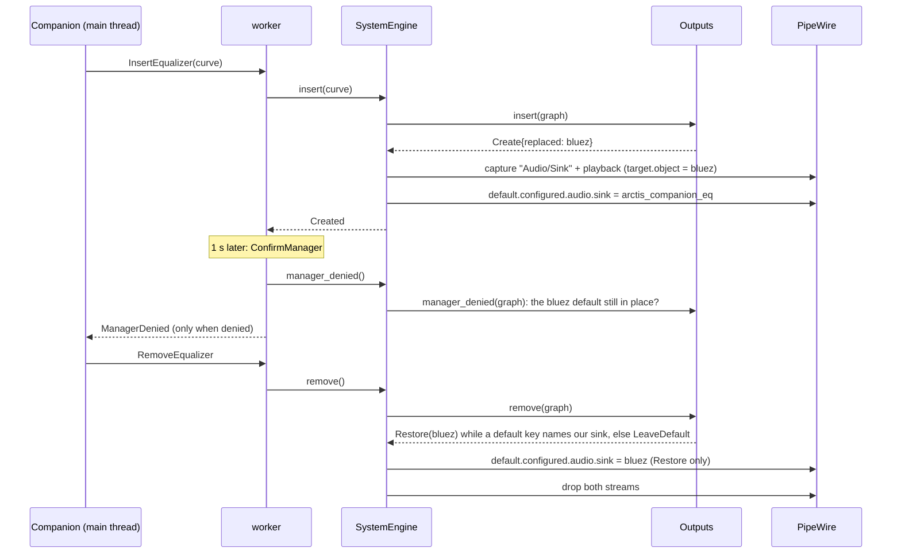
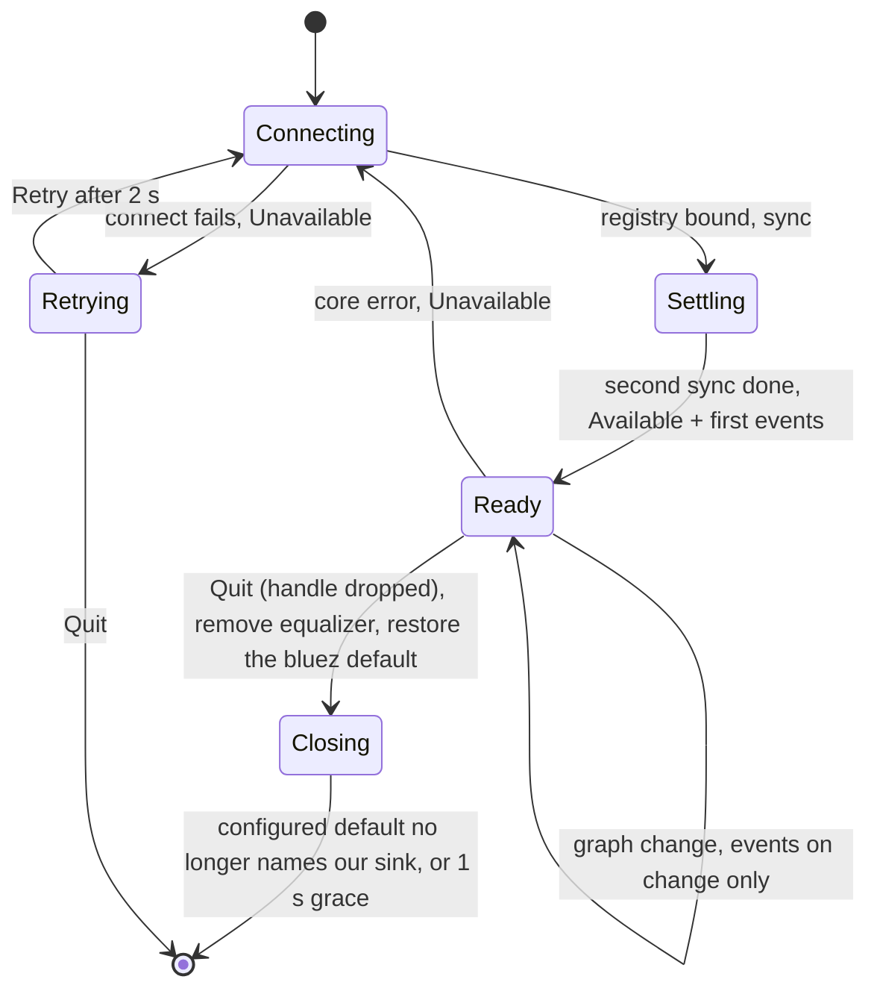

# SP7 Audio Adapter Implementation Plan

> **For agentic workers:** REQUIRED SUB-SKILL: Use superpowers:subagent-driven-development (recommended) or superpowers:executing-plans to implement this plan task-by-task. Steps use checkbox (`- [ ]`) syntax for tracking.

**Goal:** `crates/audio`: mirror the PipeWire graph, report the default sink's route and the playing app streams to
`Companion`, and run the system equalizer as an EQ sink that replaces the Nova 5 Bluetooth default, forwards volume
and mute, and restores the Bluetooth node on removal, all behind `AudioHandle`.

**Architecture:** A pure core inside the crate (`graph.rs`, `links.rs`, `outputs.rs`, `streams.rs`, `changes.rs`,
`volume.rs`, `samples.rs`) takes a plain `Graph` model or sample bytes and returns values, tested by tables. A thin
PipeWire shell (`registry.rs` mirrors globals into the `Graph`; `eq_sink.rs` owns two `pw_stream`s;
`system_engine.rs` drives insertion, retarget, removal and volume forwarding; `worker.rs` runs the PipeWire main
loop on the audio thread; `handle.rs` is the seam to the main thread) is tested against a private headless
PipeWire + WirePlumber started by `crates/audio/tests/headless/run.sh`, locally in the toolbox and in a CI job.

**Tech Stack:** Rust 2024 (rustc 1.98.1), `pipewire` 0.10.1 (feature `v1_2_0`), `triple_buffer` 9, `async-channel`
2.5; dev: `serde_json` 1, `allocation-counter` 0.8.1. Test host tools: PipeWire 1.6.9, WirePlumber 0.5.18,
`pipewire-utils` (`pw-dump`, `pw-metadata`, `pw-cli`, `pw-loopback`), `dbus-run-session`.

Spec: `docs/superpowers/specs/2026-10-11-arctis-companion-design.md` §2, §3, §3.1 (`audio::handle` row), §3.2
(`AudioEvent`, `AudioCommand`), §5 (SP7 row); audio part §1, §2, §4; quality part §1 (`crates/audio` row) and §2
(`audio-integration` job); ADR 0008, 0009, 0010; `docs/research/hardware-findings.md` §6.2, §6.3, §6.4, §9;
`docs/research/flatpak-pipewire.md` §3. Frozen seam already on `origin/main`: `crates/core/src/messages/audio.rs`
(`AudioCommand`, `AudioEvent`, `DefaultSink`, `SinkKind`, `SoundPath`, `StreamInfo`, `AppIdentifiers`).

Every code block below was compiled, linted and tested in a scratch copy of `origin/main` (`b7f88d1`) inside the
toolbox on 2026-10-12, including the headless suite run three times in a row; Deviations 12, 15 and 17 record what
that prototype taught. The first plan review added Deviations 21 to 24. The second review ran Tasks 8 to 11 as
written and found that the first review's volume copy (Deviation 22) hung PipeWire on every insertion (see the
warning in Task 8); it replaced that code and added Tasks 9a and 9b and Deviations 25 to 27. All code of Tasks 8 to
11, 9a and 9b, as it now stands, passed clippy, `check-rules` and the headless suite three times in a row in a
scratch copy of the branch on 2026-10-12. If a snippet still trips clippy, fix the names or split the function,
keeping the behaviour its test asserts.

---

## Conventions for every task

- Worktree: `/home/marcelo/Desenvolvimento/arctis-wt/sp7`, branch `sp7-audio-adapter`. Never touch
  `/home/marcelo/Desenvolvimento/arctis-companion`.
- **Run (toolbox):** `X` means
  `toolbox run -c arctis bash -lc 'cd /home/marcelo/Desenvolvimento/arctis-wt/sp7 && X'`.
  Git and `gh` run on the host in the worktree.
- No comments in any file of any language, doc comments included. Names and small functions carry the meaning.
- Clippy policy applies to tests too: cognitive complexity 8, 40 lines per function, nesting 3 (an `impl` block,
  a `fn` body and each `if`/`for`/`match`/closure block count), at most 4 arguments (`self` included), no
  `unwrap()` (use `expect` in tests), `pedantic` as errors under `-D warnings`. When clippy objects, extract a
  function. Test helpers live in the test module that first uses them, or are added to a support file in the task
  that first uses them, so nothing is dead code.
- Never touch the user's live PipeWire: tests that need PipeWire are `#[ignore]` and only run through
  `crates/audio/tests/headless/run.sh`, which gives PipeWire, WirePlumber, D-Bus and every client a private
  `XDG_RUNTIME_DIR`, config, state and data dir. The tests refuse to run without `ARCTIS_HEADLESS_PIPEWIRE=1`, which
  only that script sets.
- Never stop a process by name (`pkill`, `killall`, `pkill -f`): the toolbox shares the host's PID namespace, so a
  name also matches the user's live `pipewire` and `wireplumber`. Stop only a PID the test or script started itself.
- A headless run that hangs is a bug, not a slow machine: every wait in the suite gives up after 5 to 10 s. Wrap
  manual runs in `timeout 300`, and do not add debug calls to `pw-dump`, `pw-cli` or `pw-metadata` inside a waiting
  loop: when the graph is stuck they block forever too.
- Before each commit: `cargo fmt --all`, then Run (toolbox):
  `cargo clippy -p arctis-audio --all-targets -- -D warnings && cargo test -p arctis-audio && cargo xtask check-rules`.
  From Task 8 on, also Run (toolbox): `timeout 300 crates/audio/tests/headless/run.sh`.
- Commit subjects are conventional (`type(scope): summary`), short. Never write `Co-Authored-By`,
  "Generated with", or any AI or tool name in a commit message, PR title or PR body. Never use `--no-verify`.
- Push after every commit: `git push -u origin sp7-audio-adapter` the first time, then `git push`.

## Acceptance criteria → tasks

| SP7 acceptance criterion (design §5, quality §1 and §2) | Task |
|---|---|
| Container job: headless PipeWire + WirePlumber | 8 (harness), 12 (CI job `audio-integration`) |
| A null sink shaped like the Nova 5 bluez node, set as default | 8 (`crates/audio/tests/headless/pipewire.conf`, `Lab::open`) |
| The EQ sink is inserted and becomes default | 3 (rules), 8 |
| The EQ sink is removed with the bluez node restored | 3 (rules), 8 (`RemoveEqualizer`), 9 (handle dropped) |
| A default changed by the user while inserted is left alone | 3 (rules), 8 |
| Volume and mute forwarded | 6 (pods and mirror), 8 (forwarding and unity) |
| Inserting never changes the headset's volume: our sink starts at the bluez node's volume (Deviation 22) | 6 (node volumes), 8 (`inserting_keeps_the_bluez_volume`) |
| Stream detection with identifiers from node and client props | 4 (tables), 10 (headless) |
| A stream is classified only after its `info` event (audio §4, design §3.1 "info waits"; Deviation 21) | 8 (registry: nodes enter the graph on their first `info`) |
| Link chain through an intermediate node | 2 (tables), 4 (tables), 10 (headless, `pw-loopback`) |
| Sine at 1 kHz at the sink monitor within ±0.5 dB of `response()` minus the preamp | 7 (processing), 11 (headless) |
| Pure table: Nova 5 USB match through the Device object | 3 |
| Pure table: app identifiers from pulse-style (node) and native-style (client) prop sets | 4 |
| Pure table: link chains of up to 4 hops with an `ee_soe`-style node | 2, 3 |
| Pure table: default-sink cases (bluez, USB, speakers, our sink, user changed default while inserted, our sink after its bluez node vanished) | 3 (`the_default_sink_is_described_by_its_terminal`) |
| `AudioEvent` contract: `Available`, `Unavailable`, `DefaultSink`, `Streams`, `ManagerDenied`, `BluetoothNodeSeen` | 3 (`ManagerDenied` rule), 5 (events on change), 8 (`Available`, `Unavailable`) |
| `AudioCommand` contract: `InsertEqualizer`, `Retarget`, `RemoveEqualizer` | 3 (rules), 8, 11 (`Retarget` audible) |
| RT safety: coefficients through `triple_buffer`, nothing allocated on the RT path | 7 |
| `#![forbid(unsafe_code)]` kept (two `pw_stream`s, SP0 §6.3) | every task |
| Manager role from the core properties; ManagerDenied by reading back | 3 (rule), 8 (`media.category`, `ConfirmManager`), 9a (`the_adapter_connects_as_a_manager`) |
| A default that is not the Nova 5 bluez node is never changed (audio §2) | 3 (`insertion_target`), 9a (`inserting_over_another_default_changes_nothing`) |
| PipeWire lost and back: `Unavailable`, then `Available` after a reconnect (design §3.1 lifecycle, Deviation 13) | 9a (`crates/audio/tests/reconnect.rs`) |
| Coefficients redesigned for the negotiated rate (Deviation 16) | 9b (`crates/audio/src/designer.rs`) |
| `docs/architecture/audio.md` (sub-project rule, design §5) | 13 |

## File structure

```
crates/audio/Cargo.toml                 + triple_buffer, async-channel, pipewire feature v1_2_0; dev serde_json, allocation-counter
crates/audio/src/
  lib.rs            module list, AudioHandle and AudioCommands re-exports, init
  keys.rs           every PipeWire property key the crate reads or writes (pure)
  eq_names.rs       our node names, description and link group (pure)
  metadata_value.rs default-metadata JSON names (pure)
  graph.rs          Graph, Props, Node (props, running, last Props volume), Link, Defaults (pure)
  links.rs          follow: chain from a node to its terminal sink, MAX_HOPS (pure)
  sinks.rs          sink_kind, has_nova_bluetooth, default_sink (pure)
  insertion.rs      insertion_target, Insertion (plan_insert/commit/remove/manager_denied) (pure)
  streams.rs        streams, identifiers (pure)
  changes.rs        Published: AudioEvents only on change, DefaultSink held while Settling (pure)
  pod.rs            pod_bytes, format_pod (pure over libspa pods)
  volume.rs         VolumeChange, Volume, VolumeMirror, Props pods (pure over libspa pods)
  samples.rs        Processor: f32 bytes through core::eq::Equalizer, coefficients from triple_buffer (pure)
  designer.rs       Designer: curve and negotiated rate → coefficients into triple_buffer; rate_of (pure, Task 9b)
  registry.rs       Registry: PipeWire registry, node, device, client and metadata listeners into the Graph
  eq_sink.rs        EqSink, Replaced: capture Audio/Sink + playback stream, RT callbacks, start_at, keep_unity
  system_engine.rs  SystemEngine: insert, retarget, remove, volume forwarding, manager_denied
  worker.rs         audio thread: pw main loop, Message dispatch, connect/reconnect, Available/Unavailable, shutdown
  handle.rs         AudioHandle::spawn, AudioCommands, Drop
crates/audio/tests/
  init.rs                     (exists, unchanged)
  pure/main.rs support.rs graph.rs links.rs sinks.rs insertion.rs streams.rs changes.rs volume.rs samples.rs designer.rs
  samples_allocations.rs      counting allocator around Processor::run
  unreachable.rs              #[ignore]: no PipeWire → Unavailable, prompt quit
  reconnect.rs                #[ignore]: PipeWire started and stopped by the test → Available, Unavailable
  headless/run.sh session.sh pipewire.conf wireplumber.conf
  headless/main.rs lab.rs tools.rs tone.rs meter.rs equalizer.rs volume.rs streams.rs gain.rs   (#[ignore])
.github/workflows/ci.yml       + audio-integration job
docs/architecture/audio.md      diagrams + code paths and symbols
docs/architecture/README.md     audio row, crate entry point, CI diagram
```

## Deviations

Decisions taken where the spec is silent or ambiguous (simplest option consistent with it), or forced by what the
prototype showed:

| # | Decision | Why |
|---|---|---|
| 1 | New modules outside the spec's tree: `graph.rs`, `changes.rs`, `samples.rs`, `designer.rs`, `system_engine.rs`; `registry.rs` only binds PipeWire objects into `graph.rs`. `raw_filter.rs` is not created | the pure model, the change filter and the byte processing are testable without PipeWire; SP0 §6.3 chose two `pw_stream`s, so no `unsafe` |
| 2 | `crates/audio` also depends on `async-channel` (design §2 names it for thread messages) and enables `pipewire` feature `v1_2_0` (for `Stream::trigger_process`); dev-dependencies `serde_json` and `allocation-counter` | the design §3 table lists only core, `pipewire`, `triple_buffer`; the GNOME 50 runtime ships PipeWire ≥ 1.4 |
| 3 | `AudioHandle::spawn() -> io::Result<AudioHandle>` with `commands: AudioCommands` (`send(AudioCommand) -> bool`, wrapping a `pipewire::channel::Sender` so a command wakes the PipeWire loop) and `events: async_channel::Receiver<AudioEvent>`; `Drop` sends `Quit` and joins the thread | design §3.1 writes `Sender<AudioCommand>`; the PipeWire loop can only be woken by its own channel |
| 4 | A chain hop is one PipeWire link; moving between the two nodes of one filter (sink and output stream sharing `node.link-group`) is free. More than `MAX_HOPS` (4) links, a loop, or an end away from an `Audio/Sink` gives no chain. Links into `Stream/Input/Audio` (monitor recorders) are not followed | audio §1 "at most 4 hops through filter nodes"; a loopback is one filter, not two hops |
| 5 | App streams are `Stream/Output/Audio` nodes without `node.link-group` (filter outputs) and not named `arctis_companion_eq_out`; a stream with no identifier is skipped; the display name is `application.name` from the node, else the client, else the app key | our own and EasyEffects' outputs are not apps; `StreamInfo.ids` must name an app |
| 6 | Each of the three identifiers is read from the node props, else from the Client named by `client.id` | audio §4 says so for the portal app id; one rule for all three is simpler |
| 7 | `sink_kind` only classifies `Audio/Sink` nodes; a sink's Device must have vendor `0x1038` and a PID that `Model::lookup` calls `Supported` | the Nova 5 microphones share the Device and the bluez properties |
| 8 | No default or no chain gives `DefaultSink { terminal: Other, via_equalizer: false, via_easy_effects: false }`; an effective default (`default.audio.sink`) naming a node not in the graph gives no `DefaultSink` at all, so the last route stands (see 28); EasyEffects is any node named `ee_*` in the chain | `DefaultSink` has no "unknown"; routing to `None` is SP6's (audio §1) |
| 9 | ManagerDenied: after writing `default.configured.audio.sink`, the worker checks again `MANAGER_CONFIRM_AFTER` (1 s) later; it is denied when the configured default is not our sink and the current default is still the bluez node it replaced | hardware-findings §6.2, §9: a denied write is silent and the metadata lives in WirePlumber, so a core sync cannot confirm it; a user who moved away meanwhile is not a denial |
| 10 | Headless tests connect as a native host client, which always gets the Manager permissions, so the denial path is covered by the `outputs.rs` tables only; the Flatpak case joins SP14's checklist. What the headless suite does check is the request itself: our client object carries `media.category = Manager` (Task 9a) | SP0 §6.2 shows only a Flatpak client is denied, and that a category set anywhere but the core properties never reaches the client object |
| 11 | Removal restores the bluez node when either `default.audio.sink` or `default.configured.audio.sink` names our sink, by writing `default.configured.audio.sink`; `Retarget` and `RemoveEqualizer` without an insertion do nothing; `InsertEqualizer` while inserted retargets; `InsertEqualizer` over any default other than the bluez node itself does nothing | audio §2 "Removal"; SP0 note: restore the configured key explicitly |
| 12 | Node, Device and Client props are replaced only when the info event's change mask has `PROPS` | prototype: later info events carry an empty dict, which erased every node's props |
| 13 | `Available` is sent after the registry settles (a second core sync after the first `done`), so the first `DefaultSink` is never a half-bound graph; `Unavailable` once per transition on connect failure or core error; reconnect every `RECONNECT_AFTER` (2 s); delayed messages (`Retry`, `ConfirmManager`, the shutdown `Quit`) are posted by a short sleeper thread | PipeWire timers borrow the loop, which cannot outlive one session |
| 14 | EQ sink shape: the capture `Audio/Sink` stream's process triggers the playback stream (`StreamFlags::TRIGGER`); the playback process dequeues both buffers and runs `samples::Processor` (the `module-loopback` shape SP0 validated with `pw-loopback`); both use `RT_PROCESS`; the playback RT closure keeps a clone of the capture `StreamRc`, only dereferenced on the data thread; clones and drops happen on the audio thread before `connect` and after `disconnect` | `pipewire` 0.10 has no `pw_filter`; one `Processor` owns all RT state |
| 15 | Unity: after every Props change that carries `channelVolumes` or `mute`, the EQ sink sets its own `softVolumes` to 1 and `softMute` to 0 with `Stream::set_control`; the forwarded volume reaches the bluez node through `Node::set_param(Props)` | prototype: `param_changed(Props)` only carries the keys that changed, so the applied soft volume cannot be read; without the reset a 0.5 volume cost 6 dB twice |
| 16 | Format F32LE, stereo FL FR, rate left to the graph; coefficients designed at 48 kHz first and redesigned when the negotiated `Format` gives another rate | audio §2 leaves the stream format open |
| 17 | Quit waits until `default.configured.audio.sink` no longer names our sink, at most `SHUTDOWN_GRACE` (1 s), before leaving the loop | prototype: disconnecting right after a core sync lost the restore in some runs, because the metadata object lives in WirePlumber |
| 18 | Headless harness in `crates/audio/tests/headless/`: two null sinks from SP0's spike (the bluez stand-in with `priority.session` 2000 so it is the default), WirePlumber with every hardware monitor off, a private D-Bus session; tests read and change the graph with `pw-dump`, `pw-metadata`, `pw-cli`, `pw-loopback`; the USB stand-in has no Device, so the Dongle path is covered by the tables | SP0 §6.2; a null sink cannot carry a Device |
| 19 | The gain check is relative to Flat (same stream, same sinks): expected = `response(curve, [1000])` + `preamp_db_at(curve, 48000)`, tolerance ±0.5 dB, with a two-peak curve (1 kHz +6 dB Q 2, 100 Hz +9 dB Q 1) so the preamp is not trivially the 1 kHz gain | cancels stream and sink gains the test does not control |
| 20 | `--filesystem=xdg-run/pipewire-0` and the other final finish-args stay with SP14's manifest | SP7's checks run in the container job, not in the Flatpak |
| 21 | Nodes enter the `Graph` on their first `info` event (whose change mask always has `PROPS`), never from the registry global's props; links still come from global props | audio §4 "classified after its info event", design §3.1 "info waits": global props are a filtered subset without `application.*`, so a stream published from them would carry partial identifiers |
| 22 | The registry subscribes to each node's `Props` param and keeps its last `channelVolumes` and `mute` in the `Graph`. On insertion the system engine reads the bluez node's volume from the `Graph` and hands it to the EQ sink as `Replaced::volume`. The EQ sink applies it to itself with `Stream::set_control` (`channelVolumes`, `mute`, then `keep_unity`) on its capture stream's first `Props` report, and never forwards that first report. Our own node's volume is never set through a `pw_node` proxy | audio §2 mirrors our sink's volume to the bluez node; a new sink starts at 1.0, so without the copy GNOME's slider would show 100 % and the first step would jump the headset to almost full volume. The first `Props` report carries that default 1.0, and forwarding it set the headset to full volume on every insertion. A `set_param` on a node our own client exports deadlocks PipeWire: the server marks our client busy, stops reading its socket and waits for the pong only that socket can carry (found in review 2: the whole graph hung, `pw-dump` included) |
| 23 | Tasks 10 and 11 are acceptance scenarios over behaviour Tasks 4, 7 and 8 drove test-first; each gets a "see it fail once" step with a temporary mutation that is reverted with `git checkout` | TDD needs every test seen failing; the mutation proves the scenario can fail |
| 24 | A `default.configured.audio.sink` that still names our sink after a crash is left to WirePlumber's fallback; the adapter does not rewrite it on start | SP0 §6.3: WirePlumber falls back to the bluez node, so the stale value is harmless, and the replaced node is not known after a restart |
| 25 | The volume mirror runs one way, our sink → bluez node. A volume change made on the bluez node itself (the headset's dial over AVRCP, or another app) is not copied back onto our sink's slider while inserted | audio §2 names only that direction; copying back risks a feedback loop between two nodes. SP14's Bluetooth checklist records how the dial behaves |
| 26 | `crates/audio/tests/reconnect.rs` starts its own `pipewire` (no WirePlumber) as a child process before `session.sh` starts the shared one, and stops it by its PID | the only way to see the reconnect path; `Available` needs only the registry, and a PID the test spawned can never be the user's daemon |
| 27 | The coefficient designer and the `Format` rate parser move out of `eq_sink.rs` into the pure `designer.rs` (Task 9b) | the rate redesign of Deviation 16 had no test: the headless graph always runs at 48 kHz |
| 28 | Settling: after `InsertEqualizer` creates the sink, and after `RemoveEqualizer` removes an insertion, `Published` holds `DefaultSink` back until the end state arrives (insertion: `NovaBluetooth` via the equalizer; removal: a default other than our sink that resolves to a node, not via the equalizer) or until `SETTLE_WITHIN` (1 s) passes, then publishes whatever the graph holds. Each settling carries a ticket so an older deadline cannot end a newer one. Streams and the other events are never held | review 3: between the command and the settled graph the default named unbound nodes or ended at our own sink, and SP6's reducer read each transient as a route change, looping insert/remove forever |
| 29 | When the `default` metadata global is removed, the registry drops its proxy and the `Graph` clears its defaults | review 3: a WirePlumber restart left writes going to a dead proxy and stale defaults in the graph |
| 30 | Review 3 asked to replace the sleeper thread with a loop timer; kept the thread. `TimerSource<'l>` borrows the loop, while the worker lives in `'static` PipeWire callbacks, so it cannot own or arm one. A message a sleeper posts after its session ended is a no-op in the next one: `Retry` is ignored while connected, `ConfirmManager` finds nothing inserted, `Settled` at worst ends a newer settling early (the graph is then published as it is), and the shutdown `Quit` only arrives after the outcome is already `Quit` | `pipewire` 0.10 API; Deviation 13 |

---

### Task 0: Preflight

**Files:** none.

- [ ] **Step 1: Worktree**

If `/home/marcelo/Desenvolvimento/arctis-wt/sp7` does not exist:

```bash
git -C /home/marcelo/Desenvolvimento/arctis-companion fetch origin
git -C /home/marcelo/Desenvolvimento/arctis-companion worktree add -B sp7-audio-adapter /home/marcelo/Desenvolvimento/arctis-wt/sp7 origin/sp7-audio-adapter
```

(`origin/main` instead of `origin/sp7-audio-adapter` if that branch is gone.) Then
`git -C /home/marcelo/Desenvolvimento/arctis-wt/sp7 rebase origin/main` so the plan sits on the newest `main`.

- [ ] **Step 2: Test tools in the toolbox**

Run (toolbox): `sudo dnf install -y pipewire pipewire-utils wireplumber dbus-daemon pipewire-devel clang-devel`
Expected: installed or "already installed". Then Run (toolbox): `which pw-dump pw-metadata pw-cli pw-loopback wpctl dbus-run-session`
Expected: six paths under `/usr/bin`.

- [ ] **Step 3: Baseline**

Run (toolbox): `cargo test -p arctis-audio && cargo clippy -p arctis-audio --all-targets -- -D warnings`
Expected: `initialising_pipewire_twice_is_harmless ... ok`, no clippy output.

### Task 1: The graph model

**Files:**
- Create: `crates/audio/src/graph.rs`
- Modify: `crates/audio/src/lib.rs`
- Test: `crates/audio/tests/pure/main.rs`, `crates/audio/tests/pure/support.rs`, `crates/audio/tests/pure/graph.rs`

- [ ] **Step 1: Write the failing tests**

`crates/audio/tests/pure/main.rs`:

```rust
mod graph;
mod support;
```

`crates/audio/tests/pure/support.rs` (the `Scene` builder grows in Tasks 2 and 3):

```rust
use arctis_audio::graph::{Graph, Link, ObjectId, Props};

pub const BLUEZ: &str = "bluez_output.AA_BB_CC_DD_EE_FF.1";
pub const USB: &str = "alsa_output.usb-SteelSeries_SteelSeries_Arctis_Nova_5-00.iec958-stereo";
pub const SPEAKERS: &str = "alsa_output.pci-0000_00_1f.3.analog-stereo";

pub fn props(pairs: &[(&str, &str)]) -> Props {
    pairs.iter().copied().collect()
}

pub fn quoted(name: &str) -> String {
    format!("{{\"name\":\"{name}\"}}")
}

pub struct Scene {
    graph: Graph,
    next_link: ObjectId,
}

impl Default for Scene {
    fn default() -> Self {
        Self {
            graph: Graph::default(),
            next_link: 1000,
        }
    }
}

impl Scene {
    pub fn node(mut self, id: ObjectId, pairs: &[(&str, &str)]) -> Self {
        self.graph.put_node(id, props(pairs));
        self
    }

    pub fn sink(self, id: ObjectId, name: &str) -> Self {
        self.node(id, &[("media.class", "Audio/Sink"), ("node.name", name)])
    }

    pub fn usb(mut self, id: ObjectId, device: ObjectId, product: &str) -> Self {
        let device_id = device.to_string();
        self.graph.put_device(
            device,
            props(&[
                ("device.vendor.id", "0x1038"),
                ("device.product.id", product),
            ]),
        );
        self.node(
            id,
            &[
                ("media.class", "Audio/Sink"),
                ("node.name", USB),
                ("device.id", &device_id),
            ],
        )
    }

    pub fn speakers(self, id: ObjectId) -> Self {
        self.sink(id, SPEAKERS)
    }

    pub fn stream(self, id: ObjectId, pairs: &[(&str, &str)]) -> Self {
        let mut all = vec![("media.class", "Stream/Output/Audio")];
        all.extend_from_slice(pairs);
        self.node(id, &all)
    }

    pub fn client(mut self, id: ObjectId, pairs: &[(&str, &str)]) -> Self {
        self.graph.put_client(id, props(pairs));
        self
    }

    pub fn running(mut self, id: ObjectId) -> Self {
        self.graph.set_running(id, true);
        self
    }

    pub fn link(mut self, output: ObjectId, input: ObjectId) -> Self {
        self.graph.put_link(self.next_link, Link { output, input });
        self.next_link += 1;
        self
    }

    pub fn build(self) -> Graph {
        self.graph
    }
}
```

`crates/audio/tests/pure/graph.rs`:

```rust
use arctis_audio::graph::{
    CONFIGURED_AUDIO_SINK, DEFAULT_AUDIO_SINK, Defaults, Graph, Link, json_for_name, name_from_json,
};

use crate::support::{BLUEZ, SPEAKERS, Scene, props, quoted};

#[test]
fn props_answer_by_key() {
    let props = props(&[("node.name", "a"), ("media.class", "Audio/Sink")]);
    assert_eq!(props.get("node.name"), Some("a"));
    assert_eq!(props.get("node.nick"), None);
}

#[test]
fn a_node_keeps_its_running_state_when_its_props_change() {
    let mut graph = Scene::default().speakers(5).running(5).build();
    graph.put_node(5, props(&[("node.name", "renamed")]));
    let node = graph.node(5).expect("node 5");
    assert!(node.running);
    assert_eq!(node.name(), Some("renamed"));
}

#[test]
fn removing_an_id_forgets_it_whatever_its_kind() {
    let mut graph = Scene::default()
        .usb(7, 3, "0x2232")
        .client(9, &[("application.name", "x")])
        .link(7, 8)
        .build();
    for id in [7, 3, 9, 1000] {
        graph.remove(id);
    }
    assert_eq!(graph.nodes().count(), 0);
    assert_eq!(graph.inputs_fed_by(7).count(), 0);
}

#[test]
fn metadata_values_name_a_node() {
    let cases = [
        (r#"{"name":"bluez_output.1"}"#, Some("bluez_output.1")),
        (r#"{ "name": "spaced" }"#, Some("spaced")),
        (r#"{"name":"with \"quote\""}"#, Some("with \"quote\"")),
        (r#"{"other":"x"}"#, None),
        (r#"{"name":"#, None),
        (r#"{"name":"unterminated"#, None),
    ];
    for (value, expected) in cases {
        assert_eq!(name_from_json(value).as_deref(), expected, "{value}");
    }
}

#[test]
fn written_names_read_back() {
    for name in [BLUEZ, "a\"b", "back\\slash"] {
        assert_eq!(name_from_json(&json_for_name(name)).as_deref(), Some(name));
    }
}

#[test]
fn defaults_follow_their_metadata_keys() {
    let mut graph = Graph::default();
    graph.set_default(Some(DEFAULT_AUDIO_SINK), Some(&quoted(BLUEZ)));
    graph.set_default(Some(CONFIGURED_AUDIO_SINK), Some(&quoted(SPEAKERS)));
    graph.set_default(Some("default.audio.source"), Some(&quoted("mic")));
    assert_eq!(
        graph.defaults(),
        &Defaults {
            audio_sink: Some(BLUEZ.to_owned()),
            configured_audio_sink: Some(SPEAKERS.to_owned()),
        }
    );
    graph.set_default(Some(DEFAULT_AUDIO_SINK), None);
    assert_eq!(graph.defaults().audio_sink, None);
    graph.set_default(None, None);
    assert_eq!(graph.defaults(), &Defaults::default());
}

#[test]
fn the_current_default_prefers_the_effective_sink() {
    let both = Defaults {
        audio_sink: Some(BLUEZ.to_owned()),
        configured_audio_sink: Some(SPEAKERS.to_owned()),
    };
    let configured_only = Defaults {
        audio_sink: None,
        configured_audio_sink: Some(SPEAKERS.to_owned()),
    };
    assert_eq!(both.current(), Some(BLUEZ));
    assert_eq!(configured_only.current(), Some(SPEAKERS));
    assert!(both.mentions(SPEAKERS));
    assert!(!configured_only.mentions(BLUEZ));
}

#[test]
fn devices_and_clients_are_found_through_node_props() {
    let graph = Scene::default()
        .usb(7, 3, "0x2232")
        .client(9, &[("application.name", "Player")])
        .stream(11, &[("client.id", "9")])
        .build();
    let usb = graph.node(7).expect("usb sink");
    let stream = graph.node(11).expect("stream");
    assert_eq!(
        graph
            .device_of(usb)
            .and_then(|device| device.get("device.product.id")),
        Some("0x2232")
    );
    assert_eq!(
        graph
            .client_of(stream)
            .and_then(|client| client.get("application.name")),
        Some("Player")
    );
    assert_eq!(graph.client_of(usb), None);
}

#[test]
fn links_are_followed_from_their_output_side() {
    let mut graph = Scene::default().link(1, 2).link(1, 3).link(4, 1).build();
    graph.put_link(
        2000,
        Link {
            output: 1,
            input: 2,
        },
    );
    let mut inputs: Vec<u32> = graph.inputs_fed_by(1).collect();
    inputs.sort_unstable();
    assert_eq!(inputs, [2, 2, 3]);
}
```

- [ ] **Step 2: Run them to see them fail**

Run (toolbox): `cargo test -p arctis-audio --test pure`
Expected: FAIL to compile with `unresolved import arctis_audio::graph`.

- [ ] **Step 3: Implement**

`crates/audio/src/lib.rs`:

```rust
#![forbid(unsafe_code)]

pub mod graph;

pub fn init() {
    pipewire::init();
}
```

`crates/audio/src/graph.rs`:

```rust
use std::collections::BTreeMap;

pub type ObjectId = u32;

pub const MEDIA_CLASS: &str = "media.class";
pub const NODE_NAME: &str = "node.name";
pub const AUDIO_SINK: &str = "Audio/Sink";
pub const OUTPUT_STREAM: &str = "Stream/Output/Audio";
pub const INPUT_STREAM: &str = "Stream/Input/Audio";
pub const DEFAULT_AUDIO_SINK: &str = "default.audio.sink";
pub const CONFIGURED_AUDIO_SINK: &str = "default.configured.audio.sink";
const DEVICE_ID: &str = "device.id";
const CLIENT_ID: &str = "client.id";

#[derive(Clone, Debug, Default, PartialEq, Eq)]
pub struct Props(BTreeMap<String, String>);

impl Props {
    #[must_use]
    pub fn get(&self, key: &str) -> Option<&str> {
        self.0.get(key).map(String::as_str)
    }

    fn id(&self, key: &str) -> Option<ObjectId> {
        self.get(key)?.parse().ok()
    }
}

impl<'a> FromIterator<(&'a str, &'a str)> for Props {
    fn from_iter<I: IntoIterator<Item = (&'a str, &'a str)>>(pairs: I) -> Self {
        Self(
            pairs
                .into_iter()
                .map(|(key, value)| (key.to_owned(), value.to_owned()))
                .collect(),
        )
    }
}

#[derive(Clone, Debug, Default, PartialEq, Eq)]
pub struct Node {
    pub props: Props,
    pub running: bool,
}

impl Node {
    #[must_use]
    pub fn name(&self) -> Option<&str> {
        self.props.get(NODE_NAME)
    }

    #[must_use]
    pub fn is(&self, class: &str) -> bool {
        self.props.get(MEDIA_CLASS) == Some(class)
    }
}

#[derive(Clone, Copy, Debug, PartialEq, Eq)]
pub struct Link {
    pub output: ObjectId,
    pub input: ObjectId,
}

#[derive(Clone, Debug, Default, PartialEq, Eq)]
pub struct Defaults {
    pub audio_sink: Option<String>,
    pub configured_audio_sink: Option<String>,
}

impl Defaults {
    #[must_use]
    pub fn current(&self) -> Option<&str> {
        self.audio_sink
            .as_deref()
            .or(self.configured_audio_sink.as_deref())
    }

    #[must_use]
    pub fn configured(&self) -> Option<&str> {
        self.configured_audio_sink.as_deref()
    }

    #[must_use]
    pub fn mentions(&self, name: &str) -> bool {
        [self.audio_sink.as_deref(), self.configured()].contains(&Some(name))
    }
}

#[derive(Clone, Debug, Default)]
pub struct Graph {
    nodes: BTreeMap<ObjectId, Node>,
    devices: BTreeMap<ObjectId, Props>,
    clients: BTreeMap<ObjectId, Props>,
    links: BTreeMap<ObjectId, Link>,
    defaults: Defaults,
}

impl Graph {
    pub fn put_node(&mut self, id: ObjectId, props: Props) {
        self.nodes.entry(id).or_default().props = props;
    }

    pub fn set_running(&mut self, id: ObjectId, running: bool) {
        if let Some(node) = self.nodes.get_mut(&id) {
            node.running = running;
        }
    }

    pub fn put_device(&mut self, id: ObjectId, props: Props) {
        self.devices.insert(id, props);
    }

    pub fn put_client(&mut self, id: ObjectId, props: Props) {
        self.clients.insert(id, props);
    }

    pub fn put_link(&mut self, id: ObjectId, link: Link) {
        self.links.insert(id, link);
    }

    pub fn remove(&mut self, id: ObjectId) {
        self.nodes.remove(&id);
        self.devices.remove(&id);
        self.clients.remove(&id);
        self.links.remove(&id);
    }

    pub fn set_default(&mut self, key: Option<&str>, value: Option<&str>) {
        let name = value.and_then(name_from_json);
        match key {
            Some(DEFAULT_AUDIO_SINK) => self.defaults.audio_sink = name,
            Some(CONFIGURED_AUDIO_SINK) => self.defaults.configured_audio_sink = name,
            Some(_) => {}
            None => self.defaults = Defaults::default(),
        }
    }

    #[must_use]
    pub fn defaults(&self) -> &Defaults {
        &self.defaults
    }

    #[must_use]
    pub fn node(&self, id: ObjectId) -> Option<&Node> {
        self.nodes.get(&id)
    }

    pub fn nodes(&self) -> impl Iterator<Item = (ObjectId, &Node)> {
        self.nodes.iter().map(|(id, node)| (*id, node))
    }

    #[must_use]
    pub fn node_named(&self, name: &str) -> Option<ObjectId> {
        self.nodes()
            .find(|(_, node)| node.name() == Some(name))
            .map(|(id, _)| id)
    }

    #[must_use]
    pub fn device_of(&self, node: &Node) -> Option<&Props> {
        self.devices.get(&node.props.id(DEVICE_ID)?)
    }

    #[must_use]
    pub fn client_of(&self, node: &Node) -> Option<&Props> {
        self.clients.get(&node.props.id(CLIENT_ID)?)
    }

    pub fn inputs_fed_by(&self, id: ObjectId) -> impl Iterator<Item = ObjectId> {
        self.links
            .values()
            .filter(move |link| link.output == id)
            .map(|link| link.input)
    }
}

#[must_use]
pub fn name_from_json(value: &str) -> Option<String> {
    let after_key = value.split_once("\"name\"")?.1;
    let after_colon = after_key.trim_start().strip_prefix(':')?;
    let quoted = after_colon.trim_start().strip_prefix('"')?;
    unescape_until_quote(quoted)
}

fn unescape_until_quote(text: &str) -> Option<String> {
    let mut name = String::new();
    let mut chars = text.chars();
    while let Some(next) = chars.next() {
        match next {
            '"' => return Some(name),
            '\\' => name.push(chars.next()?),
            _ => name.push(next),
        }
    }
    None
}

#[must_use]
pub fn json_for_name(name: &str) -> String {
    let escaped = name.replace('\\', "\\\\").replace('"', "\\\"");
    format!("{{\"name\":\"{escaped}\"}}")
}
```

- [ ] **Step 4: Run them to see them pass**

Run (toolbox): `cargo test -p arctis-audio --test pure`
Expected: `test result: ok. 9 passed`.

- [ ] **Step 5: Lint and commit**

Run (toolbox): `cargo fmt --all && cargo clippy -p arctis-audio --all-targets -- -D warnings && cargo xtask check-rules`
Expected: no output from clippy, `check-rules` exits 0.

```bash
git add crates/audio/src/lib.rs crates/audio/src/graph.rs crates/audio/tests/pure
git commit -m "feat(audio): model the PipeWire graph"
git push -u origin sp7-audio-adapter
```

### Task 2: Link chains

**Files:**
- Create: `crates/audio/src/links.rs`
- Modify: `crates/audio/src/lib.rs`, `crates/audio/tests/pure/main.rs`, `crates/audio/tests/pure/support.rs`
- Test: `crates/audio/tests/pure/links.rs`

- [ ] **Step 1: Write the failing tests**

Add `mod links;` to `crates/audio/tests/pure/main.rs` (keep the list sorted).

In `crates/audio/tests/pure/support.rs`, add this struct right before `pub struct Scene`:

```rust
pub struct FilterNodes<'a> {
    pub sink: ObjectId,
    pub output: ObjectId,
    pub name: &'a str,
    pub output_name: &'a str,
    pub group: &'a str,
}
```

and these two methods inside `impl Scene`, `bluez` before `usb` and `filter` before `stream`:

```rust
    pub fn bluez(self, id: ObjectId) -> Self {
        self.node(
            id,
            &[
                ("media.class", "Audio/Sink"),
                ("node.name", BLUEZ),
                ("node.description", "Arctis Nova 5"),
                ("device.api", "bluez5"),
            ],
        )
    }

    pub fn filter(self, nodes: &FilterNodes) -> Self {
        self.node(
            nodes.sink,
            &[
                ("media.class", "Audio/Sink"),
                ("node.name", nodes.name),
                ("node.link-group", nodes.group),
            ],
        )
        .node(
            nodes.output,
            &[
                ("media.class", "Stream/Output/Audio"),
                ("node.name", nodes.output_name),
                ("node.link-group", nodes.group),
            ],
        )
    }
```

`crates/audio/tests/pure/links.rs`:

```rust
use arctis_audio::graph::Graph;
use arctis_audio::links::{MAX_HOPS, follow};

use crate::support::{FilterNodes, Scene};

const FIRST: FilterNodes = FilterNodes {
    sink: 20,
    output: 21,
    name: "first_filter",
    output_name: "first_filter_out",
    group: "group-1",
};
const SECOND: FilterNodes = FilterNodes {
    sink: 22,
    output: 23,
    name: "second_filter",
    output_name: "second_filter_out",
    group: "group-2",
};
const THIRD: FilterNodes = FilterNodes {
    sink: 24,
    output: 25,
    name: "third_filter",
    output_name: "third_filter_out",
    group: "group-3",
};

#[test]
fn a_sink_alone_is_its_own_terminal() {
    let graph = Scene::default().speakers(5).build();
    let chain = follow(&graph, 5).expect("chain");
    assert_eq!(chain.nodes(), [5]);
    assert_eq!(chain.terminal(), 5);
}

#[test]
fn a_stream_reaches_the_sink_its_ports_are_linked_to() {
    let graph = Scene::default()
        .speakers(5)
        .stream(11, &[])
        .link(11, 5)
        .link(11, 5)
        .build();
    assert_eq!(follow(&graph, 11).expect("chain").nodes(), [11, 5]);
}

#[test]
fn a_filter_is_crossed_through_its_link_group() {
    let graph = Scene::default()
        .bluez(4)
        .filter(&FIRST)
        .link(21, 4)
        .stream(11, &[])
        .link(11, 20)
        .build();
    let chain = follow(&graph, 11).expect("chain");
    assert_eq!(chain.nodes(), [11, 20, 21, 4]);
    assert_eq!(chain.terminal(), 4);
}

fn easy_effects_chain(plugins: u32) -> Graph {
    let mut scene = Scene::default()
        .usb(7, 3, "0x2232")
        .sink(40, "easyeffects_sink")
        .stream(11, &[])
        .link(11, 40);
    let mut previous = 40;
    for plugin in 0..plugins {
        let id = 41 + plugin;
        scene = scene
            .node(id, &[("node.name", "ee_soe_plugin")])
            .link(previous, id);
        previous = id;
    }
    scene.link(previous, 7).build()
}

#[test]
fn an_easy_effects_chain_within_the_hop_limit_is_followed() {
    assert_eq!(MAX_HOPS, 4);
    assert_eq!(
        follow(&easy_effects_chain(2), 11)
            .expect("chain")
            .terminal(),
        7
    );
}

#[test]
fn a_chain_longer_than_the_hop_limit_is_not_followed() {
    assert_eq!(follow(&easy_effects_chain(3), 11), None);
}

#[test]
fn moving_inside_a_filter_costs_no_hop() {
    let graph = Scene::default()
        .bluez(4)
        .filter(&FIRST)
        .filter(&SECOND)
        .filter(&THIRD)
        .stream(11, &[])
        .link(11, 20)
        .link(21, 22)
        .link(23, 24)
        .link(25, 4)
        .build();
    assert_eq!(follow(&graph, 11).expect("chain").terminal(), 4);
}

#[test]
fn recorders_of_a_sink_monitor_are_not_followed() {
    let graph = Scene::default()
        .speakers(5)
        .node(60, &[("media.class", "Stream/Input/Audio")])
        .link(5, 60)
        .build();
    assert_eq!(follow(&graph, 5).expect("chain").terminal(), 5);
}

#[test]
fn a_loop_gives_no_chain() {
    let graph = Scene::default()
        .node(1, &[("media.class", "Audio/Sink")])
        .node(2, &[("media.class", "Audio/Sink")])
        .link(1, 2)
        .link(2, 1)
        .build();
    assert_eq!(follow(&graph, 1), None);
}

#[test]
fn a_walk_that_ends_away_from_a_sink_gives_no_chain() {
    let graph = Scene::default().stream(11, &[]).build();
    assert_eq!(follow(&graph, 11), None);
    assert_eq!(follow(&graph, 99), None);
}
```

- [ ] **Step 2: Run them to see them fail**

Run (toolbox): `cargo test -p arctis-audio --test pure`
Expected: FAIL to compile with `unresolved import arctis_audio::links`.

- [ ] **Step 3: Implement**

Add `pub mod links;` to `crates/audio/src/lib.rs` after `pub mod graph;`.

`crates/audio/src/links.rs`:

```rust
use crate::graph::{AUDIO_SINK, Graph, INPUT_STREAM, OUTPUT_STREAM, ObjectId};

pub const MAX_HOPS: usize = 4;
pub const LINK_GROUP: &str = "node.link-group";

#[derive(Clone, Debug, PartialEq, Eq)]
pub struct Chain {
    nodes: Vec<ObjectId>,
    terminal: ObjectId,
}

impl Chain {
    #[must_use]
    pub fn nodes(&self) -> &[ObjectId] {
        &self.nodes
    }

    #[must_use]
    pub fn terminal(&self) -> ObjectId {
        self.terminal
    }
}

#[must_use]
pub fn follow(graph: &Graph, start: ObjectId) -> Option<Chain> {
    let mut walk = Walk {
        nodes: vec![start],
        hops: 0,
    };
    loop {
        match next_hop(graph, walk.current()) {
            Hop::WithinFilter(next) => walk.enter(next, 0)?,
            Hop::Link(next) => walk.enter(next, 1)?,
            Hop::End => return walk.finish(graph),
        }
    }
}

enum Hop {
    WithinFilter(ObjectId),
    Link(ObjectId),
    End,
}

struct Walk {
    nodes: Vec<ObjectId>,
    hops: usize,
}

impl Walk {
    fn current(&self) -> ObjectId {
        self.nodes.last().copied().unwrap_or_default()
    }

    fn enter(&mut self, next: ObjectId, cost: usize) -> Option<()> {
        let fresh = !self.nodes.contains(&next);
        self.hops += cost;
        self.nodes.push(next);
        (fresh && self.hops <= MAX_HOPS).then_some(())
    }

    fn finish(self, graph: &Graph) -> Option<Chain> {
        let terminal = self.current();
        graph.node(terminal)?.is(AUDIO_SINK).then_some(Chain {
            nodes: self.nodes,
            terminal,
        })
    }
}

fn next_hop(graph: &Graph, id: ObjectId) -> Hop {
    if let Some(output) = filter_output(graph, id) {
        return Hop::WithinFilter(output);
    }
    graph
        .inputs_fed_by(id)
        .filter(|input| carries_audio_on(graph, *input))
        .min()
        .map_or(Hop::End, Hop::Link)
}

fn filter_output(graph: &Graph, id: ObjectId) -> Option<ObjectId> {
    let sink = graph.node(id).filter(|node| node.is(AUDIO_SINK))?;
    let group = sink.props.get(LINK_GROUP)?;
    graph
        .nodes()
        .find(|(other, node)| {
            *other != id && node.is(OUTPUT_STREAM) && node.props.get(LINK_GROUP) == Some(group)
        })
        .map(|(other, _)| other)
}

fn carries_audio_on(graph: &Graph, id: ObjectId) -> bool {
    graph.node(id).is_some_and(|node| !node.is(INPUT_STREAM))
}
```

- [ ] **Step 4: Run them to see them pass**

Run (toolbox): `cargo test -p arctis-audio --test pure`
Expected: `test result: ok. 18 passed`.

- [ ] **Step 5: Lint and commit**

Run (toolbox): `cargo fmt --all && cargo clippy -p arctis-audio --all-targets -- -D warnings && cargo xtask check-rules`

```bash
git add crates/audio/src/lib.rs crates/audio/src/links.rs crates/audio/tests/pure
git commit -m "feat(audio): follow link chains to the terminal sink"
git push
```

### Task 3: Sink kinds, the default sink and the insertion rules

**Files:**
- Create: `crates/audio/src/outputs.rs`
- Modify: `crates/audio/src/lib.rs`, `crates/audio/tests/pure/main.rs`, `crates/audio/tests/pure/support.rs`
- Test: `crates/audio/tests/pure/outputs.rs`

- [ ] **Step 1: Write the failing tests**

Add `mod outputs;` to `crates/audio/tests/pure/main.rs`.

In `crates/audio/tests/pure/support.rs`, replace the first import line with:

```rust
use arctis_audio::graph::{
    CONFIGURED_AUDIO_SINK, DEFAULT_AUDIO_SINK, Graph, Link, ObjectId, Props,
};
use arctis_audio::outputs::{EQ_LINK_GROUP, EQ_OUTPUT_NAME, EQ_SINK_NAME};
```

and add these methods inside `impl Scene`, `equalizer` before `filter`, `default_sink` and `metadata` before
`build`:

```rust
    pub fn equalizer(self, sink: ObjectId, output: ObjectId) -> Self {
        self.filter(&FilterNodes {
            sink,
            output,
            name: EQ_SINK_NAME,
            output_name: EQ_OUTPUT_NAME,
            group: EQ_LINK_GROUP,
        })
    }

    pub fn default_sink(self, name: &str) -> Self {
        self.metadata(DEFAULT_AUDIO_SINK, name)
            .metadata(CONFIGURED_AUDIO_SINK, name)
    }

    pub fn metadata(mut self, key: &str, name: &str) -> Self {
        self.graph.set_default(Some(key), Some(&quoted(name)));
        self
    }
```

`crates/audio/tests/pure/outputs.rs`:

```rust
use arctis_audio::graph::{CONFIGURED_AUDIO_SINK, Graph};
use arctis_audio::outputs::{
    EQ_SINK_NAME, InsertStep, Outputs, RemoveStep, default_sink, has_nova_bluetooth,
    insertion_target, sink_kind,
};
use arctis_core::messages::audio::{DefaultSink, SinkKind};

use crate::support::{BLUEZ, SPEAKERS, Scene, USB};

#[test]
fn sinks_are_classified_by_their_props_and_device() {
    let cases = [
        (Scene::default().bluez(1), SinkKind::NovaBluetooth),
        (Scene::default().usb(1, 3, "0x2232"), SinkKind::NovaDongle),
        (Scene::default().usb(1, 3, "0x2253"), SinkKind::NovaDongle),
        (Scene::default().usb(1, 3, "0x2233"), SinkKind::Other),
        (Scene::default().usb(1, 3, "0x9999"), SinkKind::Other),
        (Scene::default().sink(1, USB), SinkKind::Other),
        (Scene::default().speakers(1), SinkKind::Other),
        (
            Scene::default().node(
                1,
                &[
                    ("media.class", "Audio/Source"),
                    ("node.description", "Arctis Nova 5"),
                    ("device.api", "bluez5"),
                ],
            ),
            SinkKind::Other,
        ),
        (
            Scene::default().node(
                1,
                &[
                    ("media.class", "Audio/Sink"),
                    ("node.description", "Other Headphones"),
                    ("device.api", "bluez5"),
                ],
            ),
            SinkKind::Other,
        ),
    ];
    for (index, (scene, expected)) in cases.into_iter().enumerate() {
        assert_eq!(sink_kind(&scene.build(), 1), expected, "case {index}");
    }
}

#[test]
fn a_vendor_from_another_maker_is_not_the_dongle() {
    let mut graph = Scene::default().usb(1, 3, "0x2232").build();
    graph.put_device(
        3,
        crate::support::props(&[
            ("device.vendor.id", "0x046d"),
            ("device.product.id", "0x2232"),
        ]),
    );
    assert_eq!(sink_kind(&graph, 1), SinkKind::Other);
}

fn sink(terminal: SinkKind, via_equalizer: bool, via_easy_effects: bool) -> DefaultSink {
    DefaultSink {
        terminal,
        via_equalizer,
        via_easy_effects,
    }
}

fn with_equalizer() -> Scene {
    Scene::default().bluez(4).equalizer(30, 31).link(31, 4)
}

#[test]
fn the_default_sink_is_described_by_its_terminal() {
    let cases = [
        (
            Scene::default().bluez(4).default_sink(BLUEZ),
            sink(SinkKind::NovaBluetooth, false, false),
        ),
        (
            with_equalizer().default_sink(EQ_SINK_NAME),
            sink(SinkKind::NovaBluetooth, true, false),
        ),
        (
            Scene::default().usb(7, 3, "0x2232").default_sink(USB),
            sink(SinkKind::NovaDongle, false, false),
        ),
        (
            Scene::default().speakers(5).default_sink(SPEAKERS),
            sink(SinkKind::Other, false, false),
        ),
        (
            Scene::default()
                .usb(7, 3, "0x2232")
                .sink(40, "easyeffects_sink")
                .node(41, &[("node.name", "ee_soe_output_level")])
                .link(40, 41)
                .link(41, 7)
                .default_sink("easyeffects_sink"),
            sink(SinkKind::NovaDongle, false, true),
        ),
        (
            Scene::default().bluez(4),
            sink(SinkKind::Other, false, false),
        ),
        (
            Scene::default().default_sink("vanished"),
            sink(SinkKind::Other, false, false),
        ),
    ];
    for (index, (scene, expected)) in cases.into_iter().enumerate() {
        assert_eq!(default_sink(&scene.build()), expected, "case {index}");
    }
}

#[test]
fn a_default_that_no_longer_reaches_bluez_through_our_sink_is_other() {
    let user_moved_while_inserted = with_equalizer().speakers(5).default_sink(SPEAKERS);
    let bluez_vanished_while_inserted = Scene::default()
        .equalizer(30, 31)
        .default_sink(EQ_SINK_NAME);
    for (index, scene) in [user_moved_while_inserted, bluez_vanished_while_inserted]
        .into_iter()
        .enumerate()
    {
        assert_eq!(
            default_sink(&scene.build()),
            sink(SinkKind::Other, false, false),
            "case {index}"
        );
    }
}

#[test]
fn the_configured_default_stands_in_while_no_effective_default_exists() {
    let graph = Scene::default()
        .bluez(4)
        .metadata(CONFIGURED_AUDIO_SINK, BLUEZ)
        .build();
    assert_eq!(default_sink(&graph).terminal, SinkKind::NovaBluetooth);
}

#[test]
fn a_nova_bluetooth_sink_anywhere_counts_as_seen() {
    assert!(has_nova_bluetooth(&Scene::default().bluez(4).build()));
    assert!(!has_nova_bluetooth(&Scene::default().speakers(5).build()));
}

#[test]
fn only_a_default_that_is_the_bluez_node_itself_is_replaced() {
    let cases: [(Graph, Option<&str>); 4] = [
        (
            Scene::default().bluez(4).default_sink(BLUEZ).build(),
            Some(BLUEZ),
        ),
        (with_equalizer().default_sink(EQ_SINK_NAME).build(), None),
        (
            Scene::default()
                .usb(7, 3, "0x2232")
                .default_sink(USB)
                .build(),
            None,
        ),
        (
            Scene::default()
                .bluez(4)
                .sink(40, "ee_sie_sink")
                .node(41, &[("node.name", "ee_soe_output_level")])
                .link(40, 41)
                .link(41, 4)
                .default_sink("ee_sie_sink")
                .build(),
            None,
        ),
    ];
    for (index, (graph, expected)) in cases.into_iter().enumerate() {
        assert_eq!(
            insertion_target(&graph).as_deref(),
            expected,
            "case {index}"
        );
    }
}

#[test]
fn inserting_creates_once_then_retargets() {
    let graph = Scene::default().bluez(4).default_sink(BLUEZ).build();
    let mut outputs = Outputs::default();
    assert_eq!(
        outputs.insert(&graph),
        InsertStep::Create {
            replaced: BLUEZ.to_owned()
        }
    );
    assert!(outputs.is_inserted());
    assert_eq!(outputs.insert(&graph), InsertStep::Retarget);
}

#[test]
fn inserting_over_another_default_is_skipped() {
    let graph = Scene::default().speakers(5).default_sink(SPEAKERS).build();
    let mut outputs = Outputs::default();
    assert_eq!(outputs.insert(&graph), InsertStep::Skip);
    assert!(!outputs.is_inserted());
}

fn inserted() -> Outputs {
    let mut outputs = Outputs::default();
    outputs.insert(&Scene::default().bluez(4).default_sink(BLUEZ).build());
    outputs
}

#[test]
fn removal_restores_the_bluez_node_while_our_sink_is_the_default() {
    let graph = with_equalizer().default_sink(EQ_SINK_NAME).build();
    let mut outputs = inserted();
    assert_eq!(
        outputs.remove(&graph),
        RemoveStep::Restore(BLUEZ.to_owned())
    );
    assert_eq!(outputs.remove(&graph), RemoveStep::NothingInserted);
}

#[test]
fn removal_leaves_a_default_the_user_changed_alone() {
    let graph = with_equalizer().speakers(5).default_sink(SPEAKERS).build();
    assert_eq!(inserted().remove(&graph), RemoveStep::LeaveDefault);
}

#[test]
fn removal_without_insertion_does_nothing() {
    let graph = with_equalizer().default_sink(EQ_SINK_NAME).build();
    assert_eq!(
        Outputs::default().remove(&graph),
        RemoveStep::NothingInserted
    );
}

#[test]
fn a_write_that_left_the_bluez_default_in_place_was_denied() {
    let unchanged = with_equalizer().default_sink(BLUEZ).build();
    let granted = with_equalizer().default_sink(EQ_SINK_NAME).build();
    let user_moved = with_equalizer().speakers(5).default_sink(SPEAKERS).build();
    assert!(inserted().manager_denied(&unchanged));
    assert!(!inserted().manager_denied(&granted));
    assert!(!inserted().manager_denied(&user_moved));
    assert!(!Outputs::default().manager_denied(&unchanged));
}
```

- [ ] **Step 2: Run them to see them fail**

Run (toolbox): `cargo test -p arctis-audio --test pure`
Expected: FAIL to compile with `unresolved import arctis_audio::outputs`.

- [ ] **Step 3: Implement**

Add `pub mod outputs;` to `crates/audio/src/lib.rs` after `pub mod links;`.

`crates/audio/src/outputs.rs`:

```rust
use arctis_core::messages::audio::{DefaultSink, SinkKind};
use arctis_core::protocol::model::{Model, ModelLookup, VENDOR_ID};

use crate::graph::{AUDIO_SINK, Graph, Node, ObjectId, Props};
use crate::links::{self, Chain};

pub const EQ_SINK_NAME: &str = "arctis_companion_eq";
pub const EQ_OUTPUT_NAME: &str = "arctis_companion_eq_out";
pub const EQ_DESCRIPTION: &str = "Arctis Nova 5 (Equalizer)";
pub const EQ_LINK_GROUP: &str = "arctis-companion-eq";
const BLUETOOTH_API: &str = "bluez5";
const NOVA_DESCRIPTION: &str = "Arctis Nova 5";
const EASY_EFFECTS_PREFIX: &str = "ee_";
const UNKNOWN: DefaultSink = DefaultSink {
    terminal: SinkKind::Other,
    via_equalizer: false,
    via_easy_effects: false,
};

#[must_use]
pub fn sink_kind(graph: &Graph, id: ObjectId) -> SinkKind {
    let Some(sink) = graph.node(id).filter(|node| node.is(AUDIO_SINK)) else {
        return SinkKind::Other;
    };
    if is_nova_bluetooth(sink) {
        SinkKind::NovaBluetooth
    } else if graph.device_of(sink).is_some_and(is_nova_dongle) {
        SinkKind::NovaDongle
    } else {
        SinkKind::Other
    }
}

fn is_nova_bluetooth(sink: &Node) -> bool {
    sink.props.get("device.api") == Some(BLUETOOTH_API)
        && sink
            .props
            .get("node.description")
            .is_some_and(|description| description.starts_with(NOVA_DESCRIPTION))
}

fn is_nova_dongle(device: &Props) -> bool {
    let vendor = device.get("device.vendor.id").and_then(parse_hex);
    let product = device.get("device.product.id").and_then(parse_hex);
    vendor == Some(VENDOR_ID)
        && product.is_some_and(|pid| matches!(Model::lookup(pid), ModelLookup::Supported(_)))
}

fn parse_hex(text: &str) -> Option<u16> {
    let digits = text
        .strip_prefix("0x")
        .or_else(|| text.strip_prefix("0X"))?;
    u16::from_str_radix(digits, 16).ok()
}

#[must_use]
pub fn has_nova_bluetooth(graph: &Graph) -> bool {
    graph
        .nodes()
        .any(|(id, _)| sink_kind(graph, id) == SinkKind::NovaBluetooth)
}

#[must_use]
pub fn default_sink(graph: &Graph) -> DefaultSink {
    graph
        .defaults()
        .current()
        .and_then(|name| graph.node_named(name))
        .and_then(|id| links::follow(graph, id))
        .map_or(UNKNOWN, |chain| describe(graph, &chain))
}

fn describe(graph: &Graph, chain: &Chain) -> DefaultSink {
    DefaultSink {
        terminal: sink_kind(graph, chain.terminal()),
        via_equalizer: passes_through_equalizer(graph, chain),
        via_easy_effects: chain_has(graph, chain, |name| name.starts_with(EASY_EFFECTS_PREFIX)),
    }
}

#[must_use]
pub fn passes_through_equalizer(graph: &Graph, chain: &Chain) -> bool {
    chain_has(graph, chain, |name| name == EQ_SINK_NAME)
}

fn chain_has(graph: &Graph, chain: &Chain, test: impl Fn(&str) -> bool) -> bool {
    chain
        .nodes()
        .iter()
        .filter_map(|id| graph.node(*id)?.name())
        .any(test)
}

#[must_use]
pub fn insertion_target(graph: &Graph) -> Option<String> {
    let name = graph.defaults().current()?;
    let id = graph.node_named(name)?;
    (sink_kind(graph, id) == SinkKind::NovaBluetooth).then(|| name.to_owned())
}

#[derive(Clone, Debug, PartialEq, Eq)]
pub enum InsertStep {
    Create { replaced: String },
    Retarget,
    Skip,
}

#[derive(Clone, Debug, PartialEq, Eq)]
pub enum RemoveStep {
    Restore(String),
    LeaveDefault,
    NothingInserted,
}

#[derive(Debug, Default)]
pub struct Outputs {
    replaced: Option<String>,
}

impl Outputs {
    pub fn insert(&mut self, graph: &Graph) -> InsertStep {
        if self.replaced.is_some() {
            return InsertStep::Retarget;
        }
        let Some(replaced) = insertion_target(graph) else {
            return InsertStep::Skip;
        };
        self.replaced = Some(replaced.clone());
        InsertStep::Create { replaced }
    }

    pub fn remove(&mut self, graph: &Graph) -> RemoveStep {
        match self.replaced.take() {
            None => RemoveStep::NothingInserted,
            Some(replaced) if graph.defaults().mentions(EQ_SINK_NAME) => {
                RemoveStep::Restore(replaced)
            }
            Some(_) => RemoveStep::LeaveDefault,
        }
    }

    #[must_use]
    pub fn manager_denied(&self, graph: &Graph) -> bool {
        let defaults = graph.defaults();
        self.replaced.as_deref().is_some_and(|replaced| {
            defaults.configured() != Some(EQ_SINK_NAME) && defaults.current() == Some(replaced)
        })
    }

    #[must_use]
    pub fn is_inserted(&self) -> bool {
        self.replaced.is_some()
    }
}
```

- [ ] **Step 4: Run them to see them pass**

Run (toolbox): `cargo test -p arctis-audio --test pure`
Expected: `test result: ok. 31 passed`.

- [ ] **Step 5: Lint and commit**

Run (toolbox): `cargo fmt --all && cargo clippy -p arctis-audio --all-targets -- -D warnings && cargo xtask check-rules`

```bash
git add crates/audio/src/lib.rs crates/audio/src/outputs.rs crates/audio/tests/pure
git commit -m "feat(audio): classify sinks and decide equalizer insertion"
git push
```

### Task 4: App streams and their path

**Files:**
- Create: `crates/audio/src/streams.rs`
- Modify: `crates/audio/src/lib.rs`, `crates/audio/tests/pure/main.rs`
- Test: `crates/audio/tests/pure/streams.rs`

- [ ] **Step 1: Write the failing tests**

Add `mod streams;` to `crates/audio/tests/pure/main.rs`.

`crates/audio/tests/pure/streams.rs`:

```rust
use arctis_audio::streams::{identifiers, streams};
use arctis_core::messages::audio::{AppIdentifiers, SoundPath, StreamInfo};

use crate::support::{FilterNodes, Scene, props};

#[test]
fn pulse_streams_carry_their_identifiers_on_the_node() {
    let node = props(&[
        ("pipewire.access.portal.app_id", "org.mozilla.firefox"),
        ("application.process.binary", "Firefox"),
    ]);
    assert_eq!(
        identifiers(&node, None),
        AppIdentifiers::new(Some("org.mozilla.firefox"), None, Some("firefox"))
    );
}

#[test]
fn native_streams_take_the_portal_app_id_from_their_client() {
    let node = props(&[
        ("application.id", "com.example.Native"),
        ("application.process.binary", "native"),
    ]);
    let client = props(&[(
        "pipewire.access.portal.app_id",
        "com.example.Native.Flatpak",
    )]);
    assert_eq!(
        identifiers(&node, Some(&client)).as_slice(),
        ["com.example.Native.Flatpak", "com.example.Native", "native"]
    );
}

#[test]
fn the_node_value_wins_over_the_client_value() {
    let node = props(&[("application.id", "from.node")]);
    let client = props(&[("application.id", "from.client")]);
    assert_eq!(identifiers(&node, Some(&client)).key(), Some("from.node"));
}

fn bluetooth_scene() -> Scene {
    Scene::default()
        .bluez(4)
        .equalizer(30, 31)
        .link(31, 4)
        .usb(7, 3, "0x2232")
        .speakers(5)
}

fn info(ids: AppIdentifiers, name: &str, running: bool, path: Option<SoundPath>) -> StreamInfo {
    StreamInfo {
        ids,
        name: name.to_owned(),
        running,
        path,
    }
}

#[test]
fn each_stream_reports_the_path_its_chain_ends_on() {
    let graph = bluetooth_scene()
        .stream(
            11,
            &[("application.id", "eq.app"), ("application.name", "Eq App")],
        )
        .link(11, 30)
        .running(11)
        .stream(12, &[("application.id", "usb.app")])
        .link(12, 7)
        .stream(13, &[("application.id", "speaker.app")])
        .link(13, 5)
        .stream(14, &[("application.id", "bluez.app")])
        .link(14, 4)
        .stream(15, &[("application.id", "idle.app")])
        .build();
    let id = |name| AppIdentifiers::new(None, Some(name), None);
    assert_eq!(
        streams(&graph),
        [
            info(id("eq.app"), "Eq App", true, Some(SoundPath::Bluetooth)),
            info(id("usb.app"), "usb.app", false, Some(SoundPath::Dongle)),
            info(id("speaker.app"), "speaker.app", false, None),
            info(id("bluez.app"), "bluez.app", false, None),
            info(id("idle.app"), "idle.app", false, None),
        ]
    );
}

#[test]
fn a_stream_behind_an_intermediate_filter_reaches_the_equalizer() {
    let graph = bluetooth_scene()
        .filter(&FilterNodes {
            sink: 20,
            output: 21,
            name: "chain_filter",
            output_name: "chain_filter_out",
            group: "loopback-1",
        })
        .link(21, 30)
        .stream(11, &[("application.process.binary", "player")])
        .link(11, 20)
        .build();
    let found = streams(&graph);
    assert_eq!(found.len(), 1);
    assert_eq!(found[0].path, Some(SoundPath::Bluetooth));
}

#[test]
fn display_names_fall_back_from_node_to_client_to_key() {
    let graph = Scene::default()
        .client(9, &[("application.name", "Client Name")])
        .stream(
            11,
            &[("application.id", "a"), ("application.name", "Node Name")],
        )
        .stream(12, &[("application.id", "b"), ("client.id", "9")])
        .stream(13, &[("application.id", "c")])
        .build();
    let names: Vec<String> = streams(&graph).into_iter().map(|info| info.name).collect();
    assert_eq!(names, ["Node Name", "Client Name", "c"]);
}

#[test]
fn filter_outputs_and_anonymous_streams_are_not_apps() {
    let graph = bluetooth_scene()
        .stream(11, &[("media.name", "no identifiers")])
        .stream(
            12,
            &[
                ("node.name", "arctis_companion_eq_out"),
                ("application.process.binary", "arctis-companion"),
            ],
        )
        .build();
    assert_eq!(streams(&graph), []);
}
```

- [ ] **Step 2: Run them to see them fail**

Run (toolbox): `cargo test -p arctis-audio --test pure`
Expected: FAIL to compile with `unresolved import arctis_audio::streams`.

- [ ] **Step 3: Implement**

Add `pub mod streams;` to `crates/audio/src/lib.rs` after `pub mod outputs;`.

`crates/audio/src/streams.rs`:

```rust
use arctis_core::messages::audio::{AppIdentifiers, SinkKind, SoundPath, StreamInfo};

use crate::graph::{Graph, Node, OUTPUT_STREAM, ObjectId, Props};
use crate::links::{self, LINK_GROUP};
use crate::outputs::{EQ_OUTPUT_NAME, passes_through_equalizer, sink_kind};

const PORTAL_APP_ID: &str = "pipewire.access.portal.app_id";
const APPLICATION_ID: &str = "application.id";
const PROCESS_BINARY: &str = "application.process.binary";
const APPLICATION_NAME: &str = "application.name";

#[must_use]
pub fn streams(graph: &Graph) -> Vec<StreamInfo> {
    graph
        .nodes()
        .filter(|(_, node)| is_app_stream(node))
        .filter_map(|(id, node)| stream_info(graph, id, node))
        .collect()
}

fn is_app_stream(node: &Node) -> bool {
    node.is(OUTPUT_STREAM)
        && node.props.get(LINK_GROUP).is_none()
        && node.name() != Some(EQ_OUTPUT_NAME)
}

fn stream_info(graph: &Graph, id: ObjectId, node: &Node) -> Option<StreamInfo> {
    let client = graph.client_of(node);
    let ids = identifiers(&node.props, client);
    let name = prop(&node.props, client, APPLICATION_NAME)
        .or(ids.key())?
        .to_owned();
    Some(StreamInfo {
        ids,
        name,
        running: node.running,
        path: path_of(graph, id),
    })
}

#[must_use]
pub fn identifiers(node: &Props, client: Option<&Props>) -> AppIdentifiers {
    AppIdentifiers::new(
        prop(node, client, PORTAL_APP_ID),
        prop(node, client, APPLICATION_ID),
        prop(node, client, PROCESS_BINARY),
    )
}

fn prop<'a>(node: &'a Props, client: Option<&'a Props>, key: &str) -> Option<&'a str> {
    node.get(key).or_else(|| client?.get(key))
}

fn path_of(graph: &Graph, id: ObjectId) -> Option<SoundPath> {
    let chain = links::follow(graph, id)?;
    if passes_through_equalizer(graph, &chain) {
        return Some(SoundPath::Bluetooth);
    }
    (sink_kind(graph, chain.terminal()) == SinkKind::NovaDongle).then_some(SoundPath::Dongle)
}
```

- [ ] **Step 4: Run them to see them pass**

Run (toolbox): `cargo test -p arctis-audio --test pure`
Expected: `test result: ok. 38 passed`.

- [ ] **Step 5: Lint and commit**

Run (toolbox): `cargo fmt --all && cargo clippy -p arctis-audio --all-targets -- -D warnings && cargo xtask check-rules`

```bash
git add crates/audio/src/lib.rs crates/audio/src/streams.rs crates/audio/tests/pure
git commit -m "feat(audio): detect app streams and their sound path"
git push
```

### Task 5: Events only on change

**Files:**
- Create: `crates/audio/src/changes.rs`
- Modify: `crates/audio/src/lib.rs`, `crates/audio/tests/pure/main.rs`
- Test: `crates/audio/tests/pure/changes.rs`

- [ ] **Step 1: Write the failing tests**

Add `mod changes;` to `crates/audio/tests/pure/main.rs`.

`crates/audio/tests/pure/changes.rs`:

```rust
use arctis_audio::changes::Published;
use arctis_core::messages::audio::{AudioEvent, DefaultSink, SinkKind};

use crate::support::{BLUEZ, SPEAKERS, Scene};

fn default_sink(terminal: SinkKind) -> AudioEvent {
    AudioEvent::DefaultSink(DefaultSink {
        terminal,
        via_equalizer: false,
        via_easy_effects: false,
    })
}

#[test]
fn the_first_look_publishes_everything() {
    let graph = Scene::default().bluez(4).default_sink(BLUEZ).build();
    assert_eq!(
        Published::default().changes(&graph),
        [
            AudioEvent::BluetoothNodeSeen,
            default_sink(SinkKind::NovaBluetooth),
            AudioEvent::Streams(Vec::new()),
        ]
    );
}

#[test]
fn an_unchanged_graph_publishes_nothing() {
    let graph = Scene::default().bluez(4).default_sink(BLUEZ).build();
    let mut published = Published::default();
    published.changes(&graph);
    assert_eq!(published.changes(&graph), []);
}

#[test]
fn only_what_changed_is_published() {
    let mut published = Published::default();
    published.changes(
        &Scene::default()
            .bluez(4)
            .speakers(5)
            .default_sink(BLUEZ)
            .build(),
    );
    let moved = Scene::default()
        .bluez(4)
        .speakers(5)
        .default_sink(SPEAKERS)
        .build();
    assert_eq!(published.changes(&moved), [default_sink(SinkKind::Other)]);
    let playing = Scene::default()
        .bluez(4)
        .speakers(5)
        .default_sink(SPEAKERS)
        .stream(11, &[("application.id", "a")])
        .build();
    let events = published.changes(&playing);
    assert!(matches!(events.as_slice(), [AudioEvent::Streams(streams)] if streams.len() == 1));
}

#[test]
fn the_bluetooth_node_is_announced_once() {
    let mut published = Published::default();
    published.changes(&Scene::default().bluez(4).build());
    published.changes(&Scene::default().build());
    let again = published.changes(&Scene::default().bluez(4).build());
    assert!(!again.contains(&AudioEvent::BluetoothNodeSeen));
}

#[test]
fn no_bluetooth_node_no_announcement() {
    let events = Published::default().changes(&Scene::default().speakers(5).build());
    assert!(!events.contains(&AudioEvent::BluetoothNodeSeen));
}
```

- [ ] **Step 2: Run them to see them fail**

Run (toolbox): `cargo test -p arctis-audio --test pure`
Expected: FAIL to compile with `unresolved import arctis_audio::changes`.

- [ ] **Step 3: Implement**

Add `pub mod changes;` to `crates/audio/src/lib.rs` before `pub mod graph;`.

`crates/audio/src/changes.rs`:

```rust
use arctis_core::messages::audio::{AudioEvent, DefaultSink, StreamInfo};

use crate::graph::Graph;
use crate::outputs::{default_sink, has_nova_bluetooth};
use crate::streams::streams;

#[derive(Debug, Default)]
pub struct Published {
    default_sink: Option<DefaultSink>,
    streams: Option<Vec<StreamInfo>>,
    bluetooth_seen: bool,
}

impl Published {
    pub fn changes(&mut self, graph: &Graph) -> Vec<AudioEvent> {
        [
            self.bluetooth_change(graph),
            replace_if_changed(&mut self.default_sink, default_sink(graph))
                .map(AudioEvent::DefaultSink),
            replace_if_changed(&mut self.streams, streams(graph)).map(AudioEvent::Streams),
        ]
        .into_iter()
        .flatten()
        .collect()
    }

    fn bluetooth_change(&mut self, graph: &Graph) -> Option<AudioEvent> {
        if self.bluetooth_seen || !has_nova_bluetooth(graph) {
            return None;
        }
        self.bluetooth_seen = true;
        Some(AudioEvent::BluetoothNodeSeen)
    }
}

fn replace_if_changed<T: Clone + PartialEq>(slot: &mut Option<T>, current: T) -> Option<T> {
    if slot.as_ref() == Some(&current) {
        return None;
    }
    *slot = Some(current.clone());
    Some(current)
}
```

- [ ] **Step 4: Run them to see them pass**

Run (toolbox): `cargo test -p arctis-audio --test pure`
Expected: `test result: ok. 43 passed`.

- [ ] **Step 5: Lint and commit**

Run (toolbox): `cargo fmt --all && cargo clippy -p arctis-audio --all-targets -- -D warnings && cargo xtask check-rules`

```bash
git add crates/audio/src/lib.rs crates/audio/src/changes.rs crates/audio/tests/pure
git commit -m "feat(audio): publish audio events only when they change"
git push
```

### Task 6: Volume pods and the volume mirror

**Files:**
- Create: `crates/audio/src/volume.rs`
- Modify: `crates/audio/src/lib.rs`, `crates/audio/src/graph.rs`, `crates/audio/tests/pure/main.rs`
- Test: `crates/audio/tests/pure/volume.rs`

- [ ] **Step 1: Write the failing tests**

Add `mod volume;` to `crates/audio/tests/pure/main.rs`.

`crates/audio/tests/pure/volume.rs`:

```rust
use arctis_audio::volume::{Volume, VolumeChange, VolumeMirror, props_pod, volume_change};
use pipewire::spa::pod::Pod;

use crate::support::{BLUEZ, Scene};

fn volume(channels: &[f32], mute: bool) -> Volume {
    Volume {
        channels: channels.to_vec(),
        mute,
    }
}

fn change(channels: Option<&[f32]>, mute: Option<bool>) -> VolumeChange {
    VolumeChange {
        channels: channels.map(<[f32]>::to_vec),
        mute,
    }
}

fn read(bytes: &[u8]) -> VolumeChange {
    volume_change(Pod::from_bytes(bytes).expect("a pod"))
}

#[test]
fn a_props_pod_reads_back_as_the_same_change() {
    let bytes = props_pod(&volume(&[0.25, 0.5], true));
    assert_eq!(read(&bytes), change(Some(&[0.25, 0.5]), Some(true)));
}

#[test]
fn a_change_without_volume_or_mute_is_empty() {
    assert!(VolumeChange::default().is_empty());
    assert!(!read(&props_pod(&volume(&[], true))).is_empty());
}

#[test]
fn the_mirror_forwards_each_new_volume_once() {
    let mut mirror = VolumeMirror::default();
    assert_eq!(
        mirror.apply(change(Some(&[1.0, 1.0]), Some(false))),
        Some(volume(&[1.0, 1.0], false))
    );
    assert_eq!(mirror.apply(change(Some(&[1.0, 1.0]), Some(false))), None);
    assert_eq!(
        mirror.apply(change(None, Some(true))),
        Some(volume(&[1.0, 1.0], true))
    );
    assert_eq!(
        mirror.apply(change(Some(&[0.5, 0.5]), None)),
        Some(volume(&[0.5, 0.5], true))
    );
    assert_eq!(mirror.apply(change(None, None)), None);
}

#[test]
fn mute_alone_waits_for_channel_volumes() {
    let mut mirror = VolumeMirror::default();
    assert_eq!(mirror.apply(change(None, Some(true))), None);
    assert_eq!(
        mirror.apply(change(Some(&[0.75, 0.75]), None)),
        Some(volume(&[0.75, 0.75], true))
    );
}

#[test]
fn a_change_replaces_only_what_it_carries() {
    let base = volume(&[0.5, 0.5], false);
    assert_eq!(
        base.merged(&change(None, Some(true))),
        volume(&[0.5, 0.5], true)
    );
    assert_eq!(
        base.merged(&change(Some(&[0.25, 0.25]), None)),
        volume(&[0.25, 0.25], false)
    );
}

#[test]
fn a_sink_knows_its_volume_once_channel_volumes_arrive() {
    let mut graph = Scene::default().bluez(4).build();
    assert_eq!(graph.volume_of(BLUEZ), None);
    graph.change_volume(4, &change(None, Some(true)));
    assert_eq!(graph.volume_of(BLUEZ), None);
    graph.change_volume(4, &change(Some(&[0.3, 0.3]), None));
    assert_eq!(graph.volume_of(BLUEZ), Some(volume(&[0.3, 0.3], true)));
    assert_eq!(graph.volume_of("absent"), None);
}
```

- [ ] **Step 2: Run them to see them fail**

Run (toolbox): `cargo test -p arctis-audio --test pure`
Expected: FAIL to compile with `unresolved import arctis_audio::volume`.

- [ ] **Step 3: Implement**

Add `pub mod volume;` to `crates/audio/src/lib.rs` after `pub mod streams;`. The SPA constants are bindgen names in
lower camel case; patterns need upper-case names, so `volume.rs` binds them to local constants once.
`SOFT_VOLUMES` and `SOFT_MUTE` are public because `eq_sink.rs` (Task 8) resets them.

`crates/audio/src/volume.rs`:

```rust
use std::io::Cursor;

use pipewire::spa;
use spa::pod::deserialize::PodDeserializer;
use spa::pod::serialize::PodSerializer;
use spa::pod::{Object, Pod, Property, PropertyFlags, Value, ValueArray};
use spa::sys::{
    SPA_PARAM_Props, SPA_PROP_channelVolumes, SPA_PROP_mute, SPA_PROP_softMute,
    SPA_PROP_softVolumes, SPA_TYPE_OBJECT_Props,
};

const CHANNEL_VOLUMES: u32 = SPA_PROP_channelVolumes;
const MUTE: u32 = SPA_PROP_mute;
pub const SOFT_VOLUMES: u32 = SPA_PROP_softVolumes;
pub const SOFT_MUTE: u32 = SPA_PROP_softMute;

#[derive(Clone, Debug, Default, PartialEq)]
pub struct VolumeChange {
    pub channels: Option<Vec<f32>>,
    pub mute: Option<bool>,
}

impl VolumeChange {
    #[must_use]
    pub fn is_empty(&self) -> bool {
        self.channels.is_none() && self.mute.is_none()
    }
}

#[derive(Clone, Debug, Default, PartialEq)]
pub struct Volume {
    pub channels: Vec<f32>,
    pub mute: bool,
}

impl Volume {
    #[must_use]
    pub fn merged(&self, change: &VolumeChange) -> Self {
        Self {
            channels: change
                .channels
                .clone()
                .unwrap_or_else(|| self.channels.clone()),
            mute: change.mute.unwrap_or(self.mute),
        }
    }
}

#[derive(Debug, Default)]
pub struct VolumeMirror {
    latest: Volume,
    forwarded: Option<Volume>,
}

impl VolumeMirror {
    pub fn apply(&mut self, change: VolumeChange) -> Option<Volume> {
        if let Some(channels) = change.channels {
            self.latest.channels = channels;
        }
        if let Some(mute) = change.mute {
            self.latest.mute = mute;
        }
        let fresh =
            !self.latest.channels.is_empty() && self.forwarded.as_ref() != Some(&self.latest);
        fresh.then(|| {
            self.forwarded = Some(self.latest.clone());
            self.latest.clone()
        })
    }
}

#[must_use]
pub fn volume_change(pod: &Pod) -> VolumeChange {
    match PodDeserializer::deserialize_any_from(pod.as_bytes()) {
        Ok((_, Value::Object(object))) => object
            .properties
            .into_iter()
            .fold(VolumeChange::default(), absorb),
        _ => VolumeChange::default(),
    }
}

fn absorb(mut change: VolumeChange, property: Property) -> VolumeChange {
    match (property.key, property.value) {
        (CHANNEL_VOLUMES, Value::ValueArray(ValueArray::Float(channels))) => {
            change.channels = Some(channels);
        }
        (MUTE, Value::Bool(mute)) => change.mute = Some(mute),
        _ => {}
    }
    change
}

#[must_use]
pub fn props_pod(volume: &Volume) -> Vec<u8> {
    serialize_props(vec![
        property(
            CHANNEL_VOLUMES,
            Value::ValueArray(ValueArray::Float(volume.channels.clone())),
        ),
        property(MUTE, Value::Bool(volume.mute)),
    ])
}

fn serialize_props(properties: Vec<Property>) -> Vec<u8> {
    let props = Value::Object(Object {
        type_: SPA_TYPE_OBJECT_Props,
        id: SPA_PARAM_Props,
        properties,
    });
    PodSerializer::serialize(Cursor::new(Vec::new()), &props)
        .map(|(cursor, _)| cursor.into_inner())
        .unwrap_or_default()
}

fn property(key: u32, value: Value) -> Property {
    Property {
        key,
        flags: PropertyFlags::empty(),
        value,
    }
}
```

Review addition (Deviation 22): each node keeps its last Props volume. In `crates/audio/src/graph.rs`:

1. Add `use crate::volume::{Volume, VolumeChange};` below `use std::collections::BTreeMap;`.
2. `Node` loses `Eq` (`Volume` holds `f32`) and gains a field:

```rust
#[derive(Clone, Debug, Default, PartialEq)]
pub struct Node {
    pub props: Props,
    pub running: bool,
    pub volume: Volume,
}
```

3. Add these two methods to `impl Graph`, after `set_running`:

```rust
    pub fn change_volume(&mut self, id: ObjectId, change: &VolumeChange) {
        if let Some(node) = self.nodes.get_mut(&id) {
            node.volume = node.volume.merged(change);
        }
    }

    #[must_use]
    pub fn volume_of(&self, name: &str) -> Option<Volume> {
        let volume = &self.node(self.node_named(name)?)?.volume;
        (!volume.channels.is_empty()).then(|| volume.clone())
    }
```

- [ ] **Step 4: Run them to see them pass**

Run (toolbox): `cargo test -p arctis-audio --test pure`
Expected: `test result: ok. 49 passed`.

- [ ] **Step 5: Lint and commit**

Run (toolbox): `cargo fmt --all && cargo clippy -p arctis-audio --all-targets -- -D warnings && cargo xtask check-rules`

```bash
git add crates/audio/src/lib.rs crates/audio/src/graph.rs crates/audio/src/volume.rs crates/audio/tests/pure
git commit -m "feat(audio): mirror volume and mute as Props pods"
git push
```

### Task 7: Real-time processing of sample bytes

**Files:**
- Create: `crates/audio/src/samples.rs`
- Modify: `crates/audio/Cargo.toml`, `crates/audio/src/lib.rs`, `crates/audio/tests/pure/main.rs`
- Test: `crates/audio/tests/pure/samples.rs`, `crates/audio/tests/samples_allocations.rs`

- [ ] **Step 1: Write the failing tests**

In `crates/audio/Cargo.toml` add `triple_buffer = "9"` under `[dependencies]` and a new section:

```toml
[dev-dependencies]
allocation-counter = "0.8.1"
```

Add `mod samples;` to `crates/audio/tests/pure/main.rs`.

`crates/audio/tests/pure/samples.rs`:

```rust
use arctis_audio::samples::{CHANNELS, FRAME_BYTES, Processor};
use arctis_core::eq::{Coefficients, Equalizer, PresetId, library};

fn designed(id: &str) -> Coefficients {
    let preset = library::find(&PresetId::new(id)).expect("built-in");
    Coefficients::design(preset.curve(), 48_000)
}

fn sine_bytes(frames: usize) -> Vec<u8> {
    (0..frames * CHANNELS)
        .map(|index| sine_sample(index / CHANNELS))
        .flat_map(f32::to_le_bytes)
        .collect()
}

fn sine_sample(frame: usize) -> f32 {
    let phase = f32::from(u16::try_from(frame % 48).expect("small")) / 48.0;
    (phase * std::f32::consts::TAU).sin() * 0.25
}

fn samples_of(bytes: &[u8]) -> Vec<f32> {
    bytes
        .as_chunks::<4>()
        .0
        .iter()
        .map(|chunk| f32::from_le_bytes(*chunk))
        .collect()
}

#[test]
fn flat_passes_samples_through_bit_exact() {
    let (_, output) = triple_buffer::triple_buffer(&designed("flat"));
    let mut processor = Processor::new(output);
    let input = sine_bytes(256);
    let mut out = vec![0; input.len()];
    assert_eq!(processor.run(&input, &mut out), input.len());
    assert_eq!(out, input);
}

#[test]
fn only_whole_frames_are_processed() {
    let (_, output) = triple_buffer::triple_buffer(&designed("flat"));
    let mut processor = Processor::new(output);
    let input = sine_bytes(4);
    let mut out = vec![0xAA; input.len() + 3];
    assert_eq!(
        processor.run(&input[..FRAME_BYTES * 3 + 5], &mut out),
        FRAME_BYTES * 3
    );
    assert_eq!(out[FRAME_BYTES * 3..], [0xAA; FRAME_BYTES + 3]);
}

#[test]
fn published_coefficients_are_applied_like_a_retarget() {
    let (mut input_side, output) = triple_buffer::triple_buffer(&designed("flat"));
    let mut processor = Processor::new(output);
    let mut reference = Equalizer::new(&designed("flat"), CHANNELS);
    let first = sine_bytes(512);
    let second = sine_bytes(10_000);
    let mut ignored = vec![0; first.len()];
    processor.run(&first, &mut ignored);
    reference.process(&mut samples_of(&first));
    input_side.write(designed("v-shape"));
    reference.retarget(&designed("v-shape"));
    let mut out = vec![0; second.len()];
    processor.run(&second, &mut out);
    let mut expected = samples_of(&second);
    reference.process(&mut expected);
    assert_eq!(samples_of(&out), expected);
}
```

`crates/audio/tests/samples_allocations.rs` (its own binary, like `crates/core/tests/eq_allocations.rs`):

```rust
use arctis_audio::samples::{CHANNELS, Processor};
use arctis_core::eq::{Coefficients, PresetId, library};

fn designed(id: &str) -> Coefficients {
    let preset = library::find(&PresetId::new(id)).expect("built-in");
    Coefficients::design(preset.curve(), 48_000)
}

#[test]
fn running_and_taking_new_coefficients_allocate_nothing() {
    let (mut input_side, output) = triple_buffer::triple_buffer(&designed("flat"));
    let mut processor = Processor::new(output);
    let input = vec![0x3E; 1024 * CHANNELS * 4];
    let mut out = vec![0; input.len()];
    input_side.write(designed("v-shape"));
    let counted = allocation_counter::measure(|| {
        for _ in 0..8 {
            processor.run(&input, &mut out);
        }
    });
    assert_eq!(counted.count_total, 0);
}
```

- [ ] **Step 2: Run them to see them fail**

Run (toolbox): `cargo test -p arctis-audio`
Expected: FAIL to compile with `unresolved import arctis_audio::samples`.

- [ ] **Step 3: Implement**

Add `pub mod samples;` to `crates/audio/src/lib.rs` after `pub mod outputs;`.

`crates/audio/src/samples.rs`:

```rust
use arctis_core::eq::{Coefficients, Equalizer};
use triple_buffer::Output;

pub const CHANNELS: usize = 2;
pub const SAMPLE_BYTES: usize = 4;
pub const FRAME_BYTES: usize = CHANNELS * SAMPLE_BYTES;
const BLOCK_SAMPLES: usize = 4096 * CHANNELS;

pub struct Processor {
    equalizer: Equalizer,
    coefficients: Output<Coefficients>,
    block: Vec<f32>,
}

impl Processor {
    #[must_use]
    pub fn new(coefficients: Output<Coefficients>) -> Self {
        Self {
            equalizer: Equalizer::new(coefficients.output_buffer(), CHANNELS),
            coefficients,
            block: vec![0.0; BLOCK_SAMPLES],
        }
    }

    pub fn run(&mut self, input: &[u8], output: &mut [u8]) -> usize {
        if self.coefficients.update() {
            self.equalizer.retarget(self.coefficients.output_buffer());
        }
        let length = whole_frames(input.len().min(output.len()));
        let block_bytes = BLOCK_SAMPLES * SAMPLE_BYTES;
        let blocks = input[..length]
            .chunks(block_bytes)
            .zip(output[..length].chunks_mut(block_bytes));
        for (from, to) in blocks {
            self.run_block(from, to);
        }
        length
    }

    fn run_block(&mut self, input: &[u8], output: &mut [u8]) {
        let samples = &mut self.block[..input.len() / SAMPLE_BYTES];
        for (sample, bytes) in samples.iter_mut().zip(input.as_chunks::<SAMPLE_BYTES>().0) {
            *sample = f32::from_le_bytes(*bytes);
        }
        self.equalizer.process(samples);
        for (bytes, sample) in output
            .as_chunks_mut::<SAMPLE_BYTES>()
            .0
            .iter_mut()
            .zip(samples)
        {
            *bytes = sample.to_le_bytes();
        }
    }
}

fn whole_frames(bytes: usize) -> usize {
    bytes - bytes % FRAME_BYTES
}
```

- [ ] **Step 4: Run them to see them pass**

Run (toolbox): `cargo test -p arctis-audio`
Expected: `pure` reports `52 passed`, `samples_allocations` reports `1 passed`, `init` reports `1 passed`.

- [ ] **Step 5: Lint and commit**

Run (toolbox): `cargo fmt --all && cargo clippy -p arctis-audio --all-targets -- -D warnings && cargo xtask check-rules`

```bash
git add Cargo.lock crates/audio/Cargo.toml crates/audio/src/lib.rs crates/audio/src/samples.rs crates/audio/tests
git commit -m "feat(audio): run sample bytes through the equalizer"
git push
```

### Task 8: The system engine end to end

The PipeWire shell, built against a private PipeWire: the registry mirror, the EQ sink, the system engine, the
audio thread and the handle. The scenarios are written first and fail because `arctis_audio::AudioHandle` does not
exist yet.

> **Review 2 correction.** The first review's version of Steps 5 to 8 copied the bluez volume onto our sink with
> `Registry::set_node_props(EQ_SINK_NAME, …)` from `SystemEngine::apply_seed`. That `set_param` targets a node our
> own client exports, so PipeWire marked our client busy and waited for a pong it no longer read: every insertion
> froze the graph, `lab.insert` timed out, and `pw-dump`, `pw-cli` and `pw-metadata` blocked forever. If your
> working copy has `seed`, `apply_seed` or a `bool`-returning `set_node_props`, replace them with the code below
> (Deviation 22); the scenarios do not change.

**Files:**
- Create: `crates/audio/src/registry.rs`, `crates/audio/src/eq_sink.rs`, `crates/audio/src/system_engine.rs`,
  `crates/audio/src/worker.rs`, `crates/audio/src/handle.rs`
- Modify: `crates/audio/Cargo.toml`, `crates/audio/src/lib.rs`, `crates/audio/src/volume.rs`
- Test: `crates/audio/tests/unreachable.rs`, `crates/audio/tests/headless/run.sh`,
  `crates/audio/tests/headless/session.sh`, `crates/audio/tests/headless/pipewire.conf`,
  `crates/audio/tests/headless/wireplumber.conf`, `crates/audio/tests/headless/main.rs`,
  `crates/audio/tests/headless/lab.rs`, `crates/audio/tests/headless/tools.rs`,
  `crates/audio/tests/headless/tone.rs`, `crates/audio/tests/headless/equalizer.rs`,
  `crates/audio/tests/headless/volume.rs`

- [ ] **Step 1: The private PipeWire**

`crates/audio/tests/headless/pipewire.conf` (SP0's spike sinks; the bluez stand-in wins the default by priority):

```
context.properties = {
    module.x11.bell = false
    module.jackdbus-detect = false
}
context.objects = [
    { factory = adapter
        args = {
            factory.name = support.null-audio-sink
            node.name = "bluez_output.AA_BB_CC_DD_EE_FF.1"
            node.description = "Arctis Nova 5"
            node.nick = "Arctis Nova 5"
            media.class = "Audio/Sink"
            device.api = "bluez5"
            api.bluez5.address = "AA:BB:CC:DD:EE:FF"
            audio.position = [ FL FR ]
            priority.session = 2000
            object.linger = true
        }
    }
    { factory = adapter
        args = {
            factory.name = support.null-audio-sink
            node.name = "alsa_output.usb-SteelSeries_SteelSeries_Arctis_Nova_5-00.iec958-stereo"
            node.description = "Arctis Nova 5 USB"
            media.class = "Audio/Sink"
            audio.position = [ FL FR ]
            priority.session = 1000
            object.linger = true
        }
    }
]
```

`crates/audio/tests/headless/wireplumber.conf`:

```
wireplumber.profiles = {
  main = {
    monitor.alsa = disabled
    monitor.alsa-midi = disabled
    monitor.bluez = disabled
    monitor.bluez-midi = disabled
    monitor.v4l2 = disabled
    monitor.libcamera = disabled
    support.reserve-device = disabled
  }
}
```

`crates/audio/tests/headless/run.sh` (makes every directory private, then runs `session.sh` on a private D-Bus):

```sh
#!/bin/sh
set -eu
here=$(cd "$(dirname "$0")" && pwd)
root=$(mktemp -d)
export XDG_RUNTIME_DIR="$root/run"
export PIPEWIRE_RUNTIME_DIR="$root/run"
export XDG_CONFIG_HOME="$root/config"
export XDG_STATE_HOME="$root/state"
export XDG_DATA_HOME="$root/data"
export XDG_CACHE_HOME="$root/cache"
export ARCTIS_HEADLESS_PIPEWIRE=1
unset PIPEWIRE_REMOTE PULSE_SERVER
mkdir -p -m 700 "$XDG_RUNTIME_DIR"
mkdir -p "$XDG_CONFIG_HOME/pipewire/pipewire.conf.d" "$XDG_CONFIG_HOME/wireplumber/wireplumber.conf.d"
cp "$here/pipewire.conf" "$XDG_CONFIG_HOME/pipewire/pipewire.conf.d/50-arctis-headless.conf"
cp "$here/wireplumber.conf" "$XDG_CONFIG_HOME/wireplumber/wireplumber.conf.d/50-arctis-headless.conf"
status=0
dbus-run-session -- "$here/session.sh" "$@" || status=$?
rm -rf "$root"
exit "$status"
```

`crates/audio/tests/headless/session.sh` (the unreachable check runs before PipeWire exists; extra arguments filter
the headless tests):

```sh
#!/bin/sh
set -eu
cargo test --package arctis-audio --test unreachable -- --ignored
pipewire > "$XDG_RUNTIME_DIR/pipewire.log" 2>&1 &
pipewire_pid=$!
wireplumber > "$XDG_RUNTIME_DIR/wireplumber.log" 2>&1 &
wireplumber_pid=$!
trap 'kill "$wireplumber_pid" "$pipewire_pid" 2>/dev/null || true' EXIT
timeout 15 sh -c 'until wpctl inspect @DEFAULT_AUDIO_SINK@ > /dev/null 2>&1; do sleep 0.2; done'
cargo test --package arctis-audio --test headless -- --ignored --test-threads=1 "$@"
```

Run: `chmod +x crates/audio/tests/headless/run.sh crates/audio/tests/headless/session.sh` (on the host; git keeps
the mode).

- [ ] **Step 2: Write the failing tests**

In `crates/audio/Cargo.toml` add `serde_json = "1"` under `[dev-dependencies]`.

`crates/audio/tests/unreachable.rs`:

```rust
use std::time::{Duration, Instant};

use arctis_audio::AudioHandle;
use arctis_core::messages::audio::AudioEvent;

const PATIENCE: Duration = Duration::from_secs(5);

#[test]
#[ignore = "run by crates/audio/tests/headless/session.sh before PipeWire starts"]
fn no_pipewire_reports_unavailable_and_still_quits() {
    assert_eq!(
        std::env::var("ARCTIS_HEADLESS_PIPEWIRE").as_deref(),
        Ok("1"),
        "run through crates/audio/tests/headless/run.sh"
    );
    let audio = AudioHandle::spawn().expect("audio thread");
    let first = audio
        .events
        .recv_blocking()
        .expect("an event before the thread ends");
    assert_eq!(first, AudioEvent::Unavailable);
    let started = Instant::now();
    drop(audio);
    assert!(started.elapsed() < PATIENCE);
}
```

`crates/audio/tests/headless/main.rs`:

```rust
mod equalizer;
mod lab;
mod tone;
mod tools;
mod volume;
```

`crates/audio/tests/headless/lab.rs` (refuses to run outside `run.sh`; resets the default to the bluez stand-in
and its volume to 1.0, unmuted, before each test):

```rust
use std::thread;
use std::time::{Duration, Instant};

use arctis_audio::AudioHandle;
use arctis_core::eq::{Curve, library};
use arctis_core::messages::audio::{AudioCommand, AudioEvent, DefaultSink, SinkKind};

use crate::tools;

pub const HEADLESS: &str = "needs the private PipeWire of crates/audio/tests/headless/run.sh";
pub const BLUEZ: &str = "bluez_output.AA_BB_CC_DD_EE_FF.1";
pub const USB: &str = "alsa_output.usb-SteelSeries_SteelSeries_Arctis_Nova_5-00.iec958-stereo";
pub const EQ_SINK: &str = "arctis_companion_eq";
const FULL_VOLUME: &str = "{ channelVolumes = [ 1.0, 1.0 ], mute = false }";
const PATIENCE: Duration = Duration::from_secs(5);
const POLL: Duration = Duration::from_millis(20);

pub fn bluetooth(via_equalizer: bool) -> AudioEvent {
    AudioEvent::DefaultSink(DefaultSink {
        terminal: SinkKind::NovaBluetooth,
        via_equalizer,
        via_easy_effects: false,
    })
}

pub fn flat() -> Curve {
    library::flat().curve().clone()
}

pub fn eventually(what: &str, test: impl Fn() -> bool) {
    let deadline = Instant::now() + PATIENCE;
    while !test() {
        assert!(Instant::now() < deadline, "timed out waiting for {what}");
        thread::sleep(POLL);
    }
}

pub struct Lab {
    pub audio: AudioHandle,
}

impl Lab {
    pub fn open() -> Self {
        assert_eq!(
            std::env::var("ARCTIS_HEADLESS_PIPEWIRE").as_deref(),
            Ok("1"),
            "{HEADLESS}"
        );
        tools::set_configured_default(BLUEZ);
        tools::set_props(BLUEZ, FULL_VOLUME);
        eventually("the bluez default", || {
            tools::configured_default().as_deref() == Some(BLUEZ)
        });
        let lab = Self {
            audio: AudioHandle::spawn().expect("audio thread"),
        };
        lab.wait_for("Available", |event| *event == AudioEvent::Available);
        lab
    }

    pub fn send(&self, command: AudioCommand) {
        assert!(self.audio.commands.send(command), "audio thread gone");
    }

    pub fn wait_for(&self, what: &str, test: impl Fn(&AudioEvent) -> bool) -> AudioEvent {
        let deadline = Instant::now() + PATIENCE;
        std::iter::repeat_with(|| self.next_event(deadline, what))
            .flatten()
            .find(|event| test(event))
            .expect("an endless iterator")
    }

    fn next_event(&self, deadline: Instant, what: &str) -> Option<AudioEvent> {
        assert!(Instant::now() < deadline, "timed out waiting for {what}");
        let event = self.audio.events.try_recv().ok();
        if event.is_none() {
            thread::sleep(POLL);
        }
        event
    }

    pub fn insert(&self, curve: Curve) {
        self.send(AudioCommand::InsertEqualizer(curve));
        self.wait_for("the equalizer as default", |event| {
            *event == bluetooth(true)
        });
    }
}
```

`crates/audio/tests/headless/tools.rs` (reads and changes the graph through `pipewire-utils`, never through the
code under test):

```rust
use std::process::Command;

use serde_json::Value;

fn run(program: &str, args: &[&str]) -> String {
    let output = Command::new(program)
        .args(args)
        .output()
        .unwrap_or_else(|error| panic!("{program}: {error}"));
    assert!(output.status.success(), "{program} {args:?} failed");
    String::from_utf8(output.stdout).expect("utf-8 output")
}

fn dump() -> Vec<Value> {
    serde_json::from_str(&run("pw-dump", &[])).expect("pw-dump JSON")
}

fn props(object: &Value) -> &Value {
    &object["info"]["props"]
}

pub fn node_id(name: &str) -> Option<u64> {
    dump()
        .iter()
        .find(|object| props(object)["node.name"] == name)
        .and_then(|object| object["id"].as_u64())
}

pub fn configured_default() -> Option<String> {
    dump()
        .iter()
        .find(|object| object["props"]["metadata.name"] == "default")?["metadata"]
        .as_array()?
        .iter()
        .find(|entry| entry["key"] == "default.configured.audio.sink")?["value"]["name"]
        .as_str()
        .map(str::to_owned)
}

pub fn set_configured_default(name: &str) {
    let value = format!("{{ \"name\": \"{name}\" }}");
    run(
        "pw-metadata",
        &[
            "-n",
            "default",
            "0",
            "default.configured.audio.sink",
            &value,
            "Spa:String:JSON",
        ],
    );
}

pub fn set_props(name: &str, pod: &str) {
    let id = node_id(name).expect("node to set").to_string();
    run("pw-cli", &["set-param", &id, "Props", pod]);
}

pub fn volume_of(name: &str) -> Option<(Vec<f64>, bool)> {
    let object = dump()
        .into_iter()
        .find(|object| props(object)["node.name"] == name)?;
    let params = object["info"]["params"]["Props"].as_array()?;
    let volumes = params
        .iter()
        .find(|param| param.get("channelVolumes").is_some())?;
    let channels = volumes["channelVolumes"]
        .as_array()?
        .iter()
        .filter_map(Value::as_f64)
        .collect();
    Some((channels, volumes["mute"].as_bool()?))
}
```

`crates/audio/tests/headless/tone.rs` (a 1 kHz sine player with chosen node and client props, and an RMS meter on
a sink monitor that skips the first second of samples):

```rust
use std::cell::RefCell;
use std::io::Cursor;
use std::rc::Rc;
use std::thread::{self, JoinHandle};
use std::time::Duration;

use pipewire as pw;
use pw::context::ContextRc;
use pw::main_loop::MainLoopRc;
use pw::properties::{PropertiesBox, properties};
use pw::spa;
use pw::stream::{Stream, StreamFlags, StreamRc};
use spa::param::audio::{AudioFormat, AudioInfoRaw};
use spa::pod::serialize::PodSerializer;
use spa::pod::{Object, Pod, Value};
use spa::sys::{SPA_PARAM_EnumFormat, SPA_TYPE_OBJECT_Format};
use spa::utils::Direction;

pub const TONE_HZ: f32 = 1000.0;
const RATE: u32 = 48_000;
const CHANNELS: u32 = 2;
const AMPLITUDE: f32 = 0.25;
const SETTLE_SAMPLES: u64 = 48_000;
const MEASURE: Duration = Duration::from_millis(1500);

pub type Pairs = Vec<(&'static str, &'static str)>;

pub struct Tone {
    stop: pw::channel::Sender<()>,
    thread: Option<JoinHandle<()>>,
}

impl Tone {
    pub fn play(node: Pairs, client: Pairs) -> Self {
        let (stop, stopped) = pw::channel::channel();
        let thread = thread::spawn(move || play_until(&node, &client, stopped));
        Self {
            stop,
            thread: Some(thread),
        }
    }
}

impl Drop for Tone {
    fn drop(&mut self) {
        let _ = self.stop.send(());
        if let Some(thread) = self.thread.take() {
            thread.join().expect("tone thread");
        }
    }
}

fn props_from(pairs: &Pairs) -> PropertiesBox {
    let mut props = PropertiesBox::new();
    for (key, value) in pairs {
        props.insert(*key, *value);
    }
    props
}

fn play_until(node: &Pairs, client: &Pairs, stopped: pw::channel::Receiver<()>) {
    let main_loop = MainLoopRc::new(None).expect("tone loop");
    let context = ContextRc::new(&main_loop, None).expect("tone context");
    let core = context
        .connect_rc(Some(props_from(client)))
        .expect("tone core");
    let mut props = props_from(node);
    props.insert(*pw::keys::MEDIA_TYPE, "Audio");
    let stream = StreamRc::new(core, "arctis-test-tone", props).expect("tone stream");
    let _listener = stream
        .add_local_listener_with_user_data(0_u32)
        .process(write_sine)
        .register()
        .expect("tone listener");
    connect(&stream, Direction::Output);
    let quit = main_loop.downgrade();
    let _attached = stopped.attach(main_loop.loop_(), move |()| {
        if let Some(main_loop) = quit.upgrade() {
            main_loop.quit();
        }
    });
    main_loop.run();
}

fn write_sine(stream: &Stream, frame: &mut u32) {
    let Some(mut buffer) = stream.dequeue_buffer() else {
        return;
    };
    let Some(data) = buffer.datas_mut().first_mut() else {
        return;
    };
    let written = data.data().map_or(0, |bytes| fill(bytes, frame));
    let chunk = data.chunk_mut();
    *chunk.offset_mut() = 0;
    *chunk.stride_mut() = 8;
    *chunk.size_mut() = u32::try_from(written).expect("small buffer");
}

fn fill(bytes: &mut [u8], frame: &mut u32) -> usize {
    let (frames, _) = bytes.as_chunks_mut::<8>();
    for slot in frames.iter_mut() {
        let phase = f64::from(*frame % RATE) * f64::from(TONE_HZ) / f64::from(RATE);
        let sample = sine(phase).to_le_bytes();
        slot[..4].copy_from_slice(&sample);
        slot[4..].copy_from_slice(&sample);
        *frame = frame.wrapping_add(1);
    }
    frames.len() * 8
}

#[expect(clippy::cast_possible_truncation)]
fn sine(phase: f64) -> f32 {
    (phase * std::f64::consts::TAU).sin() as f32 * AMPLITUDE
}

fn connect(stream: &StreamRc, direction: Direction) {
    let mut info = AudioInfoRaw::new();
    info.set_format(AudioFormat::F32LE);
    info.set_rate(RATE);
    info.set_channels(CHANNELS);
    let format = Value::Object(Object {
        type_: SPA_TYPE_OBJECT_Format,
        id: SPA_PARAM_EnumFormat,
        properties: info.into(),
    });
    let bytes = PodSerializer::serialize(Cursor::new(Vec::new()), &format)
        .expect("format pod")
        .0
        .into_inner();
    let mut params = [Pod::from_bytes(&bytes).expect("pod")];
    let flags = StreamFlags::AUTOCONNECT | StreamFlags::MAP_BUFFERS;
    stream
        .connect(direction, None, flags, &mut params)
        .expect("connect");
}

#[derive(Default)]
struct Meter {
    seen: u64,
    squares: f64,
    counted: u64,
}

impl Meter {
    fn absorb(&mut self, stream: &Stream) {
        let Some(mut buffer) = stream.dequeue_buffer() else {
            return;
        };
        let Some(data) = buffer.datas_mut().first_mut() else {
            return;
        };
        let size = usize::try_from(data.chunk().size()).expect("size");
        if let Some(bytes) = data.data() {
            self.add(&bytes[..size.min(bytes.len())]);
        }
    }

    fn add(&mut self, bytes: &[u8]) {
        for sample in bytes.as_chunks::<4>().0 {
            self.add_sample(f32::from_le_bytes(*sample));
        }
    }

    fn add_sample(&mut self, sample: f32) {
        self.seen += 1;
        if self.seen > SETTLE_SAMPLES {
            self.squares += f64::from(sample).powi(2);
            self.counted += 1;
        }
    }

    #[expect(clippy::cast_precision_loss)]
    fn db(&self) -> f64 {
        10.0 * (self.squares / self.counted as f64).log10()
    }
}

pub fn level_db(target: &str) -> f64 {
    let main_loop = MainLoopRc::new(None).expect("probe loop");
    let context = ContextRc::new(&main_loop, None).expect("probe context");
    let core = context.connect_rc(None).expect("probe core");
    let props = properties! {
        *pw::keys::MEDIA_TYPE => "Audio",
        *pw::keys::STREAM_CAPTURE_SINK => "true",
        *pw::keys::TARGET_OBJECT => target,
    };
    let stream = StreamRc::new(core, "arctis-test-probe", props).expect("probe stream");
    let meter = Rc::new(RefCell::new(Meter::default()));
    let filling = meter.clone();
    let _listener = stream
        .add_local_listener_with_user_data(())
        .process(move |stream, ()| filling.borrow_mut().absorb(stream))
        .register()
        .expect("probe listener");
    connect(&stream, Direction::Input);
    let quit = main_loop.downgrade();
    let timer = main_loop.loop_().add_timer(move |_| {
        if let Some(main_loop) = quit.upgrade() {
            main_loop.quit();
        }
    });
    timer.update_timer(Some(MEASURE), None);
    main_loop.run();
    meter.borrow().db()
}
```

`crates/audio/tests/headless/equalizer.rs`:

```rust
use arctis_core::messages::audio::{AudioCommand, AudioEvent, SinkKind};

use crate::lab::{BLUEZ, EQ_SINK, Lab, USB, bluetooth, eventually, flat};
use crate::tools;

#[test]
#[ignore = "needs the private PipeWire of crates/audio/tests/headless/run.sh"]
fn the_bluez_default_is_reported_on_start() {
    let lab = Lab::open();
    lab.wait_for("bluetooth seen", |event| {
        *event == AudioEvent::BluetoothNodeSeen
    });
    lab.wait_for("bluez default", |event| *event == bluetooth(false));
}

#[test]
#[ignore = "needs the private PipeWire of crates/audio/tests/headless/run.sh"]
fn inserting_makes_the_equalizer_the_default_and_removing_restores_bluez() {
    let lab = Lab::open();
    lab.insert(flat());
    assert_eq!(tools::configured_default().as_deref(), Some(EQ_SINK));
    lab.send(AudioCommand::RemoveEqualizer);
    lab.wait_for("bluez default again", |event| *event == bluetooth(false));
    eventually("the configured bluez default", || {
        tools::configured_default().as_deref() == Some(BLUEZ)
    });
    eventually("the equalizer sink gone", || {
        tools::node_id(EQ_SINK).is_none()
    });
}

#[test]
#[ignore = "needs the private PipeWire of crates/audio/tests/headless/run.sh"]
fn a_default_the_user_changed_while_inserted_is_left_alone() {
    let lab = Lab::open();
    lab.insert(flat());
    tools::set_configured_default(USB);
    lab.wait_for(
        "the user's default",
        |event| matches!(event, AudioEvent::DefaultSink(sink) if sink.terminal == SinkKind::Other),
    );
    lab.send(AudioCommand::RemoveEqualizer);
    eventually("the equalizer sink gone", || {
        tools::node_id(EQ_SINK).is_none()
    });
    assert_eq!(tools::configured_default().as_deref(), Some(USB));
}
```

`crates/audio/tests/headless/volume.rs`:

```rust
use crate::lab::{BLUEZ, EQ_SINK, Lab, eventually, flat};
use crate::tone::{Tone, level_db};
use crate::tools;

const UNITY_TOLERANCE_DB: f64 = 0.5;

fn close(found: &[f64], expected: f64) -> bool {
    !found.is_empty() && found.iter().all(|volume| (volume - expected).abs() < 1e-3)
}

#[test]
#[ignore = "needs the private PipeWire of crates/audio/tests/headless/run.sh"]
fn volume_and_mute_reach_the_bluez_node() {
    let lab = Lab::open();
    lab.insert(flat());
    tools::set_props(EQ_SINK, "{ channelVolumes = [ 0.25, 0.25 ], mute = true }");
    eventually("the bluez node at 0.25 and muted", || {
        tools::volume_of(BLUEZ).is_some_and(|(channels, mute)| close(&channels, 0.25) && mute)
    });
    tools::set_props(EQ_SINK, "{ channelVolumes = [ 1.0, 1.0 ], mute = false }");
    eventually("the bluez node back at 1.0", || {
        tools::volume_of(BLUEZ).is_some_and(|(channels, mute)| close(&channels, 1.0) && !mute)
    });
}

#[test]
#[ignore = "needs the private PipeWire of crates/audio/tests/headless/run.sh"]
fn the_equalizer_sink_processes_at_unity() {
    let lab = Lab::open();
    lab.insert(flat());
    let _tone = Tone::play(Vec::new(), Vec::new());
    let full = level_db(BLUEZ);
    tools::set_props(EQ_SINK, "{ channelVolumes = [ 0.5, 0.5 ] }");
    eventually("the bluez node at 0.5", || {
        tools::volume_of(BLUEZ).is_some_and(|(channels, _)| close(&channels, 0.5))
    });
    let lowered = level_db(BLUEZ);
    assert!(
        (full - lowered).abs() < UNITY_TOLERANCE_DB,
        "full {full:.2} dB, lowered {lowered:.2} dB"
    );
}

#[test]
#[ignore = "needs the private PipeWire of crates/audio/tests/headless/run.sh"]
fn inserting_keeps_the_bluez_volume() {
    let lab = Lab::open();
    tools::set_props(BLUEZ, "{ channelVolumes = [ 0.3, 0.3 ] }");
    eventually("the bluez node at 0.3", || {
        tools::volume_of(BLUEZ).is_some_and(|(channels, _)| close(&channels, 0.3))
    });
    lab.insert(flat());
    eventually("the equalizer sink at the bluez volume", || {
        tools::volume_of(EQ_SINK).is_some_and(|(channels, _)| close(&channels, 0.3))
    });
    assert!(tools::volume_of(BLUEZ).is_some_and(|(channels, _)| close(&channels, 0.3)));
}
```

`inserting_keeps_the_bluez_volume` covers Deviation 22: it fails if our sink starts at 1.0 and also if that first
1.0 is forwarded to the bluez node (the final assertion). The registry's Props subscription delivers the 0.3 change
to the adapter at the same time PipeWire shows it to `pw-dump`, so the copy at insertion sees 0.3. If the test flakes
on that ordering, wait for `pw-dump` twice before inserting; do not add a sleep to the adapter.

- [ ] **Step 3: Run them to see them fail**

Run (toolbox): `timeout 300 crates/audio/tests/headless/run.sh`
Expected: FAIL to compile with `unresolved import arctis_audio::AudioHandle`.

- [ ] **Step 4: Dependencies**

`crates/audio/Cargo.toml` `[dependencies]` becomes:

```toml
[dependencies]
arctis-core.workspace = true
async-channel = "2.5"
pipewire = { workspace = true, features = ["v1_2_0"] }
triple_buffer = "9"
```

- [ ] **Step 5: The registry mirror**

Every Node, Device and Client is bound so its info props reach the `Graph`; props are taken only when the change
mask says `PROPS` (Deviation 12), and a node enters the `Graph` with its first `info`, never from the global's props
(Deviation 21). Each node's `Props` param is subscribed so its volume reaches the `Graph` (Deviation 22). Links come
from global props. Only the metadata named `default` is bound. The `RegistryRc` is kept alive inside `Registry`, or
the server drops the listener. `set_node_props` is only ever called for the bluez node, never for our own sink
(Deviation 22).

`crates/audio/src/registry.rs`:

```rust
use std::cell::{Ref, RefCell};
use std::collections::HashMap;
use std::rc::Rc;

use pipewire as pw;
use pw::client::{Client, ClientChangeMask, ClientInfoRef};
use pw::device::{Device, DeviceChangeMask, DeviceInfoRef};
use pw::metadata::Metadata;
use pw::node::{Node, NodeChangeMask, NodeInfoRef, NodeState};
use pw::proxy::{Listener, ProxyT};
use pw::registry::{GlobalObject, RegistryRc, RegistryWeak};
use pw::spa::param::ParamType;
use pw::spa::pod::Pod;
use pw::spa::utils::dict::DictRef;
use pw::types::ObjectType;

use crate::graph::{CONFIGURED_AUDIO_SINK, Graph, Link, ObjectId, Props, json_for_name};
use crate::volume::volume_change;

const METADATA_NAME: &str = "metadata.name";
const DEFAULT_METADATA: &str = "default";
const JSON_TYPE: &str = "Spa:String:JSON";
const LINK_OUTPUT_NODE: &str = "link.output.node";
const LINK_INPUT_NODE: &str = "link.input.node";

pub type Changed = Rc<dyn Fn()>;

pub struct Registry {
    graph: Rc<RefCell<Graph>>,
    proxies: Rc<RefCell<Proxies>>,
    _listener: pw::registry::Listener,
    _proxy: RegistryRc,
}

#[derive(Default)]
struct Proxies {
    nodes: HashMap<ObjectId, Node>,
    metadata: Option<Metadata>,
    others: HashMap<ObjectId, Box<dyn ProxyT>>,
    listeners: HashMap<ObjectId, Box<dyn Listener>>,
}

impl Proxies {
    fn forget(&mut self, id: ObjectId) {
        self.listeners.remove(&id);
        self.nodes.remove(&id);
        self.others.remove(&id);
    }
}

impl Registry {
    #[must_use]
    pub fn watch(registry: RegistryRc, changed: Changed) -> Self {
        let watcher = Watcher {
            graph: Rc::new(RefCell::new(Graph::default())),
            changed,
        };
        let proxies = Rc::new(RefCell::new(Proxies::default()));
        let binder = Binder {
            registry: registry.downgrade(),
            proxies: proxies.clone(),
            watcher: watcher.clone(),
        };
        let remover = Remover {
            proxies: proxies.clone(),
            watcher: watcher.clone(),
        };
        let listener = registry
            .add_listener_local()
            .global(move |global| binder.bind(global))
            .global_remove(move |id| remover.forget(id))
            .register();
        Self {
            graph: watcher.graph,
            proxies,
            _listener: listener,
            _proxy: registry,
        }
    }

    #[must_use]
    pub fn graph(&self) -> Ref<'_, Graph> {
        self.graph.borrow()
    }

    pub fn write_default_sink(&self, name: &str) {
        if let Some(metadata) = &self.proxies.borrow().metadata {
            metadata.set_property(
                0,
                CONFIGURED_AUDIO_SINK,
                Some(JSON_TYPE),
                Some(&json_for_name(name)),
            );
        }
    }

    pub fn set_node_props(&self, name: &str, props: &Pod) {
        let Some(id) = self.graph.borrow().node_named(name) else {
            return;
        };
        if let Some(node) = self.proxies.borrow().nodes.get(&id) {
            node.set_param(ParamType::Props, 0, props);
        }
    }
}

#[derive(Clone)]
struct Watcher {
    graph: Rc<RefCell<Graph>>,
    changed: Changed,
}

impl Watcher {
    fn update(&self, edit: impl FnOnce(&mut Graph)) {
        edit(&mut self.graph.borrow_mut());
        (self.changed)();
    }

    fn node_info(&self, id: ObjectId, info: &NodeInfoRef) {
        let changed = info.change_mask().contains(NodeChangeMask::PROPS);
        let props = changed_props(changed, info.props());
        let running = matches!(info.state(), NodeState::Running);
        self.update(|graph| refresh_node(graph, id, props, running));
    }

    fn node_param(&self, id: ObjectId, kind: ParamType, param: Option<&Pod>) {
        let change = param
            .filter(|_| kind == ParamType::Props)
            .map(volume_change)
            .unwrap_or_default();
        if !change.is_empty() {
            self.update(|graph| graph.change_volume(id, &change));
        }
    }

    fn device_info(&self, id: ObjectId, info: &DeviceInfoRef) {
        let changed = info.change_mask().contains(DeviceChangeMask::PROPS);
        if let Some(props) = changed_props(changed, info.props()) {
            self.update(|graph| graph.put_device(id, props));
        }
    }

    fn client_info(&self, id: ObjectId, info: &ClientInfoRef) {
        let changed = info.change_mask().contains(ClientChangeMask::PROPS);
        if let Some(props) = changed_props(changed, info.props()) {
            self.update(|graph| graph.put_client(id, props));
        }
    }

    fn metadata_property(&self, subject: u32, key: Option<&str>, value: Option<&str>) -> i32 {
        if subject == 0 {
            self.update(|graph| graph.set_default(key, value));
        }
        0
    }
}

struct Remover {
    proxies: Rc<RefCell<Proxies>>,
    watcher: Watcher,
}

impl Remover {
    fn forget(&self, id: ObjectId) {
        self.proxies.borrow_mut().forget(id);
        self.watcher.update(|graph| graph.remove(id));
    }
}

struct Binder {
    registry: RegistryWeak,
    proxies: Rc<RefCell<Proxies>>,
    watcher: Watcher,
}

impl Binder {
    fn bind(&self, global: &GlobalObject<&DictRef>) {
        match global.type_ {
            ObjectType::Node => self.bind_node(global),
            ObjectType::Device => self.bind_device(global),
            ObjectType::Client => self.bind_client(global),
            ObjectType::Link => self.add_link(global),
            ObjectType::Metadata => self.bind_metadata(global),
            _ => {}
        }
    }

    fn bound<T: ProxyT>(&self, global: &GlobalObject<&DictRef>) -> Option<T> {
        self.registry.upgrade()?.bind(global).ok()
    }

    fn keep(&self, id: ObjectId, listener: Box<dyn Listener>) {
        self.proxies.borrow_mut().listeners.insert(id, listener);
    }

    fn bind_node(&self, global: &GlobalObject<&DictRef>) {
        let Some(node) = self.bound::<Node>(global) else {
            return;
        };
        let id = global.id;
        let (on_info, on_param) = (self.watcher.clone(), self.watcher.clone());
        let listener = node
            .add_listener_local()
            .info(move |info| on_info.node_info(id, info))
            .param(move |_, kind, _, _, param| on_param.node_param(id, kind, param))
            .register();
        node.subscribe_params(&[ParamType::Props]);
        self.keep(id, Box::new(listener));
        self.proxies.borrow_mut().nodes.insert(id, node);
    }

    fn bind_device(&self, global: &GlobalObject<&DictRef>) {
        let Some(device) = self.bound::<Device>(global) else {
            return;
        };
        let (id, watcher) = (global.id, self.watcher.clone());
        let listener = device
            .add_listener_local()
            .info(move |info| watcher.device_info(id, info))
            .register();
        self.keep(id, Box::new(listener));
        self.proxies
            .borrow_mut()
            .others
            .insert(id, Box::new(device));
    }

    fn bind_client(&self, global: &GlobalObject<&DictRef>) {
        let Some(client) = self.bound::<Client>(global) else {
            return;
        };
        let (id, watcher) = (global.id, self.watcher.clone());
        let listener = client
            .add_listener_local()
            .info(move |info| watcher.client_info(id, info))
            .register();
        self.keep(id, Box::new(listener));
        self.proxies
            .borrow_mut()
            .others
            .insert(id, Box::new(client));
    }

    fn add_link(&self, global: &GlobalObject<&DictRef>) {
        let Some(link) = global.props.and_then(link_of) else {
            return;
        };
        self.watcher.update(|graph| graph.put_link(global.id, link));
    }

    fn bind_metadata(&self, global: &GlobalObject<&DictRef>) {
        let is_default = global
            .props
            .is_some_and(|props| props.get(METADATA_NAME) == Some(DEFAULT_METADATA));
        let Some(metadata) = is_default.then(|| self.bound::<Metadata>(global)).flatten() else {
            return;
        };
        let watcher = self.watcher.clone();
        let listener = metadata
            .add_listener_local()
            .property(move |subject, key, _, value| watcher.metadata_property(subject, key, value))
            .register();
        self.keep(global.id, Box::new(listener));
        self.proxies.borrow_mut().metadata = Some(metadata);
    }
}

fn refresh_node(graph: &mut Graph, id: ObjectId, props: Option<Props>, running: bool) {
    if let Some(props) = props {
        graph.put_node(id, props);
    }
    graph.set_running(id, running);
}

fn changed_props(changed: bool, dict: Option<&DictRef>) -> Option<Props> {
    dict.filter(|_| changed).map(props_of)
}

fn props_of(dict: &DictRef) -> Props {
    dict.iter().collect()
}

fn link_of(props: &DictRef) -> Option<Link> {
    Some(Link {
        output: props.get(LINK_OUTPUT_NODE)?.parse().ok()?,
        input: props.get(LINK_INPUT_NODE)?.parse().ok()?,
    })
}
```

- [ ] **Step 6: The EQ sink**

Two streams sharing `node.link-group` and `node.group` (Deviation 14). The capture stream's `param_changed` handles
`Format` (rate → `Designer`) and `Props` (volume → `keep_unity` and the engine's forwarder, Deviation 15). The first
`Props` report is the stream's own default 1.0: `Reactions::on_props` answers it with `start_at` (the bluez volume
from `Replaced`, applied with `Stream::set_control`) and does not forward it (Deviation 22).

First make the two volume keys public in `crates/audio/src/volume.rs`: `pub const CHANNEL_VOLUMES` and
`pub const MUTE`, next to `SOFT_VOLUMES` and `SOFT_MUTE`.

`crates/audio/src/eq_sink.rs`:

```rust
use std::cell::{Cell, RefCell};
use std::io::Cursor;
use std::rc::Rc;

use arctis_core::eq::{Coefficients, Curve};
use pipewire as pw;
use pw::buffer::Buffer;
use pw::core::CoreRc;
use pw::properties::{PropertiesBox, properties};
use pw::spa;
use pw::stream::{Stream, StreamFlags, StreamListener, StreamRc};
use spa::param::ParamType;
use spa::param::audio::{AudioFormat, AudioInfoRaw, MAX_CHANNELS};
use spa::pod::serialize::PodSerializer;
use spa::pod::{Object, Pod, Value};
use spa::sys::{
    SPA_AUDIO_CHANNEL_FL, SPA_AUDIO_CHANNEL_FR, SPA_PARAM_EnumFormat, SPA_TYPE_OBJECT_Format,
};
use spa::utils::Direction;
use triple_buffer::Input;

use crate::outputs::{EQ_DESCRIPTION, EQ_LINK_GROUP, EQ_OUTPUT_NAME, EQ_SINK_NAME};
use crate::samples::{CHANNELS, FRAME_BYTES, Processor};
use crate::volume::{
    CHANNEL_VOLUMES, MUTE, SOFT_MUTE, SOFT_VOLUMES, Volume, VolumeChange, volume_change,
};

pub const INITIAL_RATE: u32 = 48_000;
const UNITY: [f32; CHANNELS] = [1.0; CHANNELS];

pub type OnVolume = Rc<dyn Fn(VolumeChange)>;

pub struct Replaced {
    pub name: String,
    pub volume: Option<Volume>,
}

pub struct EqSink {
    capture: StreamRc,
    playback: StreamRc,
    designer: Rc<RefCell<Designer>>,
    _capture_listener: StreamListener<()>,
    _playback_listener: StreamListener<Processor>,
}

impl EqSink {
    pub fn create(
        core: &CoreRc,
        curve: &Curve,
        replaced: Replaced,
        on_volume: OnVolume,
    ) -> Result<Self, pw::Error> {
        let (input, output) =
            triple_buffer::triple_buffer(&Coefficients::design(curve, INITIAL_RATE));
        let designer = Rc::new(RefCell::new(Designer {
            curve: curve.clone(),
            rate: INITIAL_RATE,
            coefficients: input,
        }));
        let capture = StreamRc::new(core.clone(), EQ_SINK_NAME, capture_props())?;
        let playback = StreamRc::new(core.clone(), EQ_OUTPUT_NAME, playback_props(&replaced.name))?;
        let reactions = Reactions {
            designer: designer.clone(),
            on_volume,
            start: replaced.volume,
            opening: Cell::new(true),
        };
        let capture_listener = listen_capture(&capture, playback.clone(), reactions)?;
        let playback_listener =
            listen_playback(&playback, capture.clone(), Processor::new(output))?;
        connect(&capture, Direction::Input, StreamFlags::empty())?;
        connect(&playback, Direction::Output, StreamFlags::TRIGGER)?;
        Ok(Self {
            capture,
            playback,
            designer,
            _capture_listener: capture_listener,
            _playback_listener: playback_listener,
        })
    }

    pub fn retarget(&self, curve: &Curve) {
        self.designer.borrow_mut().set_curve(curve);
    }
}

impl Drop for EqSink {
    fn drop(&mut self) {
        let _ = self.playback.disconnect();
        let _ = self.capture.disconnect();
    }
}

struct Designer {
    curve: Curve,
    rate: u32,
    coefficients: Input<Coefficients>,
}

impl Designer {
    fn set_curve(&mut self, curve: &Curve) {
        self.curve = curve.clone();
        self.publish();
    }

    fn set_rate(&mut self, rate: u32) {
        if rate != self.rate {
            self.rate = rate;
            self.publish();
        }
    }

    fn publish(&mut self) {
        self.coefficients
            .write(Coefficients::design(&self.curve, self.rate));
    }
}

fn capture_props() -> PropertiesBox {
    properties! {
        *pw::keys::MEDIA_TYPE => "Audio",
        *pw::keys::MEDIA_CLASS => "Audio/Sink",
        *pw::keys::NODE_NAME => EQ_SINK_NAME,
        *pw::keys::NODE_DESCRIPTION => EQ_DESCRIPTION,
        *pw::keys::NODE_LINK_GROUP => EQ_LINK_GROUP,
        *pw::keys::NODE_GROUP => EQ_LINK_GROUP,
        *pw::keys::AUDIO_CHANNELS => "2",
        "audio.position" => "[ FL FR ]",
    }
}

fn playback_props(target: &str) -> PropertiesBox {
    properties! {
        *pw::keys::MEDIA_TYPE => "Audio",
        *pw::keys::NODE_NAME => EQ_OUTPUT_NAME,
        *pw::keys::NODE_DESCRIPTION => EQ_DESCRIPTION,
        *pw::keys::NODE_LINK_GROUP => EQ_LINK_GROUP,
        *pw::keys::NODE_GROUP => EQ_LINK_GROUP,
        *pw::keys::TARGET_OBJECT => target,
        *pw::keys::NODE_DONT_RECONNECT => "true",
        *pw::keys::NODE_PASSIVE => "true",
        *pw::keys::AUDIO_CHANNELS => "2",
        "audio.position" => "[ FL FR ]",
    }
}

fn listen_capture(
    capture: &StreamRc,
    playback: StreamRc,
    reactions: Reactions,
) -> Result<StreamListener<()>, pw::Error> {
    capture
        .add_local_listener_with_user_data(())
        .param_changed(move |stream, (), id, param| {
            if let Some(param) = param {
                reactions.on_param(stream, id, param);
            }
        })
        .process(move |_, ()| {
            let _ = playback.trigger_process();
        })
        .register()
}

struct Reactions {
    designer: Rc<RefCell<Designer>>,
    on_volume: OnVolume,
    start: Option<Volume>,
    opening: Cell<bool>,
}

impl Reactions {
    fn on_param(&self, stream: &Stream, id: u32, param: &Pod) {
        if id == ParamType::Format.as_raw() {
            self.on_format(param);
        } else if id == ParamType::Props.as_raw() {
            self.on_props(stream, param);
        }
    }

    fn on_format(&self, param: &Pod) {
        if let Some(rate) = rate_of(param) {
            self.designer.borrow_mut().set_rate(rate);
        }
    }

    fn on_props(&self, stream: &Stream, param: &Pod) {
        if self.opening.replace(false) {
            start_at(stream, self.start.as_ref());
            return;
        }
        let change = volume_change(param);
        if !change.is_empty() {
            keep_unity(stream);
        }
        (self.on_volume)(change);
    }
}

fn start_at(stream: &Stream, volume: Option<&Volume>) {
    let Some(volume) = volume else {
        return;
    };
    let mute = if volume.mute { 1.0 } else { 0.0 };
    let _ = stream.set_control(CHANNEL_VOLUMES, &volume.channels);
    let _ = stream.set_control(MUTE, &[mute]);
    keep_unity(stream);
}

fn keep_unity(stream: &Stream) {
    let _ = stream.set_control(SOFT_VOLUMES, &UNITY);
    let _ = stream.set_control(SOFT_MUTE, &[0.0]);
}

fn rate_of(format: &Pod) -> Option<u32> {
    let mut info = AudioInfoRaw::new();
    info.parse(format).ok()?;
    Some(info.rate()).filter(|rate| *rate > 0)
}

fn listen_playback(
    playback: &StreamRc,
    capture: StreamRc,
    processor: Processor,
) -> Result<StreamListener<Processor>, pw::Error> {
    playback
        .add_local_listener_with_user_data(processor)
        .process(move |playback, processor| move_block(&capture, playback, processor))
        .register()
}

fn move_block(capture: &Stream, playback: &Stream, processor: &mut Processor) {
    let Some(mut input) = capture.dequeue_buffer() else {
        return;
    };
    let Some(mut output) = playback.dequeue_buffer() else {
        return;
    };
    let written = run_through(processor, &mut input, &mut output);
    finish_chunk(&mut output, written);
}

fn run_through(processor: &mut Processor, input: &mut Buffer, output: &mut Buffer) -> usize {
    let (Some(from), Some(to)) = (
        input.datas_mut().first_mut(),
        output.datas_mut().first_mut(),
    ) else {
        return 0;
    };
    let offset = usize::try_from(from.chunk().offset()).unwrap_or_default();
    let size = usize::try_from(from.chunk().size()).unwrap_or_default();
    let (Some(source), Some(target)) = (from.data(), to.data()) else {
        return 0;
    };
    let source = source.get(offset..offset + size).unwrap_or_default();
    processor.run(source, target)
}

fn finish_chunk(output: &mut Buffer, written: usize) {
    let Some(data) = output.datas_mut().first_mut() else {
        return;
    };
    let chunk = data.chunk_mut();
    *chunk.offset_mut() = 0;
    *chunk.stride_mut() = i32::try_from(FRAME_BYTES).unwrap_or_default();
    *chunk.size_mut() = u32::try_from(written).unwrap_or_default();
}

fn connect(stream: &StreamRc, direction: Direction, extra: StreamFlags) -> Result<(), pw::Error> {
    let format = format_pod();
    let mut params = [Pod::from_bytes(&format).ok_or(pw::Error::CreationFailed)?];
    let flags =
        StreamFlags::AUTOCONNECT | StreamFlags::MAP_BUFFERS | StreamFlags::RT_PROCESS | extra;
    stream.connect(direction, None, flags, &mut params)
}

fn format_pod() -> Vec<u8> {
    let mut info = AudioInfoRaw::new();
    info.set_format(AudioFormat::F32LE);
    info.set_channels(2);
    let mut position = [0; MAX_CHANNELS];
    position[0] = SPA_AUDIO_CHANNEL_FL;
    position[1] = SPA_AUDIO_CHANNEL_FR;
    info.set_position(position);
    let format = Value::Object(Object {
        type_: SPA_TYPE_OBJECT_Format,
        id: SPA_PARAM_EnumFormat,
        properties: info.into(),
    });
    PodSerializer::serialize(Cursor::new(Vec::new()), &format)
        .map(|(cursor, _)| cursor.into_inner())
        .unwrap_or_default()
}
```

- [ ] **Step 7: The system engine**

`create` hands the replaced bluez node's name and last known volume to the EQ sink as `Replaced` (Deviation 22).

`crates/audio/src/system_engine.rs`:

```rust
use std::cell::RefCell;
use std::rc::{Rc, Weak};

use arctis_core::eq::Curve;
use pipewire::core::CoreRc;
use pipewire::spa::pod::Pod;

use crate::eq_sink::{EqSink, OnVolume, Replaced};
use crate::outputs::{EQ_SINK_NAME, InsertStep, Outputs, RemoveStep};
use crate::registry::Registry;
use crate::volume::{VolumeChange, VolumeMirror, props_pod};

#[derive(Clone, Copy, Debug, PartialEq, Eq)]
pub enum Inserted {
    Created,
    Unchanged,
}

pub struct SystemEngine {
    core: CoreRc,
    registry: Rc<Registry>,
    outputs: RefCell<Outputs>,
    sink: RefCell<Option<EqSink>>,
    mirror: Rc<RefCell<VolumeMirror>>,
}

impl SystemEngine {
    #[must_use]
    pub fn new(core: CoreRc, registry: Rc<Registry>) -> Self {
        Self {
            core,
            registry,
            outputs: RefCell::default(),
            sink: RefCell::default(),
            mirror: Rc::default(),
        }
    }

    pub fn insert(&self, curve: &Curve) -> Inserted {
        let step = self.outputs.borrow_mut().insert(&self.registry.graph());
        match step {
            InsertStep::Create { replaced } => self.create(curve, &replaced),
            InsertStep::Retarget => {
                self.retarget(curve);
                Inserted::Unchanged
            }
            InsertStep::Skip => Inserted::Unchanged,
        }
    }

    fn create(&self, curve: &Curve, replaced: &str) -> Inserted {
        let forwarder = forwarder(Rc::downgrade(&self.registry), self.mirror.clone(), replaced);
        let replaced = Replaced {
            name: replaced.to_owned(),
            volume: self.registry.graph().volume_of(replaced),
        };
        let Ok(sink) = EqSink::create(&self.core, curve, replaced, forwarder) else {
            self.outputs.borrow_mut().remove(&self.registry.graph());
            return Inserted::Unchanged;
        };
        *self.sink.borrow_mut() = Some(sink);
        self.registry.write_default_sink(EQ_SINK_NAME);
        Inserted::Created
    }

    pub fn retarget(&self, curve: &Curve) {
        if let Some(sink) = self.sink.borrow().as_ref() {
            sink.retarget(curve);
        }
    }

    pub fn remove(&self) {
        let step = self.outputs.borrow_mut().remove(&self.registry.graph());
        if let RemoveStep::Restore(replaced) = &step {
            self.registry.write_default_sink(replaced);
        }
        let removed = self.sink.borrow_mut().take();
        drop(removed);
        *self.mirror.borrow_mut() = VolumeMirror::default();
    }

    #[must_use]
    pub fn manager_denied(&self) -> bool {
        self.outputs.borrow().manager_denied(&self.registry.graph())
    }
}

fn forwarder(
    registry: Weak<Registry>,
    mirror: Rc<RefCell<VolumeMirror>>,
    target: &str,
) -> OnVolume {
    let target = target.to_owned();
    Rc::new(move |change: VolumeChange| {
        if let Some(registry) = registry.upgrade() {
            forward(&registry, &mirror, &target, change);
        }
    })
}

fn forward(
    registry: &Registry,
    mirror: &RefCell<VolumeMirror>,
    target: &str,
    change: VolumeChange,
) {
    let Some(volume) = mirror.borrow_mut().apply(change) else {
        return;
    };
    let bytes = props_pod(&volume);
    if let Some(pod) = Pod::from_bytes(&bytes) {
        registry.set_node_props(target, pod);
    }
}
```

- [ ] **Step 8: The audio thread**

`run` loops over sessions: each session builds a main loop, connects with `media.category = Manager` in the core
properties, binds the registry, and becomes ready after two core syncs (Deviation 13). A failed connect announces
`Unavailable` and asks for a `Retry` after `RECONNECT_AFTER`. In this task `Quit` leaves the loop at once; Task 9
makes it restore the default first.

`crates/audio/src/worker.rs`:

```rust
use std::cell::{Cell, RefCell};
use std::rc::{Rc, Weak};
use std::thread;
use std::time::Duration;

use arctis_core::eq::Curve;
use arctis_core::messages::audio::{AudioCommand, AudioEvent};
use pipewire as pw;
use pw::channel::{Receiver, Sender};
use pw::context::ContextRc;
use pw::core::CoreRc;
use pw::main_loop::{MainLoopRc, MainLoopWeak};
use pw::properties::properties;
use pw::spa::utils::result::AsyncSeq;

use crate::changes::Published;
use crate::registry::Registry;
use crate::system_engine::{Inserted, SystemEngine};

pub const RECONNECT_AFTER: Duration = Duration::from_secs(2);
pub const MANAGER_CONFIRM_AFTER: Duration = Duration::from_secs(1);
const MANAGER_CATEGORY: &str = "Manager";

pub enum Message {
    Command(AudioCommand),
    ConfirmManager,
    Retry,
    Quit,
}

#[derive(Clone)]
pub struct Link {
    pub events: async_channel::Sender<AudioEvent>,
    pub myself: Sender<Message>,
    pub announced: Rc<Cell<Option<bool>>>,
}

impl Link {
    fn announce(&self, available: bool) {
        if self.announced.replace(Some(available)) != Some(available) {
            self.send(availability(available));
        }
    }

    fn send(&self, event: AudioEvent) {
        let _ = self.events.try_send(event);
    }

    fn send_later(&self, delay: Duration, message: Message) {
        let myself = self.myself.clone();
        thread::spawn(move || {
            thread::sleep(delay);
            let _ = myself.send(message);
        });
    }
}

fn availability(available: bool) -> AudioEvent {
    if available {
        AudioEvent::Available
    } else {
        AudioEvent::Unavailable
    }
}

#[derive(Clone, Copy, PartialEq, Eq)]
enum Outcome {
    Lost,
    Quit,
}

pub fn run(commands: Receiver<Message>, link: &Link) {
    let mut commands = commands;
    loop {
        let (returned, outcome) = session(commands, link);
        if outcome == Outcome::Quit {
            return;
        }
        commands = returned;
    }
}

fn session(commands: Receiver<Message>, link: &Link) -> (Receiver<Message>, Outcome) {
    let Ok(main_loop) = MainLoopRc::new(None) else {
        return (commands, Outcome::Quit);
    };
    let outcome = Rc::new(Cell::new(Outcome::Lost));
    let connection = Connection::open(&main_loop, link).ok();
    if connection.is_none() {
        link.announce(false);
        link.send_later(RECONNECT_AFTER, Message::Retry);
    }
    let dispatcher = Dispatcher {
        main_loop: main_loop.downgrade(),
        worker: connection
            .as_ref()
            .map(|connection| connection.worker.clone()),
        outcome: outcome.clone(),
    };
    let attached = commands.attach(main_loop.loop_(), move |message| {
        dispatcher.dispatch(message);
    });
    main_loop.run();
    let commands = attached.deattach();
    drop(connection);
    if outcome.get() == Outcome::Lost {
        link.announce(false);
    }
    (commands, outcome.get())
}

struct Dispatcher {
    main_loop: MainLoopWeak,
    worker: Option<Rc<Worker>>,
    outcome: Rc<Cell<Outcome>>,
}

impl Dispatcher {
    fn dispatch(&self, message: Message) {
        match (message, &self.worker) {
            (Message::Quit, _) => {
                self.outcome.set(Outcome::Quit);
                self.quit();
            }
            (Message::Retry, None) => self.quit(),
            (Message::Command(command), Some(worker)) => worker.command(command),
            (Message::ConfirmManager, Some(worker)) => worker.confirm_manager(),
            _ => {}
        }
    }

    fn quit(&self) {
        if let Some(main_loop) = self.main_loop.upgrade() {
            main_loop.quit();
        }
    }
}

struct Connection {
    worker: Rc<Worker>,
    _core_listener: pw::core::Listener,
    _context: ContextRc,
}

impl Connection {
    fn open(main_loop: &MainLoopRc, link: &Link) -> Result<Self, pw::Error> {
        let context = ContextRc::new(main_loop, None)?;
        let core = context.connect_rc(Some(properties! {
            *pw::keys::MEDIA_CATEGORY => MANAGER_CATEGORY,
        }))?;
        let registry = core.get_registry_rc()?;
        let worker = Rc::new_cyclic(|weak: &Weak<Worker>| {
            let registry = Rc::new(Registry::watch(registry, publisher(weak.clone())));
            Worker {
                main_loop: main_loop.downgrade(),
                engine: SystemEngine::new(core.clone(), registry.clone()),
                registry,
                core: core.clone(),
                link: link.clone(),
                state: WorkerState::default(),
            }
        });
        let core_listener = listen_core(&core, &worker);
        worker.state.initial.set(Some(core.sync(0)?));
        Ok(Self {
            worker,
            _core_listener: core_listener,
            _context: context,
        })
    }
}

fn publisher(worker: Weak<Worker>) -> Rc<dyn Fn()> {
    Rc::new(move || {
        if let Some(worker) = worker.upgrade() {
            worker.publish();
        }
    })
}

fn listen_core(core: &CoreRc, worker: &Rc<Worker>) -> pw::core::Listener {
    let on_done = Rc::downgrade(worker);
    let on_error = Rc::downgrade(worker);
    core.add_listener_local()
        .done(move |_, seq| {
            if let Some(worker) = on_done.upgrade() {
                worker.done(seq);
            }
        })
        .error(move |id, _, _, _| {
            if let Some(worker) = on_error.upgrade().filter(|_| id == pw::sys::PW_ID_CORE) {
                worker.quit_loop();
            }
        })
        .register()
}

#[derive(Default)]
struct WorkerState {
    initial: Cell<Option<AsyncSeq>>,
    settling: Cell<Option<AsyncSeq>>,
    ready: Cell<bool>,
    published: RefCell<Published>,
}

struct Worker {
    main_loop: MainLoopWeak,
    core: CoreRc,
    registry: Rc<Registry>,
    engine: SystemEngine,
    link: Link,
    state: WorkerState,
}

impl Worker {
    fn done(&self, seq: AsyncSeq) {
        let seq = Some(seq);
        if self.state.initial.get() == seq {
            self.state.settling.set(self.core.sync(0).ok());
        } else if self.state.settling.get() == seq {
            self.become_ready();
        }
    }

    fn become_ready(&self) {
        self.state.ready.set(true);
        self.link.announce(true);
        self.publish();
    }

    fn publish(&self) {
        if !self.state.ready.get() {
            return;
        }
        let events = self
            .state
            .published
            .borrow_mut()
            .changes(&self.registry.graph());
        for event in events {
            self.link.send(event);
        }
    }

    fn command(&self, command: AudioCommand) {
        match command {
            AudioCommand::InsertEqualizer(curve) => self.insert(&curve),
            AudioCommand::Retarget(curve) => self.engine.retarget(&curve),
            AudioCommand::RemoveEqualizer => self.engine.remove(),
        }
    }

    fn insert(&self, curve: &Curve) {
        if self.engine.insert(curve) == Inserted::Created {
            self.link
                .send_later(MANAGER_CONFIRM_AFTER, Message::ConfirmManager);
        }
    }

    fn confirm_manager(&self) {
        if self.engine.manager_denied() {
            self.link.send(AudioEvent::ManagerDenied);
        }
    }

    fn quit_loop(&self) {
        if let Some(main_loop) = self.main_loop.upgrade() {
            main_loop.quit();
        }
    }
}
```

- [ ] **Step 9: The handle**

`crates/audio/src/handle.rs`:

```rust
use std::cell::Cell;
use std::io;
use std::rc::Rc;
use std::thread::{self, JoinHandle};

use arctis_core::messages::audio::{AudioCommand, AudioEvent};
use pipewire as pw;

use crate::worker::{self, Link, Message};

const THREAD_NAME: &str = "audio";

#[derive(Clone)]
pub struct AudioCommands(pw::channel::Sender<Message>);

impl AudioCommands {
    #[must_use]
    pub fn send(&self, command: AudioCommand) -> bool {
        self.0.send(Message::Command(command)).is_ok()
    }
}

pub struct AudioHandle {
    pub commands: AudioCommands,
    pub events: async_channel::Receiver<AudioEvent>,
    thread: Option<JoinHandle<()>>,
}

impl AudioHandle {
    pub fn spawn() -> io::Result<Self> {
        crate::init();
        let (commands, mailbox) = pw::channel::channel();
        let (publisher, events) = async_channel::unbounded();
        let myself = commands.clone();
        let thread = thread::Builder::new()
            .name(THREAD_NAME.to_owned())
            .spawn(move || {
                let link = Link {
                    events: publisher,
                    myself,
                    announced: Rc::new(Cell::new(None)),
                };
                worker::run(mailbox, &link);
            })?;
        Ok(Self {
            commands: AudioCommands(commands),
            events,
            thread: Some(thread),
        })
    }
}

impl Drop for AudioHandle {
    fn drop(&mut self) {
        let _ = self.commands.0.send(Message::Quit);
        if let Some(thread) = self.thread.take() {
            let _ = thread.join();
        }
    }
}
```

`crates/audio/src/lib.rs`:

```rust
#![forbid(unsafe_code)]

pub mod changes;
pub mod eq_sink;
pub mod graph;
pub mod handle;
pub mod links;
pub mod outputs;
pub mod registry;
pub mod samples;
pub mod streams;
pub mod system_engine;
pub mod volume;
mod worker;

pub use handle::{AudioCommands, AudioHandle};

pub fn init() {
    pipewire::init();
}
```

- [ ] **Step 10: Run them to see them pass**

Run (toolbox): `cargo test -p arctis-audio`
Expected: `pure` 52 passed, `samples_allocations` 1 passed, `init` 1 passed, `headless` 0 passed and 6 ignored,
`unreachable` 1 ignored.

Run (toolbox): `timeout 300 crates/audio/tests/headless/run.sh`
Expected:

```
test no_pipewire_reports_unavailable_and_still_quits ... ok
test equalizer::a_default_the_user_changed_while_inserted_is_left_alone ... ok
test equalizer::inserting_makes_the_equalizer_the_default_and_removing_restores_bluez ... ok
test equalizer::the_bluez_default_is_reported_on_start ... ok
test volume::inserting_keeps_the_bluez_volume ... ok
test volume::the_equalizer_sink_processes_at_unity ... ok
test volume::volume_and_mute_reach_the_bluez_node ... ok
```

If a headless test fails, read `$XDG_RUNTIME_DIR/wireplumber.log` by rerunning with
`WIREPLUMBER_DEBUG=4` exported in `session.sh` for that one run (do not commit it) before changing code. `run.sh`
deletes the private directory on exit, so copy the logs out first (add a `cp` before its `rm -rf` for that run). If
the graph freezes (no link to the bluez node, `pw-dump` never returns), prefix the `pipewire` line of `session.sh`
with `PIPEWIRE_DEBUG=4`: a `busy changed 1` on our client followed by no pong is a `set_param` sent to a node our own
client exports (Deviation 22).

- [ ] **Step 11: Lint and commit**

Run (toolbox): `cargo fmt --all && cargo clippy --workspace --exclude arctis-ui --all-targets -- -D warnings && cargo xtask check-rules`
Expected: no clippy output; `check-rules` exits 0 (`.sh` and `.conf` are known to the comment check; shebangs are
allowed).

```bash
git add Cargo.lock crates/audio
git commit -m "feat(audio): insert the system equalizer through PipeWire"
git push
```

### Task 9: Dropping the handle restores the Bluetooth node

**Files:**
- Modify: `crates/audio/src/worker.rs`
- Test: `crates/audio/tests/headless/equalizer.rs`

- [ ] **Step 1: Write the failing test**

Append to `crates/audio/tests/headless/equalizer.rs`:

```rust
#[test]
#[ignore = "needs the private PipeWire of crates/audio/tests/headless/run.sh"]
fn dropping_the_handle_restores_bluez() {
    let lab = Lab::open();
    lab.insert(flat());
    drop(lab);
    eventually("the configured bluez default", || {
        tools::configured_default().as_deref() == Some(BLUEZ)
    });
    eventually("the equalizer sink gone", || {
        tools::node_id(EQ_SINK).is_none()
    });
}
```

- [ ] **Step 2: Run it to see it fail**

Run (toolbox): `timeout 300 crates/audio/tests/headless/run.sh dropping`
Expected: FAIL with `timed out waiting for the configured bluez default` (the client disconnects with
`default.configured.audio.sink` still naming `arctis_companion_eq`).

- [ ] **Step 3: Implement**

In `crates/audio/src/worker.rs`:

1. Add `use crate::outputs::EQ_SINK_NAME;` after `use crate::changes::Published;`, and the constant
   `pub const SHUTDOWN_GRACE: Duration = Duration::from_secs(1);` after `MANAGER_CONFIRM_AFTER`.
2. In `Dispatcher::dispatch`, replace the arm

```rust
            (Message::Quit, _) => {
                self.outcome.set(Outcome::Quit);
                self.quit();
            }
```

   with

```rust
            (Message::Quit, Some(worker)) => {
                self.outcome.set(Outcome::Quit);
                worker.shut_down();
            }
            (Message::Quit, None) => {
                self.outcome.set(Outcome::Quit);
                self.quit();
            }
```

3. Add `closing: Cell<bool>,` to `WorkerState` after `settling`.
4. Make `self.finish_closing();` the first line of `Worker::publish`, so every graph change can end a pending quit.
5. Add these methods to `impl Worker`, before `quit_loop` (Deviation 17: a second `Quit`, from the grace timer,
   leaves at once):

```rust
    fn shut_down(&self) {
        if self.state.closing.replace(true) {
            self.quit_loop();
            return;
        }
        self.engine.remove();
        self.link.send_later(SHUTDOWN_GRACE, Message::Quit);
        self.finish_closing();
    }

    fn finish_closing(&self) {
        let restored = self.registry.graph().defaults().configured() != Some(EQ_SINK_NAME);
        if self.state.closing.get() && restored {
            self.quit_loop();
        }
    }
```

- [ ] **Step 4: Run it to see it pass, three times**

Run (toolbox): `for run in 1 2 3; do timeout 300 crates/audio/tests/headless/run.sh || exit 1; done`
Expected: each run ends with `test result: ok. 7 passed`.

- [ ] **Step 5: Lint and commit**

Run (toolbox): `cargo fmt --all && cargo clippy -p arctis-audio --all-targets -- -D warnings && cargo xtask check-rules`

```bash
git add crates/audio
git commit -m "fix(audio): restore the bluetooth default before quitting"
git push
```

### Task 9a: Lifecycle and safety scenarios

Three scenarios over behaviour Task 8 built: PipeWire going away and coming back, the Manager role request, and the
rule that a default other than the bluez node is never touched. Each is seen failing once under a temporary
mutation (Deviation 23).

**Files:**
- Create: `crates/audio/tests/reconnect.rs`
- Modify: `crates/audio/tests/headless/session.sh`, `crates/audio/tests/headless/tools.rs`
- Test: `crates/audio/tests/reconnect.rs`, `crates/audio/tests/headless/equalizer.rs`

- [ ] **Step 1: Write the scenarios**

`crates/audio/tests/reconnect.rs` (Deviation 26: the test owns the `pipewire` it starts and stops it by PID):

```rust
use std::process::{Child, Command, Stdio};
use std::thread;
use std::time::{Duration, Instant};

use arctis_audio::AudioHandle;
use arctis_core::messages::audio::AudioEvent;

const PATIENCE: Duration = Duration::from_secs(10);
const POLL: Duration = Duration::from_millis(20);

struct Daemon(Child);

impl Daemon {
    fn start() -> Self {
        let child = Command::new("pipewire")
            .stdout(Stdio::null())
            .stderr(Stdio::null())
            .spawn()
            .expect("pipewire");
        Self(child)
    }
}

impl Drop for Daemon {
    fn drop(&mut self) {
        let _ = Command::new("kill").arg(self.0.id().to_string()).status();
        let _ = self.0.wait();
    }
}

fn wait_for(audio: &AudioHandle, expected: &AudioEvent) {
    let deadline = Instant::now() + PATIENCE;
    while audio.events.try_recv().ok().as_ref() != Some(expected) {
        assert!(
            Instant::now() < deadline,
            "timed out waiting for {expected:?}"
        );
        thread::sleep(POLL);
    }
}

#[test]
#[ignore = "run by crates/audio/tests/headless/session.sh before PipeWire starts"]
fn pipewire_coming_and_going_is_announced() {
    assert_eq!(
        std::env::var("ARCTIS_HEADLESS_PIPEWIRE").as_deref(),
        Ok("1"),
        "run through crates/audio/tests/headless/run.sh"
    );
    let audio = AudioHandle::spawn().expect("audio thread");
    wait_for(&audio, &AudioEvent::Unavailable);
    let daemon = Daemon::start();
    wait_for(&audio, &AudioEvent::Available);
    drop(daemon);
    wait_for(&audio, &AudioEvent::Unavailable);
    let started = Instant::now();
    drop(audio);
    assert!(started.elapsed() < PATIENCE);
}
```

In `crates/audio/tests/headless/session.sh`, add right after the `unreachable` line, so it also runs before the
shared PipeWire starts:

```sh
cargo test --package arctis-audio --test reconnect -- --ignored
```

Append to `crates/audio/tests/headless/tools.rs` (`pipewire.sec.pid` is set by the server, so only this test
process's clients match):

```rust
pub fn manager_clients_of(pid: u32) -> usize {
    dump()
        .iter()
        .filter(|object| object["type"] == "PipeWire:Interface:Client")
        .map(props)
        .filter(|props| props["pipewire.sec.pid"].as_u64() == Some(u64::from(pid)))
        .filter(|props| props["media.category"] == "Manager")
        .count()
}
```

In `crates/audio/tests/headless/equalizer.rs`, put `use std::thread;` and `use std::time::Duration;` (then a blank
line) above the `arctis_core` import, add `const QUIET: Duration = Duration::from_secs(1);` after the `use` block,
and append:

```rust
#[test]
#[ignore = "needs the private PipeWire of crates/audio/tests/headless/run.sh"]
fn the_adapter_connects_as_a_manager() {
    let _lab = Lab::open();
    eventually("one Manager client of this process", || {
        tools::manager_clients_of(std::process::id()) == 1
    });
}

#[test]
#[ignore = "needs the private PipeWire of crates/audio/tests/headless/run.sh"]
fn inserting_over_another_default_changes_nothing() {
    let lab = Lab::open();
    tools::set_configured_default(USB);
    lab.wait_for(
        "the USB default",
        |event| matches!(event, AudioEvent::DefaultSink(sink) if sink.terminal == SinkKind::Other),
    );
    lab.send(AudioCommand::InsertEqualizer(flat()));
    thread::sleep(QUIET);
    assert_eq!(tools::node_id(EQ_SINK), None);
    assert_eq!(tools::configured_default().as_deref(), Some(USB));
}
```

`QUIET` is the one fixed wait in the suite: it proves an absence (no EQ sink appears), which no event announces.

- [ ] **Step 2: See them fail once (Deviation 23)**

Temporarily, in `crates/audio/src/worker.rs`, replace `worker.quit_loop();` inside the `.error` closure of
`listen_core` with `let _ = &worker;`.
Run (toolbox): `timeout 300 crates/audio/tests/headless/run.sh`
Expected: `pipewire_coming_and_going_is_announced ... FAILED` with `timed out waiting for Unavailable` (the run
stops there). Restore it: `git checkout -- crates/audio/src/worker.rs`.

Temporarily, in `crates/audio/src/worker.rs` `Connection::open`, put `"Monitor"` in place of `MANAGER_CATEGORY`, and
in `crates/audio/src/outputs.rs` `insertion_target`, put `!= SinkKind::NovaDongle` in place of
`== SinkKind::NovaBluetooth`.
Run (toolbox): `timeout 300 crates/audio/tests/headless/run.sh`
Expected: `the_adapter_connects_as_a_manager` FAILED with `timed out waiting for one Manager client of this
process`, and `inserting_over_another_default_changes_nothing` FAILED with `left: Some(…)`, `right: None`.
Restore both: `git checkout -- crates/audio/src/worker.rs crates/audio/src/outputs.rs`.

- [ ] **Step 3: Run them, three times**

Run (toolbox): `for run in 1 2 3; do timeout 300 crates/audio/tests/headless/run.sh || exit 1; done`
Expected: each run shows `unreachable` 1 passed, `reconnect` 1 passed, `headless` 9 passed.

- [ ] **Step 4: Lint and commit**

Run (toolbox): `cargo fmt --all && cargo clippy -p arctis-audio --all-targets -- -D warnings && cargo xtask check-rules`

```bash
git add crates/audio/tests
git commit -m "test(audio): cover reconnection, the manager role and foreign defaults"
git push
```

### Task 9b: Coefficients for the negotiated rate

`Designer` and `rate_of` move out of `crates/audio/src/eq_sink.rs` into a pure module so the rate redesign of
Deviation 16 gets tables (Deviation 27); the headless graph always runs at 48 kHz and cannot show it.

**Files:**
- Create: `crates/audio/src/designer.rs`
- Modify: `crates/audio/src/lib.rs`, `crates/audio/src/eq_sink.rs`, `crates/audio/tests/pure/main.rs`
- Test: `crates/audio/tests/pure/designer.rs`

- [ ] **Step 1: Write the failing tests**

Add `mod designer;` to `crates/audio/tests/pure/main.rs` after `mod changes;`.

`crates/audio/tests/pure/designer.rs`:

```rust
use std::io::Cursor;

use arctis_audio::designer::{Designer, INITIAL_RATE, rate_of};
use arctis_core::eq::{Coefficients, Curve, PresetId, library};
use pipewire::spa;
use spa::param::audio::{AudioFormat, AudioInfoRaw};
use spa::pod::serialize::PodSerializer;
use spa::pod::{Object, Pod, Value};
use spa::sys::{SPA_PARAM_Format, SPA_TYPE_OBJECT_Format};

fn curve(id: &str) -> Curve {
    library::find(&PresetId::new(id))
        .expect("built-in")
        .curve()
        .clone()
}

fn format_at(rate: u32) -> Vec<u8> {
    let mut info = AudioInfoRaw::new();
    info.set_format(AudioFormat::F32LE);
    info.set_channels(2);
    info.set_rate(rate);
    let format = Value::Object(Object {
        type_: SPA_TYPE_OBJECT_Format,
        id: SPA_PARAM_Format,
        properties: info.into(),
    });
    PodSerializer::serialize(Cursor::new(Vec::new()), &format)
        .expect("format pod")
        .0
        .into_inner()
}

#[test]
fn a_negotiated_format_names_its_rate() {
    for (rate, expected) in [(44_100, Some(44_100)), (48_000, Some(48_000)), (0, None)] {
        let bytes = format_at(rate);
        let pod = Pod::from_bytes(&bytes).expect("pod");
        assert_eq!(rate_of(pod), expected, "{rate}");
    }
}

#[test]
fn coefficients_start_at_the_initial_rate() {
    let (_designer, output) = Designer::new(&curve("v-shape"));
    assert_eq!(
        *output.output_buffer(),
        Coefficients::design(&curve("v-shape"), INITIAL_RATE)
    );
}

#[test]
fn a_new_rate_publishes_coefficients_for_it() {
    let (mut designer, mut output) = Designer::new(&curve("v-shape"));
    designer.set_rate(44_100);
    assert!(output.update());
    assert_eq!(
        *output.output_buffer(),
        Coefficients::design(&curve("v-shape"), 44_100)
    );
}

#[test]
fn the_same_rate_publishes_nothing() {
    let (mut designer, mut output) = Designer::new(&curve("v-shape"));
    designer.set_rate(INITIAL_RATE);
    assert!(!output.update());
}

#[test]
fn a_new_curve_is_designed_at_the_negotiated_rate() {
    let (mut designer, mut output) = Designer::new(&curve("flat"));
    designer.set_rate(44_100);
    designer.set_curve(&curve("v-shape"));
    assert!(output.update());
    assert_eq!(
        *output.output_buffer(),
        Coefficients::design(&curve("v-shape"), 44_100)
    );
}
```

- [ ] **Step 2: Run them to see them fail**

Run (toolbox): `cargo test -p arctis-audio --test pure`
Expected: FAIL to compile with `unresolved import arctis_audio::designer`.

- [ ] **Step 3: Implement**

Add `pub mod designer;` to `crates/audio/src/lib.rs` after `pub mod changes;`.

`crates/audio/src/designer.rs`:

```rust
use arctis_core::eq::{Coefficients, Curve};
use pipewire::spa::param::audio::AudioInfoRaw;
use pipewire::spa::pod::Pod;
use triple_buffer::{Input, Output};

pub const INITIAL_RATE: u32 = 48_000;

pub struct Designer {
    curve: Curve,
    rate: u32,
    coefficients: Input<Coefficients>,
}

impl Designer {
    #[must_use]
    pub fn new(curve: &Curve) -> (Self, Output<Coefficients>) {
        let (coefficients, output) =
            triple_buffer::triple_buffer(&Coefficients::design(curve, INITIAL_RATE));
        let designer = Self {
            curve: curve.clone(),
            rate: INITIAL_RATE,
            coefficients,
        };
        (designer, output)
    }

    pub fn set_curve(&mut self, curve: &Curve) {
        self.curve = curve.clone();
        self.publish();
    }

    pub fn set_rate(&mut self, rate: u32) {
        if rate != self.rate {
            self.rate = rate;
            self.publish();
        }
    }

    fn publish(&mut self) {
        self.coefficients
            .write(Coefficients::design(&self.curve, self.rate));
    }
}

#[must_use]
pub fn rate_of(format: &Pod) -> Option<u32> {
    let mut info = AudioInfoRaw::new();
    info.parse(format).ok()?;
    Some(info.rate()).filter(|rate| *rate > 0)
}
```

In `crates/audio/src/eq_sink.rs`: delete `INITIAL_RATE`, `struct Designer` with its `impl`, and `fn rate_of`;
import `use crate::designer::{Designer, rate_of};`; drop `Coefficients` from the `arctis_core::eq` import and
the `triple_buffer::Input` import; and in `EqSink::create` replace the `triple_buffer` call and the `Designer`
literal with

```rust
        let (designer, output) = Designer::new(curve);
        let designer = Rc::new(RefCell::new(designer));
```

- [ ] **Step 4: Run them to see them pass**

Run (toolbox): `cargo test -p arctis-audio --test pure && timeout 300 crates/audio/tests/headless/run.sh`
Expected: `pure` 57 passed; the headless run as in Task 9a.

- [ ] **Step 5: Lint and commit**

Run (toolbox): `cargo fmt --all && cargo clippy -p arctis-audio --all-targets -- -D warnings && cargo xtask check-rules`

```bash
git add crates/audio/src crates/audio/tests/pure
git commit -m "refactor(audio): design coefficients in a pure module"
git push
```

### Task 10: Acceptance: stream identifiers and an intermediate node

The pure tables of Task 4 and the registry of Task 8 already carry this behaviour, so these scenarios are expected
to pass on their first run; they prove it against a real graph. If one fails, fix the cause under
superpowers:systematic-debugging, not the test.

**Files:**
- Modify: `crates/audio/tests/headless/main.rs`
- Test: `crates/audio/tests/headless/streams.rs`

- [ ] **Step 1: Write the scenarios**

Add `mod streams;` to `crates/audio/tests/headless/main.rs` (after `mod lab;`).

`crates/audio/tests/headless/streams.rs` (the native-style player sets `pipewire.access.portal.app_id` only on its
client; the chained player plays into a `pw-loopback` filter whose output targets our EQ sink):

```rust
use std::process::{Child, Command};

use arctis_core::messages::audio::{AudioEvent, SoundPath, StreamInfo};

use crate::lab::{EQ_SINK, Lab, eventually, flat};
use crate::tone::Tone;
use crate::tools;

fn on_bluetooth<'a>(event: &'a AudioEvent, id: &str) -> Option<&'a StreamInfo> {
    let AudioEvent::Streams(streams) = event else {
        return None;
    };
    streams.iter().find(|stream| {
        stream.path == Some(SoundPath::Bluetooth)
            && stream.running
            && stream.ids.as_slice().iter().any(|known| known == id)
    })
}

#[test]
#[ignore = "needs the private PipeWire of crates/audio/tests/headless/run.sh"]
fn identifiers_come_from_node_and_client_props() {
    let lab = Lab::open();
    lab.insert(flat());
    let _pulse_style = Tone::play(
        vec![
            ("application.id", "org.example.NodePlayer"),
            ("application.process.binary", "NodePlayer"),
        ],
        Vec::new(),
    );
    let _native_style = Tone::play(
        vec![("application.name", "Client Player")],
        vec![("pipewire.access.portal.app_id", "org.example.ClientPlayer")],
    );
    let found = lab.wait_for("both players", |event| {
        on_bluetooth(event, "nodeplayer").is_some()
            && on_bluetooth(event, "org.example.ClientPlayer").is_some()
    });
    let pulse = on_bluetooth(&found, "nodeplayer").expect("node player");
    assert_eq!(
        pulse.ids.as_slice(),
        ["org.example.NodePlayer", "nodeplayer"]
    );
    let native = on_bluetooth(&found, "org.example.ClientPlayer").expect("client player");
    assert_eq!(native.name, "Client Player");
}

struct Loopback(Child);

impl Drop for Loopback {
    fn drop(&mut self) {
        let _ = self.0.kill();
        let _ = self.0.wait();
    }
}

fn intermediate_filter() -> Loopback {
    let child = Command::new("pw-loopback")
        .args([
            "--capture-props",
            "{ media.class = Audio/Sink node.name = chain_filter audio.position = [ FL FR ] }",
            "--playback-props",
            "{ node.name = chain_filter_out target.object = arctis_companion_eq node.dont-reconnect = true audio.position = [ FL FR ] }",
        ])
        .spawn()
        .expect("pw-loopback");
    eventually("the intermediate filter", || {
        tools::node_id("chain_filter").is_some()
    });
    Loopback(child)
}

#[test]
#[ignore = "needs the private PipeWire of crates/audio/tests/headless/run.sh"]
fn a_stream_behind_an_intermediate_node_is_on_the_bluetooth_path() {
    let lab = Lab::open();
    lab.insert(flat());
    let _filter = intermediate_filter();
    let _player = Tone::play(
        vec![
            ("application.id", "org.example.Chained"),
            ("target.object", "chain_filter"),
        ],
        Vec::new(),
    );
    lab.wait_for("the chained player", |event| {
        on_bluetooth(event, "org.example.Chained").is_some()
    });
    assert!(tools::node_id(EQ_SINK).is_some());
}
```

- [ ] **Step 2: See them fail once (Deviation 23)**

Temporarily make `prop` in `crates/audio/src/streams.rs` read only the node (`node.get(key)`) and set `MAX_HOPS` in
`crates/audio/src/links.rs` to `2`.
Run (toolbox): `timeout 300 crates/audio/tests/headless/run.sh streams`
Expected: both scenarios FAIL with `timed out waiting for both players` and `timed out waiting for the chained
player`. Then restore the code: `git checkout -- crates/audio/src/streams.rs crates/audio/src/links.rs`.

- [ ] **Step 3: Run them**

Run (toolbox): `timeout 300 crates/audio/tests/headless/run.sh streams`
Expected: `identifiers_come_from_node_and_client_props ... ok` and
`a_stream_behind_an_intermediate_node_is_on_the_bluetooth_path ... ok`.

- [ ] **Step 4: Lint and commit**

Run (toolbox): `cargo fmt --all && cargo clippy -p arctis-audio --all-targets -- -D warnings && cargo xtask check-rules`

```bash
git add crates/audio/tests/headless
git commit -m "test(audio): detect streams through clients and filters"
git push
```

### Task 11: Acceptance: a 1 kHz sine through the equalizer

Expected to pass on its first run (Tasks 7 and 8 built the path); a failure is a bug in the shell, debug it.

**Files:**
- Modify: `crates/audio/tests/headless/main.rs`
- Test: `crates/audio/tests/headless/gain.rs`

- [ ] **Step 1: Write the scenario**

Add `mod gain;` to `crates/audio/tests/headless/main.rs` (after `mod equalizer;`).

`crates/audio/tests/headless/gain.rs` (Deviation 19):

```rust
use arctis_core::eq::response::{preamp_db_at, response};
use arctis_core::eq::{Curve, Filter, FilterKind, Gain, Hertz, Q};
use arctis_core::messages::audio::AudioCommand;

use crate::lab::{BLUEZ, Lab, flat};
use crate::tone::{TONE_HZ, Tone, level_db};

const TOLERANCE_DB: f64 = 0.5;

fn peak(hz: u16, half_db: i8, q_milli: u16) -> Filter {
    Filter::new(
        FilterKind::Peaking,
        Hertz::new(hz).expect("hz"),
        Gain::from_half_db(half_db).expect("gain"),
        Q::from_milli(q_milli).expect("q"),
    )
    .expect("filter")
}

fn shaped() -> Curve {
    Curve::new(vec![peak(1000, 12, 2000), peak(100, 18, 1000)]).expect("curve")
}

#[test]
#[ignore = "needs the private PipeWire of crates/audio/tests/headless/run.sh"]
fn a_sine_at_1_khz_follows_the_response_minus_the_preamp() {
    let lab = Lab::open();
    lab.insert(flat());
    let _tone = Tone::play(Vec::new(), Vec::new());
    let reference = level_db(BLUEZ);
    lab.send(AudioCommand::Retarget(shaped()));
    let shaped_level = level_db(BLUEZ);
    let expected = f64::from(response(&shaped(), &[TONE_HZ])[0]) + preamp_db_at(&shaped(), 48_000);
    let measured = shaped_level - reference;
    assert!(
        (measured - expected).abs() <= TOLERANCE_DB,
        "measured {measured:.2} dB, expected {expected:.2} dB"
    );
}
```

- [ ] **Step 2: See it fail once (Deviation 23)**

Temporarily delete the `retarget` call inside `if self.coefficients.update() { … }` in
`crates/audio/src/samples.rs`, so a `Retarget` never reaches the filter.
Run (toolbox): `timeout 300 crates/audio/tests/headless/run.sh gain`
Expected: FAIL with `measured 0.0… dB, expected -3.… dB` (the two-peak curve plays about 3 dB quieter at 1 kHz).
Then restore the code: `git checkout -- crates/audio/src/samples.rs`.

- [ ] **Step 3: Run it**

Run (toolbox): `timeout 300 crates/audio/tests/headless/run.sh gain`
Expected: `a_sine_at_1_khz_follows_the_response_minus_the_preamp ... ok`.

- [ ] **Step 4: Run the whole suite three times**

Run (toolbox): `for run in 1 2 3; do timeout 300 crates/audio/tests/headless/run.sh || exit 1; done`
Expected: each run ends with `test result: ok. 12 passed`.

- [ ] **Step 5: Lint and commit**

Run (toolbox): `cargo fmt --all && cargo clippy -p arctis-audio --all-targets -- -D warnings && cargo xtask check-rules`

```bash
git add crates/audio/tests/headless
git commit -m "test(audio): measure a sine through the equalizer"
git push
```

### Task 12: The `audio-integration` CI job

**Files:**
- Modify: `.github/workflows/ci.yml`

- [ ] **Step 1: Add the job**

Insert before the `flatpak:` job in `.github/workflows/ci.yml`:

```yaml
  audio-integration:
    needs: test
    runs-on: ubuntu-latest
    container: fedora:44
    timeout-minutes: 30
    steps:
      - run: dnf install -y --setopt=install_weak_deps=False git gcc clang-devel pipewire-devel pipewire pipewire-utils wireplumber dbus-daemon
      - uses: actions/checkout@v4
      - uses: dtolnay/rust-toolchain@master
        with:
          toolchain: 1.98.1
      - run: crates/audio/tests/headless/run.sh
```

The `test` job already installs `pipewire-devel` and `clang-devel` and runs `cargo test --workspace`, which builds
the headless binaries and skips them as ignored.

- [ ] **Step 2: Check the rules locally**

Run (toolbox): `cargo xtask check-rules`
Expected: exit 0.

- [ ] **Step 3: Commit**

```bash
git add .github/workflows/ci.yml
git commit -m "ci: run the audio adapter against a headless PipeWire"
git push
```

`timeout-minutes` bounds a hung graph (the failure mode Deviation 22 records) to 30 minutes instead of GitHub's
six hours. The job runs on the pull request opened in Task 14; if it fails only in CI (the container runs as root),
read its log, fix the script or the package list, and push again.

### Task 13: `docs/architecture/audio.md`

**Files:**
- Create: `docs/architecture/audio.md`
- Modify: `docs/architecture/README.md`

- [ ] **Step 1: Write the page**

`docs/architecture/audio.md`:

````markdown
# Audio adapter

`crates/audio/` is the only code that talks to PipeWire. It mirrors the PipeWire graph into a plain model, derives
the default sink's route and the playing streams from it, and runs the system equalizer as two client streams in
place of the Nova 5 Bluetooth node. Design rationale: audio part §1, §2 and §4 of the spec, ADR 0008, ADR 0009
and ADR 0010. Entry: `crates/audio/src/handle.rs::AudioHandle`.

## Modules

```mermaid
flowchart BT
    graph["graph.rs<br/>Graph, Props, Defaults"]
    links["links.rs<br/>follow: chain to the terminal sink"]
    outputs["outputs.rs<br/>sink kinds, default sink, Outputs"]
    streams["streams.rs<br/>app streams and their path"]
    changes["changes.rs<br/>Published: events on change"]
    volume["volume.rs<br/>VolumeMirror, Props pods"]
    samples["samples.rs<br/>Processor: bytes through Equalizer"]
    designer["designer.rs<br/>Designer: coefficients per curve and rate"]
    registry["registry.rs<br/>registry, metadata and info listeners"]
    eq_sink["eq_sink.rs<br/>EqSink: two pw_streams"]
    engine["system_engine.rs<br/>SystemEngine: insert, retarget, remove"]
    worker["worker.rs<br/>pw main loop, commands, reconnect"]
    handle["handle.rs<br/>AudioHandle"]
    graph --> links --> outputs --> streams --> changes
    graph --> registry
    volume --> eq_sink
    samples & designer --> eq_sink
    outputs & registry & eq_sink --> engine
    changes & registry & engine --> worker --> handle
```

Graph, links, outputs, streams, changes, volume, samples and designer are pure: they take a `Graph` or bytes and return
values, and are tested by tables in `crates/audio/tests/pure/main.rs`. Registry, equalizer sink, worker and handle
hold the PipeWire objects, as does the system engine that drives the equalizer sink, and are tested against a
private PipeWire (see Tests).

| Concept | Code |
|---|---|
| Graph model | `crates/audio/src/graph.rs::Graph`, `crates/audio/src/graph.rs::Props`, `crates/audio/src/graph.rs::Node`, `crates/audio/src/graph.rs::Link`, `crates/audio/src/graph.rs::Defaults` |
| Default metadata values | `crates/audio/src/graph.rs::name_from_json`, `crates/audio/src/graph.rs::json_for_name` |
| Link chains | `crates/audio/src/links.rs::follow`, `crates/audio/src/links.rs::Chain` |
| Nova 5 matching | `crates/audio/src/outputs.rs::sink_kind`, `crates/audio/src/outputs.rs::has_nova_bluetooth` |
| Route input | `crates/audio/src/outputs.rs::default_sink` |
| Insertion and removal rules | `crates/audio/src/outputs.rs::Outputs`, `crates/audio/src/outputs.rs::InsertStep`, `crates/audio/src/outputs.rs::RemoveStep`, `crates/audio/src/outputs.rs::insertion_target`, `crates/audio/src/outputs.rs::manager_denied` |
| Per-app streams | `crates/audio/src/streams.rs::streams`, `crates/audio/src/streams.rs::identifiers` |
| Events only on change | `crates/audio/src/changes.rs::Published` |
| Volume and mute | `crates/audio/src/volume.rs::VolumeMirror`, `crates/audio/src/volume.rs::volume_change`, `crates/audio/src/volume.rs::props_pod` |
| Real-time processing | `crates/audio/src/samples.rs::Processor`, `crates/audio/src/eq_sink.rs::move_block` |
| PipeWire mirror (nodes enter on their first info; Props volumes subscribed) | `crates/audio/src/registry.rs::Registry`, `crates/audio/src/registry.rs::changed_props` |
| System engine | `crates/audio/src/system_engine.rs::SystemEngine`, `crates/audio/src/system_engine.rs::Inserted` |
| Equalizer sink | `crates/audio/src/eq_sink.rs::EqSink`, `crates/audio/src/eq_sink.rs::Replaced`, `crates/audio/src/eq_sink.rs::start_at`, `crates/audio/src/eq_sink.rs::keep_unity` |
| Coefficients per curve and rate | `crates/audio/src/designer.rs::Designer`, `crates/audio/src/designer.rs::rate_of` |
| Thread and connection | `crates/audio/src/worker.rs::run`, `crates/audio/src/worker.rs::Connection`, `crates/audio/src/worker.rs::Worker`, `crates/audio/src/worker.rs::Dispatcher` |
| Handle | `crates/audio/src/handle.rs::AudioHandle`, `crates/audio/src/handle.rs::AudioCommands`, `crates/audio/src/handle.rs::spawn` |

## Following a chain

The route and each stream's path come from one walk. Moving from a filter's sink to its output stream (the two
nodes share `node.link-group`) is free; each PipeWire link is a hop, and a walk of more than four hops, a loop, or
one that ends away from an audio sink gives no chain. Recorders of a sink monitor (input streams) are not
followed.


| Terminal and chain | `DefaultSink` | Stream path |
|---|---|---|
| bluez node, chain passes our sink | `NovaBluetooth`, `via_equalizer` | `Bluetooth` |
| bluez node directly | `NovaBluetooth` | none |
| sink whose Device is vendor `0x1038` with a supported PID | `NovaDongle` | `Dongle` |
| a node named `ee_*` in the chain | `via_easy_effects` | by terminal |
| anything else, no default, no chain | `Other` | none |

## The equalizer sink



The capture stream's process callback triggers the playback stream; the playback callback dequeues both buffers
and runs `crates/audio/src/samples.rs::Processor`, which converts the `f32` bytes, takes any coefficients the
audio thread published through the triple buffer and calls `Equalizer::process`. Neither callback allocates
(`crates/audio/tests/samples_allocations.rs`). `crates/audio/src/designer.rs::Designer` redesigns the coefficients
when the curve or the negotiated rate changes.

Volume set on our sink reaches the stream as a Props param. `crates/audio/src/volume.rs::VolumeMirror`, owned by
the system engine, forwards each new `channelVolumes`/`mute` pair once to the bluez node
(`crates/audio/src/registry.rs::set_node_props`), and `crates/audio/src/eq_sink.rs::keep_unity` puts the
sink's own soft volume back to 1, so the headset's Bluetooth volume does the attenuation. The registry keeps
each node's last Props volume (`crates/audio/src/graph.rs::Graph`). On insertion
`crates/audio/src/system_engine.rs::SystemEngine` hands the bluez node's volume to the sink
(`crates/audio/src/eq_sink.rs::Replaced`), which applies it to itself on its first Props report
(`crates/audio/src/eq_sink.rs::start_at`) and never forwards that report, so the slider starts where the headset is
and inserting never changes the headset's volume. Our own node is never set through a node proxy: PipeWire would
wait on our own client and freeze the graph. The mirror runs one way only: a change made on the bluez node itself
is not copied back.

## Connection lifecycle



Messages reach the loop through a `pipewire::channel`: commands from `crates/audio/src/handle.rs::AudioCommands`,
and the delayed `Retry`, `ConfirmManager` and grace `Quit` that a short sleeper thread posts. The client connects with
`media.category = Manager` in its core properties (`docs/research/hardware-findings.md` §6.2).

## Tests

| What | Where |
|---|---|
| Graph, chains, matching, default-sink and insertion tables, streams, events, volume pods, processing | `crates/audio/tests/pure/main.rs` and its modules |
| No allocation in processing | `crates/audio/tests/samples_allocations.rs` |
| Private PipeWire + WirePlumber with a bluez-shaped null sink: insertion, restore, user default, foreign default untouched, Manager role, drop, volume, unity, volume kept on insertion, streams, chain, 1 kHz gain | `crates/audio/tests/headless/run.sh`, `crates/audio/tests/headless/main.rs` |
| PipeWire unreachable | `crates/audio/tests/unreachable.rs` |
| PipeWire started and stopped under a running adapter | `crates/audio/tests/reconnect.rs` |
````

- [ ] **Step 2: Link it from the index**

In `docs/architecture/README.md`:

1. Add the row `| [audio.md](audio.md) | audio adapter: PipeWire graph mirror, route input, per-app streams, system equalizer sink |`
   above the `eq.md` row.
2. Change the `crates/audio/` entry-points cell to
   `` `crates/audio/src/lib.rs::init`, `crates/audio/src/handle.rs::AudioHandle` ``.
3. In the "Continuous integration" diagram add, after the `flatpak` line:

```
    T --> A["audio-integration: private PipeWire + WirePlumber,<br/>crates/audio/tests/headless/run.sh"]
```

- [ ] **Step 3: Check the paths**

Run (toolbox): `cargo xtask check-doc-paths && cargo xtask check-rules`
Expected: both exit 0. A backticked word with a slash or `.rs` is read as a path, so plain words name media classes
and module files in prose.

- [ ] **Step 4: Commit**

```bash
git add docs/architecture
git commit -m "docs(architecture): add the audio adapter page"
git push
```

### Task 14: Full verification and pull request

**Files:** none new.

- [ ] **Step 1: Rebase on the newest main**

```bash
git fetch origin
git rebase origin/main
```

If another sub-project changed `crates/audio/Cargo.toml`, `Cargo.lock`, `ci.yml` or `docs/architecture/README.md`,
keep both sides and regenerate `Cargo.lock` with Run (toolbox): `cargo metadata --format-version 1 > /dev/null`.

- [ ] **Step 2: Everything, locally**

Run (toolbox):
`cargo fmt --all --check && cargo clippy --workspace --exclude arctis-ui --all-targets -- -D warnings && cargo test --workspace --exclude arctis-ui && cargo xtask check-rules && cargo xtask check-doc-paths && cargo xtask check-pure && timeout 300 crates/audio/tests/headless/run.sh`
Expected: every command exits 0; `reconnect` passes and the headless suite ends with `test result: ok. 12 passed`.

- [ ] **Step 3: Push and open the pull request**

```bash
git push --force-with-lease
gh pr create --base main --head sp7-audio-adapter \
  --title "feat(audio): add the PipeWire audio adapter" \
  --body "Adds the PipeWire audio adapter: graph mirror, route and stream detection, and the system equalizer sink with volume forwarding, tested against a headless PipeWire."
```

- [ ] **Step 4: Watch CI**

Run: `gh pr checks --watch`
Expected: `rules`, `test`, `ui`, `extension`, `audio-integration` and `flatpak` pass. Fix and push on any failure;
never merge with a red check. Merging is rebase-only and left to the orchestrator.
