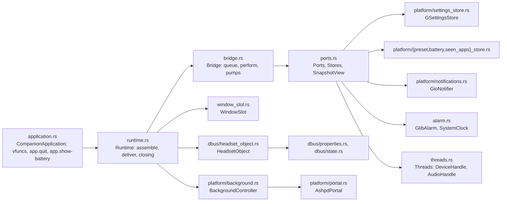
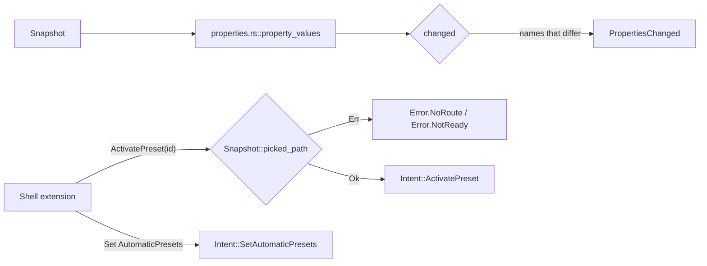
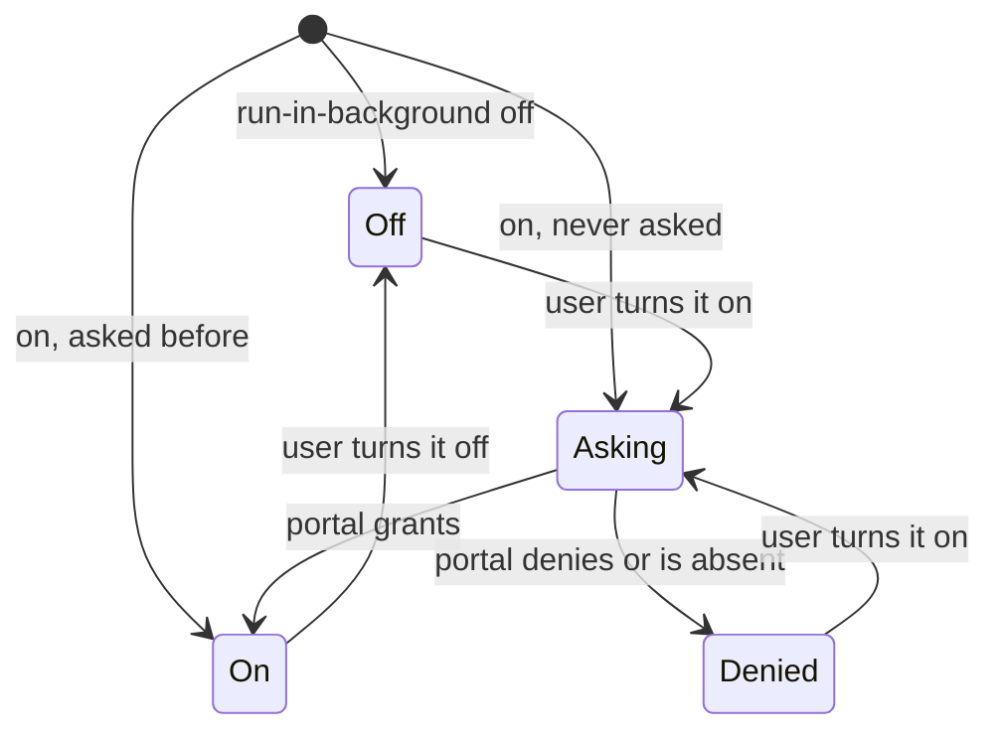
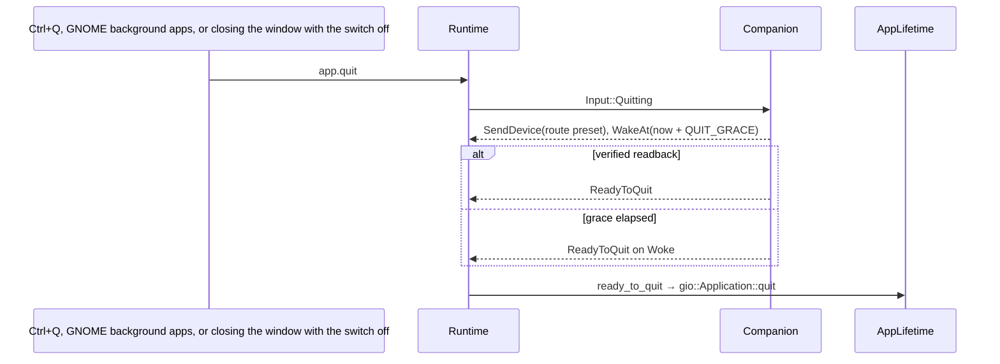
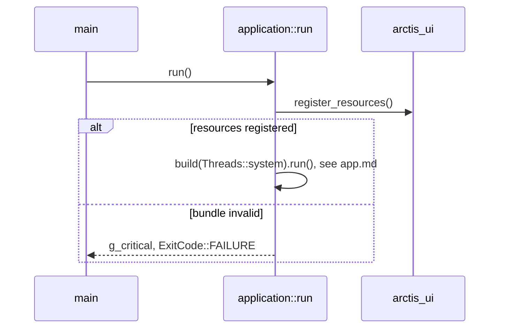

# SP8 App Platform and Bridge Implementation Plan

> **For agentic workers:** REQUIRED SUB-SKILL: Use superpowers:subagent-driven-development (recommended) or superpowers:executing-plans to implement this plan task-by-task. Steps use checkbox (`- [ ]`) syntax for tracking.

**Goal:** `crates/app` becomes the composition root: a bridge that pumps the device and audio threads, the window and
`Headset1` into `Companion` and runs every `Action` on a small port, plus the platform adapters (GSettings schema and
store, preset, seen-apps and battery file stores, the `Headset1` D-Bus object, the Background portal, notifications),
and an application that runs windowless with `--gapplication-service`.

**Architecture:** `Bridge` (`crates/app/src/bridge.rs`) owns `Companion`, a queue of `Input`s and one alarm. Every
`Action` goes through one `match` onto a trait in `crates/app/src/ports.rs`; views (`WindowSlot`, `HeadsetObject`,
`BackgroundController`) attach as `SnapshotView`s. Platform adapters live in `crates/app/src/platform/` and
`crates/app/src/dbus/`; `Runtime` wires them, and `CompanionApplication` (an `adw::Application` subclass) creates the
runtime in `startup` (primary only) after `dbus_register` has registered `Headset1` (Deviation 20). Pure mappings (D-Bus names, property values, status
line) are plain functions with table tests; GLib-bound adapters are tested against a memory GSettings backend,
tempdirs and fake services on a private `gio::TestDBus` bus.

**Tech Stack:** Rust 2024 (rustc 1.98, toolbox `arctis`), gtk4-rs 0.11, libadwaita-rs 0.9, gio/glib 0.22,
`async-channel` 2.5, `ashpd` 0.13.13 (`async-io`, `background`, no tokio), `serde_json` 1, `tempfile` 3 (tests).

Spec: `docs/superpowers/specs/2026-10-11-arctis-companion-design.md` §2 (process model, background, status line,
D-Bus, notifications), §3 (module tree, `app::bridge` row), §3.2 (the `Companion` contract), §5 (SP8 row); device
part §5 (settings table, `adopted-identity`); audio part §1, §3 (custom preset files), §4 (`app-rules`, seen apps),
§5 (battery CSV, alerts, `app.show-battery`); ui part §4 (Run in Background), §5 (`Headset1` members and values);
quality part §1 (`crates/app` row, end-to-end scenario) and §2; ADRs 0001, 0002, 0011, 0012; SP6 plan Deviations 3,
4, 5, 17, 19, 24, 35; SP9 plan Deviations 2, 8, 9, 13; SP12 plan Deviation 13.

---

## Conventions for every task

- Worktree: `/home/marcelo/Desenvolvimento/arctis-wt/sp8`, branch `sp8-app-platform`. Never touch
  `/home/marcelo/Desenvolvimento/arctis-companion`. Stay inside `crates/app`, `data/io.github.marcelogm.ArctisCompanion.gschema.xml`,
  `crates/core/tests/end_to_end.rs`, `.github/workflows/ci.yml` (two job edits), `docs/architecture/` and this plan.
  `crates/core/src`, `crates/hid`, `crates/audio` and `crates/ui` are other sub-projects' code: read them, never edit
  them. If a test here exposes a bug in them, stop and report it with the failing test instead of patching it.
- **Run:** `X` means `toolbox run -c arctis bash -lc 'cd /home/marcelo/Desenvolvimento/arctis-wt/sp8 && X'`.
- **Run (display):** `X` means

  ```bash
  toolbox run -c arctis bash -lc 'cd /home/marcelo/Desenvolvimento/arctis-wt/sp8 && export XDG_RUNTIME_DIR=$(mktemp -d) LC_ALL=C.UTF-8 && { weston --backend=headless --socket=wl-sp8 --idle-time=0 >/dev/null 2>&1 & W=$!; } && until [ -S "$XDG_RUNTIME_DIR/wl-sp8" ]; do sleep 0.1; done; GDK_BACKEND=wayland GSK_RENDERER=cairo WAYLAND_DISPLAY=wl-sp8 X; S=$?; kill $W; exit $S'
  ```

  Every `cargo test -p arctis-app` runs under Run (display): the `session_bus` binary starts the real application.
  Git and `gh` run on the host in the worktree.
- If the toolbox lacks a tool, install it there: `toolbox run -c arctis sudo dnf install -y dbus-daemon weston glib2`.
- Hardware: SP8 never opens `/dev/hidraw*`. Never run the `arctis-companion` binary (`cargo run -p arctis-app`): it
  spawns the device thread over the real sysfs and the real dongle is plugged in. Every test that starts the
  application passes `silent_threads` instead of `Threads::system`.
- No comments in any file of any language, doc comments included. Names and small functions carry the meaning.
- Clippy policy applies to tests too: cognitive complexity 8, 40 lines per function, nesting 3, at most 4
  arguments (`self` included), no `unwrap()` (tests use `expect`), `pedantic` as errors under `-D warnings`: no `as`
  casts, `#[must_use]` on public functions that return a value, no deprecated gio calls (`subscribe_to_signal`, not
  `signal_subscribe`). When clippy objects, extract a function, add a parameter struct or rename; never add an
  `allow` or `expect` attribute. Every `pub` helper in a test binary must be used by that binary.
- `gtk::gio::prelude::*` and `adw::prelude::*` re-export glib's prelude: a file that has either never also imports
  `gtk::glib::prelude::*` (the second glob is an unused import, an error under `-D warnings`; checked during the plan
  review against gtk4-rs 0.11). Import `gtk::glib::prelude::*` only where neither of the others is present.
- `std::env::set_var` is `unsafe` in Rust 2024 and `crates/app` forbids `unsafe`: tests never mutate the process
  environment. Environment for D-Bus tests comes from the `session_bus` binary re-executing itself (Task 16).
- Code blocks below are not rustfmt-formatted; `cargo fmt --all` reflows them and that is expected. Where a gtk-rs
  signature differs from what a block shows (the bindings are large), follow the compiler and keep the behaviour.
- Before each commit: Run `cargo fmt --all && cargo clippy --workspace --all-targets -- -D warnings && cargo test -p arctis-core && cargo xtask check-rules && cargo xtask check-pure && cargo xtask check-doc-paths`,
  then Run (display) `cargo test -p arctis-app`.
- Commit subjects are conventional (`type(scope): summary`), short. Never write `Co-Authored-By`, "Generated with",
  or any AI or tool name in a commit message, PR title or PR body. Never use `--no-verify`.
- The branch was created from `origin/main` and tracks it. First push: `git push -u origin sp8-app-platform`, then
  `git push` after every commit. After a rebase that moved the branch, `git push --force-with-lease`.
- SP10, SP11 and SP12 run in parallel. Overlap is limited to `docs/architecture/README.md` (one page row and the
  `crates/app/` entry-point cell) and `.github/workflows/ci.yml` (Task 23). Before Task 1, before Task 16, before
  Task 23 and before the PR run `git fetch origin && git rebase origin/main`; on a conflict in those files keep both
  sides' lines.

## Acceptance criteria → tasks

| SP8 acceptance criterion or scope item (design §5, quality §1 `crates/app` row) | Task |
|---|---|
| `crates/core/tests/end_to_end.rs` passes: connect → settle → probe → adopt → set preset → app rule switch → low battery notify → flap → reconnect, asserting actions, published phases and the wire log (command ids, plus the full `SetEqualizer` frames) | 1 |
| GSettings schema with every key of device §5, audio §1/§4/§5, ui §4 | 2 |
| GSettings store: load `AppSettings`, persist every `PersistedChange`, external changes become `SettingsChanged` | 3, 4, 5 |
| preset, seen-apps and battery stores pass the `core::ports` contract suite (tempdirs, `fresh` and `reopen`) | 6, 7, 8 |
| battery rows older than 8 days dropped at start-up; failed loads start empty | 9 |
| `crates/app/tests/bridge` covers every `Action` (Persist, StorePreset, RecordBattery, RecordSeenApp, SendDevice, SendAudio, Publish, Notify, Withdraw, WakeAt, ReadyToQuit) | 10, 11, 13 |
| `WakeAt` schedules one timeout and delivers `Woke` | 11 |
| channels pumped into `Companion` with `glib::spawn_future_local`; re-entrant inputs queued; a failing store stops nothing | 12 |
| quit sends the route preset and waits at most `QUIT_GRACE` | 13, 22 |
| `Headset1` values (`State`, `BatteryLevel`, `Charging`, `BatteryWarning`, `Route`, `Presets`, `ActivePreset`, `ActivePresetReason`, `AppRuleCount`, `AutomaticPresets`, `Model`) | 14, 15 |
| `gio::TestDBus` contract test: runtime introspection equals `data/dbus/…Headset1.xml` | 16 |
| properties follow the snapshot through `PropertiesChanged`; `ActivatePreset` with `NoRoute` / `NotReady`; `AutomaticPresets` writable | 17 |
| scripted run fires and withdraws the low-battery notification (`app.show-battery` default action), then the critical one replaces it and charging withdraws it | 18 |
| Background portal: asked at first run and when turned on, denial turns the switch off with the hint, hold guard, status line | 19, 20 |
| window wiring (`WindowPort`): one window, latest snapshot, background state, close behaviour | 21 |
| runs windowless with `--gapplication-service` (the Run in Background hold is what keeps it alive); `Activate` opens the window; `app.quit` ends the process | 22 |
| CI runs the app tests (display, dbus-daemon) | 23 |
| `docs/architecture/app.md` (sub-project rule, design §5) | 24 |

## File structure

```
data/io.github.marcelogm.ArctisCompanion.gschema.xml   every key, MuteLight enum
crates/core/tests/end_to_end.rs                         Simulation + Companion, stage by stage
crates/app/Cargo.toml                                   async-channel, ashpd, serde_json; dev: tempfile, core testkit; session_bus harness
crates/app/src/main.rs                                  main → application::run
crates/app/src/lib.rs                                   module list
crates/app/src/logging.rs                               LOG_DOMAIN, warn, report
crates/app/src/ports.rs                                 SettingsStore, DevicePort, AudioPort, SnapshotView, Notifier, Alarm, Clock, Lifetime, Ports, Stores
crates/app/src/bridge.rs                                Bridge: new, attach, submit, snapshot, pump_device, pump_audio
crates/app/src/alarm.rs                                 GlibAlarm, SystemClock
crates/app/src/threads.rs                               Threads::system, DevicePort for DeviceHandle, AudioPort for AudioHandle
crates/app/src/window_slot.rs                           WindowSlot: SnapshotView + BackgroundView over arctis_ui::Window
crates/app/src/runtime.rs                               Runtime: start, export, unexport, present, show_battery, quit
crates/app/src/application.rs                           CompanionApplication (adw::Application subclass), build, run, APP_ID
crates/app/src/dbus/mod.rs                              module list
crates/app/src/dbus/state.rs                            state_name, battery_level, charging_name, warning_name, route_name, reason_pair, error_name
crates/app/src/dbus/properties.rs                       PropertyMap, property_values, changed
crates/app/src/dbus/headset_object.rs                   HeadsetObject: register, on_intent, unregister, SnapshotView
crates/app/src/platform/mod.rs                          module list
crates/app/src/platform/settings_keys.rs                key names, headset, write_headset, route_key, app_rules, write_app_rule
crates/app/src/platform/settings_store.rs               GSettingsStore: load, watch, SettingsStore; SettingsWatch
crates/app/src/platform/files.rs                        data_dir, read_text, write_atomically, append, remove, failure
crates/app/src/platform/preset_store.rs                 FilePresets
crates/app/src/platform/battery_store.rs                FileBattery
crates/app/src/platform/seen_apps_store.rs              FileSeenApps
crates/app/src/platform/persisted.rs                    file_stores, load_persisted
crates/app/src/platform/notifications.rs                GioNotifier, notification_id, notification_for
crates/app/src/platform/background.rs                   Portal, Hold, BackgroundView, BackgroundController, status_text
crates/app/src/platform/portal.rs                       AshpdPortal
crates/app/src/platform/lifetime.rs                     AppHold, AppLifetime
crates/app/tests/common/schema.rs                       compiled_dir, memory_pair (shared by two binaries)
crates/app/tests/settings_store.rs                      schema keys, load, persist, watch
crates/app/tests/stores.rs                              contract suites + file specifics + load_persisted
crates/app/tests/bridge/{main,fakes,rig,actions,wakes,flow,quit}.rs
crates/app/tests/dbus_properties.rs                     state names and property map tables
crates/app/tests/background.rs                          BackgroundController with fakes, status line
crates/app/tests/session_bus/{main,bus,fixtures,introspection,headset,notification_service,notifications,portal_service,portal,window,service}.rs
crates/app/tests/application.rs                         build signature update
.github/workflows/ci.yml                                app tests move to the ui job
docs/architecture/app.md, docs/architecture/README.md
```

Dependency direction inside `crates/app`: `logging`, `ports` → `platform::*`, `dbus::*`, `alarm`, `threads` →
`bridge` → `window_slot` → `runtime` → `application` → `main`. Nothing in `platform` or `dbus` depends on `bridge`.

## Deviations

Decisions taken where the spec is silent or ambiguous; each is the simplest option consistent with it.

| # | Decision | Why |
|---|---|---|
| 1 | Extra files beyond the module tree: `logging.rs`, `alarm.rs`, `threads.rs`, `window_slot.rs`, `runtime.rs`, `dbus/{state, properties}.rs`, `platform/{settings_keys, files, persisted, portal, lifetime}.rs` | one responsibility per file, every file under 400 lines; the spec's tree lists the floor |
| 2 | `Bridge::new(companion, ports, stores) -> Rc<Bridge>` with `attach(Rc<dyn SnapshotView>)`, `submit(Input)`, `pump_device`, `pump_audio` instead of `Bridge::new(companion, adapters).run()` over concrete handles | ports are traits, so `crates/app/tests/bridge` runs with fakes; `HeadsetObject` exists only after `dbus_register` and the window only after `activate`, so views attach later and get the latest snapshot on attach |
| 3 | Port traits: `SettingsStore`, `DevicePort`, `AudioPort`, `SnapshotView`, `Notifier`, `Alarm`, `Clock`, `Lifetime`; the core repositories are grouped in `Stores`. The spec's `WindowPort` is `WindowSlot`, one of three `SnapshotView`s (with `HeadsetObject` and `BackgroundController`) | `Publish` has three consumers; one trait covers them |
| 4 | `submit` queues the input and drains the queue; an input submitted while actions run (a view, a GSettings echo) waits its turn | `Companion` is borrowed mutably during `handle`; re-entry would panic |
| 5 | `SystemClock` returns `glib::real_time() / 1000` as `Millis`; a `WakeAt(at)` schedules `at − now` on `GlibAlarm`, which keeps only the latest pending wake (`glib::timeout_future` inside `spawn_future_local`, the previous one aborted) | SP6 Deviation 3 (wall-clock millis); design §3.1 "owns its one GLib timeout" |
| 6 | A store error is logged with `g_warning!` and the remaining actions still run; at start-up a failed load gives an empty list | a full disk must not freeze the headset controls |
| 7 | GSettings keys: `mic-volume` `i` 0..15 (10), `sidetone` `i` 0..10 (0), `mute-light` enum off/low/medium/high = 0/1/4/10 (medium), `volume-limiter` `b` (true), `extended-range` `b` (false), `auto-power-off` enum `never`/`1m`/`5m`/`10m`/`15m`/`30m`/`45m`/`60m`/`75m`/`90m` with values equal to the minutes (`30m`; GSettings requires nicks of two characters or more, so the minute nicks carry an `m`), `preset-dongle` and `preset-bluetooth` `s` ('flat'), `app-rules` `a{ss}`, `automatic-presets` `b` (true), `adopted-identity` `s` (''), `bluetooth-sink-seen` `b` (false), `low-battery-threshold` `i` 5..50 (15), `run-in-background` `b` (true), `background-requested` `b` (false). No summaries yet | device §5, audio §1/§4/§5, ui §4 name the keys; headset defaults are never shown before adoption (device §5), so they only need to be valid; summaries are translatable text that SP14's catalogue pass adds |
| 8 | Every bounded or enum key goes through `settings_keys::accepted`: the stored value through `TryFrom`, and a value the core rejects is logged with `warn` and read through the type's total fallback (`MicVolume`/`Sidetone`/`Percent::nearest`, added to the core's `bounded!` macro, `AutoPowerOff::nearest`, `MuteLight::from_raw`). Nothing panics | GSettings already keeps stored values inside the schema; only a schema/core mismatch reaches the fallback, and Task 3's "maximum values load" test catches that |
| 9 | External GSettings changes are coalesced: the first `changed` signal of a main-loop turn schedules one `spawn_future_local` that reads the whole `AppSettings` and submits `SettingsChanged`. The app's own writes come back the same way and `Companion` ignores an equal `AppSettings` (SP6 Deviation 24) | a `Persist(Headset)` writes six keys; reading after each key would hand `Companion` a half-written state |
| 10 | Custom presets are `<data>/arctis-companion/presets/<id>.json` (serde of `core::eq::preset::Preset`), ids limited to `[a-z0-9-]+` (what `catalog::fresh_id` produces); an unreadable or invalid file is skipped with a warning; every write goes to `<name>.tmp` and is renamed | audio §3; an imported id such as `../x` must never become a path |
| 11 | Seen apps are one JSON array, newest first, at `<data>/arctis-companion/seen-apps.json`; `record` reads, applies `seen_apps::remember` and rewrites atomically; an unparsable file loads as an error at start-up (empty list) and is replaced, with a warning, by the next `record`; an I/O error makes `record` fail without writing | audio §4; SP6 Deviation 17 |
| 12 | Battery retention runs in `load_persisted`: `retain_since(now − RETENTION_SECONDS)` before the load | ADR 0012 "trimmed to 8 days at start-up" |
| 13 | `Headset1` details the spec leaves open: `Charging` maps `PluggedIn` to `charged`; `BatteryLevel` is −1 unless the latest reading has a connected link; `Model` is empty when unknown; `ActivePreset` is empty and `ActivePresetReason` is `(route, "")` when `Snapshot::picked_path` fails; `ActivatePreset` with an unknown id is forwarded (SP6 Deviation 5: `Companion` ignores it); any other method answers `org.freedesktop.DBus.Error.UnknownMethod`; error names are `io.github.marcelogm.ArctisCompanion.Error.NoRoute` and `…Error.NotReady` | ui §5 lists values and errors only |
| 14 | The contract test compares canonical member lists (each `property`, `method`, `arg`, `signal` tag with its attributes sorted) of the live `Introspect` reply and of the XML file | GDBus regenerates the XML with its own attribute order, and gio-rs exposes no accessors for interface members |
| 15 | D-Bus, notification, portal, window and service tests live in one `harness = false` binary, `crates/app/tests/session_bus/`, which re-executes itself with `GSETTINGS_SCHEMA_DIR`, `GSETTINGS_BACKEND=memory`, `XDG_DATA_HOME` and then brings up one `gio::TestDBus` | `std::env::set_var` is `unsafe` in Rust 2024; GLib's session-bus singleton cannot be torn down between libtest threads |
| 16 | The fake portal and the fake notification server are Rust gio services on the test bus instead of python-dbusmock; the notification fake is `org.gtk.Notifications`, which `GNotification` uses outside Flatpak (inside Flatpak GLib picks the portal by itself) | no Python files or pip dependency; the test still exercises `ashpd` and `send_notification` end to end |
| 17 | Background: "first run" is `background-requested` = false; a portal error or a non-zero response counts as a denial; turning Run in Background off only releases the hold (no portal call, the autostart entry stays; an autostarted service with the switch off holds nothing, so GApplication leaves `run` right after start-up: a service has no grace period of its own once its use count is zero). Status line: "Headset connected, {percent}" while the dongle is present with a connected reading, else "No headset", sent only when the text changes | design §2 and ui §4 describe only the grant and denial paths |
| 18 | Quit: `app.quit` (Ctrl+Q, and GNOME's background-apps "Quit", which activates the `quit` action over D-Bus) submits `Input::Quitting`; `ReadyToQuit` calls `gio::Application::quit`, which also ends the hold. Closing the window while Run in Background is off hides it and quits through the same path; with it on, the window closes and the hold keeps the process | design §3.2 says `ReadyToQuit` "drops the hold guard"; quitting has to work whether or not the switch is on, and the route preset must be restored on every orderly exit |
| 19 | `app.show-battery` presents the window and activates `win.show-page` with target `battery` (SP9 Deviation 8, SP12 Deviation 13) | the battery page is SP12's; until it is on `main` the action only presents the window |
| 20 | `dbus_register` only registers `Headset1` with `runtime::stored_snapshot` (a thread-free `Companion` over the stored GSettings and empty stores) and keeps it; `startup` starts the runtime (threads, files and retention, hold, portal) and attaches that object, which then publishes the real snapshot | `dbus_register` also runs in a second launch that only forwards its activation; `startup` runs only in the primary, so a second launch never spawns threads, rewrites battery.csv or takes the hold (review finding) |
| 21 | `setlocale`/`bindtextdomain` stay with SP14, which adds `po/`; until then texts resolve to English | SP9 Deviation 13; there is no catalogue to bind yet |
| 22 | CI: `arctis-app` tests move from the `test` job to the `ui` job (headless weston, `dbus-daemon`, `clang-devel`, `pipewire-devel`) | the service scenario initialises GTK, which needs a display |
| 23 | The bridge test binary is the directory `crates/app/tests/bridge/` (`main.rs` + modules) | one file would exceed 400 lines; it is still the `bridge` test target of the spec |
| 24 | The end-to-end test steps the virtual clock by 10 ms and asserts, per stage, the exact sequence of every non-`Publish` action (as a `Step`: persisted values, desired policy, values and curve, battery percent and link, alerts, wake offset from the start), the phase changes of the published snapshots against the device's published phases, and the wire log | how many identical-phase snapshots are published is not part of the contract |
| 25 | `main` no longer calls `arctis_audio::init()` | `AudioHandle::spawn` already calls it |
| 26 | `ashpd` with `default-features = false, features = ["async-io", "background"]` | design §2 "no tokio" |
| 27 | `Intent::SetRunInBackground` is routed by the pure `runtime::destination` to `BackgroundController`; every other intent goes to `Companion` | `Companion` ignores that intent (SP6), so the routing is the only thing making the preferences switch work; a pure function gets a table test instead of a GTK walk |
| 28 | `HeadsetObject` unregisters itself on drop; `shutdown` drops the runtime (and with it the object), and `dbus_unregister` drops an object no runtime took (a second launch, or threads that failed to start) | one owner, no double unexport |
| 29 | Execution: clippy (nesting 3, complexity 8, 40 lines, `similar_names`, `unnecessary_wraps`, `enum_variant_names`, `needless_pass_by_value`) reshaped some plan code: `settings_store.rs` coalesces through a private `Coalesced`; `bridge.rs` gains `record_battery`, `record_seen_app` and the free `wake` and `forward`; `background.rs` a free `answer`; `portal.rs` `report_status`; `CompanionApplication`'s vfuncs delegate to `export`, `unexport`, `present` and `stop_runtime`; `Bridge::attach` publishes before storing the view; the bridge fake's `Seen::SeenApp` is `Seen::AppRecorded`; the stored-values, reconnect and name-table tests are split into helpers or smaller tests (`dbus_properties` has 13 tests) | same behaviour, the lint policy forbids `allow` |
| 30 | Execution: the `session_bus` child gets `WAYLAND_DISPLAY` as an absolute socket path and `GTK_A11Y=none`; `Bus` keeps the session connection; the child exits with `process::exit` after the last scenario and from a panic hook on the first failure; the notification and portal fakes share `bus::own_name` | `GTestDBus::up` unsets `XDG_RUNTIME_DIR`, so a relative Wayland socket is not found; tearing `GTestDBus` down waits 30 s for the session singleton the GApplications still hold, and a panic during that teardown hung the run |
| 31 | Execution: `fixtures::silent_threads` returns `Threads`; the service scenario passes `\|\| Ok(silent_threads())` as the factory | `unnecessary_wraps` |
| 32 | Execution: `app.md` names the data files in plain text and points to `crates/app/src/platform/persisted.rs::file_stores` | `check-doc-paths` treats backticked file names as paths and does not resolve constants |
| 33 | Review: closing the window returns `window_slot::OnClose` (`ForgetWindow`, `HideUntilQuit`), mapped to `glib::Propagation` only in `WindowSlot::closing`; `BackgroundController` follows outside changes to `run-in-background` without asking the portal and ignores a denial that arrives after the switch went off; `Portal::request` takes only the answer (`AUTOSTART` is a constant in `portal.rs`); `dbus/state.rs` is `dbus/wire_names.rs`; `ActivatePreset` errors carry `wire_names::error_message`; `write_atomically` syncs the temporary file before the rename; shared test fixtures live in `arctis_core::testkit::companion` and `crates/app/tests/common/` | review findings |

---

### Task 1: End-to-end scenario across both reducers

The acceptance scenario of quality §1: the device `Session` (inside `testkit::Simulation` with a `FakeHeadset`) and
`Companion` run together on one virtual clock. `Companion` receives wall-clock millis (SP6 Deviation 3), so its clock
is `START` plus the simulation's time.

**Files:**
- Create: `crates/core/tests/end_to_end.rs`

- [ ] **Step 1: Write the test**

```rust
use std::collections::BTreeSet;
use std::mem;

use arctis_core::companion::adoption::{AdoptionStatus, DongleIdentity};
use arctis_core::companion::alerts::AlertId;
use arctis_core::companion::app_settings::{
    AppSettings, HeadsetValues, Persisted, PersistedChange, RoutePresets,
};
use arctis_core::companion::selection::PresetReason;
use arctis_core::companion::{Action, Companion, Input};
use arctis_core::eq::curve::{Curve, equivalent};
use arctis_core::eq::library;
use arctis_core::eq::preset::PresetId;
use arctis_core::intent::Intent;
use arctis_core::messages::audio::{
    AppIdentifiers, AudioEvent, DefaultSink, SinkKind, SoundPath, StreamInfo,
};
use arctis_core::messages::device::{Change, DeviceUpdate, Phase, SyncPolicy};
use arctis_core::protocol::{Command, Frame, Query, encode};
use arctis_core::session::timing::ENUMERATION_SETTLE;
use arctis_core::testkit::snapshots::{percent, values};
use arctis_core::testkit::{FakeHeadset, Flap, Simulation};
use arctis_core::time::Millis;

const START: Millis = Millis(1_760_000_000_000);
const STEP: u64 = 10;
const NOVA_5: u16 = 0x2232;
const CONNECTED: u64 = ENUMERATION_SETTLE + 2_000;

struct Stage {
    actions: Vec<Action>,
    wire: Vec<u8>,
    frames: Vec<Frame>,
    phases: Vec<Phase>,
}

struct EndToEnd {
    simulation: Simulation,
    companion: Companion,
    delivered: usize,
    wake: Option<Millis>,
    actions: Vec<Action>,
}

impl EndToEnd {
    fn new() -> Self {
        Self {
            simulation: Simulation::new(FakeHeadset::nova_5()),
            companion: Companion::new(persisted()),
            delivered: 0,
            wake: None,
            actions: Vec::new(),
        }
    }

    fn clock(&self) -> Millis {
        START.after(self.simulation.now().0)
    }

    fn send(&mut self, input: Input) {
        let actions = self.companion.handle(input, self.clock());
        for action in &actions {
            self.route(action);
        }
        self.actions.extend(actions);
    }

    fn route(&mut self, action: &Action) {
        match action {
            Action::SendDevice(Change::Desired { settings, policy }) => {
                self.simulation.desire(settings.clone(), *policy);
            }
            Action::WakeAt(at) => self.wake = Some(*at),
            _ => {}
        }
    }

    fn run_for(&mut self, duration: u64) {
        let end = self.simulation.now().after(duration);
        while self.simulation.now() < end {
            self.simulation.run_for(STEP);
            self.deliver_updates();
            self.wake_if_due();
        }
    }

    fn deliver_updates(&mut self) {
        let fresh: Vec<DeviceUpdate> = self.simulation.updates()[self.delivered..]
            .iter()
            .map(|(_, update)| update.clone())
            .collect();
        self.delivered += fresh.len();
        for update in fresh {
            self.send(Input::Device(update));
        }
    }

    fn wake_if_due(&mut self) {
        if self.wake.is_some_and(|at| at <= self.clock()) {
            self.wake = None;
            self.send(Input::Woke);
        }
    }

    fn stage(&mut self, act: impl FnOnce(&mut Self)) -> Stage {
        act(self);
        let stage = Stage {
            actions: mem::take(&mut self.actions),
            wire: self.simulation.sent_ids(),
            frames: self.simulation.writes().iter().map(|(_, frame)| frame.clone()).collect(),
            phases: self.simulation.published_phases(),
        };
        self.simulation.clear_logs();
        self.delivered = 0;
        stage
    }
}

fn id(text: &str) -> PresetId {
    PresetId::new(text)
}

fn curve(preset: &str) -> Curve {
    library::find(&id(preset)).expect("built-in preset").curve().clone()
}

fn persisted() -> Persisted {
    Persisted {
        settings: AppSettings {
            headset: values(),
            route_presets: RoutePresets {
                dongle: id("flat"),
                bluetooth: id("flat"),
            },
            app_rules: [("firefox".to_owned(), id("footsteps"))].into_iter().collect(),
            automatic_presets: true,
            adopted_identity: None,
            bluetooth_sink_seen: false,
            low_battery_threshold: percent(15),
        },
        custom_presets: Vec::new(),
        seen_apps: Vec::new(),
        battery: Vec::new(),
    }
}

fn firefox() -> StreamInfo {
    StreamInfo {
        ids: AppIdentifiers::new(Some("org.mozilla.firefox"), None, Some("firefox")),
        name: "Firefox".to_owned(),
        running: true,
        path: Some(SoundPath::Dongle),
    }
}

fn dongle_sink() -> DefaultSink {
    DefaultSink {
        terminal: SinkKind::NovaDongle,
        via_equalizer: false,
        via_easy_effects: false,
    }
}

fn equalizer_id() -> u8 {
    encode(&Command::SetEqualizer(curve("flat"))).payload()[0]
}

fn equalizer_frame(preset: &str) -> Frame {
    encode(&Command::SetEqualizer(curve(preset)))
}

fn connect_reads() -> Vec<u8> {
    [Query::Status, Query::Audio, Query::Ux, Query::Wireless, Query::Firmware]
        .into_iter()
        .map(Query::id)
        .collect()
}

const fn kind(action: &Action) -> &'static str {
    match action {
        Action::Persist(_) => "Persist",
        Action::StorePreset(_) => "StorePreset",
        Action::RecordBattery(_) => "RecordBattery",
        Action::RecordSeenApp(_) => "RecordSeenApp",
        Action::SendDevice(_) => "SendDevice",
        Action::SendAudio(_) => "SendAudio",
        Action::Publish(_) => "Publish",
        Action::Notify(_) => "Notify",
        Action::Withdraw(_) => "Withdraw",
        Action::WakeAt(_) => "WakeAt",
        Action::ReadyToQuit => "ReadyToQuit",
    }
}

fn kinds(actions: &[Action]) -> BTreeSet<&'static str> {
    actions.iter().map(kind).collect()
}

fn assert_only(actions: &[Action], allowed: &[&str]) {
    let unexpected: Vec<&str> = actions
        .iter()
        .map(kind)
        .filter(|name| !allowed.contains(name))
        .collect();
    assert!(unexpected.is_empty(), "unexpected actions: {unexpected:?}");
}

fn policies(actions: &[Action]) -> Vec<SyncPolicy> {
    actions
        .iter()
        .filter_map(|action| match action {
            Action::SendDevice(Change::Desired { policy, .. }) => Some(*policy),
            _ => None,
        })
        .collect()
}

fn curves(actions: &[Action]) -> Vec<Curve> {
    actions
        .iter()
        .filter_map(|action| match action {
            Action::SendDevice(Change::Desired { settings, .. }) => Some(settings.equalizer.clone()),
            _ => None,
        })
        .collect()
}

fn battery_percents(actions: &[Action]) -> Vec<u8> {
    actions
        .iter()
        .filter_map(|action| match action {
            Action::RecordBattery(sample) if sample.reading.is_connected() => {
                Some(sample.reading.percent.get())
            }
            _ => None,
        })
        .collect()
}

fn alerts(actions: &[Action]) -> Vec<(bool, AlertId)> {
    actions
        .iter()
        .filter_map(|action| match action {
            Action::Notify(alert) => Some((true, alert.id)),
            Action::Withdraw(id) => Some((false, *id)),
            _ => None,
        })
        .collect()
}

fn connect(run: &mut EndToEnd) -> HeadsetValues {
    let connect = run.stage(|run| {
        run.simulation.plug();
        run.run_for(CONNECTED);
    });
    let factory = HeadsetValues::from_settings(run.simulation.headset().settings());
    assert_eq!(
        connect.phases,
        [Phase::Settling, Phase::Probing, Phase::Syncing, Phase::Ready]
    );
    assert_eq!(connect.wire, connect_reads());
    assert_adopted(&connect.actions, factory);
    assert_eq!(run.companion.snapshot().dongle.adoption, AdoptionStatus::Adopted);
    factory
}

fn assert_adopted(actions: &[Action], factory: HeadsetValues) {
    let sent = policies(actions);
    assert_eq!(sent.first(), Some(&SyncPolicy::Adopt));
    assert_eq!(sent.last(), Some(&SyncPolicy::Enforce));
    let identity = DongleIdentity::new(NOVA_5, None);
    assert!(actions.contains(&Action::Persist(PersistedChange::AdoptedIdentity(identity))));
    assert!(actions.contains(&Action::Persist(PersistedChange::Headset(factory))));
    assert_eq!(battery_percents(actions), [37]);
    assert_only(actions, &["Persist", "SendDevice", "RecordBattery", "Publish"]);
}

fn set_route_preset(run: &mut EndToEnd) {
    let set = run.stage(|run| {
        run.send(Input::Intent(Intent::SetRoutePreset(SoundPath::Dongle, id("bass-boost"))));
        run.run_for(1_000);
    });
    assert_eq!(set.wire, [equalizer_id(), Query::Audio.id()]);
    assert_eq!(set.frames.first(), Some(&equalizer_frame("bass-boost")));
    assert_eq!(curves(&set.actions), [curve("bass-boost")]);
    let persisted = PersistedChange::RoutePreset(SoundPath::Dongle, id("bass-boost"));
    assert!(set.actions.contains(&Action::Persist(persisted)));
    assert_only(&set.actions, &["Persist", "SendDevice", "Publish"]);
    assert!(equivalent(&run.simulation.headset().settings().equalizer, &curve("bass-boost")));
}

fn switch_for_a_ruled_app(run: &mut EndToEnd) {
    let switch = run.stage(|run| {
        run.send(Input::Audio(AudioEvent::DefaultSink(dongle_sink())));
        run.send(Input::Audio(AudioEvent::Streams(vec![firefox()])));
        run.run_for(1_500);
    });
    assert_eq!(switch.wire, [equalizer_id(), Query::Audio.id()]);
    assert_eq!(switch.frames.first(), Some(&equalizer_frame("footsteps")));
    assert_eq!(curves(&switch.actions), [curve("footsteps")]);
    assert!(kinds(&switch.actions).is_superset(&BTreeSet::from(["WakeAt", "RecordSeenApp"])));
    assert_only(&switch.actions, &["WakeAt", "RecordSeenApp", "SendDevice", "Publish"]);
    let active = run.companion.snapshot().presets.active.dongle.clone();
    assert_eq!(active.preset, id("footsteps"));
    assert_eq!(active.reason, PresetReason::App("Firefox".to_owned()));
    assert!(equivalent(&run.simulation.headset().settings().equalizer, &curve("footsteps")));
}

fn warn_about_a_low_battery(run: &mut EndToEnd) {
    let low = run.stage(|run| {
        run.simulation.battery(percent(14));
        run.run_for(200);
    });
    assert!(low.wire.is_empty());
    assert_eq!(alerts(&low.actions), [(true, AlertId::LowBattery)]);
    assert_eq!(battery_percents(&low.actions), [14]);
    assert_only(&low.actions, &["RecordBattery", "Notify", "Publish"]);
}

fn absorb_a_flap(run: &mut EndToEnd) {
    let flap = run.stage(|run| {
        run.simulation.flap(Flap {
            node_back_after: 300,
            ..Flap::default()
        });
        run.run_for(2_000);
    });
    assert!(flap.wire.is_empty(), "Rebinding sends no queries");
    assert!(flap.phases.is_empty(), "a short flap is silent");
    assert_eq!(run.simulation.phase(), Phase::Ready);
    assert_only(&flap.actions, &["Publish"]);
}

fn reconnect(run: &mut EndToEnd, factory: HeadsetValues) {
    let again = run.stage(|run| {
        run.simulation.unplug();
        run.run_for(500);
        run.simulation.plug();
        run.run_for(CONNECTED);
    });
    assert_eq!(
        again.phases,
        [Phase::Absent, Phase::Settling, Phase::Probing, Phase::Syncing, Phase::Ready]
    );
    assert_eq!(again.wire, connect_reads(), "no drift, so nothing is written");
    let sent = policies(&again.actions);
    assert!(!sent.contains(&SyncPolicy::Adopt));
    assert_eq!(sent.last(), Some(&SyncPolicy::Enforce));
    assert_eq!(
        alerts(&again.actions),
        [(false, AlertId::LowBattery), (true, AlertId::LowBattery)]
    );
    assert_only(
        &again.actions,
        &["SendDevice", "RecordBattery", "Withdraw", "Notify", "Publish"],
    );
    let settings = run.simulation.headset().settings();
    assert_eq!(HeadsetValues::from_settings(settings), factory);
    assert!(equivalent(&settings.equalizer, &curve("footsteps")));
}

#[test]
fn connect_adopt_set_switch_warn_flap_and_reconnect() {
    let mut run = EndToEnd::new();
    let factory = connect(&mut run);
    set_route_preset(&mut run);
    switch_for_a_ruled_app(&mut run);
    warn_about_a_low_battery(&mut run);
    absorb_a_flap(&mut run);
    reconnect(&mut run, factory);
}
```

- [ ] **Step 2: Run it**

Run: `cargo test -p arctis-core --test end_to_end && cargo clippy -p arctis-core --all-targets -- -D warnings`
Expected: PASS, 1 test, clippy clean (checked by the plan review on top of `99f8274`; `connect` is split into
`connect` and `assert_adopted` because one function held cognitive complexity 9). The reducers already exist, so this test is the acceptance check of their contract. If an
assertion fails, compare the actual value with the spec (device §2 for phases and wire, audio §4 for the switch,
audio §5 for alerts) before touching anything: a difference that contradicts the spec is a bug in SP4 or SP6 to
report with this test, not an expectation to edit. Only a value the spec leaves open (for example a published
snapshot count) may be adjusted, and the reason goes into Deviations.

- [ ] **Step 3: Commit**

```bash
git add crates/core/tests/end_to_end.rs
git commit -m "test(core): run the session and the companion end to end"
git push -u origin sp8-app-platform
```

### Task 2: GSettings schema with every key

**Files:**
- Modify: `data/io.github.marcelogm.ArctisCompanion.gschema.xml`
- Modify: `crates/app/Cargo.toml`
- Create: `crates/app/tests/common/schema.rs`
- Create: `crates/app/tests/settings_store.rs`

- [ ] **Step 1: Add the dependencies the tasks below need**

`crates/app/Cargo.toml` becomes:

```toml
[package]
name = "arctis-app"
version.workspace = true
edition.workspace = true
license.workspace = true
publish.workspace = true

[lib]
path = "src/lib.rs"

[[bin]]
name = "arctis-companion"
path = "src/main.rs"

[[test]]
name = "session_bus"
path = "tests/session_bus/main.rs"
harness = false

[dependencies]
arctis-core.workspace = true
arctis-hid.workspace = true
arctis-audio.workspace = true
arctis-ui.workspace = true
gtk.workspace = true
adw.workspace = true
async-channel = "2.5"
ashpd = { version = "0.13.13", default-features = false, features = ["async-io", "background"] }
serde_json = "1"

[dev-dependencies]
arctis-core = { workspace = true, features = ["testkit"] }
tempfile = "3"

[lints]
workspace = true
```

The `[[test]] session_bus` entry points at a file Task 16 creates; until then keep that block out and add it in
Task 16 (cargo refuses a missing test path).

- [ ] **Step 2: Write the shared schema helper**

`crates/app/tests/common/schema.rs` (included with `#[path]` by `settings_store.rs` and `background.rs`; both use
both functions):

```rust
use std::path::Path;
use std::process::Command;

use gtk::gio;
use tempfile::TempDir;

pub const APP_ID: &str = "io.github.marcelogm.ArctisCompanion";

pub fn compiled_dir() -> TempDir {
    let dir = tempfile::tempdir().expect("schema dir");
    let data = Path::new(env!("CARGO_MANIFEST_DIR")).join("../../data");
    let status = Command::new("glib-compile-schemas")
        .arg("--strict")
        .arg("--targetdir")
        .arg(dir.path())
        .arg(&data)
        .status()
        .expect("glib-compile-schemas runs");
    assert!(status.success(), "the schema compiles with --strict");
    dir
}

pub fn memory_pair(dir: &Path) -> (gio::Settings, gio::Settings) {
    let source = gio::SettingsSchemaSource::from_directory(dir, None, false).expect("schema source");
    let schema = source.lookup(APP_ID, false).expect("app schema");
    let backend = gio::memory_settings_backend_new();
    (
        gio::Settings::new_full(&schema, Some(&backend), None),
        gio::Settings::new_full(&schema, Some(&backend), None),
    )
}
```

- [ ] **Step 3: Write the failing test**

`crates/app/tests/settings_store.rs`:

```rust
#[path = "common/schema.rs"]
mod schema;

use gtk::gio::prelude::*;

use schema::{compiled_dir, memory_pair};

const KEYS: [&str; 15] = [
    "mic-volume",
    "sidetone",
    "mute-light",
    "volume-limiter",
    "extended-range",
    "auto-power-off",
    "preset-dongle",
    "preset-bluetooth",
    "app-rules",
    "automatic-presets",
    "adopted-identity",
    "bluetooth-sink-seen",
    "low-battery-threshold",
    "run-in-background",
    "background-requested",
];

#[test]
fn the_schema_declares_every_key() {
    let dir = compiled_dir();
    let (settings, _) = memory_pair(dir.path());
    let schema = settings.settings_schema().expect("schema");
    for key in KEYS {
        assert!(schema.has_key(key), "{key}");
    }
    assert_eq!(schema.list_keys().len(), KEYS.len());
}
```

- [ ] **Step 4: Run it to see it fail**

Run (display): `cargo test -p arctis-app --test settings_store`
Expected: FAIL, `mic-volume` is not a key (the schema from SP1 is empty).

- [ ] **Step 5: Write the schema**

`data/io.github.marcelogm.ArctisCompanion.gschema.xml`:

```xml
<?xml version="1.0" encoding="UTF-8"?>
<schemalist gettext-domain="arctis-companion">
  <enum id="io.github.marcelogm.ArctisCompanion.MuteLight">
    <value nick="off" value="0"/>
    <value nick="low" value="1"/>
    <value nick="medium" value="4"/>
    <value nick="high" value="10"/>
  </enum>
  <schema id="io.github.marcelogm.ArctisCompanion" path="/io/github/marcelogm/ArctisCompanion/">
    <key name="mic-volume" type="i">
      <range min="0" max="15"/>
      <default>10</default>
    </key>
    <key name="sidetone" type="i">
      <range min="0" max="10"/>
      <default>0</default>
    </key>
    <key name="mute-light" enum="io.github.marcelogm.ArctisCompanion.MuteLight">
      <default>'medium'</default>
    </key>
    <key name="volume-limiter" type="b">
      <default>true</default>
    </key>
    <key name="extended-range" type="b">
      <default>false</default>
    </key>
    <key name="auto-power-off" type="i">
      <range min="0" max="90"/>
      <default>30</default>
    </key>
    <key name="preset-dongle" type="s">
      <default>'flat'</default>
    </key>
    <key name="preset-bluetooth" type="s">
      <default>'flat'</default>
    </key>
    <key name="app-rules" type="a{ss}">
      <default>{}</default>
    </key>
    <key name="automatic-presets" type="b">
      <default>true</default>
    </key>
    <key name="adopted-identity" type="s">
      <default>''</default>
    </key>
    <key name="bluetooth-sink-seen" type="b">
      <default>false</default>
    </key>
    <key name="low-battery-threshold" type="i">
      <range min="5" max="50"/>
      <default>15</default>
    </key>
    <key name="run-in-background" type="b">
      <default>true</default>
    </key>
    <key name="background-requested" type="b">
      <default>false</default>
    </key>
  </schema>
</schemalist>
```

- [ ] **Step 6: Run the tests**

Run (display): `cargo test -p arctis-app --test settings_store` → PASS, 1 test.
Run: `glib-compile-schemas --strict --dry-run data` → exit 0 (the meson `validate-schema` test runs the same).

- [ ] **Step 7: Commit**

```bash
git add data/io.github.marcelogm.ArctisCompanion.gschema.xml crates/app/Cargo.toml crates/app/tests/common/schema.rs crates/app/tests/settings_store.rs Cargo.lock
git commit -m "feat(data): declare every settings key"
git push
```

### Task 3: Load `AppSettings` from GSettings

**Files:**
- Create: `crates/app/src/logging.rs`, `crates/app/src/platform/mod.rs`, `crates/app/src/platform/settings_keys.rs`,
  `crates/app/src/platform/settings_store.rs`
- Modify: `crates/app/src/lib.rs`
- Test: `crates/app/tests/settings_store.rs`

- [ ] **Step 1: Write the failing tests**

Append to `crates/app/tests/settings_store.rs` (merge the `use` lines into the file's header):

```rust
use arctis_app::platform::settings_store::GSettingsStore;
use arctis_core::companion::adoption::DongleIdentity;
use arctis_core::companion::app_settings::{AppRules, AppSettings, HeadsetValues, RoutePresets};
use arctis_core::eq::preset::PresetId;
use arctis_core::settings::values::{AutoPowerOff, MicVolume, MuteLight, Percent, Sidetone, WirelessMode};

fn defaults() -> AppSettings {
    AppSettings {
        headset: HeadsetValues {
            mic_volume: MicVolume::try_from(10).expect("mic volume"),
            sidetone: Sidetone::try_from(0).expect("sidetone"),
            mute_light: MuteLight::Medium,
            volume_limiter: true,
            wireless_mode: WirelessMode::Standard,
            auto_power_off: AutoPowerOff::try_from(30).expect("auto power off"),
        },
        route_presets: RoutePresets {
            dongle: PresetId::new("flat"),
            bluetooth: PresetId::new("flat"),
        },
        app_rules: AppRules::default(),
        automatic_presets: true,
        adopted_identity: None,
        bluetooth_sink_seen: false,
        low_battery_threshold: Percent::try_from(15).expect("percent"),
    }
}

#[test]
fn a_fresh_schema_loads_the_defaults() {
    let dir = compiled_dir();
    let (settings, _) = memory_pair(dir.path());
    assert_eq!(GSettingsStore::new(settings).load(), defaults());
}

#[test]
fn stored_values_load_into_app_settings() {
    let dir = compiled_dir();
    let (settings, _) = memory_pair(dir.path());
    settings.set_int("mic-volume", 15).expect("mic-volume");
    settings.set_int("sidetone", 10).expect("sidetone");
    settings.set_enum("mute-light", 10).expect("mute-light");
    settings.set_boolean("extended-range", true).expect("extended-range");
    settings.set_int("auto-power-off", 90).expect("auto-power-off");
    settings.set_string("preset-bluetooth", "podcast").expect("preset");
    settings.set_string("adopted-identity", "2232").expect("identity");
    settings.set_int("low-battery-threshold", 50).expect("threshold");
    let loaded = GSettingsStore::new(settings).load();
    assert_eq!(loaded.headset.mic_volume.get(), 15);
    assert_eq!(loaded.headset.sidetone.get(), 10);
    assert_eq!(loaded.headset.mute_light, MuteLight::High);
    assert_eq!(loaded.headset.wireless_mode, WirelessMode::ExtendedRange);
    assert_eq!(loaded.headset.auto_power_off.minutes(), 90);
    assert_eq!(loaded.route_presets.bluetooth, PresetId::new("podcast"));
    assert_eq!(loaded.adopted_identity, Some(DongleIdentity::new(0x2232, None)));
    assert_eq!(loaded.low_battery_threshold.get(), 50);
}

#[test]
fn app_rules_load_as_identifier_to_preset() {
    let dir = compiled_dir();
    let (settings, _) = memory_pair(dir.path());
    let rules: std::collections::HashMap<String, String> =
        [("firefox".to_owned(), "footsteps".to_owned())].into();
    settings.set("app-rules", rules.to_variant()).expect("rules");
    let loaded = GSettingsStore::new(settings).load();
    assert_eq!(loaded.app_rules.preset_for("Firefox"), Some(&PresetId::new("footsteps")));
    assert_eq!(loaded.app_rules.len(), 1);
}

#[test]
fn an_unreadable_identity_means_never_adopted() {
    let dir = compiled_dir();
    let (settings, _) = memory_pair(dir.path());
    settings.set_string("adopted-identity", "not-hex").expect("identity");
    assert_eq!(GSettingsStore::new(settings).load().adopted_identity, None);
}
```

`ToVariant` comes through `gtk::gio::prelude::*`, which re-exports glib's prelude.

- [ ] **Step 2: Run them to see them fail**

Run (display): `cargo test -p arctis-app --test settings_store`
Expected: FAIL to compile, `arctis_app::platform` does not exist.

- [ ] **Step 3: Write the logging helpers**

`crates/app/src/logging.rs`:

```rust
use arctis_core::ports::StoreError;
use gtk::glib;

pub const LOG_DOMAIN: &str = "arctis-companion";

pub fn warn(message: &str) {
    glib::g_warning!(LOG_DOMAIN, "{message}");
}

pub fn report(result: Result<(), StoreError>) {
    if let Err(error) = result {
        warn(&error.to_string());
    }
}
```

- [ ] **Step 4: Write the key helpers**

`crates/app/src/platform/settings_keys.rs`:

```rust
use std::collections::HashMap;

use arctis_core::companion::adoption::DongleIdentity;
use arctis_core::companion::app_settings::{AppRules, HeadsetValues, RoutePresets};
use arctis_core::eq::preset::PresetId;
use arctis_core::messages::audio::SoundPath;
use arctis_core::settings::values::{AutoPowerOff, MuteLight, WirelessMode};
use gtk::gio;
use gtk::gio::prelude::*;
use gtk::glib;

pub const MIC_VOLUME: &str = "mic-volume";
pub const SIDETONE: &str = "sidetone";
pub const MUTE_LIGHT: &str = "mute-light";
pub const VOLUME_LIMITER: &str = "volume-limiter";
pub const EXTENDED_RANGE: &str = "extended-range";
pub const AUTO_POWER_OFF: &str = "auto-power-off";
pub const PRESET_DONGLE: &str = "preset-dongle";
pub const PRESET_BLUETOOTH: &str = "preset-bluetooth";
pub const APP_RULES: &str = "app-rules";
pub const AUTOMATIC_PRESETS: &str = "automatic-presets";
pub const ADOPTED_IDENTITY: &str = "adopted-identity";
pub const BLUETOOTH_SINK_SEEN: &str = "bluetooth-sink-seen";
pub const LOW_BATTERY_THRESHOLD: &str = "low-battery-threshold";
pub const RUN_IN_BACKGROUND: &str = "run-in-background";
pub const BACKGROUND_REQUESTED: &str = "background-requested";

#[must_use]
pub fn ranged<T: TryFrom<u8>>(settings: &gio::Settings, key: &str) -> T {
    u8::try_from(settings.int(key))
        .ok()
        .and_then(|value| T::try_from(value).ok())
        .expect("GSettings keeps every integer key inside its schema range")
}

#[must_use]
pub fn headset(settings: &gio::Settings) -> HeadsetValues {
    HeadsetValues {
        mic_volume: ranged(settings, MIC_VOLUME),
        sidetone: ranged(settings, SIDETONE),
        mute_light: MuteLight::from_raw(enum_value(settings, MUTE_LIGHT)),
        volume_limiter: settings.boolean(VOLUME_LIMITER),
        wireless_mode: wireless_mode(settings.boolean(EXTENDED_RANGE)),
        auto_power_off: AutoPowerOff::nearest(small(settings.int(AUTO_POWER_OFF))),
    }
}

pub fn write_headset(settings: &gio::Settings, values: HeadsetValues) -> Result<(), glib::BoolError> {
    settings.set_int(MIC_VOLUME, i32::from(values.mic_volume.get()))?;
    settings.set_int(SIDETONE, i32::from(values.sidetone.get()))?;
    settings.set_enum(MUTE_LIGHT, i32::from(values.mute_light.raw()))?;
    settings.set_boolean(VOLUME_LIMITER, values.volume_limiter)?;
    let extended = values.wireless_mode == WirelessMode::ExtendedRange;
    settings.set_boolean(EXTENDED_RANGE, extended)?;
    settings.set_int(AUTO_POWER_OFF, i32::from(values.auto_power_off.minutes()))
}

#[must_use]
pub const fn route_key(path: SoundPath) -> &'static str {
    match path {
        SoundPath::Dongle => PRESET_DONGLE,
        SoundPath::Bluetooth => PRESET_BLUETOOTH,
    }
}

#[must_use]
pub fn route_presets(settings: &gio::Settings) -> RoutePresets {
    RoutePresets {
        dongle: PresetId::new(settings.string(PRESET_DONGLE).to_string()),
        bluetooth: PresetId::new(settings.string(PRESET_BLUETOOTH).to_string()),
    }
}

#[must_use]
pub fn app_rules(settings: &gio::Settings) -> AppRules {
    stored_rules(settings)
        .into_iter()
        .map(|(identifier, preset)| (identifier, PresetId::new(preset)))
        .collect()
}

pub fn write_app_rule(
    settings: &gio::Settings,
    identifier: &str,
    preset: Option<&PresetId>,
) -> Result<(), glib::BoolError> {
    let mut rules = stored_rules(settings);
    match preset {
        Some(preset) => rules.insert(identifier.to_owned(), preset.as_str().to_owned()),
        None => rules.remove(identifier),
    };
    settings.set(APP_RULES, rules.to_variant())
}

#[must_use]
pub fn adopted_identity(settings: &gio::Settings) -> Option<DongleIdentity> {
    DongleIdentity::from_setting(&settings.string(ADOPTED_IDENTITY))
}

fn stored_rules(settings: &gio::Settings) -> HashMap<String, String> {
    settings.get(APP_RULES)
}

fn enum_value(settings: &gio::Settings, key: &str) -> u8 {
    small(settings.enum_(key))
}

fn small(value: i32) -> u8 {
    u8::try_from(value).unwrap_or(u8::MAX)
}

const fn wireless_mode(extended_range: bool) -> WirelessMode {
    if extended_range {
        WirelessMode::ExtendedRange
    } else {
        WirelessMode::Standard
    }
}
```

- [ ] **Step 5: Write the store's load**

`crates/app/src/platform/settings_store.rs`:

```rust
use arctis_core::companion::app_settings::AppSettings;
use gtk::gio;
use gtk::gio::prelude::*;

use super::settings_keys::{
    self as keys, AUTOMATIC_PRESETS, BLUETOOTH_SINK_SEEN, LOW_BATTERY_THRESHOLD,
};

#[derive(Clone, Debug)]
pub struct GSettingsStore {
    settings: gio::Settings,
}

impl GSettingsStore {
    #[must_use]
    pub const fn new(settings: gio::Settings) -> Self {
        Self { settings }
    }

    #[must_use]
    pub fn load(&self) -> AppSettings {
        let settings = &self.settings;
        AppSettings {
            headset: keys::headset(settings),
            route_presets: keys::route_presets(settings),
            app_rules: keys::app_rules(settings),
            automatic_presets: settings.boolean(AUTOMATIC_PRESETS),
            adopted_identity: keys::adopted_identity(settings),
            bluetooth_sink_seen: settings.boolean(BLUETOOTH_SINK_SEEN),
            low_battery_threshold: keys::ranged(settings, LOW_BATTERY_THRESHOLD),
        }
    }
}
```

`crates/app/src/platform/mod.rs`:

```rust
pub mod settings_keys;
pub mod settings_store;
```

`crates/app/src/lib.rs`:

```rust
#![forbid(unsafe_code)]

pub mod application;
pub mod logging;
pub mod platform;
```

- [ ] **Step 6: Run the tests**

Run (display): `cargo test -p arctis-app --test settings_store` → PASS, 5 tests.
Run: `cargo clippy -p arctis-app --all-targets -- -D warnings` → clean. `logging::warn` and `report` are `pub`, so
they are not dead code before Task 4 uses them.

- [ ] **Step 7: Commit**

```bash
git add crates/app/src crates/app/tests/settings_store.rs
git commit -m "feat(app): load app settings from GSettings"
git push
```

### Task 4: Persist every `PersistedChange`

**Files:**
- Create: `crates/app/src/ports.rs`
- Modify: `crates/app/src/platform/settings_store.rs`, `crates/app/src/lib.rs`
- Test: `crates/app/tests/settings_store.rs`

- [ ] **Step 1: Write the failing tests**

Append to `crates/app/tests/settings_store.rs`:

```rust
use arctis_app::ports::SettingsStore;
use arctis_core::companion::app_settings::PersistedChange;
use arctis_core::messages::audio::SoundPath;

fn persisted_then_loaded(change: &PersistedChange) -> AppSettings {
    let dir = compiled_dir();
    let (settings, _) = memory_pair(dir.path());
    let store = GSettingsStore::new(settings);
    store.persist(change);
    store.load()
}

fn headset_values() -> HeadsetValues {
    HeadsetValues {
        mic_volume: MicVolume::try_from(7).expect("mic volume"),
        sidetone: Sidetone::try_from(3).expect("sidetone"),
        mute_light: MuteLight::Low,
        volume_limiter: false,
        wireless_mode: WirelessMode::ExtendedRange,
        auto_power_off: AutoPowerOff::try_from(15).expect("auto power off"),
    }
}

fn assert_round_trip(change: &PersistedChange, apply: impl FnOnce(&mut AppSettings)) {
    let mut expected = defaults();
    apply(&mut expected);
    assert_eq!(persisted_then_loaded(change), expected, "{change:?}");
}

#[test]
fn headset_and_route_changes_round_trip() {
    assert_round_trip(&PersistedChange::Headset(headset_values()), |s| {
        s.headset = headset_values();
    });
    let bass = PresetId::new("bass-boost");
    assert_round_trip(&PersistedChange::RoutePreset(SoundPath::Dongle, bass.clone()), |s| {
        s.route_presets.dongle = bass;
    });
    let podcast = PresetId::new("podcast");
    assert_round_trip(&PersistedChange::RoutePreset(SoundPath::Bluetooth, podcast.clone()), |s| {
        s.route_presets.bluetooth = podcast;
    });
}

#[test]
fn app_and_dongle_changes_round_trip() {
    let rule = PersistedChange::AppRule {
        identifier: "firefox".to_owned(),
        preset: Some(PresetId::new("footsteps")),
    };
    assert_round_trip(&rule, |s| s.app_rules.set("firefox".to_owned(), PresetId::new("footsteps")));
    assert_round_trip(&PersistedChange::AutomaticPresets(false), |s| s.automatic_presets = false);
    let identity = DongleIdentity::new(0x2232, Some("ABC"));
    assert_round_trip(&PersistedChange::AdoptedIdentity(identity.clone()), |s| {
        s.adopted_identity = Some(identity);
    });
    assert_round_trip(&PersistedChange::BluetoothSinkSeen, |s| s.bluetooth_sink_seen = true);
    let threshold = Percent::try_from(20).expect("percent");
    assert_round_trip(&PersistedChange::LowBatteryThreshold(threshold), |s| {
        s.low_battery_threshold = threshold;
    });
}

#[test]
fn removing_an_app_rule_deletes_only_that_rule() {
    let dir = compiled_dir();
    let (settings, _) = memory_pair(dir.path());
    let store = GSettingsStore::new(settings);
    for identifier in ["firefox", "spotify"] {
        store.persist(&PersistedChange::AppRule {
            identifier: identifier.to_owned(),
            preset: Some(PresetId::new("footsteps")),
        });
    }
    store.persist(&PersistedChange::AppRule { identifier: "firefox".to_owned(), preset: None });
    let rules = store.load().app_rules;
    assert_eq!(rules.len(), 1);
    assert!(rules.preset_for("spotify").is_some());
}
```

- [ ] **Step 2: Run them to see them fail**

Run (display): `cargo test -p arctis-app --test settings_store`
Expected: FAIL to compile, `arctis_app::ports` does not exist.

- [ ] **Step 3: Create `ports.rs` with the settings port**

`crates/app/src/ports.rs`:

```rust
use arctis_core::companion::app_settings::PersistedChange;

pub trait SettingsStore {
    fn persist(&self, change: &PersistedChange);
}
```

Add `pub mod ports;` to `crates/app/src/lib.rs`.

- [ ] **Step 4: Implement the port on the store**

Append to `crates/app/src/platform/settings_store.rs` (merge the imports):

```rust
use arctis_core::companion::app_settings::PersistedChange;
use gtk::glib;

use super::settings_keys::{ADOPTED_IDENTITY, route_key};
use crate::logging::warn;
use crate::ports::SettingsStore;

impl GSettingsStore {
    fn write(&self, change: &PersistedChange) -> Result<(), glib::BoolError> {
        let settings = &self.settings;
        match change {
            PersistedChange::Headset(values) => keys::write_headset(settings, *values),
            PersistedChange::RoutePreset(path, preset) => {
                settings.set_string(route_key(*path), preset.as_str())
            }
            PersistedChange::AppRule { identifier, preset } => {
                keys::write_app_rule(settings, identifier, preset.as_ref())
            }
            PersistedChange::AutomaticPresets(on) => settings.set_boolean(AUTOMATIC_PRESETS, *on),
            PersistedChange::AdoptedIdentity(identity) => {
                settings.set_string(ADOPTED_IDENTITY, &identity.to_setting())
            }
            PersistedChange::BluetoothSinkSeen => settings.set_boolean(BLUETOOTH_SINK_SEEN, true),
            PersistedChange::LowBatteryThreshold(threshold) => {
                settings.set_int(LOW_BATTERY_THRESHOLD, i32::from(threshold.get()))
            }
        }
    }
}

impl SettingsStore for GSettingsStore {
    fn persist(&self, change: &PersistedChange) {
        if let Err(error) = self.write(change) {
            warn(&format!("could not save {change:?}: {error}"));
        }
    }
}
```

- [ ] **Step 5: Run the tests**

Run (display): `cargo test -p arctis-app --test settings_store` → PASS, 8 tests.

- [ ] **Step 6: Commit**

```bash
git add crates/app/src crates/app/tests/settings_store.rs
git commit -m "feat(app): persist every companion setting to GSettings"
git push
```

### Task 5: Watch GSettings for outside changes

**Files:**
- Modify: `crates/app/src/platform/settings_store.rs`
- Test: `crates/app/tests/settings_store.rs`

- [ ] **Step 1: Write the failing tests**

Append to `crates/app/tests/settings_store.rs`:

```rust
use std::cell::RefCell;
use std::rc::Rc;

use gtk::glib;

fn on_own_context(test: impl FnOnce(&glib::MainContext)) {
    let context = glib::MainContext::new();
    context
        .with_thread_default(|| test(&context))
        .expect("the test owns its main context");
}

fn drain(context: &glib::MainContext) {
    while context.iteration(false) {}
}

type Seen = Rc<RefCell<Vec<AppSettings>>>;

fn watched(store: &GSettingsStore) -> (arctis_app::platform::settings_store::SettingsWatch, Seen) {
    let seen = Seen::default();
    let log = Rc::clone(&seen);
    let watch = store.watch(move |settings| log.borrow_mut().push(settings));
    (watch, seen)
}

#[test]
fn an_outside_change_reaches_the_watcher_once_per_turn() {
    on_own_context(|context| {
        let dir = compiled_dir();
        let (ours, theirs) = memory_pair(dir.path());
        let (_watch, seen) = watched(&GSettingsStore::new(ours));
        theirs.set_int("sidetone", 6).expect("sidetone");
        theirs.set_boolean("automatic-presets", false).expect("automatic presets");
        drain(context);
        let seen = seen.borrow();
        assert_eq!(seen.len(), 1);
        assert_eq!(seen[0].headset.sidetone.get(), 6);
        assert!(!seen[0].automatic_presets);
    });
}

#[test]
fn a_multi_key_write_is_seen_whole() {
    on_own_context(|context| {
        let dir = compiled_dir();
        let (ours, _) = memory_pair(dir.path());
        let store = GSettingsStore::new(ours);
        let (_watch, seen) = watched(&store);
        store.persist(&PersistedChange::Headset(headset_values()));
        drain(context);
        assert_eq!(seen.borrow().len(), 1);
        assert_eq!(seen.borrow()[0].headset, headset_values());
    });
}

#[test]
fn dropping_the_watch_stops_it() {
    on_own_context(|context| {
        let dir = compiled_dir();
        let (ours, theirs) = memory_pair(dir.path());
        let (watch, seen) = watched(&GSettingsStore::new(ours));
        drop(watch);
        theirs.set_int("sidetone", 6).expect("sidetone");
        drain(context);
        assert!(seen.borrow().is_empty());
    });
}
```

- [ ] **Step 2: Run them to see them fail**

Run (display): `cargo test -p arctis-app --test settings_store`
Expected: FAIL to compile, no method `watch`.

- [ ] **Step 3: Implement the watch**

Append to `crates/app/src/platform/settings_store.rs` (merge the imports):

```rust
use std::cell::Cell;
use std::rc::Rc;

pub struct SettingsWatch {
    settings: gio::Settings,
    handler: Option<glib::SignalHandlerId>,
}

impl Drop for SettingsWatch {
    fn drop(&mut self) {
        if let Some(handler) = self.handler.take() {
            self.settings.disconnect(handler);
        }
    }
}

impl GSettingsStore {
    #[must_use]
    pub fn watch(&self, on_change: impl Fn(AppSettings) + 'static) -> SettingsWatch {
        let pending = Rc::new(Cell::new(false));
        let store = self.clone();
        let on_change = Rc::new(on_change);
        let handler = self.settings.connect_changed(None, move |_, _| {
            if pending.replace(true) {
                return;
            }
            let (pending, store, on_change) = (Rc::clone(&pending), store.clone(), Rc::clone(&on_change));
            glib::spawn_future_local(async move {
                pending.set(false);
                on_change(store.load());
            });
        });
        SettingsWatch {
            settings: self.settings.clone(),
            handler: Some(handler),
        }
    }
}
```

`spawn_future_local` runs on the thread-default main context, so the tests' private contexts and the
application's default context both work. A spawned load after the watch is dropped still runs once; the tests drop
the watch before any change, and the runtime keeps its watch for its whole life.

- [ ] **Step 4: Run the tests**

Run (display): `cargo test -p arctis-app --test settings_store` → PASS, 11 tests.

- [ ] **Step 5: Commit**

```bash
git add crates/app/src/platform/settings_store.rs crates/app/tests/settings_store.rs
git commit -m "feat(app): report outside settings changes once per turn"
git push
```

### Task 6: File helpers and the preset store

**Files:**
- Create: `crates/app/src/platform/files.rs`, `crates/app/src/platform/preset_store.rs`
- Modify: `crates/app/src/platform/mod.rs`
- Create: `crates/app/tests/stores.rs`

- [ ] **Step 1: Write the failing tests**

`crates/app/tests/stores.rs`:

```rust
use std::cell::Cell;
use std::fs;
use std::path::{Path, PathBuf};

use arctis_app::platform::preset_store::FilePresets;
use arctis_core::eq::library;
use arctis_core::eq::preset::{Preset, PresetId};
use arctis_core::ports::PresetRepository;
use arctis_core::testkit::repository_contracts::preset_repository_contract;
use tempfile::TempDir;

struct Scratch {
    root: TempDir,
    next: Cell<u32>,
}

impl Scratch {
    fn new() -> Self {
        Self {
            root: tempfile::tempdir().expect("scratch dir"),
            next: Cell::new(0),
        }
    }

    fn fresh(&self) -> PathBuf {
        self.next.set(self.next.get() + 1);
        self.root.path().join(self.next.get().to_string())
    }
}

fn custom(id: &str) -> Preset {
    Preset::custom(PresetId::new(id), id.to_uppercase(), library::flat().curve().clone())
}

#[test]
fn file_presets_pass_the_repository_contract() {
    let scratch = Scratch::new();
    preset_repository_contract(
        || FilePresets::new(scratch.fresh()),
        |store| FilePresets::new(store.path().to_owned()),
    );
}

#[test]
fn a_preset_is_one_json_file_named_after_its_id() {
    let scratch = Scratch::new();
    let dir = scratch.fresh();
    let mut store = FilePresets::new(dir.clone());
    store.save(&custom("bass-boost-mine")).expect("save");
    let text = fs::read_to_string(dir.join("bass-boost-mine.json")).expect("preset file");
    assert!(text.contains("\"format\": 1"));
    assert!(text.contains("\"id\": \"bass-boost-mine\""));
}

#[test]
fn an_unreadable_preset_file_is_skipped() {
    let scratch = Scratch::new();
    let dir = scratch.fresh();
    let mut store = FilePresets::new(dir.clone());
    store.save(&custom("good")).expect("save");
    fs::write(dir.join("broken.json"), "{ not json").expect("broken file");
    fs::write(dir.join("notes.txt"), "ignored").expect("other file");
    assert_eq!(store.load().expect("load"), [custom("good")]);
}

#[test]
fn an_id_that_is_not_a_slug_never_becomes_a_path() {
    let scratch = Scratch::new();
    let dir = scratch.fresh();
    let mut store = FilePresets::new(dir.clone());
    assert!(store.save(&custom("../escape")).is_err());
    assert!(store.delete(&PresetId::new("../escape")).is_err());
    assert!(!dir.parent().map(Path::to_owned).expect("parent").join("escape.json").exists());
}

#[test]
fn a_missing_directory_loads_as_empty() {
    let scratch = Scratch::new();
    assert_eq!(FilePresets::new(scratch.fresh()).load().expect("load"), []);
}
```

- [ ] **Step 2: Run them to see them fail**

Run (display): `cargo test -p arctis-app --test stores`
Expected: FAIL to compile, `preset_store` does not exist.

- [ ] **Step 3: Write the file helpers**

`crates/app/src/platform/files.rs`:

```rust
use std::fs;
use std::io::{self, Write};
use std::path::{Path, PathBuf};

use arctis_core::ports::StoreError;
use gtk::glib;

pub const APP_DIR: &str = "arctis-companion";

#[must_use]
pub fn data_dir() -> PathBuf {
    glib::user_data_dir().join(APP_DIR)
}

pub fn read_text(path: &Path) -> Result<Option<String>, StoreError> {
    match fs::read_to_string(path) {
        Ok(text) => Ok(Some(text)),
        Err(error) if error.kind() == io::ErrorKind::NotFound => Ok(None),
        Err(error) => Err(failure(path, &error)),
    }
}

pub fn write_atomically(path: &Path, text: &str) -> Result<(), StoreError> {
    create_parent(path)?;
    let temporary = path.with_extension("tmp");
    fs::write(&temporary, text).map_err(|error| failure(&temporary, &error))?;
    fs::rename(&temporary, path).map_err(|error| failure(path, &error))
}

pub fn append(path: &Path, text: &str) -> Result<(), StoreError> {
    create_parent(path)?;
    let mut file = fs::OpenOptions::new()
        .create(true)
        .append(true)
        .open(path)
        .map_err(|error| failure(path, &error))?;
    file.write_all(text.as_bytes()).map_err(|error| failure(path, &error))
}

pub fn remove(path: &Path) -> Result<(), StoreError> {
    match fs::remove_file(path) {
        Err(error) if error.kind() != io::ErrorKind::NotFound => Err(failure(path, &error)),
        _ => Ok(()),
    }
}

pub fn files_with_extension(dir: &Path, extension: &str) -> Result<Vec<PathBuf>, StoreError> {
    let entries = match fs::read_dir(dir) {
        Ok(entries) => entries,
        Err(error) if error.kind() == io::ErrorKind::NotFound => return Ok(Vec::new()),
        Err(error) => return Err(failure(dir, &error)),
    };
    Ok(entries
        .filter_map(Result::ok)
        .map(|entry| entry.path())
        .filter(|path| path.extension().is_some_and(|found| found == extension))
        .collect())
}

#[must_use]
pub fn failure(path: &Path, error: &impl ToString) -> StoreError {
    StoreError(format!("{}: {}", path.display(), error.to_string()))
}

fn create_parent(path: &Path) -> Result<(), StoreError> {
    match path.parent() {
        Some(dir) => fs::create_dir_all(dir).map_err(|error| failure(dir, &error)),
        None => Ok(()),
    }
}
```

- [ ] **Step 4: Write the preset store**

`crates/app/src/platform/preset_store.rs`:

```rust
use std::fs;
use std::path::{Path, PathBuf};

use arctis_core::eq::preset::{Preset, PresetId};
use arctis_core::ports::{PresetRepository, StoreError};

use super::files::{failure, files_with_extension, remove, write_atomically};
use crate::logging::warn;

const EXTENSION: &str = "json";

#[derive(Clone, Debug)]
pub struct FilePresets {
    dir: PathBuf,
}

impl FilePresets {
    #[must_use]
    pub const fn new(dir: PathBuf) -> Self {
        Self { dir }
    }

    #[must_use]
    pub fn path(&self) -> &Path {
        &self.dir
    }

    fn file_for(&self, id: &PresetId) -> Result<PathBuf, StoreError> {
        if is_slug(id.as_str()) {
            Ok(self.dir.join(format!("{}.{EXTENSION}", id.as_str())))
        } else {
            Err(StoreError(format!("preset id {:?} is not a slug", id.as_str())))
        }
    }
}

impl PresetRepository for FilePresets {
    fn load(&self) -> Result<Vec<Preset>, StoreError> {
        let files = files_with_extension(&self.dir, EXTENSION)?;
        Ok(files.iter().filter_map(|path| parse(path)).collect())
    }

    fn save(&mut self, preset: &Preset) -> Result<(), StoreError> {
        let path = self.file_for(preset.id())?;
        let text = serde_json::to_string_pretty(preset).map_err(|error| failure(&path, &error))?;
        write_atomically(&path, &text)
    }

    fn delete(&mut self, id: &PresetId) -> Result<(), StoreError> {
        remove(&self.file_for(id)?)
    }
}

fn is_slug(id: &str) -> bool {
    !id.is_empty()
        && id
            .chars()
            .all(|c| c.is_ascii_lowercase() || c.is_ascii_digit() || c == '-')
}

fn parse(path: &Path) -> Option<Preset> {
    let parsed = fs::read_to_string(path)
        .map_err(|error| failure(path, &error))
        .and_then(|text| serde_json::from_str(&text).map_err(|error| failure(path, &error)));
    parsed.map_err(|error| warn(&format!("skipping preset {error}"))).ok()
}
```

Add `pub mod files;` and `pub mod preset_store;` to `crates/app/src/platform/mod.rs`.

- [ ] **Step 5: Run the tests**

Run (display): `cargo test -p arctis-app --test stores` → PASS, 5 tests.

- [ ] **Step 6: Commit**

```bash
git add crates/app/src/platform crates/app/tests/stores.rs
git commit -m "feat(app): keep custom presets as one JSON file each"
git push
```

### Task 7: Battery store

**Files:**
- Create: `crates/app/src/platform/battery_store.rs`
- Modify: `crates/app/src/platform/mod.rs`
- Test: `crates/app/tests/stores.rs`

- [ ] **Step 1: Write the failing tests**

Append to `crates/app/tests/stores.rs` (merge the imports):

```rust
use arctis_app::platform::battery_store::FileBattery;
use arctis_core::battery::sample::{Reading, Sample, UnixSeconds};
use arctis_core::ports::BatteryRepository;
use arctis_core::protocol::status::{Charging, Link};
use arctis_core::settings::values::Percent;
use arctis_core::testkit::repository_contracts::battery_repository_contract;

fn sample(at: u64, percent: u8) -> Sample {
    Sample {
        at: UnixSeconds(at),
        reading: Reading {
            percent: Percent::try_from(percent).expect("percent"),
            charging: Charging::Discharging,
            link: Link::Connected,
        },
    }
}

#[test]
fn file_battery_passes_the_repository_contract() {
    let scratch = Scratch::new();
    battery_repository_contract(
        || FileBattery::new(scratch.fresh().join("battery.csv")),
        |store| FileBattery::new(store.path().to_owned()),
    );
}

#[test]
fn battery_rows_are_csv_lines() {
    let scratch = Scratch::new();
    let path = scratch.fresh().join("battery.csv");
    let mut store = FileBattery::new(path.clone());
    store.append(&sample(1_760_000_000, 73)).expect("append");
    let text = fs::read_to_string(path).expect("csv");
    assert_eq!(text, "1760000000,73,discharging,connected\n");
}

#[test]
fn a_malformed_row_loses_only_itself() {
    let scratch = Scratch::new();
    let path = scratch.fresh().join("battery.csv");
    fs::create_dir_all(path.parent().expect("parent")).expect("dir");
    fs::write(&path, "1,90,discharging,connected\ngarbage\n2,89,discharging,connected\n").expect("csv");
    let store = FileBattery::new(path);
    assert_eq!(store.load().expect("load"), [sample(1, 90), sample(2, 89)]);
}
```

- [ ] **Step 2: Run them to see them fail**

Run (display): `cargo test -p arctis-app --test stores`
Expected: FAIL to compile, `battery_store` does not exist.

- [ ] **Step 3: Write the store**

`crates/app/src/platform/battery_store.rs`:

```rust
use std::path::{Path, PathBuf};

use arctis_core::battery::log_format::{parse_log, render_line, render_log};
use arctis_core::battery::sample::{Sample, UnixSeconds};
use arctis_core::ports::{BatteryRepository, StoreError};

use super::files::{append, read_text, write_atomically};

#[derive(Clone, Debug)]
pub struct FileBattery {
    path: PathBuf,
}

impl FileBattery {
    #[must_use]
    pub const fn new(path: PathBuf) -> Self {
        Self { path }
    }

    #[must_use]
    pub fn path(&self) -> &Path {
        &self.path
    }
}

impl BatteryRepository for FileBattery {
    fn load(&self) -> Result<Vec<Sample>, StoreError> {
        Ok(read_text(&self.path)?
            .map(|text| parse_log(&text))
            .unwrap_or_default())
    }

    fn append(&mut self, sample: &Sample) -> Result<(), StoreError> {
        append(&self.path, &render_line(sample))
    }

    fn retain_since(&mut self, cutoff: UnixSeconds) -> Result<(), StoreError> {
        let kept: Vec<Sample> = self
            .load()?
            .into_iter()
            .filter(|sample| sample.at >= cutoff)
            .collect();
        write_atomically(&self.path, &render_log(&kept))
    }
}
```

Add `pub mod battery_store;` to `crates/app/src/platform/mod.rs`.

- [ ] **Step 4: Run the tests**

Run (display): `cargo test -p arctis-app --test stores` → PASS, 8 tests.

- [ ] **Step 5: Commit**

```bash
git add crates/app/src/platform crates/app/tests/stores.rs
git commit -m "feat(app): append battery samples to a CSV file"
git push
```

### Task 8: Seen-apps store

**Files:**
- Create: `crates/app/src/platform/seen_apps_store.rs`
- Modify: `crates/app/src/platform/mod.rs`
- Test: `crates/app/tests/stores.rs`

- [ ] **Step 1: Write the failing tests**

Append to `crates/app/tests/stores.rs` (merge the imports):

```rust
use arctis_app::platform::seen_apps_store::FileSeenApps;
use arctis_core::companion::seen_apps::SeenApp;
use arctis_core::ports::SeenAppsRepository;
use arctis_core::testkit::repository_contracts::seen_apps_repository_contract;

#[test]
fn file_seen_apps_pass_the_repository_contract() {
    let scratch = Scratch::new();
    seen_apps_repository_contract(
        || FileSeenApps::new(scratch.fresh().join("seen-apps.json")),
        |store| FileSeenApps::new(store.path().to_owned()),
    );
}

#[test]
fn an_unreadable_seen_apps_file_is_an_error_and_the_next_record_replaces_it() {
    let scratch = Scratch::new();
    let path = scratch.fresh().join("seen-apps.json");
    fs::create_dir_all(path.parent().expect("parent")).expect("dir");
    fs::write(&path, "[ broken").expect("file");
    let mut store = FileSeenApps::new(path);
    assert!(store.load().is_err());
    let firefox = SeenApp {
        key: "org.mozilla.firefox".to_owned(),
        name: "Firefox".to_owned(),
        identifiers: vec!["org.mozilla.firefox".to_owned(), "firefox".to_owned()],
    };
    store.record(&firefox).expect("record");
    assert_eq!(store.load().expect("load"), [firefox]);
}
```

- [ ] **Step 2: Run them to see them fail**

Run (display): `cargo test -p arctis-app --test stores`
Expected: FAIL to compile, `seen_apps_store` does not exist.

- [ ] **Step 3: Write the store**

`crates/app/src/platform/seen_apps_store.rs`:

```rust
use std::path::{Path, PathBuf};

use arctis_core::companion::seen_apps::{SeenApp, remember};
use arctis_core::ports::{SeenAppsRepository, StoreError};

use super::files::{failure, read_text, write_atomically};

#[derive(Clone, Debug)]
pub struct FileSeenApps {
    path: PathBuf,
}

impl FileSeenApps {
    #[must_use]
    pub const fn new(path: PathBuf) -> Self {
        Self { path }
    }

    #[must_use]
    pub fn path(&self) -> &Path {
        &self.path
    }
}

impl SeenAppsRepository for FileSeenApps {
    fn load(&self) -> Result<Vec<SeenApp>, StoreError> {
        match read_text(&self.path)? {
            Some(text) => serde_json::from_str(&text).map_err(|error| failure(&self.path, &error)),
            None => Ok(Vec::new()),
        }
    }

    fn record(&mut self, app: &SeenApp) -> Result<(), StoreError> {
        let apps = remember(&self.load().unwrap_or_default(), app.clone());
        let text = serde_json::to_string_pretty(&apps).map_err(|error| failure(&self.path, &error))?;
        write_atomically(&self.path, &text)
    }
}
```

Add `pub mod seen_apps_store;` to `crates/app/src/platform/mod.rs`.

- [ ] **Step 4: Run the tests**

Run (display): `cargo test -p arctis-app --test stores` → PASS, 10 tests.

- [ ] **Step 5: Commit**

```bash
git add crates/app/src/platform crates/app/tests/stores.rs
git commit -m "feat(app): remember the apps seen playing in a JSON file"
git push
```

### Task 9: Load the persisted state at start-up

**Files:**
- Create: `crates/app/src/platform/persisted.rs`
- Modify: `crates/app/src/ports.rs`, `crates/app/src/platform/mod.rs`
- Test: `crates/app/tests/stores.rs`

- [ ] **Step 1: Write the failing tests**

Append to `crates/app/tests/stores.rs` (merge the imports):

```rust
use arctis_app::platform::persisted::{file_stores, load_persisted};
use arctis_core::battery::log_format::RETENTION_SECONDS;
use arctis_core::testkit::snapshots::snapshot;
use arctis_core::time::Millis;

const NOW_SECONDS: u64 = 1_760_000_000;

fn app_settings() -> arctis_core::companion::app_settings::AppSettings {
    let snapshot = snapshot();
    arctis_core::companion::app_settings::AppSettings {
        headset: snapshot.dongle.desired,
        route_presets: snapshot.presets.route_presets.clone(),
        app_rules: snapshot.presets.rules.clone(),
        automatic_presets: true,
        adopted_identity: None,
        bluetooth_sink_seen: false,
        low_battery_threshold: snapshot.battery.low_threshold,
    }
}

#[test]
fn start_up_drops_battery_rows_older_than_eight_days() {
    let scratch = Scratch::new();
    let dir = scratch.fresh();
    let mut stores = file_stores(&dir);
    let old = sample(NOW_SECONDS - RETENTION_SECONDS - 1, 90);
    let recent = sample(NOW_SECONDS - 60, 80);
    stores.battery.append(&old).expect("old");
    stores.battery.append(&recent).expect("recent");
    let persisted = load_persisted(app_settings(), &mut stores, Millis(NOW_SECONDS * 1_000));
    assert_eq!(persisted.battery, [recent]);
    assert_eq!(FileBattery::new(dir.join("battery.csv")).load().expect("load"), [recent]);
}

#[test]
fn start_up_reads_every_store_and_survives_a_broken_one() {
    let scratch = Scratch::new();
    let dir = scratch.fresh();
    let mut stores = file_stores(&dir);
    stores.presets.save(&custom("mine")).expect("preset");
    fs::write(dir.join("seen-apps.json"), "[ broken").expect("broken seen apps");
    let persisted = load_persisted(app_settings(), &mut stores, Millis(NOW_SECONDS * 1_000));
    assert_eq!(persisted.custom_presets, [custom("mine")]);
    assert_eq!(persisted.seen_apps, []);
    assert_eq!(persisted.settings, app_settings());
    assert!(dir.join("presets").join("mine.json").exists());
}
```

- [ ] **Step 2: Run them to see them fail**

Run (display): `cargo test -p arctis-app --test stores`
Expected: FAIL to compile, `persisted` does not exist.

- [ ] **Step 3: Add `Stores` to the ports**

Append to `crates/app/src/ports.rs`:

```rust
use arctis_core::ports::{BatteryRepository, PresetRepository, SeenAppsRepository};

pub struct Stores {
    pub presets: Box<dyn PresetRepository>,
    pub battery: Box<dyn BatteryRepository>,
    pub seen_apps: Box<dyn SeenAppsRepository>,
}
```

- [ ] **Step 4: Write the loader**

`crates/app/src/platform/persisted.rs`:

```rust
use std::path::Path;

use arctis_core::battery::log_format::RETENTION_SECONDS;
use arctis_core::battery::sample::UnixSeconds;
use arctis_core::companion::app_settings::{AppSettings, Persisted};
use arctis_core::ports::StoreError;
use arctis_core::time::Millis;

use super::battery_store::FileBattery;
use super::preset_store::FilePresets;
use super::seen_apps_store::FileSeenApps;
use crate::logging::{report, warn};
use crate::ports::Stores;

pub const PRESETS_DIR: &str = "presets";
pub const BATTERY_FILE: &str = "battery.csv";
pub const SEEN_APPS_FILE: &str = "seen-apps.json";

#[must_use]
pub fn file_stores(dir: &Path) -> Stores {
    Stores {
        presets: Box::new(FilePresets::new(dir.join(PRESETS_DIR))),
        battery: Box::new(FileBattery::new(dir.join(BATTERY_FILE))),
        seen_apps: Box::new(FileSeenApps::new(dir.join(SEEN_APPS_FILE))),
    }
}

#[must_use]
pub fn load_persisted(settings: AppSettings, stores: &mut Stores, now: Millis) -> Persisted {
    let cutoff = UnixSeconds::from_millis(now).minus(RETENTION_SECONDS);
    report(stores.battery.retain_since(cutoff));
    Persisted {
        settings,
        custom_presets: loaded(stores.presets.load()),
        seen_apps: loaded(stores.seen_apps.load()),
        battery: loaded(stores.battery.load()),
    }
}

fn loaded<T>(result: Result<Vec<T>, StoreError>) -> Vec<T> {
    result.unwrap_or_else(|error| {
        warn(&format!("starting without stored data: {error}"));
        Vec::new()
    })
}
```

Add `pub mod persisted;` to `crates/app/src/platform/mod.rs`.

- [ ] **Step 5: Run the tests**

Run (display): `cargo test -p arctis-app --test stores` → PASS, 12 tests.

- [ ] **Step 6: Commit**

```bash
git add crates/app/src crates/app/tests/stores.rs
git commit -m "feat(app): load stored state and trim battery history at start-up"
git push
```

### Task 10: The bridge runs every action on its port

**Files:**
- Modify: `crates/app/src/ports.rs`, `crates/app/src/lib.rs`
- Create: `crates/app/src/bridge.rs`
- Create: `crates/app/tests/bridge/main.rs`, `crates/app/tests/bridge/fakes.rs`, `crates/app/tests/bridge/rig.rs`,
  `crates/app/tests/bridge/actions.rs`

- [ ] **Step 1: Write the fakes**

`crates/app/tests/bridge/fakes.rs`:

```rust
use std::cell::{Cell, RefCell};
use std::rc::Rc;
use std::time::Duration;

use arctis_app::ports::{
    Alarm, AudioPort, Clock, DevicePort, Lifetime, Notifier, SettingsStore, SnapshotView,
};
use arctis_core::battery::sample::{Sample, UnixSeconds};
use arctis_core::companion::Snapshot;
use arctis_core::companion::alerts::{Alert, AlertId};
use arctis_core::companion::app_settings::PersistedChange;
use arctis_core::companion::seen_apps::SeenApp;
use arctis_core::eq::preset::{Preset, PresetId};
use arctis_core::messages::audio::AudioCommand;
use arctis_core::messages::device::Change;
use arctis_core::ports::{BatteryRepository, PresetRepository, SeenAppsRepository, StoreError};
use arctis_core::time::Millis;

#[derive(Clone, Debug, PartialEq)]
pub enum Seen {
    Persisted(PersistedChange),
    SavedPreset(PresetId),
    DeletedPreset(PresetId),
    Battery(Sample),
    SeenApp(String),
    Device(Change),
    Audio(AudioCommand),
    Published(Rc<Snapshot>),
    Notified(AlertId),
    Withdrawn(AlertId),
    Scheduled(Duration),
    ReadyToQuit,
}

pub type Journal = Rc<RefCell<Vec<Seen>>>;

#[derive(Clone, Default)]
pub struct Recorder(pub Journal);

impl Recorder {
    fn push(&self, seen: Seen) {
        self.0.borrow_mut().push(seen);
    }
}

impl SettingsStore for Recorder {
    fn persist(&self, change: &PersistedChange) {
        self.push(Seen::Persisted(change.clone()));
    }
}

impl DevicePort for Recorder {
    fn send(&self, change: Change) {
        self.push(Seen::Device(change));
    }
}

impl AudioPort for Recorder {
    fn send(&self, command: AudioCommand) {
        self.push(Seen::Audio(command));
    }
}

impl SnapshotView for Recorder {
    fn publish(&self, snapshot: &Rc<Snapshot>) {
        self.push(Seen::Published(Rc::clone(snapshot)));
    }
}

impl Notifier for Recorder {
    fn notify(&self, alert: &Alert) {
        self.push(Seen::Notified(alert.id));
    }

    fn withdraw(&self, id: AlertId) {
        self.push(Seen::Withdrawn(id));
    }
}

impl Lifetime for Recorder {
    fn ready_to_quit(&self) {
        self.push(Seen::ReadyToQuit);
    }
}

impl PresetRepository for Recorder {
    fn load(&self) -> Result<Vec<Preset>, StoreError> {
        Ok(Vec::new())
    }

    fn save(&mut self, preset: &Preset) -> Result<(), StoreError> {
        self.push(Seen::SavedPreset(preset.id().clone()));
        Ok(())
    }

    fn delete(&mut self, id: &PresetId) -> Result<(), StoreError> {
        self.push(Seen::DeletedPreset(id.clone()));
        Ok(())
    }
}

impl BatteryRepository for Recorder {
    fn load(&self) -> Result<Vec<Sample>, StoreError> {
        Ok(Vec::new())
    }

    fn append(&mut self, sample: &Sample) -> Result<(), StoreError> {
        self.push(Seen::Battery(*sample));
        Ok(())
    }

    fn retain_since(&mut self, _cutoff: UnixSeconds) -> Result<(), StoreError> {
        Ok(())
    }
}

impl SeenAppsRepository for Recorder {
    fn load(&self) -> Result<Vec<SeenApp>, StoreError> {
        Ok(Vec::new())
    }

    fn record(&mut self, app: &SeenApp) -> Result<(), StoreError> {
        self.push(Seen::SeenApp(app.key.clone()));
        Ok(())
    }
}

pub struct BrokenPresets;

impl PresetRepository for BrokenPresets {
    fn load(&self) -> Result<Vec<Preset>, StoreError> {
        Ok(Vec::new())
    }

    fn save(&mut self, _preset: &Preset) -> Result<(), StoreError> {
        Err(StoreError("disk full".to_owned()))
    }

    fn delete(&mut self, _id: &PresetId) -> Result<(), StoreError> {
        Err(StoreError("disk full".to_owned()))
    }
}

type Wake = Box<dyn FnOnce()>;

#[derive(Clone)]
pub struct ManualAlarm {
    journal: Journal,
    pending: Rc<RefCell<Option<Wake>>>,
}

impl ManualAlarm {
    pub fn new(journal: Journal) -> Self {
        Self {
            journal,
            pending: Rc::default(),
        }
    }

    pub fn fire(&self) {
        let wake = self.pending.borrow_mut().take();
        if let Some(wake) = wake {
            wake();
        }
    }
}

impl Alarm for ManualAlarm {
    fn schedule(&self, delay: Duration, wake: Wake) {
        self.journal.borrow_mut().push(Seen::Scheduled(delay));
        self.pending.replace(Some(wake));
    }
}

#[derive(Clone)]
pub struct ManualClock(Rc<Cell<Millis>>);

impl ManualClock {
    pub fn starting_at(start: Millis) -> Self {
        Self(Rc::new(Cell::new(start)))
    }

    pub fn advance(&self, milliseconds: u64) {
        self.0.set(self.0.get().after(milliseconds));
    }
}

impl Clock for ManualClock {
    fn now(&self) -> Millis {
        self.0.get()
    }
}
```

- [ ] **Step 2: Write the rig and fixtures**

`crates/app/tests/bridge/rig.rs`:

```rust
use std::rc::Rc;

use arctis_app::bridge::Bridge;
use arctis_app::ports::{Ports, Stores};
use arctis_core::companion::app_settings::{AppRules, AppSettings, Persisted, RoutePresets};
use arctis_core::companion::{Companion, Input, Snapshot};
use arctis_core::eq::curve::Curve;
use arctis_core::eq::library;
use arctis_core::eq::preset::{Preset, PresetId};
use arctis_core::messages::audio::{AppIdentifiers, SoundPath, StreamInfo};
use arctis_core::messages::device::Change;
use arctis_core::ports::PresetRepository;
use arctis_core::testkit::snapshots::{id, percent, values};
use arctis_core::time::Millis;

use crate::fakes::{Journal, ManualAlarm, ManualClock, Recorder, Seen};

pub const START: Millis = Millis(1_760_000_000_000);

pub struct Rig {
    pub bridge: Rc<Bridge>,
    pub journal: Journal,
    pub alarm: ManualAlarm,
    pub clock: ManualClock,
}

impl Rig {
    pub fn new(persisted: Persisted) -> Self {
        let journal = Journal::default();
        Self::assemble(persisted, Box::new(Recorder(Rc::clone(&journal))), journal)
    }

    pub fn with_presets(persisted: Persisted, presets: Box<dyn PresetRepository>) -> Self {
        Self::assemble(persisted, presets, Journal::default())
    }

    fn assemble(persisted: Persisted, presets: Box<dyn PresetRepository>, journal: Journal) -> Self {
        let recorder = Recorder(Rc::clone(&journal));
        let alarm = ManualAlarm::new(Rc::clone(&journal));
        let clock = ManualClock::starting_at(START);
        let ports = Ports {
            settings: Box::new(recorder.clone()),
            device: Box::new(recorder.clone()),
            audio: Box::new(recorder.clone()),
            notifier: Box::new(recorder.clone()),
            alarm: Box::new(alarm.clone()),
            clock: Box::new(clock.clone()),
            lifetime: Box::new(recorder.clone()),
        };
        let stores = Stores {
            presets,
            battery: Box::new(recorder.clone()),
            seen_apps: Box::new(recorder.clone()),
        };
        let bridge = Bridge::new(Companion::new(persisted), ports, stores);
        bridge.attach(Rc::new(recorder));
        journal.borrow_mut().clear();
        Self { bridge, journal, alarm, clock }
    }

    pub fn send(&self, input: Input) -> Vec<Seen> {
        self.bridge.submit(input);
        self.take()
    }

    pub fn take(&self) -> Vec<Seen> {
        self.journal.borrow_mut().drain(..).collect()
    }
}

pub fn persisted() -> Persisted {
    Persisted {
        settings: AppSettings {
            headset: values(),
            route_presets: RoutePresets {
                dongle: id("flat"),
                bluetooth: id("flat"),
            },
            app_rules: AppRules::default(),
            automatic_presets: true,
            adopted_identity: None,
            bluetooth_sink_seen: false,
            low_battery_threshold: percent(15),
        },
        custom_presets: Vec::new(),
        seen_apps: Vec::new(),
        battery: Vec::new(),
    }
}

pub fn with_rule(app: &str, preset: &str) -> Persisted {
    let mut saved = persisted();
    saved.settings.app_rules.set(app.to_owned(), id(preset));
    saved
}

pub fn curve(preset: &str) -> Curve {
    library::find(&PresetId::new(preset)).expect("built-in preset").curve().clone()
}

pub fn mine() -> Preset {
    Preset::custom(id("mine"), "Mine".to_owned(), curve("bass-boost"))
}

pub fn firefox(path: Option<SoundPath>) -> StreamInfo {
    StreamInfo {
        ids: AppIdentifiers::new(Some("org.mozilla.firefox"), None, Some("firefox")),
        name: "Firefox".to_owned(),
        running: true,
        path,
    }
}

pub fn published(seen: &[Seen]) -> Option<Rc<Snapshot>> {
    seen.iter().rev().find_map(|item| match item {
        Seen::Published(snapshot) => Some(Rc::clone(snapshot)),
        _ => None,
    })
}

pub fn device_curves(seen: &[Seen]) -> Vec<Curve> {
    seen.iter()
        .filter_map(|item| match item {
            Seen::Device(Change::Desired { settings, .. }) => Some(settings.equalizer.clone()),
            _ => None,
        })
        .collect()
}
```

`crates/app/tests/bridge/main.rs`:

```rust
mod actions;
mod fakes;
mod rig;
```

The two files above are shown whole once. Leave out the helpers no test uses yet and add each with the task that
first uses it, so the binary never has dead code: `ManualAlarm::fire`, `ManualClock::advance` and `with_rule`
(Task 11), `BrokenPresets` and `Rig::with_presets` (Task 12), `device_curves` (Task 13).

- [ ] **Step 3: Write the failing tests**

`crates/app/tests/bridge/actions.rs`:

```rust
use std::rc::Rc;

use arctis_core::companion::Input;
use arctis_core::companion::alerts::AlertId;
use arctis_core::companion::app_settings::PersistedChange;
use arctis_core::intent::Intent;
use arctis_core::messages::audio::{AudioCommand, AudioEvent, DefaultSink, SinkKind};
use arctis_core::messages::device::{Change, DeviceUpdate, Phase, SyncPolicy};
use arctis_core::protocol::firmware::Firmware;
use arctis_core::protocol::status::{Charging, Link};
use arctis_core::testkit::snapshots::{id, nova_5, percent};

use crate::fakes::{Recorder, Seen};
use crate::rig::{Rig, curve, firefox, mine, persisted, published};

fn status(level: u8, charging: Charging) -> Input {
    Input::Device(DeviceUpdate::Status {
        battery: percent(level),
        charging,
        link: Link::Connected,
    })
}

#[test]
fn a_persisted_change_reaches_the_settings_store() {
    let rig = Rig::new(persisted());
    let seen = rig.send(Input::Intent(Intent::SetAutomaticPresets(false)));
    assert!(seen.contains(&Seen::Persisted(PersistedChange::AutomaticPresets(false))));
}

#[test]
fn a_saved_preset_reaches_the_preset_store() {
    let rig = Rig::new(persisted());
    let seen = rig.send(Input::Intent(Intent::SavePreset(mine())));
    assert!(seen.contains(&Seen::SavedPreset(id("mine"))));
}

#[test]
fn a_deleted_preset_reaches_the_preset_store() {
    let mut saved = persisted();
    saved.custom_presets = vec![mine()];
    let rig = Rig::new(saved);
    let seen = rig.send(Input::Intent(Intent::DeletePreset(id("mine"))));
    assert!(seen.contains(&Seen::DeletedPreset(id("mine"))));
}

#[test]
fn a_low_reading_is_recorded_and_notified() {
    let rig = Rig::new(persisted());
    let seen = rig.send(status(10, Charging::Discharging));
    assert!(seen.iter().any(|item| matches!(item, Seen::Battery(sample) if sample.reading.percent.get() == 10)));
    assert!(seen.contains(&Seen::Notified(AlertId::LowBattery)));
}

#[test]
fn charging_withdraws_the_notification() {
    let rig = Rig::new(persisted());
    let _ = rig.send(status(10, Charging::Discharging));
    let seen = rig.send(status(10, Charging::Charging));
    assert!(seen.contains(&Seen::Withdrawn(AlertId::LowBattery)));
}

#[test]
fn an_app_seen_playing_is_recorded() {
    let rig = Rig::new(persisted());
    let seen = rig.send(Input::Audio(AudioEvent::Streams(vec![firefox(None)])));
    assert!(seen.contains(&Seen::SeenApp("org.mozilla.firefox".to_owned())));
}

#[test]
fn an_identity_reaches_the_device_thread() {
    let rig = Rig::new(persisted());
    let seen = rig.send(Input::Device(DeviceUpdate::Identity {
        model: nova_5(),
        uniq: None,
        firmware: Firmware { receiver: None, headset: None },
    }));
    assert!(seen.iter().any(|item| matches!(
        item,
        Seen::Device(Change::Desired { policy: SyncPolicy::Adopt, .. })
    )));
}

#[test]
fn a_bluetooth_default_reaches_the_audio_thread() {
    let rig = Rig::new(persisted());
    let sink = DefaultSink {
        terminal: SinkKind::NovaBluetooth,
        via_equalizer: false,
        via_easy_effects: false,
    };
    let seen = rig.send(Input::Audio(AudioEvent::DefaultSink(sink)));
    assert!(seen.contains(&Seen::Audio(AudioCommand::InsertEqualizer(curve("flat")))));
}

#[test]
fn every_changed_snapshot_is_published() {
    let rig = Rig::new(persisted());
    let seen = rig.send(Input::Device(DeviceUpdate::Phase(Phase::Settling)));
    let snapshot = published(&seen).expect("a published snapshot");
    assert_eq!(snapshot.dongle.phase, Phase::Settling);
}

#[test]
fn attaching_a_view_publishes_the_current_snapshot() {
    let rig = Rig::new(persisted());
    rig.bridge.attach(Rc::new(Recorder(Rc::clone(&rig.journal))));
    let seen = rig.take();
    assert_eq!(published(&seen), Some(rig.bridge.snapshot()));
}

#[test]
fn quitting_with_nothing_to_restore_is_ready_at_once() {
    let rig = Rig::new(persisted());
    assert!(rig.send(Input::Quitting).contains(&Seen::ReadyToQuit));
}
```

- [ ] **Step 4: Run them to see them fail**

Run (display): `cargo test -p arctis-app --test bridge`
Expected: FAIL to compile, `arctis_app::bridge` and the port traits do not exist.

- [ ] **Step 5: Complete the ports**

`crates/app/src/ports.rs` becomes:

```rust
use std::rc::Rc;
use std::time::Duration;

use arctis_core::companion::Snapshot;
use arctis_core::companion::alerts::{Alert, AlertId};
use arctis_core::companion::app_settings::PersistedChange;
use arctis_core::messages::audio::AudioCommand;
use arctis_core::messages::device::Change;
use arctis_core::ports::{BatteryRepository, PresetRepository, SeenAppsRepository};
use arctis_core::time::Millis;

pub trait SettingsStore {
    fn persist(&self, change: &PersistedChange);
}

pub trait DevicePort {
    fn send(&self, change: Change);
}

pub trait AudioPort {
    fn send(&self, command: AudioCommand);
}

pub trait SnapshotView {
    fn publish(&self, snapshot: &Rc<Snapshot>);
}

pub trait Notifier {
    fn notify(&self, alert: &Alert);
    fn withdraw(&self, id: AlertId);
}

pub trait Alarm {
    fn schedule(&self, delay: Duration, wake: Box<dyn FnOnce()>);
}

pub trait Clock {
    fn now(&self) -> Millis;
}

pub trait Lifetime {
    fn ready_to_quit(&self);
}

pub struct Ports {
    pub settings: Box<dyn SettingsStore>,
    pub device: Box<dyn DevicePort>,
    pub audio: Box<dyn AudioPort>,
    pub notifier: Box<dyn Notifier>,
    pub alarm: Box<dyn Alarm>,
    pub clock: Box<dyn Clock>,
    pub lifetime: Box<dyn Lifetime>,
}

pub struct Stores {
    pub presets: Box<dyn PresetRepository>,
    pub battery: Box<dyn BatteryRepository>,
    pub seen_apps: Box<dyn SeenAppsRepository>,
}
```

- [ ] **Step 6: Write the bridge**

`crates/app/src/bridge.rs`:

```rust
use std::cell::{Cell, RefCell};
use std::collections::VecDeque;
use std::rc::{Rc, Weak};
use std::time::Duration;

use arctis_core::companion::{Action, Companion, Input, PresetChange, Snapshot};
use arctis_core::time::Millis;

use crate::logging::report;
use crate::ports::{Ports, SnapshotView, Stores};

pub struct Bridge {
    companion: RefCell<Companion>,
    ports: Ports,
    stores: RefCell<Stores>,
    views: RefCell<Vec<Rc<dyn SnapshotView>>>,
    latest: RefCell<Rc<Snapshot>>,
    inbox: RefCell<VecDeque<Input>>,
    draining: Cell<bool>,
    myself: Weak<Self>,
}

impl Bridge {
    #[must_use]
    pub fn new(companion: Companion, ports: Ports, stores: Stores) -> Rc<Self> {
        let latest = companion.snapshot();
        Rc::new_cyclic(|myself| Self {
            companion: RefCell::new(companion),
            ports,
            stores: RefCell::new(stores),
            views: RefCell::default(),
            latest: RefCell::new(latest),
            inbox: RefCell::default(),
            draining: Cell::new(false),
            myself: myself.clone(),
        })
    }

    #[must_use]
    pub fn snapshot(&self) -> Rc<Snapshot> {
        Rc::clone(&self.latest.borrow())
    }

    pub fn attach(&self, view: Rc<dyn SnapshotView>) {
        self.views.borrow_mut().push(Rc::clone(&view));
        view.publish(&self.snapshot());
    }

    pub fn submit(&self, input: Input) {
        self.inbox.borrow_mut().push_back(input);
        if self.draining.replace(true) {
            return;
        }
        while let Some(input) = self.next_input() {
            self.handle(input);
        }
        self.draining.set(false);
    }

    fn next_input(&self) -> Option<Input> {
        self.inbox.borrow_mut().pop_front()
    }

    fn handle(&self, input: Input) {
        let now = self.ports.clock.now();
        let actions = self.companion.borrow_mut().handle(input, now);
        for action in actions {
            self.perform(action, now);
        }
    }

    fn perform(&self, action: Action, now: Millis) {
        match action {
            Action::Persist(change) => self.ports.settings.persist(&change),
            Action::StorePreset(change) => self.store_preset(&change),
            Action::RecordBattery(sample) => report(self.stores.borrow_mut().battery.append(&sample)),
            Action::RecordSeenApp(app) => report(self.stores.borrow_mut().seen_apps.record(&app)),
            Action::SendDevice(change) => self.ports.device.send(change),
            Action::SendAudio(command) => self.ports.audio.send(command),
            Action::Publish(snapshot) => self.publish(&snapshot),
            Action::Notify(alert) => self.ports.notifier.notify(&alert),
            Action::Withdraw(id) => self.ports.notifier.withdraw(id),
            Action::WakeAt(at) => self.wake_at(at, now),
            Action::ReadyToQuit => self.ports.lifetime.ready_to_quit(),
        }
    }

    fn store_preset(&self, change: &PresetChange) {
        let mut stores = self.stores.borrow_mut();
        report(match change {
            PresetChange::Save(preset) => stores.presets.save(preset),
            PresetChange::Delete(id) => stores.presets.delete(id),
        });
    }

    fn publish(&self, snapshot: &Rc<Snapshot>) {
        self.latest.replace(Rc::clone(snapshot));
        let views = self.views.borrow().clone();
        for view in views {
            view.publish(snapshot);
        }
    }

    fn wake_at(&self, at: Millis, now: Millis) {
        let bridge = self.myself.clone();
        let delay = Duration::from_millis(at.since(now));
        self.ports.alarm.schedule(
            delay,
            Box::new(move || {
                if let Some(bridge) = bridge.upgrade() {
                    bridge.submit(Input::Woke);
                }
            }),
        );
    }
}
```

Add `pub mod bridge;` to `crates/app/src/lib.rs`.

- [ ] **Step 7: Run the tests**

Run (display): `cargo test -p arctis-app --test bridge` → PASS, 11 tests. If one input does not produce its
action, open the `crates/core/tests/companion/*_flow.rs` test that covers it (for example `presets_flow.rs` for
`DeletePreset`, `routing_flow.rs` for `InsertEqualizer`) and use the same input sequence; never weaken the
assertion to `is_empty` or `any`.

- [ ] **Step 8: Commit**

```bash
git add crates/app/src crates/app/tests/bridge
git commit -m "feat(app): run every companion action on its port"
git push
```

### Task 11: One alarm delivers `Woke`

**Files:**
- Create: `crates/app/src/alarm.rs`
- Modify: `crates/app/src/lib.rs`
- Create: `crates/app/tests/bridge/wakes.rs`; modify `crates/app/tests/bridge/main.rs`

- [ ] **Step 1: Write the failing tests**

`crates/app/tests/bridge/wakes.rs`:

```rust
use std::cell::RefCell;
use std::rc::Rc;
use std::thread;
use std::time::{Duration, Instant, SystemTime, UNIX_EPOCH};

use arctis_app::alarm::{GlibAlarm, SystemClock};
use arctis_app::ports::{Alarm, Clock};
use arctis_core::companion::Input;
use arctis_core::messages::audio::{AudioCommand, AudioEvent, DefaultSink, SinkKind, SoundPath};
use gtk::glib;

use crate::fakes::Seen;
use crate::rig::{Rig, curve, firefox, with_rule};

fn bluetooth_rig() -> Rig {
    let rig = Rig::new(with_rule("firefox", "bass-boost"));
    let sink = DefaultSink {
        terminal: SinkKind::NovaBluetooth,
        via_equalizer: false,
        via_easy_effects: false,
    };
    let _ = rig.send(Input::Audio(AudioEvent::DefaultSink(sink)));
    rig
}

#[test]
fn a_wake_at_schedules_the_alarm_for_its_delay() {
    let rig = bluetooth_rig();
    let streams = AudioEvent::Streams(vec![firefox(Some(SoundPath::Bluetooth))]);
    let seen = rig.send(Input::Audio(streams));
    assert!(seen.contains(&Seen::Scheduled(Duration::from_secs(1))));
}

#[test]
fn the_alarm_delivers_woke_to_the_companion() {
    let rig = bluetooth_rig();
    let _ = rig.send(Input::Audio(AudioEvent::Streams(vec![firefox(Some(SoundPath::Bluetooth))])));
    rig.clock.advance(1_000);
    rig.alarm.fire();
    let seen = rig.take();
    assert!(seen.contains(&Seen::Audio(AudioCommand::Retarget(curve("bass-boost")))));
}

#[test]
fn the_glib_alarm_keeps_only_the_latest_wake() {
    let context = glib::MainContext::new();
    context
        .with_thread_default(|| {
            let alarm = GlibAlarm::default();
            let fired = Rc::new(RefCell::new(Vec::new()));
            let (first, second) = (Rc::clone(&fired), Rc::clone(&fired));
            alarm.schedule(Duration::from_millis(30), Box::new(move || first.borrow_mut().push("first")));
            alarm.schedule(Duration::from_millis(5), Box::new(move || second.borrow_mut().push("second")));
            let deadline = Instant::now() + Duration::from_millis(200);
            while Instant::now() < deadline {
                context.iteration(false);
                thread::sleep(Duration::from_millis(1));
            }
            assert_eq!(*fired.borrow(), ["second"]);
        })
        .expect("the test owns its main context");
}

#[test]
fn the_system_clock_counts_wall_clock_milliseconds() {
    let unix = SystemTime::now().duration_since(UNIX_EPOCH).expect("after 1970").as_millis();
    let now = u128::from(SystemClock.now().0);
    assert!(now.abs_diff(unix) < 1_000);
}
```

Add `mod wakes;` to `crates/app/tests/bridge/main.rs`.

- [ ] **Step 2: Run them to see them fail**

Run (display): `cargo test -p arctis-app --test bridge`
Expected: FAIL to compile, `arctis_app::alarm` does not exist.

- [ ] **Step 3: Write the alarm and the clock**

`crates/app/src/alarm.rs`:

```rust
use std::cell::RefCell;
use std::time::Duration;

use arctis_core::time::Millis;
use gtk::glib;

use crate::ports::{Alarm, Clock};

const MICROS_PER_MILLI: i64 = 1_000;

#[derive(Default)]
pub struct GlibAlarm {
    pending: RefCell<Option<glib::JoinHandle<()>>>,
}

impl Alarm for GlibAlarm {
    fn schedule(&self, delay: Duration, wake: Box<dyn FnOnce()>) {
        let job = glib::spawn_future_local(async move {
            glib::timeout_future(delay).await;
            wake();
        });
        if let Some(previous) = self.pending.replace(Some(job)) {
            previous.abort();
        }
    }
}

pub struct SystemClock;

impl Clock for SystemClock {
    fn now(&self) -> Millis {
        Millis(u64::try_from(glib::real_time() / MICROS_PER_MILLI).unwrap_or_default())
    }
}
```

Add `pub mod alarm;` to `crates/app/src/lib.rs`.

- [ ] **Step 4: Run the tests**

Run (display): `cargo test -p arctis-app --test bridge` → PASS, 15 tests.

- [ ] **Step 5: Commit**

```bash
git add crates/app/src crates/app/tests/bridge
git commit -m "feat(app): wake the companion from one GLib timeout"
git push
```

### Task 12: Pumps, the input queue and failing stores

**Files:**
- Modify: `crates/app/src/bridge.rs`, `crates/app/Cargo.toml` (already has `async-channel`)
- Create: `crates/app/tests/bridge/flow.rs`; modify `crates/app/tests/bridge/main.rs`

- [ ] **Step 1: Write the failing tests**

`crates/app/tests/bridge/flow.rs`:

```rust
use std::cell::{Cell, RefCell};
use std::rc::{Rc, Weak};

use arctis_app::bridge::Bridge;
use arctis_app::ports::SnapshotView;
use arctis_core::companion::app_settings::PersistedChange;
use arctis_core::companion::{Input, Snapshot};
use arctis_core::intent::Intent;
use arctis_core::messages::audio::AudioEvent;
use arctis_core::messages::device::{DeviceUpdate, Phase};
use arctis_core::testkit::snapshots::id;
use gtk::glib;

use crate::fakes::{BrokenPresets, Seen};
use crate::rig::{Rig, mine, persisted, published};

fn on_own_context(test: impl FnOnce(&glib::MainContext)) {
    let context = glib::MainContext::new();
    context
        .with_thread_default(|| test(&context))
        .expect("the test owns its main context");
}

fn drain(context: &glib::MainContext) {
    while context.iteration(false) {}
}

#[test]
fn device_updates_are_pumped_into_the_companion() {
    on_own_context(|context| {
        let rig = Rig::new(persisted());
        let (sender, receiver) = async_channel::unbounded();
        let _pump = rig.bridge.pump_device(receiver);
        sender.send_blocking(DeviceUpdate::Phase(Phase::Settling)).expect("send");
        drain(context);
        assert_eq!(rig.bridge.snapshot().dongle.phase, Phase::Settling);
    });
}

#[test]
fn audio_events_are_pumped_into_the_companion() {
    on_own_context(|context| {
        let rig = Rig::new(persisted());
        let (sender, receiver) = async_channel::unbounded();
        let _pump = rig.bridge.pump_audio(receiver);
        sender.send_blocking(AudioEvent::ManagerDenied).expect("send");
        drain(context);
        assert!(rig.bridge.snapshot().audio.manager_denied);
    });
}

struct Echo {
    bridge: RefCell<Weak<Bridge>>,
    sent: Cell<bool>,
}

impl SnapshotView for Echo {
    fn publish(&self, _snapshot: &Rc<Snapshot>) {
        if self.sent.replace(true) {
            return;
        }
        if let Some(bridge) = self.bridge.borrow().upgrade() {
            bridge.submit(Input::Intent(Intent::SetAutomaticPresets(false)));
        }
    }
}

#[test]
fn an_input_submitted_while_actions_run_waits_its_turn() {
    let rig = Rig::new(persisted());
    let echo = Rc::new(Echo {
        bridge: RefCell::new(Rc::downgrade(&rig.bridge)),
        sent: Cell::new(true),
    });
    rig.bridge.attach(echo.clone());
    echo.sent.set(false);
    let seen = rig.send(Input::Device(DeviceUpdate::Phase(Phase::Settling)));
    assert!(seen.contains(&Seen::Persisted(PersistedChange::AutomaticPresets(false))));
    assert!(!rig.bridge.snapshot().presets.automatic);
}

#[test]
fn a_failing_store_does_not_stop_the_other_actions() {
    let rig = Rig::with_presets(persisted(), Box::new(BrokenPresets));
    let seen = rig.send(Input::Intent(Intent::SavePreset(mine())));
    let snapshot = published(&seen).expect("still published");
    assert!(snapshot.presets.find(&id("mine")).is_some());
}
```

`Rig::with_presets` builds its own journal; `published(&seen)` reads it through `rig.send`, which drains
`rig.journal`, the same journal the attached recorder writes to.

Add `mod flow;` to `crates/app/tests/bridge/main.rs`.

- [ ] **Step 2: Run them to see them fail**

Run (display): `cargo test -p arctis-app --test bridge`
Expected: FAIL to compile, no method `pump_device`.

- [ ] **Step 3: Add the pumps**

Append to `crates/app/src/bridge.rs` (merge the imports):

```rust
use arctis_core::messages::audio::AudioEvent;
use arctis_core::messages::device::DeviceUpdate;
use gtk::glib;

impl Bridge {
    #[must_use]
    pub fn pump_device(&self, updates: async_channel::Receiver<DeviceUpdate>) -> glib::JoinHandle<()> {
        self.pump(updates, Input::Device)
    }

    #[must_use]
    pub fn pump_audio(&self, events: async_channel::Receiver<AudioEvent>) -> glib::JoinHandle<()> {
        self.pump(events, Input::Audio)
    }

    fn pump<T: 'static>(
        &self,
        receiver: async_channel::Receiver<T>,
        wrap: fn(T) -> Input,
    ) -> glib::JoinHandle<()> {
        let bridge = self.myself.clone();
        glib::spawn_future_local(async move {
            while let Ok(item) = receiver.recv().await {
                let Some(bridge) = bridge.upgrade() else {
                    break;
                };
                bridge.submit(wrap(item));
            }
        })
    }
}
```

- [ ] **Step 4: Run the tests**

Run (display): `cargo test -p arctis-app --test bridge` → PASS, 19 tests. The queue and the store reporting already
exist from Task 10; these tests pin them.

- [ ] **Step 5: Commit**

```bash
git add crates/app/src/bridge.rs crates/app/tests/bridge
git commit -m "feat(app): pump the device and audio channels into the bridge"
git push
```

### Task 13: Quit restores the route preset within `QUIT_GRACE`

**Files:**
- Create: `crates/app/tests/bridge/quit.rs`; modify `crates/app/tests/bridge/main.rs`

- [ ] **Step 1: Write the tests**

`crates/app/tests/bridge/quit.rs`:

```rust
use std::time::Duration;

use arctis_core::companion::Input;
use arctis_core::companion::adoption::DongleIdentity;
use arctis_core::companion::timing::QUIT_GRACE;
use arctis_core::eq::curve::Curve;
use arctis_core::messages::audio::{AudioEvent, DefaultSink, SinkKind, SoundPath};
use arctis_core::messages::device::{DeviceUpdate, Phase};
use arctis_core::protocol::firmware::Firmware;
use arctis_core::settings::headset_settings::HeadsetSettings;
use arctis_core::testkit::snapshots::{nova_5, values};

use crate::fakes::Seen;
use crate::rig::{Rig, curve, device_curves, firefox, with_rule};

const NOVA_5: u16 = 0x2232;

fn observed(preset: &str) -> Input {
    Input::Device(DeviceUpdate::Observed(observed_settings(curve(preset))))
}

fn observed_settings(equalizer: Curve) -> HeadsetSettings {
    values().with_curve(equalizer)
}

fn connect_adopted(rig: &Rig) {
    let _ = rig.send(Input::Device(DeviceUpdate::Phase(Phase::Syncing)));
    let _ = rig.send(Input::Device(DeviceUpdate::Identity {
        model: nova_5(),
        uniq: None,
        firmware: Firmware { receiver: None, headset: None },
    }));
    let _ = rig.send(observed("flat"));
    let _ = rig.send(Input::Device(DeviceUpdate::Phase(Phase::Ready)));
}

fn app_preset_on_the_headset() -> Rig {
    let mut saved = with_rule("firefox", "bass-boost");
    saved.settings.adopted_identity = Some(DongleIdentity::new(NOVA_5, None));
    let rig = Rig::new(saved);
    connect_adopted(&rig);
    let sink = DefaultSink {
        terminal: SinkKind::NovaDongle,
        via_equalizer: false,
        via_easy_effects: false,
    };
    let _ = rig.send(Input::Audio(AudioEvent::DefaultSink(sink)));
    let _ = rig.send(Input::Audio(AudioEvent::Streams(vec![firefox(Some(SoundPath::Dongle))])));
    rig.clock.advance(1_000);
    rig.alarm.fire();
    assert_eq!(device_curves(&rig.take()), [curve("bass-boost")], "the app preset is written");
    let _ = rig.send(observed("bass-boost"));
    rig.clock.advance(100);
    rig
}

#[test]
fn quitting_sends_the_route_preset_and_waits_for_it() {
    let rig = app_preset_on_the_headset();
    let seen = rig.send(Input::Quitting);
    assert_eq!(device_curves(&seen), [curve("flat")]);
    assert!(seen.contains(&Seen::Scheduled(Duration::from_millis(QUIT_GRACE))));
    assert!(!seen.contains(&Seen::ReadyToQuit));
}

#[test]
fn quit_ends_when_the_route_preset_is_verified() {
    let rig = app_preset_on_the_headset();
    let _ = rig.send(Input::Quitting);
    rig.clock.advance(300);
    assert!(rig.send(observed("flat")).contains(&Seen::ReadyToQuit));
}

#[test]
fn quit_ends_after_the_grace_without_a_verify() {
    let rig = app_preset_on_the_headset();
    let _ = rig.send(Input::Quitting);
    rig.clock.advance(QUIT_GRACE);
    rig.alarm.fire();
    assert!(rig.take().contains(&Seen::ReadyToQuit));
}
```

Add `mod quit;` to `crates/app/tests/bridge/main.rs`.

- [ ] **Step 2: Run them**

Run (display): `cargo test -p arctis-app --test bridge` → PASS, 22 tests. The behaviour lives in
`core::companion::quitting`; these tests are SP8's acceptance that the bridge carries it through the alarm. A failure
here is investigated like Task 1's: compare with audio §4 "Leaving an app's curve on the headset" before changing
anything, and report a core bug instead of patching core.

- [ ] **Step 3: Commit**

```bash
git add crates/app/tests/bridge
git commit -m "test(app): quit restores the route preset within the grace"
git push
```

### Task 14: `Headset1` names for phases, batteries, routes and reasons

**Files:**
- Create: `crates/app/src/dbus/mod.rs`, `crates/app/src/dbus/state.rs`
- Modify: `crates/app/src/lib.rs`
- Create: `crates/app/tests/dbus_properties.rs`

- [ ] **Step 1: Write the failing tests**

`crates/app/tests/dbus_properties.rs`:

```rust
use arctis_app::dbus::state::{
    battery_level, charging_name, error_name, reason_pair, route_name, state_name, warning_name,
};
use arctis_core::battery::sample::Reading;
use arctis_core::companion::adoption::AdoptionStatus;
use arctis_core::companion::alerts::BatteryWarning;
use arctis_core::companion::routing::Route;
use arctis_core::companion::selection::{ActivateError, PresetReason};
use arctis_core::messages::device::Phase;
use arctis_core::protocol::status::{Charging, Link};
use arctis_core::testkit::snapshots::percent;

const ADOPTED: AdoptionStatus = AdoptionStatus::Adopted;
const NEVER: AdoptionStatus = AdoptionStatus::NeverAdopted;
const UNKNOWN: AdoptionStatus = AdoptionStatus::Unknown;

#[test]
fn state_follows_phase_adoption_and_route() {
    let table = [
        (Phase::Absent, NEVER, Route::None, "absent"),
        (Phase::Absent, NEVER, Route::Dongle, "absent"),
        (Phase::PermissionDenied, NEVER, Route::None, "permission-denied"),
        (Phase::Absent, NEVER, Route::Bluetooth, "bluetooth-only"),
        (Phase::PermissionDenied, ADOPTED, Route::Bluetooth, "bluetooth-only"),
        (Phase::Settling, ADOPTED, Route::Dongle, "connecting"),
        (Phase::Probing, UNKNOWN, Route::None, "connecting"),
        (Phase::Syncing, NEVER, Route::Dongle, "connecting"),
        (Phase::HeadsetOff, NEVER, Route::Dongle, "awaiting-headset"),
        (Phase::HeadsetOff, UNKNOWN, Route::Dongle, "awaiting-headset"),
        (Phase::HeadsetOff, ADOPTED, Route::Dongle, "headset-off"),
        (Phase::Ready, ADOPTED, Route::Dongle, "connected"),
        (Phase::Rebinding, ADOPTED, Route::Bluetooth, "connected"),
    ];
    for (phase, adoption, route, expected) in table {
        assert_eq!(state_name(phase, adoption, route), expected, "{phase:?} {adoption:?} {route:?}");
    }
}

fn reading(level: u8, charging: Charging, link: Link) -> Option<Reading> {
    Some(Reading { percent: percent(level), charging, link })
}

#[test]
fn battery_level_needs_a_connected_reading() {
    assert_eq!(battery_level(None), -1);
    assert_eq!(battery_level(reading(73, Charging::Discharging, Link::HeadsetOff)), -1);
    assert_eq!(battery_level(reading(73, Charging::Discharging, Link::Connected)), 73);
}

#[test]
fn charging_words() {
    assert_eq!(charging_name(None), "unknown");
    let table = [
        (Charging::Unknown, "unknown"),
        (Charging::Charging, "charging"),
        (Charging::PluggedIn, "charged"),
        (Charging::Discharging, "discharging"),
    ];
    for (charging, expected) in table {
        assert_eq!(charging_name(reading(50, charging, Link::Connected)), expected);
    }
}

#[test]
fn warning_route_and_error_words() {
    assert_eq!(warning_name(BatteryWarning::None), "none");
    assert_eq!(warning_name(BatteryWarning::Low), "low");
    assert_eq!(warning_name(BatteryWarning::Critical), "critical");
    assert_eq!(route_name(Route::Dongle), "dongle");
    assert_eq!(route_name(Route::Bluetooth), "bluetooth");
    assert_eq!(route_name(Route::None), "none");
    assert_eq!(error_name(ActivateError::NoRoute), "io.github.marcelogm.ArctisCompanion.Error.NoRoute");
    assert_eq!(error_name(ActivateError::NotReady), "io.github.marcelogm.ArctisCompanion.Error.NotReady");
}

#[test]
fn reasons_name_the_app() {
    assert_eq!(reason_pair(&PresetReason::Route), ("route", String::new()));
    assert_eq!(reason_pair(&PresetReason::App("Firefox".to_owned())), ("app", "Firefox".to_owned()));
    assert_eq!(reason_pair(&PresetReason::Manual(Some("Firefox".to_owned()))), ("manual", "Firefox".to_owned()));
    assert_eq!(reason_pair(&PresetReason::Manual(None)), ("manual", String::new()));
}
```

- [ ] **Step 2: Run them to see them fail**

Run (display): `cargo test -p arctis-app --test dbus_properties`
Expected: FAIL to compile, `arctis_app::dbus` does not exist.

- [ ] **Step 3: Write the names**

`crates/app/src/dbus/state.rs`:

```rust
use arctis_core::battery::sample::Reading;
use arctis_core::companion::adoption::AdoptionStatus;
use arctis_core::companion::alerts::BatteryWarning;
use arctis_core::companion::routing::Route;
use arctis_core::companion::selection::{ActivateError, PresetReason};
use arctis_core::messages::device::Phase;
use arctis_core::protocol::status::Charging;

pub const NO_ROUTE: &str = "io.github.marcelogm.ArctisCompanion.Error.NoRoute";
pub const NOT_READY: &str = "io.github.marcelogm.ArctisCompanion.Error.NotReady";

#[must_use]
pub const fn state_name(phase: Phase, adoption: AdoptionStatus, route: Route) -> &'static str {
    match phase {
        Phase::Absent | Phase::PermissionDenied if matches!(route, Route::Bluetooth) => "bluetooth-only",
        Phase::Absent => "absent",
        Phase::PermissionDenied => "permission-denied",
        Phase::Settling | Phase::Probing | Phase::Syncing => "connecting",
        Phase::HeadsetOff if matches!(adoption, AdoptionStatus::Adopted) => "headset-off",
        Phase::HeadsetOff => "awaiting-headset",
        Phase::Ready | Phase::Rebinding => "connected",
    }
}

#[must_use]
pub fn battery_level(reading: Option<Reading>) -> i32 {
    reading
        .filter(|reading| reading.is_connected())
        .map_or(-1, |reading| i32::from(reading.percent.get()))
}

#[must_use]
pub fn charging_name(reading: Option<Reading>) -> &'static str {
    match reading.map(|reading| reading.charging) {
        Some(Charging::Charging) => "charging",
        Some(Charging::PluggedIn) => "charged",
        Some(Charging::Discharging) => "discharging",
        Some(Charging::Unknown) | None => "unknown",
    }
}

#[must_use]
pub const fn warning_name(warning: BatteryWarning) -> &'static str {
    match warning {
        BatteryWarning::None => "none",
        BatteryWarning::Low => "low",
        BatteryWarning::Critical => "critical",
    }
}

#[must_use]
pub const fn route_name(route: Route) -> &'static str {
    match route {
        Route::Dongle => "dongle",
        Route::Bluetooth => "bluetooth",
        Route::None => "none",
    }
}

#[must_use]
pub fn reason_pair(reason: &PresetReason) -> (&'static str, String) {
    match reason {
        PresetReason::Route => ("route", String::new()),
        PresetReason::App(app) => ("app", app.clone()),
        PresetReason::Manual(app) => ("manual", app.clone().unwrap_or_default()),
    }
}

#[must_use]
pub const fn error_name(error: ActivateError) -> &'static str {
    match error {
        ActivateError::NoRoute => NO_ROUTE,
        ActivateError::NotReady => NOT_READY,
    }
}
```

`crates/app/src/dbus/mod.rs`:

```rust
pub mod state;
```

Add `pub mod dbus;` to `crates/app/src/lib.rs`.

- [ ] **Step 4: Run the tests**

Run (display): `cargo test -p arctis-app --test dbus_properties` → PASS, 5 tests.

- [ ] **Step 5: Commit**

```bash
git add crates/app/src crates/app/tests/dbus_properties.rs
git commit -m "feat(app): name headset states for the Headset1 interface"
git push
```

### Task 15: `Headset1` property values from a snapshot

**Files:**
- Create: `crates/app/src/dbus/properties.rs`
- Modify: `crates/app/src/dbus/mod.rs`
- Test: `crates/app/tests/dbus_properties.rs`

- [ ] **Step 1: Write the failing tests**

Append to `crates/app/tests/dbus_properties.rs` (merge the imports):

```rust
use arctis_app::dbus::properties::{changed, property_values};
use arctis_core::companion::selection::ActivePreset;
use arctis_core::testkit::snapshots::{id, rules, snapshot, with};

const SIGNATURES: [(&str, &str); 11] = [
    ("ActivePreset", "s"),
    ("ActivePresetReason", "(ss)"),
    ("AppRuleCount", "u"),
    ("AutomaticPresets", "b"),
    ("BatteryLevel", "i"),
    ("BatteryWarning", "s"),
    ("Charging", "s"),
    ("Model", "s"),
    ("Presets", "a(ss)"),
    ("Route", "s"),
    ("State", "s"),
];

#[test]
fn every_contract_property_has_a_value_of_its_type() {
    let values = property_values(&snapshot());
    let found: Vec<(&str, String)> = values
        .iter()
        .map(|(name, value)| (*name, value.type_().as_str().to_owned()))
        .collect();
    let expected: Vec<(&str, String)> = SIGNATURES
        .iter()
        .map(|(name, signature)| (*name, (*signature).to_owned()))
        .collect();
    assert_eq!(found, expected);
}

#[test]
fn a_ready_dongle_reads_as_connected_with_its_model_and_battery() {
    let values = property_values(&snapshot());
    assert_eq!(values["State"].get::<String>().as_deref(), Some("connected"));
    assert_eq!(values["Model"].get::<String>().as_deref(), Some("Arctis Nova 5"));
    assert_eq!(values["BatteryLevel"].get::<i32>(), Some(73));
    assert_eq!(values["Charging"].get::<String>().as_deref(), Some("discharging"));
    assert_eq!(values["Route"].get::<String>().as_deref(), Some("dongle"));
    assert_eq!(values["AutomaticPresets"].get::<bool>(), Some(true));
}

#[test]
fn presets_list_every_preset_with_its_name() {
    let values = property_values(&snapshot());
    let presets = values["Presets"].get::<Vec<(String, String)>>().expect("a(ss)");
    assert_eq!(presets.len(), snapshot().presets.all.len());
    assert!(presets.contains(&("bass-boost".to_owned(), "Bass Boost".to_owned())));
}

#[test]
fn the_active_preset_is_the_picked_paths() {
    let mut chosen = snapshot();
    chosen.presets.active.dongle = ActivePreset {
        preset: id("footsteps"),
        reason: PresetReason::App("Firefox".to_owned()),
    };
    chosen.presets.rules = rules(&[("firefox", "footsteps"), ("spotify", "bass-boost")]);
    let values = property_values(&chosen);
    assert_eq!(values["ActivePreset"].get::<String>().as_deref(), Some("footsteps"));
    assert_eq!(
        values["ActivePresetReason"].get::<(String, String)>(),
        Some(("app".to_owned(), "Firefox".to_owned()))
    );
    assert_eq!(values["AppRuleCount"].get::<u32>(), Some(2));
}

#[test]
fn no_picked_path_means_no_active_preset() {
    let values = property_values(&with(Phase::Absent, Route::None));
    assert_eq!(values["ActivePreset"].get::<String>().as_deref(), Some(""));
    assert_eq!(
        values["ActivePresetReason"].get::<(String, String)>(),
        Some(("route".to_owned(), String::new()))
    );
}

#[test]
fn only_changed_properties_are_reported() {
    let before = property_values(&snapshot());
    let mut lower = snapshot();
    if let Some(reading) = lower.battery.reading.as_mut() {
        reading.percent = percent(14);
    }
    lower.battery.warning = BatteryWarning::Low;
    let names: Vec<&str> = changed(&before, &property_values(&lower)).into_keys().collect();
    assert_eq!(names, ["BatteryLevel", "BatteryWarning"]);
    assert!(changed(&before, &before).is_empty());
}
```

- [ ] **Step 2: Run them to see them fail**

Run (display): `cargo test -p arctis-app --test dbus_properties`
Expected: FAIL to compile, `properties` does not exist.

- [ ] **Step 3: Write the property map**

`crates/app/src/dbus/properties.rs`:

```rust
use std::collections::BTreeMap;

use arctis_core::companion::Snapshot;
use arctis_core::companion::selection::PresetReason;
use arctis_core::view::text::preset_title;
use arctis_ui::text::resolve;
use gtk::glib;
use gtk::glib::prelude::*;

use super::state::{
    battery_level, charging_name, reason_pair, route_name, state_name, warning_name,
};

pub type PropertyMap = BTreeMap<&'static str, glib::Variant>;

#[must_use]
pub fn property_values(snapshot: &Snapshot) -> PropertyMap {
    let reading = snapshot.battery.reading;
    let (active, reason) = active_preset(snapshot);
    PropertyMap::from([
        ("State", state(snapshot).to_variant()),
        ("Model", model_name(snapshot).to_variant()),
        ("BatteryLevel", battery_level(reading).to_variant()),
        ("Charging", charging_name(reading).to_variant()),
        ("BatteryWarning", warning_name(snapshot.battery.warning).to_variant()),
        ("Route", route_name(snapshot.audio.route).to_variant()),
        ("Presets", preset_list(snapshot).to_variant()),
        ("ActivePreset", active.to_variant()),
        ("ActivePresetReason", reason.to_variant()),
        ("AppRuleCount", rule_count(snapshot).to_variant()),
        ("AutomaticPresets", snapshot.presets.automatic.to_variant()),
    ])
}

#[must_use]
pub fn changed(before: &PropertyMap, after: &PropertyMap) -> PropertyMap {
    after
        .iter()
        .filter(|(name, value)| before.get(*name) != Some(*value))
        .map(|(name, value)| (*name, value.clone()))
        .collect()
}

const fn state(snapshot: &Snapshot) -> &'static str {
    state_name(snapshot.dongle.phase, snapshot.dongle.adoption, snapshot.audio.route)
}

fn model_name(snapshot: &Snapshot) -> &'static str {
    snapshot.dongle.model.as_ref().map_or("", |model| model.name)
}

fn preset_list(snapshot: &Snapshot) -> Vec<(String, String)> {
    snapshot
        .presets
        .all
        .iter()
        .map(|preset| (preset.id().as_str().to_owned(), resolve(&preset_title(preset))))
        .collect()
}

fn rule_count(snapshot: &Snapshot) -> u32 {
    u32::try_from(snapshot.presets.rules.len()).unwrap_or(u32::MAX)
}

fn active_preset(snapshot: &Snapshot) -> (String, (&'static str, String)) {
    match snapshot.picked_path() {
        Ok(path) => {
            let active = snapshot.presets.active.get(path);
            (active.preset.as_str().to_owned(), reason_pair(&active.reason))
        }
        Err(_) => (String::new(), reason_pair(&PresetReason::Route)),
    }
}
```

Add `pub mod properties;` to `crates/app/src/dbus/mod.rs`.

- [ ] **Step 4: Run the tests**

Run (display): `cargo test -p arctis-app --test dbus_properties` → PASS, 11 tests.

- [ ] **Step 5: Commit**

```bash
git add crates/app/src/dbus crates/app/tests/dbus_properties.rs
git commit -m "feat(app): derive Headset1 property values from the snapshot"
git push
```

### Task 16: `Headset1` on the bus matches its contract

The first scenario of the `session_bus` binary (Deviation 15). The parent process compiles the schema into a tempdir
and re-executes itself with the environment set; the child brings up one `gio::TestDBus` and runs every scenario in
order, panicking on the first failure.

**Files:**
- Modify: `crates/app/Cargo.toml` (add the `[[test]] session_bus` block from Task 2)
- Create: `crates/app/src/dbus/headset_object.rs`; modify `crates/app/src/dbus/mod.rs`
- Create: `crates/app/tests/session_bus/main.rs`, `bus.rs`, `fixtures.rs`, `introspection.rs`, `headset.rs`

- [ ] **Step 1: Write the harness**

`crates/app/tests/session_bus/main.rs`:

```rust
mod bus;
mod fixtures;
mod headset;
mod introspection;

use std::env;
use std::path::Path;
use std::process::Command;

use bus::Bus;

const CHILD: &str = "ARCTIS_SESSION_BUS_CHILD";

type Scenario = (&'static str, fn(&Bus));

const SCENARIOS: &[Scenario] = &[("Headset1 matches its contract", headset::matches_the_contract)];

fn main() {
    if env::var_os(CHILD).is_some() {
        run_scenarios();
    } else {
        run_child();
    }
}

fn run_child() {
    let root = tempfile::tempdir().expect("scratch dir");
    let schemas = root.path().join("schemas");
    compile_schema(&schemas);
    let status = Command::new(env::current_exe().expect("this test binary"))
        .env(CHILD, "1")
        .env("GSETTINGS_SCHEMA_DIR", &schemas)
        .env("GSETTINGS_BACKEND", "memory")
        .env("XDG_DATA_HOME", root.path().join("data"))
        .status()
        .expect("the scenarios run");
    assert!(status.success(), "a session bus scenario failed");
}

fn compile_schema(target: &Path) {
    std::fs::create_dir_all(target).expect("schema dir");
    let data = Path::new(env!("CARGO_MANIFEST_DIR")).join("../../data");
    let status = Command::new("glib-compile-schemas")
        .arg("--strict")
        .arg("--targetdir")
        .arg(target)
        .arg(data)
        .status()
        .expect("glib-compile-schemas runs");
    assert!(status.success());
}

fn run_scenarios() {
    let bus = Bus::start();
    for (name, scenario) in SCENARIOS {
        eprintln!("scenario: {name}");
        scenario(&bus);
    }
    bus.stop();
    eprintln!("{} scenarios passed", SCENARIOS.len());
}
```

`crates/app/tests/session_bus/bus.rs`:

```rust
use std::thread;
use std::time::{Duration, Instant};

use gtk::gio;
use gtk::gio::prelude::*;
use gtk::glib;

const PATIENCE: Duration = Duration::from_secs(5);
const CALL_TIMEOUT_MS: i32 = 5_000;

pub struct Bus {
    test: gio::TestDBus,
}

pub struct Target<'a> {
    pub name: &'a str,
    pub path: &'a str,
    pub interface: &'a str,
}

impl Bus {
    pub fn start() -> Self {
        let test = gio::TestDBus::new(gio::TestDBusFlags::NONE);
        test.up();
        Self { test }
    }

    pub fn session(&self) -> gio::DBusConnection {
        gio::bus_get_sync(gio::BusType::Session, None::<&gio::Cancellable>).expect("session bus")
    }

    pub fn client(&self) -> gio::DBusConnection {
        let address = self.test.bus_address().expect("bus address");
        let flags = gio::DBusConnectionFlags::AUTHENTICATION_CLIENT
            | gio::DBusConnectionFlags::MESSAGE_BUS_CONNECTION;
        gio::DBusConnection::for_address_sync(&address, flags, None, None::<&gio::Cancellable>)
            .expect("client connection")
    }

    pub fn stop(&self) {
        self.test.stop();
    }
}

pub fn wait_until(what: &str, done: impl Fn() -> bool) {
    let context = glib::MainContext::default();
    let deadline = Instant::now() + PATIENCE;
    while !done() {
        assert!(Instant::now() < deadline, "timed out waiting for {what}");
        context.iteration(false);
        thread::sleep(Duration::from_millis(2));
    }
}

pub fn settle() {
    let context = glib::MainContext::default();
    let deadline = Instant::now() + Duration::from_millis(200);
    while Instant::now() < deadline {
        context.iteration(false);
        thread::sleep(Duration::from_millis(2));
    }
}

pub fn call(
    connection: &gio::DBusConnection,
    target: &Target,
    method: &str,
    parameters: Option<&glib::Variant>,
) -> Result<glib::Variant, glib::Error> {
    let reply = connection.call_future(
        Some(target.name),
        target.path,
        target.interface,
        method,
        parameters,
        None,
        gio::DBusCallFlags::NONE,
        CALL_TIMEOUT_MS,
    );
    glib::MainContext::default().block_on(reply)
}
```

`wait_until` and `settle` are first used in Task 17; add them there so this binary never has dead code.

`crates/app/tests/session_bus/introspection.rs`:

```rust
pub fn canonical_members(xml: &str, interface: &str) -> Vec<String> {
    let start = xml
        .find(&format!("<interface name=\"{interface}\""))
        .expect("the interface is present");
    let body = &xml[start..];
    let end = body.find("</interface>").expect("the interface is closed");
    let mut members: Vec<String> = body[..end].split('<').filter_map(canonical_tag).collect();
    members.sort();
    members
}

fn canonical_tag(tag: &str) -> Option<String> {
    let tag = tag.trim().trim_end_matches('>').trim_end_matches('/');
    let mut parts = tag.split_whitespace();
    let kind = parts.next()?;
    if !["property", "method", "arg", "signal"].contains(&kind) {
        return None;
    }
    let mut attributes: Vec<&str> = parts.collect();
    attributes.sort_unstable();
    Some(format!("{kind} {}", attributes.join(" ")))
}
```

`crates/app/tests/session_bus/fixtures.rs` (this task needs only the contract text and the path; Tasks 17–22 add
the rest of this file when they first use it):

```rust
use std::fs;
use std::path::Path;

pub const PATH: &str = "/io/github/marcelogm/ArctisCompanion";
pub const INTERFACE: &str = "io.github.marcelogm.ArctisCompanion.Headset1";

pub fn contract_xml() -> String {
    let file = Path::new(env!("CARGO_MANIFEST_DIR"))
        .join("../../data/dbus")
        .join(format!("{INTERFACE}.xml"));
    fs::read_to_string(file).expect("contract file")
}
```

- [ ] **Step 2: Write the failing scenario**

`crates/app/tests/session_bus/headset.rs`:

```rust
use std::rc::Rc;

use arctis_app::dbus::headset_object::HeadsetObject;
use arctis_core::testkit::snapshots::snapshot;
use gtk::gio::prelude::*;

use crate::bus::{Bus, Target, call};
use crate::fixtures::{INTERFACE, PATH, contract_xml};
use crate::introspection::canonical_members;

pub fn matches_the_contract(bus: &Bus) {
    let session = bus.session();
    let object = HeadsetObject::register(&session, PATH, Rc::new(snapshot())).expect("exported");
    let name = session.unique_name().expect("unique name");
    let target = Target {
        name: &name,
        path: PATH,
        interface: "org.freedesktop.DBus.Introspectable",
    };
    let reply = call(&bus.client(), &target, "Introspect", None).expect("introspection");
    let (live,) = reply.get::<(String,)>().expect("(s)");
    assert_eq!(
        canonical_members(&live, INTERFACE),
        canonical_members(&contract_xml(), INTERFACE)
    );
    object.unregister();
}
```

- [ ] **Step 3: Run it to see it fail**

Add the `[[test]] session_bus` block to `crates/app/Cargo.toml` (Task 2, Step 1).
Run (display): `cargo test -p arctis-app --test session_bus`
Expected: FAIL to compile, `headset_object` does not exist.

- [ ] **Step 4: Write the object**

`crates/app/src/dbus/headset_object.rs`:

```rust
use std::cell::RefCell;
use std::collections::HashMap;
use std::rc::{Rc, Weak};

use arctis_core::companion::Snapshot;
use arctis_core::eq::preset::PresetId;
use arctis_core::intent::Intent;
use gtk::gio;
use gtk::glib;
use gtk::glib::prelude::*;

use super::properties::{PropertyMap, changed, property_values};
use super::state::error_name;
use crate::logging::warn;
use crate::ports::SnapshotView;

pub const INTERFACE: &str = "io.github.marcelogm.ArctisCompanion.Headset1";
const CONTRACT: &str =
    include_str!("../../../../data/dbus/io.github.marcelogm.ArctisCompanion.Headset1.xml");
const PROPERTIES: &str = "org.freedesktop.DBus.Properties";
const UNKNOWN_METHOD: &str = "org.freedesktop.DBus.Error.UnknownMethod";

type IntentHandler = Rc<dyn Fn(Intent)>;

pub struct HeadsetObject {
    connection: gio::DBusConnection,
    path: String,
    registration: RefCell<Option<gio::RegistrationId>>,
    snapshot: RefCell<Rc<Snapshot>>,
    values: RefCell<PropertyMap>,
    intents: RefCell<Option<IntentHandler>>,
}

impl HeadsetObject {
    pub fn register(
        connection: &gio::DBusConnection,
        path: &str,
        snapshot: Rc<Snapshot>,
    ) -> Result<Rc<Self>, glib::Error> {
        let object = Rc::new(Self {
            connection: connection.clone(),
            path: path.to_owned(),
            registration: RefCell::default(),
            values: RefCell::new(property_values(&snapshot)),
            snapshot: RefCell::new(snapshot),
            intents: RefCell::default(),
        });
        let id = export(&object)?;
        object.registration.replace(Some(id));
        Ok(object)
    }

    pub fn on_intent(&self, handler: impl Fn(Intent) + 'static) {
        self.intents.replace(Some(Rc::new(handler)));
    }

    pub fn unregister(&self) {
        if let Some(id) = self.registration.take()
            && let Err(error) = self.connection.unregister_object(id)
        {
            warn(&format!("Headset1 was not unregistered: {error}"));
        }
    }

    fn property(&self, name: &str) -> glib::Variant {
        self.values
            .borrow()
            .get(name)
            .cloned()
            .unwrap_or_else(|| "".to_variant())
    }

    fn call(&self, method: &str, parameters: &glib::Variant, invocation: gio::DBusMethodInvocation) {
        match (method, parameters.get::<(String,)>()) {
            ("ActivatePreset", Some((id,))) => self.activate(id, invocation),
            _ => invocation.return_dbus_error(UNKNOWN_METHOD, method),
        }
    }

    fn activate(&self, id: String, invocation: gio::DBusMethodInvocation) {
        let picked = self.snapshot.borrow().picked_path();
        match picked {
            Ok(_) => {
                invocation.return_value(None);
                self.emit(Intent::ActivatePreset(PresetId::new(id)));
            }
            Err(error) => invocation.return_dbus_error(error_name(error), &format!("{error:?}")),
        }
    }

    fn set(&self, name: &str, value: &glib::Variant) -> bool {
        let automatic = (name == "AutomaticPresets").then(|| value.get::<bool>()).flatten();
        let Some(on) = automatic else {
            return false;
        };
        self.emit(Intent::SetAutomaticPresets(on));
        true
    }

    fn emit(&self, intent: Intent) {
        let handler = self.intents.borrow().clone();
        if let Some(handler) = handler {
            handler(intent);
        }
    }

    fn announce(&self, changes: &PropertyMap) {
        let changed: HashMap<String, glib::Variant> = changes
            .iter()
            .map(|(name, value)| ((*name).to_owned(), value.clone()))
            .collect();
        let body = (INTERFACE, changed, Vec::<String>::new()).to_variant();
        let sent = self
            .connection
            .emit_signal(None, &self.path, PROPERTIES, "PropertiesChanged", Some(&body));
        if let Err(error) = sent {
            warn(&format!("PropertiesChanged was not sent: {error}"));
        }
    }
}

impl SnapshotView for HeadsetObject {
    fn publish(&self, snapshot: &Rc<Snapshot>) {
        let values = property_values(snapshot);
        let changes = changed(&self.values.borrow(), &values);
        self.snapshot.replace(Rc::clone(snapshot));
        self.values.replace(values);
        if !changes.is_empty() {
            self.announce(&changes);
        }
    }
}

fn export(object: &Rc<HeadsetObject>) -> Result<gio::RegistrationId, glib::Error> {
    let node = gio::DBusNodeInfo::for_xml(CONTRACT)?;
    let interface = node
        .lookup_interface(INTERFACE)
        .ok_or_else(|| glib::Error::new(gio::IOErrorEnum::NotFound, "Headset1 is not in its contract"))?;
    let (on_call, on_get, on_set) = (Rc::downgrade(object), Rc::downgrade(object), Rc::downgrade(object));
    object
        .connection
        .register_object(&object.path, &interface)
        .method_call(move |_, _, _, _, method, parameters, invocation| {
            called(&on_call, method, &parameters, invocation);
        })
        .property(move |_, _, _, _, name| read(&on_get, name))
        .set_property(move |_, _, _, _, name, value| written(&on_set, name, &value))
        .build()
}

fn called(
    object: &Weak<HeadsetObject>,
    method: &str,
    parameters: &glib::Variant,
    invocation: gio::DBusMethodInvocation,
) {
    match object.upgrade() {
        Some(object) => object.call(method, parameters, invocation),
        None => invocation.return_dbus_error(UNKNOWN_METHOD, method),
    }
}

fn read(object: &Weak<HeadsetObject>, name: &str) -> glib::Variant {
    object
        .upgrade()
        .map_or_else(|| "".to_variant(), |object| object.property(name))
}

fn written(object: &Weak<HeadsetObject>, name: &str, value: &glib::Variant) -> bool {
    object.upgrade().is_some_and(|object| object.set(name, value))
}
```

`(INTERFACE, HashMap<String, Variant>, Vec<String>)` serialises as `(sa{sv}as)`, the `PropertiesChanged` body.
The include path climbs from `crates/app/src/dbus/` to the repository root.

Add `pub mod headset_object;` to `crates/app/src/dbus/mod.rs`.

- [ ] **Step 5: Run the scenario**

Run (display): `cargo test -p arctis-app --test session_bus`
Expected: PASS, "1 scenarios passed" on stderr, exit 0. If `test.up()` fails, install `dbus-daemon` in the
toolbox (Conventions).

- [ ] **Step 6: Commit**

```bash
git add crates/app/Cargo.toml crates/app/src/dbus crates/app/tests/session_bus
git commit -m "feat(app): export Headset1 from its contract XML"
git push
```

### Task 17: Properties follow the snapshot; `ActivatePreset` and `AutomaticPresets`

**Files:**
- Modify: `crates/app/tests/session_bus/{main,bus,fixtures,headset}.rs`
- (No production change expected: Task 16's object already implements these; the scenarios pin them.)

- [ ] **Step 1: Add the helpers the scenarios use**

Append to `crates/app/tests/session_bus/bus.rs`:

```rust
use crate::fixtures::{INTERFACE, PATH};

pub fn property(connection: &gio::DBusConnection, name: &str, property: &str) -> glib::Variant {
    let target = Target {
        name,
        path: PATH,
        interface: "org.freedesktop.DBus.Properties",
    };
    let reply = call(connection, &target, "Get", Some(&(INTERFACE, property).to_variant()))
        .expect("property read");
    let (value,) = reply.get::<(glib::Variant,)>().expect("(v)");
    value
}
```

(`ToVariant` already comes through `bus.rs`'s `gtk::gio::prelude::*`, which re-exports glib's prelude.)

Append to `crates/app/tests/session_bus/fixtures.rs`:

```rust
use std::cell::RefCell;
use std::rc::Rc;

use arctis_core::intent::Intent;

pub type Intents = Rc<RefCell<Vec<Intent>>>;

pub fn recorder(log: &Intents) -> impl Fn(Intent) + 'static {
    let log = Rc::clone(log);
    move |intent| log.borrow_mut().push(intent)
}
```

- [ ] **Step 2: Write the scenarios**

Append to `crates/app/tests/session_bus/headset.rs` (merge the imports):

```rust
use std::cell::RefCell;
use std::collections::HashMap;

use arctis_app::ports::SnapshotView;
use arctis_core::companion::Snapshot;
use arctis_core::companion::adoption::AdoptionStatus;
use arctis_core::companion::alerts::BatteryWarning;
use arctis_core::companion::routing::Route;
use arctis_core::intent::Intent;
use arctis_core::messages::device::Phase;
use arctis_core::testkit::snapshots::{id, percent, with};
use gtk::gio;
use gtk::glib;

use crate::bus::{property, settle, wait_until};
use crate::fixtures::{Intents, recorder};

fn low_battery() -> Snapshot {
    let mut low = snapshot();
    if let Some(reading) = low.battery.reading.as_mut() {
        reading.percent = percent(14);
    }
    low.battery.warning = BatteryWarning::Low;
    low
}

type Signals = Rc<RefCell<Vec<glib::Variant>>>;

fn listen(client: &gio::DBusConnection, sender: &str) -> (gio::SignalSubscription, Signals) {
    let signals = Signals::default();
    let log = Rc::clone(&signals);
    let subscription = client.subscribe_to_signal(
        Some(sender),
        Some("org.freedesktop.DBus.Properties"),
        Some("PropertiesChanged"),
        Some(PATH),
        None,
        gio::DBusSignalFlags::NONE,
        move |signal| log.borrow_mut().push(signal.parameters.clone()),
    );
    settle();
    (subscription, signals)
}

pub fn follows_the_snapshot(bus: &Bus) {
    let session = bus.session();
    let name = session.unique_name().expect("unique name");
    let object = HeadsetObject::register(&session, PATH, Rc::new(snapshot())).expect("exported");
    let client = bus.client();
    let (_subscription, signals) = listen(&client, &name);
    object.publish(&Rc::new(low_battery()));
    wait_until("PropertiesChanged", || !signals.borrow().is_empty());
    let first = signals.borrow()[0].clone();
    let (interface, changed, invalidated) = first
        .get::<(String, HashMap<String, glib::Variant>, Vec<String>)>()
        .expect("(sa{sv}as)");
    assert_eq!(interface, INTERFACE);
    let mut names: Vec<&str> = changed.keys().map(String::as_str).collect();
    names.sort_unstable();
    assert_eq!(names, ["BatteryLevel", "BatteryWarning"]);
    assert!(invalidated.is_empty());
    assert_eq!(property(&client, &name, "BatteryLevel").get::<i32>(), Some(14));
    object.publish(&Rc::new(low_battery()));
    settle();
    assert_eq!(signals.borrow().len(), 1, "an unchanged snapshot sends nothing");
    object.unregister();
}

fn activate(bus: &Bus, state: Snapshot) -> (Result<glib::Variant, glib::Error>, Vec<Intent>) {
    let session = bus.session();
    let name = session.unique_name().expect("unique name");
    let object = HeadsetObject::register(&session, PATH, Rc::new(state)).expect("exported");
    let intents = Intents::default();
    object.on_intent(recorder(&intents));
    let target = Target { name: &name, path: PATH, interface: INTERFACE };
    let result = call(&bus.client(), &target, "ActivatePreset", Some(&("bass-boost",).to_variant()));
    object.unregister();
    let intents = intents.borrow().clone();
    (result, intents)
}

fn refused_with(result: &Result<glib::Variant, glib::Error>, error: &str) -> bool {
    result.as_ref().is_err_and(|refusal| refusal.message().contains(error))
}

pub fn activate_preset_follows_the_picked_path(bus: &Bus) {
    let (result, intents) = activate(bus, with(Phase::Absent, Route::None));
    assert!(refused_with(&result, "Error.NoRoute"), "{result:?}");
    assert!(intents.is_empty());
    let mut never_read = with(Phase::HeadsetOff, Route::None);
    never_read.dongle.adoption = AdoptionStatus::NeverAdopted;
    let (result, intents) = activate(bus, never_read);
    assert!(refused_with(&result, "Error.NotReady"), "{result:?}");
    assert!(intents.is_empty());
    let (result, intents) = activate(bus, snapshot());
    assert!(result.is_ok(), "{result:?}");
    assert_eq!(intents, [Intent::ActivatePreset(id("bass-boost"))]);
}

pub fn automatic_presets_is_writable(bus: &Bus) {
    let session = bus.session();
    let name = session.unique_name().expect("unique name");
    let object = HeadsetObject::register(&session, PATH, Rc::new(snapshot())).expect("exported");
    let intents = Intents::default();
    object.on_intent(recorder(&intents));
    let target = Target { name: &name, path: PATH, interface: "org.freedesktop.DBus.Properties" };
    let value = (INTERFACE, "AutomaticPresets", false.to_variant()).to_variant();
    call(&bus.client(), &target, "Set", Some(&value)).expect("set");
    assert_eq!(*intents.borrow(), [Intent::SetAutomaticPresets(false)]);
    object.unregister();
}
```

Register the scenarios in `main.rs`:

```rust
const SCENARIOS: &[Scenario] = &[
    ("Headset1 matches its contract", headset::matches_the_contract),
    ("properties follow the snapshot", headset::follows_the_snapshot),
    ("ActivatePreset follows the picked path", headset::activate_preset_follows_the_picked_path),
    ("AutomaticPresets is writable", headset::automatic_presets_is_writable),
];
```

- [ ] **Step 3: Run the scenarios**

Run (display): `cargo test -p arctis-app --test session_bus` → "4 scenarios passed".
These pass against Task 16's object. To prove each one can fail, break the matching line of
`headset_object.rs` once (return `true` from `set` without emitting; skip `announce`; return `Ok` for every
`picked_path`), see the scenario fail, and restore it.

- [ ] **Step 4: Commit**

```bash
git add crates/app/tests/session_bus
git commit -m "test(app): pin Headset1 signals, ActivatePreset and AutomaticPresets"
git push
```

### Task 18: Notifications, and a scripted low-battery run

**Files:**
- Create: `crates/app/src/platform/notifications.rs`; modify `crates/app/src/platform/mod.rs`
- Create: `crates/app/tests/session_bus/notification_service.rs`, `crates/app/tests/session_bus/notifications.rs`
- Modify: `crates/app/tests/session_bus/{main,fixtures}.rs`

- [ ] **Step 1: Write the fake notification server**

`crates/app/tests/session_bus/notification_service.rs`:

```rust
use std::cell::RefCell;
use std::rc::Rc;

use gtk::gio;
use gtk::gio::prelude::*;
use gtk::glib;

use crate::bus::{Bus, wait_until};

const NAME: &str = "org.gtk.Notifications";
const PATH: &str = "/org/gtk/Notifications";
const XML: &str = r#"<node><interface name="org.gtk.Notifications"><method name="AddNotification"><arg type="s" direction="in"/><arg type="s" direction="in"/><arg type="a{sv}" direction="in"/></method><method name="RemoveNotification"><arg type="s" direction="in"/><arg type="s" direction="in"/></method></interface></node>"#;

#[derive(Clone, Debug, PartialEq, Eq)]
pub enum Shown {
    Added { id: String, title: String, default_action: String },
    Removed(String),
}

pub struct NotificationService {
    connection: gio::DBusConnection,
    owner: Option<gio::OwnerId>,
    registration: Option<gio::RegistrationId>,
    log: Rc<RefCell<Vec<Shown>>>,
}

impl NotificationService {
    pub fn start(bus: &Bus) -> Self {
        let connection = bus.client();
        let log: Rc<RefCell<Vec<Shown>>> = Rc::default();
        let node = gio::DBusNodeInfo::for_xml(XML).expect("notification interface");
        let interface = node.lookup_interface(NAME).expect("interface");
        let writer = Rc::clone(&log);
        let registration = connection
            .register_object(PATH, &interface)
            .method_call(move |_, _, _, _, method, parameters, invocation| {
                if let Some(shown) = record(method, &parameters) {
                    writer.borrow_mut().push(shown);
                }
                invocation.return_value(None);
            })
            .build()
            .expect("notification server registered");
        let owner = own(&connection);
        Self { connection, owner: Some(owner), registration: Some(registration), log }
    }

    pub fn shown(&self) -> Vec<Shown> {
        self.log.borrow().clone()
    }

    pub fn stop(mut self) {
        if let Some(owner) = self.owner.take() {
            gio::bus_unown_name(owner);
        }
        if let Some(registration) = self.registration.take() {
            self.connection.unregister_object(registration).expect("unregistered");
        }
    }
}

fn own(connection: &gio::DBusConnection) -> gio::OwnerId {
    let owned = Rc::new(std::cell::Cell::new(false));
    let flag = Rc::clone(&owned);
    let owner = gio::bus_own_name_on_connection(
        connection,
        NAME,
        gio::BusNameOwnerFlags::NONE,
        move |_, _| flag.set(true),
        |_, _| {},
    );
    wait_until("org.gtk.Notifications to be owned", || owned.get());
    owner
}

fn record(method: &str, parameters: &glib::Variant) -> Option<Shown> {
    match method {
        "AddNotification" => {
            let (_, id, notification) = parameters.get::<(String, String, glib::VariantDict)>()?;
            let title = notification.lookup::<String>("title").ok()??;
            let default_action = notification.lookup::<String>("default-action").ok()??;
            Some(Shown::Added { id, title, default_action })
        }
        "RemoveNotification" => {
            let (_, id) = parameters.get::<(String, String)>()?;
            Some(Shown::Removed(id))
        }
        _ => None,
    }
}
```

- [ ] **Step 2: Add the quiet bridge fixtures**

Append to `crates/app/tests/session_bus/fixtures.rs` (merge the imports):

```rust
use arctis_app::alarm::{GlibAlarm, SystemClock};
use arctis_app::bridge::Bridge;
use arctis_app::ports::{AudioPort, DevicePort, Lifetime, Notifier, Ports, SettingsStore, Stores};
use arctis_core::battery::sample::{Sample, UnixSeconds};
use arctis_core::companion::app_settings::{AppRules, AppSettings, Persisted, PersistedChange, RoutePresets};
use arctis_core::companion::seen_apps::SeenApp;
use arctis_core::companion::{Companion, Input};
use arctis_core::eq::preset::{Preset, PresetId};
use arctis_core::messages::audio::AudioCommand;
use arctis_core::messages::device::{Change, DeviceUpdate};
use arctis_core::ports::{BatteryRepository, PresetRepository, SeenAppsRepository, StoreError};
use arctis_core::protocol::status::{Charging, Link};
use arctis_core::testkit::snapshots::{id, percent, values};

pub struct Quiet;

impl SettingsStore for Quiet {
    fn persist(&self, _change: &PersistedChange) {}
}

impl DevicePort for Quiet {
    fn send(&self, _change: Change) {}
}

impl AudioPort for Quiet {
    fn send(&self, _command: AudioCommand) {}
}

impl Lifetime for Quiet {
    fn ready_to_quit(&self) {}
}

impl PresetRepository for Quiet {
    fn load(&self) -> Result<Vec<Preset>, StoreError> {
        Ok(Vec::new())
    }

    fn save(&mut self, _preset: &Preset) -> Result<(), StoreError> {
        Ok(())
    }

    fn delete(&mut self, _id: &PresetId) -> Result<(), StoreError> {
        Ok(())
    }
}

impl BatteryRepository for Quiet {
    fn load(&self) -> Result<Vec<Sample>, StoreError> {
        Ok(Vec::new())
    }

    fn append(&mut self, _sample: &Sample) -> Result<(), StoreError> {
        Ok(())
    }

    fn retain_since(&mut self, _cutoff: UnixSeconds) -> Result<(), StoreError> {
        Ok(())
    }
}

impl SeenAppsRepository for Quiet {
    fn load(&self) -> Result<Vec<SeenApp>, StoreError> {
        Ok(Vec::new())
    }

    fn record(&mut self, _app: &SeenApp) -> Result<(), StoreError> {
        Ok(())
    }
}

pub fn persisted() -> Persisted {
    Persisted {
        settings: AppSettings {
            headset: values(),
            route_presets: RoutePresets { dongle: id("flat"), bluetooth: id("flat") },
            app_rules: AppRules::default(),
            automatic_presets: true,
            adopted_identity: None,
            bluetooth_sink_seen: false,
            low_battery_threshold: percent(15),
        },
        custom_presets: Vec::new(),
        seen_apps: Vec::new(),
        battery: Vec::new(),
    }
}

pub fn quiet_bridge(notifier: Box<dyn Notifier>) -> Rc<Bridge> {
    let ports = Ports {
        settings: Box::new(Quiet),
        device: Box::new(Quiet),
        audio: Box::new(Quiet),
        notifier,
        alarm: Box::<GlibAlarm>::default(),
        clock: Box::new(SystemClock),
        lifetime: Box::new(Quiet),
    };
    let stores = Stores {
        presets: Box::new(Quiet),
        battery: Box::new(Quiet),
        seen_apps: Box::new(Quiet),
    };
    Bridge::new(Companion::new(persisted()), ports, stores)
}

pub fn status(level: u8, charging: Charging) -> Input {
    Input::Device(DeviceUpdate::Status {
        battery: percent(level),
        charging,
        link: Link::Connected,
    })
}
```

- [ ] **Step 3: Write the failing scenario**

`crates/app/tests/session_bus/notifications.rs`:

```rust
use arctis_app::platform::notifications::GioNotifier;
use arctis_core::protocol::status::Charging;
use gtk::gio;
use gtk::gio::prelude::*;

use crate::bus::{Bus, wait_until};
use crate::fixtures::{quiet_bridge, status};
use crate::notification_service::{NotificationService, Shown};

const TEST_APP_ID: &str = "io.github.marcelogm.ArctisCompanion.NotificationTest";

fn registered_application() -> gio::Application {
    let application = gio::Application::new(Some(TEST_APP_ID), gio::ApplicationFlags::empty());
    application.register(None::<&gio::Cancellable>).expect("registered");
    application
}

fn added(id: &str, title: &str) -> Shown {
    Shown::Added {
        id: id.to_owned(),
        title: title.to_owned(),
        default_action: "app.show-battery".to_owned(),
    }
}

fn removed(id: &str) -> Shown {
    Shown::Removed(id.to_owned())
}

fn shown_after(service: &NotificationService, what: &str, count: usize) -> Vec<Shown> {
    wait_until(what, || service.shown().len() == count);
    service.shown()
}

pub fn battery_alerts_are_notified_then_withdrawn(bus: &Bus) {
    let service = NotificationService::start(bus);
    let bridge = quiet_bridge(Box::new(GioNotifier::new(registered_application())));
    bridge.submit(status(14, Charging::Discharging));
    let shown = shown_after(&service, "the low-battery notification", 1);
    assert_eq!(shown, [added("low-battery", "Headset Battery Low")]);
    bridge.submit(status(4, Charging::Discharging));
    let shown = shown_after(&service, "the critical notification", 3);
    assert_eq!(
        shown[1..],
        [removed("low-battery"), added("critical-battery", "Headset Battery Critical")]
    );
    bridge.submit(status(4, Charging::Charging));
    let shown = shown_after(&service, "the withdrawal", 4);
    assert_eq!(shown[3], removed("critical-battery"));
    service.stop();
}
```

Add `mod notification_service;` and `mod notifications;` to `main.rs` and the scenario
`("battery alerts are notified then withdrawn", notifications::battery_alerts_are_notified_then_withdrawn)` to
`SCENARIOS`. The script follows `core::companion::alerts`: 14 % fires `low-battery`; 4 % (at or below
`CRITICAL_BATTERY`) withdraws it and fires `critical-battery`; charging withdraws `critical-battery`. Both
notification ids and the default action are therefore checked on the wire.

- [ ] **Step 4: Run it to see it fail**

Run (display): `cargo test -p arctis-app --test session_bus`
Expected: FAIL to compile, `notifications` does not exist.

- [ ] **Step 5: Write the notifier**

`crates/app/src/platform/notifications.rs`:

```rust
use arctis_core::companion::alerts::{Alert, AlertId};
use arctis_ui::text::resolve;
use gtk::gio;
use gtk::gio::prelude::*;

use crate::ports::Notifier;

pub const SHOW_BATTERY_ACTION: &str = "app.show-battery";

pub struct GioNotifier {
    application: gio::Application,
}

impl GioNotifier {
    #[must_use]
    pub const fn new(application: gio::Application) -> Self {
        Self { application }
    }
}

impl Notifier for GioNotifier {
    fn notify(&self, alert: &Alert) {
        self.application
            .send_notification(Some(notification_id(alert.id)), &notification_for(alert));
    }

    fn withdraw(&self, id: AlertId) {
        self.application.withdraw_notification(notification_id(id));
    }
}

#[must_use]
pub const fn notification_id(id: AlertId) -> &'static str {
    match id {
        AlertId::LowBattery => "low-battery",
        AlertId::CriticalBattery => "critical-battery",
    }
}

#[must_use]
pub fn notification_for(alert: &Alert) -> gio::Notification {
    let notification = gio::Notification::new(&resolve(&alert.title));
    notification.set_body(Some(&resolve(&alert.body)));
    notification.set_default_action(SHOW_BATTERY_ACTION);
    notification
}
```

Add `pub mod notifications;` to `crates/app/src/platform/mod.rs`.

- [ ] **Step 6: Run the scenario**

Run (display): `cargo test -p arctis-app --test session_bus` → "5 scenarios passed".

- [ ] **Step 7: Commit**

```bash
git add crates/app/src/platform crates/app/tests/session_bus
git commit -m "feat(app): send and withdraw battery notifications"
git push
```

### Task 19: Run in Background: the controller and the status line

**Files:**
- Create: `crates/app/src/platform/background.rs`; modify `crates/app/src/platform/mod.rs`
- Create: `crates/app/tests/background.rs`

- [ ] **Step 1: Write the failing tests**

`crates/app/tests/background.rs`:

```rust
#[path = "common/schema.rs"]
mod schema;

use std::cell::{Cell, RefCell};
use std::rc::Rc;

use arctis_app::platform::background::{BackgroundController, BackgroundView, Hold, Portal};
use arctis_app::ports::SnapshotView;
use arctis_core::companion::routing::Route;
use arctis_core::messages::device::Phase;
use arctis_core::testkit::snapshots::{snapshot, with};
use arctis_core::view::preferences::Background;
use gtk::gio;
use gtk::gio::prelude::*;
use tempfile::TempDir;

use schema::{compiled_dir, memory_pair};

type Answer = Box<dyn FnOnce(bool)>;

#[derive(Default)]
struct FakePortal {
    requests: RefCell<Vec<bool>>,
    pending: RefCell<Vec<Answer>>,
    statuses: RefCell<Vec<String>>,
}

impl FakePortal {
    fn answer(&self, granted: bool) {
        let answer = self.pending.borrow_mut().remove(0);
        answer(granted);
    }
}

impl Portal for FakePortal {
    fn request(&self, autostart: bool, answer: Answer) {
        self.requests.borrow_mut().push(autostart);
        self.pending.borrow_mut().push(answer);
    }

    fn set_status(&self, message: String) {
        self.statuses.borrow_mut().push(message);
    }
}

#[derive(Default)]
struct FakeHold(Cell<bool>);

impl Hold for FakeHold {
    fn hold(&self) {
        self.0.set(true);
    }

    fn release(&self) {
        self.0.set(false);
    }
}

#[derive(Default)]
struct FakeView(RefCell<Vec<Background>>);

impl BackgroundView for FakeView {
    fn show_background(&self, state: Background) {
        self.0.borrow_mut().push(state);
    }
}

struct Setup {
    _dir: TempDir,
    settings: gio::Settings,
    portal: Rc<FakePortal>,
    hold: Rc<FakeHold>,
    view: Rc<FakeView>,
    controller: Rc<BackgroundController>,
}

fn setup(run_in_background: bool, asked_before: bool) -> Setup {
    let dir = compiled_dir();
    let (settings, _) = memory_pair(dir.path());
    settings.set_boolean("run-in-background", run_in_background).expect("run in background");
    settings.set_boolean("background-requested", asked_before).expect("requested");
    let (portal, hold, view) = (Rc::<FakePortal>::default(), Rc::<FakeHold>::default(), Rc::<FakeView>::default());
    let controller = BackgroundController::new(settings.clone(), portal.clone(), hold.clone(), view.clone());
    Setup { _dir: dir, settings, portal, hold, view, controller }
}

#[test]
fn the_first_run_holds_and_asks_for_autostart() {
    let s = setup(true, false);
    s.controller.start();
    assert!(s.hold.0.get());
    assert_eq!(*s.view.0.borrow(), [Background::On]);
    assert_eq!(*s.portal.requests.borrow(), [true]);
}

#[test]
fn a_grant_is_remembered_and_not_asked_again() {
    let s = setup(true, false);
    s.controller.start();
    s.portal.answer(true);
    assert!(s.settings.boolean("background-requested"));
    assert!(s.hold.0.get());
    let again = BackgroundController::new(s.settings.clone(), s.portal.clone(), s.hold.clone(), s.view.clone());
    again.start();
    assert_eq!(s.portal.requests.borrow().len(), 1);
}

#[test]
fn a_denial_turns_run_in_background_off() {
    let s = setup(true, false);
    s.controller.start();
    s.portal.answer(false);
    assert!(!s.settings.boolean("run-in-background"));
    assert!(!s.hold.0.get());
    assert_eq!(s.view.0.borrow().last(), Some(&Background::Denied));
    assert!(!s.controller.is_enabled());
}

#[test]
fn switched_off_at_start_shows_off_without_holding() {
    let s = setup(false, true);
    s.controller.start();
    assert!(!s.hold.0.get());
    assert_eq!(*s.view.0.borrow(), [Background::Off]);
    assert!(s.portal.requests.borrow().is_empty());
}

#[test]
fn turning_it_on_asks_again() {
    let s = setup(false, true);
    s.controller.start();
    s.controller.set_enabled(true);
    assert!(s.settings.boolean("run-in-background"));
    assert!(s.hold.0.get());
    assert_eq!(s.view.0.borrow().last(), Some(&Background::On));
    assert_eq!(*s.portal.requests.borrow(), [true]);
}

#[test]
fn turning_it_off_releases_without_asking() {
    let s = setup(true, true);
    s.controller.start();
    s.controller.set_enabled(false);
    assert!(!s.settings.boolean("run-in-background"));
    assert!(!s.hold.0.get());
    assert_eq!(s.view.0.borrow().last(), Some(&Background::Off));
    assert!(s.portal.requests.borrow().is_empty());
}

#[test]
fn the_status_line_follows_the_snapshot_when_it_changes() {
    let s = setup(true, true);
    s.controller.publish(&Rc::new(snapshot()));
    s.controller.publish(&Rc::new(snapshot()));
    let mut absent = with(Phase::Absent, Route::None);
    absent.battery.reading = None;
    s.controller.publish(&Rc::new(absent));
    assert_eq!(
        *s.portal.statuses.borrow(),
        ["Headset connected, 73 %", "No headset"]
    );
}
```

- [ ] **Step 2: Run them to see them fail**

Run (display): `cargo test -p arctis-app --test background`
Expected: FAIL to compile, `background` does not exist.

- [ ] **Step 3: Write the controller**

`crates/app/src/platform/background.rs`:

```rust
use std::cell::RefCell;
use std::rc::{Rc, Weak};

use arctis_core::companion::Snapshot;
use arctis_core::view::preferences::Background;
use arctis_core::view::text::{Arg, Text};
use arctis_ui::text::resolve;
use gtk::gio;
use gtk::gio::prelude::*;

use super::settings_keys::{BACKGROUND_REQUESTED, RUN_IN_BACKGROUND};
use crate::logging::warn;
use crate::ports::SnapshotView;

pub trait Portal {
    fn request(&self, autostart: bool, answer: Box<dyn FnOnce(bool)>);
    fn set_status(&self, message: String);
}

pub trait Hold {
    fn hold(&self);
    fn release(&self);
}

pub trait BackgroundView {
    fn show_background(&self, state: Background);
}

pub struct BackgroundController {
    settings: gio::Settings,
    portal: Rc<dyn Portal>,
    hold: Rc<dyn Hold>,
    view: Rc<dyn BackgroundView>,
    status: RefCell<Option<String>>,
    myself: Weak<Self>,
}

impl BackgroundController {
    #[must_use]
    pub fn new(
        settings: gio::Settings,
        portal: Rc<dyn Portal>,
        hold: Rc<dyn Hold>,
        view: Rc<dyn BackgroundView>,
    ) -> Rc<Self> {
        Rc::new_cyclic(|myself| Self {
            settings,
            portal,
            hold,
            view,
            status: RefCell::default(),
            myself: myself.clone(),
        })
    }

    pub fn start(&self) {
        if !self.is_enabled() {
            self.view.show_background(Background::Off);
            return;
        }
        self.keep_running();
        if !self.settings.boolean(BACKGROUND_REQUESTED) {
            self.ask();
        }
    }

    #[must_use]
    pub fn is_enabled(&self) -> bool {
        self.settings.boolean(RUN_IN_BACKGROUND)
    }

    pub fn set_enabled(&self, on: bool) {
        self.store(RUN_IN_BACKGROUND, on);
        if on {
            self.keep_running();
            self.ask();
        } else {
            self.stop_running(Background::Off);
        }
    }

    fn keep_running(&self) {
        self.hold.hold();
        self.view.show_background(Background::On);
    }

    fn stop_running(&self, state: Background) {
        self.hold.release();
        self.view.show_background(state);
    }

    fn ask(&self) {
        let controller = self.myself.clone();
        self.portal.request(
            true,
            Box::new(move |granted| {
                if let Some(controller) = controller.upgrade() {
                    controller.answered(granted);
                }
            }),
        );
    }

    fn answered(&self, granted: bool) {
        self.store(BACKGROUND_REQUESTED, true);
        if !granted {
            self.store(RUN_IN_BACKGROUND, false);
            self.stop_running(Background::Denied);
        }
    }

    fn store(&self, key: &str, value: bool) {
        if let Err(error) = self.settings.set_boolean(key, value) {
            warn(&format!("could not save {key}: {error}"));
        }
    }
}

impl SnapshotView for BackgroundController {
    fn publish(&self, snapshot: &Rc<Snapshot>) {
        let message = resolve(&status_text(snapshot));
        if self.status.borrow().as_deref() == Some(message.as_str()) {
            return;
        }
        self.status.replace(Some(message.clone()));
        self.portal.set_status(message);
    }
}

#[must_use]
pub fn status_text(snapshot: &Snapshot) -> Text {
    let connected = snapshot
        .battery
        .reading
        .filter(|reading| reading.is_connected() && snapshot.dongle.is_present());
    match connected {
        Some(reading) => Text::format(
            "Headset connected, {percent}",
            vec![("percent", Arg::Percent(reading.percent))],
        ),
        None => Text::plain("No headset"),
    }
}
```

Add `pub mod background;` to `crates/app/src/platform/mod.rs`.

- [ ] **Step 4: Run the tests**

Run (display): `cargo test -p arctis-app --test background` → PASS, 7 tests.

- [ ] **Step 5: Commit**

```bash
git add crates/app/src/platform crates/app/tests/background.rs
git commit -m "feat(app): keep running in the background when allowed"
git push
```

### Task 20: The Background portal through `ashpd`

**Files:**
- Create: `crates/app/src/platform/portal.rs`; modify `crates/app/src/platform/mod.rs`
- Create: `crates/app/tests/session_bus/portal_service.rs`, `crates/app/tests/session_bus/portal.rs`
- Modify: `crates/app/tests/session_bus/main.rs`

- [ ] **Step 1: Write the fake portal**

`crates/app/tests/session_bus/portal_service.rs`:

```rust
use std::cell::{Cell, RefCell};
use std::collections::HashMap;
use std::rc::Rc;

use gtk::gio;
use gtk::gio::prelude::*;
use gtk::glib;

use crate::bus::{Bus, wait_until};

const NAME: &str = "org.freedesktop.portal.Desktop";
const PATH: &str = "/org/freedesktop/portal/desktop";
const INTERFACE: &str = "org.freedesktop.portal.Background";
const XML: &str = r#"<node><interface name="org.freedesktop.portal.Background"><method name="RequestBackground"><arg type="s" name="parent_window" direction="in"/><arg type="a{sv}" name="options" direction="in"/><arg type="o" name="handle" direction="out"/></method><method name="SetStatus"><arg type="a{sv}" name="options" direction="in"/></method><property name="version" type="u" access="read"/></interface></node>"#;

#[derive(Clone, Debug, PartialEq, Eq)]
pub struct Request {
    pub autostart: bool,
    pub commandline: Vec<String>,
}

#[derive(Default)]
pub struct PortalState {
    pub grant: Cell<bool>,
    pub requests: RefCell<Vec<Request>>,
    pub statuses: RefCell<Vec<String>>,
}

pub struct PortalService {
    connection: gio::DBusConnection,
    owner: Option<gio::OwnerId>,
    registration: Option<gio::RegistrationId>,
    pub state: Rc<PortalState>,
}

impl PortalService {
    pub fn start(bus: &Bus) -> Self {
        let connection = bus.client();
        let state = Rc::<PortalState>::default();
        let node = gio::DBusNodeInfo::for_xml(XML).expect("portal interface");
        let interface = node.lookup_interface(INTERFACE).expect("interface");
        let handler = Rc::clone(&state);
        let registration = connection
            .register_object(PATH, &interface)
            .method_call(move |connection, sender, _, _, method, parameters, invocation| {
                answer(&Call { state: &handler, connection: &connection, sender: sender.unwrap_or_default() }, method, &parameters, invocation);
            })
            .property(|_, _, _, _, _| 2_u32.to_variant())
            .build()
            .expect("portal registered");
        let owner = own(&connection);
        Self { connection, owner: Some(owner), registration: Some(registration), state }
    }

    pub fn stop(mut self) {
        if let Some(owner) = self.owner.take() {
            gio::bus_unown_name(owner);
        }
        if let Some(registration) = self.registration.take() {
            self.connection.unregister_object(registration).expect("unregistered");
        }
    }
}

struct Call<'a> {
    state: &'a PortalState,
    connection: &'a gio::DBusConnection,
    sender: &'a str,
}

fn own(connection: &gio::DBusConnection) -> gio::OwnerId {
    let owned = Rc::new(Cell::new(false));
    let flag = Rc::clone(&owned);
    let owner = gio::bus_own_name_on_connection(
        connection,
        NAME,
        gio::BusNameOwnerFlags::NONE,
        move |_, _| flag.set(true),
        |_, _| {},
    );
    wait_until("the portal name to be owned", || owned.get());
    owner
}

fn answer(call: &Call, method: &str, parameters: &glib::Variant, invocation: gio::DBusMethodInvocation) {
    match method {
        "RequestBackground" => request_background(call, parameters, invocation),
        "SetStatus" => {
            let message = options(parameters, 0).and_then(|dict| dict.lookup::<String>("message").ok().flatten());
            call.state.statuses.borrow_mut().extend(message);
            invocation.return_value(None);
        }
        _ => invocation.return_dbus_error("org.freedesktop.DBus.Error.UnknownMethod", method),
    }
}

fn options(parameters: &glib::Variant, index: usize) -> Option<glib::VariantDict> {
    parameters.try_child_value(index)?.get::<glib::VariantDict>()
}

fn request_background(call: &Call, parameters: &glib::Variant, invocation: gio::DBusMethodInvocation) {
    let dict = options(parameters, 1).unwrap_or_default();
    let token = dict.lookup::<String>("handle_token").ok().flatten().unwrap_or_default();
    call.state.requests.borrow_mut().push(Request {
        autostart: dict.lookup::<bool>("autostart").ok().flatten().unwrap_or(false),
        commandline: dict.lookup::<Vec<String>>("commandline").ok().flatten().unwrap_or_default(),
    });
    let handle = request_path(call.sender, &token);
    let path = glib::variant::ObjectPath::try_from(handle.clone()).expect("object path");
    invocation.return_value(Some(&(path,).to_variant()));
    let granted = call.state.grant.get();
    let results: HashMap<String, glib::Variant> = HashMap::from([
        ("background".to_owned(), granted.to_variant()),
        ("autostart".to_owned(), granted.to_variant()),
    ]);
    call.connection
        .emit_signal(Some(call.sender), &handle, "org.freedesktop.portal.Request", "Response", Some(&(0_u32, results).to_variant()))
        .expect("Response sent");
}

fn request_path(sender: &str, token: &str) -> String {
    let sender = sender.trim_start_matches(':').replace('.', "_");
    format!("{PATH}/request/{sender}/{token}")
}
```

- [ ] **Step 2: Write the failing scenario**

`crates/app/tests/session_bus/portal.rs`:

```rust
use std::cell::Cell;
use std::rc::Rc;

use arctis_app::platform::background::Portal;
use arctis_app::platform::portal::AshpdPortal;

use crate::bus::{Bus, wait_until};
use crate::portal_service::{PortalService, Request};

fn ask(portal: &AshpdPortal) -> bool {
    let answer = Rc::new(Cell::new(None));
    let slot = Rc::clone(&answer);
    portal.request(true, Box::new(move |granted| slot.set(Some(granted))));
    wait_until("the portal answer", || answer.get().is_some());
    answer.get().unwrap_or(false)
}

pub fn asks_for_background_with_autostart(bus: &Bus) {
    let service = PortalService::start(bus);
    let portal = AshpdPortal;
    service.state.grant.set(true);
    assert!(ask(&portal));
    service.state.grant.set(false);
    assert!(!ask(&portal));
    let expected = Request {
        autostart: true,
        commandline: vec!["arctis-companion".to_owned(), "--gapplication-service".to_owned()],
    };
    assert_eq!(*service.state.requests.borrow(), [expected.clone(), expected]);
    portal.set_status("No headset".to_owned());
    wait_until("the status line", || !service.state.statuses.borrow().is_empty());
    assert_eq!(*service.state.statuses.borrow(), ["No headset"]);
    service.stop();
}

pub fn an_absent_portal_counts_as_denied(_bus: &Bus) {
    assert!(!ask(&AshpdPortal));
}
```

`unwrap_or(false)` on an `Option` is not `unwrap()`; the wait guarantees `Some`.

Add `mod portal;` and `mod portal_service;` to `main.rs`, and append to `SCENARIOS`:
`("the portal is absent", portal::an_absent_portal_counts_as_denied)` **before** the service starts, then
`("the portal grants and denies", portal::asks_for_background_with_autostart)`.

- [ ] **Step 3: Run it to see it fail**

Run (display): `cargo test -p arctis-app --test session_bus`
Expected: FAIL to compile, `portal` does not exist.

- [ ] **Step 4: Write the portal adapter**

`crates/app/src/platform/portal.rs`:

```rust
use arctis_core::view::text::Text;
use arctis_ui::text::resolve;
use ashpd::desktop::background::{Background, BackgroundProxy, SetStatusOptions};
use gtk::glib;

use super::background::Portal;
use crate::logging::{LOG_DOMAIN, warn};

const COMMAND: [&str; 2] = ["arctis-companion", "--gapplication-service"];
const REASON: &str = "Keep battery warnings, battery history and app presets working with the window closed";

pub struct AshpdPortal;

impl Portal for AshpdPortal {
    fn request(&self, autostart: bool, answer: Box<dyn FnOnce(bool)>) {
        glib::spawn_future_local(async move {
            answer(request_background(autostart).await);
        });
    }

    fn set_status(&self, message: String) {
        glib::spawn_future_local(async move {
            if let Err(error) = send_status(&message).await {
                glib::g_debug!(LOG_DOMAIN, "background status not sent: {error}");
            }
        });
    }
}

async fn request_background(autostart: bool) -> bool {
    let reason = resolve(&Text::plain(REASON));
    let request = Background::request()
        .reason(reason.as_str())
        .auto_start(autostart)
        .command(COMMAND)
        .dbus_activatable(false)
        .send()
        .await;
    match request.and_then(|request| request.response()) {
        Ok(answer) => answer.run_in_background(),
        Err(error) => {
            warn(&format!("background request failed: {error}"));
            false
        }
    }
}

async fn send_status(message: &str) -> ashpd::Result<()> {
    let proxy = BackgroundProxy::new().await?;
    proxy
        .set_status(SetStatusOptions::default().set_message(message))
        .await
}
```

Add `pub mod portal;` to `crates/app/src/platform/mod.rs`.

- [ ] **Step 5: Run the scenarios**

Run (display): `cargo test -p arctis-app --test session_bus` → "7 scenarios passed". The absent-portal scenario logs
one "background request failed" warning; that is expected. If `ashpd` caches a session connection opened before
`TestDBus::up`, the bus address is already set when the child starts, so both scenarios use the test bus.

- [ ] **Step 6: Commit**

```bash
git add crates/app/src/platform crates/app/tests/session_bus Cargo.lock
git commit -m "feat(app): ask the Background portal through ashpd"
git push
```

### Task 21: Threads, the hold, and the window slot

`Threads` turns the SP5 and SP7 handles into ports; `AppHold` and `AppLifetime` are the application's side of
`Hold` and `Lifetime`; `WindowSlot` is the spec's `WindowPort`: it keeps the latest snapshot and background state,
creates the window on demand, and decides what closing it means.

**Files:**
- Create: `crates/app/src/threads.rs`, `crates/app/src/platform/lifetime.rs`, `crates/app/src/window_slot.rs`
- Modify: `crates/app/src/lib.rs`, `crates/app/src/platform/mod.rs`
- Create: `crates/app/tests/session_bus/window.rs`; modify `crates/app/tests/session_bus/main.rs`

- [ ] **Step 1: Write the failing scenario**

`crates/app/tests/session_bus/window.rs`:

```rust
use std::cell::Cell;
use std::rc::Rc;

use adw::prelude::*;
use arctis_app::platform::background::BackgroundView;
use arctis_app::ports::SnapshotView;
use arctis_app::window_slot::WindowSlot;
use arctis_core::testkit::snapshots::snapshot;
use arctis_core::view::preferences::Background;
use arctis_ui::Window;
use gtk::gio;
use gtk::glib;

use crate::bus::{Bus, settle};
use crate::fixtures::{Intents, recorder};

const TEST_APP_ID: &str = "io.github.marcelogm.ArctisCompanion.WindowTest";

fn application() -> adw::Application {
    adw::init().expect("libadwaita initialises");
    arctis_ui::register_resources().expect("bundled resources register");
    let application = adw::Application::builder().application_id(TEST_APP_ID).build();
    application.register(None::<&gio::Cancellable>).expect("registered");
    application
}

fn closing_decision(keep_running: &Rc<Cell<bool>>) -> Rc<dyn Fn() -> glib::Propagation> {
    let decision = Rc::clone(keep_running);
    Rc::new(move || {
        if decision.get() {
            glib::Propagation::Proceed
        } else {
            glib::Propagation::Stop
        }
    })
}

fn close_and_settle(window: &Window) {
    window.close();
    settle();
}

pub fn presents_one_window_with_the_latest_state(_bus: &Bus) {
    let application = application();
    let intents = Intents::default();
    let keep_running = Rc::new(Cell::new(false));
    let slot = WindowSlot::new(Rc::new(recorder(&intents)), closing_decision(&keep_running));
    slot.publish(&Rc::new(snapshot()));
    slot.show_background(Background::Denied);
    slot.present(&application);
    slot.present(&application);
    assert_eq!(application.windows().len(), 1, "one window");
    let window = slot.window().expect("a window");
    hides_then_reuses(&slot, &application, &window);
    keep_running.set(true);
    close_and_settle(&window);
    assert!(slot.window().is_none(), "closing with Run in Background on forgets the window");
    assert!(intents.borrow().is_empty(), "rendering emits no intent");
}

fn hides_then_reuses(slot: &Rc<WindowSlot>, application: &adw::Application, window: &Window) {
    close_and_settle(window);
    assert!(!window.is_visible(), "quitting hides the window");
    assert!(slot.window().is_some(), "and keeps it until the quit ends");
    slot.present(application);
    assert!(window.is_visible(), "presenting again shows the kept window");
    assert_eq!(application.windows().len(), 1, "still one window");
}
```

Add `mod window;` to `main.rs` and the scenario
`("the window slot presents one window", window::presents_one_window_with_the_latest_state)` to `SCENARIOS`.

`register` emits `startup` on the primary instance, so the `GtkApplication` has its platform integration before
`Window::new` adds a window to it. The window is presented again before the second `close`: that pins the reuse of a
hidden window and keeps the second `close` from depending on whether GTK keeps a hidden toplevel realized
(`gtk_window_close` does nothing on an unrealized window).

- [ ] **Step 2: Run it to see it fail**

Run (display): `cargo test -p arctis-app --test session_bus`
Expected: FAIL to compile, `window_slot` does not exist.

- [ ] **Step 3: Write the threads**

`crates/app/src/threads.rs`:

```rust
use std::io;

use arctis_audio::AudioHandle;
use arctis_core::messages::audio::{AudioCommand, AudioEvent};
use arctis_core::messages::device::{Change, DeviceUpdate};
use arctis_hid::{DeviceHandle, SysfsRoot};

use crate::logging::warn;
use crate::ports::{AudioPort, DevicePort};

pub struct Threads {
    pub device: Box<dyn DevicePort>,
    pub device_updates: async_channel::Receiver<DeviceUpdate>,
    pub audio: Box<dyn AudioPort>,
    pub audio_events: async_channel::Receiver<AudioEvent>,
}

impl Threads {
    pub fn system() -> io::Result<Self> {
        let device = DeviceHandle::spawn(SysfsRoot::system())?;
        let audio = AudioHandle::spawn()?;
        Ok(Self {
            device_updates: device.updates.clone(),
            audio_events: audio.events.clone(),
            device: Box::new(device),
            audio: Box::new(audio),
        })
    }
}

impl DevicePort for DeviceHandle {
    fn send(&self, change: Change) {
        if !self.changes.send(change) {
            warn("the device thread has stopped");
        }
    }
}

impl AudioPort for AudioHandle {
    fn send(&self, command: AudioCommand) {
        if !self.commands.send(command) {
            warn("the audio thread has stopped");
        }
    }
}
```

`Threads::system` is the only code in SP8 that starts real threads; no test calls it (Conventions).

- [ ] **Step 4: Write the hold and the lifetime**

`crates/app/src/platform/lifetime.rs`:

```rust
use std::cell::RefCell;

use gtk::gio;
use gtk::gio::prelude::*;
use gtk::glib;

use super::background::Hold;
use crate::ports::Lifetime;

pub struct AppHold {
    application: gio::Application,
    guard: RefCell<Option<gio::ApplicationHoldGuard>>,
}

impl AppHold {
    #[must_use]
    pub fn new(application: &gio::Application) -> Self {
        Self {
            application: application.clone(),
            guard: RefCell::default(),
        }
    }
}

impl Hold for AppHold {
    fn hold(&self) {
        if self.guard.borrow().is_none() {
            self.guard.replace(Some(self.application.hold()));
        }
    }

    fn release(&self) {
        self.guard.take();
    }
}

pub struct AppLifetime {
    application: glib::WeakRef<gio::Application>,
}

impl AppLifetime {
    #[must_use]
    pub fn new(application: &gio::Application) -> Self {
        Self {
            application: application.downgrade(),
        }
    }
}

impl Lifetime for AppLifetime {
    fn ready_to_quit(&self) {
        if let Some(application) = self.application.upgrade() {
            application.quit();
        }
    }
}
```

Add `pub mod lifetime;` to `crates/app/src/platform/mod.rs`.

- [ ] **Step 5: Write the window slot**

`crates/app/src/window_slot.rs`:

```rust
use std::cell::{Cell, RefCell};
use std::rc::Rc;

use adw::prelude::*;
use arctis_core::companion::Snapshot;
use arctis_core::intent::Intent;
use arctis_core::view::preferences::Background;
use arctis_ui::Window;
use gtk::glib;

use crate::platform::background::BackgroundView;
use crate::ports::SnapshotView;

const SHOW_PAGE: &str = "win.show-page";

type IntentHandler = Rc<dyn Fn(Intent)>;
type CloseHandler = Rc<dyn Fn() -> glib::Propagation>;

pub struct WindowSlot {
    window: RefCell<Option<Window>>,
    latest: RefCell<Option<Rc<Snapshot>>>,
    background: Cell<Background>,
    intents: IntentHandler,
    on_close: CloseHandler,
}

impl WindowSlot {
    #[must_use]
    pub fn new(intents: IntentHandler, on_close: CloseHandler) -> Rc<Self> {
        Rc::new(Self {
            window: RefCell::default(),
            latest: RefCell::default(),
            background: Cell::new(Background::default()),
            intents,
            on_close,
        })
    }

    #[must_use]
    pub fn window(&self) -> Option<Window> {
        self.window.borrow().clone()
    }

    pub fn present(self: &Rc<Self>, application: &adw::Application) {
        self.window_for(application).present();
    }

    pub fn show_page(self: &Rc<Self>, application: &adw::Application, tag: &str) {
        let window = self.window_for(application);
        window.present();
        if let Err(error) = WidgetExt::activate_action(&window, SHOW_PAGE, Some(&tag.to_variant())) {
            crate::logging::warn(&format!("{SHOW_PAGE} {tag}: {error}"));
        }
    }

    fn window_for(self: &Rc<Self>, application: &adw::Application) -> Window {
        if let Some(window) = self.window() {
            return window;
        }
        let window = self.build(application);
        self.window.replace(Some(window.clone()));
        window
    }

    fn build(self: &Rc<Self>, application: &adw::Application) -> Window {
        let window = Window::new(application);
        let intents = Rc::clone(&self.intents);
        window.on_intent(move |intent| intents(intent));
        window.set_background(self.background.get());
        if let Some(snapshot) = self.latest.borrow().as_ref() {
            window.render(snapshot);
        }
        let slot = Rc::downgrade(self);
        window.connect_close_request(move |window| {
            slot.upgrade()
                .map_or(glib::Propagation::Proceed, |slot| slot.closing(window))
        });
        window
    }

    fn closing(&self, window: &Window) -> glib::Propagation {
        let decision = (self.on_close)();
        if decision == glib::Propagation::Stop {
            window.set_visible(false);
        } else {
            self.window.replace(None);
        }
        decision
    }
}

impl SnapshotView for WindowSlot {
    fn publish(&self, snapshot: &Rc<Snapshot>) {
        self.latest.replace(Some(Rc::clone(snapshot)));
        if let Some(window) = self.window() {
            window.render(snapshot);
        }
    }
}

impl BackgroundView for WindowSlot {
    fn show_background(&self, state: Background) {
        self.background.set(state);
        if let Some(window) = self.window() {
            window.set_background(state);
        }
    }
}
```

`Window::new` takes `&adw::Application`; the runtime passes `CompanionApplication` upcast to it (Task 22).

Add `pub mod threads;` and `pub mod window_slot;` to `crates/app/src/lib.rs`.

- [ ] **Step 6: Run the scenario**

Run (display): `cargo test -p arctis-app --test session_bus` → "8 scenarios passed".
Run: `cargo clippy -p arctis-app --all-targets -- -D warnings`. `Threads`, `AppHold` and `AppLifetime` are `pub`
items of the library, so they are not dead code before Task 22 uses them.

- [ ] **Step 7: Commit**

```bash
git add crates/app/src crates/app/tests/session_bus
git commit -m "feat(app): wire the device and audio threads, the hold and the window"
git push
```

### Task 22: The runtime and the application, windowless as a service

**Files:**
- Create: `crates/app/src/runtime.rs`
- Rewrite: `crates/app/src/application.rs`, `crates/app/src/main.rs`; modify `crates/app/src/lib.rs`
- Modify: `crates/app/tests/application.rs`, `crates/app/tests/background.rs`
- Create: `crates/app/tests/session_bus/service.rs`; modify `crates/app/tests/session_bus/{main,fixtures}.rs`

- [ ] **Step 1: Write the failing tests**

The window's Run in Background switch emits `Intent::SetRunInBackground`, which `Companion` ignores; only the
runtime can route it to `BackgroundController`. That routing is a pure function so it gets a table test. Append to
`crates/app/tests/background.rs` (merge the imports):

```rust
use arctis_app::runtime::{Destination, destination};
use arctis_core::companion::Input;
use arctis_core::intent::Intent;

#[test]
fn the_run_in_background_switch_goes_to_the_controller() {
    assert_eq!(
        destination(Intent::SetRunInBackground(false)),
        Destination::Background(false)
    );
    assert_eq!(
        destination(Intent::SetAutomaticPresets(false)),
        Destination::Companion(Input::Intent(Intent::SetAutomaticPresets(false)))
    );
}
```

Append to `crates/app/tests/session_bus/fixtures.rs` (merge the imports):

```rust
use std::io;

use arctis_app::threads::Threads;
use arctis_core::messages::audio::AudioEvent;

pub struct Silent<T> {
    _open: async_channel::Sender<T>,
}

impl DevicePort for Silent<DeviceUpdate> {
    fn send(&self, _change: Change) {}
}

impl AudioPort for Silent<AudioEvent> {
    fn send(&self, _command: AudioCommand) {}
}

pub fn silent_threads() -> io::Result<Threads> {
    let (device_open, device_updates) = async_channel::unbounded();
    let (audio_open, audio_events) = async_channel::unbounded();
    Ok(Threads {
        device: Box::new(Silent { _open: device_open }),
        device_updates,
        audio: Box::new(Silent { _open: audio_open }),
        audio_events,
    })
}
```

`async-channel` is a normal dependency of `arctis-app`, so the test binary can name it.

`crates/app/tests/session_bus/service.rs`:

```rust
use std::cell::Cell;
use std::collections::HashMap;
use std::rc::Rc;
use std::time::Duration;

use adw::prelude::*;
use arctis_app::application::{self, APP_ID};
use gtk::gio;
use gtk::glib;

use crate::bus::Bus;
use crate::fixtures::{INTERFACE, PATH, silent_threads};

const SETTLE: Duration = Duration::from_millis(500);
const CALL_TIMEOUT_MS: i32 = 5_000;

async fn call(
    client: &gio::DBusConnection,
    interface: &str,
    method: &str,
    parameters: glib::Variant,
) -> glib::Variant {
    client
        .call_future(Some(APP_ID), PATH, interface, method, Some(&parameters), None, gio::DBusCallFlags::NONE, CALL_TIMEOUT_MS)
        .await
        .expect("the application answers")
}

fn no_platform_data() -> HashMap<String, glib::Variant> {
    HashMap::new()
}

async fn probe(application: application::CompanionApplication, client: gio::DBusConnection, probed: Rc<Cell<bool>>) {
    glib::timeout_future(SETTLE).await;
    assert!(application.windows().is_empty(), "no window before activation");
    let state = call(&client, "org.freedesktop.DBus.Properties", "Get", (INTERFACE, "State").to_variant()).await;
    let (state,) = state.get::<(glib::Variant,)>().expect("(v)");
    assert_eq!(state.get::<String>().as_deref(), Some("absent"));
    let _ = call(&client, "org.freedesktop.Application", "Activate", (no_platform_data(),).to_variant()).await;
    glib::timeout_future(SETTLE).await;
    assert_eq!(application.windows().len(), 1, "Activate opens the window");
    probed.set(true);
    let quit = ("quit", Vec::<glib::Variant>::new(), no_platform_data()).to_variant();
    client.call(Some(APP_ID), PATH, "org.freedesktop.Application", "ActivateAction", Some(&quit), None, gio::DBusCallFlags::NONE, CALL_TIMEOUT_MS, None::<&gio::Cancellable>, |_| {});
}

fn asked_for_background_before() {
    let settings = gio::Settings::new(APP_ID);
    settings.set_boolean("background-requested", true).expect("background-requested");
    gio::Settings::sync();
}

pub fn runs_windowless_as_a_service(bus: &Bus) {
    asked_for_background_before();
    let application = application::build(silent_threads);
    let probed = Rc::new(Cell::new(false));
    glib::spawn_future_local(probe(application.clone(), bus.client(), Rc::clone(&probed)));
    let code = application.run_with_args(&["arctis-companion", "--gapplication-service"]);
    assert_eq!(code, glib::ExitCode::SUCCESS);
    assert!(probed.get(), "the probe ran inside the service");
}
```

A panic inside `probe` aborts the child process, which the parent reports as a failed run; the message is
printed before the abort.

`asked_for_background_before` is required, not cosmetic. A `--gapplication-service` GApplication has no grace
period of its own: it leaves `run` as soon as its use count drops to zero (checked during the plan review with a
`Gio.Application` under `dbus-run-session`: release at 0.1 s, exit at 0.1 s). The only thing keeping this windowless
service alive is the `AppHold` taken by `BackgroundController::start` (`run-in-background` defaults to on). With
`background-requested` still false, `start` would ask the Background portal, which no longer has an owner on the
test bus after the portal scenario stopped it; the denial would release the hold within milliseconds and the
service would exit before `probe` runs, leaving `probed` false. With the flag set, the scenario also proves that the
hold keeps a windowless service running. `GSETTINGS_BACKEND=memory` makes every `gio::Settings` of the child share
one in-memory store, so the runtime's own `gio::Settings` sees the value.

Add `mod service;` to `main.rs` and append the scenario last (it owns `APP_ID` on the bus and quits the process's
only `adw::Application`): `("runs windowless as a service", service::runs_windowless_as_a_service)`.

- [ ] **Step 2: Run it to see it fail**

Run (display): `cargo test -p arctis-app --test session_bus --test background`
Expected: FAIL to compile, `application::build` takes no argument, `CompanionApplication` and `arctis_app::runtime`
do not exist.

- [ ] **Step 3: Write the runtime**

`crates/app/src/runtime.rs`:

```rust
use std::cell::RefCell;
use std::rc::{Rc, Weak};

use adw::prelude::*;
use arctis_core::companion::{Companion, Input};
use arctis_core::intent::Intent;
use gtk::{gio, glib};

use crate::alarm::{GlibAlarm, SystemClock};
use crate::application::APP_ID;
use crate::bridge::Bridge;
use crate::dbus::headset_object::HeadsetObject;
use crate::platform::background::BackgroundController;
use crate::platform::files::data_dir;
use crate::platform::lifetime::{AppHold, AppLifetime};
use crate::platform::notifications::GioNotifier;
use crate::platform::persisted::{file_stores, load_persisted};
use crate::platform::portal::AshpdPortal;
use crate::platform::settings_store::{GSettingsStore, SettingsWatch};
use crate::ports::{AudioPort, Clock, DevicePort, Ports};
use crate::threads::Threads;
use crate::window_slot::WindowSlot;

const BATTERY_PAGE: &str = "battery";

#[derive(Debug, PartialEq, Eq)]
pub enum Destination {
    Background(bool),
    Companion(Input),
}

#[must_use]
pub fn destination(intent: Intent) -> Destination {
    match intent {
        Intent::SetRunInBackground(on) => Destination::Background(on),
        other => Destination::Companion(Input::Intent(other)),
    }
}

pub struct Runtime {
    bridge: Rc<Bridge>,
    window: Rc<WindowSlot>,
    background: Rc<BackgroundController>,
    headset: RefCell<Option<Rc<HeadsetObject>>>,
    pumps: Vec<glib::JoinHandle<()>>,
    _watch: SettingsWatch,
}

struct Parts {
    bridge: Rc<Bridge>,
    pumps: Vec<glib::JoinHandle<()>>,
    watch: SettingsWatch,
    settings: gio::Settings,
}

impl Runtime {
    #[must_use]
    pub fn start(application: &adw::Application, threads: Threads) -> Rc<Self> {
        let parts = assemble(application, threads);
        let runtime = Rc::new_cyclic(|myself: &Weak<Self>| {
            let window = WindowSlot::new(intent_handler(myself), close_handler(myself));
            let hold = Rc::new(AppHold::new(application.upcast_ref()));
            let background = BackgroundController::new(parts.settings, Rc::new(AshpdPortal), hold, window.clone());
            Self {
                bridge: parts.bridge,
                window,
                background,
                headset: RefCell::default(),
                pumps: parts.pumps,
                _watch: parts.watch,
            }
        });
        runtime.bridge.attach(runtime.window.clone());
        runtime.bridge.attach(runtime.background.clone());
        runtime.background.start();
        runtime
    }

    pub fn export(self: &Rc<Self>, connection: &gio::DBusConnection, path: &str) -> Result<(), glib::Error> {
        let object = HeadsetObject::register(connection, path, self.bridge.snapshot())?;
        let runtime = Rc::downgrade(self);
        object.on_intent(move |intent| deliver(&runtime, intent));
        self.bridge.attach(object.clone());
        self.headset.replace(Some(object));
        Ok(())
    }

    pub fn unexport(&self) {
        if let Some(object) = self.headset.take() {
            object.unregister();
        }
    }

    pub fn present(&self, application: &adw::Application) {
        self.window.present(application);
    }

    pub fn show_battery(&self, application: &adw::Application) {
        self.window.show_page(application, BATTERY_PAGE);
    }

    pub fn quit(&self) {
        self.bridge.submit(Input::Quitting);
    }

    fn deliver(&self, intent: Intent) {
        match destination(intent) {
            Destination::Background(on) => self.background.set_enabled(on),
            Destination::Companion(input) => self.bridge.submit(input),
        }
    }

    fn closing(&self) -> glib::Propagation {
        if self.background.is_enabled() {
            return glib::Propagation::Proceed;
        }
        self.quit();
        glib::Propagation::Stop
    }
}

impl Drop for Runtime {
    fn drop(&mut self) {
        for pump in &self.pumps {
            pump.abort();
        }
    }
}

fn deliver(runtime: &Weak<Runtime>, intent: Intent) {
    if let Some(runtime) = runtime.upgrade() {
        runtime.deliver(intent);
    }
}

fn intent_handler(runtime: &Weak<Runtime>) -> Rc<dyn Fn(Intent)> {
    let runtime = runtime.clone();
    Rc::new(move |intent| deliver(&runtime, intent))
}

fn close_handler(runtime: &Weak<Runtime>) -> Rc<dyn Fn() -> glib::Propagation> {
    let runtime = runtime.clone();
    Rc::new(move || {
        runtime
            .upgrade()
            .map_or(glib::Propagation::Proceed, |runtime| runtime.closing())
    })
}

fn assemble(application: &adw::Application, threads: Threads) -> Parts {
    let settings = gio::Settings::new(APP_ID);
    let store = GSettingsStore::new(settings.clone());
    let Threads { device, device_updates, audio, audio_events } = threads;
    let bridge = bridge(application, &store, device, audio);
    let pumps = vec![bridge.pump_device(device_updates), bridge.pump_audio(audio_events)];
    let watcher = Rc::downgrade(&bridge);
    let watch = store.watch(move |changed| {
        if let Some(bridge) = watcher.upgrade() {
            bridge.submit(Input::SettingsChanged(changed));
        }
    });
    Parts { bridge, pumps, watch, settings }
}

fn bridge(
    application: &adw::Application,
    store: &GSettingsStore,
    device: Box<dyn DevicePort>,
    audio: Box<dyn AudioPort>,
) -> Rc<Bridge> {
    let clock = SystemClock;
    let mut stores = file_stores(&data_dir());
    let persisted = load_persisted(store.load(), &mut stores, clock.now());
    let ports = Ports {
        settings: Box::new(store.clone()),
        device,
        audio,
        notifier: Box::new(GioNotifier::new(application.clone().upcast())),
        alarm: Box::<GlibAlarm>::default(),
        clock: Box::new(clock),
        lifetime: Box::new(AppLifetime::new(application.upcast_ref())),
    };
    Bridge::new(Companion::new(persisted), ports, stores)
}
```

- [ ] **Step 4: Write the application**

`crates/app/src/application.rs`:

```rust
use std::io;
use std::rc::Rc;

use adw::prelude::*;
use adw::subclass::prelude::*;
use gtk::{gio, glib};

use crate::logging::LOG_DOMAIN;
use crate::runtime::Runtime;
use crate::threads::Threads;

pub const APP_ID: &str = "io.github.marcelogm.ArctisCompanion";
const QUIT_ACCELERATOR: &str = "<Control>q";

pub type ThreadFactory = fn() -> io::Result<Threads>;

mod imp {
    use std::cell::{Cell, RefCell};
    use std::rc::Rc;

    use adw::subclass::prelude::*;
    use gtk::{gio, glib};

    use super::ThreadFactory;
    use crate::runtime::Runtime;

    #[derive(Default)]
    pub struct CompanionApplication {
        pub threads: Cell<Option<ThreadFactory>>,
        pub runtime: RefCell<Option<Rc<Runtime>>>,
    }

    #[glib::object_subclass]
    impl ObjectSubclass for CompanionApplication {
        const NAME: &'static str = "ArctisCompanionApplication";
        type Type = super::CompanionApplication;
        type ParentType = adw::Application;
    }

    impl ObjectImpl for CompanionApplication {}

    impl ApplicationImpl for CompanionApplication {
        fn dbus_register(&self, connection: &gio::DBusConnection, path: &str) -> Result<(), glib::Error> {
            self.parent_dbus_register(connection, path)?;
            match self.obj().runtime() {
                Some(runtime) => runtime.export(connection, path),
                None => Ok(()),
            }
        }

        fn dbus_unregister(&self, connection: &gio::DBusConnection, path: &str) {
            if let Some(runtime) = self.runtime.borrow().as_ref() {
                runtime.unexport();
            }
            self.parent_dbus_unregister(connection, path);
        }

        fn startup(&self) {
            self.parent_startup();
            self.obj().install_actions();
            let _ = self.obj().runtime();
        }

        fn activate(&self) {
            self.parent_activate();
            let application = self.obj();
            if let Some(runtime) = application.runtime() {
                runtime.present(application.upcast_ref());
            }
        }

        fn shutdown(&self) {
            if let Some(runtime) = self.runtime.take() {
                runtime.unexport();
            }
            self.parent_shutdown();
        }
    }

    impl GtkApplicationImpl for CompanionApplication {}

    impl AdwApplicationImpl for CompanionApplication {}
}

glib::wrapper! {
    pub struct CompanionApplication(ObjectSubclass<imp::CompanionApplication>)
        @extends adw::Application, gtk::Application, gio::Application,
        @implements gio::ActionGroup, gio::ActionMap;
}

impl CompanionApplication {
    fn runtime(&self) -> Option<Rc<Runtime>> {
        let imp = self.imp();
        if let Some(runtime) = imp.runtime.borrow().as_ref() {
            return Some(Rc::clone(runtime));
        }
        let threads = imp.threads.take()?;
        match threads() {
            Ok(threads) => {
                let runtime = Runtime::start(self.upcast_ref(), threads);
                imp.runtime.replace(Some(Rc::clone(&runtime)));
                Some(runtime)
            }
            Err(error) => {
                glib::g_critical!(LOG_DOMAIN, "the device and audio threads did not start: {error}");
                self.quit();
                None
            }
        }
    }

    fn install_actions(&self) {
        let quit = gio::ActionEntry::builder("quit")
            .activate(|application: &Self, _, _| application.quit_gracefully())
            .build();
        let battery = gio::ActionEntry::builder("show-battery")
            .activate(|application: &Self, _, _| application.show_battery())
            .build();
        self.add_action_entries([quit, battery]);
        self.set_accels_for_action("app.quit", &[QUIT_ACCELERATOR]);
    }

    fn quit_gracefully(&self) {
        match self.runtime() {
            Some(runtime) => runtime.quit(),
            None => self.quit(),
        }
    }

    fn show_battery(&self) {
        if let Some(runtime) = self.runtime() {
            runtime.show_battery(self.upcast_ref());
        }
    }
}

#[must_use]
pub fn build(threads: ThreadFactory) -> CompanionApplication {
    let application: CompanionApplication = glib::Object::builder()
        .property("application-id", APP_ID)
        .build();
    application.imp().threads.set(Some(threads));
    application
}

#[must_use]
pub fn run() -> glib::ExitCode {
    match arctis_ui::register_resources() {
        Ok(()) => build(Threads::system).run(),
        Err(error) => {
            glib::g_critical!(LOG_DOMAIN, "bundled resources failed to register: {error}");
            glib::ExitCode::FAILURE
        }
    }
}
```

`runtime()` borrows `imp.runtime` only briefly: `Runtime::start` never calls back into the application, so no
borrow is held across it.

GApplication calls `dbus_unregister` after `shutdown`, so `shutdown` unexports `Headset1` itself before it drops the
runtime; otherwise the registration would outlive its object until the connection closes. Dropping the runtime drops
the bridge's ports, and the `DeviceHandle` and `AudioHandle` drops join their threads (the audio thread restores the
default sink before it exits, audio §2 "Removal ... on quit").

`crates/app/src/main.rs`:

```rust
#![forbid(unsafe_code)]

fn main() -> gtk::glib::ExitCode {
    arctis_app::application::run()
}
```

Add `pub mod runtime;` to `crates/app/src/lib.rs`. The final module list:

```rust
#![forbid(unsafe_code)]

pub mod alarm;
pub mod application;
pub mod bridge;
pub mod dbus;
pub mod logging;
pub mod platform;
pub mod ports;
pub mod runtime;
pub mod threads;
pub mod window_slot;
```

- [ ] **Step 5: Update the existing application test**

`crates/app/tests/application.rs`:

```rust
use adw::prelude::*;
use arctis_app::application::{self, APP_ID};
use arctis_app::threads::Threads;

#[test]
fn application_uses_the_app_id() {
    assert_eq!(
        application::build(Threads::system).application_id().as_deref(),
        Some(APP_ID)
    );
}
```

Building never calls the factory, so no thread starts.

- [ ] **Step 6: Run everything**

Run (display): `cargo test -p arctis-app` → every binary passes; `background` runs 8 tests; `session_bus` prints
"9 scenarios passed".
Run: `cargo clippy --workspace --all-targets -- -D warnings` → clean.

- [ ] **Step 7: Commit**

```bash
git add crates/app
git commit -m "feat(app): start the runtime as a windowless service"
git push
```

### Task 23: CI runs the app tests with a display and a bus

**Files:**
- Modify: `.github/workflows/ci.yml`

- [ ] **Step 1: Move `arctis-app` from the `test` job to the `ui` job**

In the `test` job, change the test step to:

```yaml
      - run: cargo test --workspace --exclude arctis-ui --exclude arctis-app
```

In the `ui` job, replace the `dnf install` line and the test command:

```yaml
      - run: dnf install -y --setopt=install_weak_deps=False git gcc clang-devel pipewire-devel gtk4-devel libadwaita-devel blueprint-compiler weston mesa-dri-drivers dbus-daemon glib2
```

```yaml
          cargo test --package arctis-ui --package arctis-app
```

and rename that step to `widget and app tests under headless weston`.

- [ ] **Step 2: Check the workflow locally**

Run: `cargo xtask check-rules` → passes (YAML comments rule; no comment added).
Run (display): `cargo test --package arctis-ui --package arctis-app` → passes, as CI will run it.

- [ ] **Step 3: Commit**

```bash
git add .github/workflows/ci.yml
git commit -m "ci: run the app tests under headless weston"
git push
```

### Task 24: `docs/architecture/app.md`

**Files:**
- Create: `docs/architecture/app.md`
- Modify: `docs/architecture/README.md`

- [ ] **Step 1: Write the page**

`docs/architecture/app.md` (every backticked path and `path.rs::Item` is checked by `cargo xtask check-doc-paths`):

````markdown
# App platform

`crates/app/` is the composition root and the only crate that touches GSettings, files under
`$XDG_DATA_HOME/arctis-companion`, the session bus and the portals. It decides nothing: every decision is
`crates/core/src/companion/reducer.rs::Companion`'s, and the bridge runs each returned action on one port. Design
rationale: design §2, §3.1 and §3.2, ADR 0001, ADR 0002, ADR 0011 and ADR 0012.

## Modules



| Concern | Code |
|---|---|
| Application and its actions | `crates/app/src/application.rs::CompanionApplication`, `crates/app/src/application.rs::build`, `crates/app/src/application.rs::run`, `crates/app/src/application.rs::install_actions` |
| Wiring | `crates/app/src/runtime.rs::Runtime`, `crates/app/src/runtime.rs::assemble`, `crates/app/src/runtime.rs::deliver`, `crates/app/src/runtime.rs::destination`, `crates/app/src/runtime.rs::closing` |
| One input at a time, one port per action | `crates/app/src/bridge.rs::Bridge`, `crates/app/src/bridge.rs::submit`, `crates/app/src/bridge.rs::perform`, `crates/app/src/bridge.rs::attach` |
| Ports | `crates/app/src/ports.rs::Ports`, `crates/app/src/ports.rs::Stores`, `crates/app/src/ports.rs::SnapshotView`, `crates/app/src/ports.rs::SettingsStore`, `crates/app/src/ports.rs::DevicePort`, `crates/app/src/ports.rs::AudioPort`, `crates/app/src/ports.rs::Notifier`, `crates/app/src/ports.rs::Alarm`, `crates/app/src/ports.rs::Clock`, `crates/app/src/ports.rs::Lifetime` |
| Channels from the threads | `crates/app/src/threads.rs::Threads`, `crates/app/src/bridge.rs::pump_device`, `crates/app/src/bridge.rs::pump_audio` |
| One timeout, wall-clock millis | `crates/app/src/alarm.rs::GlibAlarm`, `crates/app/src/alarm.rs::SystemClock`, `crates/app/src/bridge.rs::wake_at` |

## Startup

```mermaid
sequenceDiagram
    participant M as main
    participant A as CompanionApplication
    participant R as Runtime
    participant B as Bridge
    M->>A: build(Threads::system).run()
    A->>A: dbus_register(connection, path)
    A->>R: start: load AppSettings and stores, Companion::new(persisted)
    R->>B: Bridge::new, pump_device, pump_audio, watch GSettings
    R->>B: attach(WindowSlot), attach(BackgroundController)
    R->>R: BackgroundController::start
    A->>R: export: HeadsetObject::register, attach
    A->>A: startup: actions app.quit (Ctrl+Q), app.show-battery
    alt launched with --gapplication-service
        A-->>A: no window; Headset1, notifications and history keep working
    else activate
        A->>R: present: WindowSlot builds Window and renders the latest snapshot
    end
```

`crates/app/src/application.rs::runtime` creates the runtime once, from `dbus_register` or from `startup`,
whichever runs first; without a session bus only `startup` runs.

## One input

```mermaid
sequenceDiagram
    participant S as source: pump, window, Headset1, GSettings, alarm
    participant B as Bridge
    participant C as Companion
    participant P as ports
    S->>B: submit(Input)
    B->>B: queue; drain unless already draining
    B->>C: handle(input, SystemClock::now)
    C-->>B: actions
    B->>P: perform: Persist, StorePreset, RecordBattery, RecordSeenApp,<br/>SendDevice, SendAudio, Publish, Notify, Withdraw, WakeAt, ReadyToQuit
    P-->>B: a view may submit again: it waits in the queue
```

| Action | Port | Adapter |
|---|---|---|
| `Persist` | `SettingsStore` | `crates/app/src/platform/settings_store.rs::GSettingsStore` |
| `StorePreset` | `Stores.presets` | `crates/app/src/platform/preset_store.rs::FilePresets` |
| `RecordBattery` | `Stores.battery` | `crates/app/src/platform/battery_store.rs::FileBattery` |
| `RecordSeenApp` | `Stores.seen_apps` | `crates/app/src/platform/seen_apps_store.rs::FileSeenApps` |
| `SendDevice` | `DevicePort` | `crates/hid/src/handle.rs::DeviceHandle` |
| `SendAudio` | `AudioPort` | `crates/audio/src/handle.rs::AudioHandle` |
| `Publish` | `SnapshotView` | `crates/app/src/window_slot.rs::WindowSlot`, `crates/app/src/dbus/headset_object.rs::HeadsetObject`, `crates/app/src/platform/background.rs::BackgroundController` |
| `Notify`, `Withdraw` | `Notifier` | `crates/app/src/platform/notifications.rs::GioNotifier` |
| `WakeAt` | `Alarm` | `crates/app/src/alarm.rs::GlibAlarm` |
| `ReadyToQuit` | `Lifetime` | `crates/app/src/platform/lifetime.rs::AppLifetime` |

A failed store write is logged (`crates/app/src/logging.rs::report`) and the remaining actions still run.

## Settings and files

| Data | Where | Code |
|---|---|---|
| headset values, route presets, app rules, automatic presets, adopted identity, Bluetooth seen, low-battery threshold, Run in Background | GSettings `data/io.github.marcelogm.ArctisCompanion.gschema.xml` | `crates/app/src/platform/settings_keys.rs::headset`, `crates/app/src/platform/settings_store.rs::load`, `crates/app/src/platform/settings_store.rs::watch` |
| custom presets | `presets/<id>.json` | `crates/app/src/platform/preset_store.rs::FilePresets` |
| battery history | `battery.csv`, 8 days kept at start-up | `crates/app/src/platform/battery_store.rs::FileBattery`, `crates/app/src/platform/persisted.rs::load_persisted` |
| seen apps | `seen-apps.json`, newest first, 50 | `crates/app/src/platform/seen_apps_store.rs::FileSeenApps` |

Every file write goes through `crates/app/src/platform/files.rs::write_atomically` (temporary file, then rename),
except the CSV append. Outside changes to GSettings reach `Companion` once per main-loop turn as
`SettingsChanged`; the app's own writes come back the same way and are ignored because nothing changed.

## Headset1



| Concern | Code |
|---|---|
| Export from the contract XML on GApplication's connection | `crates/app/src/dbus/headset_object.rs::HeadsetObject`, `crates/app/src/dbus/headset_object.rs::register`, `crates/app/src/dbus/headset_object.rs::export` |
| Values and the diff | `crates/app/src/dbus/properties.rs::property_values`, `crates/app/src/dbus/properties.rs::changed` |
| Names | `crates/app/src/dbus/state.rs::state_name`, `crates/app/src/dbus/state.rs::battery_level`, `crates/app/src/dbus/state.rs::charging_name`, `crates/app/src/dbus/state.rs::reason_pair`, `crates/app/src/dbus/state.rs::error_name` |

## Background and quitting



`crates/app/src/platform/background.rs::BackgroundController` holds the application (through
`crates/app/src/platform/lifetime.rs::AppHold`) while the switch is on and sends the status line
(`crates/app/src/platform/background.rs::status_text`) through `crates/app/src/platform/portal.rs::AshpdPortal`.



## Tests

| Binary | What it proves |
|---|---|
| `crates/core/tests/end_to_end.rs` | `Session` and `Companion` together: connect, adopt, set preset, app rule switch, low battery, flap, reconnect, with the wire log |
| `crates/app/tests/bridge/main.rs` | every action reaches its fake port; one alarm and `Woke`; pumps; the queue; failing stores; quit within the grace |
| `crates/app/tests/settings_store.rs` | schema keys; load, persist and watch over a memory backend |
| `crates/app/tests/stores.rs` | the `core::ports` contract suite on tempdirs; file specifics; start-up loading |
| `crates/app/tests/dbus_properties.rs` | `Headset1` names and values |
| `crates/app/tests/background.rs` | Run in Background with fakes; the status line; the switch intent routed to the controller |
| `crates/app/tests/session_bus/main.rs` | on a private `gio::TestDBus`: the contract, `PropertiesChanged`, `ActivatePreset`, notifications, the portal, the window slot, and the windowless service |
````

- [ ] **Step 2: Update the index**

In `docs/architecture/README.md` add the row
`| [app.md](app.md) | app platform: bridge, ports, settings and file stores, Headset1, background, notifications |`
to the pages table, set the `crates/app/` entry-point cell to
`` `crates/app/src/main.rs::main`, `crates/app/src/application.rs::run`, `crates/app/src/application.rs::build`, `crates/app/src/runtime.rs::Runtime`, `crates/app/src/bridge.rs::Bridge` ``,
and replace the "Window startup" diagram with:



- [ ] **Step 3: Check the paths**

Run: `cargo xtask check-doc-paths` → passes. A failure names the path or symbol; fix the page, not the code.

- [ ] **Step 4: Commit**

```bash
git add docs/architecture/app.md docs/architecture/README.md
git commit -m "docs(architecture): add the app platform page"
git push
```

### Task 25: Final verification and pull request

**Files:**
- Modify: this plan (execution deviations, if any)

- [ ] **Step 1: Rebase and run every check**

```bash
git fetch origin && git rebase origin/main
```

Run: `cargo fmt --all --check && cargo clippy --workspace --all-targets -- -D warnings && cargo test --workspace --exclude arctis-ui --exclude arctis-app && cargo xtask check-rules && cargo xtask check-pure && cargo xtask check-doc-paths`
Run (display): `cargo test --package arctis-ui --package arctis-app`
Run: `glib-compile-schemas --strict --dry-run data`
Expected: all pass. Push with `git push --force-with-lease` if the rebase moved the branch.

- [ ] **Step 2: Walk the acceptance table**

For each row of "Acceptance criteria → tasks", name the test that proves it and confirm it ran in Step 1. Record
every decision taken during execution that differs from this plan as a new row under Deviations, then commit:

```bash
git add docs/superpowers/plans/2026-10-12-sp8-app-platform.md
git commit -m "docs: record SP8 execution deviations"
git push
```

- [ ] **Step 3: Open the pull request**

```bash
gh pr create --base main --head sp8-app-platform \
  --title "feat(app): bridge, platform adapters and windowless service" \
  --body "Adds the bridge that runs the companion against the device and audio threads, the GSettings and file stores, the Headset1 D-Bus object, the Background portal and notifications, and runs the app windowless as a service."
```

The body is that one sentence and nothing else: no checklist, no test summary, no attribution of any kind.

- [ ] **Step 4: Watch CI**

Run: `gh pr checks --watch`
Expected: `rules`, `test`, `ui`, `extension`, `audio-integration` and `flatpak` green. A red `ui` job usually means a
missing package in its `dnf install` line (Task 23); a red `flatpak` job may need network for the new crates, which
the manifest already allows (`--share=network`).
