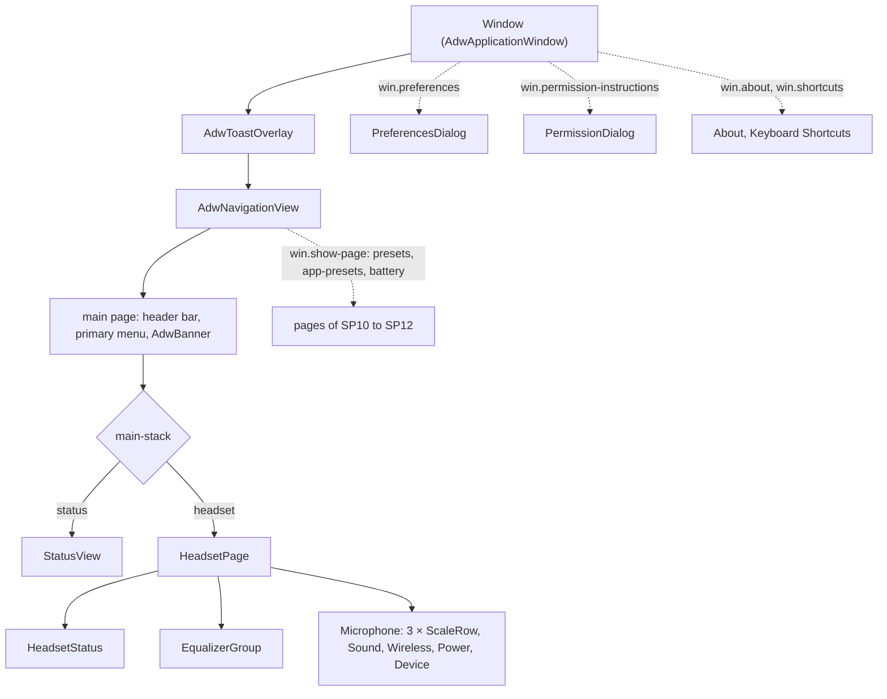
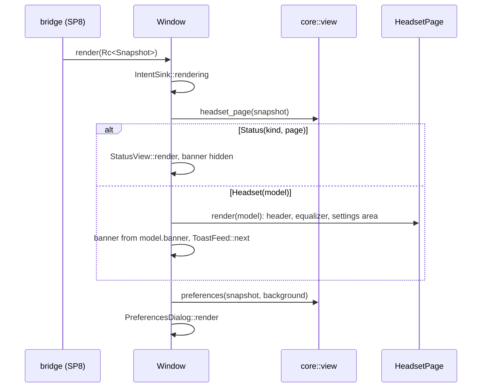
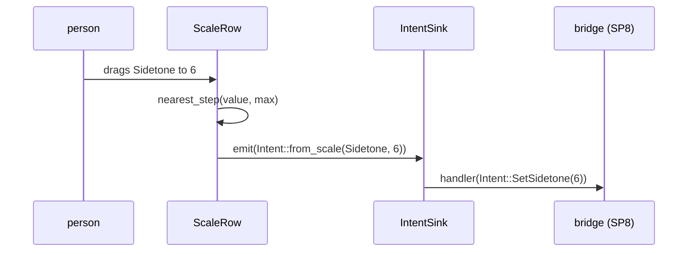

# SP9 Main Window, Headset Page and States Implementation Plan

> **For agentic workers:** REQUIRED SUB-SKILL: Use superpowers:subagent-driven-development (recommended) or superpowers:executing-plans to implement this plan task-by-task. Steps use checkbox (`- [ ]`) syntax for tracking.

**Goal:** The `crates/ui` main window: `AdwApplicationWindow` with banner, toasts and navigation, the headset page
(header, equalizer group, headset-setting groups), the status pages, the permission dialog, the preferences
dialog, the About and Keyboard Shortcuts dialogs and `text.rs`, all rendering `core::view` models and emitting
`core::intent::Intent`s, tested headless with `#[gtk::test]`.

**Architecture:** `Window::render(&Rc<Snapshot>)` calls `core::view::headset_page` and
`core::view::preferences::preferences` and hands each model to one widget (`HeadsetPage`, `StatusView`,
`PreferencesDialog`, the banner, `ToastFeed`). Widgets are Blueprint templates, one `.blp` and one `.rs` each.
User input leaves the crate through one `IntentSink` callback (`Window::on_intent`); every render runs inside
`IntentSink::rendering`, so programmatic updates never emit intents. `text::resolve` is the only place that turns a
`Text` into a string (gettext, ngettext, locale-aware numbers).

**Tech Stack:** Rust 2024 (rustc 1.98, toolbox `arctis`), gtk4-rs 0.11 (`gnome_50`), libadwaita-rs 0.9 (`v1_9`),
gettext-rs 0.7 (`gettext-system`), blueprint-compiler 0.20, `glib-build-tools` 0.22; tests run under
`weston --backend=headless`.

Spec: `docs/superpowers/specs/2026-10-11-arctis-companion-design.md` §3 (module tree, `crates/ui` row), §5 (SP9
row); ui part §1 (information architecture), §2 (headset page, banner priority, states, capabilities), §4
(preferences, Run in Background, adaptive, HIG capitalization, i18n, `Text`); quality part §1 (`crates/ui` row) and
§2 (the `ui` CI job); ADR 0013; glossary `CONTEXT.md`; SP6 plan Deviations 16, 19, 21, 26, 30, 36, 42.

---

## Conventions for every task

- Worktree: `/home/marcelo/Desenvolvimento/arctis-wt/sp9`, branch `sp9-main-window`. Never touch
  `/home/marcelo/Desenvolvimento/arctis-companion`. Stay inside `crates/ui`, the two small `crates/core` additions
  of Tasks 1–2, `Cargo.toml` (one workspace dependency), `docs/architecture/` and this plan. SP9 never opens
  `/dev/hidraw*`, never talks to PipeWire and never edits `crates/app` (SP8 wires `Window` to the bridge).
- **Run (core):** `X` means `toolbox run -c arctis bash -lc 'cd /home/marcelo/Desenvolvimento/arctis-wt/sp9 && X'`.
- **Run (ui):** `X` means

  ```bash
  toolbox run -c arctis bash -lc 'cd /home/marcelo/Desenvolvimento/arctis-wt/sp9 && export XDG_RUNTIME_DIR=$(mktemp -d) LC_ALL=C.UTF-8 && { weston --backend=headless --socket=wl-sp9 --idle-time=0 >/dev/null 2>&1 & W=$!; } && until [ -S "$XDG_RUNTIME_DIR/wl-sp9" ]; do sleep 0.1; done; GDK_BACKEND=wayland GSK_RENDERER=cairo WAYLAND_DISPLAY=wl-sp9 X; S=$?; kill $W; exit $S'
  ```

  This is what the `ui` job of `.github/workflows/ci.yml` does (its `fedora:44` container has no `LANG`, so it
  runs in the C locale too). `LC_ALL=C.UTF-8` keeps `NumberStyle::current()` on the decimal point whatever the
  host locale is, so widget tests that compare against `english()` stay deterministic. Git and `gh` run on the
  host in the worktree.
- Never run the `arctis-companion` binary (`cargo run -p arctis-app`): once SP8 wires the device thread it opens
  `/dev/hidraw*`, and with the real dongle plugged in only SP0 and SP5 may do that. Every template is loaded by
  the widget tests instead.
- No comments in any file of any language, doc comments and Blueprint included. Names and small functions carry
  the meaning. Blueprint strings shown to people are `_("…")`; widget `name:` values and icon names are not.
- Clippy policy applies to tests too: cognitive complexity 8, 40 lines per function, nesting 3, at most 4
  arguments (`self` included), no `unwrap()` (tests use `expect`), `pedantic` as errors under `-D warnings`: no
  `as` casts (use `f64::from`, `u32::try_from`, `widget_values::nearest_step`), no `==` on floats,
  `#[must_use]` on public functions that return a value. When clippy objects, extract a function or rename; never
  add an `allow` or `expect` attribute.
- HIG capitalization: header case for titles, buttons and menu items, sentence case for subtitles and
  descriptions.
- Every row whose title or subtitle comes from a model has `use-markup: false` (custom preset and app names are
  user text).
- Widget tests live in one integration binary, `crates/ui/tests/widgets/main.rs`, one module per widget. Helpers
  go into `crates/ui/tests/widgets/support.rs` in the task that first uses them, so nothing is dead. Widgets are
  found by their Blueprint `name:` through `support::named`, never through test-only accessors (the two getters
  `ScaleRow::value_text` and `HeadsetStatus::description` exist because GTK has no public getter for accessible
  properties).
- Expected strings come from the core model through `arctis_core::testkit::english::english` whenever the model
  provides them, so a test checks the rendering, not a copy of a msgid.
- Code blocks below are not rustfmt-formatted; `cargo fmt --all` reflows them and that is expected.
- Before each commit, Run (core): `cargo fmt --all && cargo clippy --workspace --all-targets -- -D warnings && cargo test -p arctis-core && cargo xtask check-rules && cargo xtask check-pure && cargo xtask check-doc-paths`,
  then Run (ui): `cargo test -p arctis-ui`.
- Commit subjects are conventional (`type(scope): summary`), short. Never write `Co-Authored-By`,
  "Generated with", or any AI or tool name in a commit message, PR title or PR body. Never use `--no-verify`.
- Push after every commit: `git push -u origin sp9-main-window` the first time, then `git push`. After a rebase
  that moved the branch, `git push --force-with-lease`.
- SP5 runs in parallel and SP8 may start while SP9 is open. Overlap is limited to `Cargo.toml` (one workspace
  dependency line), `crates/core/src/testkit/mod.rs` and `docs/architecture/README.md` (one page row and the
  `crates/ui/` entry-point cell). Before Task 1, before Task 15 and before the PR run
  `git fetch origin && git rebase origin/main`; on a conflict in those files keep both sides' lines.

## Acceptance criteria → tasks

| SP9 acceptance criterion (design §5, quality §1 `crates/ui` row) | Task |
|---|---|
| Scope: `crates/ui` window (`window.rs`, primary menu, actions, banner, toast overlay, navigation) | 15 |
| Scope: headset page (`headset_page.rs`, `headset_status.rs`, `scale_row.rs`, equalizer group) | 6, 7, 9, 10 |
| Scope: status pages (`status_pages.rs`) | 8, 15 |
| Scope: permission dialog (`permission_dialog.rs`) | 12, 15 |
| Scope: preferences dialog (`preferences_dialog.rs`, `core::view::preferences`) | 2, 13, 15 |
| Scope: toasts (write failed, Retry) | 11, 15 |
| Scope: banner | 15 |
| Scope: `text.rs` | 4 |
| `#[gtk::test]` headless: each `Phase` × `Route` renders the right page | 15 |
| banner priority | 15 |
| never-adopted HeadsetOff hides the headset groups (and the 2.4 GHz Preset row), also with adoption `Unknown` after a restart | 10, 15 |
| each control emits its `Intent` (both preset combos, Use Route Preset, Automatic App Presets, three scales, two switches, Automatic Power Off, toast Retry, Run in Background, Low Battery Warning, navigation rows' targets) | 6, 9, 10, 11, 13, 15 |
| rendering never emits an `Intent` | 5, 6, 9, 10, 13, 15 |
| model → row values ("Not applied", value texts, capability-driven rows) | 6, 7, 9, 10 |
| ui §2 states: Settling, Probing, Syncing insensitive until observed; HeadsetOff and Rebinding stay sensitive; Bluetooth only keeps Battery History and hides the 2.4 GHz Preset row | 10 |
| accessibility walk: names, value texts, descriptions | 6, 7, 16 |
| pt_BR number rendering ("+2,0 dB", "73 %") | 4 |
| 360 px wide with no horizontal scroll | 16 |
| primary menu: Preferences, Keyboard Shortcuts, About | 14, 15 |
| `docs/architecture/ui.md` (sub-project rule, design §5) | 17 |

## File structure

```
Cargo.toml                                     workspace dependency gettext-rs
crates/core/src/testkit/mod.rs                 pub mod snapshots
crates/core/src/testkit/snapshots.rs           snapshot(), with(), nova_5(), values(), percent(), id()
crates/core/src/view/mod.rs                    pub mod preferences
crates/core/src/view/preferences.rs            Background, PreferencesModel, preferences, LOW_BATTERY_MIN/MAX
crates/core/tests/view/support.rs              re-exports the testkit fixtures
crates/core/tests/view/preferences.rs          preferences model table
crates/core/tests/view/main.rs                 mod preferences
crates/ui/Cargo.toml                           gettext-rs; dev: arctis-core with testkit
crates/ui/build.rs                             data/ as a resource source dir
crates/ui/resources/resources.gresource.xml    every .ui plus metainfo.xml
crates/ui/resources/window.blp                 toast overlay, navigation, main page, banner, stack, primary menu
crates/ui/resources/headset_page.blp           AdwPreferencesPage with every group
crates/ui/resources/headset_status.blp         header: icons, battery, route, connection subtitle
crates/ui/resources/equalizer_group.blp        preset combos, Now Playing, switch, navigation rows
crates/ui/resources/scale_row.blp              AdwPreferencesRow + GtkScale
crates/ui/resources/status_pages.blp           AdwStatusPage + pill button
crates/ui/resources/permission_dialog.blp      udev rule, reload command, copy buttons
crates/ui/resources/preferences_dialog.blp     Run in Background, Low Battery Warning, GNOME Shell Integration
crates/ui/resources/shortcuts_dialog.blp       AdwShortcutsDialog
crates/ui/src/lib.rs                           modules and re-exports
crates/ui/src/text.rs                          NumberStyle, Resolver, resolve, optional
crates/ui/src/intents.rs                       IntentSink
crates/ui/src/widget_values.rs                 nearest_step, index, position, show_choices, show_label
crates/ui/src/scale_row.rs                     ScaleRow
crates/ui/src/headset_status.rs                HeadsetStatus
crates/ui/src/status_pages.rs                  StatusView
crates/ui/src/equalizer_group.rs               EqualizerGroup
crates/ui/src/headset_groups.rs                show_scale, show_switch, show_choice, show_device, DeviceRows
crates/ui/src/headset_page.rs                  HeadsetPage
crates/ui/src/toasts.rs                        ToastFeed
crates/ui/src/permission_dialog.rs             PermissionDialog, UDEV_RULE, RELOAD_COMMAND
crates/ui/src/preferences_dialog.rs            PreferencesDialog, SHELL_EXTENSIONS_URI
crates/ui/src/app_dialogs.rs                   about_dialog, shortcuts_dialog
crates/ui/src/window.rs                        Window
crates/ui/tests/window.rs                      deleted (moved into the widgets binary)
crates/ui/tests/widgets/                       main.rs support.rs text.rs widget_values.rs intents.rs scale_row.rs
                                               headset_status.rs status_pages.rs equalizer_group.rs headset_page.rs
                                               toasts.rs permission_dialog.rs preferences_dialog.rs app_dialogs.rs
                                               window.rs accessibility.rs layout.rs
docs/architecture/ui.md                        diagrams + code paths and symbols
docs/architecture/README.md                    one new row, crates/ui entry points
```

Dependency direction inside `crates/ui`: `text` → `intents`, `widget_values` → `scale_row`, `headset_status`,
`status_pages`, `equalizer_group`, `toasts`, `permission_dialog`, `preferences_dialog`, `app_dialogs` →
`headset_rows` → `headset_page` → `window`.

## Deviations

Decisions taken where the spec is silent or ambiguous; each is the simplest option consistent with it.

| # | Decision | Why |
|---|---|---|
| 1 | Extra files beyond the module tree: `intents.rs`, `widget_values.rs`, `equalizer_group.rs` (+ `.blp`), `headset_rows.rs`, `toasts.rs`, `app_dialogs.rs`, `shortcuts_dialog.blp`; in core `view/preferences.rs` and `testkit/snapshots.rs` | one responsibility per file, every file well under 400 lines; the spec's tree lists the floor |
| 2 | Intents leave the crate through `Window::on_intent(impl Fn(Intent))`, backed by a cloneable `IntentSink`; no GObject signal, no channel | ui §1 forbids channels in `crates/ui`; a Rust callback needs no boxed `GType` for `Intent`. SP8's bridge passes a closure that feeds `Companion` |
| 3 | Every render runs inside `IntentSink::rendering`, which drops emissions; a re-entrant handler is safe because the handler is cloned out of its `RefCell` before the call | setting a combo, switch or scale from a model fires the same notify signals as a user change |
| 4 | `Window::render(&Rc<Snapshot>)` takes the published snapshot (SP6 Deviation 4) and computes the page models itself; it keeps the latest snapshot for the preferences dialog and for SP10–SP12 pages | one entry point for SP8's `WindowPort`; models stay derived from one snapshot |
| 5 | The single banner sits in the main navigation page's `AdwToolbarView`, below its header bar; the `AdwToastOverlay` wraps the whole `AdwNavigationView` | with an `AdwNavigationView`, each page owns its header bar; a banner above the header bar is not a libadwaita pattern. Still one banner, chosen by `core::view::headset_page::banner` |
| 6 | The Power group stays visible on the headset page because it holds the Battery History row; its Automatic Power Off row hides with the other headset settings (never adopted, Bluetooth only) | ui §1 keeps Battery History reachable in Bluetooth-only mode; the headset-setting rows are what ui §2 hides |
| 7 | "Untested model" is a warning row (`dialog-warning-symbolic` prefix) in the Device group, shown only for `Support::Untested` | `DeviceModel` carries it as its own `Text`; joining it to the model name would concatenate msgids |
| 8 | Navigation rows (Presets, App Presets, Battery History) activate `win.show-page` with the tags `presets`, `app-presets`, `battery`; the action pushes the page only if the navigation view has one with that tag. SP10–SP12 add those pages to `window.blp` | SP9 must not build those pages, and the rows must exist now (ui §2) |
| 9 | Preferences model `core::view::preferences::preferences(&Snapshot, Background)` with `Background::{Off, On, Denied}` supplied by SP8 through `Window::set_background`; `LOW_BATTERY_MIN` 5 and `LOW_BATTERY_MAX` 50 live there | Run in Background is not in `Snapshot` (SP6 Deviation 19); ui §4 gives the 5..50 range and the denial hint |
| 10 | `SHELL_EXTENSIONS_URI` is `https://extensions.gnome.org/` until SP14 publishes the extension and knows its page | the extension has no extensions.gnome.org id yet |
| 11 | Permission dialog: step 1 "Save this rule as /etc/udev/rules.d/70-arctis-companion.rules" with the rule text (`include_str!` of `data/udev/70-arctis-companion.rules`) and a copy button; step 2 "Then reload the rules and reconnect the dongle" with `sudo udevadm control --reload-rules && sudo udevadm trigger` and a copy button. Strings live in the Blueprint | ui §1 "udev rule + command, copy buttons"; the rule file stays the single source (it is already tested by `crates/core/tests/udev_rule.rs`) |
| 12 | Number formatting: `NumberStyle` picks a decimal comma when the language of `glib::language_names_with_category("LC_NUMERIC")` is in a fixed list (`pt`, `de`, `fr`, `es`, …), else a point. Percent is `"{n} %"` in every locale, Hertz and counts have no grouping, times use `glib::DateTime::format("%x %R")` | `crates/ui` may not use `unsafe` (`localeconv`) and may depend only on core, gtk4, libadwaita and gettext-rs; GLib has no number formatter. The pt_BR test needs "+2,0 dB" and "73 %" |
| 13 | gettext-rs 0.7 with `gettext-system`. `setlocale`, `bindtextdomain` and `textdomain` are called by the binary at startup (SP8/SP14); until then every msgid resolves to its English text | `crates/ui` has no `main`; tests run untranslated |
| 14 | Keyboard Shortcuts is a window action `win.shortcuts` (Ctrl+?) presenting an `AdwShortcutsDialog` built from `shortcuts_dialog.ui` (Preferences Ctrl+comma, Keyboard Shortcuts Ctrl+?, Close Window Ctrl+W); the window binds Ctrl+comma to `win.preferences` and Ctrl+W to `window.close`. No Quit item | ui §1 primary menu; `app.quit` and its accelerator belong to SP8's application |
| 15 | About uses `adw::AboutDialog::from_appdata` over `data/io.github.marcelogm.ArctisCompanion.metainfo.xml`, bundled into the ui gresource as `metainfo.xml` by `crates/ui/build.rs` | the metainfo stays the single source of name, developer, version, license and links |
| 16 | Accessibility walk rule: every widget that is focusable, can take focus, is shown (visible and child-visible up the tree) and has an interactive role (Button, ToggleButton, Switch, Slider, ComboBox, SpinButton, CheckBox, Link) has the `Label` property or a `LabelledBy` relation; the inner toggle of a `GtkMenuButton` counts as named when the menu button has a `Label`. Icon-only buttons get an explicit accessible label. Every shown `GtkScale` has `ValueText`; `HeadsetStatus` has one `Description` for the whole header | GTK 4.22 exposes in safe Rust only `gtk::test_accessible_has_property`/`has_relation` (values are checked through `gtk::ffi::gtk_test_accessible_check_property` in `tests/widgets/support.rs`); a spike showed libadwaita rows and labelled buttons carry `LabelledBy`, the menu button's inner toggle carries nothing, and the header's text parts are labels a screen reader already reads |
| 17 | "360 px with no horizontal scroll" is checked as: the window content's, the status view's and both dialogs' minimum widths are at most 360, and every shown `GtkScrolledWindow` has `hscrollbar-policy` Never, with the richest English snapshot | pt_BR catalogs come with SP14; minimum width is what decides horizontal scrolling |
| 18 | Snapshot fixtures move from `crates/core/tests/view/support.rs` into `arctis_core::testkit::snapshots`, which that file re-exports; `crates/ui` dev-depends on `arctis-core` with `testkit` | one set of fixtures for core view tests and widget tests |
| 19 | The failure toast is de-duplicated by `ToastFeed` on `WriteFailure.serial` (SP6 Deviation 21) and only offered while its setting is still in `not_applied`; its button label is the msgid "Retry" | the snapshot repeats the last failure on every publish, and a window built later must not show a failure already resolved |
| 20 | Quiet and loud end icons (`microphone-sensitivity-low-symbolic`, `microphone-sensitivity-high-symbolic`) only on the microphone Volume row; marks are drawn below the scale with their labels | ui §2 lists end icons only for that row |
| 21 | Known gap carried from SP6 Deviation 36: after a restart with the headset off the page shows banner 2 until the session publishes `Identity`; SP9 renders whatever the model says | rendering cannot invent adoption |
| 22 | The existing `crates/ui/tests/window.rs` moves into the `widgets` binary as `widgets/window.rs` | one GTK initialisation, one test binary |
| 23 | The preferences dialog sets `search-enabled: false` | one page with three rows needs no search, and the search toggle is a libadwaita internal the accessibility walk would otherwise have to special-case |
| 24 | The dialog actions are tested through their dialogs (Tasks 12–14), the primary menu's action names and the banner's action name; presenting a dialog on an unmapped test window is not | presenting needs a mapped toplevel; the actions are one-line `present` calls |
| 25 | No smoke run of the `arctis-companion` binary in SP9 | after a rebase onto a `main` that carries SP8 the binary opens `/dev/hidraw*`, which only SP0 and SP5 may do with the real dongle plugged in; the widget tests already load every template |
| 26 | Widget tests run with `LC_ALL=C.UTF-8` locally; the pt_BR rendering is checked through `NumberStyle::for_locale`, never through the process locale | `NumberStyle::current()` reads the environment, so a decimal-comma host would otherwise change what `resolve` returns next to `english()` |
| 27 | Capability-driven rows are checked with a hand-built `Capabilities::new(&[…])` model: every model in `Model::SUPPORTED` has `ALL_SETTINGS` today | ADR 0013 needs a test that a missing capability hides its row and an emptied group |
| 28 | `support::collect` also walks `adw::Dialog::child`, and `support::shown` treats a `gtk::Window` or `adw::Dialog` as shown whatever its own visibility | dialog content is not in the widget tree until presented, and the test windows are never mapped |
| 29 | Executed with small clippy-driven rewrites of plan code (`Resolver` helpers take `self`, `WidgetExt::get_visible` instead of closures, `WidgetExt::activate_action` disambiguated, `owned` returns a tuple, `AccessibleRole::Checkbox`); no behaviour change | pedantic clippy policy |
| 30 | `cargo llvm-cov` was not run: `llvm-tools-preview` is not installed in the toolbox; the core additions are two small fully tested modules | no sudo-free way to add it here |
| 31 | Review fixes applied: single-pass placeholder filling in `text.rs` (argument values are never re-expanded), `show_if` and `show_combo_row` in `widget_values.rs`, `headset_groups.rs` renamed `headset_rows.rs` without `DeviceRows`, one match in `render_area`, `ScaleRow::render` takes the previous model first, `shortcuts_builder` shared with the test, the banner action set from `PERMISSION_ACTION`, `connect_intent` renamed `on_intent`, `ToastFeed::next` renamed `toast_for_new_failure`, the spin range set in `constructed`, the test-only accessibility mirrors removed, tautological tests removed | all review findings were verified as real |
| 32 | `shortcuts_dialog()` now panics with an explicit message when the resource lacks its dialog, instead of returning an empty one | a drifted resource id must fail loudly; the test builds the same lookup |

---

### Task 1: Shared snapshot fixtures in the core testkit

**Files:**
- Create: `crates/core/src/testkit/snapshots.rs`
- Modify: `crates/core/src/testkit/mod.rs`
- Modify: `crates/core/tests/view/support.rs`

- [ ] **Step 1: Point the view tests at the testkit fixtures**

Replace `crates/core/tests/view/support.rs` with:

```rust
use arctis_core::companion::app_settings::AppRules;
use arctis_core::eq::library;
use arctis_core::eq::preset::Preset;
use arctis_core::eq::{Gain, Hertz};

pub use arctis_core::testkit::snapshots::{id, nova_5, percent, snapshot, values, with};

pub fn gain(half_db: i8) -> Gain {
    Gain::from_half_db(half_db).expect("gain in the envelope")
}

pub fn hertz(hz: u16) -> Hertz {
    Hertz::new(hz).expect("frequency in the envelope")
}

pub fn custom(name: &str) -> Preset {
    Preset::custom(
        id(&name.to_lowercase()),
        name.to_owned(),
        library::flat().curve().clone(),
    )
}

pub fn rules(entries: &[(&str, &str)]) -> AppRules {
    entries
        .iter()
        .map(|(app, preset)| ((*app).to_owned(), id(preset)))
        .collect()
}

pub fn assert_close(actual: f64, expected: f64, tolerance: f64) {
    assert!(
        (actual - expected).abs() <= tolerance,
        "got {actual}, expected {expected} ± {tolerance}"
    );
}
```

- [ ] **Step 2: Run the view tests to see them fail**

Run (core): `cargo test -p arctis-core --test view`
Expected: FAIL to compile with "could not find `snapshots` in `testkit`".

- [ ] **Step 3: Move the fixtures into the testkit**

Create `crates/core/src/testkit/snapshots.rs`:

```rust
use crate::battery::sample::Reading;
use crate::companion::Snapshot;
use crate::companion::adoption::AdoptionStatus;
use crate::companion::alerts::BatteryWarning;
use crate::companion::app_settings::{AppRules, HeadsetValues, RoutePresets};
use crate::companion::per_path::PerPath;
use crate::companion::routing::{AudioService, Route};
use crate::companion::selection::ActivePreset;
use crate::companion::snapshot::{AudioSnapshot, BatterySnapshot, DongleSnapshot, PresetsSnapshot};
use crate::eq::library;
use crate::eq::preset::PresetId;
use crate::messages::audio::{DefaultSink, SinkKind};
use crate::messages::device::Phase;
use crate::protocol::firmware::{Firmware, Version};
use crate::protocol::model::{Model, ModelLookup};
use crate::protocol::status::{Charging, Link};
use crate::settings::values::{AutoPowerOff, MicVolume, MuteLight, Percent, Sidetone, WirelessMode};

#[must_use]
pub fn percent(value: u8) -> Percent {
    Percent::try_from(value).expect("percent")
}

#[must_use]
pub fn id(text: &str) -> PresetId {
    PresetId::new(text)
}

#[must_use]
pub fn nova_5() -> Model {
    let ModelLookup::Supported(model) = Model::lookup(0x2232) else {
        panic!("the Nova 5 is supported");
    };
    model
}

#[must_use]
pub fn values() -> HeadsetValues {
    HeadsetValues {
        mic_volume: MicVolume::try_from(7).expect("mic volume"),
        sidetone: Sidetone::try_from(3).expect("sidetone"),
        mute_light: MuteLight::Low,
        volume_limiter: false,
        wireless_mode: WirelessMode::ExtendedRange,
        auto_power_off: AutoPowerOff::try_from(15).expect("auto power off"),
    }
}

#[must_use]
pub fn snapshot() -> Snapshot {
    Snapshot {
        dongle: dongle(),
        audio: audio(),
        presets: presets(),
        battery: battery(),
    }
}

#[must_use]
pub fn with(phase: Phase, route: Route) -> Snapshot {
    let mut s = snapshot();
    s.dongle.phase = phase;
    s.audio.route = route;
    s
}

const fn version(major: u8, minor: u8) -> Version {
    Version {
        major,
        minor,
        patch: 0,
    }
}

fn dongle() -> DongleSnapshot {
    DongleSnapshot {
        phase: Phase::Ready,
        adoption: AdoptionStatus::Adopted,
        model: Some(nova_5()),
        firmware: Some(Firmware {
            receiver: Some(version(1, 16)),
            headset: Some(version(0, 9)),
        }),
        desired: values(),
        observed: Some(values().with_curve(library::flat().curve().clone())),
        not_applied: Vec::new(),
        last_failure: None,
    }
}

fn audio() -> AudioSnapshot {
    AudioSnapshot {
        route: Route::Dongle,
        service: AudioService::Available,
        default_sink: Some(DefaultSink {
            terminal: SinkKind::NovaDongle,
            via_equalizer: false,
            via_easy_effects: false,
        }),
        manager_denied: false,
        bluetooth_sink_seen: false,
    }
}

fn presets() -> PresetsSnapshot {
    PresetsSnapshot {
        all: library::library(),
        route_presets: RoutePresets {
            dongle: id("flat"),
            bluetooth: id("flat"),
        },
        active: PerPath {
            dongle: ActivePreset::route(id("flat")),
            bluetooth: ActivePreset::route(id("flat")),
        },
        rules: AppRules::default(),
        automatic: true,
        seen_apps: Vec::new(),
    }
}

fn battery() -> BatterySnapshot {
    BatterySnapshot {
        reading: Some(Reading {
            percent: percent(73),
            charging: Charging::Discharging,
            link: Link::Connected,
        }),
        warning: BatteryWarning::None,
        history: Vec::new(),
        low_threshold: percent(15),
    }
}
```

Add `pub mod snapshots;` to `crates/core/src/testkit/mod.rs` (keep the list sorted:
`english`, `memory_repositories`, `repository_contracts`, `snapshots`).

- [ ] **Step 4: Run the view tests to see them pass**

Run (core): `cargo test -p arctis-core --test view && cargo clippy -p arctis-core --all-targets --features testkit -- -D warnings`
Expected: every view test passes, clippy clean. If clippy reports an unused re-export in `support.rs`, drop that
name from the `pub use` line.

- [ ] **Step 5: Commit**

```bash
git add crates/core/src/testkit crates/core/tests/view/support.rs
git commit -m "test(core): share snapshot fixtures through the testkit"
git push -u origin sp9-main-window
```

### Task 2: The preferences page model

**Files:**
- Create: `crates/core/src/view/preferences.rs`
- Modify: `crates/core/src/view/mod.rs`
- Create: `crates/core/tests/view/preferences.rs`
- Modify: `crates/core/tests/view/main.rs`

- [ ] **Step 1: Write the failing tests**

Create `crates/core/tests/view/preferences.rs`:

```rust
use arctis_core::testkit::english::english;
use arctis_core::view::preferences::{
    Background, LOW_BATTERY_MAX, LOW_BATTERY_MIN, PreferencesModel, preferences,
};

use crate::support::{percent, snapshot};

fn with_threshold(value: u8) -> PreferencesModel {
    let mut s = snapshot();
    s.battery.low_threshold = percent(value);
    preferences(&s, Background::On)
}

#[test]
fn run_in_background_follows_the_background_state() {
    let cases = [
        (Background::Off, false, None),
        (Background::On, true, None),
        (
            Background::Denied,
            false,
            Some("Allow it in Settings → Apps → Arctis Companion"),
        ),
    ];
    for (background, active, hint) in cases {
        let model = preferences(&snapshot(), background);
        assert_eq!(model.run_in_background, active, "{background:?}");
        assert_eq!(
            model.background_subtitle.as_ref().map(english).as_deref(),
            hint,
            "{background:?}"
        );
    }
}

#[test]
fn the_low_battery_warning_shows_the_threshold() {
    assert_eq!(with_threshold(15).low_battery, 15);
}

#[test]
fn the_low_battery_warning_stays_inside_its_range() {
    assert_eq!(with_threshold(2).low_battery, LOW_BATTERY_MIN);
    assert_eq!(with_threshold(80).low_battery, LOW_BATTERY_MAX);
}

#[test]
fn the_range_is_five_to_fifty_percent() {
    assert_eq!((LOW_BATTERY_MIN, LOW_BATTERY_MAX), (5, 50));
}

#[test]
fn the_background_starts_off() {
    assert_eq!(Background::default(), Background::Off);
}
```

Add `mod preferences;` to `crates/core/tests/view/main.rs`, between `mod headset_rows;` and `mod presets;`.

- [ ] **Step 2: Run the tests to see them fail**

Run (core): `cargo test -p arctis-core --test view preferences`
Expected: FAIL to compile with "could not find `preferences` in `view`".

- [ ] **Step 3: Write the model**

Create `crates/core/src/view/preferences.rs`:

```rust
use super::text::Text;
use crate::companion::snapshot::Snapshot;

pub const LOW_BATTERY_MIN: u8 = 5;
pub const LOW_BATTERY_MAX: u8 = 50;

#[derive(Clone, Copy, Debug, Default, PartialEq, Eq, Hash)]
pub enum Background {
    #[default]
    Off,
    On,
    Denied,
}

#[derive(Clone, Debug, PartialEq, Eq)]
pub struct PreferencesModel {
    pub run_in_background: bool,
    pub background_subtitle: Option<Text>,
    pub low_battery: u8,
}

#[must_use]
pub fn preferences(snapshot: &Snapshot, background: Background) -> PreferencesModel {
    PreferencesModel {
        run_in_background: background == Background::On,
        background_subtitle: (background == Background::Denied)
            .then(|| Text::plain("Allow it in Settings → Apps → Arctis Companion")),
        low_battery: snapshot
            .battery
            .low_threshold
            .get()
            .clamp(LOW_BATTERY_MIN, LOW_BATTERY_MAX),
    }
}
```

Add `pub mod preferences;` to `crates/core/src/view/mod.rs` (alphabetical, before `pub mod presets;`).

- [ ] **Step 4: Run the tests to see them pass**

Run (core): `cargo test -p arctis-core --test view && cargo xtask check-pure`
Expected: PASS.

- [ ] **Step 5: Commit**

```bash
git add crates/core/src/view crates/core/tests/view
git commit -m "feat(core): add the preferences page model"
git push
```

### Task 3: gettext, test fixtures and one widget test binary

**Files:**
- Modify: `Cargo.toml`
- Modify: `crates/ui/Cargo.toml`
- Delete: `crates/ui/tests/window.rs`
- Create: `crates/ui/tests/widgets/main.rs`, `crates/ui/tests/widgets/support.rs`, `crates/ui/tests/widgets/window.rs`

- [ ] **Step 1: Move the existing window tests into the new binary**

Create `crates/ui/tests/widgets/support.rs`:

```rust
use std::sync::Once;

static RESOURCES: Once = Once::new();

pub fn init() {
    adw::init().expect("libadwaita initialises");
    RESOURCES.call_once(|| arctis_ui::register_resources().expect("bundled resources register"));
}
```

Create `crates/ui/tests/widgets/window.rs`:

```rust
use gtk::prelude::{GtkWindowExt, WidgetExt};

use crate::support::init;

fn new_window() -> arctis_ui::Window {
    init();
    gtk::glib::Object::new()
}

#[gtk::test]
fn window_is_titled_arctis_companion() {
    assert_eq!(new_window().title().as_deref(), Some("Arctis Companion"));
}

#[gtk::test]
fn window_keeps_the_minimum_size_of_the_design() {
    let window = new_window();
    assert_eq!(
        (window.width_request(), window.height_request()),
        (360, 294)
    );
}
```

Create `crates/ui/tests/widgets/main.rs`:

```rust
mod support;

mod window;
```

Delete `crates/ui/tests/window.rs`.

- [ ] **Step 2: Add the dependencies**

In the root `Cargo.toml`, `[workspace.dependencies]`, add (alphabetical, after `arctis-ui`):

```toml
gettext-rs = { version = "0.7.7", features = ["gettext-system"] }
```

Replace `crates/ui/Cargo.toml` with:

```toml
[package]
name = "arctis-ui"
version.workspace = true
edition.workspace = true
license.workspace = true
publish.workspace = true

[dependencies]
arctis-core.workspace = true
gtk.workspace = true
adw.workspace = true
gettext-rs.workspace = true

[dev-dependencies]
arctis-core = { workspace = true, features = ["testkit"] }

[build-dependencies]
glib-build-tools.workspace = true

[lints]
workspace = true
```

`gettext-rs` stays unused until Task 4; `cargo` does not warn about unused dependencies.

- [ ] **Step 3: Run the widget tests**

Run (ui): `cargo test -p arctis-ui`
Expected: `tests/widgets/main.rs`: 2 passed.

- [ ] **Step 4: Commit**

```bash
git add Cargo.toml Cargo.lock crates/ui/Cargo.toml crates/ui/tests
git commit -m "build(ui): add gettext and a single widget test binary"
git push
```

### Task 4: `text.rs`, the only `Text` resolver

**Files:**
- Create: `crates/ui/src/text.rs`
- Modify: `crates/ui/src/lib.rs`
- Create: `crates/ui/tests/widgets/text.rs`
- Modify: `crates/ui/tests/widgets/main.rs`

- [ ] **Step 1: Write the failing tests**

Create `crates/ui/tests/widgets/text.rs`:

```rust
use arctis_core::battery::sample::UnixSeconds;
use arctis_core::eq::{Gain, Hertz};
use arctis_core::testkit::snapshots::percent;
use arctis_core::view::text::{Arg, Text};
use arctis_ui::text::{NumberStyle, Resolver, optional};

fn brazilian() -> Resolver {
    Resolver::new(NumberStyle::for_locale("pt_BR.UTF-8"))
}

fn american() -> Resolver {
    Resolver::new(NumberStyle::for_locale("en_US.UTF-8"))
}

fn decibels(half_db: i8) -> Text {
    let gain = Gain::from_half_db(half_db).expect("gain in the envelope");
    Text::format("{gain}", vec![("gain", Arg::Decibels(gain))])
}

#[test]
fn pt_br_renders_decibels_with_a_decimal_comma() {
    assert_eq!(brazilian().resolve(&decibels(4)), "+2,0 dB");
}

#[test]
fn pt_br_renders_a_percent_with_a_space() {
    let text = Text::format("{level}", vec![("level", Arg::Percent(percent(73)))]);
    assert_eq!(brazilian().resolve(&text), "73 %");
}

#[test]
fn english_renders_decibels_with_a_decimal_point() {
    assert_eq!(american().resolve(&decibels(-3)), "-1.5 dB");
}

#[test]
fn the_c_locale_and_unknown_languages_use_a_point() {
    assert_eq!(NumberStyle::for_locale("C"), NumberStyle::POINT);
    assert_eq!(NumberStyle::for_locale("ja_JP.UTF-8"), NumberStyle::POINT);
}

#[test]
fn languages_with_a_decimal_comma_are_recognised_by_their_code() {
    assert_eq!(
        NumberStyle::for_locale("de_DE@euro"),
        NumberStyle::for_locale("pt_BR")
    );
    assert_ne!(NumberStyle::for_locale("pt"), NumberStyle::POINT);
}

#[test]
fn plurals_substitute_n() {
    let minutes = |n| Text::plural(["{n} minute", "{n} minutes"], n, Vec::new());
    assert_eq!(american().resolve(&minutes(1)), "1 minute");
    assert_eq!(american().resolve(&minutes(5)), "5 minutes");
}

#[test]
fn formats_fill_named_arguments() {
    let text = Text::format(
        "{preset}, chosen for {app}",
        vec![
            ("preset", Arg::Msgid("Flat".to_owned())),
            ("app", Arg::Str("Firefox".to_owned())),
        ],
    );
    assert_eq!(american().resolve(&text), "Flat, chosen for Firefox");
}

#[test]
fn verbatim_text_is_never_translated_or_filled() {
    assert_eq!(american().resolve(&Text::verbatim("{x} & y")), "{x} & y");
}

#[test]
fn numbers_and_frequencies_have_no_grouping() {
    let text = Text::format(
        "{count} at {frequency}",
        vec![
            ("count", Arg::Number(1000)),
            ("frequency", Arg::Hertz(Hertz::new(1000).expect("frequency"))),
        ],
    );
    assert_eq!(brazilian().resolve(&text), "1000 at 1000 Hz");
}

#[test]
fn times_render_as_a_local_date() {
    let text = Text::format("{at}", vec![("at", Arg::Time(UnixSeconds(86_400)))]);
    assert!(!american().resolve(&text).is_empty());
}

#[test]
fn a_missing_optional_text_is_empty() {
    assert_eq!(optional(None), "");
    assert_eq!(optional(Some(&Text::plain("Not applied"))), "Not applied");
}
```

Add `mod text;` to `crates/ui/tests/widgets/main.rs`.

- [ ] **Step 2: Run the tests to see them fail**

Run (ui): `cargo test -p arctis-ui text`
Expected: FAIL to compile with "could not find `text` in `arctis_ui`".

- [ ] **Step 3: Write the resolver**

Create `crates/ui/src/text.rs`:

```rust
use arctis_core::battery::sample::UnixSeconds;
use arctis_core::view::text::{Arg, Text};
use gettextrs::{gettext, ngettext};
use gtk::glib;

const DECIMAL_COMMA_LANGUAGES: [&str; 31] = [
    "bg", "ca", "cs", "da", "de", "el", "es", "et", "fi", "fr", "gl", "hr", "hu", "id", "it", "lt",
    "lv", "nb", "nl", "nn", "pl", "pt", "ro", "ru", "sk", "sl", "sr", "sv", "tr", "uk", "vi",
];

#[derive(Clone, Copy, Debug, PartialEq, Eq)]
pub struct NumberStyle {
    decimal: char,
}

impl NumberStyle {
    pub const POINT: Self = Self { decimal: '.' };
    const COMMA: Self = Self { decimal: ',' };

    #[must_use]
    pub fn for_locale(locale: &str) -> Self {
        let language = locale.split(['_', '.', '@']).next().unwrap_or_default();
        if DECIMAL_COMMA_LANGUAGES.contains(&language) {
            Self::COMMA
        } else {
            Self::POINT
        }
    }

    #[must_use]
    pub fn current() -> Self {
        glib::language_names_with_category("LC_NUMERIC")
            .first()
            .map_or(Self::POINT, |name| Self::for_locale(name))
    }

    fn signed_tenths(self, value: f64) -> String {
        format!("{value:+.1}").replace('.', &self.decimal.to_string())
    }
}

#[derive(Clone, Copy, Debug, PartialEq, Eq)]
pub struct Resolver {
    numbers: NumberStyle,
}

impl Resolver {
    #[must_use]
    pub const fn new(numbers: NumberStyle) -> Self {
        Self { numbers }
    }

    #[must_use]
    pub fn current() -> Self {
        Self::new(NumberStyle::current())
    }

    #[must_use]
    pub fn resolve(&self, text: &Text) -> String {
        match text {
            Text::Verbatim(text) => text.clone(),
            Text::Plain(msgid) => gettext(msgid.as_str()),
            Text::Format { msgid, args } => self.fill(&gettext(msgid.as_str()), args),
            Text::Plural {
                singular,
                plural,
                n,
                args,
            } => {
                let form = ngettext(singular.as_str(), plural.as_str(), *n);
                self.fill(&form.replace("{n}", &n.to_string()), args)
            }
        }
    }

    fn fill(&self, template: &str, args: &[(&str, Arg)]) -> String {
        args.iter().fold(template.to_owned(), |text, (name, arg)| {
            text.replace(&format!("{{{name}}}"), &self.argument(arg))
        })
    }

    fn argument(&self, arg: &Arg) -> String {
        match arg {
            Arg::Percent(percent) => format!("{} %", percent.get()),
            Arg::Decibels(gain) => format!("{} dB", self.numbers.signed_tenths(gain.db())),
            Arg::Hertz(hertz) => format!("{} Hz", hertz.get()),
            Arg::Number(number) => number.to_string(),
            Arg::Time(at) => local_time(*at),
            Arg::Msgid(msgid) => gettext(msgid.as_str()),
            Arg::Str(text) => text.clone(),
        }
    }
}

#[must_use]
pub fn resolve(text: &Text) -> String {
    Resolver::current().resolve(text)
}

#[must_use]
pub fn optional(text: Option<&Text>) -> String {
    text.map(resolve).unwrap_or_default()
}

fn local_time(at: UnixSeconds) -> String {
    i64::try_from(at.0)
        .ok()
        .and_then(|seconds| glib::DateTime::from_unix_local(seconds).ok())
        .and_then(|time| time.format("%x %R").ok())
        .map(String::from)
        .unwrap_or_default()
}
```

Replace `crates/ui/src/lib.rs` with:

```rust
#![forbid(unsafe_code)]

pub mod text;
mod window;

pub use window::Window;

pub fn register_resources() -> Result<(), gtk::glib::Error> {
    gtk::gio::resources_register_include!("arctis-ui.gresource")
}
```

- [ ] **Step 4: Run the tests to see them pass**

Run (ui): `cargo test -p arctis-ui text`
Expected: PASS (11 tests). Then Run (core): `cargo clippy -p arctis-ui --all-targets -- -D warnings`.

- [ ] **Step 5: Commit**

```bash
git add crates/ui/src crates/ui/tests
git commit -m "feat(ui): resolve texts with gettext and locale-aware numbers"
git push
```

### Task 5: `IntentSink` and widget value helpers

**Files:**
- Create: `crates/ui/src/intents.rs`, `crates/ui/src/widget_values.rs`
- Modify: `crates/ui/src/lib.rs`
- Create: `crates/ui/tests/widgets/intents.rs`, `crates/ui/tests/widgets/widget_values.rs`
- Modify: `crates/ui/tests/widgets/main.rs`, `crates/ui/tests/widgets/support.rs`

- [ ] **Step 1: Write the failing tests**

Append to `crates/ui/tests/widgets/support.rs` (and add `use std::cell::RefCell; use std::rc::Rc;`,
`use arctis_core::intent::Intent; use arctis_ui::intents::IntentSink;` at the top):

```rust
pub type Log = Rc<RefCell<Vec<Intent>>>;

pub fn recording_sink() -> (IntentSink, Log) {
    let sink = IntentSink::default();
    let log = Log::default();
    let writer = Rc::clone(&log);
    sink.connect(move |intent| writer.borrow_mut().push(intent));
    (sink, log)
}
```

Create `crates/ui/tests/widgets/intents.rs`:

```rust
use arctis_core::intent::Intent;
use arctis_ui::intents::IntentSink;

use crate::support::recording_sink;

#[test]
fn an_emitted_intent_reaches_the_handler() {
    let (sink, log) = recording_sink();
    sink.emit(Intent::RetryWrite);
    assert_eq!(*log.borrow(), vec![Intent::RetryWrite]);
}

#[test]
fn intents_emitted_while_rendering_are_dropped() {
    let (sink, log) = recording_sink();
    sink.rendering(|| sink.emit(Intent::RetryWrite));
    assert!(log.borrow().is_empty());
}

#[test]
fn nested_renders_restore_the_outer_state() {
    let (sink, log) = recording_sink();
    sink.rendering(|| sink.rendering(|| ()));
    sink.emit(Intent::RetryWrite);
    assert_eq!(log.borrow().len(), 1);
}

#[test]
fn a_sink_without_a_handler_drops_intents() {
    IntentSink::default().emit(Intent::RetryWrite);
}

#[test]
fn emit_some_skips_none() {
    let (sink, log) = recording_sink();
    sink.emit_some(None);
    sink.emit_some(Some(Intent::EndPreview));
    assert_eq!(*log.borrow(), vec![Intent::EndPreview]);
}

#[test]
fn a_handler_may_render_again() {
    let sink = IntentSink::default();
    let inner = sink.clone();
    sink.connect(move |_| inner.rendering(|| inner.emit(Intent::RetryWrite)));
    sink.emit(Intent::RetryWrite);
}

#[test]
fn clones_share_the_handler() {
    let (sink, log) = recording_sink();
    sink.clone().emit(Intent::RetryWrite);
    assert_eq!(log.borrow().len(), 1);
}
```

Create `crates/ui/tests/widgets/widget_values.rs`:

```rust
use adw::prelude::*;
use arctis_core::view::text::Text;
use arctis_ui::widget_values::{index, nearest_step, position, show_choices, show_label};

use crate::support::init;

fn items(names: &[&str]) -> Vec<String> {
    names.iter().map(|name| (*name).to_owned()).collect()
}

#[test]
fn nearest_step_rounds_and_clamps() {
    assert_eq!(nearest_step(5.6, 10), 6);
    assert_eq!(nearest_step(5.4, 10), 5);
    assert_eq!(nearest_step(-3.0, 10), 0);
    assert_eq!(nearest_step(42.0, 15), 15);
}

#[test]
fn list_positions_convert_both_ways() {
    assert_eq!(index(3), Some(3));
    assert_eq!(index(gtk::INVALID_LIST_POSITION), None);
    assert_eq!(position(2), 2);
}

#[gtk::test]
fn show_choices_fills_and_selects() {
    init();
    let row = adw::ComboRow::new();
    show_choices(&row, &items(&["Never", "1 minute"]), 1);
    let list = row.model().and_downcast::<gtk::StringList>().expect("a string list");
    assert_eq!(list.string(1).as_deref(), Some("1 minute"));
    assert_eq!(row.selected(), 1);
}

#[gtk::test]
fn show_choices_keeps_the_model_when_items_are_unchanged() {
    init();
    let row = adw::ComboRow::new();
    show_choices(&row, &items(&["Flat", "Bass Boost"]), 0);
    let before = row.model();
    show_choices(&row, &items(&["Flat", "Bass Boost"]), 1);
    assert_eq!(row.model(), before);
    show_choices(&row, &items(&["Flat"]), 0);
    assert_ne!(row.model(), before);
}

#[gtk::test]
fn show_label_hides_a_missing_text() {
    init();
    let label = gtk::Label::new(Some("old"));
    show_label(&label, None);
    assert!(!label.get_visible());
    show_label(&label, Some(&Text::plain("Not applied")));
    assert!(label.get_visible());
    assert_eq!(label.label(), "Not applied");
}
```

Add `mod intents;` and `mod widget_values;` to `crates/ui/tests/widgets/main.rs`.

- [ ] **Step 2: Run the tests to see them fail**

Run (ui): `cargo test -p arctis-ui -- intents widget_values`
Expected: FAIL to compile with "could not find `intents` in `arctis_ui`".

- [ ] **Step 3: Write the sink and the helpers**

Create `crates/ui/src/intents.rs`:

```rust
use std::cell::{Cell, RefCell};
use std::rc::Rc;

use arctis_core::intent::Intent;

type Handler = Rc<dyn Fn(Intent)>;

#[derive(Clone, Default)]
pub struct IntentSink {
    handler: Rc<RefCell<Option<Handler>>>,
    rendering: Rc<Cell<bool>>,
}

impl IntentSink {
    pub fn connect(&self, handler: impl Fn(Intent) + 'static) {
        self.handler.replace(Some(Rc::new(handler)));
    }

    pub fn emit(&self, intent: Intent) {
        if self.rendering.get() {
            return;
        }
        let handler = self.handler.borrow().clone();
        if let Some(handler) = handler {
            handler(intent);
        }
    }

    pub fn emit_some(&self, intent: Option<Intent>) {
        if let Some(intent) = intent {
            self.emit(intent);
        }
    }

    pub fn rendering<T>(&self, render: impl FnOnce() -> T) -> T {
        let outer = self.rendering.replace(true);
        let result = render();
        self.rendering.set(outer);
        result
    }
}
```

Create `crates/ui/src/widget_values.rs`:

```rust
use adw::prelude::*;
use arctis_core::view::text::Text;

use crate::text::optional;

#[must_use]
pub fn nearest_step(value: f64, max: u8) -> u8 {
    (0..=max)
        .min_by(|a, b| distance(*a, value).total_cmp(&distance(*b, value)))
        .unwrap_or(0)
}

#[must_use]
pub fn index(position: u32) -> Option<usize> {
    (position != gtk::INVALID_LIST_POSITION)
        .then(|| usize::try_from(position).ok())
        .flatten()
}

#[must_use]
pub fn position(index: usize) -> u32 {
    u32::try_from(index).unwrap_or(gtk::INVALID_LIST_POSITION)
}

pub fn show_choices(row: &adw::ComboRow, items: &[String], selected: usize) {
    if !shows(row, items) {
        let names: Vec<&str> = items.iter().map(String::as_str).collect();
        row.set_model(Some(&gtk::StringList::new(&names)));
    }
    row.set_selected(position(selected));
}

pub fn show_label(label: &gtk::Label, text: Option<&Text>) {
    label.set_visible(text.is_some());
    label.set_label(&optional(text));
}

fn distance(step: u8, value: f64) -> f64 {
    (f64::from(step) - value).abs()
}

fn shows(row: &adw::ComboRow, items: &[String]) -> bool {
    row.model()
        .and_downcast::<gtk::StringList>()
        .is_some_and(|list| same_items(&list, items))
}

fn same_items(list: &gtk::StringList, items: &[String]) -> bool {
    position(items.len()) == list.n_items()
        && (0..list.n_items())
            .zip(items)
            .all(|(at, item)| list.string(at).as_deref() == Some(item.as_str()))
}
```

In `crates/ui/src/lib.rs` add `pub mod intents;` and `pub mod widget_values;` (module list alphabetical:
`intents`, `text`, `widget_values`, `window`).

- [ ] **Step 4: Run the tests to see them pass**

Run (ui): `cargo test -p arctis-ui`
Expected: PASS.

- [ ] **Step 5: Commit**

```bash
git add crates/ui/src crates/ui/tests
git commit -m "feat(ui): add the intent sink and widget value helpers"
git push
```

### Task 6: `ScaleRow`

**Files:**
- Create: `crates/ui/resources/scale_row.blp`, `crates/ui/src/scale_row.rs`
- Modify: `crates/ui/resources/resources.gresource.xml`, `crates/ui/src/lib.rs`
- Create: `crates/ui/tests/widgets/scale_row.rs`
- Modify: `crates/ui/tests/widgets/main.rs`, `crates/ui/tests/widgets/support.rs`

- [ ] **Step 1: Write the failing tests**

Append to `crates/ui/tests/widgets/support.rs` (with `use adw::prelude::*;` at the top):

```rust
pub fn descendants(root: &impl IsA<gtk::Widget>) -> Vec<gtk::Widget> {
    let mut found = Vec::new();
    collect(root.upcast_ref(), &mut found);
    found
}

pub fn named<T: IsA<gtk::Widget>>(root: &impl IsA<gtk::Widget>, name: &str) -> T {
    descendants(root)
        .into_iter()
        .find(|widget| widget.widget_name() == name)
        .and_then(|widget| widget.downcast::<T>().ok())
        .unwrap_or_else(|| panic!("no widget named {name} of that type"))
}

pub fn first<T: IsA<gtk::Widget>>(root: &impl IsA<gtk::Widget>) -> T {
    descendants(root)
        .into_iter()
        .find_map(|widget| widget.downcast::<T>().ok())
        .expect("a widget of that type")
}

fn collect(widget: &gtk::Widget, found: &mut Vec<gtk::Widget>) {
    let mut child = widget.first_child();
    while let Some(current) = child {
        found.push(current.clone());
        collect(&current, found);
        child = current.next_sibling();
    }
}
```

Create `crates/ui/tests/widgets/scale_row.rs`:

```rust
use adw::prelude::*;
use arctis_core::companion::Snapshot;
use arctis_core::intent::Intent;
use arctis_core::settings::headset_settings::Setting;
use arctis_core::settings::values::{MicVolume, Sidetone};
use arctis_core::testkit::english::english;
use arctis_core::testkit::snapshots::snapshot;
use arctis_core::view::headset_rows::{HeadsetGroupsModel, ScaleModel, headset_groups};
use arctis_ui::ScaleRow;
use arctis_ui::intents::IntentSink;
use arctis_ui::widget_values::nearest_step;
use gtk::{AccessibleProperty, glib};

use crate::support::{Log, first, init, named, recording_sink};

fn groups(snapshot: &Snapshot) -> HeadsetGroupsModel {
    headset_groups(&snapshot.dongle).expect("a supported model")
}

fn sidetone_model(snapshot: &Snapshot) -> ScaleModel {
    groups(snapshot).sidetone.expect("the Nova 5 has sidetone")
}

fn rendered(model: &ScaleModel) -> (ScaleRow, IntentSink, Log) {
    init();
    let (sink, log) = recording_sink();
    let row: ScaleRow = glib::Object::new();
    row.connect_intents(&sink);
    sink.rendering(|| row.render(model));
    (row, sink, log)
}

#[gtk::test]
fn the_row_shows_the_model() {
    let model = sidetone_model(&snapshot());
    let (row, _, _) = rendered(&model);
    let scale = first::<gtk::Scale>(&row);
    assert_eq!(row.title(), english(&model.title));
    assert_eq!(nearest_step(scale.value(), Sidetone::MAX), 3);
    assert_eq!(nearest_step(scale.adjustment().upper(), 20), Sidetone::MAX);
    assert_eq!(row.value_text(), "Low");
}

#[gtk::test]
fn a_step_between_marks_reads_as_a_count() {
    let mut s = snapshot();
    s.dongle.desired.sidetone = Sidetone::try_from(4).expect("sidetone");
    let (row, _, _) = rendered(&sidetone_model(&s));
    assert_eq!(row.value_text(), "4 of 10");
}

#[gtk::test]
fn moving_the_scale_emits_the_setting_intent() {
    let (row, _, log) = rendered(&sidetone_model(&snapshot()));
    first::<gtk::Scale>(&row).set_value(6.0);
    assert_eq!(
        *log.borrow(),
        vec![Intent::SetSidetone(Sidetone::try_from(6).expect("sidetone"))]
    );
}

#[gtk::test]
fn rendering_a_new_value_emits_nothing() {
    let (row, sink, log) = rendered(&sidetone_model(&snapshot()));
    let mut s = snapshot();
    s.dongle.desired.sidetone = Sidetone::try_from(10).expect("sidetone");
    sink.rendering(|| row.render(&sidetone_model(&s)));
    assert!(log.borrow().is_empty());
}

#[gtk::test]
fn the_microphone_volume_has_quiet_and_loud_icons() {
    let model = groups(&snapshot()).mic_volume.expect("mic volume");
    let (row, _, log) = rendered(&model);
    let icons: Vec<gtk::Image> = crate::support::descendants(&row)
        .into_iter()
        .filter_map(|widget| widget.downcast::<gtk::Image>().ok())
        .filter(|icon| icon.get_visible())
        .collect();
    assert_eq!(icons.len(), 2);
    first::<gtk::Scale>(&row).set_value(9.0);
    assert_eq!(
        *log.borrow(),
        vec![Intent::SetMicVolume(MicVolume::try_from(9).expect("volume"))]
    );
}

#[gtk::test]
fn sidetone_has_no_end_icons() {
    let (row, _, _) = rendered(&sidetone_model(&snapshot()));
    assert!(
        crate::support::descendants(&row)
            .into_iter()
            .filter_map(|widget| widget.downcast::<gtk::Image>().ok())
            .all(|icon| !icon.get_visible())
    );
}

#[gtk::test]
fn a_setting_not_applied_shows_its_subtitle() {
    let mut s = snapshot();
    s.dongle.not_applied = vec![Setting::Sidetone];
    let (row, _, _) = rendered(&sidetone_model(&s));
    let subtitle = named::<gtk::Label>(&row, "subtitle");
    assert!(subtitle.get_visible());
    assert_eq!(subtitle.label(), "Not applied");
}

#[gtk::test]
fn the_scale_has_an_accessible_label_and_value_text() {
    let (row, _, _) = rendered(&sidetone_model(&snapshot()));
    let scale = first::<gtk::Scale>(&row);
    assert!(gtk::test_accessible_has_property(&scale, AccessibleProperty::Label));
    assert!(gtk::test_accessible_has_property(&scale, AccessibleProperty::ValueText));
}
```

Add `mod scale_row;` to `crates/ui/tests/widgets/main.rs`.

- [ ] **Step 2: Run the tests to see them fail**

Run (ui): `cargo test -p arctis-ui scale_row`
Expected: FAIL to compile with "no `ScaleRow` in the root".

- [ ] **Step 3: Write the template and the widget**

Create `crates/ui/resources/scale_row.blp`:

```blueprint
using Gtk 4.0;
using Adw 1;

template $ArctisScaleRow: Adw.PreferencesRow {
  activatable: false;

  child: Box {
    orientation: vertical;
    spacing: 2;
    margin-top: 8;
    margin-bottom: 8;
    margin-start: 12;
    margin-end: 12;

    Label title_label {
      xalign: 0;
      wrap: true;
    }

    Label subtitle_label {
      name: "subtitle";
      xalign: 0;
      wrap: true;
      visible: false;

      styles [
        "dim-label",
        "caption",
      ]
    }

    Box {
      spacing: 6;

      Image start_icon {
        visible: false;
      }

      Scale scale {
        hexpand: true;
        digits: 0;
        round-digits: 0;
        draw-value: false;

        adjustment: Adjustment {
          lower: 0;
          upper: 1;
          step-increment: 1;
          page-increment: 1;
        };
      }

      Image end_icon {
        visible: false;
      }
    }
  };
}
```

Add `<file preprocess="xml-stripblanks">scale_row.ui</file>` to `crates/ui/resources/resources.gresource.xml`
(inside the `/io/github/marcelogm/ArctisCompanion/ui` gresource).

Create `crates/ui/src/scale_row.rs`:

```rust
use adw::prelude::*;
use adw::subclass::prelude::*;
use arctis_core::intent::Intent;
use arctis_core::settings::headset_settings::Setting;
use arctis_core::view::headset_rows::{Mark, ScaleModel};
use gtk::accessible::Property;
use gtk::glib;

use crate::intents::IntentSink;
use crate::text::resolve;
use crate::widget_values::{nearest_step, show_label};

const QUIET_AND_LOUD: (&str, &str) = (
    "microphone-sensitivity-low-symbolic",
    "microphone-sensitivity-high-symbolic",
);

mod imp {
    use std::cell::RefCell;

    use adw::subclass::prelude::*;
    use arctis_core::view::headset_rows::ScaleModel;
    use gtk::glib;

    #[derive(Default, gtk::CompositeTemplate)]
    #[template(resource = "/io/github/marcelogm/ArctisCompanion/ui/scale_row.ui")]
    pub struct ScaleRow {
        #[template_child]
        pub title_label: TemplateChild<gtk::Label>,
        #[template_child]
        pub subtitle_label: TemplateChild<gtk::Label>,
        #[template_child]
        pub start_icon: TemplateChild<gtk::Image>,
        #[template_child]
        pub end_icon: TemplateChild<gtk::Image>,
        #[template_child]
        pub scale: TemplateChild<gtk::Scale>,
        pub model: RefCell<Option<ScaleModel>>,
        pub value_text: RefCell<String>,
    }

    #[glib::object_subclass]
    impl ObjectSubclass for ScaleRow {
        const NAME: &'static str = "ArctisScaleRow";
        type Type = super::ScaleRow;
        type ParentType = adw::PreferencesRow;

        fn class_init(klass: &mut Self::Class) {
            klass.bind_template();
        }

        fn instance_init(obj: &glib::subclass::InitializingObject<Self>) {
            obj.init_template();
        }
    }

    impl ObjectImpl for ScaleRow {}
    impl WidgetImpl for ScaleRow {}
    impl ListBoxRowImpl for ScaleRow {}
    impl PreferencesRowImpl for ScaleRow {}
}

glib::wrapper! {
    pub struct ScaleRow(ObjectSubclass<imp::ScaleRow>)
        @extends adw::PreferencesRow, gtk::ListBoxRow, gtk::Widget,
        @implements gtk::Accessible, gtk::Actionable, gtk::Buildable, gtk::ConstraintTarget;
}

impl ScaleRow {
    pub fn render(&self, model: &ScaleModel) {
        let imp = self.imp();
        let title = resolve(&model.title);
        self.set_title(&title);
        imp.title_label.set_label(&title);
        show_label(&imp.subtitle_label, model.subtitle.as_ref());
        self.show_icons(model.setting);
        self.show_marks(&model.marks);
        let adjustment = imp.scale.adjustment();
        adjustment.set_upper(f64::from(model.max));
        adjustment.set_value(f64::from(model.value));
        self.announce(&title, &resolve(&model.value_text));
        imp.model.replace(Some(model.clone()));
    }

    pub fn connect_intents(&self, sink: &IntentSink) {
        self.imp().scale.connect_value_changed(glib::clone!(
            #[weak(rename_to = row)]
            self,
            #[strong]
            sink,
            move |scale| sink.emit_some(row.intent_for(scale.value()))
        ));
    }

    #[must_use]
    pub fn value_text(&self) -> String {
        self.imp().value_text.borrow().clone()
    }

    fn intent_for(&self, value: f64) -> Option<Intent> {
        let model = self.imp().model.borrow();
        let model = model.as_ref()?;
        Intent::from_scale(model.setting, nearest_step(value, model.max))
    }

    fn show_icons(&self, setting: Setting) {
        let imp = self.imp();
        let icons = (setting == Setting::MicVolume).then_some(QUIET_AND_LOUD);
        imp.start_icon.set_visible(icons.is_some());
        imp.end_icon.set_visible(icons.is_some());
        if let Some((quiet, loud)) = icons {
            imp.start_icon.set_icon_name(Some(quiet));
            imp.end_icon.set_icon_name(Some(loud));
        }
    }

    fn show_marks(&self, marks: &[Mark]) {
        let imp = self.imp();
        if imp.model.borrow().as_ref().is_some_and(|shown| shown.marks == marks) {
            return;
        }
        imp.scale.clear_marks();
        for mark in marks {
            let label = glib::markup_escape_text(&resolve(&mark.label));
            imp.scale.add_mark(f64::from(mark.value), gtk::PositionType::Bottom, Some(&label));
        }
    }

    fn announce(&self, title: &str, value_text: &str) {
        let imp = self.imp();
        imp.scale.update_property(&[Property::Label(title), Property::ValueText(value_text)]);
        imp.value_text.replace(value_text.to_owned());
    }
}
```

In `crates/ui/src/lib.rs` add `mod scale_row;` and `pub use scale_row::ScaleRow;`.

- [ ] **Step 4: Run the tests to see them pass**

Run (ui): `cargo test -p arctis-ui scale_row`
Expected: PASS (8 tests).

- [ ] **Step 5: Commit**

```bash
git add crates/ui
git commit -m "feat(ui): add the scale row with marks and value text"
git push
```

### Task 7: `HeadsetStatus`, the page header

**Files:**
- Create: `crates/ui/resources/headset_status.blp`, `crates/ui/src/headset_status.rs`
- Modify: `crates/ui/resources/resources.gresource.xml`, `crates/ui/src/lib.rs`
- Create: `crates/ui/tests/widgets/headset_status.rs`
- Modify: `crates/ui/tests/widgets/main.rs`, `crates/ui/tests/widgets/support.rs`

- [ ] **Step 1: Write the failing tests**

Append to `crates/ui/tests/widgets/support.rs` (with
`use arctis_core::companion::Snapshot; use arctis_core::view::headset_page::{HeadsetModel, HeadsetPageModel, headset_page};`):

```rust
pub fn headset_model(snapshot: &Snapshot) -> HeadsetModel {
    match headset_page(snapshot) {
        HeadsetPageModel::Headset(model) => *model,
        HeadsetPageModel::Status(kind, _) => panic!("expected the headset page, got {kind:?}"),
    }
}
```

Create `crates/ui/tests/widgets/headset_status.rs`:

```rust
use adw::prelude::*;
use arctis_core::companion::Snapshot;
use arctis_core::messages::device::Phase;
use arctis_core::companion::routing::Route;
use arctis_core::testkit::english::english;
use arctis_core::testkit::snapshots::{snapshot, with};
use arctis_ui::HeadsetStatus;
use gtk::{AccessibleProperty, glib};

use crate::support::{first, headset_model, init, named};

fn rendered(snapshot: &Snapshot) -> HeadsetStatus {
    init();
    let status: HeadsetStatus = glib::Object::new();
    status.render(&headset_model(snapshot).header);
    status
}

#[gtk::test]
fn the_header_shows_battery_and_route() {
    let s = snapshot();
    let header = headset_model(&s).header;
    let status = rendered(&s);
    assert_eq!(
        named::<gtk::Label>(&status, "battery").label(),
        english(header.battery.as_ref().expect("a reading"))
    );
    assert_eq!(named::<gtk::Label>(&status, "route").label(), english(&header.route));
    assert!(!named::<gtk::Box>(&status, "connection").get_visible());
}

#[gtk::test]
fn the_level_icon_comes_from_the_model() {
    let s = snapshot();
    let header = headset_model(&s).header;
    let status = rendered(&s);
    let icons: Vec<String> = crate::support::descendants(&status)
        .into_iter()
        .filter_map(|widget| widget.downcast::<gtk::Image>().ok())
        .filter_map(|image| image.icon_name().map(String::from))
        .collect();
    assert!(icons.contains(&header.icon), "{icons:?}");
    assert!(icons.contains(&"audio-headset-symbolic".to_owned()));
}

#[gtk::test]
fn connecting_shows_a_spinner_and_its_subtitle() {
    let status = rendered(&with(Phase::Syncing, Route::Dongle));
    assert!(named::<gtk::Box>(&status, "connection").get_visible());
    assert!(first::<adw::Spinner>(&status).get_visible());
    assert!(
        crate::support::descendants(&status)
            .into_iter()
            .filter_map(|widget| widget.downcast::<gtk::Label>().ok())
            .any(|label| label.label() == "Connecting…")
    );
}

#[gtk::test]
fn rebinding_reads_reconnecting() {
    let status = rendered(&with(Phase::Rebinding, Route::Dongle));
    assert!(
        crate::support::descendants(&status)
            .into_iter()
            .filter_map(|widget| widget.downcast::<gtk::Label>().ok())
            .any(|label| label.label() == "Reconnecting…")
    );
}

#[gtk::test]
fn an_unknown_battery_hides_the_level_text() {
    let mut s = snapshot();
    s.battery.reading = None;
    let status = rendered(&s);
    assert!(!named::<gtk::Label>(&status, "battery").get_visible());
}

#[gtk::test]
fn the_header_has_an_accessible_description() {
    let s = snapshot();
    let status = rendered(&s);
    assert!(gtk::test_accessible_has_property(&status, AccessibleProperty::Description));
    assert_eq!(status.description(), english(&headset_model(&s).header.description));
}
```

Add `mod headset_status;` to `crates/ui/tests/widgets/main.rs`.

- [ ] **Step 2: Run the tests to see them fail**

Run (ui): `cargo test -p arctis-ui headset_status`
Expected: FAIL to compile with "no `HeadsetStatus` in the root".

- [ ] **Step 3: Write the template and the widget**

Create `crates/ui/resources/headset_status.blp`:

```blueprint
using Gtk 4.0;
using Adw 1;

template $ArctisHeadsetStatus: Adw.Bin {
  child: Box {
    spacing: 12;

    Image {
      icon-name: "audio-headset-symbolic";
      pixel-size: 48;
    }

    Box {
      orientation: vertical;
      valign: center;
      spacing: 2;

      Box {
        spacing: 6;

        Image level_icon {}

        Label battery_label {
          name: "battery";
          xalign: 0;

          styles [
            "heading",
          ]
        }
      }

      Label route_label {
        name: "route";
        xalign: 0;
        wrap: true;

        styles [
          "dim-label",
        ]
      }

      Box connection_box {
        name: "connection";
        spacing: 6;
        visible: false;

        Adw.Spinner spinner {}

        Label subtitle_label {
          xalign: 0;
          wrap: true;
        }
      }
    }
  };
}
```

Add `<file preprocess="xml-stripblanks">headset_status.ui</file>` to the gresource.

Create `crates/ui/src/headset_status.rs`:

```rust
use adw::subclass::prelude::*;
use arctis_core::view::headset_page::HeaderModel;
use gtk::accessible::Property;
use gtk::glib;
use gtk::prelude::*;

use crate::text::{optional, resolve};
use crate::widget_values::show_label;

mod imp {
    use std::cell::RefCell;

    use adw::subclass::prelude::*;
    use gtk::glib;

    #[derive(Default, gtk::CompositeTemplate)]
    #[template(resource = "/io/github/marcelogm/ArctisCompanion/ui/headset_status.ui")]
    pub struct HeadsetStatus {
        #[template_child]
        pub level_icon: TemplateChild<gtk::Image>,
        #[template_child]
        pub battery_label: TemplateChild<gtk::Label>,
        #[template_child]
        pub route_label: TemplateChild<gtk::Label>,
        #[template_child]
        pub connection_box: TemplateChild<gtk::Box>,
        #[template_child]
        pub spinner: TemplateChild<adw::Spinner>,
        #[template_child]
        pub subtitle_label: TemplateChild<gtk::Label>,
        pub description: RefCell<String>,
    }

    #[glib::object_subclass]
    impl ObjectSubclass for HeadsetStatus {
        const NAME: &'static str = "ArctisHeadsetStatus";
        type Type = super::HeadsetStatus;
        type ParentType = adw::Bin;

        fn class_init(klass: &mut Self::Class) {
            klass.bind_template();
        }

        fn instance_init(obj: &glib::subclass::InitializingObject<Self>) {
            obj.init_template();
        }
    }

    impl ObjectImpl for HeadsetStatus {}
    impl WidgetImpl for HeadsetStatus {}
    impl BinImpl for HeadsetStatus {}
}

glib::wrapper! {
    pub struct HeadsetStatus(ObjectSubclass<imp::HeadsetStatus>)
        @extends adw::Bin, gtk::Widget,
        @implements gtk::Accessible, gtk::Buildable, gtk::ConstraintTarget;
}

impl HeadsetStatus {
    pub fn render(&self, model: &HeaderModel) {
        let imp = self.imp();
        imp.level_icon.set_icon_name(Some(&model.icon));
        show_label(&imp.battery_label, model.battery.as_ref());
        imp.route_label.set_label(&resolve(&model.route));
        imp.connection_box.set_visible(model.subtitle.is_some());
        imp.subtitle_label.set_label(&optional(model.subtitle.as_ref()));
        imp.spinner.set_visible(model.busy);
        self.describe(&resolve(&model.description));
    }

    #[must_use]
    pub fn description(&self) -> String {
        self.imp().description.borrow().clone()
    }

    fn describe(&self, description: &str) {
        self.update_property(&[Property::Description(description)]);
        self.imp().description.replace(description.to_owned());
    }
}
```

In `crates/ui/src/lib.rs` add `mod headset_status;` and `pub use headset_status::HeadsetStatus;`.

- [ ] **Step 4: Run the tests to see them pass**

Run (ui): `cargo test -p arctis-ui headset_status`
Expected: PASS (6 tests).

- [ ] **Step 5: Commit**

```bash
git add crates/ui
git commit -m "feat(ui): add the headset status header"
git push
```

### Task 8: `StatusView`, the status pages

**Files:**
- Create: `crates/ui/resources/status_pages.blp`, `crates/ui/src/status_pages.rs`
- Modify: `crates/ui/resources/resources.gresource.xml`, `crates/ui/src/lib.rs`
- Create: `crates/ui/tests/widgets/status_pages.rs`
- Modify: `crates/ui/tests/widgets/main.rs`

- [ ] **Step 1: Write the failing tests**

Create `crates/ui/tests/widgets/status_pages.rs`:

```rust
use adw::prelude::*;
use arctis_core::companion::routing::Route;
use arctis_core::messages::device::Phase;
use arctis_core::testkit::english::english;
use arctis_core::testkit::snapshots::with;
use arctis_core::view::headset_page::{HeadsetPageModel, headset_page};
use arctis_core::view::status_page::StatusPageModel;
use arctis_ui::StatusView;
use gtk::glib;

use crate::support::{first, init, named};

fn status_model(phase: Phase) -> StatusPageModel {
    match headset_page(&with(phase, Route::Dongle)) {
        HeadsetPageModel::Status(_, model) => *model,
        HeadsetPageModel::Headset(_) => panic!("expected a status page"),
    }
}

fn rendered(model: &StatusPageModel, action: Option<&str>) -> StatusView {
    init();
    let view: StatusView = glib::Object::new();
    view.render(model, action);
    view
}

#[gtk::test]
fn no_headset_shows_its_title_and_no_button() {
    let model = status_model(Phase::Absent);
    let view = rendered(&model, None);
    let page = first::<adw::StatusPage>(&view);
    assert_eq!(page.title(), "No Headset Connected");
    assert_eq!(page.description().as_deref(), Some(english(&model.description).as_str()));
    assert_eq!(page.icon_name().as_deref(), Some(model.icon));
    assert!(!named::<gtk::Button>(&view, "status-button").get_visible());
}

#[gtk::test]
fn permission_required_shows_its_button_and_action() {
    let view = rendered(
        &status_model(Phase::PermissionDenied),
        Some("win.permission-instructions"),
    );
    let button = named::<gtk::Button>(&view, "status-button");
    assert!(button.get_visible());
    assert_eq!(button.label().as_deref(), Some("Show Instructions"));
    assert_eq!(
        button.action_name().as_deref(),
        Some("win.permission-instructions")
    );
}

#[gtk::test]
fn a_new_model_replaces_the_button() {
    let view = rendered(
        &status_model(Phase::PermissionDenied),
        Some("win.permission-instructions"),
    );
    view.render(&status_model(Phase::Absent), None);
    let button = named::<gtk::Button>(&view, "status-button");
    assert!(!button.get_visible());
    assert_eq!(button.action_name(), None);
}
```

Add `mod status_pages;` to `crates/ui/tests/widgets/main.rs`.

- [ ] **Step 2: Run the tests to see them fail**

Run (ui): `cargo test -p arctis-ui status_pages`
Expected: FAIL to compile with "no `StatusView` in the root".

- [ ] **Step 3: Write the template and the widget**

Create `crates/ui/resources/status_pages.blp`:

```blueprint
using Gtk 4.0;
using Adw 1;

template $ArctisStatusView: Adw.Bin {
  child: Adw.StatusPage page {
    vexpand: true;

    child: Button button {
      name: "status-button";
      halign: center;
      visible: false;

      styles [
        "pill",
        "suggested-action",
      ]
    };
  };
}
```

Add `<file preprocess="xml-stripblanks">status_pages.ui</file>` to the gresource.

Create `crates/ui/src/status_pages.rs`:

```rust
use adw::subclass::prelude::*;
use arctis_core::view::status_page::StatusPageModel;
use gtk::glib;
use gtk::prelude::*;

use crate::text::{optional, resolve};

mod imp {
    use adw::subclass::prelude::*;
    use gtk::glib;

    #[derive(Default, gtk::CompositeTemplate)]
    #[template(resource = "/io/github/marcelogm/ArctisCompanion/ui/status_pages.ui")]
    pub struct StatusView {
        #[template_child]
        pub page: TemplateChild<adw::StatusPage>,
        #[template_child]
        pub button: TemplateChild<gtk::Button>,
    }

    #[glib::object_subclass]
    impl ObjectSubclass for StatusView {
        const NAME: &'static str = "ArctisStatusView";
        type Type = super::StatusView;
        type ParentType = adw::Bin;

        fn class_init(klass: &mut Self::Class) {
            klass.bind_template();
        }

        fn instance_init(obj: &glib::subclass::InitializingObject<Self>) {
            obj.init_template();
        }
    }

    impl ObjectImpl for StatusView {}
    impl WidgetImpl for StatusView {}
    impl BinImpl for StatusView {}
}

glib::wrapper! {
    pub struct StatusView(ObjectSubclass<imp::StatusView>)
        @extends adw::Bin, gtk::Widget,
        @implements gtk::Accessible, gtk::Buildable, gtk::ConstraintTarget;
}

impl StatusView {
    pub fn render(&self, model: &StatusPageModel, button_action: Option<&str>) {
        let imp = self.imp();
        imp.page.set_icon_name(Some(model.icon));
        imp.page.set_title(&resolve(&model.title));
        imp.page.set_description(Some(&resolve(&model.description)));
        imp.button.set_visible(model.button.is_some());
        imp.button.set_label(&optional(model.button.as_ref()));
        imp.button.set_action_name(button_action);
    }
}
```

In `crates/ui/src/lib.rs` add `mod status_pages;` and `pub use status_pages::StatusView;`.

- [ ] **Step 4: Run the tests to see them pass**

Run (ui): `cargo test -p arctis-ui status_pages`
Expected: PASS (3 tests).

- [ ] **Step 5: Commit**

```bash
git add crates/ui
git commit -m "feat(ui): add the status view for status pages"
git push
```

### Task 9: `EqualizerGroup`

**Files:**
- Create: `crates/ui/resources/equalizer_group.blp`, `crates/ui/src/equalizer_group.rs`
- Modify: `crates/ui/resources/resources.gresource.xml`, `crates/ui/src/lib.rs`
- Create: `crates/ui/tests/widgets/equalizer_group.rs`
- Modify: `crates/ui/tests/widgets/main.rs`, `crates/ui/tests/widgets/support.rs`

- [ ] **Step 1: Write the failing tests**

Append to `crates/ui/tests/widgets/support.rs`:

```rust
pub fn combo_text(row: &adw::ComboRow) -> String {
    row.selected_item()
        .and_downcast::<gtk::StringObject>()
        .map(|item| item.string().to_string())
        .unwrap_or_default()
}
```

Create `crates/ui/tests/widgets/equalizer_group.rs`:

```rust
use adw::prelude::*;
use arctis_core::companion::Snapshot;
use arctis_core::companion::selection::{ActivePreset, PresetReason};
use arctis_core::intent::Intent;
use arctis_core::messages::audio::SoundPath;
use arctis_core::testkit::snapshots::{id, snapshot};
use arctis_core::view::equalizer_rows::equalizer_group;
use arctis_ui::EqualizerGroup;
use arctis_ui::intents::IntentSink;
use gtk::glib;

use crate::support::{Log, combo_text, descendants, init, named, recording_sink};

fn rendered(snapshot: &Snapshot) -> (EqualizerGroup, IntentSink, Log) {
    init();
    let (sink, log) = recording_sink();
    let group: EqualizerGroup = glib::Object::new();
    group.connect_intents(&sink);
    sink.rendering(|| group.render(&equalizer_group(snapshot)));
    (group, sink, log)
}

fn playing_for_firefox() -> Snapshot {
    let mut s = snapshot();
    s.presets.active.dongle = ActivePreset {
        preset: id("footsteps"),
        reason: PresetReason::App("Firefox".to_owned()),
    };
    s
}

fn warning_titles(group: &EqualizerGroup) -> Vec<String> {
    descendants(group)
        .into_iter()
        .filter(|widget| widget.widget_name() == "equalizer-warning")
        .filter_map(|widget| widget.downcast::<adw::ActionRow>().ok())
        .map(|row| row.title().to_string())
        .collect()
}

#[gtk::test]
fn the_dongle_combo_shows_the_route_preset() {
    let (group, _, _) = rendered(&snapshot());
    let row = named::<adw::ComboRow>(&group, "dongle-preset");
    assert!(row.get_visible());
    assert_eq!(row.title(), "2.4 GHz Preset");
    assert_eq!(combo_text(&row), "Flat");
}

#[gtk::test]
fn the_bluetooth_combo_needs_a_seen_bluez_sink() {
    let (group, _, _) = rendered(&snapshot());
    assert!(!named::<adw::ComboRow>(&group, "bluetooth-preset").get_visible());
    let mut s = snapshot();
    s.audio.bluetooth_sink_seen = true;
    let (group, _, _) = rendered(&s);
    let row = named::<adw::ComboRow>(&group, "bluetooth-preset");
    assert!(row.get_visible());
    assert_eq!(
        row.subtitle().as_deref(),
        Some("Applies when this computer plays to the headset over Bluetooth")
    );
}

#[gtk::test]
fn picking_a_preset_sets_the_route_preset() {
    let (group, _, log) = rendered(&snapshot());
    let row = named::<adw::ComboRow>(&group, "dongle-preset");
    let model = equalizer_group(&snapshot());
    let items = model.dongle_preset.expect("dongle combo").items;
    let target = items
        .iter()
        .position(|item| item.id == id("bass-boost"))
        .expect("Bass Boost is a built-in");
    row.set_selected(u32::try_from(target).expect("small index"));
    assert_eq!(
        *log.borrow(),
        vec![Intent::SetRoutePreset(SoundPath::Dongle, id("bass-boost"))]
    );
}

#[gtk::test]
fn now_playing_is_hidden_while_the_route_preset_plays() {
    let (group, _, _) = rendered(&snapshot());
    assert!(!named::<adw::ActionRow>(&group, "now-playing").get_visible());
}

#[gtk::test]
fn now_playing_names_the_app_and_offers_the_route_preset() {
    let (group, _, log) = rendered(&playing_for_firefox());
    let row = named::<adw::ActionRow>(&group, "now-playing");
    assert!(row.get_visible());
    assert_eq!(row.subtitle().as_deref(), Some("Footsteps, chosen for Firefox"));
    let button = named::<gtk::Button>(&group, "use-route-preset");
    assert_eq!(button.label().as_deref(), Some("Use Route Preset"));
    button.emit_clicked();
    assert_eq!(*log.borrow(), vec![Intent::UseRoutePreset(SoundPath::Dongle)]);
}

#[gtk::test]
fn the_switch_turns_automatic_presets_off() {
    let (group, _, log) = rendered(&snapshot());
    let row = named::<adw::SwitchRow>(&group, "automatic-presets");
    assert!(row.is_active());
    row.set_active(false);
    assert_eq!(*log.borrow(), vec![Intent::SetAutomaticPresets(false)]);
}

#[gtk::test]
fn warnings_appear_and_go() {
    let mut s = snapshot();
    s.audio.manager_denied = true;
    let (group, sink, _) = rendered(&s);
    assert_eq!(
        warning_titles(&group),
        vec!["Choose “Arctis Nova 5 (Equalizer)” as output in Sound settings".to_owned()]
    );
    sink.rendering(|| group.render(&equalizer_group(&snapshot())));
    assert!(warning_titles(&group).is_empty());
}

#[gtk::test]
fn rendering_a_new_route_preset_emits_nothing() {
    let (group, sink, log) = rendered(&snapshot());
    let mut s = playing_for_firefox();
    s.presets.route_presets.dongle = id("podcast");
    s.presets.automatic = false;
    sink.rendering(|| group.render(&equalizer_group(&s)));
    assert_eq!(combo_text(&named::<adw::ComboRow>(&group, "dongle-preset")), "Podcast");
    assert!(log.borrow().is_empty());
}

#[gtk::test]
fn picking_a_bluetooth_preset_sets_its_route_preset() {
    let mut s = snapshot();
    s.audio.bluetooth_sink_seen = true;
    let (group, _, log) = rendered(&s);
    let items = equalizer_group(&s).bluetooth_preset.expect("bluetooth combo").items;
    let target = items
        .iter()
        .position(|item| item.id == id("podcast"))
        .expect("Podcast is a built-in");
    named::<adw::ComboRow>(&group, "bluetooth-preset")
        .set_selected(u32::try_from(target).expect("small index"));
    assert_eq!(
        *log.borrow(),
        vec![Intent::SetRoutePreset(SoundPath::Bluetooth, id("podcast"))]
    );
}
```

Add `mod equalizer_group;` to `crates/ui/tests/widgets/main.rs`.

- [ ] **Step 2: Run the tests to see them fail**

Run (ui): `cargo test -p arctis-ui equalizer_group`
Expected: FAIL to compile with "no `EqualizerGroup` in the root".

- [ ] **Step 3: Write the template and the widget**

Create `crates/ui/resources/equalizer_group.blp`:

```blueprint
using Gtk 4.0;
using Adw 1;

template $ArctisEqualizerGroup: Adw.PreferencesGroup {
  title: _("Equalizer");

  Adw.ComboRow dongle_preset {
    name: "dongle-preset";
    title: _("2.4 GHz Preset");
    use-markup: false;
  }

  Adw.ComboRow bluetooth_preset {
    name: "bluetooth-preset";
    title: _("Bluetooth from This Computer");
    use-markup: false;
  }

  Adw.ActionRow now_playing {
    name: "now-playing";
    title: _("Now Playing");
    use-markup: false;

    [suffix]
    Button use_route_preset {
      name: "use-route-preset";
      valign: center;
    }
  }

  Adw.SwitchRow automatic_presets {
    name: "automatic-presets";
    title: _("Automatic App Presets");
  }

  Adw.ActionRow {
    name: "app-presets-row";
    title: _("App Presets");
    activatable: true;
    action-name: "win.show-page";
    action-target: "'app-presets'";

    [suffix]
    Image {
      icon-name: "go-next-symbolic";
    }
  }

  Adw.ActionRow {
    name: "presets-row";
    title: _("Presets");
    activatable: true;
    action-name: "win.show-page";
    action-target: "'presets'";

    [suffix]
    Image {
      icon-name: "go-next-symbolic";
    }
  }
}
```

Add `<file preprocess="xml-stripblanks">equalizer_group.ui</file>` to the gresource.

Create `crates/ui/src/equalizer_group.rs`:

```rust
use adw::prelude::*;
use adw::subclass::prelude::*;
use arctis_core::intent::Intent;
use arctis_core::messages::audio::SoundPath;
use arctis_core::view::equalizer_rows::{EqualizerGroupModel, NowPlayingModel, PresetComboModel};
use arctis_core::view::text::Text;
use gtk::glib;

use crate::intents::IntentSink;
use crate::text::{optional, resolve};
use crate::widget_values::{index, show_choices};

mod imp {
    use std::cell::RefCell;

    use adw::subclass::prelude::*;
    use arctis_core::view::equalizer_rows::EqualizerGroupModel;
    use gtk::glib;

    #[derive(Default, gtk::CompositeTemplate)]
    #[template(resource = "/io/github/marcelogm/ArctisCompanion/ui/equalizer_group.ui")]
    pub struct EqualizerGroup {
        #[template_child]
        pub dongle_preset: TemplateChild<adw::ComboRow>,
        #[template_child]
        pub bluetooth_preset: TemplateChild<adw::ComboRow>,
        #[template_child]
        pub now_playing: TemplateChild<adw::ActionRow>,
        #[template_child]
        pub use_route_preset: TemplateChild<gtk::Button>,
        #[template_child]
        pub automatic_presets: TemplateChild<adw::SwitchRow>,
        pub model: RefCell<Option<EqualizerGroupModel>>,
        pub warning_rows: RefCell<Vec<adw::ActionRow>>,
    }

    #[glib::object_subclass]
    impl ObjectSubclass for EqualizerGroup {
        const NAME: &'static str = "ArctisEqualizerGroup";
        type Type = super::EqualizerGroup;
        type ParentType = adw::PreferencesGroup;

        fn class_init(klass: &mut Self::Class) {
            klass.bind_template();
        }

        fn instance_init(obj: &glib::subclass::InitializingObject<Self>) {
            obj.init_template();
        }
    }

    impl ObjectImpl for EqualizerGroup {}
    impl WidgetImpl for EqualizerGroup {}
    impl PreferencesGroupImpl for EqualizerGroup {}
}

glib::wrapper! {
    pub struct EqualizerGroup(ObjectSubclass<imp::EqualizerGroup>)
        @extends adw::PreferencesGroup, gtk::Widget,
        @implements gtk::Accessible, gtk::Buildable, gtk::ConstraintTarget;
}

impl EqualizerGroup {
    pub fn render(&self, model: &EqualizerGroupModel) {
        let imp = self.imp();
        let previous = imp.model.replace(Some(model.clone()));
        show_combo(&imp.dongle_preset, model.dongle_preset.as_ref());
        show_combo(&imp.bluetooth_preset, model.bluetooth_preset.as_ref());
        self.show_now_playing(model.now_playing.as_ref());
        imp.automatic_presets.set_active(model.automatic_presets);
        if previous.as_ref().map(|shown| &shown.warnings) != Some(&model.warnings) {
            self.show_warnings(&model.warnings);
        }
    }

    pub fn connect_intents(&self, sink: &IntentSink) {
        let imp = self.imp();
        self.connect_preset(&imp.dongle_preset, SoundPath::Dongle, sink);
        self.connect_preset(&imp.bluetooth_preset, SoundPath::Bluetooth, sink);
        imp.use_route_preset.connect_clicked(glib::clone!(
            #[weak(rename_to = group)]
            self,
            #[strong]
            sink,
            move |_| sink.emit_some(group.use_route_preset_intent())
        ));
        let sink = sink.clone();
        imp.automatic_presets.connect_active_notify(move |row| {
            sink.emit(Intent::SetAutomaticPresets(row.is_active()));
        });
    }

    fn connect_preset(&self, row: &adw::ComboRow, path: SoundPath, sink: &IntentSink) {
        row.connect_selected_notify(glib::clone!(
            #[weak(rename_to = group)]
            self,
            #[strong]
            sink,
            move |row| sink.emit_some(group.preset_intent(path, row.selected()))
        ));
    }

    fn preset_intent(&self, path: SoundPath, position: u32) -> Option<Intent> {
        let model = self.imp().model.borrow();
        let model = model.as_ref()?;
        let combo = match path {
            SoundPath::Dongle => model.dongle_preset.as_ref(),
            SoundPath::Bluetooth => model.bluetooth_preset.as_ref(),
        }?;
        let item = combo.items.get(index(position)?)?;
        Some(Intent::SetRoutePreset(path, item.id.clone()))
    }

    fn use_route_preset_intent(&self) -> Option<Intent> {
        let model = self.imp().model.borrow();
        let now_playing = model.as_ref()?.now_playing.as_ref()?;
        Some(now_playing.use_route_preset.clone())
    }

    fn show_now_playing(&self, model: Option<&NowPlayingModel>) {
        let imp = self.imp();
        imp.now_playing.set_visible(model.is_some());
        if let Some(model) = model {
            imp.now_playing.set_subtitle(&resolve(&model.subtitle));
            imp.use_route_preset.set_label(&resolve(&model.button));
        }
    }

    fn show_warnings(&self, warnings: &[Text]) {
        let imp = self.imp();
        for row in imp.warning_rows.take() {
            self.remove(&row);
        }
        let rows: Vec<adw::ActionRow> = warnings.iter().map(warning_row).collect();
        for row in &rows {
            self.add(row);
        }
        imp.warning_rows.replace(rows);
    }
}

fn show_combo(row: &adw::ComboRow, model: Option<&PresetComboModel>) {
    row.set_visible(model.is_some());
    let Some(model) = model else {
        return;
    };
    row.set_title(&resolve(&model.title));
    row.set_subtitle(&optional(model.subtitle.as_ref()));
    let items: Vec<String> = model.items.iter().map(|item| resolve(&item.title)).collect();
    show_choices(row, &items, model.selected);
}

fn warning_row(text: &Text) -> adw::ActionRow {
    let row = adw::ActionRow::builder()
        .name("equalizer-warning")
        .title(resolve(text))
        .use_markup(false)
        .build();
    row.add_prefix(&gtk::Image::from_icon_name("dialog-warning-symbolic"));
    row
}
```

In `crates/ui/src/lib.rs` add `mod equalizer_group;` and `pub use equalizer_group::EqualizerGroup;`.

- [ ] **Step 4: Run the tests to see them pass**

Run (ui): `cargo test -p arctis-ui equalizer_group`
Expected: PASS (9 tests).

- [ ] **Step 5: Commit**

```bash
git add crates/ui
git commit -m "feat(ui): add the equalizer group"
git push
```

### Task 10: `HeadsetPage` and its setting groups

**Files:**
- Create: `crates/ui/resources/headset_page.blp`, `crates/ui/src/headset_page.rs`, `crates/ui/src/headset_groups.rs`
- Modify: `crates/ui/resources/resources.gresource.xml`, `crates/ui/src/lib.rs`
- Create: `crates/ui/tests/widgets/headset_page.rs`
- Modify: `crates/ui/tests/widgets/main.rs`

- [ ] **Step 1: Write the failing tests**

Create `crates/ui/tests/widgets/headset_page.rs`:

```rust
use adw::prelude::*;
use arctis_core::companion::Snapshot;
use arctis_core::companion::adoption::AdoptionStatus;
use arctis_core::companion::routing::Route;
use arctis_core::intent::Intent;
use arctis_core::messages::device::Phase;
use arctis_core::protocol::model::{Capabilities, Support};
use arctis_core::settings::headset_settings::Setting;
use arctis_core::settings::values::{AutoPowerOff, MicVolume, MuteLight, Sidetone};
use arctis_core::testkit::english::english;
use arctis_core::testkit::snapshots::{snapshot, values, with};
use arctis_core::view::headset_rows::headset_groups;
use arctis_ui::intents::IntentSink;
use arctis_ui::{HeadsetPage, ScaleRow};
use gtk::glib;

use crate::support::{Log, combo_text, first, headset_model, init, named, recording_sink};

const SETTING_GROUPS: [&str; 4] = [
    "microphone-group",
    "sound-group",
    "wireless-group",
    "device-group",
];

fn rendered(snapshot: &Snapshot) -> (HeadsetPage, IntentSink, Log) {
    init();
    let (sink, log) = recording_sink();
    let page: HeadsetPage = glib::Object::new();
    page.connect_intents(&sink);
    sink.rendering(|| page.render(&headset_model(snapshot)));
    (page, sink, log)
}

fn unadopted(adoption: AdoptionStatus) -> Snapshot {
    let mut s = with(Phase::HeadsetOff, Route::Dongle);
    s.dongle.adoption = adoption;
    s
}

fn unobserved(phase: Phase) -> Snapshot {
    let mut s = with(phase, Route::Dongle);
    s.dongle.observed = None;
    s
}

fn shown_groups(page: &HeadsetPage) -> Vec<&'static str> {
    SETTING_GROUPS
        .into_iter()
        .filter(|name| named::<adw::PreferencesGroup>(page, name).get_visible())
        .collect()
}

#[gtk::test]
fn a_ready_headset_shows_every_setting() {
    let (page, _, _) = rendered(&snapshot());
    assert_eq!(shown_groups(&page), SETTING_GROUPS.to_vec());
    assert_eq!(named::<ScaleRow>(&page, "sidetone").value_text(), "Low");
    assert_eq!(named::<ScaleRow>(&page, "mic-volume").value_text(), "7 of 15");
    assert_eq!(named::<ScaleRow>(&page, "mute-light").value_text(), "Low");
    assert!(!named::<adw::SwitchRow>(&page, "volume-limiter").is_active());
    assert!(named::<adw::SwitchRow>(&page, "extended-range").is_active());
    assert_eq!(combo_text(&named::<adw::ComboRow>(&page, "auto-power-off")), "15 minutes");
    assert!(!named::<adw::PreferencesGroup>(&page, "bluetooth-only-group").get_visible());
}

#[gtk::test]
fn the_device_group_shows_model_and_firmware() {
    let s = snapshot();
    let device = headset_groups(&s.dongle).expect("groups").device;
    let (page, _, _) = rendered(&s);
    assert_eq!(
        named::<adw::ActionRow>(&page, "model").subtitle().as_deref(),
        Some(english(&device.model).as_str())
    );
    assert_eq!(
        named::<adw::ActionRow>(&page, "firmware").subtitle().as_deref(),
        Some(english(&device.firmware).as_str())
    );
    assert!(!named::<adw::ActionRow>(&page, "support").get_visible());
}

#[gtk::test]
fn an_untested_model_shows_a_warning_row() {
    let mut s = snapshot();
    let mut model = s.dongle.model.expect("a model");
    model.support = Support::Untested;
    s.dongle.model = Some(model);
    let (page, _, _) = rendered(&s);
    let row = named::<adw::ActionRow>(&page, "support");
    assert!(row.get_visible());
    assert_eq!(row.title(), "Untested model");
}

#[gtk::test]
fn an_unadopted_headset_off_hides_the_headset_settings() {
    for adoption in [AdoptionStatus::NeverAdopted, AdoptionStatus::Unknown] {
        let (page, _, _) = rendered(&unadopted(adoption));
        assert!(shown_groups(&page).is_empty(), "{adoption:?}");
        assert!(!named::<adw::ComboRow>(&page, "auto-power-off").get_visible());
        assert!(!named::<adw::ComboRow>(&page, "dongle-preset").get_visible());
        assert!(named::<adw::ActionRow>(&page, "battery-history").get_visible());
    }
}

#[gtk::test]
fn bluetooth_only_replaces_the_settings_with_one_group() {
    let mut s = with(Phase::Absent, Route::Bluetooth);
    s.audio.bluetooth_sink_seen = true;
    let (page, _, _) = rendered(&s);
    let group = named::<adw::PreferencesGroup>(&page, "bluetooth-only-group");
    assert!(group.get_visible());
    assert_eq!(
        group.description().as_deref(),
        Some("Connect the wireless dongle to change headset settings")
    );
    assert!(shown_groups(&page).is_empty());
    assert!(!named::<adw::ComboRow>(&page, "dongle-preset").get_visible());
    assert!(named::<adw::ComboRow>(&page, "bluetooth-preset").get_visible());
    assert!(named::<adw::ActionRow>(&page, "battery-history").get_visible());
}

#[gtk::test]
fn settings_are_insensitive_while_connecting_until_values_are_observed() {
    for phase in [Phase::Settling, Phase::Probing, Phase::Syncing] {
        let (page, _, _) = rendered(&unobserved(phase));
        let group = named::<adw::PreferencesGroup>(&page, "microphone-group");
        assert!(!group.is_sensitive(), "{phase:?}");
        assert!(!named::<adw::ComboRow>(&page, "auto-power-off").is_sensitive());
    }
}

#[gtk::test]
fn settings_stay_sensitive_while_off_or_reconnecting() {
    for phase in [Phase::HeadsetOff, Phase::Rebinding] {
        let (page, _, _) = rendered(&unobserved(phase));
        let group = named::<adw::PreferencesGroup>(&page, "microphone-group");
        assert!(group.is_sensitive(), "{phase:?}");
        assert!(named::<adw::ComboRow>(&page, "auto-power-off").is_sensitive());
    }
}

#[gtk::test]
fn rows_the_model_lacks_are_omitted() {
    let mut s = snapshot();
    let mut model = s.dongle.model.expect("a model");
    model.capabilities = Capabilities::new(&[Setting::MicVolume, Setting::AutoPowerOff]);
    s.dongle.model = Some(model);
    let (page, _, _) = rendered(&s);
    assert_eq!(shown_groups(&page), ["microphone-group", "device-group"]);
    assert!(named::<ScaleRow>(&page, "mic-volume").get_visible());
    assert!(!named::<ScaleRow>(&page, "sidetone").get_visible());
    assert!(!named::<ScaleRow>(&page, "mute-light").get_visible());
    assert!(named::<adw::ComboRow>(&page, "auto-power-off").get_visible());
}

#[gtk::test]
fn a_setting_not_applied_shows_the_observed_value() {
    let mut s = snapshot();
    s.dongle.not_applied = vec![Setting::Sidetone];
    let mut observed = s.dongle.observed.clone().expect("observed");
    observed.sidetone = Sidetone::try_from(6).expect("sidetone");
    s.dongle.observed = Some(observed);
    let (page, _, _) = rendered(&s);
    let row = named::<ScaleRow>(&page, "sidetone");
    assert_eq!(row.value_text(), "Medium");
    assert_eq!(named::<gtk::Label>(&row, "subtitle").label(), "Not applied");
}

#[gtk::test]
fn each_setting_control_emits_its_intent() {
    let (page, _, log) = rendered(&snapshot());
    first::<gtk::Scale>(&named::<ScaleRow>(&page, "mic-volume")).set_value(9.0);
    first::<gtk::Scale>(&named::<ScaleRow>(&page, "sidetone")).set_value(6.0);
    first::<gtk::Scale>(&named::<ScaleRow>(&page, "mute-light")).set_value(3.0);
    named::<adw::SwitchRow>(&page, "volume-limiter").set_active(true);
    named::<adw::SwitchRow>(&page, "extended-range").set_active(false);
    named::<adw::ComboRow>(&page, "auto-power-off").set_selected(0);
    assert_eq!(
        *log.borrow(),
        vec![
            Intent::SetMicVolume(MicVolume::try_from(9).expect("volume")),
            Intent::SetSidetone(Sidetone::try_from(6).expect("sidetone")),
            Intent::SetMuteLight(MuteLight::High),
            Intent::SetVolumeLimiter(true),
            Intent::SetExtendedRange(false),
            Intent::SetAutoPowerOff(AutoPowerOff::NEVER),
        ]
    );
}

#[gtk::test]
fn rendering_new_values_emits_nothing() {
    let (page, sink, log) = rendered(&snapshot());
    let mut s = snapshot();
    let mut desired = values();
    desired.sidetone = Sidetone::try_from(10).expect("sidetone");
    desired.volume_limiter = true;
    desired.auto_power_off = AutoPowerOff::NEVER;
    s.dongle.desired = desired;
    s.dongle.observed = Some(desired.with_curve(
        s.dongle.observed.clone().expect("observed").equalizer,
    ));
    sink.rendering(|| page.render(&headset_model(&s)));
    assert_eq!(named::<ScaleRow>(&page, "sidetone").value_text(), "High");
    assert!(log.borrow().is_empty());
}
```

`Model` is `Copy` with public `support` and `capabilities` fields, `Capabilities::new` is a public `const fn`, and
`HeadsetSettings` has public `sidetone` and `equalizer` fields (checked against `origin/main`), so the snapshots
above build directly.

Add `mod headset_page;` to `crates/ui/tests/widgets/main.rs`.

- [ ] **Step 2: Run the tests to see them fail**

Run (ui): `cargo test -p arctis-ui headset_page`
Expected: FAIL to compile with "no `HeadsetPage` in the root".

- [ ] **Step 3: Write the template, the group helpers and the page**

Create `crates/ui/resources/headset_page.blp`:

```blueprint
using Gtk 4.0;
using Adw 1;

template $ArctisHeadsetPage: Adw.Bin {
  child: Adw.PreferencesPage {
    Adw.PreferencesGroup {
      $ArctisHeadsetStatus status {}
    }

    $ArctisEqualizerGroup equalizer {}

    Adw.PreferencesGroup bluetooth_only_group {
      name: "bluetooth-only-group";
      visible: false;
    }

    Adw.PreferencesGroup microphone_group {
      name: "microphone-group";
      title: _("Microphone");

      $ArctisScaleRow mic_volume {
        name: "mic-volume";
      }

      $ArctisScaleRow sidetone {
        name: "sidetone";
      }

      $ArctisScaleRow mute_light {
        name: "mute-light";
      }
    }

    Adw.PreferencesGroup sound_group {
      name: "sound-group";
      title: _("Sound");

      Adw.SwitchRow volume_limiter {
        name: "volume-limiter";
        use-markup: false;
      }
    }

    Adw.PreferencesGroup wireless_group {
      name: "wireless-group";
      title: _("Wireless");

      Adw.SwitchRow extended_range {
        name: "extended-range";
        use-markup: false;
      }
    }

    Adw.PreferencesGroup {
      name: "power-group";
      title: _("Power");

      Adw.ComboRow auto_power_off {
        name: "auto-power-off";
        use-markup: false;
      }

      Adw.ActionRow {
        name: "battery-history";
        title: _("Battery History");
        activatable: true;
        action-name: "win.show-page";
        action-target: "'battery'";

        [suffix]
        Image {
          icon-name: "go-next-symbolic";
        }
      }
    }

    Adw.PreferencesGroup device_group {
      name: "device-group";
      title: _("Device");

      Adw.ActionRow model_row {
        name: "model";
        title: _("Model");
        subtitle-selectable: true;
        use-markup: false;

        styles [
          "property",
        ]
      }

      Adw.ActionRow support_row {
        name: "support";
        use-markup: false;
        visible: false;

        [prefix]
        Image {
          icon-name: "dialog-warning-symbolic";
        }
      }

      Adw.ActionRow firmware_row {
        name: "firmware";
        title: _("Firmware");
        subtitle-selectable: true;
        use-markup: false;

        styles [
          "property",
        ]
      }
    }
  };
}
```

Add `<file preprocess="xml-stripblanks">headset_page.ui</file>` to the gresource.

Create `crates/ui/src/headset_groups.rs`:

```rust
use adw::prelude::*;
use arctis_core::view::headset_rows::{ChoiceModel, DeviceModel, ScaleModel, SwitchModel};

use crate::scale_row::ScaleRow;
use crate::text::{optional, resolve};
use crate::widget_values::show_choices;

pub struct DeviceRows<'a> {
    pub model: &'a adw::ActionRow,
    pub support: &'a adw::ActionRow,
    pub firmware: &'a adw::ActionRow,
}

pub fn show_scale(row: &ScaleRow, model: Option<&ScaleModel>) -> bool {
    row.set_visible(model.is_some());
    if let Some(model) = model {
        row.render(model);
    }
    model.is_some()
}

pub fn show_switch(row: &adw::SwitchRow, model: Option<&SwitchModel>) -> bool {
    row.set_visible(model.is_some());
    if let Some(model) = model {
        row.set_title(&resolve(&model.title));
        row.set_subtitle(&optional(model.subtitle.as_ref()));
        row.set_active(model.active);
    }
    model.is_some()
}

pub fn show_choice(row: &adw::ComboRow, model: Option<&ChoiceModel>) {
    row.set_visible(model.is_some());
    if let Some(model) = model {
        row.set_title(&resolve(&model.title));
        row.set_subtitle(&optional(model.subtitle.as_ref()));
        let items: Vec<String> = model.items.iter().map(resolve).collect();
        show_choices(row, &items, model.selected);
    }
}

pub fn show_device(rows: &DeviceRows<'_>, model: &DeviceModel) {
    rows.model.set_subtitle(&resolve(&model.model));
    rows.support.set_visible(model.support.is_some());
    rows.support.set_title(&optional(model.support.as_ref()));
    rows.firmware.set_subtitle(&resolve(&model.firmware));
}
```

Create `crates/ui/src/headset_page.rs`:

```rust
use adw::prelude::*;
use adw::subclass::prelude::*;
use arctis_core::intent::Intent;
use arctis_core::settings::headset_settings::Setting;
use arctis_core::view::headset_page::{HeadsetModel, SettingsArea};
use arctis_core::view::headset_rows::HeadsetGroupsModel;
use gtk::glib;

use crate::headset_groups::{DeviceRows, show_choice, show_device, show_scale, show_switch};
use crate::intents::IntentSink;
use crate::text::resolve;
use crate::widget_values::index;

mod imp {
    use adw::subclass::prelude::*;
    use gtk::glib;
    use gtk::glib::prelude::StaticTypeExt;

    use crate::equalizer_group::EqualizerGroup;
    use crate::headset_status::HeadsetStatus;
    use crate::scale_row::ScaleRow;

    #[derive(Default, gtk::CompositeTemplate)]
    #[template(resource = "/io/github/marcelogm/ArctisCompanion/ui/headset_page.ui")]
    pub struct HeadsetPage {
        #[template_child]
        pub status: TemplateChild<HeadsetStatus>,
        #[template_child]
        pub equalizer: TemplateChild<EqualizerGroup>,
        #[template_child]
        pub bluetooth_only_group: TemplateChild<adw::PreferencesGroup>,
        #[template_child]
        pub microphone_group: TemplateChild<adw::PreferencesGroup>,
        #[template_child]
        pub mic_volume: TemplateChild<ScaleRow>,
        #[template_child]
        pub sidetone: TemplateChild<ScaleRow>,
        #[template_child]
        pub mute_light: TemplateChild<ScaleRow>,
        #[template_child]
        pub sound_group: TemplateChild<adw::PreferencesGroup>,
        #[template_child]
        pub volume_limiter: TemplateChild<adw::SwitchRow>,
        #[template_child]
        pub wireless_group: TemplateChild<adw::PreferencesGroup>,
        #[template_child]
        pub extended_range: TemplateChild<adw::SwitchRow>,
        #[template_child]
        pub auto_power_off: TemplateChild<adw::ComboRow>,
        #[template_child]
        pub device_group: TemplateChild<adw::PreferencesGroup>,
        #[template_child]
        pub model_row: TemplateChild<adw::ActionRow>,
        #[template_child]
        pub support_row: TemplateChild<adw::ActionRow>,
        #[template_child]
        pub firmware_row: TemplateChild<adw::ActionRow>,
    }

    #[glib::object_subclass]
    impl ObjectSubclass for HeadsetPage {
        const NAME: &'static str = "ArctisHeadsetPage";
        type Type = super::HeadsetPage;
        type ParentType = adw::Bin;

        fn class_init(klass: &mut Self::Class) {
            HeadsetStatus::ensure_type();
            EqualizerGroup::ensure_type();
            ScaleRow::ensure_type();
            klass.bind_template();
        }

        fn instance_init(obj: &glib::subclass::InitializingObject<Self>) {
            obj.init_template();
        }
    }

    impl ObjectImpl for HeadsetPage {}
    impl WidgetImpl for HeadsetPage {}
    impl BinImpl for HeadsetPage {}
}

glib::wrapper! {
    pub struct HeadsetPage(ObjectSubclass<imp::HeadsetPage>)
        @extends adw::Bin, gtk::Widget,
        @implements gtk::Accessible, gtk::Buildable, gtk::ConstraintTarget;
}

impl HeadsetPage {
    pub fn render(&self, model: &HeadsetModel) {
        let imp = self.imp();
        imp.status.render(&model.header);
        imp.equalizer.render(&model.equalizer);
        self.render_area(&model.settings);
    }

    pub fn connect_intents(&self, sink: &IntentSink) {
        let imp = self.imp();
        imp.equalizer.connect_intents(sink);
        for row in [&imp.mic_volume, &imp.sidetone, &imp.mute_light] {
            row.connect_intents(sink);
        }
        connect_switch(&imp.volume_limiter, Setting::VolumeLimiter, sink);
        connect_switch(&imp.extended_range, Setting::WirelessMode, sink);
        let sink = sink.clone();
        imp.auto_power_off.connect_selected_notify(move |row| {
            sink.emit_some(index(row.selected()).and_then(Intent::from_auto_power_off_choice));
        });
    }

    fn render_area(&self, area: &SettingsArea) {
        let imp = self.imp();
        let note = match area {
            SettingsArea::BluetoothOnly(text) => Some(resolve(text)),
            SettingsArea::Groups(_) | SettingsArea::Hidden => None,
        };
        imp.bluetooth_only_group.set_visible(note.is_some());
        imp.bluetooth_only_group.set_description(note.as_deref());
        let groups = match area {
            SettingsArea::Groups(groups) => Some(groups.as_ref()),
            SettingsArea::BluetoothOnly(_) | SettingsArea::Hidden => None,
        };
        self.render_groups(groups);
    }

    fn render_groups(&self, groups: Option<&HeadsetGroupsModel>) {
        let imp = self.imp();
        let microphone = [
            show_scale(&imp.mic_volume, groups.and_then(|g| g.mic_volume.as_ref())),
            show_scale(&imp.sidetone, groups.and_then(|g| g.sidetone.as_ref())),
            show_scale(&imp.mute_light, groups.and_then(|g| g.mute_light.as_ref())),
        ];
        imp.microphone_group.set_visible(microphone.contains(&true));
        let limiter = groups.and_then(|g| g.volume_limiter.as_ref());
        imp.sound_group.set_visible(show_switch(&imp.volume_limiter, limiter));
        let range = groups.and_then(|g| g.extended_range.as_ref());
        imp.wireless_group.set_visible(show_switch(&imp.extended_range, range));
        show_choice(&imp.auto_power_off, groups.and_then(|g| g.auto_power_off.as_ref()));
        self.render_device(groups);
        self.set_settings_sensitive(groups.is_none_or(|g| g.sensitive));
    }

    fn render_device(&self, groups: Option<&HeadsetGroupsModel>) {
        let imp = self.imp();
        imp.device_group.set_visible(groups.is_some());
        let rows = DeviceRows {
            model: &imp.model_row,
            support: &imp.support_row,
            firmware: &imp.firmware_row,
        };
        if let Some(groups) = groups {
            show_device(&rows, &groups.device);
        }
    }

    fn set_settings_sensitive(&self, sensitive: bool) {
        let imp = self.imp();
        let settings: [&gtk::Widget; 4] = [
            imp.microphone_group.upcast_ref(),
            imp.sound_group.upcast_ref(),
            imp.wireless_group.upcast_ref(),
            imp.auto_power_off.upcast_ref(),
        ];
        for widget in settings {
            widget.set_sensitive(sensitive);
        }
    }
}

fn connect_switch(row: &adw::SwitchRow, setting: Setting, sink: &IntentSink) {
    let sink = sink.clone();
    row.connect_active_notify(move |row| {
        sink.emit_some(Intent::from_switch(setting, row.is_active()));
    });
}
```

In `crates/ui/src/lib.rs` add `mod headset_groups;`, `mod headset_page;` and `pub use headset_page::HeadsetPage;`.

- [ ] **Step 4: Run the tests to see them pass**

Run (ui): `cargo test -p arctis-ui headset_page`
Expected: PASS (11 tests).

- [ ] **Step 5: Commit**

```bash
git add crates/ui
git commit -m "feat(ui): add the headset page and its setting groups"
git push
```

### Task 11: `ToastFeed`, write-failure toasts with Retry

**Files:**
- Create: `crates/ui/src/toasts.rs`
- Modify: `crates/ui/src/lib.rs`
- Create: `crates/ui/tests/widgets/toasts.rs`
- Modify: `crates/ui/tests/widgets/main.rs`

- [ ] **Step 1: Write the failing tests**

Create `crates/ui/tests/widgets/toasts.rs`:

```rust
use arctis_core::intent::Intent;
use arctis_core::view::headset_page::ToastModel;
use arctis_core::view::text::Text;
use arctis_ui::ToastFeed;
use gtk::prelude::ObjectExt;

use crate::support::{init, recording_sink};

fn failure(serial: u32) -> ToastModel {
    ToastModel {
        serial,
        title: Text::plain("Could Not Change Sidetone"),
        retry: Intent::RetryWrite,
    }
}

#[gtk::test]
fn a_new_failure_makes_a_toast_with_retry() {
    init();
    let (sink, _) = recording_sink();
    let toast = ToastFeed::default()
        .next(Some(&failure(1)), &sink)
        .expect("a toast");
    assert_eq!(toast.title().as_deref(), Some("Could Not Change Sidetone"));
    assert_eq!(toast.button_label().as_deref(), Some("Retry"));
}

#[gtk::test]
fn the_same_failure_is_shown_once() {
    init();
    let (sink, _) = recording_sink();
    let feed = ToastFeed::default();
    assert!(feed.next(Some(&failure(1)), &sink).is_some());
    assert!(feed.next(Some(&failure(1)), &sink).is_none());
    assert!(feed.next(None, &sink).is_none());
    assert!(feed.next(Some(&failure(2)), &sink).is_some());
}

#[gtk::test]
fn retry_emits_the_retry_intent() {
    init();
    let (sink, log) = recording_sink();
    let toast = ToastFeed::default()
        .next(Some(&failure(1)), &sink)
        .expect("a toast");
    toast.emit_by_name::<()>("button-clicked", &[]);
    assert_eq!(*log.borrow(), vec![Intent::RetryWrite]);
}
```

Add `mod toasts;` to `crates/ui/tests/widgets/main.rs`.

- [ ] **Step 2: Run the tests to see them fail**

Run (ui): `cargo test -p arctis-ui toasts`
Expected: FAIL to compile with "no `ToastFeed` in the root".

- [ ] **Step 3: Write the feed**

Create `crates/ui/src/toasts.rs`:

```rust
use std::cell::Cell;

use arctis_core::view::headset_page::ToastModel;
use arctis_core::view::text::Text;

use crate::intents::IntentSink;
use crate::text::resolve;

#[derive(Debug, Default)]
pub struct ToastFeed {
    shown: Cell<Option<u32>>,
}

impl ToastFeed {
    #[must_use]
    pub fn next(&self, model: Option<&ToastModel>, sink: &IntentSink) -> Option<adw::Toast> {
        let model = model?;
        let previous = self.shown.replace(Some(model.serial));
        (previous != Some(model.serial)).then(|| failure_toast(model, sink))
    }
}

fn failure_toast(model: &ToastModel, sink: &IntentSink) -> adw::Toast {
    let toast = adw::Toast::builder()
        .title(resolve(&model.title))
        .button_label(resolve(&Text::plain("Retry")))
        .use_markup(false)
        .build();
    let retry = model.retry.clone();
    let sink = sink.clone();
    toast.connect_button_clicked(move |_| sink.emit(retry.clone()));
    toast
}
```

In `crates/ui/src/lib.rs` add `mod toasts;` and `pub use toasts::ToastFeed;`.

- [ ] **Step 4: Run the tests to see them pass**

Run (ui): `cargo test -p arctis-ui toasts`
Expected: PASS (3 tests).

- [ ] **Step 5: Commit**

```bash
git add crates/ui
git commit -m "feat(ui): add write-failure toasts with retry"
git push
```

### Task 12: `PermissionDialog`

**Files:**
- Create: `crates/ui/resources/permission_dialog.blp`, `crates/ui/src/permission_dialog.rs`
- Modify: `crates/ui/resources/resources.gresource.xml`, `crates/ui/src/lib.rs`
- Create: `crates/ui/tests/widgets/permission_dialog.rs`
- Modify: `crates/ui/tests/widgets/main.rs`

- [ ] **Step 1: Write the failing tests**

Create `crates/ui/tests/widgets/permission_dialog.rs`:

```rust
use adw::prelude::*;
use arctis_ui::{PermissionDialog, RELOAD_COMMAND, UDEV_RULE};
use gtk::glib;

use crate::support::{init, named};

fn dialog() -> PermissionDialog {
    init();
    glib::Object::new()
}

fn clipboard_text(widget: &impl IsA<gtk::Widget>) -> String {
    widget
        .clipboard()
        .content()
        .expect("local clipboard content")
        .value(glib::Type::STRING)
        .expect("text on the clipboard")
        .get::<String>()
        .expect("a string")
}

#[test]
fn the_rule_is_the_shipped_udev_rule() {
    assert_eq!(
        UDEV_RULE,
        include_str!("../../../../data/udev/70-arctis-companion.rules").trim_end()
    );
    assert!(UDEV_RULE.contains("TAG+=\"uaccess\""));
}

#[test]
fn the_command_reloads_and_triggers_udev() {
    assert_eq!(
        RELOAD_COMMAND,
        "sudo udevadm control --reload-rules && sudo udevadm trigger"
    );
}

#[gtk::test]
fn the_dialog_shows_the_rule_and_the_command() {
    let dialog = dialog();
    assert_eq!(dialog.title(), "Permission Required");
    assert_eq!(named::<gtk::Label>(&dialog, "udev-rule").label(), UDEV_RULE);
    assert_eq!(named::<gtk::Label>(&dialog, "reload-command").label(), RELOAD_COMMAND);
}

#[gtk::test]
fn copy_buttons_put_their_text_on_the_clipboard() {
    let dialog = dialog();
    named::<gtk::Button>(&dialog, "copy-rule").emit_clicked();
    assert_eq!(clipboard_text(&dialog), UDEV_RULE);
    named::<gtk::Button>(&dialog, "copy-command").emit_clicked();
    assert_eq!(clipboard_text(&dialog), RELOAD_COMMAND);
}
```

Add `mod permission_dialog;` to `crates/ui/tests/widgets/main.rs`.

- [ ] **Step 2: Run the tests to see them fail**

Run (ui): `cargo test -p arctis-ui permission_dialog`
Expected: FAIL to compile with "no `PermissionDialog` in the root".

- [ ] **Step 3: Write the template and the dialog**

Create `crates/ui/resources/permission_dialog.blp`:

```blueprint
using Gtk 4.0;
using Adw 1;

template $ArctisPermissionDialog: Adw.Dialog {
  title: _("Permission Required");
  content-width: 520;

  child: Adw.ToolbarView {
    [top]
    Adw.HeaderBar {}

    content: ScrolledWindow {
      hscrollbar-policy: never;
      propagate-natural-height: true;

      child: Box {
        orientation: vertical;
        spacing: 12;
        margin-top: 12;
        margin-bottom: 24;
        margin-start: 24;
        margin-end: 24;

        Label {
          label: _("Save this rule as /etc/udev/rules.d/70-arctis-companion.rules");
          wrap: true;
          xalign: 0;
        }

        Box {
          spacing: 6;

          Label rule_label {
            name: "udev-rule";
            hexpand: true;
            selectable: true;
            wrap: true;
            wrap-mode: char;
            xalign: 0;

            styles [
              "monospace",
            ]
          }

          Button copy_rule {
            name: "copy-rule";
            icon-name: "edit-copy-symbolic";
            valign: start;
            tooltip-text: _("Copy Rule");

            accessibility {
              label: _("Copy Rule");
            }

            styles [
              "flat",
            ]
          }
        }

        Label {
          label: _("Then reload the rules and reconnect the dongle");
          wrap: true;
          xalign: 0;
        }

        Box {
          spacing: 6;

          Label command_label {
            name: "reload-command";
            hexpand: true;
            selectable: true;
            wrap: true;
            wrap-mode: char;
            xalign: 0;

            styles [
              "monospace",
            ]
          }

          Button copy_command {
            name: "copy-command";
            icon-name: "edit-copy-symbolic";
            valign: start;
            tooltip-text: _("Copy Command");

            accessibility {
              label: _("Copy Command");
            }

            styles [
              "flat",
            ]
          }
        }
      };
    };
  };
}
```

Add `<file preprocess="xml-stripblanks">permission_dialog.ui</file>` to the gresource.

Create `crates/ui/src/permission_dialog.rs`:

```rust
use gtk::glib;
use gtk::prelude::*;

pub const UDEV_RULE: &str =
    include_str!("../../../data/udev/70-arctis-companion.rules").trim_ascii_end();
pub const RELOAD_COMMAND: &str = "sudo udevadm control --reload-rules && sudo udevadm trigger";

mod imp {
    use adw::subclass::prelude::*;
    use gtk::glib;
    use gtk::prelude::*;

    use super::{RELOAD_COMMAND, UDEV_RULE};

    #[derive(Default, gtk::CompositeTemplate)]
    #[template(resource = "/io/github/marcelogm/ArctisCompanion/ui/permission_dialog.ui")]
    pub struct PermissionDialog {
        #[template_child]
        pub rule_label: TemplateChild<gtk::Label>,
        #[template_child]
        pub copy_rule: TemplateChild<gtk::Button>,
        #[template_child]
        pub command_label: TemplateChild<gtk::Label>,
        #[template_child]
        pub copy_command: TemplateChild<gtk::Button>,
    }

    #[glib::object_subclass]
    impl ObjectSubclass for PermissionDialog {
        const NAME: &'static str = "ArctisPermissionDialog";
        type Type = super::PermissionDialog;
        type ParentType = adw::Dialog;

        fn class_init(klass: &mut Self::Class) {
            klass.bind_template();
        }

        fn instance_init(obj: &glib::subclass::InitializingObject<Self>) {
            obj.init_template();
        }
    }

    impl ObjectImpl for PermissionDialog {
        fn constructed(&self) {
            self.parent_constructed();
            self.rule_label.set_label(UDEV_RULE);
            self.command_label.set_label(RELOAD_COMMAND);
            super::copy_on_click(&self.copy_rule, UDEV_RULE);
            super::copy_on_click(&self.copy_command, RELOAD_COMMAND);
        }
    }

    impl WidgetImpl for PermissionDialog {}
    impl AdwDialogImpl for PermissionDialog {}
}

glib::wrapper! {
    pub struct PermissionDialog(ObjectSubclass<imp::PermissionDialog>)
        @extends adw::Dialog, gtk::Widget,
        @implements gtk::Accessible, gtk::Buildable, gtk::ConstraintTarget;
}

impl Default for PermissionDialog {
    fn default() -> Self {
        glib::Object::new()
    }
}

fn copy_on_click(button: &gtk::Button, text: &'static str) {
    button.connect_clicked(move |button| button.clipboard().set_text(text));
}
```

`str::trim_ascii_end` is a stable `const fn` since Rust 1.80 (the toolbox has 1.98.1), so `UDEV_RULE` stays a
`const`.

In `crates/ui/src/lib.rs` add `mod permission_dialog;` and
`pub use permission_dialog::{PermissionDialog, RELOAD_COMMAND, UDEV_RULE};`.

- [ ] **Step 4: Run the tests to see them pass**

Run (ui): `cargo test -p arctis-ui permission_dialog`
Expected: PASS (4 tests).

- [ ] **Step 5: Commit**

```bash
git add crates/ui
git commit -m "feat(ui): add the permission dialog with copyable rule and command"
git push
```

### Task 13: `PreferencesDialog`

**Files:**
- Create: `crates/ui/resources/preferences_dialog.blp`, `crates/ui/src/preferences_dialog.rs`
- Modify: `crates/ui/resources/resources.gresource.xml`, `crates/ui/src/lib.rs`
- Create: `crates/ui/tests/widgets/preferences_dialog.rs`
- Modify: `crates/ui/tests/widgets/main.rs`

- [ ] **Step 1: Write the failing tests**

Create `crates/ui/tests/widgets/preferences_dialog.rs`:

```rust
use adw::prelude::*;
use arctis_core::intent::Intent;
use arctis_core::testkit::snapshots::{percent, snapshot};
use arctis_core::view::preferences::{Background, LOW_BATTERY_MAX, LOW_BATTERY_MIN, preferences};
use arctis_ui::intents::IntentSink;
use arctis_ui::widget_values::nearest_step;
use arctis_ui::{PreferencesDialog, SHELL_EXTENSIONS_URI};
use gtk::glib;

use crate::support::{Log, init, named, recording_sink};

fn rendered(background: Background) -> (PreferencesDialog, IntentSink, Log) {
    init();
    let (sink, log) = recording_sink();
    let dialog: PreferencesDialog = glib::Object::new();
    dialog.connect_intents(&sink);
    sink.rendering(|| dialog.render(&preferences(&snapshot(), background)));
    (dialog, sink, log)
}

#[gtk::test]
fn run_in_background_shows_its_state() {
    let (dialog, _, _) = rendered(Background::On);
    let row = named::<adw::SwitchRow>(&dialog, "run-in-background");
    assert!(row.is_active());
    assert_eq!(row.subtitle().as_deref().unwrap_or_default(), "");
}

#[gtk::test]
fn a_denied_request_turns_the_switch_off_with_a_hint() {
    let (dialog, _, log) = rendered(Background::Denied);
    let row = named::<adw::SwitchRow>(&dialog, "run-in-background");
    assert!(!row.is_active());
    assert_eq!(
        row.subtitle().as_deref(),
        Some("Allow it in Settings → Apps → Arctis Companion")
    );
    assert!(log.borrow().is_empty());
}

#[gtk::test]
fn the_low_battery_warning_shows_the_threshold_and_range() {
    let (dialog, _, _) = rendered(Background::Off);
    let row = named::<adw::SpinRow>(&dialog, "low-battery");
    let adjustment = row.adjustment();
    assert_eq!(nearest_step(row.value(), 100), 15);
    assert_eq!(nearest_step(adjustment.lower(), 100), LOW_BATTERY_MIN);
    assert_eq!(nearest_step(adjustment.upper(), 100), LOW_BATTERY_MAX);
}

#[gtk::test]
fn each_control_emits_its_intent() {
    let (dialog, _, log) = rendered(Background::Off);
    named::<adw::SwitchRow>(&dialog, "run-in-background").set_active(true);
    named::<adw::SpinRow>(&dialog, "low-battery").set_value(20.0);
    assert_eq!(
        *log.borrow(),
        vec![
            Intent::SetRunInBackground(true),
            Intent::SetLowBatteryThreshold(percent(20)),
        ]
    );
}

#[gtk::test]
fn the_shell_integration_row_links_to_extensions() {
    let (dialog, _, _) = rendered(Background::Off);
    let row = named::<adw::ActionRow>(&dialog, "shell-integration");
    assert_eq!(row.title(), "GNOME Shell Integration");
    assert!(row.is_activatable());
    assert!(SHELL_EXTENSIONS_URI.starts_with("https://extensions.gnome.org/"));
}
```

Add `mod preferences_dialog;` to `crates/ui/tests/widgets/main.rs`.

- [ ] **Step 2: Run the tests to see them fail**

Run (ui): `cargo test -p arctis-ui preferences_dialog`
Expected: FAIL to compile with "no `PreferencesDialog` in the root".

- [ ] **Step 3: Write the template and the dialog**

Create `crates/ui/resources/preferences_dialog.blp`:

```blueprint
using Gtk 4.0;
using Adw 1;

template $ArctisPreferencesDialog: Adw.PreferencesDialog {
  search-enabled: false;

  Adw.PreferencesPage {
    Adw.PreferencesGroup {
      Adw.SwitchRow run_in_background {
        name: "run-in-background";
        title: _("Run in Background");
        use-markup: false;
      }

      Adw.SpinRow low_battery {
        name: "low-battery";
        title: _("Low Battery Warning");

        adjustment: Adjustment {
          lower: 5;
          upper: 50;
          step-increment: 1;
          page-increment: 5;
        };
      }

      Adw.ActionRow shell_integration {
        name: "shell-integration";
        title: _("GNOME Shell Integration");
        activatable: true;

        [suffix]
        Image {
          icon-name: "adw-external-link-symbolic";
        }
      }
    }
  }
}
```

Add `<file preprocess="xml-stripblanks">preferences_dialog.ui</file>` to the gresource.

Create `crates/ui/src/preferences_dialog.rs`:

```rust
use adw::prelude::*;
use adw::subclass::prelude::*;
use arctis_core::intent::Intent;
use arctis_core::settings::values::Percent;
use arctis_core::view::preferences::{LOW_BATTERY_MAX, LOW_BATTERY_MIN, PreferencesModel};
use gtk::{gio, glib};

use crate::intents::IntentSink;
use crate::text::optional;
use crate::widget_values::nearest_step;

pub const SHELL_EXTENSIONS_URI: &str = "https://extensions.gnome.org/";

mod imp {
    use adw::prelude::*;
    use adw::subclass::prelude::*;
    use gtk::glib;

    #[derive(Default, gtk::CompositeTemplate)]
    #[template(resource = "/io/github/marcelogm/ArctisCompanion/ui/preferences_dialog.ui")]
    pub struct PreferencesDialog {
        #[template_child]
        pub run_in_background: TemplateChild<adw::SwitchRow>,
        #[template_child]
        pub low_battery: TemplateChild<adw::SpinRow>,
        #[template_child]
        pub shell_integration: TemplateChild<adw::ActionRow>,
    }

    #[glib::object_subclass]
    impl ObjectSubclass for PreferencesDialog {
        const NAME: &'static str = "ArctisPreferencesDialog";
        type Type = super::PreferencesDialog;
        type ParentType = adw::PreferencesDialog;

        fn class_init(klass: &mut Self::Class) {
            klass.bind_template();
        }

        fn instance_init(obj: &glib::subclass::InitializingObject<Self>) {
            obj.init_template();
        }
    }

    impl ObjectImpl for PreferencesDialog {
        fn constructed(&self) {
            self.parent_constructed();
            self.shell_integration.connect_activated(super::open_extensions);
        }
    }

    impl WidgetImpl for PreferencesDialog {}
    impl AdwDialogImpl for PreferencesDialog {}
    impl PreferencesDialogImpl for PreferencesDialog {}
}

glib::wrapper! {
    pub struct PreferencesDialog(ObjectSubclass<imp::PreferencesDialog>)
        @extends adw::PreferencesDialog, adw::Dialog, gtk::Widget,
        @implements gtk::Accessible, gtk::Buildable, gtk::ConstraintTarget;
}

impl Default for PreferencesDialog {
    fn default() -> Self {
        glib::Object::new()
    }
}

impl PreferencesDialog {
    pub fn render(&self, model: &PreferencesModel) {
        let imp = self.imp();
        imp.run_in_background.set_active(model.run_in_background);
        imp.run_in_background
            .set_subtitle(&optional(model.background_subtitle.as_ref()));
        imp.low_battery
            .set_range(f64::from(LOW_BATTERY_MIN), f64::from(LOW_BATTERY_MAX));
        imp.low_battery.set_value(f64::from(model.low_battery));
    }

    pub fn connect_intents(&self, sink: &IntentSink) {
        let imp = self.imp();
        let switch_sink = sink.clone();
        imp.run_in_background.connect_active_notify(move |row| {
            switch_sink.emit(Intent::SetRunInBackground(row.is_active()));
        });
        let spin_sink = sink.clone();
        imp.low_battery.connect_value_notify(move |row| {
            spin_sink.emit_some(threshold_intent(row.value()));
        });
    }
}

fn threshold_intent(value: f64) -> Option<Intent> {
    Percent::try_from(nearest_step(value, LOW_BATTERY_MAX))
        .ok()
        .map(Intent::SetLowBatteryThreshold)
}

fn open_extensions(row: &adw::ActionRow) {
    let window = row.root().and_downcast::<gtk::Window>();
    gtk::UriLauncher::new(SHELL_EXTENSIONS_URI).launch(
        window.as_ref(),
        gio::Cancellable::NONE,
        |_| {},
    );
}
```

In `crates/ui/src/lib.rs` add `mod preferences_dialog;` and
`pub use preferences_dialog::{PreferencesDialog, SHELL_EXTENSIONS_URI};`.

- [ ] **Step 4: Run the tests to see them pass**

Run (ui): `cargo test -p arctis-ui preferences_dialog`
Expected: PASS (5 tests).

- [ ] **Step 5: Commit**

```bash
git add crates/ui
git commit -m "feat(ui): add the preferences dialog"
git push
```

### Task 14: About and Keyboard Shortcuts dialogs

**Files:**
- Create: `crates/ui/resources/shortcuts_dialog.blp`, `crates/ui/src/app_dialogs.rs`
- Modify: `crates/ui/build.rs`, `crates/ui/resources/resources.gresource.xml`, `crates/ui/src/lib.rs`
- Create: `crates/ui/tests/widgets/app_dialogs.rs`
- Modify: `crates/ui/tests/widgets/main.rs`

- [ ] **Step 1: Write the failing tests**

Create `crates/ui/tests/widgets/app_dialogs.rs`:

```rust
use adw::prelude::*;
use arctis_ui::app_dialogs::about_dialog;

use crate::support::init;

const SHORTCUTS: &str = "/io/github/marcelogm/ArctisCompanion/ui/shortcuts_dialog.ui";

#[gtk::test]
fn about_comes_from_the_metainfo() {
    init();
    let about = about_dialog();
    assert_eq!(about.application_name(), "Arctis Companion");
    assert_eq!(about.version(), env!("CARGO_PKG_VERSION"));
    assert_eq!(about.developer_name(), "marcelogm");
    assert_eq!(
        about.issue_url(),
        "https://github.com/marcelogm/arctis-companion/issues"
    );
}

#[gtk::test]
fn the_shortcuts_dialog_lists_three_shortcuts() {
    init();
    let builder = gtk::Builder::from_resource(SHORTCUTS);
    assert!(builder.object::<adw::ShortcutsDialog>("shortcuts_dialog").is_some());
    let mut accelerators: Vec<String> = builder
        .objects()
        .into_iter()
        .filter_map(|object| object.downcast::<adw::ShortcutsItem>().ok())
        .map(|item| item.accelerator().to_string())
        .collect();
    accelerators.sort();
    assert_eq!(
        accelerators,
        ["<Control>comma", "<Control>question", "<Control>w"]
    );
}
```

`gtk::Builder::objects` has no defined order, hence the sort. `AdwShortcutsItem` is a plain `GObject`, so the
builder, not the widget tree, is where the items are found. Add `mod app_dialogs;` to
`crates/ui/tests/widgets/main.rs`.

- [ ] **Step 2: Run the tests to see them fail**

Run (ui): `cargo test -p arctis-ui app_dialogs`
Expected: FAIL to compile with "could not find `app_dialogs` in `arctis_ui`".

- [ ] **Step 3: Bundle the metainfo, write the shortcuts template and the constructors**

In `crates/ui/build.rs`, add a rerun line and the data directory as a resource source:

```rust
const METAINFO: &str = "../../data/io.github.marcelogm.ArctisCompanion.metainfo.xml";

fn main() -> Result<(), Box<dyn Error>> {
    println!("cargo::rerun-if-changed=resources");
    println!("cargo::rerun-if-changed={METAINFO}");
    let out_dir = PathBuf::from(env::var("OUT_DIR")?);
    compile_blueprints(&out_dir)?;
    glib_build_tools::compile_resources(
        &[out_dir.as_path(), Path::new("resources"), Path::new("../../data")],
        "resources/resources.gresource.xml",
        "arctis-ui.gresource",
    );
    Ok(())
}
```

Add to the `/io/github/marcelogm/ArctisCompanion/ui` gresource:

```xml
    <file preprocess="xml-stripblanks">shortcuts_dialog.ui</file>
    <file alias="metainfo.xml">io.github.marcelogm.ArctisCompanion.metainfo.xml</file>
```

Create `crates/ui/resources/shortcuts_dialog.blp`:

```blueprint
using Gtk 4.0;
using Adw 1;

Adw.ShortcutsDialog shortcuts_dialog {
  Adw.ShortcutsSection {
    Adw.ShortcutsItem {
      title: _("Preferences");
      accelerator: "<Control>comma";
    }

    Adw.ShortcutsItem {
      title: _("Keyboard Shortcuts");
      accelerator: "<Control>question";
    }

    Adw.ShortcutsItem {
      title: _("Close Window");
      accelerator: "<Control>w";
    }
  }
}
```

Create `crates/ui/src/app_dialogs.rs`:

```rust
const METAINFO: &str = "/io/github/marcelogm/ArctisCompanion/ui/metainfo.xml";
const SHORTCUTS: &str = "/io/github/marcelogm/ArctisCompanion/ui/shortcuts_dialog.ui";

#[must_use]
pub fn about_dialog() -> adw::AboutDialog {
    adw::AboutDialog::from_appdata(METAINFO, None)
}

#[must_use]
pub fn shortcuts_dialog() -> adw::ShortcutsDialog {
    gtk::Builder::from_resource(SHORTCUTS)
        .object::<adw::ShortcutsDialog>("shortcuts_dialog")
        .unwrap_or_else(adw::ShortcutsDialog::new)
}
```

In `crates/ui/src/lib.rs` add `pub mod app_dialogs;`.

- [ ] **Step 4: Run the tests to see them pass**

Run (ui): `cargo test -p arctis-ui app_dialogs`
Expected: PASS (2 tests).

- [ ] **Step 5: Commit**

```bash
git add crates/ui
git commit -m "feat(ui): add the about and keyboard shortcuts dialogs"
git push
```

### Task 15: The main window renders snapshots

**Files:**
- Modify: `crates/ui/resources/window.blp`, `crates/ui/src/window.rs`
- Modify: `crates/ui/tests/widgets/window.rs`, `crates/ui/tests/widgets/support.rs`

Run `git fetch origin && git rebase origin/main` first (conventions).

- [ ] **Step 1: Write the failing tests**

Append to `crates/ui/tests/widgets/support.rs` (with `use arctis_ui::Window;` and `use gtk::glib;`):

```rust
pub fn rendered_window(snapshot: Snapshot) -> (Window, Log) {
    init();
    let window: Window = glib::Object::new();
    let log = Log::default();
    let writer = Rc::clone(&log);
    window.connect_intent(move |intent| writer.borrow_mut().push(intent));
    window.render(&Rc::new(snapshot));
    (window, log)
}
```

Replace `crates/ui/tests/widgets/window.rs` with (the first two tests are the ones moved in Task 3):

```rust
use std::rc::Rc;

use adw::prelude::*;
use arctis_core::companion::Snapshot;
use arctis_core::companion::adoption::AdoptionStatus;
use arctis_core::companion::routing::Route;
use arctis_core::intent::Intent;
use arctis_core::messages::device::Phase;
use arctis_core::settings::values::Sidetone;
use arctis_core::testkit::snapshots::{id, snapshot, values, with};
use arctis_core::view::preferences::Background;
use arctis_ui::{ScaleRow, Window};
use gtk::{gio, glib};

use crate::support::{first, init, named, rendered_window};

const PHASES: [Phase; 8] = [
    Phase::Absent,
    Phase::PermissionDenied,
    Phase::Settling,
    Phase::Probing,
    Phase::HeadsetOff,
    Phase::Syncing,
    Phase::Ready,
    Phase::Rebinding,
];
const ROUTES: [Route; 3] = [Route::Dongle, Route::Bluetooth, Route::None];

#[derive(Debug, PartialEq, Eq)]
enum Shown {
    NoHeadset,
    PermissionRequired,
    BluetoothOnly,
    Full,
}

fn expected(phase: Phase, route: Route) -> Shown {
    match (phase, route) {
        (Phase::Absent | Phase::PermissionDenied, Route::Bluetooth) => Shown::BluetoothOnly,
        (Phase::Absent, _) => Shown::NoHeadset,
        (Phase::PermissionDenied, _) => Shown::PermissionRequired,
        _ => Shown::Full,
    }
}

fn status_kind(title: &str) -> Shown {
    match title {
        "No Headset Connected" => Shown::NoHeadset,
        "Permission Required" => Shown::PermissionRequired,
        other => panic!("unexpected status page {other}"),
    }
}

fn headset_kind(window: &Window) -> Shown {
    if named::<adw::PreferencesGroup>(window, "bluetooth-only-group").get_visible() {
        return Shown::BluetoothOnly;
    }
    assert!(named::<adw::PreferencesGroup>(window, "microphone-group").get_visible());
    Shown::Full
}

fn shown_page(window: &Window) -> Shown {
    let stack = named::<gtk::Stack>(window, "main-stack");
    if stack.visible_child_name().as_deref() == Some("status") {
        return status_kind(&first::<adw::StatusPage>(window).title());
    }
    headset_kind(window)
}

fn never_adopted(phase: Phase) -> Snapshot {
    let mut s = with(phase, Route::Dongle);
    s.dongle.adoption = AdoptionStatus::NeverAdopted;
    s
}

fn new_window() -> Window {
    init();
    glib::Object::new()
}

#[gtk::test]
fn window_is_titled_arctis_companion() {
    assert_eq!(new_window().title().as_deref(), Some("Arctis Companion"));
}

#[gtk::test]
fn window_keeps_the_minimum_size_of_the_design() {
    let window = new_window();
    assert_eq!(
        (window.width_request(), window.height_request()),
        (360, 294)
    );
}

fn banner_of(window: &Window) -> Option<(String, Option<String>)> {
    let banner = first::<adw::Banner>(window);
    banner.is_revealed().then(|| {
        (
            banner.title().to_string(),
            banner.button_label().map(String::from),
        )
    })
}

fn owned(title: &str, button: Option<&str>) -> Option<(String, Option<String>)> {
    Some((title.to_owned(), button.map(str::to_owned)))
}

#[gtk::test]
fn every_phase_and_route_shows_its_page() {
    let cases = PHASES
        .into_iter()
        .flat_map(|phase| ROUTES.map(|route| (phase, route)));
    for (phase, route) in cases {
        let (window, _) = rendered_window(with(phase, route));
        assert_eq!(shown_page(&window), expected(phase, route), "{phase:?} × {route:?}");
    }
}

#[gtk::test]
fn the_banner_shows_what_the_model_picks() {
    let cases = [
        (
            with(Phase::PermissionDenied, Route::Bluetooth),
            owned("Permission is needed to use the wireless dongle", Some("Show Instructions")),
        ),
        (
            never_adopted(Phase::HeadsetOff),
            owned("Turn on the headset to read its settings", None),
        ),
        (
            with(Phase::HeadsetOff, Route::Dongle),
            owned("Headset is off. Changes apply when it turns on.", None),
        ),
        (with(Phase::Ready, Route::Dongle), None),
    ];
    for (snapshot, banner) in cases {
        let (window, _) = rendered_window(snapshot);
        assert_eq!(banner_of(&window), banner);
    }
}

#[gtk::test]
fn an_unknown_adoption_after_a_restart_asks_to_turn_the_headset_on() {
    let mut s = with(Phase::HeadsetOff, Route::Dongle);
    s.dongle.adoption = AdoptionStatus::Unknown;
    let (window, _) = rendered_window(s);
    assert_eq!(
        banner_of(&window),
        owned("Turn on the headset to read its settings", None)
    );
}

#[gtk::test]
fn navigation_rows_target_their_pages() {
    let (window, _) = rendered_window(snapshot());
    let rows = [
        ("presets-row", "presets"),
        ("app-presets-row", "app-presets"),
        ("battery-history", "battery"),
    ];
    for (name, tag) in rows {
        let row = named::<adw::ActionRow>(&window, name);
        assert_eq!(row.action_name().as_deref(), Some("win.show-page"), "{name}");
        let target = row.action_target_value().and_then(|value| value.get::<String>());
        assert_eq!(target.as_deref(), Some(tag), "{name}");
    }
}

#[gtk::test]
fn the_banner_button_opens_the_instructions() {
    let (window, _) = rendered_window(with(Phase::PermissionDenied, Route::Bluetooth));
    assert_eq!(
        first::<adw::Banner>(&window).action_name().as_deref(),
        Some("win.permission-instructions")
    );
}

#[gtk::test]
fn a_status_page_hides_the_banner() {
    let (window, _) = rendered_window(with(Phase::PermissionDenied, Route::Bluetooth));
    window.render(&Rc::new(with(Phase::Absent, Route::Dongle)));
    assert_eq!(banner_of(&window), None);
}

#[gtk::test]
fn the_permission_status_page_opens_the_instructions() {
    let (window, _) = rendered_window(with(Phase::PermissionDenied, Route::Dongle));
    let button = named::<gtk::Button>(&window, "status-button");
    assert!(button.get_visible());
    assert_eq!(
        button.action_name().as_deref(),
        Some("win.permission-instructions")
    );
}

#[gtk::test]
fn a_never_adopted_headset_off_hides_the_headset_groups() {
    let (window, _) = rendered_window(never_adopted(Phase::HeadsetOff));
    for name in ["microphone-group", "sound-group", "wireless-group", "device-group"] {
        assert!(!named::<adw::PreferencesGroup>(&window, name).get_visible(), "{name}");
    }
    assert!(!named::<adw::ComboRow>(&window, "dongle-preset").get_visible());
}

#[gtk::test]
fn a_control_reaches_the_intent_handler() {
    let (window, log) = rendered_window(snapshot());
    first::<gtk::Scale>(&named::<ScaleRow>(&window, "sidetone")).set_value(6.0);
    assert_eq!(
        *log.borrow(),
        vec![Intent::SetSidetone(Sidetone::try_from(6).expect("sidetone"))]
    );
}

#[gtk::test]
fn rendering_a_changed_snapshot_emits_nothing() {
    let (window, log) = rendered_window(snapshot());
    let mut s = snapshot();
    let mut desired = values();
    desired.sidetone = Sidetone::try_from(10).expect("sidetone");
    desired.volume_limiter = true;
    s.dongle.desired = desired;
    s.presets.route_presets.dongle = id("bass-boost");
    s.presets.automatic = false;
    s.battery.low_threshold = arctis_core::testkit::snapshots::percent(30);
    window.render(&Rc::new(s));
    window.set_background(Background::Denied);
    assert!(log.borrow().is_empty());
}

#[gtk::test]
fn navigation_rows_open_their_page_once_it_exists() {
    let (window, _) = rendered_window(snapshot());
    let navigation = named::<adw::NavigationView>(&window, "navigation");
    let tag = || navigation.visible_page().and_then(|page| page.tag()).map(String::from);
    window
        .activate_action("win.show-page", Some(&"presets".to_variant()))
        .expect("the action exists");
    assert_eq!(tag().as_deref(), Some("main"));
    navigation.add(&adw::NavigationPage::with_tag(&gtk::Label::new(None), "Presets", "presets"));
    window
        .activate_action("win.show-page", Some(&"presets".to_variant()))
        .expect("the action exists");
    assert_eq!(tag().as_deref(), Some("presets"));
}

#[gtk::test]
fn the_background_state_reaches_the_preferences() {
    let (window, log) = rendered_window(snapshot());
    window.set_background(Background::Denied);
    let row = named::<adw::SwitchRow>(&window.preferences_dialog(), "run-in-background");
    assert!(!row.is_active());
    assert_eq!(
        row.subtitle().as_deref(),
        Some("Allow it in Settings → Apps → Arctis Companion")
    );
    row.set_active(true);
    assert_eq!(*log.borrow(), vec![Intent::SetRunInBackground(true)]);
}

#[gtk::test]
fn the_primary_menu_holds_preferences_shortcuts_and_about() {
    let (window, _) = rendered_window(snapshot());
    let menu = named::<gtk::MenuButton>(&window, "primary-menu")
        .menu_model()
        .expect("a menu model");
    let section = menu
        .item_link(0, gio::MENU_LINK_SECTION)
        .expect("one section");
    let actions: Vec<String> = (0..section.n_items())
        .filter_map(|item| {
            section.item_attribute_value(item, gio::MENU_ATTRIBUTE_ACTION, Some(glib::VariantTy::STRING))
        })
        .filter_map(|value| value.get::<String>())
        .collect();
    assert_eq!(actions, ["win.preferences", "win.shortcuts", "win.about"]);
}
```

The dialog actions (`win.preferences`, `win.about`, `win.shortcuts`, `win.permission-instructions`) are one-line
`present` calls; their dialogs are tested in Tasks 12–14 and their wiring by the menu test above and by
`the_banner_button_opens_the_instructions`. Presenting dialogs on an unmapped window is not tested.

- [ ] **Step 2: Run the tests to see them fail**

Run (ui): `cargo test -p arctis-ui window`
Expected: FAIL to compile with "no method named `render` found for struct `arctis_ui::Window`".

- [ ] **Step 3: Write the window template**

Replace `crates/ui/resources/window.blp` with:

```blueprint
using Gtk 4.0;
using Adw 1;

template $ArctisWindow: Adw.ApplicationWindow {
  title: _("Arctis Companion");
  default-width: 420;
  default-height: 640;
  width-request: 360;
  height-request: 294;

  content: Adw.ToastOverlay toasts {
    child: Adw.NavigationView navigation {
      name: "navigation";

      Adw.NavigationPage {
        tag: "main";
        title: _("Arctis Companion");

        child: Adw.ToolbarView {
          [top]
          Adw.HeaderBar {
            [end]
            MenuButton {
              name: "primary-menu";
              icon-name: "open-menu-symbolic";
              menu-model: primary_menu;
              primary: true;
              tooltip-text: _("Main Menu");

              accessibility {
                label: _("Main Menu");
              }
            }
          }

          [top]
          Adw.Banner banner {
            use-markup: false;
            action-name: "win.permission-instructions";
          }

          content: Stack main_stack {
            name: "main-stack";

            StackPage {
              name: "status";

              child: $ArctisStatusView status_view {};
            }

            StackPage {
              name: "headset";

              child: $ArctisHeadsetPage headset_page {};
            }
          };
        };
      }
    };
  };
}

menu primary_menu {
  section {
    item {
      label: _("_Preferences");
      action: "win.preferences";
    }

    item {
      label: _("_Keyboard Shortcuts");
      action: "win.shortcuts";
    }

    item {
      label: _("_About Arctis Companion");
      action: "win.about";
    }
  }
}
```

- [ ] **Step 4: Write the window**

Replace `crates/ui/src/window.rs` with:

```rust
use std::rc::Rc;

use adw::prelude::*;
use adw::subclass::prelude::*;
use arctis_core::companion::Snapshot;
use arctis_core::intent::Intent;
use arctis_core::view::headset_page::{
    BannerModel, HeadsetModel, HeadsetPageModel, StatusKind, headset_page,
};
use arctis_core::view::preferences::{Background, preferences};
use arctis_core::view::status_page::StatusPageModel;
use gtk::{gio, glib};

use crate::preferences_dialog::PreferencesDialog;
use crate::text::resolve;

const PERMISSION_ACTION: &str = "win.permission-instructions";

mod imp {
    use std::cell::{Cell, OnceCell, RefCell};
    use std::rc::Rc;

    use adw::prelude::*;
    use adw::subclass::prelude::*;
    use arctis_core::companion::Snapshot;
    use arctis_core::view::preferences::Background;
    use gtk::{gdk, glib};

    use crate::app_dialogs::{about_dialog, shortcuts_dialog};
    use crate::headset_page::HeadsetPage;
    use crate::intents::IntentSink;
    use crate::permission_dialog::PermissionDialog;
    use crate::preferences_dialog::PreferencesDialog;
    use crate::status_pages::StatusView;
    use crate::toasts::ToastFeed;

    #[derive(Default, gtk::CompositeTemplate)]
    #[template(resource = "/io/github/marcelogm/ArctisCompanion/ui/window.ui")]
    pub struct Window {
        #[template_child]
        pub toasts: TemplateChild<adw::ToastOverlay>,
        #[template_child]
        pub navigation: TemplateChild<adw::NavigationView>,
        #[template_child]
        pub banner: TemplateChild<adw::Banner>,
        #[template_child]
        pub main_stack: TemplateChild<gtk::Stack>,
        #[template_child]
        pub status_view: TemplateChild<StatusView>,
        #[template_child]
        pub headset_page: TemplateChild<HeadsetPage>,
        pub sink: IntentSink,
        pub toast_feed: ToastFeed,
        pub snapshot: RefCell<Option<Rc<Snapshot>>>,
        pub background: Cell<Background>,
        pub preferences: OnceCell<PreferencesDialog>,
    }

    #[glib::object_subclass]
    impl ObjectSubclass for Window {
        const NAME: &'static str = "ArctisWindow";
        type Type = super::Window;
        type ParentType = adw::ApplicationWindow;

        fn class_init(klass: &mut Self::Class) {
            StatusView::ensure_type();
            HeadsetPage::ensure_type();
            klass.bind_template();
            klass.install_action("win.preferences", None, |window, _, _| {
                window.preferences_dialog().present(Some(window));
            });
            klass.install_action("win.about", None, |window, _, _| {
                about_dialog().present(Some(window));
            });
            klass.install_action("win.shortcuts", None, |window, _, _| {
                shortcuts_dialog().present(Some(window));
            });
            klass.install_action(super::PERMISSION_ACTION, None, |window, _, _| {
                PermissionDialog::default().present(Some(window));
            });
            klass.install_action(
                "win.show-page",
                Some(glib::VariantTy::STRING),
                |window, _, target| window.show_page(target.and_then(glib::Variant::str)),
            );
            klass.add_binding_action(gdk::Key::comma, gdk::ModifierType::CONTROL_MASK, "win.preferences");
            klass.add_binding_action(gdk::Key::question, gdk::ModifierType::CONTROL_MASK, "win.shortcuts");
            klass.add_binding_action(gdk::Key::w, gdk::ModifierType::CONTROL_MASK, "window.close");
        }

        fn instance_init(obj: &glib::subclass::InitializingObject<Self>) {
            obj.init_template();
        }
    }

    impl ObjectImpl for Window {
        fn constructed(&self) {
            self.parent_constructed();
            self.headset_page.connect_intents(&self.sink);
        }
    }

    impl WidgetImpl for Window {}
    impl WindowImpl for Window {}
    impl ApplicationWindowImpl for Window {}
    impl AdwApplicationWindowImpl for Window {}
}

glib::wrapper! {
    pub struct Window(ObjectSubclass<imp::Window>)
        @extends adw::ApplicationWindow, gtk::ApplicationWindow, gtk::Window, gtk::Widget,
        @implements gio::ActionGroup, gio::ActionMap, gtk::Accessible, gtk::Buildable,
            gtk::ConstraintTarget, gtk::Native, gtk::Root, gtk::ShortcutManager;
}

impl Window {
    #[must_use]
    pub fn new(application: &adw::Application) -> Self {
        glib::Object::builder()
            .property("application", application)
            .build()
    }

    pub fn connect_intent(&self, handler: impl Fn(Intent) + 'static) {
        self.imp().sink.connect(handler);
    }

    pub fn render(&self, snapshot: &Rc<Snapshot>) {
        let imp = self.imp();
        imp.snapshot.replace(Some(Rc::clone(snapshot)));
        imp.sink.rendering(|| {
            self.render_main(&headset_page(snapshot));
            self.render_preferences();
        });
    }

    pub fn set_background(&self, background: Background) {
        let imp = self.imp();
        imp.background.set(background);
        imp.sink.rendering(|| self.render_preferences());
    }

    #[must_use]
    pub fn preferences_dialog(&self) -> PreferencesDialog {
        let imp = self.imp();
        imp.preferences
            .get_or_init(|| {
                let dialog = PreferencesDialog::default();
                dialog.connect_intents(&imp.sink);
                dialog
            })
            .clone()
    }

    fn render_preferences(&self) {
        let imp = self.imp();
        let snapshot = imp.snapshot.borrow().clone();
        if let Some(snapshot) = snapshot {
            let model = preferences(&snapshot, imp.background.get());
            self.preferences_dialog().render(&model);
        }
    }

    fn show_page(&self, tag: Option<&str>) {
        let navigation = &self.imp().navigation;
        if let Some(page) = tag.and_then(|tag| navigation.find_page(tag)) {
            navigation.push(&page);
        }
    }

    fn render_main(&self, model: &HeadsetPageModel) {
        match model {
            HeadsetPageModel::Status(kind, page) => self.show_status(*kind, page),
            HeadsetPageModel::Headset(headset) => self.show_headset(headset),
        }
    }

    fn show_status(&self, kind: StatusKind, page: &StatusPageModel) {
        let imp = self.imp();
        imp.status_view.render(page, status_action(kind));
        imp.banner.set_revealed(false);
        imp.main_stack.set_visible_child_name("status");
    }

    fn show_headset(&self, model: &HeadsetModel) {
        let imp = self.imp();
        imp.headset_page.render(model);
        self.show_banner(model.banner.as_ref());
        imp.main_stack.set_visible_child_name("headset");
        if let Some(toast) = imp.toast_feed.next(model.failure_toast.as_ref(), &imp.sink) {
            imp.toasts.add_toast(toast);
        }
    }

    fn show_banner(&self, banner: Option<&BannerModel>) {
        let view = &self.imp().banner;
        view.set_revealed(banner.is_some());
        if let Some(banner) = banner {
            view.set_title(&resolve(&banner.title));
            view.set_button_label(banner.button.as_ref().map(resolve).as_deref());
        }
    }
}

const fn status_action(kind: StatusKind) -> Option<&'static str> {
    match kind {
        StatusKind::PermissionRequired => Some(PERMISSION_ACTION),
        StatusKind::NoHeadset => None,
    }
}
```

`crates/app/src/application.rs` keeps calling `Window::new(application)`; nothing in `crates/app` changes.

- [ ] **Step 5: Run the tests to see them pass**

Run (ui): `cargo test -p arctis-ui`
Expected: PASS, every module. Then Run (core):
`cargo clippy --workspace --all-targets -- -D warnings && cargo test -p arctis-app`.

- [ ] **Step 6: Commit**

```bash
git add crates/ui
git commit -m "feat(ui): render snapshots in the main window"
git push
```

### Task 16: Accessibility walk and the 360 px layout

**Files:**
- Create: `crates/ui/tests/widgets/accessibility.rs`, `crates/ui/tests/widgets/layout.rs`
- Modify: `crates/ui/tests/widgets/main.rs`, `crates/ui/tests/widgets/support.rs`

- [ ] **Step 1: Write the tests**

Append to `crates/ui/tests/widgets/support.rs` (with
`use arctis_core::companion::selection::{ActivePreset, PresetReason};`):

```rust
pub fn shown(widget: &gtk::Widget) -> bool {
    widget.get_visible()
        && widget.is_child_visible()
        && widget.parent().is_none_or(|parent| shown(&parent))
}

pub fn rich_snapshot() -> Snapshot {
    let mut s = arctis_core::testkit::snapshots::snapshot();
    s.audio.bluetooth_sink_seen = true;
    s.audio.manager_denied = true;
    s.presets.active.dongle = ActivePreset {
        preset: arctis_core::testkit::snapshots::id("footsteps"),
        reason: PresetReason::App("Firefox".to_owned()),
    };
    s
}
```

Create `crates/ui/tests/widgets/accessibility.rs`:

```rust
use adw::prelude::*;
use arctis_core::companion::routing::Route;
use arctis_core::messages::device::Phase;
use arctis_core::testkit::english::english;
use arctis_core::testkit::snapshots::{snapshot, with};
use arctis_ui::{HeadsetStatus, PermissionDialog};
use gtk::{AccessibleProperty, AccessibleRelation, AccessibleRole};

use crate::support::{descendants, first, headset_model, init, rendered_window, rich_snapshot, shown};

const INTERACTIVE: [AccessibleRole; 8] = [
    AccessibleRole::Button,
    AccessibleRole::ToggleButton,
    AccessibleRole::Switch,
    AccessibleRole::Slider,
    AccessibleRole::ComboBox,
    AccessibleRole::SpinButton,
    AccessibleRole::CheckBox,
    AccessibleRole::Link,
];

fn needs_name(widget: &gtk::Widget) -> bool {
    widget.is_focusable()
        && widget.can_focus()
        && shown(widget)
        && INTERACTIVE.contains(&widget.accessible_role())
}

fn labelled(widget: &impl IsA<gtk::Accessible>) -> bool {
    gtk::test_accessible_has_property(widget, AccessibleProperty::Label)
        || gtk::test_accessible_has_relation(widget, AccessibleRelation::LabelledBy)
}

fn named_by_menu_button(widget: &gtk::Widget) -> bool {
    widget
        .parent()
        .and_downcast::<gtk::MenuButton>()
        .is_some_and(|menu| labelled(&menu))
}

fn unnamed(root: &impl IsA<gtk::Widget>) -> Vec<String> {
    descendants(root)
        .into_iter()
        .filter(|widget| needs_name(widget))
        .filter(|widget| !labelled(widget) && !named_by_menu_button(widget))
        .map(|widget| format!("{} {}", widget.type_().name(), widget.widget_name()))
        .collect()
}

#[gtk::test]
fn the_walk_sees_the_controls() {
    let (window, _) = rendered_window(rich_snapshot());
    let controls = descendants(&window)
        .into_iter()
        .filter(|widget| needs_name(widget))
        .count();
    assert!(controls >= 6, "only {controls} controls need a name");
}

#[gtk::test]
fn every_control_of_the_headset_page_has_a_name() {
    let (window, _) = rendered_window(rich_snapshot());
    assert_eq!(unnamed(&window), Vec::<String>::new());
}

#[gtk::test]
fn every_control_of_the_status_pages_has_a_name() {
    for phase in [Phase::Absent, Phase::PermissionDenied] {
        let (window, _) = rendered_window(with(phase, Route::Dongle));
        assert_eq!(unnamed(&window), Vec::<String>::new(), "{phase:?}");
    }
}

#[gtk::test]
fn every_control_of_the_banner_has_a_name() {
    let (window, _) = rendered_window(with(Phase::PermissionDenied, Route::Bluetooth));
    assert_eq!(unnamed(&window), Vec::<String>::new());
}

#[gtk::test]
fn every_control_of_the_dialogs_has_a_name() {
    init();
    let (window, _) = rendered_window(snapshot());
    assert_eq!(unnamed(&window.preferences_dialog()), Vec::<String>::new());
    assert_eq!(unnamed(&PermissionDialog::default()), Vec::<String>::new());
}

#[gtk::test]
fn every_shown_scale_has_value_text() {
    let (window, _) = rendered_window(rich_snapshot());
    let scales: Vec<gtk::Scale> = descendants(&window)
        .into_iter()
        .filter(shown)
        .filter_map(|widget| widget.downcast::<gtk::Scale>().ok())
        .collect();
    assert_eq!(scales.len(), 3);
    for scale in scales {
        assert!(gtk::test_accessible_has_property(&scale, AccessibleProperty::ValueText));
    }
}

#[gtk::test]
fn the_header_has_a_description() {
    let s = rich_snapshot();
    let (window, _) = rendered_window(s.clone());
    let status = first::<HeadsetStatus>(&window);
    assert!(gtk::test_accessible_has_property(&status, AccessibleProperty::Description));
    assert_eq!(status.description(), english(&headset_model(&s).header.description));
}
```

`.filter(shown)` needs `shown` to take `&gtk::Widget`; it does. If the walk reports a widget, give that widget an
accessible label in its Blueprint (`accessibility { label: _("…"); }`) or a labelled-by relation; never weaken
`needs_name` or `labelled`.

Create `crates/ui/tests/widgets/layout.rs`:

```rust
use adw::prelude::*;
use arctis_core::companion::routing::Route;
use arctis_core::messages::device::Phase;
use arctis_core::testkit::snapshots::{snapshot, with};
use arctis_ui::PermissionDialog;

use crate::support::{descendants, rendered_window, rich_snapshot, shown};

const NARROWEST: i32 = 360;

fn minimum_width(widget: &impl IsA<gtk::Widget>) -> i32 {
    widget.measure(gtk::Orientation::Horizontal, -1).0
}

#[gtk::test]
fn the_headset_page_fits_the_narrowest_window() {
    let (window, _) = rendered_window(rich_snapshot());
    let content = window.content().expect("window content");
    assert!(minimum_width(&content) <= NARROWEST, "{}", minimum_width(&content));
}

#[gtk::test]
fn the_status_pages_fit_the_narrowest_window() {
    for phase in [Phase::Absent, Phase::PermissionDenied] {
        let (window, _) = rendered_window(with(phase, Route::Dongle));
        let content = window.content().expect("window content");
        assert!(minimum_width(&content) <= NARROWEST, "{phase:?}");
    }
}

#[gtk::test]
fn the_dialogs_fit_the_narrowest_window() {
    let (window, _) = rendered_window(snapshot());
    assert!(minimum_width(&window.preferences_dialog()) <= NARROWEST);
    assert!(minimum_width(&PermissionDialog::default()) <= NARROWEST);
}

#[gtk::test]
fn nothing_shown_scrolls_horizontally() {
    let (window, _) = rendered_window(rich_snapshot());
    let scrolled: Vec<gtk::ScrolledWindow> = descendants(&window)
        .into_iter()
        .filter(shown)
        .filter_map(|widget| widget.downcast::<gtk::ScrolledWindow>().ok())
        .collect();
    assert!(!scrolled.is_empty(), "the headset page scrolls vertically");
    for view in scrolled {
        assert_eq!(view.hscrollbar_policy(), gtk::PolicyType::Never);
    }
}
```

Add `mod accessibility;` and `mod layout;` to `crates/ui/tests/widgets/main.rs`.

- [ ] **Step 2: Run the tests**

Run (ui): `cargo test -p arctis-ui -- accessibility layout`
Expected: PASS. A failure here is a real defect in a template from Tasks 6–15: fix the template (accessible
label, `wrap: true`, `hscrollbar-policy: never`), never the rule.

- [ ] **Step 3: Watch the walk catch a defect**

These checks are written after the templates, so prove they can fail before committing: delete the
`tooltip-text` line and the `accessibility { label: … }` block of `copy_rule` in
`crates/ui/resources/permission_dialog.blp`, Run (ui):
`cargo test -p arctis-ui -- accessibility::every_control_of_the_dialogs_has_a_name`, expect FAIL naming
`GtkButton copy-rule`, then `git checkout crates/ui/resources/permission_dialog.blp` and re-run to PASS. The
`the_walk_sees_the_controls` test and the non-empty `scrolled` assertion keep both files from passing vacuously
later.

- [ ] **Step 4: Commit**

```bash
git add crates/ui
git commit -m "test(ui): walk the accessibility tree and check the 360 px layout"
git push
```

### Task 17: `docs/architecture/ui.md`

**Files:**
- Create: `docs/architecture/ui.md`
- Modify: `docs/architecture/README.md`

- [ ] **Step 1: Write the page**

Create `docs/architecture/ui.md`:

````markdown
# Main window and widgets

`crates/ui/` renders `core::view` models and turns user input into `core::intent::Intent`s. It reads no
GSettings, no channel and no file. Design rationale: ui part §1, §2, §4; ADR 0013.

## Widget tree



| Widget | Code | Template |
|---|---|---|
| Window | `crates/ui/src/window.rs::Window`, `crates/ui/src/window.rs::status_action` | `crates/ui/resources/window.blp` |
| Headset page | `crates/ui/src/headset_page.rs::HeadsetPage`, `crates/ui/src/headset_groups.rs::show_scale`, `crates/ui/src/headset_groups.rs::show_switch`, `crates/ui/src/headset_groups.rs::show_choice`, `crates/ui/src/headset_groups.rs::show_device` | `crates/ui/resources/headset_page.blp` |
| Header | `crates/ui/src/headset_status.rs::HeadsetStatus` | `crates/ui/resources/headset_status.blp` |
| Equalizer group | `crates/ui/src/equalizer_group.rs::EqualizerGroup` | `crates/ui/resources/equalizer_group.blp` |
| Scale row | `crates/ui/src/scale_row.rs::ScaleRow` | `crates/ui/resources/scale_row.blp` |
| Status pages | `crates/ui/src/status_pages.rs::StatusView` | `crates/ui/resources/status_pages.blp` |
| Write-failure toasts | `crates/ui/src/toasts.rs::ToastFeed` | – |
| Permission dialog | `crates/ui/src/permission_dialog.rs::PermissionDialog` | `crates/ui/resources/permission_dialog.blp` |
| Preferences dialog | `crates/ui/src/preferences_dialog.rs::PreferencesDialog`, `crates/core/src/view/preferences.rs::preferences`, `crates/core/src/view/preferences.rs::Background` | `crates/ui/resources/preferences_dialog.blp` |
| About, Keyboard Shortcuts | `crates/ui/src/app_dialogs.rs::about_dialog`, `crates/ui/src/app_dialogs.rs::shortcuts_dialog` | `crates/ui/resources/shortcuts_dialog.blp` |

Templates compile through `crates/ui/build.rs::main` and `crates/ui/resources/resources.gresource.xml`, which
also bundles `data/io.github.marcelogm.ArctisCompanion.metainfo.xml` for the About dialog.

## One render



Programmatic updates fire the same notify signals as user input; `crates/ui/src/intents.rs::IntentSink` drops
every emission made inside `rendering`, so only a person's change becomes an `Intent`.

## One change



| Concern | Code |
|---|---|
| Intent callback and render guard | `crates/ui/src/intents.rs::IntentSink`, `crates/ui/src/window.rs::Window` (`connect_intent`) |
| Slider steps, list positions, combo items | `crates/ui/src/widget_values.rs::nearest_step`, `crates/ui/src/widget_values.rs::index`, `crates/ui/src/widget_values.rs::show_choices` |
| `Text` to string | `crates/ui/src/text.rs::resolve`, `crates/ui/src/text.rs::Resolver`, `crates/ui/src/text.rs::NumberStyle` |

## Text

`crates/ui/src/text.rs::Resolver` is the only place that turns `crates/core/src/view/text.rs::Text` into a string:
`gettext` for `Plain` and `Arg::Msgid`, `ngettext` for `Plural` with `{n}`, named placeholders filled after
translation, decibels with the locale's decimal separator (`crates/ui/src/text.rs::NumberStyle`), percent as
`73 %`, times through `glib::DateTime`.

## Tests

One binary, `crates/ui/tests/widgets/main.rs`, run under a headless Wayland compositor (the `ui` job of
`.github/workflows/ci.yml`). Fixtures come from `crates/core/src/testkit/snapshots.rs::snapshot` and
`crates/core/src/testkit/snapshots.rs::with`. `crates/ui/tests/widgets/window.rs` renders every `Phase` × `Route`;
`crates/ui/tests/widgets/accessibility.rs` walks names, value texts and descriptions;
`crates/ui/tests/widgets/layout.rs` checks the 360 px minimum width.
````

In `docs/architecture/README.md`: add the row `| [ui.md](ui.md) | main window, headset page, status pages, dialogs, text resolver |`
to the page table, and replace the `crates/ui/` entry-point cell with
`` `crates/ui/src/lib.rs::register_resources`, `crates/ui/src/window.rs::Window`, `crates/ui/src/text.rs::resolve`, `crates/ui/src/intents.rs::IntentSink` ``.

- [ ] **Step 2: Check the paths**

Run (core): `cargo xtask check-doc-paths && cargo xtask check-rules`
Expected: PASS. `xtask/src/check_doc_paths.rs::declares` matches the token pair `fn status_action`, so the
`const fn` counts, and the `struct Window` inside `glib::wrapper!` counts for `Window`.

- [ ] **Step 3: Commit**

```bash
git add docs/architecture
git commit -m "docs(architecture): add the main window page"
git push
```

### Task 18: Final verification and pull request

**Files:** none new.

- [ ] **Step 1: Rebase and run everything**

```bash
git fetch origin && git rebase origin/main
```

Run (core): `cargo fmt --all --check && cargo clippy --workspace --all-targets -- -D warnings && cargo test --workspace --exclude arctis-ui && cargo xtask check-rules && cargo xtask check-pure && cargo xtask check-doc-paths && cargo llvm-cov --package arctis-core --fail-under-lines 90`
Run (ui): `cargo test -p arctis-ui`
Expected: all PASS; `check-rules` may print line-limit warnings only.

Do not run the `arctis-companion` binary (Deviation 25): every template is already loaded by the widget tests.

- [ ] **Step 2: Push and open the pull request**

```bash
git push --force-with-lease
gh pr create --base main --head sp9-main-window \
  --title "feat(ui): add the main window and headset page" \
  --body "Adds the main window with banner, toasts and navigation, the headset page, status pages, permission and preferences dialogs, and the locale-aware text resolver."
```

- [ ] **Step 3: Watch the checks**

```bash
gh pr checks --watch
```

Expected: `rules`, `test`, `ui`, `extension`, `flatpak` green. Fix any red job with a new commit (never amend a
pushed commit, never `--no-verify`). Merging is a rebase merge done by the orchestrator.
