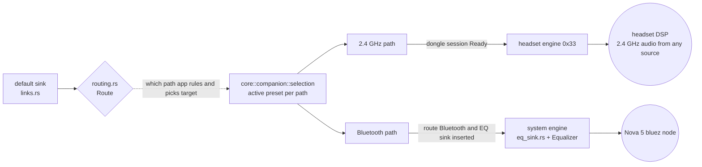
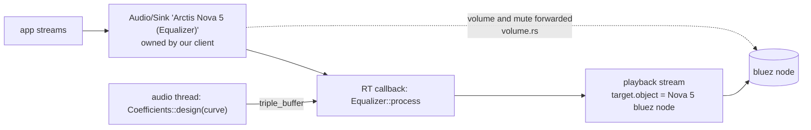
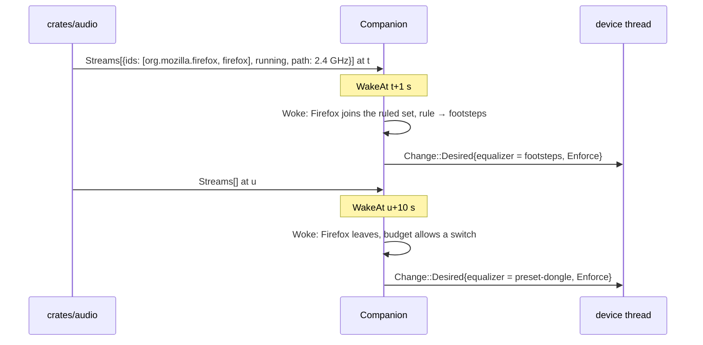
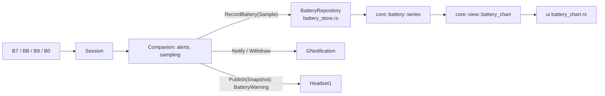

# Arctis Companion: equalizer, per-app presets, battery history

Part of [the design](2026-10-11-arctis-companion-design.md). Facts cited as FP §n come from
`docs/research/flatpak-pipewire.md`. Code: `crates/core/src/eq/`, `crates/core/src/companion/`,
`crates/core/src/battery/`, `crates/core/src/messages/audio.rs`, `crates/audio/src/`, `crates/app/src/platform/`.

## 1. Paths, engines and the route

**Each path has its own engine and its own route preset; an engine never processes another path's audio**
([ADR 0008](../../adr/0008-eq-engine-by-route-never-stacked.md)).

| Path | Engine | Active when | Route preset |
|---|---|---|---|
| 2.4 GHz | headset engine: `Command::SetEqualizer` (`0x33`), verified by `0x20` | the dongle session is Ready, whatever PipeWire reports. The headset keeps this curve for consoles | GSettings `preset-dongle` |
| Bluetooth from this computer | system engine: `crates/audio/src/eq_sink.rs` + `core::eq::Equalizer` | the route is Bluetooth and the system equalizer is inserted (§2) | GSettings `preset-bluetooth` |

The **route** says which path carries this computer's audio now (`core/src/companion/routing.rs`). It is decided
from the user's current output, never from which sinks exist: the audio adapter reads `default.audio.sink` from
the `default` metadata (falling back to `default.configured.audio.sink`) and follows that sink's link chain
(`crates/audio/src/links.rs`, at most 4 hops through filter nodes such as EasyEffects) to its terminal sink.

| Terminal sink of the default | Route |
|---|---|
| the Nova 5 bluez node (directly, or behind our EQ sink) | `Bluetooth` |
| the Nova 5 USB sink | `Dongle` |
| anything else, or PipeWire unreachable | `None` |

Matching: the Nova 5 USB sink is the node whose `device.id` names a Device with `device.vendor.id` `0x1038` and a
`device.product.id` among the non-bootloader PIDs of `core::protocol::model` (FP §3.1: these properties sit on the
Device, not the node). The Nova 5 bluez node has `device.api = bluez5` plus the properties SP0 records; until then
it matches a `node.description` starting with "Arctis Nova 5".



| Topic | Decision |
|---|---|
| No PipeWire | the 2.4 GHz path keeps working: the headset engine needs only HID. Only the Bluetooth path and app presets degrade |
| Stacking | never: 2.4 GHz audio is shaped only by the headset, this computer's Bluetooth audio only by the system engine. On Bluetooth the headset may still apply its own Bluetooth curve, set by the phone app, which this app cannot read or change |
| Curves are nominal on the headset | every preset fits the hardware envelope: at most 10 filters, kinds peaking / low-shelf / high-shelf / low-pass / high-pass, 20..20000 Hz, −10..+10 dB in 0.5 dB steps, Q 0.2..10, gain 0 dB for low-pass and high-pass. The graph draws `core::eq::response` (RBJ math in `core/src/eq/biquad.rs`). On the system engine that is the curve applied, minus a preamp of `−max(boost)` dB, so it plays quieter by that amount. On the headset engine it is the nominal curve: the firmware's filter design is unknown |
| Parity gap | the official "Dual EQ" Bluetooth preset is applied by the headset to phone audio. This app cannot do that: `0x34` is unverified (ADR 0013). SP0 sends the read-only `0x22`; if it returns a band layout, SP0 tries `0x34` with phone audio, and a working result becomes a capability in a later sub-project. Until then the metainfo lists "Bluetooth preset for the phone" as a known gap |
| Dongle-only machines | on a desktop that only uses the dongle, the system engine never runs; "Bluetooth from This Computer" is shown only after a Nova 5 bluez node has been seen once (GSettings `bluetooth-sink-seen`) |
| EasyEffects | `ee_*` nodes in the default sink's chain produce an info row "EasyEffects is processing audio; the system equalizer is off" and the EQ sink is not inserted |

## 2. System engine (`crates/audio`)

[ADR 0009](../../adr/0009-in-process-pipewire-dsp.md): `module-filter-chain` is absent from the GNOME Flatpak
runtime (FP §3.3), so the DSP runs in-process, EasyEffects style.



| Topic | Decision | Code |
|---|---|---|
| Insertion | only when the default sink is the Nova 5 bluez node itself. The adapter creates the EQ sink and its playback stream, sets `default.configured.audio.sink` to the EQ sink (client property `media.category = Manager`), and remembers the replaced bluez node | `eq_sink.rs`, `outputs.rs` |
| Removal | when the route leaves Bluetooth, on quit, or on drop. If the default is still our EQ sink, the remembered bluez node is restored; if the user picked another output meanwhile, the default is left alone. A default that is not the Nova 5 bluez node is never changed | `outputs.rs` |
| Volume | the EQ sink processes at unity; its `channelVolumes` and `mute` are mirrored to the bluez node, so GNOME's slider and media keys keep driving the headset's absolute Bluetooth volume | `volume.rs` |
| Naming | the sink description is "Arctis Nova 5 (Equalizer)"; the raw bluez node stays visible in Sound settings (hiding it is unverified) | `eq_sink.rs` |
| Manager role denied | (SP0 checks WirePlumber 0.5.18) the Equalizer group shows a warning row "Choose “Arctis Nova 5 (Equalizer)” as output in Sound settings" | ui §2 |
| RT safety | coefficients are designed on the audio thread by `core::eq::Coefficients::design(&Curve, rate)` and handed over through the `triple_buffer` crate; the callback calls `Equalizer::retarget(&Coefficients)` and `process`, which allocate nothing and crossfade over 10 ms | `core/src/eq/equalizer.rs` |
| `unsafe` | `crates/audio` is `#![forbid(unsafe_code)]`. If SP0's node-shape spike chooses `pw_filter`, which `pipewire` 0.10 does not wrap, the crate becomes `#![deny(unsafe_code)]` with one `#[allow(unsafe_code)]` module, `raw_filter.rs`, exposing only safe functions | `raw_filter.rs` |

`Equalizer::new(&Coefficients, channels)`: RBJ biquads, transposed direct form II, f32, preallocated per channel,
preamp included in the coefficients.

## 3. Preset library and editor data

[ADR 0011](../../adr/0011-own-presets-and-apo-import.md). SteelSeries presets are proprietary and are not shipped,
not even the HeadsetControl curves.

| Kind | Source | Editable |
|---|---|---|
| Built-in | const data in `core/src/eq/library.rs`, authored by us, CC0: Flat (the factory curve: 10 peaking bands at 32..16000 Hz, 0 dB, Q 1.41), Bass Boost, Bass Reduction, Treble Soften, Vocal Clarity, Footsteps, V-Shape, Movie Night, Podcast, Late Night | no; "Duplicate" starts a custom copy |
| Custom | `$XDG_DATA_HOME/arctis-companion/presets/<id>.json`, one file per preset | yes, saved instantly |
| Imported | Equalizer APO / AutoEQ `ParametricEQ.txt` (`Preamp:`, `Filter n: ON PK Fc … Hz Gain … dB Q …`) through `core::eq::apo`; values outside the envelope are clamped (low-pass and high-pass gain set to 0 dB) and listed in a toast; more than 10 filters is rejected | becomes custom |

```json
{"format": 1, "id": "bass-boost-mine", "name": "Bass Boost (Mine)",
 "filters": [{"kind": "low-shelf", "hz": 105, "gain_db": 5.5, "q": 0.71}]}
```

Export writes the same JSON or APO text through the file chooser portal. Names of built-ins are translated
msgids; custom names are user text. Built-in tests: every library preset validates against the envelope and its
`response()` stays within ±10 dB.

Missing presets: `core::companion` resolves an unknown preset id (deleted, or its file removed from disk) to Flat
for `preset-dongle` and `preset-bluetooth`, and marks an app rule that names it as "Preset missing" (it never
applies). Deleting a referenced custom preset shows the toast "Deleted “X”. Used by the 2.4 GHz preset and 1 app
rule" with Undo.

## 4. Per-app presets

[ADR 0010](../../adr/0010-per-app-presets-from-pipewire-streams.md). Detection uses **PipeWire stream properties,
not the focused window**: no portal exposes focus, the extension is optional, and playback decides what is heard.
Registry read access is granted to Flatpak clients by default (FP §3.4).

| Topic | Rule (`core/src/companion/selection.rs` unless stated) |
|---|---|
| App identifiers | every stream carries up to three: the portal app id, `application.id`, lowercased `application.process.binary`. `crates/audio/src/streams.rs` reads `pipewire.access.portal.app_id` from the node props, else from the Client global named by the node's `client.id` (native PipeWire clients carry it only on the client; pipewire-pulse copies it to the stream). Display name from `application.name` |
| App key | the first present identifier; it names an app in seen apps and in new rules |
| Rule | GSettings `app-rules` `a{ss}`: stored identifier → preset id. A rule matches a stream when its identifier equals any of the stream's identifiers, case-insensitively |
| Seen apps | `$XDG_DATA_HOME/arctis-companion/seen-apps.json`: key, display name and identifiers of the last 50 apps seen playing, across sessions, through `core::ports::SeenAppsRepository` |
| Candidate stream | `Stream/Output/Audio`, classified after its `info` event, whose link chain (`links.rs`, at most 4 hops) ends at the Nova 5 USB sink (2.4 GHz path) or at our EQ sink (Bluetooth path) |
| Ruled set | per path: an app with a matching rule joins after `RULE_ENTER` 1 s of continuous running and leaves only after `RULE_LEAVE` 10 s with no running stream. Corking and uncorking within 10 s changes nothing |
| Choice | the member that joined the ruled set most recently; an empty set → the path's route preset |
| Switch budget | at most one automatic switch per `AUTO_SWITCH_MIN_INTERVAL`: 30 s on the 2.4 GHz path (each is a `0x33` write), 2 s on the Bluetooth path; later changes coalesce to the latest choice; no write when the observed curve is `equivalent` |
| Switch off | GSettings `automatic-presets` (`AdwSwitchRow` and the Quick Settings toggle) |
| Feedback | silent: no notification; the "Now Playing" row, the Shell subtitle and `ActivePresetReason` explain it |

User picks. The **picked path** is the route's path, else the 2.4 GHz path when the dongle is present; none →
`ActivatePreset` fails with `NoRoute`.

| Where | No ruled app playing on that path | A ruled app playing on that path |
|---|---|---|
| Window combo row ("2.4 GHz Preset", "Bluetooth from This Computer") | sets the route preset (persistent) | sets the route preset and makes it the manual pick |
| Shell menu item, `ActivatePreset` | sets the route preset of the picked path | manual pick of the picked path, not persisted |

A manual pick ends when the path's ruled set changes, when the route changes, or at restart. The combo rows always
show the route preset; the active preset, when it differs, is shown by the "Now Playing" row (ui §2).



Leaving an app's curve on the headset: on an orderly quit with the dongle Ready, `Companion` sends the route
preset for the 2.4 GHz path and the app waits up to 1 s for its verify. Every reconnect reconciles the curve to the
active preset, which is the route preset when no ruled stream runs. A crash or a suspend while a ruled app plays
can still leave the app's curve for a console; the App Presets page says so.

## 5. Battery history and alerts

[ADR 0012](../../adr/0012-battery-history-as-csv.md).

| Topic | Decision | Code |
|---|---|---|
| Sampling | no extra device traffic: samples come from `B7`, `BB`, `B9` and every `B0` already sent; a row is written only when percent, charging or link changed | `core/src/battery/sample.rs` |
| Storage | append-only CSV `unix_seconds,percent,charging,link` at `$XDG_DATA_HOME/arctis-companion/battery.csv`, about 100 rows a day; rows older than 8 days dropped at start-up (the Week view needs 7) | `core/src/battery/log_format.rs`, `crates/app/src/platform/battery_store.rs` |
| Series | `series(&[Sample], Window::{Day, Week}) -> Series`: line segments broken when the link is not connected, charging spans, last full charge | `core/src/battery/series.rs` |
| Alerts | `BatteryWarning::{None, Low, Critical}` computed once: `Low` at `low-battery-threshold` (default 15 %), `Critical` at 5 %, 3-point hysteresis, back to `None` when charging starts. It drives the `low-battery` / `critical-battery` `GNotification` (each once per discharge, withdrawn on charge, default action `app.show-battery`) and the D-Bus `BatteryWarning` property | `core/src/companion/alerts.rs` |


