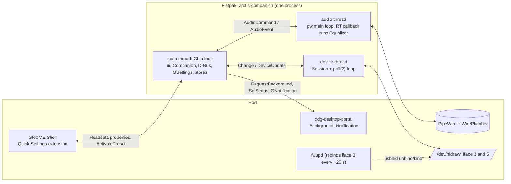
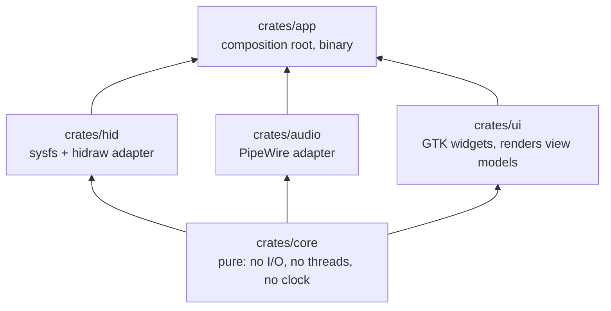
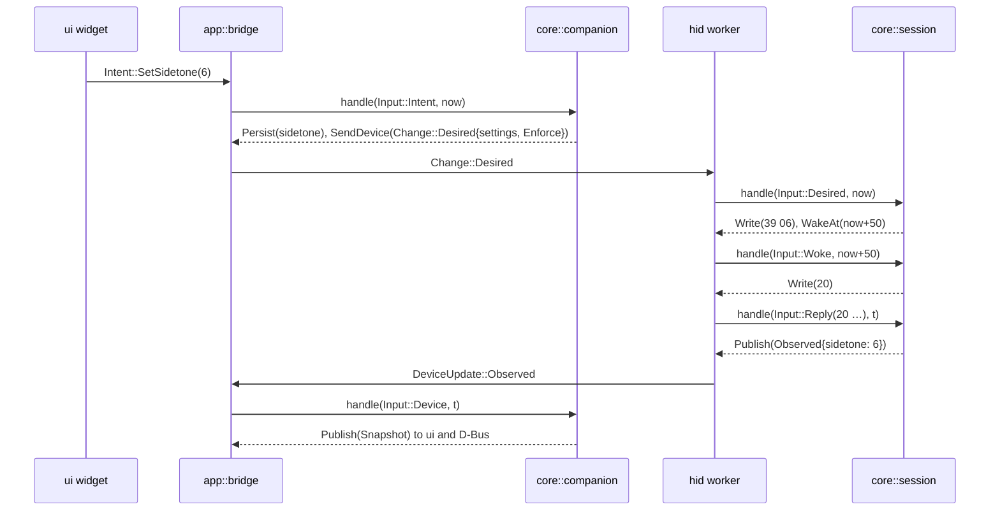
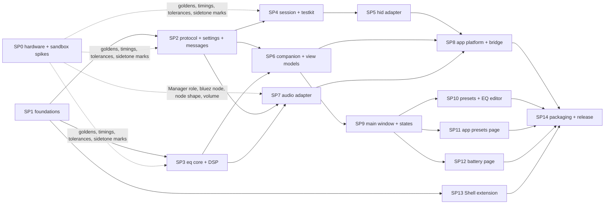

# Arctis Companion: design

Status: authoritative, revised 2026-10-12 after the second adversarial review (decisions in
[the review log](../../adr/review-log.md)). It supersedes `docs/superpowers/specs/proposals/*.md`.
Base: the *simplicity* proposal, with the judges' grafts from *testability* and *gnome-native* and every fatal flaw
they reported fixed (section 7). Research inputs: `docs/research/*.md`. Glossary: `CONTEXT.md`. Decisions: `docs/adr/`.

App id `io.github.marcelogm.ArctisCompanion`. Target: Fedora 44, GNOME 50, GTK 4.22, libadwaita 1.9, Rust + gtk4-rs.

| Part | Contents |
|---|---|
| this file | goals, process model, workspace and seams, the `Companion` contract, sub-projects |
| [device](2026-10-11-arctis-companion-device.md) | protocol codec, device lifecycle, echoes, write-then-verify, settings and reconciliation |
| [audio](2026-10-11-arctis-companion-audio.md) | paths, engines and the route, preset library, per-app presets, battery history |
| [ui](2026-10-11-arctis-companion-ui.md) | information architecture, widgets, states, i18n, D-Bus interface, Shell extension |
| [quality](2026-10-11-arctis-companion-quality.md) | tests per layer, CI, enforcement of the engineering rules |

## 1. Goals and non-goals

Goals: parity with the official Companion App for the Nova 5 (`docs/research/official-app-features.md` §9), plus
per-app automatic presets, a system-side parametric EQ through PipeWire, and battery history. Surfaces: a libadwaita
app, a GNOME Shell Quick Settings extension and native notifications. Shipped as a Flatpak plus a host udev rule.

Scope of the system equalizer: it shapes audio that this computer plays to the headset over Bluetooth. On a machine
that only uses the dongle it never runs; there the headset's own equalizer does the work (audio §1).

Deliberately left out, each addable later behind an existing seam: separate daemon, ChatMix mixing, Steam AppID
matching, drag handles on the EQ graph, rule reordering, battery time-remaining estimate, multiple dongles at once,
the `A5` preset-name frame, the Bluetooth hardware EQ `0x34` (SP0 probes it, ADR 0013), hiding the raw bluez node,
suspend hooks, inotify, libudev, hidapi, SQLite, zbus servers, tokio, relm4. The 2.4 GHz / Bluetooth audio-mode
switch is not shown because no USB command for it is known (ADR 0013).

## 2. Process model

One process: the Flatpak app. It owns the dongle, the PipeWire client, the D-Bus object, the battery log and the
notifications ([ADR 0001](../../adr/0001-single-process-background-app.md)).



| Concern | Decision | Rationale |
|---|---|---|
| Device owner | the device thread of the app process | one writer inside the app; fwupd's periodic rebind is absorbed by Rebinding (device §2) |
| Background | `gio::ApplicationHoldGuard` held while GSettings `run-in-background` is on (default on). Closing the window keeps the process | notifications, history, per-app presets and the extension keep working |
| Background permission and autostart | Background portal through `ashpd` (`RequestBackground{autostart: true, commandline: [arctis-companion, --gapplication-service]}`) at first run and again whenever the user turns "Run in Background" on; a denial turns the switch back off with a hint to GNOME Settings (ui §4); never requested without a user action after the first run | the Request/Response handshake is subtle; `ashpd` is the Circle-app norm (Amberol) |
| Status line | portal `SetStatus`: "Headset connected, 73 %" / "No headset" | visible in GNOME's background-apps list |
| Shell extension data | `Headset1` exported with `gio::DBusConnection::register_object` from the `dbus_register` vfunc, on GApplication's own connection and name ([ADR 0002](../../adr/0002-dbus-on-gapplication-connection.md)) | the name is already owned by GApplication; a second connection could not export under it |
| Extension when app absent | proxy flag `DO_NOT_AUTO_START`; the toggle hides when the name has no owner | the Shell never revives a process the user put to rest |
| Notifications | `gio::Application::send_notification` (portal under Flatpak) | zero extra code paths |
| Opening the window | `org.freedesktop.Application.Activate` (`DBusActivatable=true`) | standard |

Threads exist only where an external API blocks or owns a loop. Messages cross threads over `async-channel`
(consumed with `glib::spawn_future_local`) and, towards the device thread, a `std::sync::mpsc` plus a wake pipe that
the `poll(2)` loop watches. No tokio.

## 3. Workspace and seams

Five crates. A crate boundary exists only where it enforces a dependency rule
([ADR 0003](../../adr/0003-five-crate-workspace-pure-core.md)).



| Crate | May depend on | Rule it enforces |
|---|---|---|
| `crates/core` | `serde`, `serde_json` only (checked by `cargo xtask check-pure`) | every decision is pure and unit-testable; time enters as a `Millis` argument |
| `crates/hid` | core, `rustix` | no GTK; the only code that touches `/dev/hidraw*` and `/sys/class/hidraw` |
| `crates/audio` | core, `pipewire`, `triple_buffer` | no GTK; the only code that touches PipeWire |
| `crates/ui` | core, `gtk4`, `libadwaita`, `gettext-rs` | widgets render `core::view` models and emit `Intent`s; no channels, no GSettings, no files |
| `crates/app` | all, `ashpd` | wiring, platform adapters (GSettings, files, portal, notifications, D-Bus) |

```
crates/core/src/
  protocol/   frame.rs command.rs reply.rs event.rs eq_wire.rs model.rs
  settings/   values.rs headset_settings.rs
  messages/   device.rs audio.rs
  session/    session.rs phase.rs input.rs effect.rs reconcile.rs verify.rs echo.rs timing.rs
  eq/         filter.rs curve.rs preset.rs library.rs apo.rs biquad.rs coefficients.rs response.rs equalizer.rs
  companion/  companion.rs input.rs action.rs snapshot.rs adoption.rs routing.rs selection.rs alerts.rs
              deadlines.rs timing.rs
  battery/    sample.rs log_format.rs series.rs
  view/       headset_page.rs presets.rs eq_editor.rs app_presets.rs battery_chart.rs text.rs
  ports.rs  time.rs  intent.rs
  testkit/    fake_headset.rs simulation.rs memory_repositories.rs      (cargo feature "testkit")
crates/core/tests/    golden/*.hex udev_rule.rs end_to_end.rs
crates/hid/src/       discovery.rs port.rs wake.rs worker.rs handle.rs
crates/audio/src/     registry.rs outputs.rs streams.rs links.rs eq_sink.rs volume.rs worker.rs handle.rs
crates/ui/src/        window.rs headset_page.rs headset_status.rs scale_row.rs status_pages.rs text.rs
                      permission_dialog.rs presets_page.rs eq_editor_page.rs eq_band_row.rs response_graph.rs
                      app_presets_page.rs add_rule_dialog.rs battery_page.rs battery_chart.rs
                      preferences_dialog.rs
crates/ui/resources/  *.blp style.css
crates/app/src/       main.rs application.rs bridge.rs ports.rs dbus/headset_object.rs
                      platform/{settings_store,preset_store,seen_apps_store,battery_store,background,notifications}.rs
crates/app/tests/     bridge.rs
data/                 gschema, desktop, metainfo, D-Bus service, icons, dbus/…Headset1.xml, udev/70-arctis-companion.rules
extension/            arctis-companion@marcelogm.github.io/{metadata.json,extension.js,lib/presentation.js,lib/client.js}
xtask/src/            check_rules/ check_commits.rs check_doc_paths.rs check_pure.rs install_hooks.rs
xtask/tests/          one file per rule, violations built in tempdirs
build-aux/            io.github.marcelogm.ArctisCompanion.json (Flatpak manifest)
po/  extension/po/  docs/architecture/  .github/workflows/
```

### 3.1 Module interfaces

| Module | Interface | What it hides (depth) |
|---|---|---|
| `core::protocol` | `encode(&Command) -> Frame`, `decode_reply(Query, &[u8]) -> Result<Reply>`, `decode_event(&[u8]) -> Option<DeviceEvent>`, `Model::lookup(pid) -> ModelLookup` | 65-byte framing, on-wire offsets, stale tails, gain `20 + 2 dB`, Q ×1000, LED raw 0/1/4/10, bootloader PIDs. `Command` has no variant for a forbidden frame ([ADR 0004](../../adr/0004-native-protocol-with-command-allow-list.md)) |
| `core::messages` | `Change`, `SyncPolicy`, `DeviceUpdate`, `AudioCommand`, `AudioEvent` | the two thread seams, frozen by SP2 |
| `core::session` | `Session::new()`, `session.handle(Input, Millis) -> Vec<Effect>`, `session.phase()` | lifecycle phases, settles, probe, Rebinding without queries, echo filtering, reconcile, pacing, write-then-verify with backoff, retry |
| `core::eq` | `Preset`, `Curve`, `curve::equivalent`, `library()`, `apo::{parse, render}`, `response(&Curve, &[f32]) -> Vec<f32>`, `Coefficients::design(&Curve, rate)`, `Equalizer::new(&Coefficients, channels)`, `retarget(&Coefficients)`, `process(&mut [f32])` | RBJ biquads, envelope validation, device quantization tolerance, preamp, crossfade, APO text |
| `core::companion` | `Companion::new(Persisted)`, `companion.handle(Input, Millis) -> Vec<Action>`, `snapshot()` | adoption, routing, preset selection with hysteresis, budgets and picks, alerts, battery sampling, deadlines, what to persist |
| `core::view` | `headset_page(&Snapshot) -> HeadsetPageModel` and one function per page | every user-visible `Text` and widget state |
| `core::ports` | `PresetRepository`, `BatteryRepository`, `SeenAppsRepository` traits | file formats; in-memory adapters in `testkit` |
| `hid::handle` | `DeviceHandle::spawn(SysfsRoot) -> DeviceHandle { changes: Sender<Change>, updates: Receiver<DeviceUpdate> }` | the thread, discovery, open/reopen, `poll(2)` timers, executing `Effect`s |
| `audio::handle` | `AudioHandle::spawn() -> AudioHandle { commands: Sender<AudioCommand>, events: Receiver<AudioEvent> }` | registry, info waits, client props, link chains, Nova 5 matching, default-sink metadata, EQ sink, volume forwarding |
| `app::bridge` | `Bridge::new(companion, adapters).run()` with `struct Adapters { device: DeviceHandle, audio: AudioHandle, window: WindowPort, dbus: HeadsetObject, stores: Stores, notifier: Notifier }` | pumps channels into `Companion`, owns its one GLib timeout, and runs each `Action` through one `match` onto the small port traits of `crates/app/src/ports.rs` |

Two sans-I/O reducers carry all behaviour: `Session` on the device thread (device timing never waits for the GTK
loop) and `Companion` on the main thread (cross-cutting policy). Neither grows into a god-reducer: each delegates to
one small module per rule (`reconcile.rs`, `verify.rs`, `echo.rs`, `selection.rs`, `alerts.rs`, …).



### 3.2 The `Companion` contract

Frozen with `core::messages` so SP6 and SP8 build against the same tables.

| `Input` to `Companion` | Source |
|---|---|
| `Device(DeviceUpdate)` | device thread |
| `Audio(AudioEvent)`: `Available`, `Unavailable`, `DefaultSink(DefaultSink)`, `Streams(Vec<StreamInfo>)`, `ManagerDenied`, `BluetoothNodeSeen` | audio thread |
| `Intent(Intent)` | ui widgets and `Headset1` |
| `Woke` | the bridge's timeout reached the earliest `WakeAt` |
| `SettingsChanged(AppSettings)` | GSettings changed outside the app |
| `Quitting` | the `app.quit` action |

| `Action` from `Companion` | Port (`crates/app/src/ports.rs`) |
|---|---|
| `Persist(PersistedChange)` | `SettingsStore` (GSettings) |
| `StorePreset(PresetChange)` | `PresetRepository` |
| `RecordBattery(Sample)`, `RecordSeenApp(SeenApp)` | `BatteryRepository`, `SeenAppsRepository` |
| `SendDevice(Change)` | `DeviceHandle` |
| `SendAudio(AudioCommand)`: `InsertEqualizer(Curve)`, `Retarget(Curve)`, `RemoveEqualizer` | `AudioHandle` |
| `Publish(Snapshot)` | `WindowPort`, `HeadsetObject` |
| `Notify(Alert)`, `Withdraw(AlertId)` | `Notifier` |
| `WakeAt(Millis)` | the bridge's single GLib timeout |
| `ReadyToQuit` | drops the hold guard |

`Companion` keeps every pending deadline in `deadlines.rs` and returns one `WakeAt` for the earliest. Its constants
live in `core/src/companion/timing.rs`: `RULE_ENTER` 1 s, `RULE_LEAVE` 10 s, `AUTO_SWITCH_MIN_INTERVAL` 30 s
(2.4 GHz) and 2 s (Bluetooth), `EDITOR_THROTTLE` 250 ms, `QUIT_GRACE` 1 s.

## 4. Key decisions (index)

| # | Decision | Where |
|---|---|---|
| 0001 | Single background-capable app process, no daemon | §2 |
| 0002 | `Headset1` via gio on GApplication's connection; extension never auto-starts the app | §2, ui §5 |
| 0003 | Five crates around a pure `core` | §3 |
| 0004 | Native Rust protocol; `Command` is the allow-list (no `09`, `35 01` as save, `A5`, `A7`, `0x22`, `0x34`) | device §1 |
| 0005 | Long-lived ports, Rebinding sends no queries, sysfs rescan is the only discovery; the flap comes from fwupd | device §2 |
| 0006 | Events first; status poll every 10 s only while the headset is off, safety poll every 5 min in Ready | device §3 |
| 0007 | Desired-state reconciliation with adoption per dongle identity, events as intent, echoes filtered | device §3, §5 |
| 0008 | One engine per path, never stacked; the route comes from the default sink | audio §1 |
| 0009 | In-process PipeWire DSP, inserted only in place of the Nova 5 bluez default | audio §2 |
| 0010 | Per-app presets from PipeWire streams, ruled-set hysteresis, per-path budgets, defined picks | audio §4 |
| 0011 | Own preset library, JSON user presets, Equalizer APO import | audio §3 |
| 0012 | Battery history as change-only CSV, 8 days | audio §5 |
| 0013 | Capability-driven rows; the audio-mode switch and the phone Bluetooth preset are known gaps | ui §2, audio §1 |
| 0014 | One Rust `xtask` enforces every engineering rule; rebase-only merges | quality §3 |
| 0015 | Raw hidraw over `rustix`, no hidapi | device §2 |

## 5. Sub-projects

Each sub-project gets its own implementation plan, is built test-first, and ends with its
`docs/architecture/<area>.md` page (mermaid plus code paths and symbols, validated by `cargo xtask check-doc-paths`).



Parallel waves: **W1** {SP0, SP1} → **W2** {SP2, SP3, SP13} → **W3** {SP4, SP6, SP7} → **W4** {SP5, SP9} →
**W5** {SP8, SP10, SP11, SP12} → **W6** {SP14}. SP13 needs only the frozen `Headset1` XML (ui §5) and a fake
service. SP0 is run by an agent while the user is away: read-only items, plus allow-listed writes that restore the original value and verify by readback. Items that need a person (power cycle, listening for glitches, pressing buttons, Bluetooth pairing, root for `systemctl stop fwupd`) move to SP14's hardware checklist; every dependency on them has a designed default.
Acceptance criteria use only what a sub-project's dependencies deliver; checks that need the real dongle, a real
PipeWire session or a Bluetooth-paired computer are in SP14's checklist.

SP0 items (throwaway scripts outside the repo, allow-listed writes only):

| Area | Items |
|---|---|
| Device behaviour | persistence across a power cycle; where events arrive (buttons, dial); whether a host write produces an event, on which interface and how late (`ECHO_WINDOW`); time from each setter to its readback (`VERIFY_BACKOFF`); link and readback after `35 0` and `35 1` (`WIRELESS_MODE_GRACE`) and which value is Extended range; EQ quantization of odd Q and frequency values (`curve.rs` tolerances); sidetone mapping 0/3/6/10; `0x10` slot meaning; `HID_UNIQ` presence |
| Glitches | `B0` at 2 s and 60 s; one `0x33` write |
| iface 3 flap | `systemctl stop fwupd` for 2 minutes confirms fwupd as the cause; shortest safe `REBIND_SETTLE`; with `92-viia.rules` moved away, how long a recreated node stays unreadable |
| Bluetooth | read-only `0x22`; only if it returns a band layout, `0x34` with phone audio and a `0x22` readback; `B0[1]` and `B9` while pressing QuickSwitch with both links up |
| Sandbox and PipeWire | Flatpak sysfs rescan and hidraw open; virtual sink plus playback stream and the node shape (two streams or `pw_filter`); Manager role under WirePlumber 0.5.18, setting `default.configured.audio.sink`, forwarding volume to the bluez node; Nova 5 bluez node properties |

| SP | Scope | Acceptance criteria |
|---|---|---|
| SP0 | the items above | `docs/research/hardware-findings.md` answers each item with captures; `hid-protocol.md` §7.4 records the flap's cause; new golden `.hex` files; constants in `core::session::timing`, `core::companion::timing` and `core::eq::curve` decided; a fallback named for every negative answer |
| SP1 | workspace with five compiling crates, `xtask` (`check-rules`, `check-commits`, `check-doc-paths`, `check-pure`, `install-hooks`), clippy/rustfmt/ESLint config, CI workflows, meson install of data, Flatpak manifest with `llvm22` building an empty `AdwApplicationWindow` and linking `crates/audio`, branch ruleset, `docs/architecture/README.md` | CI green; `xtask/tests` build in tempdirs a commented file (Rust doc comment, JS, TOML, Blueprint), a `core` dependency outside the allow-list, a `pub unsafe fn`, a removed lint allow, and a commit, PR title or PR body with `Co-Authored-By`, and each makes its check fail; a 401-line file produces a warning and a zero exit code; a `pub fn f() -> Result<(), E>` with no docs passes `clippy -D warnings`; `check-rules` passes on a tree with a freshly generated `Cargo.lock` and `pt_BR.po`; the ruleset allows only rebase merging and requires `rules`; `scripts/check-line-limit.sh` and `.githooks/*` replaced by `xtask install-hooks` |
| SP2 | `core::protocol`, `core::settings`, `core::messages` | every frame in `docs/research/hid-protocol.md` §7.1 and SP0 decodes; every `Command` encodes to its cited bytes; stale tails ignored; proptest round-trip of `eq_wire`; no constructor yields `09`, `35 01`-as-save, `A5`, `A7`, `0x22`, `0x34`; bootloader PIDs map to `ModelLookup::Bootloader`; the udev rule test passes; message types match §3.2 and device §6; 100 % line coverage |
| SP3 | `core::eq` (filter, curve, preset, library, APO, biquad, coefficients, response, equalizer) | the per-kind magnitude criteria of quality §1; `curve::equivalent` table; Flat bit-exact identity and equivalent to the factory curve; poles inside the unit circle over the envelope; no NaN/denormals after 10 s silence; `process` and `retarget` allocate nothing (counting allocator); crossfade continuity; APO round-trip; every library preset validates |
| SP4 | `core::session` + `core::testkit` (`FakeHeadset`, `Simulation` with virtual clock) | every arrow of the device §2 diagram and every scenario listed in quality §1 for `core::session` passes; `cargo mutants` leaves no survivor in `session` |
| SP5 | `crates/hid` | discovery passes against sysfs fixture trees (Nova 5, 5X, bootloader, two dongles, missing iface 5, `HID_UNIQ`, nodes without the 0666 rule, EACCES); the worker passes the `Simulation` scenarios over a socketpair port; on the real dongle for 30 min with fwupd running: no user-visible disconnect, zero lost writes |
| SP6 | `core::companion`, `core::battery`, `core::ports`, `core::view`, `core::intent` | the `core::companion`, `core::battery` and `core::view` tables of quality §1; every `Phase` × `Route` yields a page model; sidetone marks and value texts |
| SP7 | `crates/audio` | container job: headless PipeWire + WirePlumber, a null sink shaped like the Nova 5 bluez node set as default; the EQ sink is inserted, becomes default and is removed with the bluez node restored; a default changed by the user while inserted is left alone; volume and mute forwarded; stream detection with identifiers from node and client props; link chain through an intermediate node; sine at 1 kHz at the sink monitor within ±0.5 dB of `response()` minus the preamp |
| SP8 | `crates/app`: bridge, ports, GSettings schema and store, preset, seen-apps and battery stores, `Headset1` object, Background portal, notifications | `crates/app/tests/bridge.rs` covers every `Action`; `crates/core/tests/end_to_end.rs` passes; `gio::TestDBus` contract test equals `data/dbus/…Headset1.xml`; stores pass the `core::ports` contract suite; scripted run fires and withdraws the low-battery notification; quit sends the route preset and waits at most `QUIT_GRACE`; runs windowless with `--gapplication-service` |
| SP9 | `crates/ui` window, headset page, status pages, permission dialog, preferences dialog, toasts, banner, `text.rs` | `#[gtk::test]` headless: each `Phase` × `Route` renders the right page; banner priority; never-adopted HeadsetOff hides the headset groups; each control emits its `Intent`; accessibility walk (names, value texts, descriptions) passes; pt_BR number rendering; 360 px wide with no horizontal scroll |
| SP10 | presets page, EQ editor page, response graph, import/export | `#[gtk::test]` and view-model checks: keyboard-only editing of every band; low-pass/high-pass gain insensitive; instant save with undo toast; delete toast names the preset's uses; Preview emits its manual-pick intents; APO import of a published AutoEQ file; empty Custom group description |
| SP11 | app presets page, add-rule dialog | `#[gtk::test]` and view-model checks: rules list with identifiers and "Preset missing"; Add Rule offers seen apps and "Other App…"; empty states; each control emits its `Intent` |
| SP12 | battery page and chart | Day and Week views render a synthetic week; charging spans shaded; gaps broken; accessible summary text present; empty state |
| SP13 | Shell extension for `shell-version ["50"]` | `gjs` tests of `lib/presentation.js` and `lib/client.js` against a fake service; ESLint clean; XML copy equals `data/dbus/…Headset1.xml`; manual check in `gnome-shell --devkit`; hidden when the app is absent |
| SP14 | final manifest, udev rule + in-app instructions, metainfo (known gaps: audio-mode switch, phone Bluetooth preset), pt_BR, release workflow, end-to-end checklist | `flatpak-builder --install` works on Fedora 44 with the rule; `appstreamcli validate`, `desktop-file-validate`, `glib-compile-schemas --strict` pass; pt_BR 100 %; `check-doc-paths` covers ADR "Code:" lines; tag builds `.flatpak`, extension zip and rule; checklist passed on hardware: an edit on the 2.4 GHz path reaches the headset (verified readback) within 300 ms when not Rebinding; in a real session a ruled app switches the preset after 1 s and restores it 10 s after stop; on a Bluetooth-paired computer the system engine runs 30 min at 48 kHz / 256 with no xruns |

## 6. Risks carried forward

| Risk | Owner | Fallback already designed |
|---|---|---|
| No events from the device | SP0 | `HEADSET_OFF_POLL` detects power-on; the Ready safety poll covers battery, floor 60 s (ADR 0006) |
| Settings do not persist on the headset | SP0 | desired state re-applied on every connect (ADR 0007) |
| Host writes echo as events | SP0 | `echo.rs` consumes them within `ECHO_WINDOW` (device §3) |
| `0x33` write glitches audio | SP0 | per-app switching on the 2.4 GHz path keeps its 30 s minimum interval and is documented |
| fwupd talks to iface 3 on its own schedule | SP0, SP5 | silent Rebinding with a short `REBIND_SETTLE`; frames drained during settles |
| Manager role denied to Flatpak | SP0, SP7 | warning row asking the user to pick "Arctis Nova 5 (Equalizer)" in Sound settings |
| System engine cannot be checked on a dongle-only desktop | SP14 | container tests in SP7; the xrun check runs on a Bluetooth-paired computer |
| Flathub review of `--device=all` | SP14 | justification in metainfo, udev rule documented |

## 7. Fatal flaws from the first review and their fixes

| Flaw | Fix |
|---|---|
| Schema defaults overwrite the headset on first launch | adoption per dongle identity, settings hidden until read (device §5) |
| Flap turns into a resync burst | Rebinding sends no queries (device §2) |
| Events on iface 3 discarded | iface 3 stays open; unsolicited frames go to the event decoder (device §3) |
| zbus cannot export under GApplication's name | gio `register_object` in `dbus_register` (ADR 0002) |
| PipeWire EQ unreachable or stacked | one engine per path; the route comes from the default sink (ADR 0008) |
| Per-app switching floods HID | ruled-set hysteresis, 30 s minimum interval, no write when the curve is equivalent (audio §4) |
| Manual pick turns automatic presets off globally | picks scoped to the path's ruled set (audio §4) |
| Quick Settings toggle is a status light | toggle titled "App Presets" switches Automatic App Presets (ui §5) |
| Status page hides controls when the headset is off | banner, controls stay sensitive after adoption, changes queue (ui §2) |
| Battery history in the primary menu | navigation row on the main page (ui §1) |
| Explicit Save/Revert in the editor | instant save, Duplicate for built-ins, undo toasts (ui §3) |
| Busy-poll loop | `poll(2)` on both ports plus a wake pipe, timeout = next `WakeAt` (device §2) |
| No check that doc paths exist | `xtask check-doc-paths`, symbols included (quality §3) |
| Engine preference exposes internals | removed; paths and the route decide |

The second review's findings and their decisions are in [the review log](../../adr/review-log.md).
