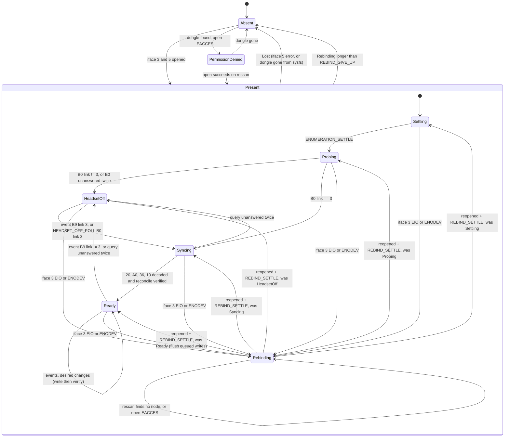
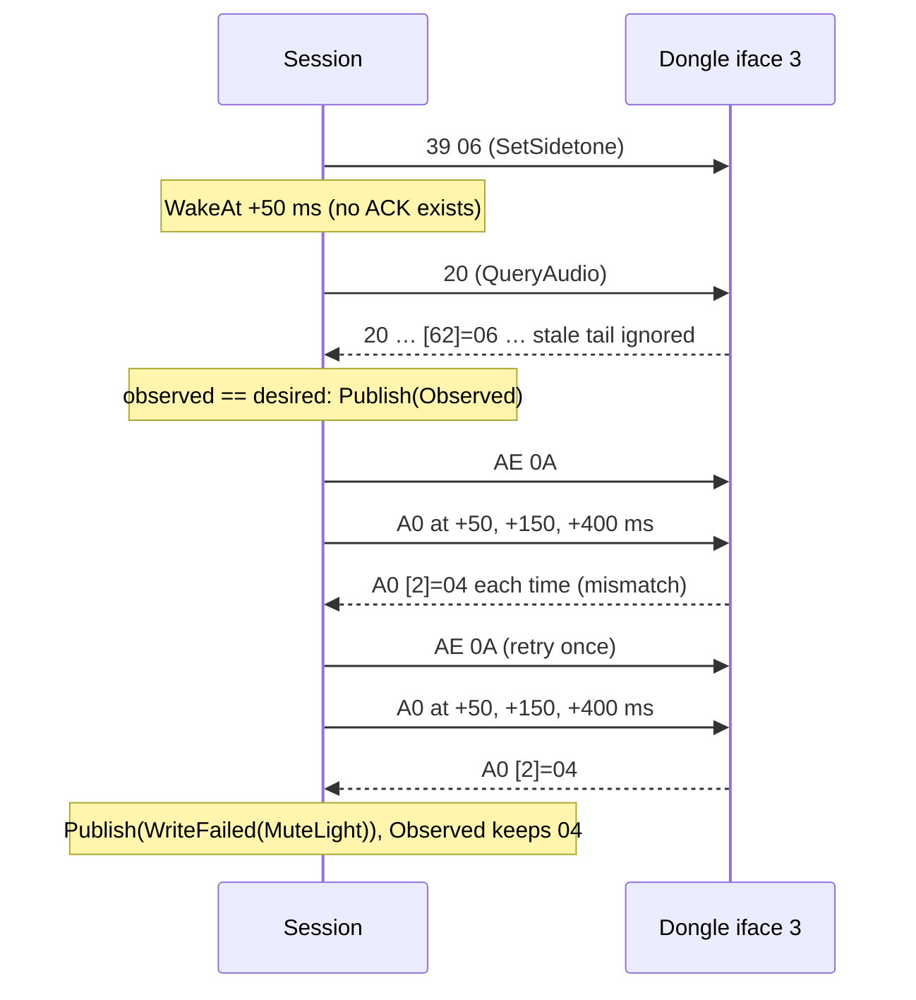
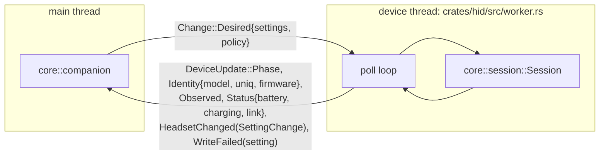

# Arctis Companion: device

Part of [the design](2026-10-11-arctis-companion-design.md). Facts cited as HID §n come from
`docs/research/hid-protocol.md`. Code: `crates/core/src/protocol/`, `crates/core/src/session/`,
`crates/core/src/settings/`, `crates/core/src/messages/device.rs`, `crates/hid/src/`.

## 1. Protocol codec (`core::protocol`)

Pure functions over bytes. No I/O, no clock.

| Item | Rule | Code |
|---|---|---|
| Framing | host writes 65 bytes: `00` then the 64-byte payload; device answers 64 bytes, byte 0 echoes the command | `frame.rs` |
| Offsets | on-wire offsets only (LAM offsets minus one, HID §4) | `reply.rs`, `event.rs` |
| Stale tails | each reply is parsed to its documented length, never further (HID §7.2) | `reply.rs` |
| EQ wire | 10 × `{freq u16 LE, filter u8, gain 20+2·dB, Q×1000 u16 LE}`; `20001` = disabled band | `eq_wire.rs` |
| Models | `0x2232` Nova 5, `0x2253` Nova 5X (upstream-verified); `0x2255`, `0x2264` `Support::Untested`; `0x2233`, `0x2254`, `0x2265` → `ModelLookup::Bootloader`, never opened | `model.rs` |
| udev rule | `data/udev/70-arctis-companion.rules` matches exactly the non-bootloader PIDs of `model.rs`; `crates/core/tests/udev_rule.rs` reads the rule with `include_str!` and asserts it | `model.rs` |

`Command` (the allow-list, [ADR 0004](../../adr/0004-native-protocol-with-command-allow-list.md)):

| Variant | Bytes | Readback query |
|---|---|---|
| `QueryStatus` | `B0` | – |
| `QueryFirmware` | `10` | – |
| `QueryAudio` | `20` | – |
| `QueryUx` | `A0` | – |
| `QueryWireless` | `36` | – |
| `SetMicVolume(MicVolume)` | `37 n` (0..15) | `20[61]` |
| `SetSidetone(Sidetone)` | `39 n` (0..10) | `20[62]` |
| `SetVolumeLimiter(bool)` | `27 0/1` | `20[63]` |
| `SetEqualizer(Curve)` | `33` + 60 band bytes | `20[1..61]` |
| `SetMuteLight(MuteLight)` | `AE raw` (0/1/4/10) | `A0[2]` |
| `SetAutoPowerOff(AutoPowerOff)` | `A3 minutes` | `A0[1]` |
| `SetWirelessMode(WirelessMode)` | `35 0/1` (0 = range = Extended range on, SP0 confirms) | `36[1]` |

There is no variant that can produce `09`, a trailing `35 01` "save", `A5`, `A7`, `0x22`, `0x34`, or any frame for
a bootloader PID. A golden test asserts that no `Command` encodes to those bytes. SP0 sends `0x22` once from its
throwaway script (ADR 0004); `Command` only changes if SP0 proves a Bluetooth curve exists (ADR 0013).

`DeviceEvent` decodes `27 37 39 45 A3 AE B7 B9 BB` (HID §6). Value types in `core::settings::values` reject
out-of-range numbers at construction (`Sidetone::try_from(11)` fails).

Curve comparison: the device may store a value other than the one written (HID §5.3: Q 1414 written, 1410 read).
Every comparison of two curves (verify, "already matches", adoption) goes through one function,
`core::eq::curve::equivalent(a, b)`: kind and gain byte equal, frequency within ±1 Hz, Q within ±1 %, and all
disabled bands (`20001`) equal whatever their other bytes. SP0 writes a curve with odd Q and frequency values and
records the readback; if the largest deviation exceeds those tolerances, the constants in `curve.rs` are raised
to it.

## 2. Lifecycle (`core::session`)

Resuming a phase re-enters it from its start (Settling restarts its wait, Probing resends `B0`, Syncing redoes its
pending transaction), except Ready, which keeps its snapshot and flushes the writes queued while Rebinding.

| Topic | Decision |
|---|---|
| Ports | Both iface 3 (commands) and iface 5 (events) stay open while the dongle is present. One device thread runs a `poll(2)` loop over both fds and a wake pipe; the timeout is the next `WakeAt`. No busy polling |
| Discovery | `hid::discovery` reads `/sys/class/hidraw/*/device/uevent` (`HID_ID` vendor/product, `HID_PHYS` suffix `/input3` or `/input5`, `HID_UNIQ`) and groups nodes by physical path. sysfs reads touch no device, so they cannot glitch audio. No inotify, no libudev, no netlink ([ADR 0005](../../adr/0005-long-lived-ports-and-silent-rebinding.md)) |
| Rescan cadence | `RESCAN_ABSENT` 2 s in Absent and PermissionDenied, `RESCAN_REBINDING` 250 ms in Rebinding, none in any other phase: there, removal shows up as an iface 5 error |
| The ~20 s iface 3 flap | caused by fwupd's SteelSeries "fizz" plugin, which unbinds and rebinds usbhid on iface 3 to poll the headset (confirmed by SP0, `docs/research/hardware-findings.md` §4), so every host with fwupd sees it. `Rebinding` keeps the last snapshot, sends **no queries**, queues desired changes, and resumes the interrupted phase after the node returns and `REBIND_SETTLE` passes. The UI reads `Phase::Rebinding` as connected; only after `REBIND_NOTICE` it shows "Reconnecting…" |
| EACCES while Rebinding | a recreated node is `root 0600` until udev applies the `uaccess` ACL a few ms later. An EACCES open in Rebinding is treated like a missing node and retried on the next rescan. PermissionDenied is only entered from Absent; a node that stays unreadable ends in Absent after `REBIND_GIVE_UP` and then in PermissionDenied on the next discovery |
| Frames during a settle | frames read on iface 3 during `ENUMERATION_SETTLE` or `REBIND_SETTLE` are drained and dropped, so stale tails left by another claimant (fwupd) never decode as replies or events |
| In-flight write during a flap | the write is redone after reopen, then verified. Safe because every `Command` sets an absolute value, never a toggle |
| Transport | raw hidraw through `rustix` (open, write 65, read 64), [ADR 0015](../../adr/0015-raw-hidraw-over-rustix.md). `hid::port` is the internal seam; tests use a socketpair |
| Query timeout | a query unanswered twice moves the session to `HeadsetOff`, except during `WIRELESS_MODE_GRACE` (§4) |

Timing constants, all in `crates/core/src/session/timing.rs`. `Session` never sleeps; it returns `WakeAt`.

| Constant | Default | SP0 result (`docs/research/hardware-findings.md` §9) |
|---|---|---|
| `COMMAND_SPACING` | 50 ms | – |
| `ENUMERATION_SETTLE` | 3 s, only after Absent → found | – |
| `REBIND_SETTLE` | 100 ms | 0 ms was safe in 24 of 24; the node reopens about 60 ms after the `EIO`; default kept |
| `REBIND_NOTICE` | 5 s | – |
| `REBIND_GIVE_UP` | 30 s | – |
| `REPLY_TIMEOUT` | 500 ms | – |
| `VERIFY_BACKOFF` | readbacks at 50, 150, 400 ms after a write | headset off: the first readback shows the value; headset on is an SP14 checklist item; default kept |
| `ECHO_WINDOW` | 1 s after the last write of a transaction | headset off: no echo on any interface; headset on is an SP14 checklist item; default kept |
| `WIRELESS_MODE_GRACE` | 5 s after `35` | headset off: readback at once, no link change; headset on is an SP14 checklist item; default kept |
| `HEADSET_OFF_POLL` | 10 s, only in HeadsetOff | – |
| `STATUS_SAFETY_POLL` | 5 min, only in Ready, floor 60 s | glitch test is an SP14 checklist item (fwupd itself sends `B0` every 20 s); default kept |
| `RESCAN_ABSENT`, `RESCAN_REBINDING` | 2 s, 250 ms | – |

## 3. Events versus polling

[ADR 0006](../../adr/0006-events-first-safety-poll.md). Events are primary: `B7` battery, `BB` charging, `B9` link,
`37 39 27 A3 AE` on-headset changes, `45` dial. Both ports are read; a frame on iface 3 whose echo byte does not
match the pending query goes to `decode_event`, so it does not matter which interface SP0 finds them on.

`B0` is sent on Probing, on `B9`, every `HEADSET_OFF_POLL` while HeadsetOff (no 2.4 GHz audio flows then, so it
cannot glitch), and in Ready only as the safety net `STATUS_SAFETY_POLL` after the last battery event, never while
a write transaction is in flight. If SP0 finds that the device sends no events, the Ready cadence becomes what
SP0's glitch test allows, floor 60 s. HeadsetControl #452 links frequent polling to audio glitches.

Our own echoes are not intent (`crates/core/src/session/echo.rs`). The setter ids `27 37 39 A3 AE` are also event
ids, so the dongle may echo a host write as an event. While a write transaction for a setting is in flight, and
for `ECHO_WINDOW` after its last write, an event for that setting whose value equals any value written in that
transaction is consumed as an echo and never published. Every other setting event is published as
`HeadsetChanged` and immediately replaces the field in the `Session`'s copy of desired, so verify never fights
it. A real press that lands on a value written within the window is indistinguishable and treated as an echo; the
readback then shows it as observed.

## 4. Write then verify

- One transaction at a time. During reconcile, writes are batched and then verified with one readback per query
  kind (`20`, `A0`, `36`), as in the table in §1 (`verify.rs`). The EQ field compares with `curve::equivalent`.
- A readback that does not yet show the written value is re-sent at each `VERIFY_BACKOFF` step; only the last
  step can declare a mismatch.
- After `SetWirelessMode`, a `B9` link ≠ 3 or a timed-out readback within `WIRELESS_MODE_GRACE` is expected: the
  session keeps its phase, waits for `B9` link 3 or the end of the grace, then reads `36`. Only a link still down
  after the grace leads to HeadsetOff.
- Coalescing: only the latest desired value of a setting is ever written, so slider drags do not queue.
- `WriteFailed(setting)` reaches the UI as a toast with Retry, and the row shows the observed value with the
  subtitle "Not applied" (ui §2). Retry re-sends the desired value. Within a connection nothing else is retried
  automatically; every later Syncing reconciles drift, which retries the unapplied value once more.

## 5. Settings and reconciliation

[ADR 0007](../../adr/0007-desired-state-reconciliation.md). `HeadsetSettings { mic_volume, sidetone, mute_light,
volume_limiter, wireless_mode, auto_power_off, equalizer: Curve }` exists twice: **desired** (owned by
`Companion`, persisted in GSettings) and **observed** (read from the headset by `Session`).

| Rule | Behaviour | Code |
|---|---|---|
| No desired, no write | `Session` starts with no desired settings and never writes until a `Change::Desired` arrives; without one it reads, publishes observed and reaches Ready | `core/src/session/session.rs` |
| Sync policy | `Change::Desired { settings, policy }`, with `SyncPolicy::Adopt` (write nothing, publish observed) or `SyncPolicy::Enforce` (reconcile drift). One message, so policy and settings can never arrive out of order | `core/src/messages/device.rs` |
| Adoption | when Ready and the dongle's identity differs from GSettings `adopted-identity`, `Companion` sends `Adopt`, copies observed into desired, maps the observed curve to a library preset with `curve::equivalent` (the built-in Flat is the factory curve), or else saves it as the custom preset "Headset Curve" and selects it as the 2.4 GHz preset; then stores the identity and sends `Enforce` | `core/src/companion/adoption.rs` |
| Identity | model PID plus `HID_UNIQ` (the dongle's USB serial) when it is not empty, else the PID alone; SP0 records whether the Nova 5 dongle reports one. Firmware strings are not part of it, so a firmware update never triggers adoption | `core/src/companion/adoption.rs` |
| Never read | before the first adoption for this identity, headset settings cannot be edited: with the headset off, the window hides the headset-setting groups and asks to turn the headset on (ui §2), and `ActivatePreset` on the 2.4 GHz path returns `NotReady`. Schema defaults are never shown as if they were read | `core/src/view/headset_page.rs` |
| Event is intent | a `HeadsetChanged` event (never an echo, §3) updates desired, so reconnect never fights a button press | `core/src/companion/companion.rs` |
| Reconnect | entering Syncing writes only fields where observed differs from desired (drift), then verifies | `core/src/session/reconcile.rs` |
| Headset off | after adoption, desired changes still update desired and persist; they are applied on the next Syncing; the UI says "Changes apply when it turns on" | `core/src/session/session.rs` |
| Accepted trade-off | changes made from the phone app while this app is not running are overwritten on reconnect. Revisit only if SP0 proves on-headset persistence | ADR 0007 |

| Setting | Lives on | Desired stored in | Widget (ui §2) |
|---|---|---|---|
| Mic volume 0..15 | headset `37` | GSettings `mic-volume` | `ScaleRow`, 16 steps, end icons |
| Sidetone 0..10 | headset `39` | `sidetone` | `ScaleRow`, 11 steps, marks Off 0, Low 3, Medium 6, High 10 |
| Mute light Off/Low/Medium/High | headset `AE` | `mute-light` (enum) | `ScaleRow`, 4 labelled steps |
| Volume limiter | headset `27` | `volume-limiter` | `AdwSwitchRow` |
| Extended range | headset `35`/`36` | `extended-range` | `AdwSwitchRow` |
| Automatic power off | headset `A3` | `auto-power-off` (enum Never, 1, 5, 10, 15, 30, 45, 60, 75, 90) | `AdwComboRow` |
| Headset EQ curve | headset `33` | derived: the active preset of the 2.4 GHz path | preset rows |
| `adopted-identity` | app | GSettings string, empty by default | – |

The sidetone marks were read from the official screenshot (11 ticks, labels at indices 0, 3, 6, 10); SP0 confirms
the bytes. App-only settings (presets, rules, preferences, battery log) are in [audio](2026-10-11-arctis-companion-audio.md)
and [ui](2026-10-11-arctis-companion-ui.md).

## 6. Messages across the device seam

The message types live in `crates/core/src/messages/device.rs` and are frozen by SP2, so SP4, SP5 and SP6 build
against the same contract.

| `Input` to `Session` | Source |
|---|---|
| `Found{pid, uniq, command, events}`, `Lost`, `CommandPortLost`, `CommandPortBack`, `CommandPortDenied`, `Denied` | `hid::discovery` and port errors |
| `Reply(bytes)`, `Unsolicited{interface, bytes}` | reads on iface 3 and iface 5 |
| `Woke` | `poll(2)` timeout reached the earliest `WakeAt` |
| `Desired{settings, policy}` | `Change::Desired` from the main thread |

| `Effect` from `Session` | Executed by the worker |
|---|---|
| `Write(Frame)` | write on iface 3 |
| `WakeAt(Millis)` | sets the `poll(2)` timeout |
| `Rescan(Cadence)` | sets the sysfs rescan cadence (`Absent`, `Rebinding`, `Off`) |
| `Publish(DeviceUpdate)` | sends to the main thread |

Multiple PIDs: the first dongle by sysfs path order wins, deterministically; multiple dongles at once are out of
scope. An untested model is shown as such in the Device group (ui §2).
