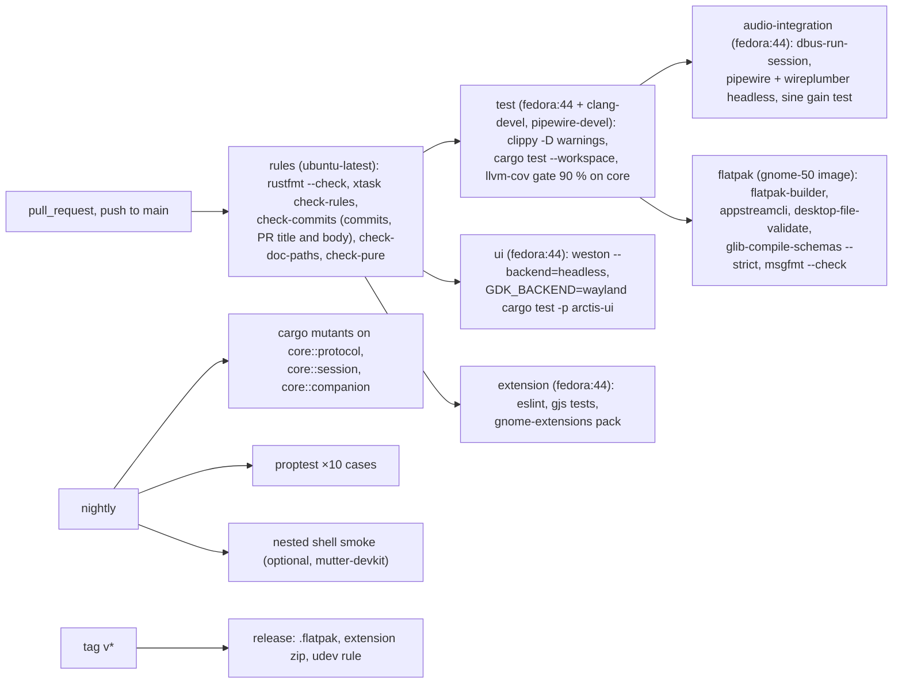
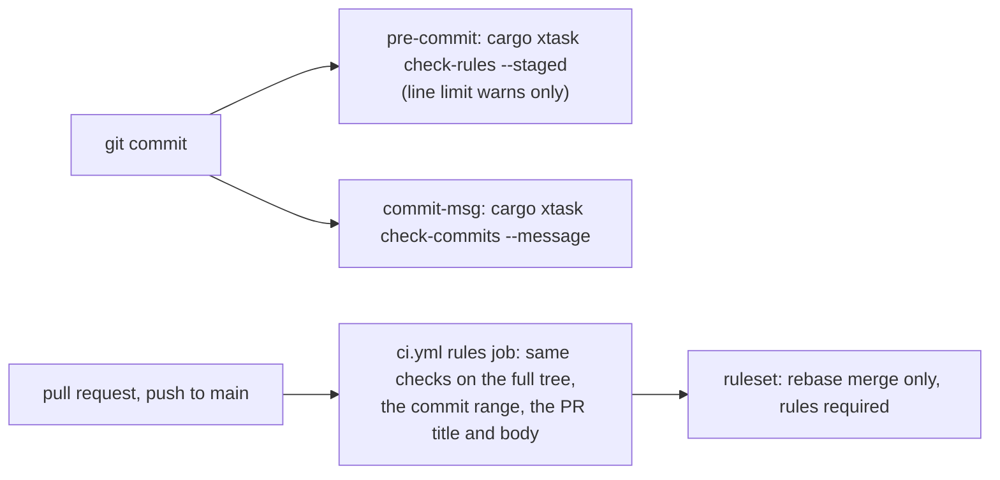

# Arctis Companion: tests, CI, rule enforcement

Part of [the design](2026-10-11-arctis-companion-design.md). Tests come first in every sub-project (TDD). Code and
tests are the documentation; `docs/architecture/` holds mermaid diagrams that point at code paths and symbols and
is checked by `cargo xtask check-doc-paths`.

## 1. Tests per layer

| Layer | What is tested | Fakes and fixtures |
|---|---|---|
| `core::protocol` | golden bytes: every captured frame in `crates/core/tests/golden/*.hex` decodes to its struct; every `Command` encodes to its cited bytes; stale-tail frames decode; `decode_*` never panics on any 64 bytes (proptest); no `Command` encodes to a forbidden frame; the udev rule lists exactly the supported PIDs (`crates/core/tests/udev_rule.rs`) | captures from `docs/research/hid-protocol.md` §7.1 and SP0 |
| `core::settings` | each value type rejects out-of-range input | – |
| `core::session` | scenario tables in `testkit::Simulation`, one per arrow of the device §2 diagram, plus: 20 s flap for 10 virtual minutes with zero queries; flap during Settling and during Probing; `Lost` from every phase; `REBIND_GIVE_UP`; reopen returns EACCES twice then succeeds with no `Phase::PermissionDenied` published; node unreadable for 10 ms during a rebind; stale tail from another claimant after a rebind is dropped; EIO mid-write; readback that shows the value only at the 400 ms step; verify mismatch; device that quantizes Q on write passes verify; `35` followed by `B9` link 2 then 3 within the grace; query timeout; no events and the headset powers on: Syncing within `HEADSET_OFF_POLL` + settle; echo of an older value during a drag is consumed; real button press during an unrelated write becomes `HeadsetChanged`; no desired → no write; `Adopt` and `Enforce`; desired arriving after Probing; headset-off queueing; safety-poll cadence | `testkit::FakeHeadset` models registers, stale tails, Q quantization, readback latency, echo events, dropped writes, flapping iface 3, EACCES windows, silent device, bootloader PIDs; virtual clock |
| `core::eq` | per kind at 44.1 and 48 kHz, ±0.05 dB: peaking `|H(f0)|` = gain; shelves `|H(f0)|` = gain/2 with asymptotes within ±0.1 dB of gain and of 0 dB at 20 Hz / 20 kHz; low-pass and high-pass `|H(f0)|` = 20·log10(Q) and the gain field has no effect. Flat bit-exact identity; poles inside the unit circle over the envelope; no NaN or denormals after 10 s silence; `process` and `retarget` allocate nothing (counting global allocator); a retarget crossfades over 10 ms with no step above the steady-state difference; `curve::equivalent` tolerance table; APO parse/render round-trip; library validity; Flat equivalent to the factory curve | – |
| `core::companion`, `core::battery` | given/when/then tables: adoption by identity (new identity, same identity, firmware change), field mapping and "Headset Curve"; routing from the default sink (bluez, behind our EQ sink, USB, EasyEffects in between, speakers, PipeWire down with dongle Ready); selection (enter, leave, cork and uncork within 10 s, recency by join time, per-path budget, combo pick and Shell pick with and without ruled apps, pick then restart, pick then a new ruled app, missing preset id); never adopted + HeadsetOff; alerts with hysteresis and `BatteryWarning`; quit restores the route preset; sampling dedupe, CSV round-trip, 8-day retention, series gaps | `testkit::memory_repositories` |
| `core::view` | every `Phase` × `Route` gives a page model (Absent × Bluetooth has the equalizer rows); banner priority; sidetone marks and value texts; "Not applied" rows; empty states; chart geometry; accessible descriptions; `Text` values only | – |
| `crates/hid` | `discovery` against sysfs fixture trees in `crates/hid/tests/sysfs/` (Nova 5, 5X, bootloader, two dongles, missing iface 5, `HID_UNIQ` present and empty, nodes without the 0666 rule); worker over a socketpair port runs the same `Simulation` scenarios end to end; EACCES path | socketpair, tempdirs |
| `crates/audio` | pure tables: Nova 5 USB match through the Device object; app identifiers from pulse-style (node) and native-style (client) prop sets; link chains of up to 4 hops with an `ee_soe`-style node; default-sink cases (bluez, USB, speakers, our sink, user changed default while inserted); container integration (§2) | headless PipeWire |
| `crates/app` | `crates/app/tests/bridge.rs`: every `Action` reaches its fake port, `WakeAt` schedules one timeout and delivers `Woke`; `gio::TestDBus`: runtime introspection equals the XML, properties follow a fake `Companion`; stores pass the `core::ports` contract suite on tempdirs; Background portal and notifications against `python-dbusmock` | fakes, dbusmock, tempdirs |
| `crates/ui` | `#[gtk::test]` under a headless Wayland compositor: model → row values; row change → `Intent`; each `Phase` × `Route` → expected page; tree walk asserts every focusable widget has an accessible name, every `GtkScale` has value text, and `HeadsetStatus`, `ResponseGraph`, `BatteryChart` have descriptions; `text.rs` renders pt_BR numbers | models from `core::view` |
| extension | `gjs -m extension/tests/run.js` with plain asserts on `lib/presentation.js` (every subtitle, insensitive with no rules, panel icon per `BatteryWarning`); `lib/client.js` against a GJS fake service exporting the shared XML in `dbus-run-session`; ESLint | fake property bags |
| hardware | `#[ignore]` suite gated by `ARCTIS_HW=1`, run by a human: read-only first, then allow-listed writes | the real dongle |

End-to-end scenario in `crates/core/tests/end_to_end.rs` (acceptance of SP8, which comes after both reducers):
connect → settle → probe → adopt → set preset → app rule switch → low battery notify → flap → reconnect, asserting
every `Effect`, every `Action` and the wire log.

## 2. CI on GitHub Actions

Workflows: `.github/workflows/ci.yml`, `nightly.yml`, `release.yml`. Pure crates and `xtask` build on the plain
runner; anything that links GTK or PipeWire runs in the `fedora:44` container with `clang-devel` and
`pipewire-devel` (the `pipewire` crate runs bindgen). The Flatpak manifest adds the SDK extension
`org.freedesktop.Sdk.Extension.llvm22` (branch 25.08, the GNOME 50 base), with `append-path`
`/usr/lib/sdk/llvm22/bin` and `prepend-ld-library-path` `/usr/lib/sdk/llvm22/lib`, as Flathub's Helvum does.
i18n: CI regenerates the POT and fails if it is stale, runs `msgfmt --check`, and fails on any untranslated
`pt_BR` entry.

Merging: a branch ruleset on `main` allows only rebase merging and requires the `rules` status check, so no
commit that GitHub builds server-side (squash or merge commit, with its automatic `Co-authored-by:` trailers) can
land. The `rules` job also runs on every push to `main`, so a leak fails loudly.

## 3. Enforcement of the engineering rules

[ADR 0014](../../adr/0014-xtask-enforces-rules.md). One Rust tool, `xtask/`, runs locally through hooks
(`cargo xtask install-hooks`, which replaces `scripts/check-line-limit.sh` and the current `.githooks/`) and in CI.

| Rule | Mechanism | Code |
|---|---|---|
| No comments, any language | Rust: `ra_ap_rustc_lexer` comment tokens, doc comments included. JS: ESLint rule over `getAllComments()`. Blueprint, CSS: `//` and `/* */` outside strings. TOML, YAML, meson, shell, desktop files: `#` outside strings (shebang allowed). XML: `<!--`. JSON has none. Licence via `LICENSE` + `REUSE.toml`, never headers | `xtask/src/check_rules/comments/` |
| Generated files | one list, used by both the comment check and the line limit: `Cargo.lock`, `cargo-sources.json`, `*.po`, `*.pot`, `po/LINGUAS`, `po/POTFILES*`, images (`*.png`, `*.svg`) | `xtask/src/check_rules/generated.rs` |
| About 400 lines per file, any language (guideline, not a gate) | every tracked file outside the generated list. Both CI and the local hook print a warning and never fail: the user made the limit a general directive (commit `3a6b29e`). Reviewers treat a warning as a prompt to refactor | `xtask/src/check_rules/line_limit.rs` |
| Low cognitive complexity | `[workspace.lints.clippy]` `cognitive_complexity = "deny"`, `too_many_lines = "deny"`, `excessive_nesting = "deny"`, `too_many_arguments = "deny"`, `unwrap_used = "deny"` outside tests, `pedantic = "warn"`; `clippy.toml`: thresholds 8, 40, 3, 4. ESLint `complexity: 6`, `max-depth: 3`, `max-lines: ["warn", 400]` | `Cargo.toml`, `clippy.toml`, `extension/eslint.config.js` |
| Lints that demand comments are off | `missing_errors_doc`, `missing_panics_doc`, `missing_safety_doc`, `undocumented_unsafe_blocks`, `doc_markdown` set to `"allow"`; `check-rules` fails if any of these allows is removed | `Cargo.toml`, `xtask/src/check_rules/lints.rs` |
| `unsafe` | `#![forbid(unsafe_code)]` in every crate except `crates/hid` and, only if SP0 requires it, `crates/audio` (audio §2). No `pub unsafe fn` anywhere: unsafe code sits behind safe functions (`check-rules`, lexer-based) | `xtask/src/check_rules/unsafe_api.rs` |
| Formatting | `cargo fmt --check` | `rustfmt.toml` |
| Pure core | `cargo metadata`: `arctis-core` normal dependencies within `serde`, `serde_json`; dev-dependencies free | `xtask/src/check_pure.rs` |
| Conventional commits, no attribution | subject is `type(scope)!: summary` with type one of feat, fix, refactor, test, docs, build, ci, chore, perf, style, revert; rejects `Co-Authored-By` (any case), "Generated with", and mentions of AI tools. Checked on every commit of the range, on the PR title (same subject format) and on the PR body (`github.event.pull_request.title` and `.body`) | `xtask/src/check_commits.rs` |
| Durable docs | every backticked repo path in `docs/architecture/**/*.md`, `CONTEXT.md` and the "Code:" lines of `docs/adr/*.md` exists; a `path.rs::Item` reference must name a `fn`, `struct`, `enum` or `trait` declared in that file. ADR "Code:" lines join the check in SP14, once every cited path exists. Specs, proposals and research are dated records and exempt | `xtask/src/check_doc_paths.rs` |
| XML contract copy | extension XML byte-equal to `data/dbus/…Headset1.xml` | `xtask/src/check_rules/` |

Rule fixtures never live in the tracked tree: `xtask/tests/*.rs` create each violating file, lockfile or commit
in a tempdir and assert a non-zero result, so `check-rules` on the repository stays green.

