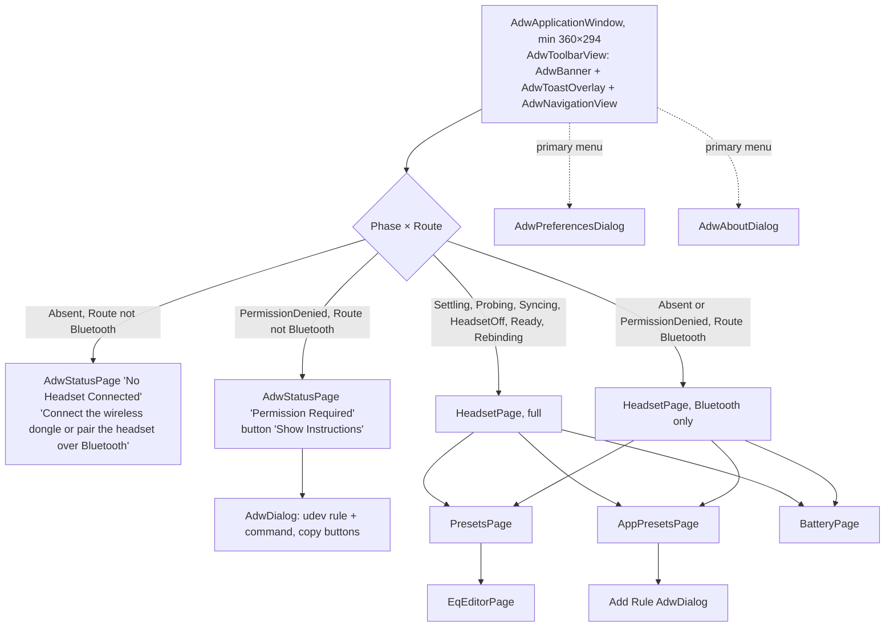
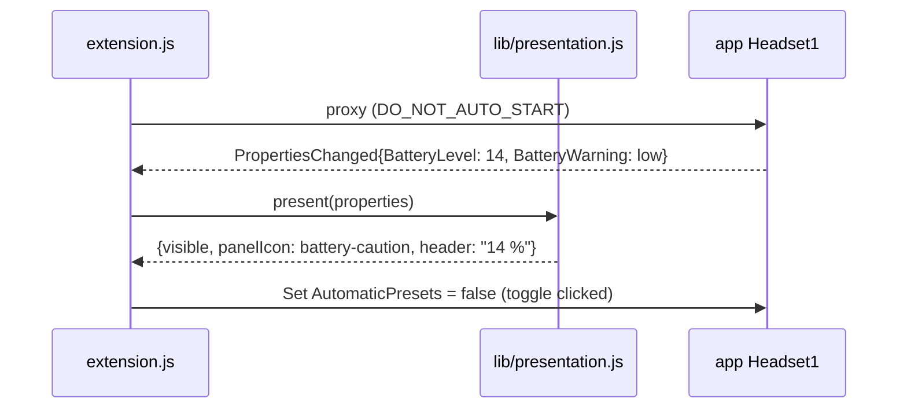

# Arctis Companion: UI, D-Bus interface, Shell extension

Part of [the design](2026-10-11-arctis-companion-design.md). Facts cited as UI §n come from
`docs/research/gnome-ui.md`. Code: `crates/ui/src/`, `crates/ui/resources/`, `crates/core/src/view/`,
`crates/app/src/dbus/`, `extension/`.

Every widget renders a model from `core::view` and emits a `core::intent::Intent`. No widget reads GSettings, a
channel or a file. Blueprint, one `.blp` and one `.rs` per widget, compiled into a gresource by `crates/ui/build.rs`.

## 1. Information architecture

What the window shows depends on two inputs: the dongle `Phase` and the `Route` (audio §1).



Bluetooth only: the page shows the rows the system engine and the app data can serve ("Bluetooth from This
Computer", Now Playing, Automatic App Presets, App Presets, Presets, Battery History read-only) and replaces the
headset-setting groups with one group whose description reads "Connect the wireless dongle to change headset
settings". With PermissionDenied it also shows the permission banner (§2).

The primary menu holds only app-level items (Preferences, Keyboard Shortcuts, About). Content views are navigation
rows on the main page.

## 2. Headset page

| Group | Row | Widget | Notes |
|---|---|---|---|
| (header) | battery, charging, route | `HeadsetStatus` (custom): symbolic headset icon, level icon, "73 % · Discharging", and the route as "Sound from this computer over 2.4 GHz", "… over Bluetooth" or "Not this computer's sound output" | read-only, accessible description on each part |
| Equalizer | 2.4 GHz Preset | `AdwComboRow` | shown when the dongle is present; always displays the route preset |
| | Bluetooth from This Computer | `AdwComboRow`, subtitle "Applies when this computer plays to the headset over Bluetooth" | shown when `bluetooth-sink-seen`; always displays the route preset |
| | Now Playing | `AdwActionRow`, read-only, suffix button "Use Route Preset" | visible only when the active preset differs from the route preset: "Footsteps, chosen for Firefox" or "Bass Boost, until Firefox stops"; the button makes the route preset the manual pick |
| | Automatic App Presets | `AdwSwitchRow` | |
| | App Presets | `AdwActionRow` + `go-next-symbolic` | |
| | Presets | `AdwActionRow` + `go-next-symbolic` | library and editor |
| | (warnings) | `AdwActionRow` with a `dialog-warning-symbolic` prefix | Manager role denied ("Choose “Arctis Nova 5 (Equalizer)” as output in Sound settings"; no button, because opening Settings from the sandbox needs an extra D-Bus permission), EasyEffects active, "App presets unavailable: audio service not reachable" |
| Microphone | Volume | `ScaleRow` (custom `AdwPreferencesRow` + `GtkScale`) 16 steps, quiet/loud end icons | value text "7 of 15" |
| | Sidetone | `ScaleRow` 11 steps, marks Off 0, Low 3, Medium 6, High 10 | every step selectable; value text "Off", "Low", "Medium", "High", else "4 of 10" |
| | Mute Light Brightness | `ScaleRow` 4 steps labelled Off, Low, Medium, High | value text is the label |
| Sound | Volume Limiter | `AdwSwitchRow` | |
| Wireless | Extended Range | `AdwSwitchRow`, subtitle "Increases range, lowers microphone quality" | |
| Power | Automatic Power Off | `AdwComboRow` Never, 1 minute, 5 minutes … 90 minutes | plural msgids |
| | Battery History | `AdwActionRow` + `go-next-symbolic` | |
| Device | Model, Firmware | `AdwActionRow` with selectable subtitle | "Untested model" subtitle for `Support::Untested` |

`ScaleRow` sets `gtk::accessible::Property::ValueText` from the model's `value_text` on every change, so screen
readers announce "Low", not "3".

States and feedback. One window-level `AdwBanner`; when several apply, `core::view::headset_page` picks the first
of this order:

| Priority | Situation | Banner |
|---|---|---|
| 1 | PermissionDenied with Route Bluetooth | "Permission is needed to use the wireless dongle", button "Show Instructions" |
| 2 | HeadsetOff and the dongle never adopted (device §5) | "Turn on the headset to read its settings"; headset-setting groups and the 2.4 GHz Preset row are hidden, never filled with schema defaults |
| 3 | HeadsetOff after adoption | "Headset is off. Changes apply when it turns on." Last-known values shown, controls stay sensitive |

| Situation | Presentation |
|---|---|
| Rebinding for more than `REBIND_NOTICE` | header subtitle "Reconnecting…" with a spinner; controls stay sensitive |
| Settling, Probing, Syncing | header subtitle "Connecting…"; controls insensitive until the first observed values arrive |
| Write failed | `AdwToast` with one msgid per setting ("Could Not Change Sidetone", "Could Not Change Microphone Volume", …) and Retry; the row shows the observed value with the subtitle "Not applied" until observed equals desired |
| Group-scoped problems | warning rows in the Equalizer group (table above), never a banner |

Capabilities ([ADR 0013](../../adr/0013-capability-driven-rows.md)): `core::protocol::model::Capabilities` lists what
a model supports; `core::view::headset_page` omits rows a model lacks. The 2.4 GHz / Bluetooth audio-mode switch is
not a capability of any model today, so it is never shown. The dongle cannot see which link the headset plays
from (SP0 captures `B0[1]` and `B9` while pressing QuickSwitch with both links up); if SP0 finds a signal, a
"Headset is playing from Bluetooth" state is added to the header.

## 3. Presets and EQ editor

- `PresetsPage`: two `AdwPreferencesGroup`s, Built-in and Custom, each row `AdwActionRow` + `go-next-symbolic`. The
  Custom group has the description "Create, duplicate or import a preset to customize it" while it is empty. Header
  buttons: New Preset (`list-add-symbolic`, also Ctrl+N anywhere in the window: a custom copy of the Flat curve named
  "Custom Preset", "Custom Preset 2", …, opened in the editor) and Import (APO or JSON through the file chooser
  portal).
- `EqEditorPage` (`AdwNavigationPage`): an interactive `EqGraph` (snapshot drawing, log axis 20 Hz–20 kHz labelled at
  20, 50, 100 … 20k with fainter minor lines, ±12 dB labelled every 3 dB with 0 dB emphasised, shaded reference zones
  Sub-bass … Brilliance whose labels take one row, two staggered rows or hide when they do not fit, the curve from
  `core::eq::response` filled to 0 dB, accessible description from `core::view::eq_graph`, which calls the headset
  curve "nominal"; extra curves are data, a list of series with a line style, a colour role and a label, and the
  vertical range is a `LevelRange`) above a list of up to 10 `EqBandRow`s (`AdwExpanderRow` titled "250 Hz · +2.0 dB"
  containing type `AdwComboRow`, frequency `AdwSpinRow`, gain `AdwSpinRow` step 0.5, Q `AdwSpinRow`, enabled
  `AdwSwitchRow`). The gain row is insensitive for low-pass and high-pass. Add Band / Remove Band.
- The graph has one numbered, focusable handle per band at (frequency, gain), 0 dB for pass filters. Dragging moves
  frequency and gain, shown live in the curve and the row and saved once on release; the wheel over a handle changes Q;
  a double click on empty space adds a peak there; Delete, Backspace or the context menu removes the band. Arrows nudge
  a semitone or 0.5 dB, Page Up/Down or +/− change Q. Picking a handle expands its row; expanding a row selects its
  handle. Built-in presets show handles that select but never move. Nothing animates.
- Built-ins are read-only with a "Duplicate" header button. Custom presets save instantly (no Save button).
  Header menu: Rename, Export, Delete (undo toast naming its uses, audio §3).
- Preview: a header toggle "Preview" (shown when a path is available) makes the edited preset the manual pick of
  the picked path while the page is open, and ends that pick when the page closes. Editing a preset that is
  active, by preview or otherwise, applies live: the system engine immediately, the headset engine throttled by
  `Companion` to one `Change::Desired` per 250 ms, each verified.
- One column at every width: the graph above the band list, both in an `AdwClamp` of 720 px, so a wide window centres
  the editor like a preferences page instead of splitting it.

## 4. App presets, battery, preferences, text

| Page | Content | Empty state |
|---|---|---|
| `AppPresetsPage` | dynamic list (`GtkListView`): app icon if resolvable, app name, subtitle with the stored identifier (or "Preset missing"), preset `GtkDropDown`, remove button. Page description: "On the 2.4 GHz connection the headset keeps an app's preset if this computer stops unexpectedly". When Automatic App Presets is off, a warning row says so | `AdwStatusPage` "No App Presets", "Choose a preset that applies while an app plays sound", suggested-action button "Add Rule" |
| Add Rule `AdwDialog` | group "Seen Playing" from seen apps (audio §4), then "Other App…" with an entry for an identifier (Flatpak app id, application id or binary name) | "Seen Playing" hidden, focus on "Other App…" |
| `BatteryPage` | `AdwToggleGroup` Day / Week, `BatteryChart` custom snapshot (line in accent color, charging spans shaded, gaps broken, works in dark and high contrast), rows "Last full charge" and current level; accessible description from `core::view::battery_chart` | `AdwStatusPage` "No Battery History Yet", "History appears after the headset has been connected for a while" |
| `AdwPreferencesDialog` | Run in Background, Low Battery Warning `AdwSpinRow` 5..50 %, "GNOME Shell Integration" link row to extensions.gnome.org | – |

Run in Background: the Background portal is requested at first run and, after that, only when the user turns the
switch on. If the portal answers `background = false`, the switch goes back off and its subtitle reads "Allow it
in Settings → Apps → Arctis Companion".

Each empty state is a state of its `core::view` model, with a table test.

- Adaptive: content in the preferences page clamp; minimum 360×294; breakpoints as above.
- HIG capitalization: header case for titles and buttons, sentence case for subtitles and descriptions.
- i18n: `gettext-rs`, English msgids, `po/pt_BR.po`; Blueprint strings marked translatable; the extension has its
  own domain in `extension/po/`.
- `core::view::text` returns a typed `Text`, never a finished string: `Plain(msgid)`,
  `Format { msgid, args: Vec<Arg> }` with `Arg::{Percent, Decibels, Hertz, Str}`, and
  `Plural { singular, plural, n }`. Msgids are whole sentences with named placeholders ("{preset}, chosen for
  {app}"), never concatenated. `crates/ui/src/text.rs` is the only resolver: gettext or ngettext, then
  locale-aware number formatting. A pt_BR unit test renders "+2,0 dB" and "73 %".

## 5. D-Bus interface and Shell extension

Single source: `data/dbus/io.github.marcelogm.ArctisCompanion.Headset1.xml`. The extension's copy must be byte-equal
(`cargo xtask check-rules`). Object path `/io/github/marcelogm/ArctisCompanion`, exported by
`crates/app/src/dbus/headset_object.rs` from the `dbus_register` vfunc on GApplication's connection
([ADR 0002](../../adr/0002-dbus-on-gapplication-connection.md)). This XML is frozen before SP13 starts.

```xml
<node>
  <interface name="io.github.marcelogm.ArctisCompanion.Headset1">
    <property name="State" type="s" access="read"/>
    <property name="Model" type="s" access="read"/>
    <property name="BatteryLevel" type="i" access="read"/>
    <property name="Charging" type="s" access="read"/>
    <property name="BatteryWarning" type="s" access="read"/>
    <property name="Route" type="s" access="read"/>
    <property name="Presets" type="a(ss)" access="read"/>
    <property name="ActivePreset" type="s" access="read"/>
    <property name="ActivePresetReason" type="(ss)" access="read"/>
    <property name="AppRuleCount" type="u" access="read"/>
    <property name="AutomaticPresets" type="b" access="readwrite"/>
    <method name="ActivatePreset">
      <arg name="id" type="s" direction="in"/>
    </method>
  </interface>
</node>
```

| Member | Values |
|---|---|
| `State` | `absent` (no dongle, Route not Bluetooth), `permission-denied` (dongle denied, Route not Bluetooth), `bluetooth-only` (no usable dongle, Route Bluetooth), `connecting` (Settling, Probing, Syncing), `awaiting-headset` (HeadsetOff, never adopted), `headset-off`, `connected` (Ready, Rebinding) |
| `BatteryLevel` | 0..100, `-1` unknown |
| `Charging` | `unknown`, `charging`, `charged`, `discharging` |
| `BatteryWarning` | `none`, `low`, `critical`, from `core::companion::alerts` |
| `Route` | `dongle`, `bluetooth`, `none` |
| `Presets` | (id, translated name) |
| `ActivePreset` | id of the active preset of the picked path (audio §4) |
| `ActivePresetReason` | (`manual` \| `route` \| `app`, app display name or empty). For `manual` the name is the newest ruled app, whose stop ends the pick |
| `AppRuleCount` | number of entries in `app-rules` |
| `ActivatePreset` | audio §4 "User picks"; errors `…Error.NoRoute` (no picked path) and `…Error.NotReady` (2.4 GHz path, dongle never adopted) |

Changes go out as `PropertiesChanged` only. The window opens with `org.freedesktop.Application.Activate`.

Extension `extension/arctis-companion@marcelogm.github.io/`, `metadata.json` `shell-version ["50"]`, no `prefs.js`:

- `SystemIndicator` whose panel icon shows only while `BatteryWarning` is not `none` or the headset is charging.
  No permanent panel clutter.
- `QuickMenuToggle` titled "App Presets"; **checked = `AutomaticPresets`**, clicking toggles it. Subtitle: the
  active preset name ("Flat"), "Footsteps · Firefox" for an app rule, "Bass Boost · Until Firefox stops" for a
  manual pick. With `AppRuleCount` 0 the toggle is insensitive and its subtitle reads "No app rules".
- Menu: header (headset icon, `Model`, "73 %" or "Charging · 73 %"), preset items with a check ornament calling
  `ActivatePreset` (insensitive while `State` is `connecting`, or `awaiting-headset` with `Route` not `bluetooth`), separator, "Headset Settings"
  (`Activate`).
- Hidden when the name has no owner or `State` is `absent` or `permission-denied` (the window explains those).
  Proxy uses `DO_NOT_AUTO_START`. No sliders, no notifications (the app owns them).
- `lib/presentation.js` maps the property bag to `{visible, panelIcon, title, subtitle, sensitive, checked,
  header, items}` and imports nothing from `resource:///`; numbers go through `toLocaleString()` and strings
  through the extension's gettext domain. `lib/client.js` wraps `Gio.DBusProxy` with an injectable proxy.
  `extension.js` only wires these to Shell classes and disconnects everything in `disable()`.


