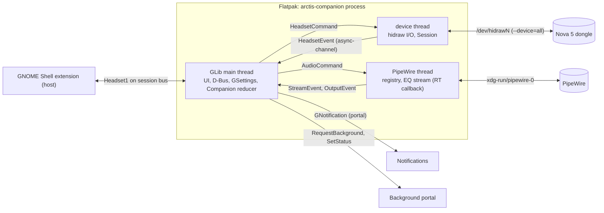
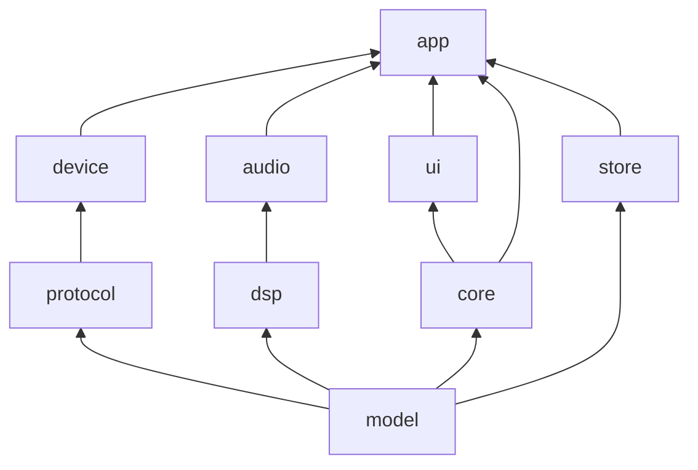
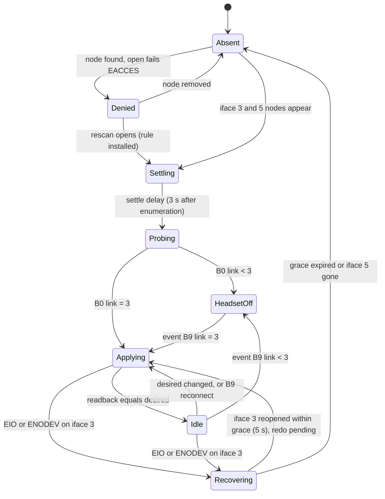
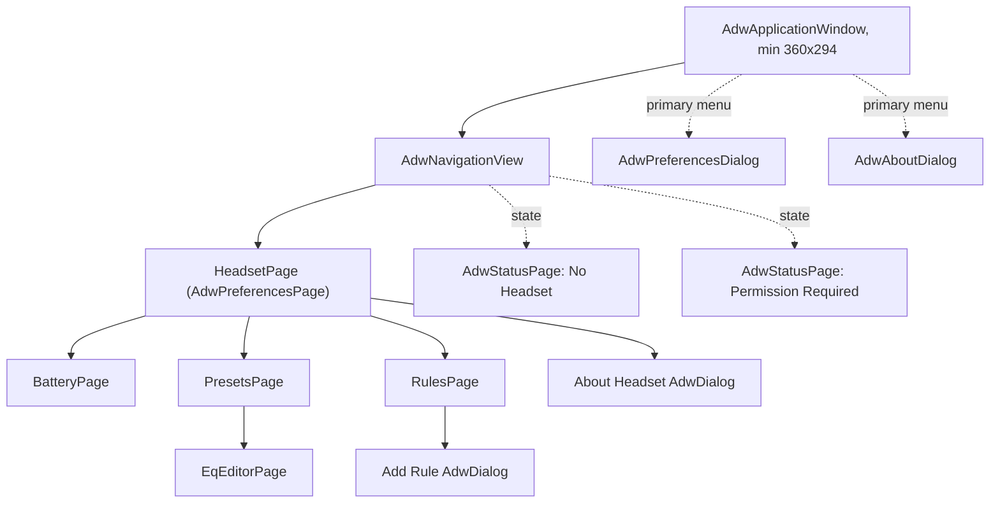
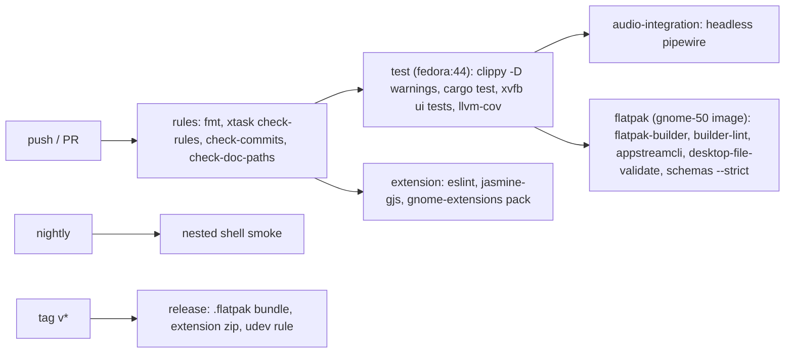

# Arctis Companion: GNOME-native architecture proposal

Lens: GNOME first. HIG fidelity, Flatpak and portal correctness, Circle-app conventions, Shell polish.
Inputs: `docs/research/*.md` (cited as HID, FEAT, UI, FP, PRIOR). App id: `io.github.marcelogm.ArctisCompanion`
(from the `origin` remote). Everything marked SPIKE is settled by sub-project SP1 before it is relied on.

## 1. Process model

**Decision: one process, the app itself.** `arctis-companion` is a single-instance `AdwApplication` that owns
the dongle, the PipeWire client, the D-Bus service and notifications. It runs windowless when the window closes,
kept alive by `gio::ApplicationHoldGuard` after a granted Background portal request. No separate daemon.

Rationale: GApplication already gives single-instance and a session bus name (`$FLATPAK_ID` needs no
`--own-name`, UI 3.3); Amberol does the same with `ashpd` (UI 4); one owner means no device contention between
processes; one Flatpak, one permission story.

| Launch path | Command | Window |
|---|---|---|
| User opens the app | `arctis-companion` | yes |
| Login autostart (portal `autostart=true`, `commandline=[arctis-companion, --gapplication-service]`) | service mode | no |
| Window closed while "Run in Background" is on | process stays, hold guard kept | no |
| Shell extension | never activates the app (`DO_NOT_AUTO_START`), only observes it | - |

The extension not auto-starting is deliberate: if the user turned background off, the Shell must not revive the
process behind their back. Background status line via portal `SetStatus`: "Headset connected, 73 %".



No tokio. Three threads, typed messages over `async-channel`, consumed on the main loop with
`glib::spawn_future_local` (FP 2.4).

### 1.1 D-Bus interface (`io.github.marcelogm.ArctisCompanion.Headset1`)

Object `/io/github/marcelogm/ArctisCompanion`, exported with `gio::DBusConnection::register_object` from the
`dbus_register` vfunc, on GApplication's own connection. Introspection XML lives in
`crates/app/data/headset1.xml` and is the contract the extension tests against.

| Member | Kind | Type | Meaning |
|---|---|---|---|
| `Connection` | prop r | `s` | `absent`, `permission-denied`, `headset-off`, `connected` |
| `Model` | prop r | `s` | display name, empty when absent |
| `BatteryLevel` | prop r | `i` | 0..100, `-1` unknown |
| `Charging` | prop r | `s` | `unknown`, `charging`, `charged`, `discharging` |
| `Presets` | prop r | `a(ss)` | id, translated name |
| `ActivePreset` | prop r | `s` | preset id |
| `ActivePresetReason` | prop r | `s` | `manual`, `default`, or the app display name that triggered it |
| `AutomaticPresets` | prop rw | `b` | per-app switching on/off |
| `ActivatePreset(s id)` | method | | manual selection (pauses automatic switching) |

Changes go out as `PropertiesChanged` only. Opening the window uses the standard
`org.freedesktop.Application.Activate` (the `.desktop` is `DBusActivatable=true`). Version suffix `1` because
the extension ships separately and must tolerate an older app.

## 2. Workspace and seams

```
Cargo.toml                 workspace, [workspace.lints], profile
clippy.toml rustfmt.toml   thresholds (section 10)
crates/
  model/     value types, no deps        Sidetone MicVolume MuteLight AutoOff WirelessMode Link Charge
                                         Battery EqCurve Band FilterKind Hz GainDb Q Model HeadsetSettings
  protocol/  pure codec, no I/O          encode(Command)->Frame, decode(&[u8])->Result<Reply>, Event
  device/    transport + session         Headset::spawn(Locator)->(HeadsetHandle, Receiver<HeadsetEvent>)
    session/   sans-I/O state machine    Session::handle(Input, Instant)->Vec<Effect>
    transport/ hidraw adapter + fake     trait Locator, trait Port; SysfsLocator, HidrawPort, FakeDongle
    runner.rs  executes Effects on a thread
  dsp/       pure, alloc-free process    BiquadBank::new(&EqCurve, rate), process(&mut [f32]), response(&EqCurve, Hz)->dB
  audio/     PipeWire adapters           AudioService::spawn()->(AudioHandle, Receiver<AudioEvent>)
    streams.rs  registry -> AppStream{key, name, icon, running}
    outputs.rs  Nova 5 USB sink / Bluetooth sink detection, default-sink tracking
    equalizer.rs virtual sink + playback stream running dsp::BiquadBank
  core/      pure domain + reducer       Companion::handle(Input)->Vec<Output>; Snapshot
    presets.rs  library, built-ins, validation
    selection.rs per-app preset selection
    routing.rs  EQ engine choice (headset vs system)
    battery.rs  history stats, runtime estimate, notification policy
    reconcile.rs desired vs actual headset settings
  store/     persistence adapters        PresetStore (JSON dir), BatteryLog (SQLite), apo::parse(&str)
  ui/        widgets + pages             HeadsetPage, EqEditorPage, BatteryPage, PresetsPage, RulesPage, widgets/*
  app/       composition root, bin       AdwApplication, D-Bus export, portal, notifications, GSettings bridge
extension/   GJS Quick Settings          extension.js (thin), lib/presentation.js lib/proxy.js (pure/testable)
xtask/       repo rules                  check-rules, check-commits, check-doc-paths, install-hooks
data/ po/ build-aux/ io.github.marcelogm.ArctisCompanion.json
```



Seams with two adapters each (real seams, not hypothetical): `device::Locator`/`Port` (sysfs+hidraw,
`FakeDongle`), `audio` channel boundary (PipeWire, scripted fake), `store` traits defined in `core`
(`PresetRepository`, `BatteryRepository`: file/SQLite, in-memory). `core` and `ui` never see bytes or PipeWire.

Depth checks. `Headset` hides discovery, rebind recovery, pacing, coalescing, verify and resync behind
`HeadsetHandle::apply(HeadsetSettings)` plus an event stream. `Companion` hides every cross-cutting rule (which
preset, which engine, when to notify, what to persist) behind one `handle`. `AudioService` hides graph wiring
behind `AudioHandle::{set_system_eq(Option<EqCurve>), set_manager_role}`.

## 3. Device lifecycle



- **Discovery inside Flatpak.** `SysfsLocator` reads `/sys/class/hidraw/*/device/uevent` (`HID_ID`, `HID_PHYS`
  suffix `/input3` and `/input5`). Triggers: inotify on `/dev` for `hidraw*` plus a 2 s rescan only while not
  connected (netlink is blocked by `--unshare-net`, FP 1.6; inotify SPIKE). No libudev, no `/run/udev`.
- **Re-enumeration.** iface 3 flaps every ~20 s (HID 7.4). `Recovering` is invisible to the UI: the snapshot
  stays `connected` for the grace window, the queued command is retried after reopen. Retrying is safe because
  every write in `protocol` is an absolute value, never a toggle (codec invariant, tested).
- **Events vs polling.** The runner blocks on iface 5 with a 50 ms timeout, then drains commands and timers.
  Replies on iface 3 are matched by echo byte; anything else read there goes to the event decoder too. `B0` is
  read on connect, on `B9`, and as a safety net every 5 min only if no battery event arrived in that window
  (polling glitch, HID 6).
- **Write then verify.** 50 ms pacing; slider writes coalesce (latest value per setting wins). After a batch,
  one readback per touched query (`0x20` for EQ, mic, sidetone, limiter; `0xA0` for LED, auto-off; `0x36` for
  range). Mismatch retries once, then `HeadsetEvent::ApplyFailed(setting)`. Never `09` / `35 01` (HID 5.2).
- **Source of truth.** Desired settings live on the desktop (GSettings); the headset is a cache. First ever
  connection adopts the headset's values (`settings-adopted=false` → read, store, flip). Every later entry to
  `Applying` writes only the diff. A hardware-originated event (`0x37`, `0x39`, `0x27`, `0xA3`, `0xAE`) is user
  intent and updates desired state, so reconnect never fights the user's button press.
- **PIDs.** `Model::from_pid` accepts `0x2232` and `0x2253`; `0x2264`, `0x2255` behind the same codec but shown
  as "untested" until SP1 confirms. Bootloader PIDs `0x2233 0x2254 0x2265` are rejected in the locator, tested.
  One headset at a time (first match); multi-dongle is out of scope.

## 4. Settings model

| Where | What | Why |
|---|---|---|
| Headset (HID) + mirrored in GSettings `…Headset` | sidetone 0..10, mic volume 0..15, mute light 0..3, volume limiter, auto-off minutes, extended range, hardware EQ curve | the headset applies them; the mirror makes reconnect re-apply deterministic |
| GSettings `io.github.marcelogm.ArctisCompanion` | run-in-background, low-battery-threshold (15), notify-full-charge, automatic-presets, default-preset, active-preset, app-rules `a(ss)` (app key → preset id, order = priority), equalizer-engine (`automatic`/`headset`/`system`), safety-poll-minutes (hidden), window geometry | small, typed, change-notified, Circle-app norm |
| `$XDG_DATA_HOME/arctis-companion/presets/<id>.json` | custom presets | structured, import/export, one file per preset |
| `$XDG_DATA_HOME/arctis-companion/battery.sqlite` | battery samples | time series, retention queries |
| gresource `presets/builtin.json` | shipped presets | read-only, translated names via gettext |

Preset JSON, versioned: `{"format":1,"name":"Footsteps","bands":[{"kind":"peaking","hz":2500,"gain_db":4.0,"q":1.0}, …]}`,
max 10 bands, validated by `model` constructors (gain −10..+10 step 0.5, Q 0.2..10, 20..20000 Hz).

## 5. Equalizer

**One curve, two engines.** A preset is an `EqCurve` constrained to the hardware's envelope, so the same preset
sounds the same whichever engine plays it. `core::routing` picks the engine from the active output:

| Active output (from `audio::outputs`) | Engine | Mechanism |
|---|---|---|
| Nova 5 USB sink (2.4 GHz via dongle) | headset | `0x33` write + `0x20` verify. Zero CPU, persists for console use |
| Nova 5 Bluetooth sink on this PC (SPIKE: name match `bluez_output.*` + description) | system | app-owned virtual sink → `dsp::BiquadBank` → playback stream targeting the BT sink; set as default only while active, restored on stop |
| anything else | none | EQ rows show "Equalizer applies to the Arctis Nova 5 only" |

Never both: when the system engine is active the headset curve is left untouched, when headset is active no EQ
node exists. Detected EasyEffects nodes produce an info row ("EasyEffects is also processing audio"). Default
sink switching needs `media.category = Manager` (FP 3.4, SPIKE). `0x34`/`0xA5` (BT-path hardware EQ, name
announce) are not used (unverified, not needed). Advanced override `equalizer-engine` exists for diagnosis.

**Shipped library** (authored by us, CC0 data, no SteelSeries curves, no HeadsetControl values): Flat,
Bass Boost, Bass Reduction, Treble Boost, Vocal Clarity, Footsteps, Immersive (V-shape), Night Listening,
Podcast. Plus **Import…** for Equalizer APO / AutoEQ `ParametricEQ.txt` (`store::apo`, >10 filters rejected
with a clear toast, values clamped and reported) and JSON import/export.

**Editor UX** (`EqEditorPage`, pushed on `AdwNavigationView`):

- `EqCurveView` custom widget (snapshot): log frequency 20 Hz..20 kHz, ±10 dB grid, curve from
  `dsp::response`; ten handles, drag = frequency+gain, scroll = Q, handles focusable with arrow keys, each with
  an accessible label "Band 3, 250 hertz, plus 2 decibels".
- Below: `AdwPreferencesGroup` of `AdwExpanderRow` per band ("250 Hz · +2.0 dB") containing `AdwComboRow`
  (type), `AdwSpinRow` frequency, gain (0.5 step), Q, `AdwSwitchRow` enabled.
- Built-ins are read-only; header button "Duplicate". Custom presets save instantly (HIG: no Save button);
  destructive actions give an undo toast. Editing the active preset previews live: system engine immediately,
  headset engine throttled to one write per 250 ms.
- `AdwBreakpoint` at `max-width: 720sp` stacks curve over list; wider puts them side by side.

## 6. Per-app presets

**Detection: PipeWire stream properties, not the focused window.** Audio is what matters (Discord in the
background while a game is focused), there is no focus portal, it works without the extension, and Registry RX
is granted to Flatpak clients by default (FP 3.5). `AppStream.key` = `pipewire.access.portal.app_id` →
`application.id` → `application.process.binary`; display name from `application.name`. Classify only after the
node `info` event and only streams in state `running` targeting a Nova 5 output.

`core::selection` (pure) rules:

1. Manual choice (app or Shell) wins and turns `AutomaticPresets` off; the user turns it back on.
2. Otherwise the highest-priority rule among running streams wins; ties go to the most recently started.
3. Enter after the stream has been running 1 s; leave 10 s after the last matching stream stops (no flapping on
   notification sounds or track gaps); then `default-preset`.
4. Switches are silent: no notification (HIG), a toast only if the window is visible, the Shell subtitle shows
   "Footsteps · Firefox".

Rules UI: `RulesPage` lists rules as `AdwComboRow` (app name/icon as title, preset as value), reorderable by
drag; "Add Rule" opens an `AdwDialog` listing apps seen playing this session plus "Other App…" (binary name).

## 7. Battery history

- **Sampling.** Only from events (`B7`, `BB`, `B9`) and the 5 min safety poll; never a dedicated poll. Write on
  change, at most one row per minute, plus charge-state transitions always. Table
  `sample(ts INTEGER, percent INTEGER, charge INTEGER)`, 90-day retention pruned on startup.
- **Derivations (pure, `core::battery`).** Discharge sessions, estimated time remaining (least-squares slope of
  the current session, shown only with ≥ 30 min of data), last full charge.
- **View.** `BatteryPage`: `AdwToggleGroup` "Day / Week", `BatteryChart` custom snapshot (line, charging
  segments shaded, accent color, works in dark/high contrast), summary rows below, chart accessible description
  generated from the derivations.
- **Notifications.** `GNotification` ids `low-battery` (threshold, default 15 %) and `critical-battery` (5 %),
  withdrawn on charging; optional `charged`. Default action `app.show-battery`. Hysteresis 3 points.

## 8. UI information architecture



HeadsetPage groups, one widget per control:

| Group | Row | Widget |
|---|---|---|
| (header) | battery, charge, link | `HeadsetStatus` custom: our own symbolic headset, level icon, "73 % · Discharging", "2.4 GHz" |
| Equalizer | Preset | `AdwComboRow`, subtitle "Applied by headset" or "Applied by system" |
| | Automatic App Presets | `AdwSwitchRow` |
| | App Rules, Presets | `AdwActionRow` + `go-next-symbolic` |
| Microphone | Volume | `ScaleRow` (custom `AdwPreferencesRow` + `GtkScale`, 16 steps, end icons) |
| | Sidetone | `ScaleRow` 0..10 with marks Off/Low/Medium/High (positions SPIKE) |
| | Mute Light Brightness | `AdwComboRow` Off/Low/Medium/High |
| Wireless | Volume Limiter | `AdwSwitchRow` |
| | Extended Range | `AdwSwitchRow`, subtitle "Increases range, lowers microphone quality" |
| | Automatic Power Off | `AdwComboRow` Never, 1, 5, 10, 15, 30, 45, 60, 75, 90 min |
| | Battery History | `AdwActionRow` + chevron |

Not shown: the 2.4 GHz / Bluetooth audio-mode switch, because no USB command exists (HID 5.4). HIG: no control
that cannot work. The header shows the link read-only; `model::Capabilities` hides rows a model lacks, so the
switch appears the day SP1 finds a command.

States: no dongle → `AdwStatusPage` "No Headset Connected". Node but EACCES → `AdwStatusPage` "Permission
Required" with "Show Instructions" (`AdwDialog`: the udev rule and `sudo` command, copy buttons; the sandbox
cannot run it). Headset off → page visible, values last-known and insensitive, header "Headset Off". Failed write
→ `AdwToast` "Could Not Change Sidetone" + Retry. No PipeWire → equalizer subtitle explains. Preferences:
Run in Background, Start on Login (portal, denial reflected back into the switch), notification thresholds,
Equalizer Engine, "GNOME Shell Integration" link row to extensions.gnome.org.

Text: English source, HIG capitalization (header case for titles/buttons, sentence case for descriptions),
gettext via `gettext-rs`, `po/pt_BR.po`; Blueprint `.blp` per widget, one widget per file.

## 9. Shell extension (GNOME 50)

`metadata.json`: `shell-version ["50"]`, uuid `arctis-companion@marcelogm.github.io`, no `prefs.js`.

- `SystemIndicator` with a panel icon only while `Connection == connected` and battery ≤ threshold or charging.
- `QuickMenuToggle` "Arctis Nova 5", subtitle "73 %" / "Charging · 73 %" / "Footsteps · Firefox"; checked =
  `AutomaticPresets`. Menu header (icon, name, battery), preset items with check ornament calling
  `ActivatePreset`, separator, "Headset Settings" → `org.freedesktop.Application.Activate`.
- Hidden when the name has no owner or `Connection` is `absent`. No sliders, no notifications (the app owns
  them; HIG says the window must hold the same information).
- `lib/presentation.js` maps the property bag to `{visible, title, subtitle, icon, items}`; pure, no
  `resource:///` imports. `extension.js` only wires proxies to widgets and disconnects everything in `disable()`.

## 10. Testing, CI, rule enforcement

| Layer | Tests | Fixtures / fakes |
|---|---|---|
| model | constructors reject out-of-range; proptest | - |
| protocol | golden frames from HID 7.1 (`tests/golden/*.hex`), stale-tail parsing, round-trip proptest, "all writes absolute" | SP1 adds captured write/event traces |
| device | `Session` scenario tables with fake clock: rebind every 20 s, EIO mid-batch, verify mismatch, B9 resync, EACCES, bootloader PID; runner against `FakeDongle` | `FakeDongle` emulates stale tails, node churn, headset off |
| hardware | `#[ignore]` suite, `ARCTIS_HW=1`, run by a human with the headset | real dongle |
| dsp | magnitude at center = gain ±0.01 dB, shelf asymptotes, poles inside unit circle, 48/44.1 kHz, no allocation in `process` (counting allocator), denormal flush | - |
| audio | integration against a headless PipeWire+WirePlumber: sine through EQ sink, measured gain at band center; registry classification | Fedora container job |
| core | reducer given/when/then, selection timing, routing table, battery estimate, notification hysteresis | in-memory repositories |
| store | tempdir SQLite retention, preset JSON snapshot (`insta`), APO parser fixtures | - |
| ui | `#[gtk::test]` under `xvfb-run`: snapshot → widget state, widget action → intent, every interactive widget has an accessible label | fake `Snapshot` |
| app | D-Bus contract test: spawn service on a private bus (`gio::TestDBus`), assert properties and signals match `headset1.xml` | fake headset/audio |
| extension | `jasmine-gjs` on `lib/*`; ESLint; nightly smoke `gnome-shell --headless --devkit` with a fake `Headset1` service | gjs fake service |

GitHub Actions (`.github/workflows/`):



Enforcement (supersedes `scripts/check-line-limit.sh` and the current `.githooks`, which `xtask install-hooks`
regenerates):

- `xtask check-rules`: every tracked file ≤ 400 lines (exempt list in `xtask/src/exempt.rs`: `Cargo.lock`,
  generated `cargo-sources.json`, `po/*.po`); no comments: Rust via `ra_ap_rustc_lexer` comment tokens (incl.
  doc comments), Blueprint/CSS slash comments, `#` in TOML/YAML/meson/shell (string-aware), XML `<!--`;
  licensing through `REUSE.toml`, not headers. JS: local ESLint rule reporting `getAllComments()`.
- `[workspace.lints.clippy]`: `cognitive_complexity = "deny"`, `too_many_lines = "deny"`, `pedantic` warn;
  `clippy.toml`: `cognitive-complexity-threshold = 8`, `too-many-lines-threshold = 40`,
  `excessive-nesting-threshold = 3`, `too-many-arguments-threshold = 4`. CI uses `-D warnings`.
- `rustfmt --check`; ESLint `complexity: [error, 6]`, `max-lines: 400`.
- `xtask check-commits <base>..HEAD`: conventional-commit subject regex; rejects any `Co-Authored-By`,
  "Generated with", tool or AI mention, in commit messages and in the PR body (separate step on
  `pull_request`).
- `xtask check-doc-paths`: every backticked repo path in `docs/**/*.md` exists, so diagrams stay durable.

## 11. Sub-projects

| # | Sub-project | Depends on | Acceptance criteria |
|---|---|---|---|
| SP0 | Foundations | - | workspace skeleton builds; xtask rules + hooks; CI `rules` and `test` green; Flatpak manifest builds an empty `AdwApplicationWindow`; `docs/architecture.md` with the diagrams above |
| SP1 | Hardware and sandbox spikes (human + agent) | SP0 | written answers with captures in `crates/protocol/tests/golden/`: persistence after power cycle, sidetone mark positions, event interface, 20 s rebind cause and settle need, inotify in bwrap, PipeWire Manager role in Flatpak, Nova 5 BT sink name |
| SP2 | `model` + `protocol` | SP0 | every command and event in HID 5-6 encoded/decoded; golden tests pass; 100 % line coverage on codec |
| SP3 | `device` | SP2 (SP1 for timings) | state machine matches section 3 diagram as tests; `FakeDongle` scenarios incl. 20 s rebind with no `Disconnected` emitted; manual HW suite passes |
| SP4 | `dsp` | SP0 (model types) | numeric suite green; `process` alloc-free; `response()` used by a plot fixture |
| SP5 | `core` | SP2 types | reducer covers reconcile, routing, selection, battery policy; no GTK/PipeWire deps (checked by `cargo tree` in xtask) |
| SP6 | `store` | SP2 types | presets JSON round-trip, APO import, SQLite retention; repositories satisfy `core` traits |
| SP7 | `audio` | SP4, SP1 | registry emits `AppStream`s; system EQ audible gain verified in CI integration job; default sink restored on drop |
| SP8 | `app` service | SP3, SP5, SP6 | D-Bus contract test; background portal + autostart; notifications; works windowless |
| SP9 | UI main page and states | SP5 (snapshot) | HeadsetPage, status pages, toasts, Preferences; widget tests; 360 px width without horizontal scroll |
| SP10 | EQ editor, presets, rules, battery pages | SP9, SP4 | keyboard-only editing; undo toasts; chart accessible description; breakpoint layout |
| SP11 | Shell extension | D-Bus XML from SP8 | jasmine suite; ESLint clean; nightly smoke; hides when app absent |
| SP12 | Packaging and release | all | Flathub-lint clean manifest, metainfo with screenshots, udev rule + instructions, pt_BR complete, release workflow |

```mermaid
gantt
  dateFormat X
  axisFormat %s
  section Wave 1
  SP0 :a0, 0, 1
  section Wave 2
  SP1 :a1, 1, 3
  SP2 :a2, 1, 2
  SP4 :a4, 1, 2
  section Wave 3
  SP3 :a3, 2, 4
  SP5 :a5, 2, 3
  SP6 :a6, 2, 3
  SP7 :a7, 3, 4
  SP9 :a9, 3, 4
  section Wave 4
  SP8 :a8, 4, 5
  SP10 :a10, 4, 5
  SP11 :a11, 4, 5
  section Wave 5
  SP12 :a12, 5, 6
```



Parallel sets: {SP1, SP2, SP4}; {SP3, SP5, SP6}, then {SP7, SP9}; {SP8, SP10, SP11} (SP11 starts as soon as
`headset1.xml` is frozen, against a fake service).

## 12. Open risks

- `--device=all` scrutiny on Flathub; justified in metainfo, udev rule documented (FP 1.5).
- System EQ default-sink switching depends on WirePlumber granting Manager to Flatpak clients (SP1).
- Settings may not persist on the headset without a save command; the desktop-as-source-of-truth model covers
  it on this PC but not on a console (SP1 answers; document the result in the UI if negative).
- Sidetone level marks and Nova 5X variants unverified; shown as "untested model" until confirmed.
