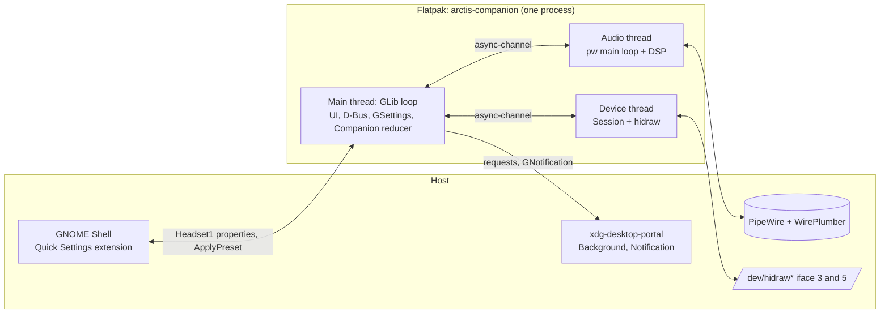
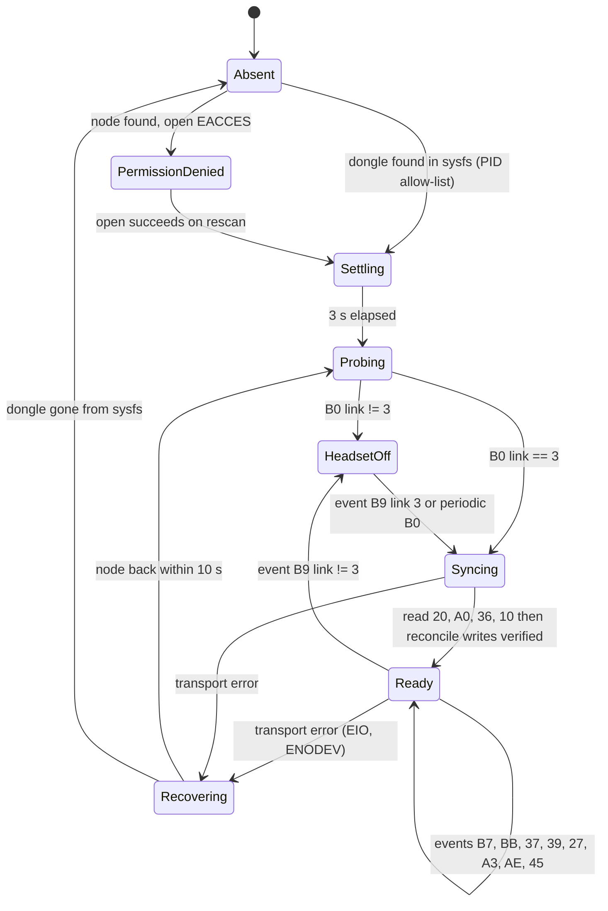
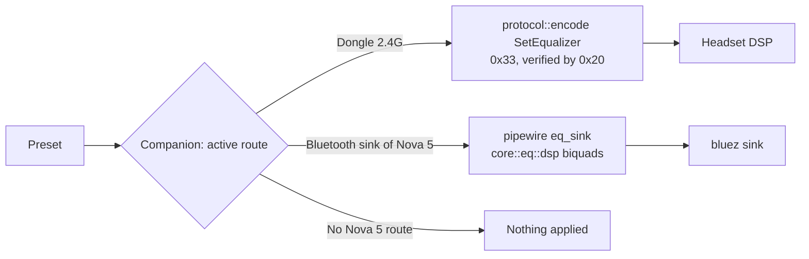
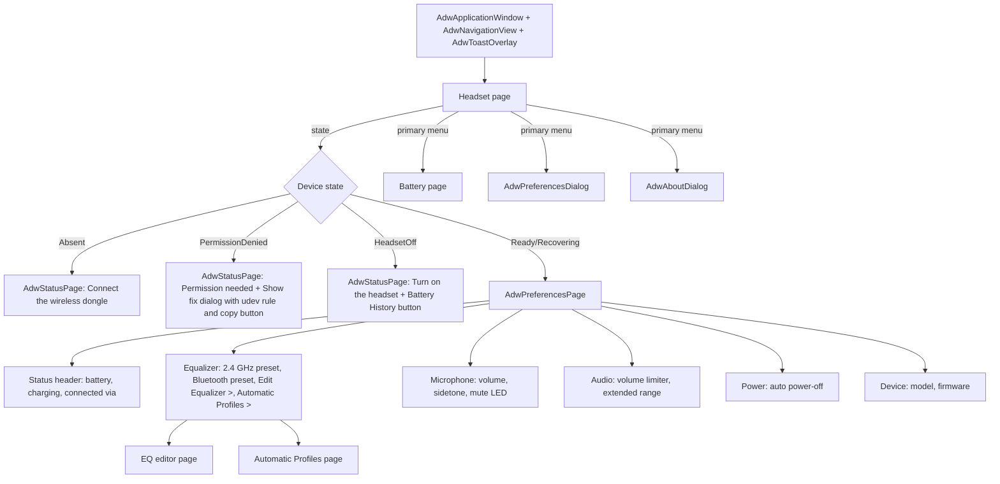
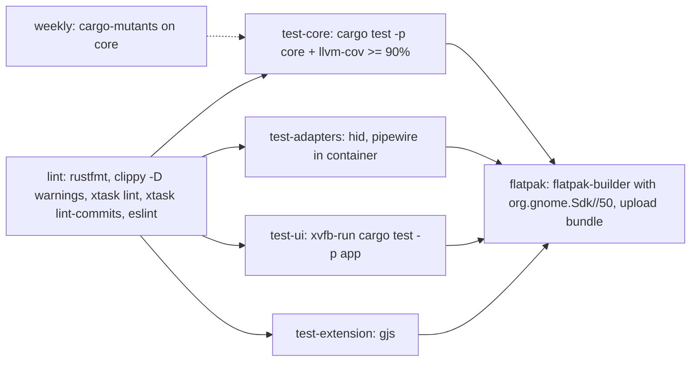
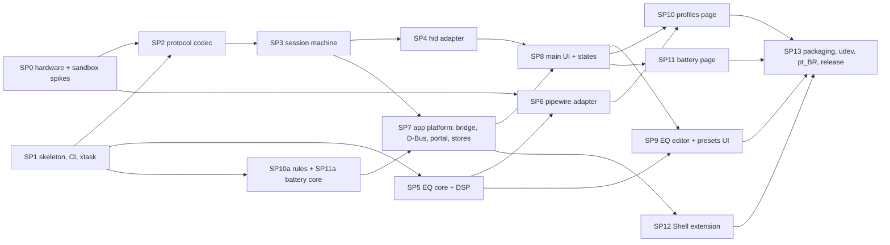

# Arctis Companion: architecture proposal (lens: minimal cognitive load)

One process, two pure state machines, three threads, four crates. Everything that can be pure is pure and lives in one crate; everything that touches the outside world is a thin adapter behind a channel. Research inputs: `docs/research/*.md`.

Guiding rules for every decision below:

- A reader understands a feature by opening **one pure module** and its tests. Adapters hold no policy.
- No abstraction without a second user or a test seam that needs it.
- Prefer what GNOME and Fedora already ship: `gio` for D-Bus, GSettings, GNotification, gettext, meson for install.
- Never write an unverified command. Unknowns go to the hardware spike (SP0) before code depends on them.

## 1. Process model

**Decision: a single process, the Flatpak app itself.** It owns the device, the PipeWire EQ, the per-app watcher, the battery log, the D-Bus service and notifications. No daemon, no helper, no second binary.

| Concern | Decision | Rationale |
|---|---|---|
| Device owner | The app process (device thread) | Only one writer to the headset; no lock or IPC between owners |
| Running in background | `GApplication` hold while the preference "Run in background" is on (default on). Window close hides the window, process stays | Same binary, same code path with or without a window |
| Permission to run in background | `org.freedesktop.portal.Background.RequestBackground` with `autostart: true`, `commandline: ["arctis-companion", "--gapplication-service"]`, called through `gio::DBusProxy` (no `ashpd`) | Saves the `ashpd`+`zbus` dependency tree for one call. If the user denies, the app still works while its window is open |
| Autostart | The portal writes the autostart entry; `--gapplication-service` starts with no window | One mechanism, revocable from GNOME Settings > Apps |
| Shell extension data | D-Bus interface exported by the app on its own well-known name (the app id, allowed by default in Flatpak) | No `--talk-name`/`--own-name` needed; the extension is outside the sandbox |
| Extension when app absent | Proxy created with `DO_NOT_AUTO_START`; the toggle is hidden when the name has no owner | The shell never spawns a sandbox at login; autostart is the portal's job |
| Notifications | `gio::Application::send_notification` (routed to the portal by GIO in Flatpak) | Zero extra code paths |
| D-Bus library | `gio` (`DBusConnection::register_object`) on the `GApplication` connection | The name is already owned by `GApplication`; no second bus connection |



Threads exist only where an external API blocks or owns a loop (hidraw reads, `pw_main_loop`). The main thread never blocks; no tokio.

## 2. Workspace and seams

```
Cargo.toml                       workspace, lints, profile
crates/
  core/                          pure: no I/O, no GTK, no PipeWire, no threads. deps: serde only
    src/protocol/  frame.rs command.rs reply.rs event.rs eq_codec.rs model.rs
    src/session/   state.rs input.rs effect.rs reconcile.rs verify.rs
    src/eq/        preset.rs filter.rs library.rs apo.rs biquad.rs response.rs dsp.rs
    src/companion/ state.rs event.rs action.rs route.rs rules.rs alerts.rs
    src/battery/   sample.rs log_format.rs series.rs
    src/settings.rs  value types: MicVolume, Sidetone, MuteLed, Inactivity, WirelessMode
    tests/golden/  hex captures from hardware (hid-protocol.md 7.1 + SP0)
  hid/                           adapter: sysfs discovery, hidraw I/O, device thread. deps: core, rustix
    src/discovery.rs transport.rs pacing.rs worker.rs handle.rs
  pipewire/                      adapter: registry watcher, EQ sink, audio thread. deps: core, pipewire
    src/registry.rs streams.rs routes.rs eq_sink.rs worker.rs handle.rs
  app/                           GTK binary, composition root. deps: all above, gtk4, libadwaita, gettext-rs
    src/main.rs application.rs bridge.rs
    src/dbus/ headset_object.rs headset1.xml
    src/platform/ background_portal.rs notifications.rs settings_store.rs preset_store.rs battery_store.rs
    src/ui/ window.rs headset_page.rs status_header.rs microphone_group.rs eq_group.rs power_group.rs
            empty_states.rs eq_editor_page.rs eq_band_row.rs response_graph.rs
            profiles_page.rs battery_page.rs battery_chart.rs preferences_dialog.rs
    data/ ui/*.blp, gschema, desktop, metainfo, service, icons
extension/                       GJS, ESM. src/extension.js indicator.js model.js proxy.js, tests/
xtask/                           cargo xtask lint | lint-commits (rule enforcement, section 10)
packaging/ flatpak manifest, 70-arctis-companion.rules
po/ extension/po/                gettext, English source + pt_BR
```

Why four crates and not eight: a crate boundary is used only where it **enforces** a dependency rule. `core` cannot import I/O because it has no I/O dependencies; `hid` and `pipewire` cannot see GTK; `app` is the only place where GTK exists. Transport, session and discovery are modules, not crates: the seam is a type, not a manifest.

### Public interfaces (the whole surface each module offers)

| Module | Interface | Depth: what it hides |
|---|---|---|
| `core::protocol` | `encode(&Command) -> Frame`, `decode(&[u8]) -> Option<Message>`, `Model::from_pid(u16) -> Option<Model>` | 65-byte framing, on-wire offsets, stale tails, gain `20+2dB`, Q x1000, LED raw 0/1/4/10, bootloader PID exclusion |
| `core::session` | `Session::new(Desired)`, `session.handle(Input) -> Vec<Effect>` | Connection states, settle delay, probe, reconcile desired vs actual, write-then-readback, retry-once, event interpretation |
| `core::eq` | `Preset`, `library()`, `apo::parse/render`, `response(&Preset, &[f32]) -> Vec<f32>`, `Equalizer::new(&Preset, rate)`, `eq.process(&mut [f32])` | RBJ biquads, 10-filter hardware limits, preamp, APO text format |
| `core::companion` | `Companion::new(Config)`, `companion.handle(Event) -> Vec<Action>` | Route-to-target choice, per-app rule priority and debounce, manual override, low-battery alerts, what to persist |
| `core::battery` | `Sample`, `log_format::{parse, render}`, `series(&[Sample], Window) -> Series` | Change-only sampling, retention, charging spans |
| `hid::handle` | `DeviceHandle::spawn(SysRoot, Desired) -> DeviceHandle { changes: Sender<Change>, updates: Receiver<Update> }` | Thread, discovery, reopen on EIO/ENODEV, 50 ms pacing, 3 s settle |
| `pipewire::handle` | `AudioHandle::spawn() -> AudioHandle { commands: Sender<AudioCommand>, events: Receiver<AudioEvent> }` | Registry, node info waits, Nova 5 sink matching, virtual sink + playback stream, default-sink metadata |
| `app::bridge` | `Bridge::run(device, audio, companion, ui, dbus)` | Pumps channels into the reducer and fans `Action`s out to adapters |

`Session` and `Companion` are sans-I/O reducers: input in, effects out. Every behaviour in sections 3-7 is a table-driven test against one of them.

## 3. Device lifecycle



| Topic | Decision | Rationale |
|---|---|---|
| Discovery | Read `/sys/class/hidraw/*/device/uevent` (`HID_ID`, `HID_PHYS` suffix `/input3`, `/input5`); rescan every 2 s while not Ready | sysfs is exposed in Flatpak; no libudev, no netlink (blocked by `--unshare-net`), no inotify (unverified under bwrap). One mechanism, no device I/O, so no audio glitch |
| iface 3 (commands) | **Open per transaction**: open, write, read reply with timeout, close | iface 3 re-enumerates every ~20 s. A short-lived fd makes the flap invisible: the next transaction rediscovers the node. No long-lived fd to invalidate |
| iface 5 (events) | Long-lived blocking read on the device thread; on EOF/ENODEV the worker emits `Input::Detached` and rescans | iface 5 is stable per research |
| Transient failure | `TransportFailed` → `Recovering`; queued intents survive; UI shows "Reconnecting" only after 3 s | A 20 s flap must not flicker the UI |
| Events vs polling | Events for battery, charging, link, on-headset changes. `B0` once on Probing and then every 5 min as a safety net (constant `STATUS_SAFETY_POLL`, tuned in SP0) | HeadsetControl #452 reports glitches with polling |
| Write then verify | `Set*` → after 50 ms the matching query (`20` for mic, sidetone, limiter, EQ; `A0` for LED, inactivity; `36` for wireless) → compare → on mismatch rewrite once → else `Effect::Publish` with `WriteFailed(setting)` | No ACK exists. Only idempotent absolute writes, so a retry is safe |
| Forbidden frames | `09`, `35 01` after writes, `A7`, `A5`, `0x34`, bootloader PIDs. Enforced by `Command` having no variant for them | The type system is the allow-list |
| Source of truth | **GSettings holds the desired value.** On Syncing, actual != desired → write desired. An event from the headset (user turned a knob) updates desired | Persistence across power cycles is unknown (open question 1); one direction of sync is easy to reason about. Accepted trade-off: changes made from the phone app while this app is closed are overwritten on reconnect |
| Multiple PIDs | `Model::{Nova5, Nova5X}` from PIDs `0x2232`, `0x2253`, `0x2264`(UNVERIFIED); same protocol; first matching dongle wins | YAGNI for two dongles at once |
| Pacing | `pacing.rs` owns 50 ms spacing and the 3 s settle; `Session` never sleeps | Time stays out of pure code; the worker injects `Input::Settled` |

## 4. Settings model

| Setting | Lives on | Stored by app in | Widget |
|---|---|---|---|
| Mic volume 0..15 | headset `37` | GSettings `mic-volume` | `GtkScale` 16 steps in `AdwActionRow` |
| Sidetone 0..10 | headset `39` | GSettings `sidetone` | `GtkScale` 11 steps, marks Off/Low/Medium/High (mapping from SP0) |
| Mute LED Off/Low/Medium/High | headset `AE` | GSettings `mute-led` | `AdwComboRow` |
| Volume limiter | headset `27` | GSettings `volume-limiter` | `AdwSwitchRow` |
| Extended range | headset `35`/`36` | GSettings `extended-range` | `AdwSwitchRow`, subtitle "Lowers microphone quality to increase wireless range" |
| Auto power-off | headset `A3` | GSettings `inactivity` (enum Never,1,5,10,15,30,45,60,75,90) | `AdwComboRow` |
| Headset EQ curve | headset `33` | derived from `preset-dongle` | `AdwComboRow` of presets |
| Bluetooth preset | app only (system EQ) | GSettings `preset-bluetooth` | `AdwComboRow` |
| Per-app rules | app only | GSettings `app-rules` `a{ss}` app key → preset id | list page |
| Run in background, low-battery threshold, notifications | app only | GSettings | `AdwPreferencesDialog` |
| User presets | app only | `$XDG_DATA_HOME/arctis-companion/presets/<id>.json`, one file per preset | editor |
| Battery history | app only | `$XDG_DATA_HOME/arctis-companion/battery.csv` | chart |

Preset JSON (`core::eq::preset`, serde): `{"id":"bass-boost","name":"Bass Boost","filters":[{"kind":"low-shelf","freq":105,"gain":5.5,"q":0.71}]}`. One file per preset makes export a file copy and import a file pick.

## 5. Equalizer

**One preset model, two renderers, target chosen by route, never by the user.**

Every preset obeys the hardware envelope: at most 10 filters, kinds peaking/low-shelf/high-shelf/low-pass/high-pass, 20..20000 Hz, -10..+10 dB in 0.5 dB steps, Q 0.2..10. So any preset can go to either target without translation loss.



| Topic | Decision | Rationale |
|---|---|---|
| 2.4G | Hardware EQ `0x33` only; system EQ off | Free, zero latency, persists for consoles. Never double-process |
| Bluetooth | System EQ: app-owned `Audio/Sink` "Arctis Nova 5 (Equalizer)" + playback stream `target.object` = Nova 5 bluez node, made default sink via metadata (`media.category = Manager`) while BT is active; removed otherwise | `0x34` is unverified and BT audio does not pass through the dongle. EasyEffects-style in-process DSP is the known working path in Flatpak |
| Route detection | `pipewire::routes`: Nova 5 USB sink (`device.vendor.id`/`device.product.id`) and Nova 5 bluez sink (name match, rule from SP0) and the current default sink → `Route::{Dongle, Bluetooth, None}` | The dongle cannot see Bluetooth; PipeWire can |
| Audio mode toggle | **Not shown.** Read-only "Connected via 2.4 GHz / Bluetooth" row | No USB command exists; HIG: never show a control that cannot work |
| DSP | `core::eq::dsp::Equalizer`: RBJ biquads, transposed direct form II, f32, preallocated, automatic preamp `-max(boost)`; coefficient swap via a lock-free double buffer in the adapter | Pure and numerically testable; the graph and the DSP share `biquad.rs`, so the curve shown is the curve applied |
| Shipped library | Our own curves in `core::eq::library` (const data): Flat, Bass Boost, Voice Clarity, V-Shape, Footsteps, Treble Soften, Late Night (gentle low cut + limiter-friendly). No SteelSeries curves, not even the HeadsetControl ones | Proprietary presets cannot ship. Library grows by data, reviewed by tests |
| Import / export | Equalizer APO parametric text (`Preamp:`, `Filter n: ON PK Fc .. Hz Gain .. dB Q ..`), clamped to the envelope with a visible warning | De facto interchange format; AutoEQ publishes it, so users can bring measured corrections |
| Editor UX | `AdwNavigationPage`: read-only `response_graph` (snapshot drawing, log-frequency axis) above a boxed list of up to 10 `AdwExpanderRow` bands (type combo, frequency spin, gain scale, Q spin, enable switch). Edits apply live (150 ms debounce) to the active target. Header: "Save as…", "Revert". Dragging handles on the graph is deferred | Rows are keyboard- and screen-reader-friendly by construction; the graph adds understanding without a second editing model |
| Built-in presets | Read-only; editing one starts a copy ("Bass Boost (custom)") | No reset logic needed |

## 6. Per-app profiles

**Decision: PipeWire stream properties, not the focused window.** Flatpak has no portal for focus; asking the extension would make an optional surface load-bearing. PipeWire read access (RX) is granted to Flatpak clients by default.

| Topic | Rule |
|---|---|
| App key | first present of `pipewire.access.portal.app_id`, `application.id`, `application.process.binary` |
| Active stream | `Stream/Output/Audio` node whose state is `running` (not merely existing, so an idle Discord does not win) |
| Choice | Most recently started running stream that has a rule wins; when it stops, the next most recent; none → route default preset |
| Debounce | 500 ms before switching, so short notification sounds do not flap the EQ |
| Manual override | A preset picked by hand while a rule is active holds until the ruled stream stops |
| UI | "Automatic Profiles" page: `GtkListView` of rules (app name, icon if resolvable, preset combo); "Add" dialog lists apps seen playing in this session plus a free-text key |
| Deferred | Steam AppID matching (requires `/proc` outside the sandbox) |

All of this is `core::companion::rules`, tested with event scripts (`StreamStarted`, `StreamStateChanged`, `Tick`).

## 7. Battery history

| Topic | Decision |
|---|---|
| Sampling | No extra device traffic: samples come from events `B7`/`BB`/`B9`, the Probing `B0` and the 5-minute safety `B0`. Write a line only when percent, charging or link changed |
| Storage | Append-only CSV `unix_seconds,percent,charging,link`, ~100 lines/day. Lines older than 90 days dropped when the app starts. No SQLite |
| Visualisation | "Battery" page: `AdwToggleGroup` Day / Week, `battery_chart` custom widget (line with charging spans shaded, offline gaps broken), current level and "Last full charge" row. Accessible summary text for screen readers |
| Notifications | Low battery at the threshold (default 15 %) and at 5 %, once per discharge; withdrawn when charging starts. Nothing else (HIG: do not interrupt for trivia) |

## 8. UI information architecture



- Every view renders a `ViewModel` struct from `core`; widgets emit `Intent`s. No widget reads GSettings or a channel.
- Failed writes: `AdwToast` "Could not change sidetone" with "Retry". Recovering: controls insensitive after 3 s, spinner in the header bar.
- Adaptive: content inside `AdwClamp` (preferences page default), minimum 360×294, one `AdwBreakpoint` at `max-width: 400sp` that stacks the battery page toggle under the chart title.
- i18n: `gettext-rs`, English msgids, `po/pt_BR.po`; extension has its own domain in `extension/po/`. `xtask lint` fails on untranslated pt_BR strings.
- UI defined in Blueprint, one `.blp` per widget, compiled by `build.rs` into a gresource.

## 9. D-Bus interface and Shell extension (GNOME 50)

Name: the app id (`io.github.marcelogm.ArctisCompanion`, final id chosen in SP1). Object `/io/github/marcelogm/ArctisCompanion/Headset`. Single source: `crates/app/src/dbus/headset1.xml`, copied into the extension at build; `xtask lint` fails if the two differ.

```
interface io.github.marcelogm.ArctisCompanion.Headset1
  property State      s  read   absent | permission-denied | headset-off | syncing | ready | recovering
  property Model      s  read   "Arctis Nova 5"
  property Battery    i  read   0..100, -1 unknown
  property Charging   b  read
  property Route      s  read   dongle | bluetooth | none
  property Preset     s  read   active preset id
  property Presets    a(ss) read  (id, name) for the menu
  method   ApplyPreset(s id)
  signal   org.freedesktop.DBus.Properties.PropertiesChanged
```

Opening the window uses the standard `org.freedesktop.Application.Activate` (desktop file `DBusActivatable=true`). No other methods: settings are edited in the app.

Extension scope: `SystemIndicator` with a headset-battery icon in the panel (only when State is `ready`), one `QuickMenuToggle` "Arctis Nova 5" with subtitle "62 %, charging"; clicking opens the menu (checked = connected). Menu: header with battery, preset list as radio items calling `ApplyPreset`, "Headset Settings" (Activate). Hidden when the name has no owner. Logic in `model.js` (pure: properties → labels, icon names, items), shell glue in `indicator.js`.

## 10. Testing, CI and rule enforcement

| Layer | Tests | Fakes / fixtures |
|---|---|---|
| `core::protocol` | Golden bytes: every captured frame in `tests/golden/*.hex` decodes to the expected struct; every `Command` encodes to the captured bytes; proptest round-trip of EQ bands; stale-tail frames still decode | Hardware captures from SP0 |
| `core::session` | Scenario tables: "given inputs, expect effects" for every state transition, reconcile, verify, retry-once, flap during Syncing | none needed (pure) |
| `core::eq` | DSP numeric: magnitude at `f0` equals gain ±0.05 dB for each kind; flat preset is identity; impulse response decays (stability); `process` allocates nothing (counting global allocator in test); APO parse/render round-trip; library presets respect the envelope | none |
| `core::companion`, `core::battery` | Event scripts for route choice, rules, debounce, override, alerts; CSV parse/render, retention, series | none |
| `hid` | Discovery against fake sysfs trees in tempdirs; worker against an in-memory `Transport` that can return EIO and vanish; optional `uhid` job that creates a virtual Nova 5 (descriptors from research) and re-creates iface 3 every 2 s | `FakeTransport`, `/dev/uhid` (UNVERIFIED on runners, job skips if absent) |
| `pipewire` | Integration in a Fedora container: `dbus-run-session` + `pipewire` + `wireplumber` headless, a `null-audio-sink` named like the Nova 5, assert our sink and link via `pw-dump` | containerised PipeWire |
| `app` platform | Background portal and notifications against `python-dbusmock` on a private bus; stores in tempdirs | dbusmock |
| `app` UI | `#[gtk::test]` under `xvfb-run`: given a `ViewModel`, rows show values; moving a scale emits the `Intent`; each empty state renders | ViewModels from `core` |
| extension | `eslint` + `gjs -m extension/tests/run.js` on `model.js` (plain asserts, no framework) | fake property bags |

GitHub Actions (`.github/workflows/ci.yml`), all jobs on `ubuntu-latest` with a `fedora:44` container where GTK/PipeWire are needed:



Rule enforcement, all in `xtask` (Rust, no shell scripts to keep comment-free):

| Rule | Mechanism |
|---|---|
| ≤ 400 lines, any language | `xtask lint` over `git ls-files`, excluding only generated files (`Cargo.lock`, `*.po` generated headers listed explicitly) |
| No comments | Rust via `ra_ap_rustc_lexer` comment tokens; Blueprint/CSS/JS via a token scan; TOML/YAML/meson by `#` outside strings; JS also via eslint `no-inline-comments` + custom check. No SPDX headers (licence in `LICENSE` + `REUSE.toml`) |
| Cognitive complexity | `[workspace.lints.clippy] cognitive_complexity = "deny"`, `clippy.toml: cognitive-complexity-threshold = 10`, `too-many-lines-threshold = 40`, `pedantic = "warn"` |
| Formatting | `cargo fmt --check` |
| Commits | `xtask lint-commits <base>..HEAD`: conventional-commit subject regex; rejects any `Co-Authored-By`, `Generated with`, `Claude`, `noreply@anthropic.com` in commit or PR body (PR body checked via `github.event.pull_request.body`) |

## 11. Sub-projects



Parallel groups: {SP0, SP1} → {SP2, SP5, SP10a} → {SP3, SP6} → {SP4, SP7} → {SP8, SP12} → {SP9, SP10, SP11} → SP13.

| SP | Scope | Acceptance criteria |
|---|---|---|
| SP0 | Manual spikes with throwaway scripts outside the repo tree: power-cycle persistence, events on iface 5 (press buttons, change dial), `B0` poll glitch test, sidetone Off/Low/Medium/High mapping, `35` behaviour, iface 3 flap on a clean boot; Flatpak spike: sysfs rescan + hidraw open, `pw_filter` sink with Manager role, Nova 5 bluez node properties | `docs/research/hardware-findings.md` answers each open question with captures; golden hex files added; constants (`STATUS_SAFETY_POLL`, sidetone marks) decided |
| SP1 | Workspace, four crates compiling, meson install for data, Flatpak manifest stub, `xtask lint` + `lint-commits`, CI workflow, clippy/rustfmt config, app id | CI green on an empty app; a test file with a comment or 401 lines fails `xtask lint`; a commit with `Co-Authored-By` fails `lint-commits` |
| SP2 | `core::protocol` + `core::settings` | All golden frames round-trip; no `Command` variant for forbidden frames; 100 % line coverage |
| SP3 | `core::session` | Every arrow of the state diagram has a scenario test; verify/retry and flap-during-sync covered |
| SP4 | `hid` crate | Fake-transport tests for reopen-on-EIO; on real hardware, 30 min across iface 3 flaps with no user-visible disconnect |
| SP5 | `core::eq` (model, library, APO, biquad, response, dsp) | Numeric tests pass; library presets validated; `process` alloc-free test passes |
| SP6 | `pipewire` crate | Container test shows the EQ sink linked to a fake Nova 5 sink; route events emitted on sink appear/disappear; stream start/stop events carry the app key |
| SP7 | `app::bridge`, `core::companion` wiring, D-Bus object, background portal, notifications, GSettings schema, stores | `gdbus introspect` matches `headset1.xml`; dbusmock tests for portal and notification; low-battery notification fired and withdrawn in a scripted run |
| SP8 | Window, headset page, empty and permission states, toasts | Widget tests for each state and control; manual HIG review against section 8 |
| SP9 | Preset combos, editor page, graph, import/export | Editing a band changes hardware EQ (verified readback) within 300 ms; APO file import works with a published AutoEQ file |
| SP10 | `core::companion::rules` + profiles page | Playing audio from a ruled app switches the preset after 500 ms and restores it on stop |
| SP11 | `core::battery` + store + battery page | A week of synthetic samples renders Day and Week views; retention trims >90 days |
| SP12 | Extension for shell-version `["50"]` | `model.js` tests pass; manual check in `gnome-shell --devkit`; hidden when app absent |
| SP13 | Final manifest (`--device=all`, `--filesystem=xdg-run/pipewire-0`, no network), udev rule file + in-app fix dialog text, metainfo, pt_BR complete, release workflow attaching `.flatpak` | `flatpak-builder --install` on Fedora 44 works end to end with the udev rule; `appstreamcli validate` passes |

## 12. Deliberately left out

Separate daemon, ChatMix mixing, Steam AppID matching, drag handles on the EQ graph, battery time-remaining estimate, multiple dongles, the `A5` preset-name frame, `ashpd`/`zbus`/tokio/SQLite/relm4. Each can be added later behind an existing seam without changing the others.
