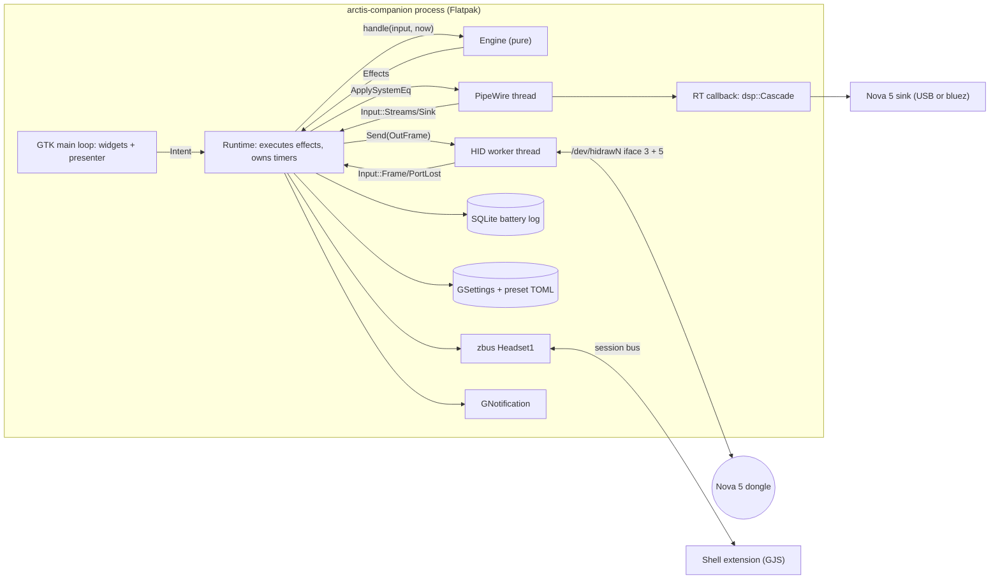
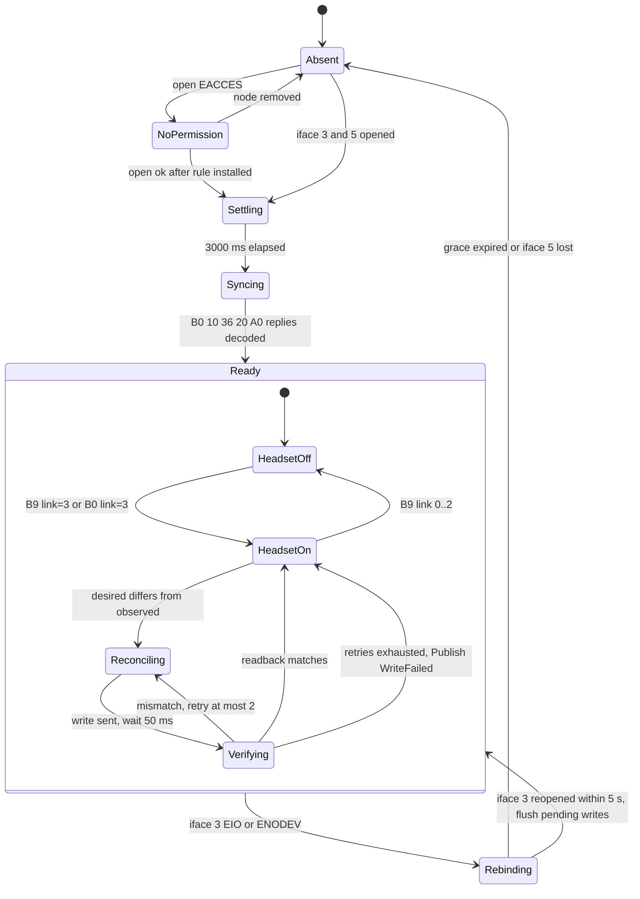
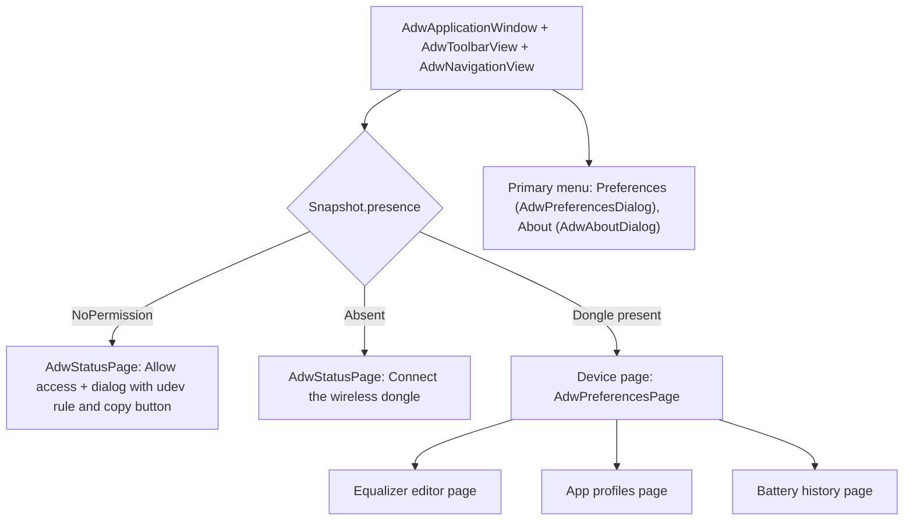
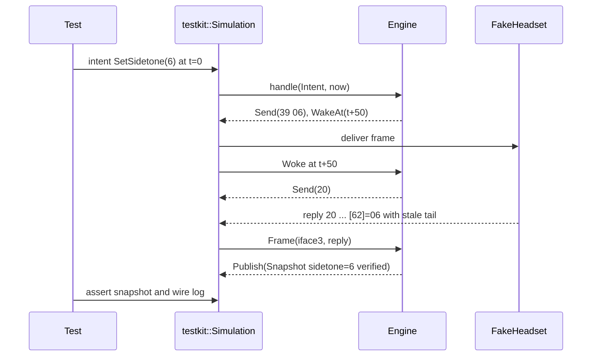
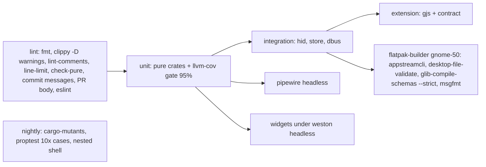
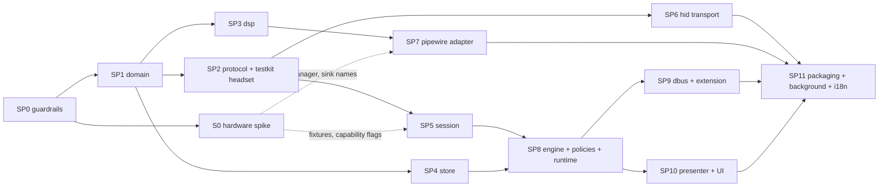

# Arctis Companion: architecture proposal (lens: testability and correctness)

App id `io.github.marcelogm.ArctisCompanion` (written `$APP_ID`). The design follows one rule: **all decisions are made by pure code that takes `(state, input, now)` and returns `(state, effects)`. Threads, file descriptors, PipeWire, GTK and D-Bus only carry out those effects.** Every behaviour below can be checked in CI with fakes and a virtual clock. Hardware is needed only to record fixtures.

## 1. Process model

| Decision | Choice | Rationale |
|---|---|---|
| Device owner | The app process (`GtkApplication`) owns the HID worker, the PipeWire client and the engine | The user chose no daemon. Exactly one owner means no arbitration and no IPC between owners |
| Background | `GApplication` hold, granted by the Background portal (`ashpd`, `RequestBackground{autostart, commandline: ["arctis-companion","--gapplication-service"]}`). GSettings `run-in-background` turns it on or off | Closing the window keeps the process alive, so notifications, history, per-app EQ and the Shell extension keep working |
| Autostart | Set by the portal response. A denial is stored, shown in Preferences and never asked again | HIG "Be considerate" |
| Shell extension data | Session bus, the app's own name `$APP_ID` (Flatpak allows owning it without `--own-name`). Interface `$APP_ID.Headset1`. The extension uses `DO_NOT_AUTO_START` and hides itself when the name has no owner | Respects a user who turned background off. The extension never starts device I/O on its own |
| Notifications | `GNotification` (goes through the portal under Flatpak), produced by a pure `BatteryNotifier` policy | The policy is unit-tested. The shell part only sends and withdraws |
| Open window | `org.freedesktop.Application.Activate` comes free with GApplication. The `.service` file allows D-Bus activation from the desktop | No custom IPC |



## 2. Workspace and seams

Pure crates may not depend on I/O crates. `scripts/check-pure-crates.sh` enforces this by reading `cargo metadata` against an allow-list (`thiserror`, `serde`, `arrayvec`) and by grepping for `std::fs`, `std::thread`, `Instant::now` and `SystemTime::now`. Time enters the pure crates only as `Now { mono_ms: u64, unix_s: i64 }`.

```
crates/
  domain/      PURE  settings.rs eq.rs battery.rs preset.rs app_key.rs now.rs
  protocol/    PURE  frame.rs command.rs reply.rs event.rs eq_wire.rs model.rs  tests/golden.rs  tests/fixtures/*.hex
  session/     PURE  phase.rs input.rs effect.rs session.rs reconcile.rs verify.rs schedule.rs capability.rs
  dsp/         PURE  biquad.rs cascade.rs response.rs crossfade.rs mailbox.rs
  engine/      PURE  engine.rs snapshot.rs intent.rs policy/{app_profiles,battery_notifier,battery_sampling,battery_stats}.rs
  presenter/   PURE  device_page.rs eq_graph.rs history_chart.rs profiles.rs text.rs
  store/       SHELL preset_toml.rs apo_text.rs library.rs battery_log.rs
  hid/         SHELL sysfs_scan.rs hidraw.rs watcher.rs worker.rs
  pipewire/    SHELL registry.rs sink_match.rs eq_node.rs routing.rs worker.rs
  dbus/        SHELL headset1.rs
  testkit/     DEV   fake_headset.rs simulation.rs fake_audio.rs captures.rs
app/           SHELL main.rs application.rs runtime.rs background.rs notifier.rs settings_store.rs i18n.rs widgets/*.rs ui/*.blp
extension/     arctis-companion@marcelogm.github.io/{metadata.json,extension.js,lib/model.js,lib/client.js} tests/*.test.js
data/          gschema, desktop, metainfo, dbus service + Headset1.xml, udev/70-arctis-companion.rules, presets/*.toml
po/            LINGUAS(pt_BR) POTFILES.in pt_BR.po
xtask/         lint-comments, capture (hardware to fixture), check-pure
```

Public interfaces (the seams):

```rust
pub fn encode(command: &Command) -> OutFrame;
pub fn decode_reply(query: Query, frame: &InFrame) -> Result<Reply, DecodeError>;
pub fn decode_event(frame: &InFrame) -> Result<DeviceEvent, DecodeError>;
pub fn model_for(pid: u16) -> ModelLookup;

impl Session { pub fn handle(&mut self, input: SessionInput, now: Now) -> Vec<SessionEffect>; pub fn view(&self) -> DeviceView; }
impl Engine  { pub fn new(persisted: Persisted) -> Self; pub fn handle(&mut self, input: Input, now: Now) -> Vec<Effect>; }

impl Cascade { pub fn design(curve: &EqCurve, rate: f32) -> Self; pub fn process(&mut self, interleaved: &mut [f32], channels: usize); }
pub fn magnitude_db(curve: &EqCurve, rate: f32, hz: f32) -> f32;

pub trait BatteryLog { fn append(&mut self, r: &BatteryReading) -> Result<(), StoreError>; fn range(&self, from: i64, to: i64) -> Result<Vec<BatteryReading>, StoreError>; fn prune_before(&mut self, t: i64) -> Result<(), StoreError>; }
pub fn scan(sysfs_root: &Path) -> Vec<Endpoint>;
pub fn device_page(snapshot: &Snapshot) -> DevicePageModel;
```

`Input` = `PortOpened | PortLost | PermissionDenied | Frame(Interface, InFrame) | Woke | Intent | StreamChanged | SinkChanged`. `Effect` = `Open | Send | WakeAt | Publish(Snapshot) | ApplySystemEq | RouteSystemEq | RecordBattery | Notify | Withdraw | PersistDesired`. The `app/runtime.rs` executor is a single `match` over `Effect`. That keeps every port behind one channel or one trait, so `testkit::Simulation` can swap all of them at once.

Why 11 crates and not 3: each pure/shell boundary is enforced by the compiler. A pure crate that tries to open a file fails to compile. `domain` stays apart from `protocol` because `dsp`, `store` and `presenter` need the EQ types but not the wire format.

## 3. Device lifecycle

**Discovery (inside Flatpak).** The worker watches `/dev` with inotify (`hidraw*` create/delete) and rescans `/sys/class/hidraw/*/device/uevent` plus the parent `bInterfaceNumber`. A 2 s poll is a fallback in case inotify under bwrap turns out to be dead (spike S0 checks this). We use no libudev and no `hidapi`: raw `rustix` open/read/write on the node. The sysfs root is a parameter, so `scan` is tested against fixture trees under `crates/hid/tests/sysfs/`.

**Models.** `protocol::model.rs` holds `0x2232`, `0x2253` (upstream-verified) and `0x2255`, `0x2264` (`Support::Unverified`, so the UI shows a "model not tested" banner). Bootloader PIDs `0x2233/0x2254/0x2265` return `ModelLookup::Forbidden` and are never opened, and a test asserts that. If two dongles are present, the lowest sysfs path wins, deterministically. Multi-device support is out of scope (YAGNI).



- **Re-enumeration every ~20 s** is the `Rebinding` state. The snapshot keeps the last known values and the UI does not flicker. Rebinding sends **no queries**, so the flapping does not turn into a 20 s poll. A full sync happens only from `Absent` or when the link changes to connected.
- **Events vs polling.** iface 5 events (`B7`, `BB`, `B9`, `37`, `39`, `27`, `A3`, `AE`) are primary. `B0` is queried once per sync and then only if no battery event has come for 5 min, and never while a write transaction is in flight. If spike S0 shows that the device sends no events, the same policy runs with `fallback_poll = 60 s`. That value is a constant in `schedule.rs`, so it is tested and not scattered through the code.
- **Write then verify.** One transaction at a time, with 50 ms between commands. Replies are matched by echo byte and decoded with fixed lengths, so stale tails are ignored. The readback table lives in `verify.rs`: `37/39/27/33 → 20`, `A3/AE → A0`, `35 → 36`. We never send HeadsetControl's `09`/`35 01`, and a golden test asserts that no setter emits them. We also never send `A5` or `A7` (YAGNI and unverified).
- **Source of truth: desired-state reconciliation.** The session holds `desired` and `observed: HeadsetSettings`. `reconcile.rs` returns the first differing field as one absolute-value write. Writes are idempotent and there are no toggles, so retry is always safe. Slider drags coalesce on their own because only the latest desired value is ever written. Rules:
  1. On first connect ever (`settings-adopted=false`), observed becomes desired (adoption).
  2. When the headset itself reports a change through an event, desired takes that value. A hardware button press counts as user intent.
  3. On (re)connect or headset power-on, any drift is overwritten with desired. This makes up for headset persistence that may be missing (protocol open question 1).
  4. While the headset is off, intents still update desired. The UI says "Changes apply when the headset turns on".

## 4. Settings model

| Where | What | Format |
|---|---|---|
| Headset (applied, observed) | mic volume 0..15, sidetone 0..10, mute LED raw 0/1/4/10, volume limiter, auto-off minutes, wireless mode, hardware EQ curve (`0x33`) | wire |
| GSettings (desired + app) | `mic-volume`, `sidetone`, `mute-led` (enum), `volume-limiter`, `extended-range`, `auto-off-minutes`, `headset-preset` (id), `settings-adopted`, `run-in-background`, `low-battery-threshold` (15), `notify-full-charge`, `system-eq-enabled`, `system-preset`, `app-profiles-enabled`, `app-profiles` `a{ss}` (AppKey to preset id) | `data/$APP_ID.gschema.xml`. Tests use `GSETTINGS_BACKEND=memory` |
| Files | presets: bundled read-only in gresource, user presets in `$XDG_DATA_HOME/arctis-companion/presets/<id>.toml` | TOML `version = 1`, `name`, `[[filter]] kind freq_hz gain_db q enabled`, at most 10 filters (the hardware limit, so any preset fits either target) |
| SQLite | battery history | `$XDG_DATA_HOME/arctis-companion/history.sqlite3` |

`settings_store.rs` is the only GSettings adapter. It maps keys to and from `domain` types, and `domain` validated newtypes (`Sidetone(u8)` with `TryFrom`) reject out-of-range values at the boundary.

## 5. Equalizer

Two layers, named by where they run:

| Layer | Target | Applies to | Changed by | Why |
|---|---|---|---|---|
| **Headset equalizer** | `0x33` on the dongle (10-filter parametric on hardware) | 2.4 GHz audio, every source (PC, console) | user choice only | Base tuning that stays on the device for consoles. Zero CPU. HID writes are rare, which avoids the glitch risk of issue #452 |
| **Computer equalizer** (opt-in) | in-process `pw_filter` DSP (EasyEffects style) behind a virtual sink created by our client (`support.null-audio-sink` adapter), output `target.object` = Nova sink | this PC only, works the same over the USB sink or the bluez sink | user choice and per-app profiles | Instant switching through a coefficient crossfade, it works on Bluetooth (where `0x34` is unverified), and its objects die with the client, so a crash cannot leave a broken audio graph |

- The two layers stack on purpose: the headset layer is the base and the computer layer adjusts per app. The UI states this in the row subtitles. A Bluetooth headset EQ row shows up only if spike S0 proves that `0x22`/`0x34` read back correctly (capability flag in `capability.rs`).
- The computer layer becomes the default sink only while it is enabled and a Nova sink is present. Otherwise the previous default is restored. Changing the default sink needs `media.category = Manager` (spike S0 checks this against WirePlumber 0.5.18). If it is denied, the UI shows an `AdwBanner` with the manual step. We detect EasyEffects nodes (`ee_*`) and show a warning banner instead of fighting over the default.
- RT safety: the control thread computes `Cascade` coefficients and passes them over a lock-free `mailbox.rs` (an atomic slot swap). The RT callback does not allocate and crossfades for 10 ms. A counting global allocator in the `dsp` tests proves `process` does zero allocations.
- **Shipped presets** (our own curves, CC0, no SteelSeries data): Flat, Bass Boost, Bass Reducer, Vocal Clarity, Footsteps, Treble Soften, Movie Night, Podcast. Import of **Equalizer APO** text (`Filter n: ON PK Fc .. Gain .. Q ..`, which is the AutoEQ format users already have), plus TOML import/export. The official library cannot be shipped; APO import is the replacement.
- **Editor** (`AdwNavigationPage`): an `EqGraph` widget draws `magnitude_db` across 20 Hz–20 kHz (log axis) with a draggable handle per filter. Under it, a boxed list with one `AdwExpanderRow` per filter (type `AdwComboRow`, `AdwSpinRow` for Hz, dB from −10 to +10 in 0.5 steps, Q from 0.2 to 10, enable switch). The header has Save as, Import, Export and Reset. Edits preview live on the computer layer. A headset-layer write waits for a 600 ms debounce, then goes through write-then-verify. Deleting a preset gives an `AdwToast` with Undo. Handle-drag math (`presenter::eq_graph::drag`) is pure and tested.

## 6. Per-app profiles

Detection uses **PipeWire stream properties**, not the focused window. No portal exposes focus, and a focus source would make a core feature depend on the extension. Playback is also what decides what we hear. `pipewire/registry.rs` waits for the node `info` event and emits `StreamChanged{id, app_key, running}`. `AppKey` comes from `pipewire.access.portal.app_id`, then `application.id`, then lowercased `application.process.binary`.

Rules in `engine/policy/app_profiles.rs` (pure, table-tested):
1. Candidates are running streams whose AppKey has a rule. The active profile belongs to the candidate that **started running most recently**. Ties go to the higher stream id.
2. With no candidate, the active preset is `system-preset`.
3. A manual pick (UI or extension) overrides until the set of running ruled apps changes.
4. A 500 ms debounce after the set settles, so notification blips do not switch the EQ.
5. Profiles drive only the computer layer. If that layer is off, the profiles page shows a banner offering to turn it on.

## 7. Battery history

- **Samples:** the `B7`/`BB` events, the `B0` read from each sync, and the 5-min fallback (§3). `battery_sampling.rs` stores **change points only**, plus one heartbeat per hour while connected, so the chart can tell "flat" from "no data". Readings while `link != 3` are dropped.
- **Storage:** `battery_sample(ts INTEGER, percent INTEGER, charge INTEGER, PRIMARY KEY(ts))` in WAL mode, pruned after 90 days at startup. Tests use `:memory:`.
- **Visualization:** a history page with an `AdwToggleGroup` (24 h / 7 d / 30 d) and a `HistoryChart` widget (snapshot drawing, charging spans shaded, with an accessible text summary). `battery_stats.rs` gives the discharge rate and the estimated time left (linear fit of the current discharge segment), which also appear as the header subtitle. `presenter::history_chart` turns samples into path geometry (downsampling, gaps), and the widget only strokes it.
- **Notifications** (`battery_notifier.rs`): low at the threshold and at 5 % (each fires once, re-armed after charging), full charge (optional). The low-battery notification is withdrawn when charging starts.

## 8. UI information architecture (HIG)



| Group / control | Widget |
|---|---|
| Header: battery %, charging, 2.4 GHz link, Bluetooth sink present, time left | custom `BatteryHeader` (symbolic icons + labels, an accessible label on each) |
| Headset off | `AdwBanner` "Headset is off. Changes apply when it turns on." Controls stay sensitive |
| Equalizer: Headset preset / Edit / Computer equalizer / Computer preset / App profiles | `AdwComboRow`, `AdwActionRow` with `go-next-symbolic`, `AdwSwitchRow`, `AdwComboRow`, `AdwActionRow` |
| Mic volume 0..15 | `ScaleRow` (`AdwPreferencesRow` + `GtkScale`, 16 marks, quiet/loud end icons, as in the official app) |
| Sidetone 0..10 | `ScaleRow` with 11 steps, labelled marks Off=0, Low=3, Medium=6, High=10 (positions read from the official screenshot), all steps selectable |
| Mute LED brightness | `AdwComboRow` Off / Low / Medium / High |
| Volume limiter, Extended range | `AdwSwitchRow`. Extended range subtitle: "Lowers microphone quality to increase wireless range" |
| Auto power-off | `AdwComboRow` Never, 1, 5, 10, 15, 30, 45, 60, 75, 90 min |
| Write failure | `AdwToast` "Couldn't apply sidetone" with Retry |
| Preferences dialog | Run in background, Start at login, Low-battery threshold `AdwSpinRow`, Notify when charged |

- **Audio mode 2.4G/Bluetooth** has no known USB command, so it is shown as **read-only status**. HIG: never show a control that does nothing. It is listed as a parity gap in the metainfo.
- **Adaptive:** minimum size 360×294. The device page is a clamped preferences page. The EQ editor uses an `AdwBreakpoint` (`max-width: 550sp`) to switch from graph-beside-list to graph-above-list.
- **Thin widgets:** each widget takes a presenter model and emits `Intent`s. Every user-visible string is a msgid that `presenter::text` returns and the widget layer translates with `gettext`.
- **i18n:** English source, `po/pt_BR.po`, Blueprint strings marked `_()`. CI runs `xgettext` and fails if the POT is stale, runs `msgfmt --check`, and fails on any untranslated pt_BR entry.

## 9. Shell extension (GNOME 50)

Scope: one `SystemIndicator` with a panel icon (battery level of the headset, only while it is connected) and one `QuickMenuToggle` "Arctis Nova 5":

- The subtitle shows the battery % and charging state. The toggle switches the **computer equalizer** on and off.
- The menu has a header (icon, name, link state), radio items for **headset preset** (from `Presets`), and "Open Arctis Companion" (`Activate`).
- No sliders and no per-setting controls (YAGNI; the app has them).

Layout: `lib/model.js` is pure (snapshot to icon name, subtitle and menu items). `lib/client.js` wraps `Gio.DBusProxy` built from the shared `data/dbus/$APP_ID.Headset1.xml`, with an injectable proxy. `extension.js` only wires these to Shell classes, and `disable()` destroys everything.

```xml
<interface name="io.github.marcelogm.ArctisCompanion.Headset1">
  <property name="Presence" type="s" access="read"/>
  <property name="Link" type="s" access="read"/>
  <property name="BatteryPercent" type="i" access="read"/>
  <property name="Charging" type="s" access="read"/>
  <property name="HeadsetPreset" type="s" access="read"/>
  <property name="SystemEqEnabled" type="b" access="read"/>
  <property name="Presets" type="a(ss)" access="read"/>
  <method name="SelectHeadsetPreset"><arg name="id" type="s" direction="in"/></method>
  <method name="SetSystemEqEnabled"><arg name="enabled" type="b" direction="in"/></method>
</interface>
```

Object path `/io/github/marcelogm/ArctisCompanion`. Changes go out as `PropertiesChanged`. `BatteryPercent = -1` means unknown. Methods return a D-Bus error when the device is absent. The interface is versioned in its name (`Headset1`).

## 10. Testing strategy and enforcement



| Layer | Tests | Tooling |
|---|---|---|
| domain, protocol | golden bytes: the live captures from research §7.1 as `tests/fixtures/*.hex`, each encoder against upstream-cited hex, `encode∘decode` round-trip for every curve, a "never panics on any 64 bytes" check, and a check that the forbidden bytes `09`, `35 01`, `A5`, `A7` are never emitted by setters | `cargo test`, `proptest` |
| session, engine | scenario tests in `Simulation` with virtual time: settle 3 s, rebind every 20 s keeps the snapshot and sends no query, EIO in the middle of a write retries after reopen, no events leads to the fallback cadence, mismatched readback gives at most 2 retries then `WriteFailed`, headset-off intents, adoption, event-wins rule. `FakeHeadset` models registers, stale tails, dropped writes, flapping and bootloader PIDs | `cargo test`. `cargo-mutants` nightly on `protocol`, `session`, `engine/policy` (zero surviving mutants is the goal) |
| policies | tables for profile resolution, notifier hysteresis, sampling dedupe, discharge estimate | `cargo test` |
| dsp | at `fc`, \|H\| = gain ±0.05 dB. Flat preset bit-exact identity. Poles inside the unit circle over the whole valid parameter range. No NaN or denormals after 10 s of silence. Zero allocations in `process`. Crossfade continuity (max sample step bound) | `proptest`, counting allocator |
| store | TOML/APO parse and serialize round-trip, rejection of more than 10 filters and out-of-range values, a corrupt user file is reported and skipped, SQLite prune and range | tempdir, `:memory:` |
| hid | `scan` against sysfs fixture trees (Nova 5, 5X, bootloader, two dongles, missing iface 5); `hidraw` over a `socketpair` standing in for the node; watcher via inotify on a tempdir | `cargo test` |
| pipewire | `sink_match` and AppKey extraction as pure tables. Integration: headless `pipewire` + `wireplumber` in `dbus-run-session`, a null sink named like the Nova, `pw-play` with `application.process.binary=test-app`. Assert the stream is detected, the EQ node routes to the sink, and the sink monitor capture matches `magnitude_db` within ±0.5 dB at 1 kHz with a sine | CI job `pipewire` |
| dbus | p2p zbus over `UnixStream::pair` against a fake engine handle. Contract test: runtime introspection equals `Headset1.xml` | `cargo test` |
| presenter | snapshot to page model for every presence and link state, sidetone marks, chart geometry, drag math | `cargo test` (no GTK) |
| widgets | `#[gtk::test]`: a model sets row values, a row change emits the right `Intent`, every focusable widget has an accessible name (tree walk), every presence state shows the expected page | Fedora 44 container, `weston --backend=headless`, `GDK_BACKEND=wayland` |
| extension | `gjs -m` + Jasmine unit tests for `model.js`. `client.js` against `arctis-dbus-fake` (a test binary serving canned snapshots) in `dbus-run-session`, which is a cross-language contract test. ESLint `complexity: 8` | CI job `extension`. Nested-shell smoke test nightly (`gnome-shell --devkit` needs `mutter-devkit`, UNVERIFIED on runners) |
| hardware | `cargo xtask capture`: read-only plus allow-listed writes, run by the user, writes hex fixtures with metadata. Never in CI | manual |

**CI (GitHub Actions)**, all on `ubuntu-latest` with a `fedora:44` container where GTK/PipeWire are needed:



**Enforcement of the user rules:**
- **No comments:** `cargo xtask lint-comments` tokenizes Rust with `ra_ap_rustc_lexer` and fails on any `LineComment`/`BlockComment`, doc comments included. JS is checked with acorn's `onComment`. Blueprint, TOML, YAML, shell and XML are checked by line rules that allow only the shebang. It runs in pre-commit and in CI.
- **400 lines:** the existing `scripts/check-line-limit.sh` in pre-commit and CI, for every language.
- **Complexity:** `[workspace.lints.clippy]` `cognitive_complexity = "deny"` (threshold 10 in `clippy.toml`), `too_many_lines = "deny"` (40), `excessive_nesting` (3), `too_many_arguments` (4), `unwrap_used = "deny"` outside tests, `#![forbid(unsafe_code)]` everywhere except `hid` and `pipewire`. ESLint `complexity` 8 and `max-depth` 3.
- **Commits/PRs:** the existing `commit-msg` hook, plus a CI job that checks the conventional-commit regex over the PR range and rejects attribution text in commits and in the PR body.
- **Docs:** `docs/architecture.md` (mermaid only, each node naming its `crates/...` path) and ADRs in `docs/adr/` for the decisions in §1–§6. A CI check fails if a path cited in the docs no longer exists.

## 11. Sub-projects



| Id | Scope | Acceptance criteria | Parallel wave |
|---|---|---|---|
| SP0 | Workspace, empty crates, CI pipeline, `xtask lint-comments`, `check-pure`, clippy config, commit/PR checks | CI green. A fixture file with a comment, one with 401 lines, a pure crate pulling `std::fs`, and a commit with an attribution trailer each make CI fail | 1 |
| S0 | Hardware spike (user-run, read-only first): inotify in bwrap, iface 5 events (press buttons), persistence after power cycle, sidetone/LED mapping, `0x22`/`0x34`, Manager role, bluez sink name, cause of the rebind | Hex fixtures and a findings section added to `docs/research/hid-protocol.md`. Every UNVERIFIED item §3 depends on is resolved or has an explicit fallback | 1 |
| SP1 | `domain` newtypes, EqCurve, Preset, Now | 100 % line coverage. Each invalid range is rejected by a test | 2 |
| SP2 | `protocol` codec, model table, `testkit::FakeHeadset` | Every live capture decodes. Every command matches its cited hex. Forbidden-byte test passes. Proptests pass | 3 |
| SP3 | `dsp` biquads, cascade, response, mailbox, crossfade | All dsp numeric tests in §10 pass, including zero allocations | 3 |
| SP4 | `store` TOML/APO presets, bundled presets, SQLite log | Round-trips pass. The 8 bundled presets load. A corrupt file is reported, not fatal | 3 |
| SP5 | `session` state machine, reconcile, verify, schedule | Every scenario in §10 passes in `Simulation`. cargo-mutants leaves no survivors | 4 |
| SP6 | `hid` scan, hidraw, watcher, worker | Fixture trees pass. On the real dongle, `xtask capture` survives 10 min of iface 3 flapping with zero lost writes | 4 |
| SP7 | `pipewire` registry, EQ node, routing | The headless CI job passes. Manual check: no xruns at 48 kHz/256 for 30 min | 4 |
| SP8 | `engine` + policies + `app/runtime.rs` | End-to-end `Simulation` runs connect → sync → set preset → app profile switch → low battery notify → rebind, and every effect is asserted | 5 |
| SP9 | `dbus` Headset1 + extension | Contract tests pass in Rust and GJS. ESLint is clean. The extension disables cleanly (no leaked signals in the nested-shell smoke test) | 6 |
| SP10 | `presenter` + widgets + Blueprint, all pages in §8 | Presenter tests cover every presence state. Widget tests pass headless. Every focusable widget has an accessible name. No file over 400 lines | 6 |
| SP11 | Flatpak manifest (`--device=all`, `--filesystem=xdg-run/pipewire-0`, no `--socket=session-bus`), udev rule + permission dialog, Background portal, metainfo, pt_BR | The Flatpak builds in CI. Validators pass. pt_BR is 100 % translated. A fresh-VM checklist is run by the user | 7 |

SP2, SP3 and SP4 run in parallel. So do SP5, SP6 and SP7, and SP9 and SP10. SP10 can start as soon as the `Snapshot` and `Intent` types are frozen in SP8's first PR. S0 runs alongside everything and changes only fixtures and capability flags. The architecture assumes nothing that S0 could overturn without a fallback that is already designed.
